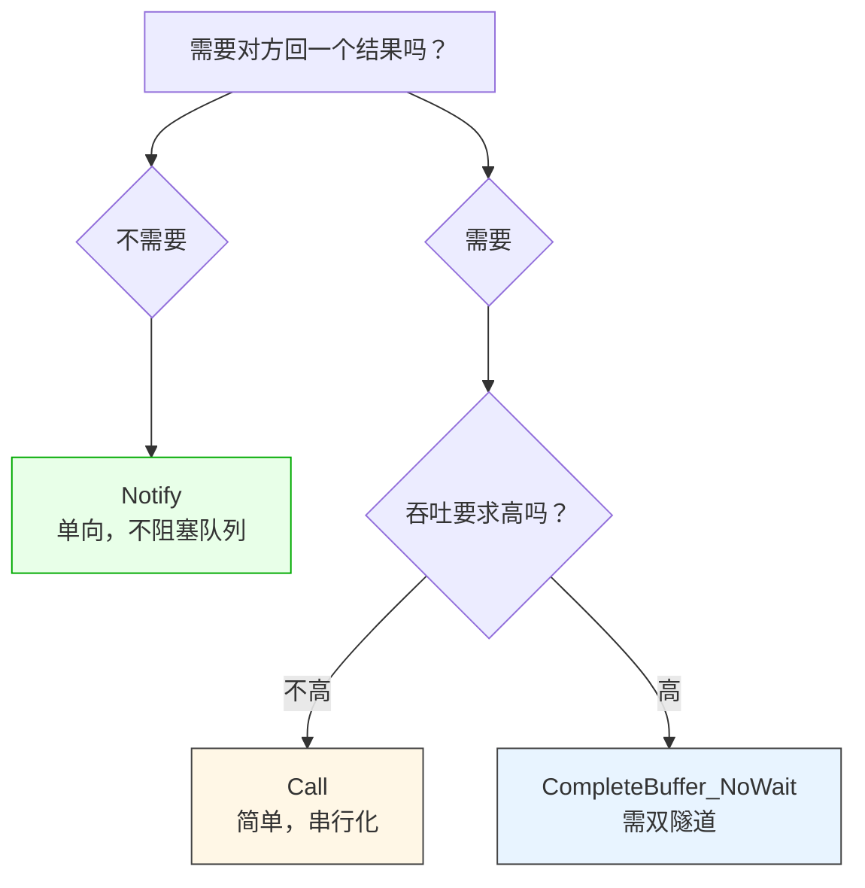
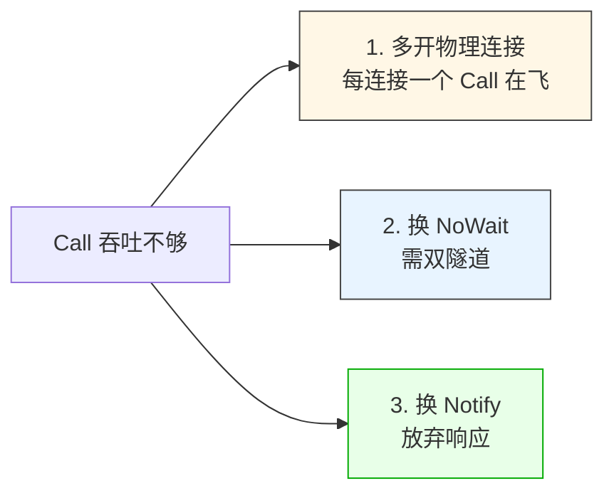

# LF_Cmd_Model_Choice.md

> 做 LF 应用第一天就要面对的选择：**Notify 还是 Call**。
>
> 这两者不是"同步/异步"的差别，是**协议模型的差别**。`Call` 是请求-响应，一个 IO 同时只能有一个在飞（`FWaitOnResult` 卡住队列）；`Notify` 是单向通知，发完就走，完全不受这个标志影响。所以架构层面的推论是：**用 Call 你的吞吐上限 = 单个连接的最慢往返；用 Notify 才能把连接用满**。而第三条路——`CompleteBuffer_NoWait_Stream`——是 LF 为"既要响应又要高吞吐"准备的优化，代价是必须开双隧道。

---

## 三条路的取舍

| 模型 | 有响应 | 阻塞队列 | 需要双隧道 | 典型场景 |
|------|:------:|:--------:|:----------:|---------|
| **Notify** | ❌ | ❌ | ❌ | 日志上报、指标推送、事件广播 |
| **Call** | ✅ | ✅ | ❌ | 查询、配置拉取、低频 RPC |
| **CompleteBuffer_NoWait** | ✅ | ❌ | ✅ | 高频 RPC、游戏帧同步、实时指令 |

**关键差异在于"阻塞队列"这一列**。`Call` 发出的那一刻，整个 `FSend_Queue_Pool` 就停摆了，直到响应回来。`Notify` 和 `NoWait` 都不会碰 `FWaitOnResult`，队列能一直流动。

---

## Notify 的代价：没有确认

`Notify` 不阻塞队列是因为它**不保证送达**。发出去就忘了，对端崩了、网络断了、处理失败了，发送方一概不知道。

所以 `Notify` 只适合"丢了也不影响正确性"的场景——日志、指标、事件。任何"必须确认"的业务逻辑都不能用 `Notify`。需要顺序的话用 `Sequenced_Notify`（走顺序线程池，FIFO 保证），但仍然没有确认。

---

## Call 的代价：吞吐上限

`Call` 的简单性值得肯定——调用方阻塞、拿到结果、继续，心智负担低。但它的瓶颈是明确的：**吞吐上限 = 单连接最慢的那次往返**。

1000 个并发请求，用 `Call` 就是 1000 次串行的往返。这不是 LF 的实现问题，是**模型本身**决定的——它就不设计成并发。

想突破这个上限有三条路：

**第一条（多连接）**是最朴素的——客户端连 10 个服务器、或者对同一服务器开 10 条物理连接，每条一个 `Call` 在飞，总吞吐 ×10。适合"我就是要用 Call 的简单性，但吞吐不能太低"的场景。

**第二条（NoWait）**是 LF 为这个需求准备的优化——请求走一个隧道、响应走另一个隧道，两个方向互不阻塞。代价是**必须配置双隧道**（`DoubleChannelFramework`），配置量比单连接大。

**第三条（Notify）**是根本性放弃——不需要响应就别要。很多业务其实不需要同步响应，只是"习惯性地用了 Call"。

---

## 一个容易忽略的事实

`Call` 超时之后，`FWaitOnResult` **不会自动复位**。这意味着一次超时，后续所有 `Call` 都发不出去，这条连接就废了。所以用 `Call` 的应用必须做**超时后的重连**——不是"再试一次"，是"断开连接重建"。

`Notify` 和 `NoWait` 没有这个问题，因为它们不设置 `FWaitOnResult`。

---

## 陷阱速查

| 症状 | 根因 | 修复 |
|------|------|------|
| Call 吞吐上不去 | `FWaitOnResult` 串行化 | 多连接或换 NoWait |
| Call 超时后全连接卡死 | `FWaitOnResult` 没复位 | 超时后重连 |
| Notify 丢消息 | 设计如此，无确认 | 需要确认用 Call |
| Notify 顺序乱 | 不走顺序线程 | 需要 FIFO 用 `Sequenced_Notify` |
| NoWait 报错 | 没配双隧道 | 配置 `DoubleChannelFramework` |
| 不知道用什么 | 习惯性用了 Call | 先问"要不要响应"，再问"吞吐够不够" |

---

## 最后一句

选模型的时候，**先问"要不要响应"，再问"吞吐够不够"**。两个问题答完，模型就定了。剩下的都是配置层面的事——多开连接、配双隧道、换 Sequenced 变体。

反过来说，很多性能问题不是 LF 慢，是**用错了模型**。1000 次 Call 串行不是 LF 的错，是 Call 本来就不做并发。想清楚这一点，比事后调参有用得多。