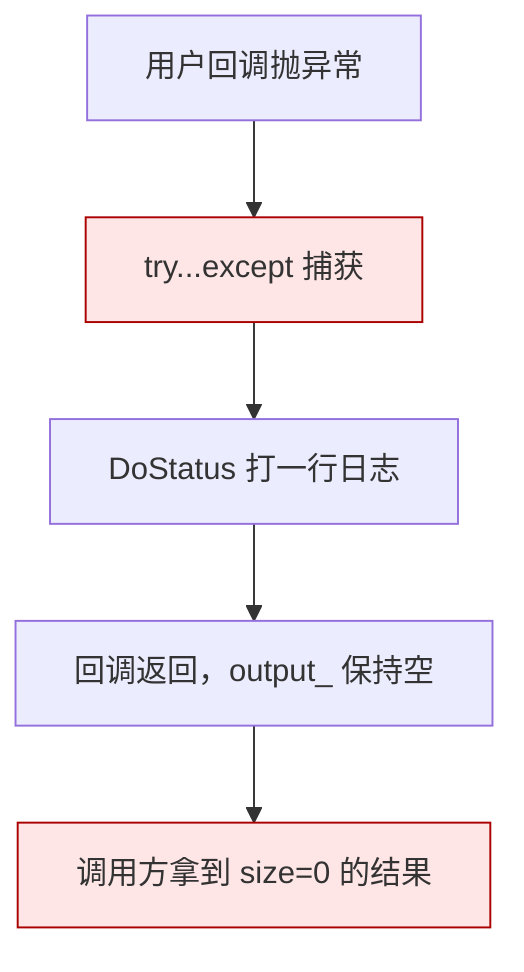
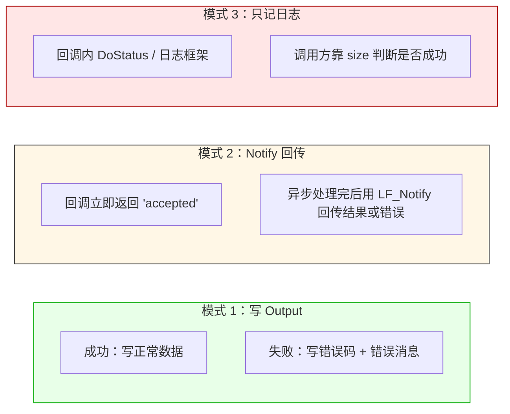

# LF_Error_In_Callback.md

> LF 的回调里**抛异常等于没抛**。
>
> `TLF_Engine.Execute_Call` 把用户回调整个包在 `try...except` 里，异常被吞掉、打一行 `'execute call-mode api "%s" (stdcall) execpet!'` 到日志、然后正常返回——调用方拿到的是一个**空的、大小为零的结果**，看上去就像"这次调用成功了但什么也没干"。这个设计不是疏忽，是跨语言回调的必然结果：C ABI 边界上没有统一的异常传递机制，Pascal 异常不能传到 Python，Python 异常不能传到 Rust，所以 LF 干脆全部吞掉，把"错误怎么传"这件事留给协议层。

| 你以为的 | 实际发生的 |
|---------|-----------|
| 回调抛异常，调用方收到错误 | 异常被吞，调用方拿到 size=0 的空结果 |
| size=0 就是"没找到 API" | size=0 可能是"没找到"、"回调异常"、"超时"三种之一 |
| 日志里能看到异常 | 能看到，但只有一行 `execpet!`，没有堆栈、没有错误详情 |
| 异常会向上传播 | 不会，`Execute_Call` 内部消化掉了 |

**怎么正确报错**：在回调里用**协议层**传错误，不要用异常。常见的三种模式：

**模式 1** 适合短任务——直接在 Output 里写一个"状态字节 + 数据"或者"状态字节 + 错误字符串"，调用方读第一个字节判断成功失败。最省事，也最可控。

**模式 2** 适合长任务——回调立即返回 task_id，调用方通过 task_id 追踪进度。但这个模式要求调用方那边有个地方存 task_id 到回调的映射，工程量大一些。

**模式 3** 只适合"错误不影响调用方决策"的场景，比如心跳、指标上报。**不要用这个模式处理业务逻辑错误**——调用方分不清"成功了但没返回数据"和"失败了"。

**代价**：所有错误处理都必须在**应用层协议**里做。LF 不提供 `LF_Call` 的 `try...catch` 语义，因为跨语言的异常传递本身就是没有统一标准的。

**一个后果**：如果你用 `LF_Call` 只判断"返回 size 是不是 0"，那你就分不清"对端没注册 API"、"对端回调崩了"、"对端超时"——三种情况返回的都是 size=0 的句柄。正确的做法是让协议层带上状态码：`Output.WriteUInt8(0)` 表示成功，`Output.WriteUInt8(1)` + 错误消息表示失败。调用方读第一个字节就能区分，这才是 LF 推荐的用法。