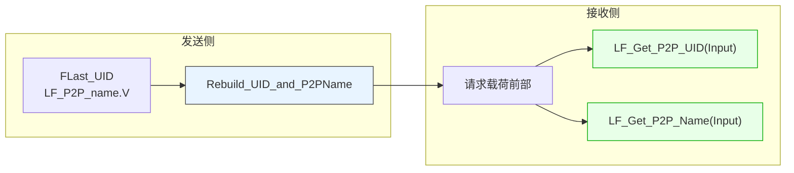
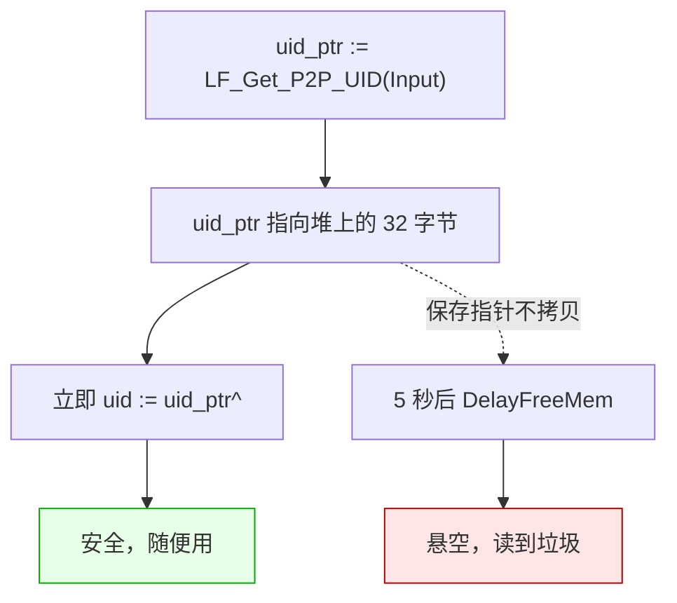
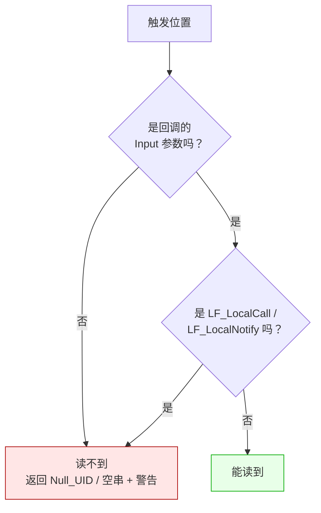

# LF_P2P_Identity.md

> LF 里有个东西叫"P2P 身份"，也就是 UID 和 P2PName。
>
> 这两个东西最容易让人误解的地方是：它**不是查出来的，是送过来的**。这一篇就把这个"送"的过程说清楚。

---

## 一句话本质

身份是**发送方在发请求时顺手写进载荷的元数据**，接收方只是把它读出来而已。



关键在于：**如果发送方没写进去，接收方就永远读不到**。所以那些"读不到身份"的场景，根本原因是这个请求压根没有发送方。

---

## 发送方到底写了什么

写进去的就三样东西，按顺序排在业务参数前面：

```
[apiName: string]
[FromUID: 32 bytes]         ← FLast_UID
[FromP2PName: string]       ← LF_P2P_name.V
[Param.Size: Int32]
[Param: bytes]              ← 真正的业务数据
```

这段是 `TMemory_Param_Tool.EncryptToMem` 干的活。所有 `Send_*` 系列方法都会调一次 `Rebuild_UID_and_P2PName`，把 `FLast_UID` 和 `LF_P2P_name.V` 塞到业务参数前面。

所以只要请求走的是 `Send_*`，就一定带身份。不走 `Send_*` 的，就没带。

---

## 读的时候有一层陷阱

`LF_Get_P2P_UID` 的返回值不是 32 字节的数组，是**指向 32 字节的指针**。这是个改动过的接口，旧文档可能还写着"返回值"，那种描述是错的。

源码是这样的：

```pascal
function LF_Get_P2P_UID(Hnd: TDataHnd___): PP2P_UID___;
begin
  New(Result);                                  // ← 在堆上分配
  if (Hnd <> nil) and (PLF_Data(Hnd)^.Data_Param <> nil) then
      Result^ := PLF_Data(Hnd)^.Get_P2P_UID()
  else Result^ := Null_UID();
  DelayFreeMem(5.0, Result);                    // ← 5 秒后自动释放
end;
```

这意味着：



**调用者只做一件事**：解引用，拷贝，完事。不手动释放，不长期保存。

Name 那边也是同样的 5 秒规则，只是返回的是 `PAnsiChar`，拷贝方式更直白——大多数语言里对应一个字符串赋值就够了。

---

## 哪些位置读得到，哪些读不到

这一部分最容易出错，因为直觉上你会觉得"句柄就在手里，读个身份有什么难"。事实上 LF 把能读的位置收得很紧。



| 位置 | 能读？ | 为什么 |
|------|:------:|--------|
| `On_Call(Trigger, Input, Output)` 的 `Input` | ✅ | 从网络接收，带侧数据 |
| `On_Notify(Trigger, Input)` 的 `Input` | ✅ | 同上 |
| `LF_Call` 命中本地短路的回调 `Input` | ✅ | 走了 `Send_*` 路径 |
| `LF_LocalCall` / `LF_LocalNotify` 的回调 `Input` | ❌ | **没走 `Send_*`，没注入** |
| `OnResult` 回调的 `Result_` | ❌ | 是输出句柄，没有 `Data_Param` |
| 自己 `LF_CreateData` 创建的句柄 | ❌ | 没有发送方 |

读到不该读的地方时，LF 不是静默返回空值，它会在日志里打一行警告：

```
[warning] Get_P2P_UID(): P2P Info only backcall "input" parameter.
```

看到这行警告，就说明读错了位置。

---

## 为什么本地调用读不到

这一条最反直觉，单独说一下。

`LF_LocalCall` 的源码走的是：

```pascal
function LF_LocalCall(appHnd, Param): TDataHnd___;
begin
  tmp := TMem64.Create;
  PLF_Data(Param).Data_Param.EncryptToMem(tmp);   // ← 直接编码，没有 Rebuild
  PLF_Data(Param).Begin_Call;
  Result := TLF_Data.New_Result_From(app.Engine.Execute_Call(tmp), True);
  ...
end;
```

注意这里调的是 `EncryptToMem`，不是 `Rebuild_UID_and_P2PName`。`EncryptToMem` 只是把当前句柄里已有的 `FromUID` / `FromP2PName` 编进去——而你自己用 `LF_CreateData` 创建的句柄，这两个字段是空的（`Null_UID()` / 空串）。

对比一下，`LF_Call` 走的是：

```pascal
tmp_param := TMemory_Param_Tool.Rebuild_UID_and_P2PName(Param, FLast_UID, LF_P2P_name.V);
```

`Rebuild_UID_and_P2PName` 会**用当前客户端的 UID 和 P2PName 覆盖**句柄里的字段。所以走 `LF_Call` 的请求，无论最后是本地短路还是走网络，身份都是对的。

这也是一个取舍。`LF_LocalCall` 被设计成"纯进程内调用"，不掺和任何网络身份的概念——如果要身份，用 `LF_Call`，反正会本地短路，成本一样。

---

## 各语言里怎么读

规则统一，只是语法不一样。列几个常见的：

| 语言 | UID | P2PName |
|------|-----|---------|
| Pascal | `uid := LF_Get_P2P_UID(Input)^` | `name := LF_Get_P2P_NameEx(Input)` |
| Python | `uid = inp.get_p2p_uid()`（内部已拷贝成 `bytes`） | `name = inp.get_p2p_name()` |
| C++ | `auto uid = inp.getP2PUid()`（返回 `std::array<uint8_t,32>`） | `auto name = inp.getP2PName()` |
| C# | `var uid = input.P2PUid` | `var name = input.P2PName` |
| Rust | `let uid = input.p2p_uid()` | `let name = input.p2p_name()` |
| Go | `uid, _ := inp.GetP2PUID()` | `name, _ := inp.GetP2PName()` |
| Java | `byte[] uid = in.getP2pUid()` | `String name = in.getP2pName()` |
| Node.js / TS | `const uid = inp.getP2PUid()` | `const name = inp.getP2PName()` |

绑定层都已经帮你把指针解引用、拷贝这一步做完了。你拿到的就是原生对象，不需要操心 5 秒的事。

需要自己接裸指针的场景，比如写 NIF、写 C 扩展、手搓 Julia 的 `ccall`，才需要自己处理"解引用 + 立即拷贝"这套流程。

---

## 陷阱速查

| 症状 | 根因 | 修复 |
|------|------|------|
| 身份读出来全是 0 | 在 `Output` 或自建句柄上调用 | 只在回调的 `Input` 上读 |
| 日志里出现 `P2P Info only backcall "input" parameter` | 同上 | 同上 |
| `LF_LocalCall` 里读不到身份 | 不走 `Rebuild_UID_and_P2PName` | 需要身份时改用 `LF_Call` |
| 拿到的 UID 是乱码 | 把指针当成数组用了 | `uid := uid_ptr^` 再拷贝 |
| 5 秒后 UID 变成垃圾 | 保存了指针没拷贝 | 立即拷贝，别存指针 |
| 发送方设置了 `LF_P2P_name` 但接收方拿到的还是空 | 设置之后没等 `Update_UID_Info` 上报 | 设置完至少等一个 `Progress` 周期 |
| 高频调用后内存慢涨 | 每次 `LF_Get_P2P_UID` 都 `New` + `DelayFreeMem` | 回调内调一次，缓存值 |

---

## 最后一句

P2P 身份的设计其实很朴素：**发送方顺手带上，接收方顺手读走**。所有的"读不到"、"读到空"、"读到垃圾"，都能归结成两种原因——

**要么这个请求压根没有发送方（本地调用、自建句柄），要么你读的位置不对（输出句柄）。**

想清楚这一点，剩下的都是细节。