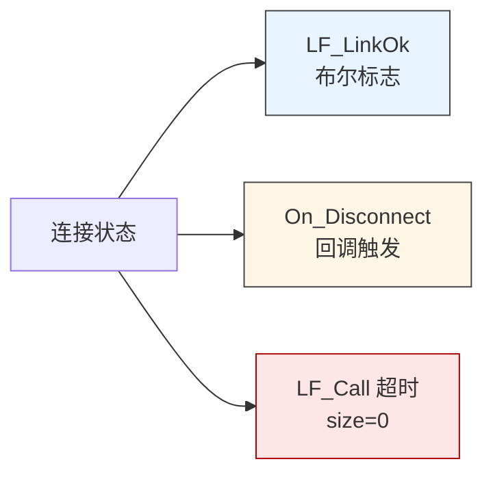
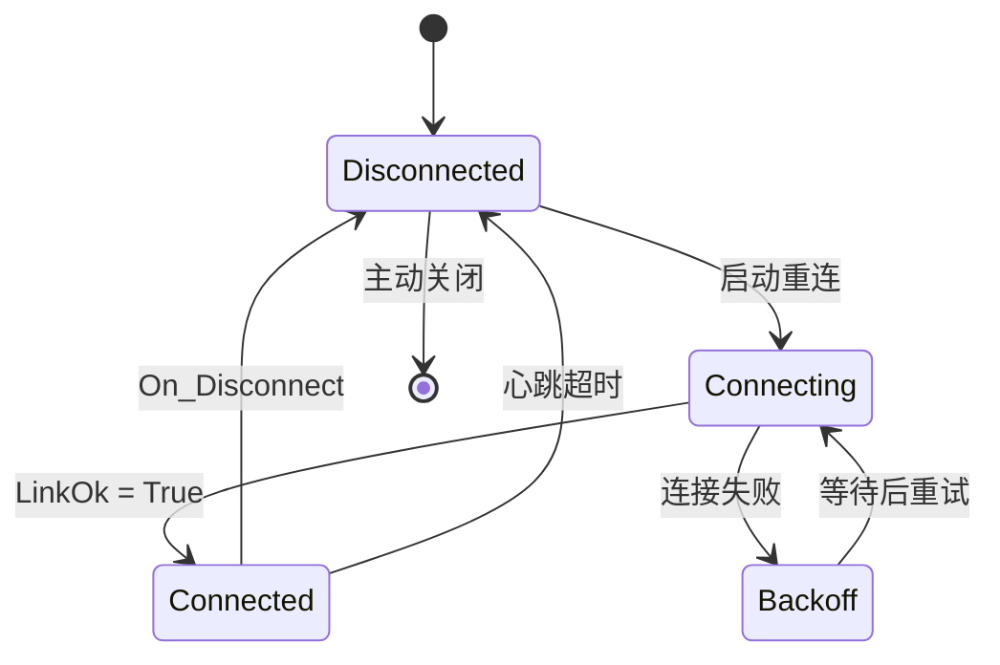
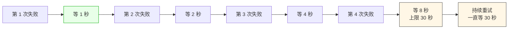
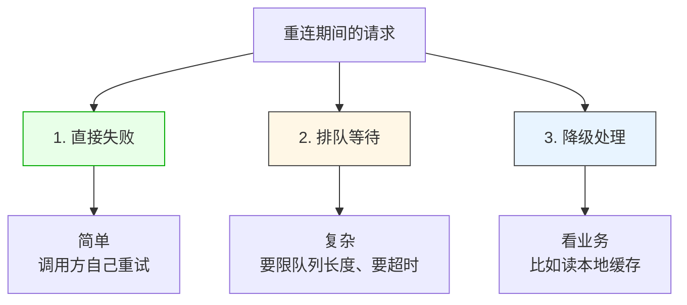
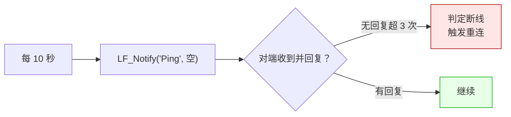

# LF_Reconnect_Strategy.md

> LF 给你的是"断线"信号，不是"重连"行为。
>
> `LF_LinkOk` 变 False、`On_Disconnect` 回调触发、`LF_Call` 超时返回空——这些都只是**告诉你连接没了**。什么时候重连、重连几次、重连期间请求怎么办，LF 一概不管。这一篇说清楚"应用层该怎么接这根线"。

---

## 断线的三个信号

LF 不抛异常，所以你得从三个地方判断"连接是不是还活着"：

| 信号 | 时机 | 可靠性 |
|------|------|--------|
| `LF_LinkOk` 变 False | 物理断开或 TunnelLink 失败 | 准，但轮询有延迟 |
| `On_Disconnect` 回调 | 物理链路断开瞬间 | 准，但是异步的 |
| `LF_Call` 超时 | 发出请求后没响应 | 最慢，可能是网络卡也可能是对端挂了 |

**实践上三个都要用**：`On_Disconnect` 做即时反应（清理状态），`LF_LinkOk` 做轮询兜底，`LF_Call` 超时做最后的手段（顺带触发重连）。

---

## 重连的完整状态机

**关键点**：`Backoff` 那个状态不能省。没有退避的重连会变成**重连风暴**——服务端挂了，1000 个客户端同时重连，服务端刚起来又被压垮，客户端又失败，循环往复。

---

## 退避策略

指数退避，封顶 30 秒。上界别太小——太小等于没退避；也别太大——太大客户端恢复太慢。

**建议加上随机抖动**：`wait = base * 2^n + random(0, base)`。抖动能把"同时失败的客户端"分散开，避免它们在同一秒重连。

---

## 重连期间的请求怎么办

这是应用层最头疼的地方。三个选择：

**选 1（直接失败）** 最省事。`LF_Call` 返回空，应用层立即返回错误。前提是调用方有重试逻辑——但重试逻辑放调用方往往更好，因为调用方知道这个请求重不重要。

**选 2（排队等待）** 需要小心。队列必须有上限，否则服务端挂 10 分钟，客户端内存涨 10 分钟。还要给排队请求设超时——超过 30 秒还没发出去的请求应该直接判失败。

**选 3（降级处理）** 适合读操作——读失败就读本地缓存，别阻塞主流程。写操作不适合降级，写失败必须明确告诉调用方。

**三个选择的共同点是：不能吞掉**。重连期间请求失败是正常的，但调用方必须知道它失败了。LF 的 `LF_Call` 超时返回 size=0，这是"正常响应"，不是错误——应用层必须自己包装一层状态码，把"超时"和"对端返回空"区分开。

---

## 心跳：别等 `LF_Call` 超时

`LF_Call` 超时是最慢的断线信号——它要等完整的一次往返超时（默认 30 秒）。业务流量大的时候还行，没流量的时候就变成"半小时才发现连接挂了"。

**主动心跳**是更快的方案：

心跳用一个轻量的 API——比如 `Ping` / `Status` 之类，不要挂业务逻辑。频率 10~30 秒，连续 3 次没回应就判死。这个参数自己调，越短发现越快，但流量越大。

**Heartbeat 有个副作用**：心跳本身也是 `Notify` 或 `Call`，会走队列。如果业务请求把队列堵死了（比如大批 `Call` 串行），心跳也发不出去，就会误判断线。所以要确保心跳**不跟业务抢队列**——用单独的 P2PName，或者用 `Notify`（不阻塞队列），或者接受这个误判（队列堵死本来也等同于断线）。

---

## 陷阱速查

| 症状 | 根因 | 修复 |
|------|------|------|
| 服务端重启后客户端全部卡住 | 客户端没检测到断线 | 加心跳或监听 `On_Disconnect` |
| 服务端刚起来又被压垮 | 重连风暴 | 指数退避 + 随机抖动 |
| 重连期间内存暴涨 | 请求排队没上限 | 队列设上限 + 请求超时 |
| 半小时才发现断线 | 没流量，`LF_Call` 没超时 | 加心跳 |
| 重连一直失败 | 端点变了（服务端换端口） | 应用层配置重新拉取 |
| 重连后请求发到旧连接 | 清理不彻底 | `On_Disconnect` 里清空应用层状态 |

---

## 最后一句

LF 提供的是"**断线的检测手段**"——`LF_LinkOk`、`On_Disconnect`、心跳。重连行为本身是应用的职责，因为只有应用知道"哪些请求可以重试、哪些不行、重试几次、退避多久、重连期间怎么降级"。

把这个边界想清楚，重连就不会变成一件玄学的事——它只是应用层一个普通的有限状态机，退避、抖动、队列上限、请求超时，都是标准工程手段。