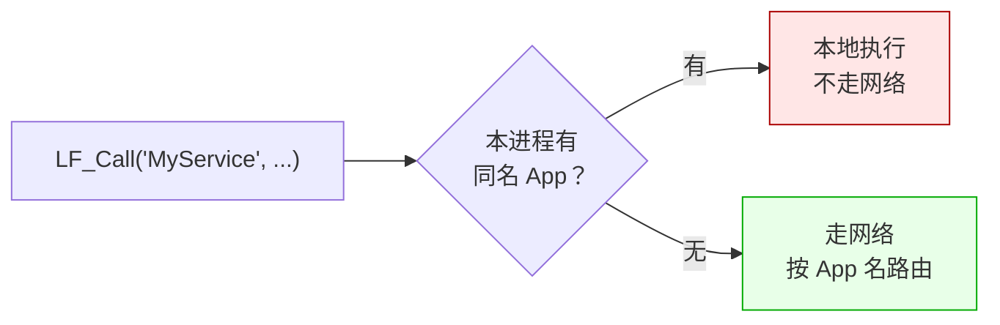
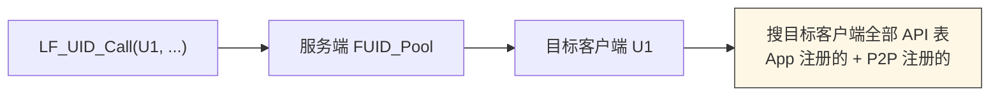

# LF_Route_Choice.md

> 用 LF 做应用，第一件事就是选路由：`LF_Call`、`LF_UID_Call`、`LF_P2PNAME_Call`。这三个不是"版本",是**三种语义**——App 名找服务，UID 找客户端，P2PName 找一组。选错了不会报错，会默默跑偏。这一篇把"什么时候选哪种"和"它们各自的暗坑"说清楚。

---

## 一张表定决策

| 你的需求 | 用哪个 | 一句话 |
|---------|--------|--------|
| 固定服务名，谁在跑都行 | **App 名** | 按服务名找，本地优先 |
| 定向到某个具体客户端 | **UID** | 会话级定位，能调它的**任何** API |
| 一组同质 worker，任一处理 | **P2PName** | 组内负载均衡，不做本地优先 |
| 纯进程内调用 | **`LF_LocalCall`** | 不注入身份，不路由 |

选完还有一个隐藏决策：**同名的 App 在本进程里也注册了吗？** 如果注册了，`LF_Call` 会**本地短路**，压根不出网络。

---

## 本地短路：最容易被咬的地方

这是 LF 的**路由优化**——省一次网络往返。但对做应用的人来说，它有一个副作用：**多节点部署时，如果服务端进程里也注册了同名 App，客户端发来的请求会被服务端就地处理，压根不转发给后端的 worker 集群**。

这带来的典型 bug 是：

- 本地开发时**一切正常**——单进程自测，反正就一个进程
- 部署到服务器后**部分请求处理慢了、部分快了**——因为流量被分成了两部分，一部分本地处理，一部分转发

更隐蔽的是：**服务端的 App 和客户端的 App 同名时**，服务端的 App 会"截胡"本该转发给远端 worker 的请求。这个设计是**故意**的（"服务器能本地处理就别转发"），但对不熟悉的人来说就是**行为不一致**。

---

## UID 万能路由的代价

UID 的最大卖点是**能调目标客户端的任何 API**，包括通过 P2P 注册的、App 注册的，全都命中。这很爽，但也有代价：**它绕过了 App 名的边界**。

这个"全部"是双刃剑：
- 好处：不需要知道目标用哪个 App 名注册的
- 坏处：**目标客户端的 API 表里只要有同名 API，就会被调通**——哪怕那个 API 是"内部工具"、"调试用"，设计时不希望被外部调用

所以在做应用时，**P2P 注册的 API 应该视为"公开但需谨慎"的接口**，不要把内部用的东西挂在 P2P 上。

---

## P2PName 的不对称

P2PName 是"组"的概念，多个客户端设同一个 P2PName 就成了一组。请求发过去，服务端按 `Cycle_Anchor` 或 `FixedSequenced` 选一个处理。听起来跟 App 名很像，但有一个**关键差异**：

| 维度 | App 名 | P2PName |
|------|--------|---------|
| 本地优先 | ✅ | ❌ |
| 命中 P2P 注册的 API | ❌ | ✅ |
| 负载均衡 | 无（App 名唯一） | ✅ |
| 粘性 | 无 | ✅（20 秒） |

**App 名调用不会命中 P2P 注册的函数**。这意味着：如果你把 API 注册到 `LF_P2P_APP`（进程级的全局 App），App 名调用**找不到它**。要用 UID 或 P2PName 调。

这个不对称对做应用的人影响很大：**要让一个 API 既能被 App 名发现，又能被 UID 命中，就必须注册到业务 App 上，不能注册到 P2P**。反过来，P2P 注册适合"工具函数"——比如 `whoami`、`Status`、`Ping` 这类，不挂业务 App、通过 UID 或组名就能调到。

---

## 三条规则记住它

1. **业务 API 注册到业务 App 上**——这样它既能被 App 名命中，又能被 UID / P2PName 命中。
2. **工具类 API 注册到 P2P**——比如 `whoami`、`Status`、`Ping`，只暴露给 UID / P2PName 调用。
3. **多节点部署时想清楚"服务端要不要注册业务 App"**——注册了就会被本地短路截胡，不注册就把所有请求转发出去。

---

## 陷阱速查

| 症状 | 根因 | 修复 |
|------|------|------|
| 单进程正常，多进程部分慢 | 服务器本地短路截胡 | 服务端不注册业务 App，或改成 UID / P2PName |
| App 名调 P2P 注册的 API 失败 | 路由不对称 | 把 API 注册到业务 App 上 |
| `LF_Call` 明明发了请求却没到对端 | 本地短路 | 确认本进程没有同名 App |
| 多节点时同名 App 收到两倍流量 | 每个节点都有自己的本地短路 | 用 UID / P2PName 定向 |
| 想"广播"到一组 worker，但只到了一个 | 用了 App 名 | 改用 P2PName |
| P2PName 顺序不严格 | 服务端可能在多个 UID 之间切 | 需要严格顺序用 UID 定向 + Sequenced |

---

## 最后一句

路由选择的本质是"**我要找什么**"：

- 找**服务**（谁在跑都行）→ App 名
- 找**某个客户端** → UID
- 找**一组 worker** → P2PName

想清楚这一层，剩下都是工程上的取舍——要不要接受本地短路、要不要让服务器注册业务 App、要不要给工具类 API 单独开个 P2P 命名空间。

这些取舍都没有"最佳实践"，取决于你的部署形态。但把选择摆清楚，比事后排查"为什么请求没到对端"要轻松得多。