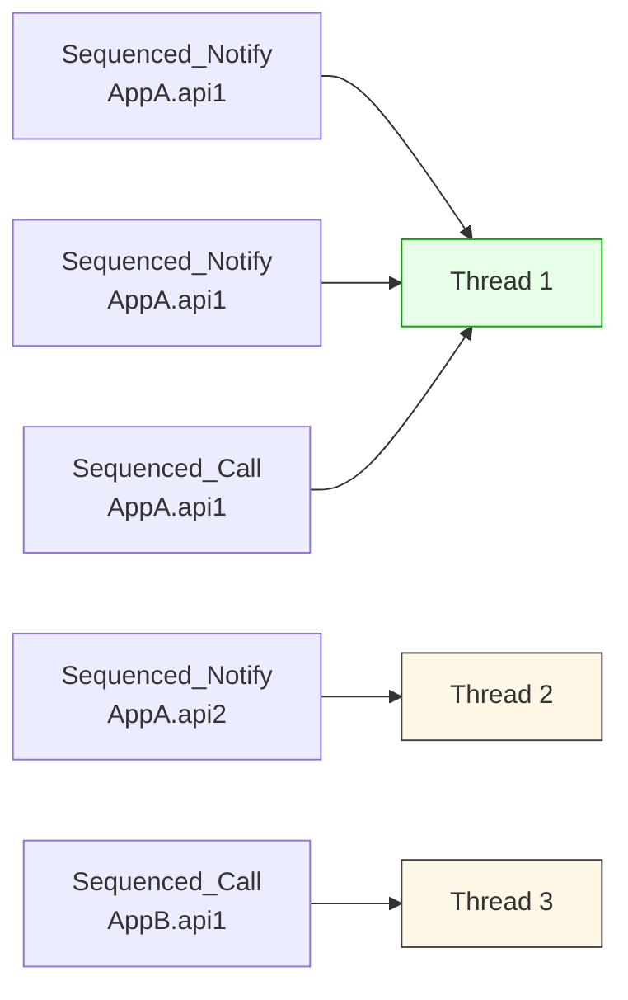
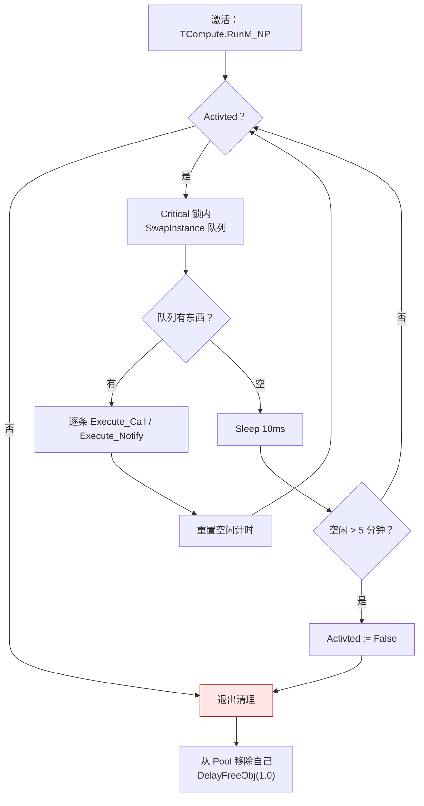

# LF_Sequenced_FIFO.md

> `Sequenced_*` 这一族函数，是 LF 里唯一带顺序保证的调用方式。
>
> 但它保证的**不是全局 FIFO**，是**某个粒度上的 FIFO**。这一篇把这个粒度和它背后的线程模型说清楚——顺带说一个容易被注释误导的细节。

---

## 一句话本质

FIFO 不是靠排队实现的，是靠**"每个 `(App, API)` 对独占一个线程"**实现的。



同一个 `(App, API)` 的所有 Sequenced 请求进同一个线程的队列，队列是 FIFO 的，所以顺序保证。不同 `(App, API)` 各自一个线程，互不阻塞。

这个设计很省事——不需要全局锁，不需要复杂的依赖图调度，只要按 Key 哈希到线程就行。代价是线程数可能很多（每个活跃的 `(App, API)` 对都要占一个线程），所以加了"空闲 5 分钟自动退出"的回收。

---

## Key 是怎么拼的

两行代码的事：

```pascal
procedure TLF_Notify_Sequence_Thread_Pool.Post_Notify2(const APP: TLF_App; Memory_Param: TMem64);
begin
  Post_Notify(PFormat('%s.%s', [APP.Name.Text, TMemory_Param_Tool.Get_apiName(Memory_Param).Text]), APP, Memory_Param);
end;
```

Key 就是 `App.Name + '.' + apiName`。

注意这里有个细节：**Key 里没有 UID，也没有 P2PName**。这意味着 `UID_Sequenced_Notify` 和 `P2PName_Sequenced_Notify` 也走的是同一套 Key 逻辑——它们最终还是会按 `(App, API)` 分线程。UID 和 P2PName 只是路由到目标客户端的方式，跟线程分组无关。

---

## FIFO 到底保证什么

这一点最容易踩坑。列个表说清楚：

| 场景 | FIFO？ | 为什么 |
|------|:------:|--------|
| 同一 `(App, API)` 的 `Sequenced_Notify` | ✅ | 同线程、同队列 |
| 同一 `(App, API)` 的 `Sequenced_Call` | ✅ | 同上 |
| 同一 `(App, API)` 的 `Sequenced_Notify` 和 `Sequenced_Call` 混着调 | ✅ | 两种走的是**同一个线程**，但**不同队列**——见下面 |
| 同一 UID 的 `UID_Sequenced_*` | ✅ | 继承上一行，路由到同一 UID 时仍在同一 `(App, API)` 线程 |
| 同一 P2PName 的 `P2PName_Sequenced_*` | ⚠️ | 每个 `(p2p_name, api)` 对 FIFO，**但 p2p 负载均衡可能把请求分给不同 UID，落到不同客户端** |
| 不同 `(App, API)` 之间 | ❌ | 不同线程，天然并发 |
| 混用 `Sequenced_Notify` 和普通 `Notify` | ❌ | 普通 Notify 不走顺序线程池 |

**关于第三行**的那个 ⚠️ 得单独说：`Sequenced_Notify` 走 `TLF_Notify_Sequence_Thread_Pool`，`Sequenced_Call` 走 `TLF_Call_Sequence_Thread_Pool`。两个 Pool 是分开的，但**对同一个 `(App, API)` 对，两个 Pool 各自有一个线程**。也就是说，如果你先发一个 `Sequenced_Notify`、再发一个 `Sequenced_Call`，它们分别进两个线程的队列，**彼此之间没有顺序保证**。

只有"同一个函数族内"才有 FIFO 保证。混着调，两个线程谁先跑完没准。

这个问题在排查"我明明用了 Sequenced，怎么顺序还是乱"时非常常见。

---

## 线程跑起来之后

`Do_Run_Th` 的主循环说穿了就三件事：**换队列、处理、检查空闲**。



`SwapInstance` 那一步是关键：它在锁内把 `Queue_Tool` 整个换成一个空的 `tmp`，锁外再慢慢处理。这样生产端（`Post_Notify2`）就不会被消费端阻塞。LF 里到处都是这种"锁内换指针、锁外干活"的模式。

---

## 那个 1 秒 vs 5 秒的事

源码里有两处数字，看的时候要分清楚：

```pascal
// Do_Run_Th 的空闲退出判断
if GetTimeTick() - tk >= Z.Core.C_Tick_Minute * 5 then
    Activted := False;              // ← 空闲 5 分钟才退出

// Do_Run_Th 末尾
DelayFreeObj(1.0, self);            // ← 退出后 1 秒释放
```

**5 分钟**是"多久没活干就下班"。
**1 秒**是"下班之后多久关灯"。

这两件事是串行发生的，不是"关闭后还有 1 秒可用"。线程一旦 `Activted := False`，就立刻往外走清理流程，清理完 `DelayFreeObj(1.0, self)` 只是给 TCompute 一个写完 `IsRunning` / `IsExit` 状态位的窗口，让外部（如果有的话）能观察到"这个线程已经退出了"。

有个细节值得留意：**1 秒，不是 5 秒**。这一点我在不同版本的文档里见过不一致的描述。以源码为准——`DelayFreeObj(1.0, self)`。

---

## 那个竞态

`Kill_App` 和 `Do_Run_Th` 之间存在一个微妙的竞态，值得说一下。

线程退出时，`Do_Run_Th` 要判断"我还需不需要从 Pool 里移除自己"：

```pascal
// Do_Run_Th 末尾（未加锁检查）
if (Internal_Queue_Data___ <> nil) and (Internal_Queue_Pool___ <> nil) then
  begin
    Internal_Queue_Pool___.Lock;
    try Internal_Queue_Pool___.Remove(Internal_Queue_Data___);
    finally Internal_Queue_Pool___.UnLock; end;
  end;
```

而 `Kill_App` 在加锁的情况下会把这俩字段置 nil：

```pascal
// Kill_App 内部（加锁置 nil）
queue^.Data^.Data.Second.Critical.Lock;
try
  queue^.Data^.Data.Second.Internal_Queue_Pool___ := nil;
  queue^.Data^.Data.Second.Internal_Queue_Data___ := nil;
finally
  queue^.Data^.Data.Second.Critical.UnLock; end;
```

**问题**：`Do_Run_Th` 判断 `Internal_Queue_Pool___ <> nil` 的时候**没加锁**。理论上 `Kill_App` 可能在这个判断之后、`Lock` 之前把指针置 nil，然后 `Internal_Queue_Pool___.Lock` 就是对着 nil 调用方法——崩溃。

这是一个低概率事件，实际触发需要线程调度恰好错开。实践上的缓解方法是：

- **`LF_FreeApp` 之前确保顺序线程已经停止**（比如应用正在正常退出，而不是边跑边 Kill）
- **避免高并发下频繁创建销毁 App**

不保证完全不撞，但在常见的生命周期里够用。

---

## 陷阱速查

| 症状 | 根因 | 修复 |
|------|------|------|
| `Sequenced_Notify` 和 `Sequenced_Call` 混着发，顺序乱 | 两者走不同的 Pool，各自一个线程 | 不要混；要么全用 Notify，要么全用 Call |
| `P2PName_Sequenced_*` 顺序乱 | p2p 负载均衡把请求分给不同 UID | 需要严格顺序时改用 `UID_Sequenced_*` |
| 线程数暴涨 | 活跃 `(App, API)` 对太多 | 减少 App 数量或合并 API |
| 某个 API 卡死整条链 | 该 `(App, API)` 的回调里阻塞了 | 短任务直接做，长任务拆出去 |
| 认为"线程退出后还有 5 秒窗口" | 注释看混了 | 1 秒释放的是对象，退出后不保留任何引用 |
| `Kill_App` 崩溃 | `Do_Run_Th` 判断指针时未加锁 | 避免高并发销毁 App |

---

## 最后一句

`Sequenced_*` 的设计其实很清晰：**用一个线程换一个 `(App, API)` 对的顺序保证**。理解了这一点，就能推出所有边界——

- 同一个 Key 内，顺序稳定
- 不同的 Key 之间，天然并发
- Key 里没有 UID，所以 UID 和 P2PName 的 Sequenced 变体，本质还是 `(App, API)` 级的 FIFO

需要更强保证的时候，比如"所有 UID 的某个 API 都要全局顺序"，这个模型给不了。LF 的选择是让你用 UID 定向到单个客户端再用 Sequenced——把"全局顺序"变成"单个目标上的顺序"，问题就退化成它已经解决的那个问题了。