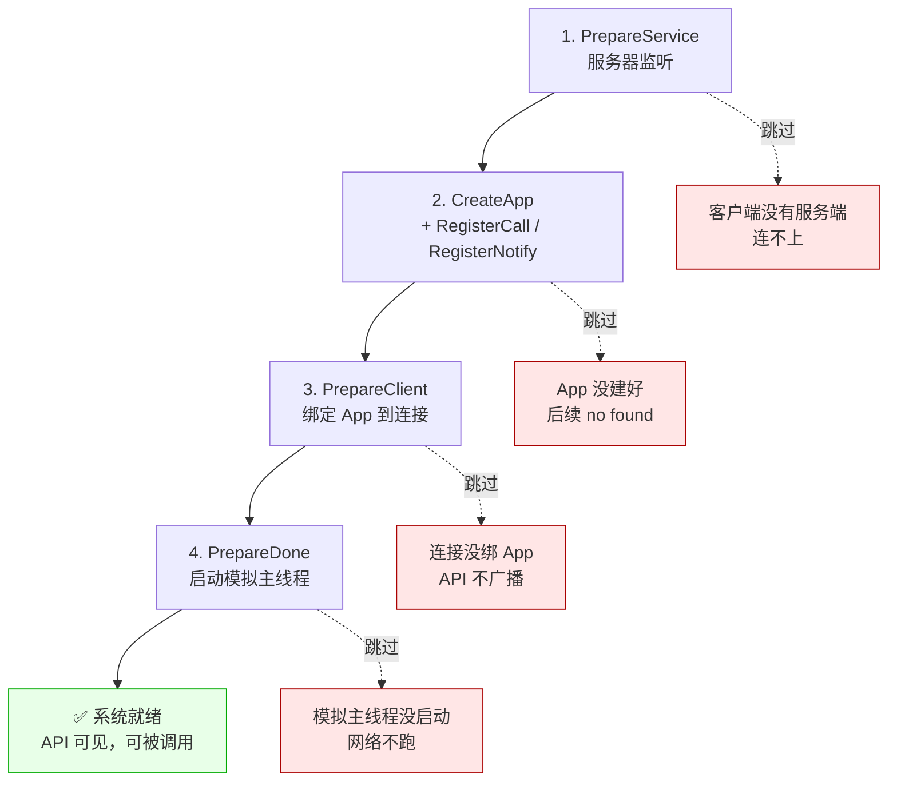

# LF_Startup_Order.md

> LF 的启动顺序**不能乱**，而且乱了的后果是**静默失败**——不报错、不崩、就是"连接建了但调不通"。
>
> 正确的顺序是 `PrepareService` → 创建 App + 注册 API → `PrepareClient` → `PrepareDone`。这四步里，`PrepareClient` 必须在 App 创建**之后**，因为它要知道把连接绑给哪个 App；`PrepareDone` 必须在最后，因为它一旦启动模拟主线程，前面的配置就固化了。顺序错了最常见的表现是"TunnelLink 成功，但对方调我的 API 永远 no found"。

| 顺序错误 | 现象 |
|---------|------|
| `PrepareClient` 在 `CreateApp` 之前 | 连接建立了，但没有 App 绑上去，API 列表空 |
| `RegisterCall` 在 `PrepareClient` 之后 | 注册是成功的，但 `PrepareDone` 之前的注册不会触发即时广播，客户端看不到 |
| `PrepareDone` 在 `PrepareClient` 之前 | 模拟主线程起来时还没有客户端，`Wait_Connection_ReadyOk` 会等空连接然后超时 |
| 先 `PrepareDone` 再 `CreateApp` | 晚注册的 App 要等 1 秒的 `DoChange` 广播周期，别指望立刻可见 |

**为什么是这个顺序**：`PrepareService` 和 `PrepareClient` 是在 `AppHnd_Bind_Tag_List` 里登记"要创建什么连接"，`PrepareDone` 才是真正把这些连接启动、拉起模拟主线程、跑 C4 的时刻。所以在 `PrepareDone` 之前，注册的 App / API / 客户端都只是**登记状态**，没有真正生效。`PrepareDone` 之后系统才进入"运行时"，注册的东西才被广播、才能被路由到。

**一个后果**：部署分布式系统时，客户端和服务端的启动顺序你控制不了。如果客户端先启动，服务端还没起来，`PrepareDone` 时 `Wait_Connection_ReadyOk=True` 会等 `Wait_Connection_Timeout`（默认 30 秒）然后返回 0。此时要么重启客户端，要么用 `Wait_Connection_ReadyOk=False` 让 `PrepareDone` 立即返回，然后自己定期 `LF_CheckApp` / `LF_CheckApi` 探测目标就绪。

后者是部署环境的标准做法——**不赌"我起来时你也在"**，赌"我起来后能等到你"。