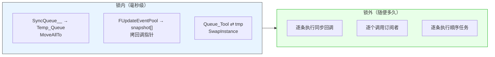

# LF_SwapUnderLock.md

> LF 内核里凡是"持锁遍历"，都不真在锁里遍历。
>
> 它总是先在锁内把整个队列**换成一个临时空容器**（`MoveAllTo` / `SwapInstance` / `snapshot` 拷贝），解锁后再慢慢处理临时容器里的东西。这个模式在 `Check_Synchronize`、`Do_LFRegEvent`、`Sequence_Thread.Do_Run_Th` 里反复出现，是 LF 里最统一的一处设计——**锁只负责"抢所有权"，不负责"干活"**。

| 你以为的 | 实际发生的 |
|---------|-----------|
| 持锁遍历队列，回调在锁里跑 | 锁里只换容器，回调全在锁外跑 |
| `MoveAllTo` / `SwapInstance` 是拷贝 | 都是 O(1) 换指针，不移动节点、不拷数据 |
| `snapshot` 是深拷贝回调对象 | 只拷 `OnUpdate` 函数指针到数组，不是对象 |
| 锁的粒度是"整批处理完" | 锁的粒度是"换指针"，通常几十个时钟周期 |

**为什么这样做**：因为回调里大概率会再次访问同一个容器。`OnUpdate` 里可能 `Subscribe_Update` / `Remove_Update`（改 `FUpdateEventPool`），顺序任务里可能 `Post_Notify`（改 `Queue_Tool`），同步回调里可能又触发新的 `Synchronize`（改 `SyncQueue__`）。如果持锁遍历，回调一访问自己就死锁。**换容器把"遍历"和"修改"解耦**——锁内换走的是旧容器的所有权，回调改的是新容器，两者互不干扰。

**代价**：峰值时刻内存里有两份容器。`Temp_Queue` 是个空 `TLF_List`、`snapshot` 是个指针数组、`tmp` 是个空 `TOrderStruct`——都不大，但是有。换来的收益是回调可以任意操作容器，不会死锁。

**一个后果**：`Do_LFRegEvent` 的回调里 `Remove_Update(self)` 是安全的，`Do_Run_Th` 的任务里 `Post_Notify2` 是安全的，`Check_Synchronize` 的同步回调里再 `Synchronize` 也是安全的。这些"看起来会死锁"的操作，都靠"锁内换容器"这一招撑住。反过来，如果在锁外遍历的过程中又有新东西入队，那批新东西只能等下一次循环——**这批不会丢，但也不会被当前这一轮处理**，所以高频回调会表现为"分批处理、永远慢一拍"。