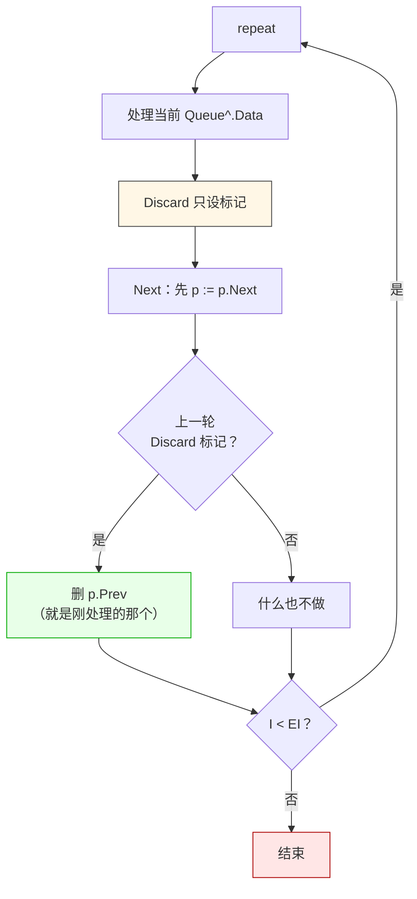

# LF_TBigList_Iterator.md

> LF 内核里所有的池——发送队列、DataPool、顺序线程队列、哈希桶——底层都是 `TBigList`，而它的迭代器有个反直觉的设计：`Next` 是**先移动指针再判断是否结束**，不是先判断再移动。这意味着 `while It.Next do Process(It.Data)` 会跳过首节点，而 `repeat Process(It.Data) until not It.Next` 才是对的写法。这个设计不是 bug，是为了让 `Discard`（迭代中删除）能安全实现——`Discard` 只设一个标记，真正删除发生**下一次 `Next`** 的内部，此时迭代器已经移到下一个节点，删的是"前一个"，迭代状态不受影响。这也是为什么 LF 内核里所有遍历都长成 `with Pool.Repeat_ do repeat ... until not Next`——不是风格偏好，是唯一正确的写法。

| 你以为的 | 实际发生的 |
|---------|-----------|
| `while Next do` 能遍历全部 | **漏首节点**，`p___` 一开始就在 `First`，`Next` 一调用就移到 `Second` |
| `Discard` 立即删除节点 | 只设 `Is_Discard___ := True`，删除发生在**下一次 `Next`** 里 |
| 回收池是"节点复用池" | 是**延迟删除队列**，`Push_To_Recycle_Pool` 只标记不删，`Free_Recycle_Pool` 才真删 |
| `Remove_Data` 立即删 | 先 `Push_To_Recycle_Pool` 标记所有匹配，再 `Free_Recycle_Pool` 统一释放 |
| `Add` 从回收池取节点 | **不取**，直接 `new(p)`，回收池里的节点只在 `Free_Recycle_Pool` 时才被 `Dispose` |

**代价**：`Push_To_Recycle_Pool` 之后节点**还在链表里**，只是标了 `Recycle___ := True`。这意味着"我标记了但还没 `Free_Recycle_Pool`"的窗口期内，这个节点仍然能被 `Find` / 遍历命中。这也是为什么 LF 内核里凡是"批量删除"都长成 `先遍历标记 → 再 Free_Recycle_Pool`——两次遍历之间不能有外部访问。

**一个后果**：`TCritical_BigList` 的迭代器不自动加锁，`Discard` 内部调 `Remove_P(p___^.Prev, False)` 用的是 `Lock_ := False`。所以**线程安全版的迭代也必须外部加锁**，只是加了锁之后 `Discard` 才能正常工作——不加锁就直接崩。