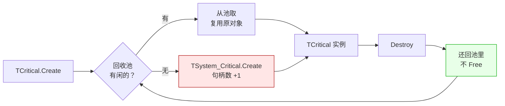

# LF_TCritical_Reuse.md

> 一个反直觉的事实：LF 里创建十万个 `TCritical`，操作系统句柄数几乎不涨。
>
> 因为 `TCritical` **不是**对 `TCriticalSection` 的薄包装，它底下有一层回收池。`Create` 时先看池里有没有空闲的临界区对象，有就复用，没有才真的 `new` 一个；`Destroy` 时也不是立刻释放，而是把底层对象**还回池里**。所以"创建/销毁一万次"在系统看来只是"创建/复用了同一个临界区对象一万次"。这就是为什么 Z 系的服务器在任务管理器里句柄数长期保持恒定——锁的开销被摊到了池子上，而不是被推给操作系统。

| 你以为的 | 实际发生的 |
|---------|-----------|
| `Create` = new 一个临界区 | 先查池，命中就复用，未命中才真的 new |
| `Destroy` = 释放临界区 | 底层对象还回池，只有 `TSystem_Critical` 实例本身在池里长期驻留 |
| 频繁创建/销毁 → 句柄数上涨 | 句柄数恒定，只有池的"高水位"决定真实句柄数 |
| `LNum` 是引用计数 | `LNum` 是**当前实例的递归计数**，`Destroy` 前会 `while LNum > 0 do Release` 强制释放 |

**代价**：`Get_System_Critical_Num` 统计的是"总创建过的实例数"，不代表"当前持有句柄数"；想知道真实占用要看 `Get_System_Critical_Recycle_Pool_Num`（池里空闲的）和两者的差。

**一个后果**：`TCritical` 是 `sealed` 的——不允许继承。想加自己的语义，只能组合，不能继承。