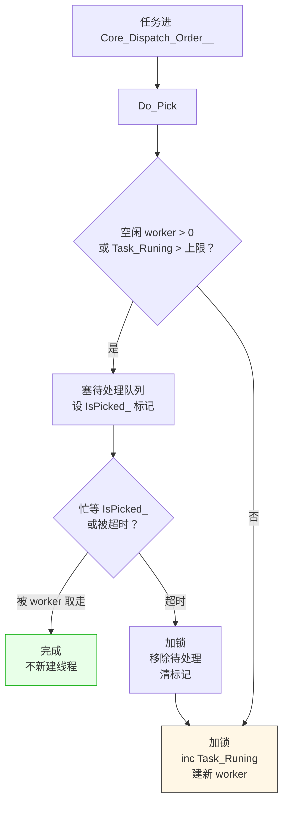

# LF_ThreadPool_Pick.md

> 任务来了，线程池**不急着建线程**。
>
> `TCore_Dispatch_Order_Thread` 的 `Do_Pick` 干的第一件事是查 `Core_Thread_Wait_Sum__.V`——如果有空闲 worker 在等活干，就把任务塞进 `Core_Thread_Dispatch_Queue_Pool__`（待处理队列），然后**忙等** `IsPicked_` 被置位或超时。只有确认"没有空闲 worker"或者"忙等到超时"了，才 `inc(Core_Thread_Task_Runing__)` 并创建新 worker。这套逻辑的意义在于：**任务来了先让空闲 worker 消化，实在消化不了才扩容**——暴力扩容会瞬间把线程数顶到上限，然后大批线程空闲 1 秒后又全部自杀，抖动非常厉害。

| 你以为的 | 实际发生的 |
|---------|-----------|
| 任务一来就建线程 | 有空闲 worker 时先塞待处理队列，不建 |
| 没空闲 worker 才建线程 | 对，但"没空闲"是快照判断，可能撞上同时有多任务涌入 |
| 线程建了就一直在 | 空闲超过 `Core_Thread_Life_Time_Tick__`（默认 1000ms）自动退出 |
| `Core_Thread_Task_Runing__` 是"当前活跃任务数" | 是"当前活跃 worker 数"，不是任务数 |
| `Core_Thread_Wait_Sum__` 是"排队任务数" | 是"空闲等待取活的 worker 数"，语义正好反过来 |

**代价**：那个"忙等 `IsPicked_` 或超时"是一个非阻塞式的软锁——`Do_Pick` 在等，工作线程也在等，两者都在 1ms 级别轮询。代价是短时间内的 CPU 空转，收益是**不需要额外的条件变量就能协调**。超时值用的是 `Core_Thread_Life_Time_Tick__`（和 worker 空闲退出同一个常量），所以"等 worker 来取"和"worker 等多任务"共用同一个时间尺度，行为对称。

**一个后果**：`ParallelFor` 里如果任务切分太细（比如每个 `ParallelFor` 只切 2 个线程），很容易触发"没空闲 worker → 建新线程"的路径——建完线程任务跑完，线程又空闲，很快又有一个新任务进来，循环反复。这就是 LF 的 `Parallel_Granularity__` 默认取 8 而不是 CPU 核数的原因——**少建线程、让已有线程多干活**，比"精确匹配核数"更稳。