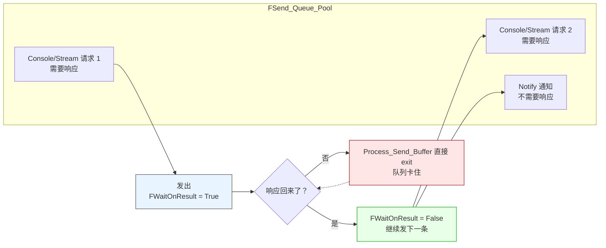

# LF_WaitOnResult.md

> 同一个 IO 上，**同一时刻只能有一个请求-响应在飞**。
>
> 每条 `TPeerIO` 里有个 `FWaitOnResult: TAtomVar<Boolean>`。`SendConsoleCmd` / `SendStreamCmd` 发出前把它置 True，响应回来后置 False。`Process_Send_Buffer` 每轮开头第一行就是检查它——True 就直接 `exit`，队列里剩下的请求一个都不发。所以队列不是"顺序发送"的，是"**第一条发出去后彻底卡住**"，直到响应回来才继续。这就是 LF 的请求-响应串行化：不靠复杂的任务跟踪，就靠一个布尔标志。

| 你以为的 | 实际发生的 |
|---------|-----------|
| 队列按顺序把请求逐条发出去 | **第一条发出去后整个队列卡死**，等响应回来才放行下一条 |
| Notify 和 Call 一起排队 | Notify **不受 `FWaitOnResult` 影响**，Call 卡住的时候 Notify 也发不出去（队列顺序如此），但 Call 响应回来后它立刻能走 |
| 多个 Call 可以并发 | **不行**，同一个 IO 上只能有一个在飞 |
| 这个标志是防重入 | 不是，是**强制的请求-响应串行化**，两者语义不同 |

**代价**：同一个连接上，**吞吐受限于最慢的那一次往返**。想并发怎么办？开多个物理连接——这就是双隧道（Recv + Send）、P2PVM 虚拟多连接的设计动机之一。或者用 `CompleteBuffer_NoWait_Stream`（不走这个标志）。

**一个后果**：`LF_Call` 超时了，`FWaitOnResult` 不会自动复位。超时的唯一表现是调用方拿到 size=0 的句柄，但 `FWaitOnResult` 仍然是 True——后续请求还是发不出去。这就是为什么 "超时后必须重连或重置" 是 LF 的常识性要求，源码里不替你复位。这也是 `Check_Param_And_Send_Queue` 里周期性发 `SendNULL` 的原因——`SendNULL` 是一个不带响应的通知，专门去**主动探一下这条连接还是不是活的**，如果对端不响应，就说明链路真的挂了，可以安全断开。