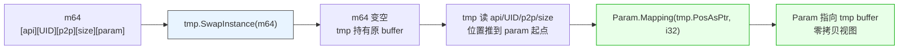

# LF_ZeroCopy_Decode.md

> `TMemory_Param_Tool.DecryptFromMem` 拆载荷的时候，**一次 memcpy 都不做**。
>
> 它不把业务参数拷出来，而是让 `Param` 直接 `Mapping` 到源 `TMem64` 缓冲区里的某个偏移处。做法很妙——用 `tmp.SwapInstance(m64)` 把调用方传进来的 `m64` 内部 buffer **整个接管**给 `tmp`，然后 `tmp` 一边往前读 `apiName` / `FromUID` / `FromP2PName` / `Param.Size`，一边把位置推到业务参数的起点，最后 `Param.Mapping(tmp.PosAsPtr, i32)`——`Param` 就变成了那块 buffer 上的一个视图，源 buffer 由 `tmp` 持有。整条链上业务参数一次没动过。

| 你以为的 | 实际发生的 |
|---------|-----------|
| 解码要把业务参数拷出来 | 走 `Mapping` 零拷贝，`Param` 只是源 buffer 上的一个视图 |
| `m64` 解码后还能用 | **已经被 `SwapInstance` 掏空**，内容是空的 |
| `Param` 是独立副本 | 生命周期绑在 `TMemory_Param_Tool`（也就是 `tmp`）上 |
| `DecryptFromMem` 不改源 | **会改**，非 `ProtectedMode` 模式下源 `m64` 被 Swap 走 |
| `ProtectedMode = True` 时也一样 | **不一样**，这个分支走 `ReadPtr(Param.Memory, ...)`，是**真拷贝** |

**为什么有 `ProtectedMode` 分支**：`m64.ProtectedMode = True` 意味着源 buffer 是只读映射（别人传进来的 `SetPointerWithProtectedMode`），不能 Swap——Swap 意味着接管所有权，只读的东西不该接管。所以这个分支老老实实读出来、拷出来。`ProtectedMode = False` 才是常见情况，走零拷贝。

**代价**：`Param` 的生命周期绑在 `TMemory_Param_Tool` 上。`TMemory_Param_Tool.Destroy` 里先 `DisposeObject(Param)`（因为 Param 是视图，`ProtectedMode = True`，不释放 buffer），再 `DisposeObject(tmp)`（这才是真正释放 buffer）。顺序不能反。

**一个后果**：`Execute_Call` 里 `input_ := TLF_Data.New_Param_From(Memory_Param, False)` 之后，如果业务代码回调里把 `input_` 传给另一层、另一层又用了 `DecryptFromMem` 或者别的消费它——只要这一层不拷贝，视图还能用；一旦 `input_` 被 Free，`Param` 就悬空了。所以回调里读 `Input` 是安全的，但**把 `Input` 塞进异步队列延迟消费**，就会踩到这块。