# LingoFuse 多语言完整指南（v2.0 · 权威知识库）

> **定位**：面向 AI 与人类开发者的权威参考，覆盖 LingoFuse 核心运行时、18 种语言绑定、两套代码生成工具链（`code_decl_to_abi` / `code_decl_to_json_abi`）与完整的踩坑知识库。
>
> **本版原则**：本文档只收录**有源文档直接依据**的内容。**不确定的内容已全部移到独立的不确定知识库**（`LingoFuse_Uncertain_Knowledge_Base.md`）。读者可以默认本文档中的每一条断言都可直接采信。

---

## 📖 目录

**第一部分 基础与架构**
- [第 0 章 快速定位](#第-0-章-快速定位)
- [第 1 章 三层架构与设计哲学](#第-1-章-三层架构与设计哲学)
- [第 2 章 核心概念与术语](#第-2-章-核心概念与术语)
- [第 3 章 生命周期与初始化（多语言）](#第-3-章-生命周期与初始化多语言)

**第二部分 API 详细参考**
- [第 4 章 数据句柄完整参考](#第-4-章-数据句柄完整参考)
- [第 5 章 应用句柄完整参考](#第-5-章-应用句柄完整参考)
- [第 6 章 API 注册机制](#第-6-章-api-注册机制)
- [第 7 章 本地调用与路由短路](#第-7-章-本地调用与路由短路)

**第三部分 路由与寻址机制**
- [第 8 章 三套寻址详解](#第-8-章-三套寻址详解)
- [第 9 章 跨寻址路由与 UID 万能路由](#第-9-章-跨寻址路由与-uid-万能路由)
- [第 10 章 自动发送方身份识别](#第-10-章-自动发送方身份识别)

**第四部分 高级主题**
- [第 11 章 运行时选项详解](#第-11-章-运行时选项详解)
- [第 12 章 网络准备与模拟主线程](#第-12-章-网络准备与模拟主线程)
- [第 13 章 状态、查询与网络事件](#第-13-章-状态查询与网络事件)
- [第 14 章 线程模型与并发](#第-14-章-线程模型与并发)
- [第 15 章 内存与生命周期管理](#第-15-章-内存与生命周期管理)
- [第 16 章 跨语言绑定与 ABI 契约](#第-16-章-跨语言绑定与-abi-契约)
- [第 17 章 清理与关闭](#第-17-章-清理与关闭)

**第五部分 P2P 与分布式**
- [第 18 章 P2P 分布式负载](#第-18-章-p2p-分布式负载)
- [第 19 章 路由优化：本地短路与服务器本地处理](#第-19-章-路由优化本地短路与服务器本地处理)

**第六部分 多语言绑定深度解析**
- [第 20 章 十八种绑定逐一展开](#第-20-章-十八种绑定逐一展开)

**第七部分 工具链**
- [第 21 章 code_decl_to_abi 二进制 ABI 工具链](#第-21-章-code_decl_to_abi-二进制-abi-工具链)
- [第 22 章 code_decl_to_json_abi HTTP/JSON 工具链](#第-22-章-code_decl_to_json_abi-httpjson-工具链)

**第八部分 踩坑知识库**
- [第 23 章 踩坑知识库](#第-23-章-踩坑知识库)
- [第 24 章 各语言最佳实践速查](#第-24-章-各语言最佳实践速查)
- [第 25 章 LLM 生态坑索引](#第-25-章-llm-生态坑索引)

**附录**
- [附录 A 错误消息原文索引](#附录-a-错误消息原文索引)
- [附录 B ID 总览与维护约定](#附录-b-id-总览与维护约定)
- [附录 C 给 AI 使用者的检索规则](#附录-c-给-ai-使用者的检索规则)
- [附录 D 核心铁律（多语言版）](#附录-d-核心铁律多语言版)
- [附录 E 多语言接线对照表](#附录-e-多语言接线对照表)

---

# 第一部分 基础与架构

## 第 0 章 快速定位

### 0.1 一句话定位

**LingoFuse 是跨语言 RPC 总线**。它用 C ABI 把 Pascal 侧的 RPC 能力暴露给 18 种语言（17 种原生 FFI + 1 种经 bridge 的 PHP），同时自身也是完整的分布式 RPC 引擎，支持**三套寻址**（App 名 / UID / P2PName）、**自动发送方身份识别**、**本地短路路由**、**服务器本地处理**、**C4 服务网格**、**序列化族**和 **P2P 分布式负载**。

**LingoFuse 的生态由三块构成**：

| 层 | 组件 | 说明 |
|----|------|------|
| **核心运行时** | `LingoFuse64.dll` / `liblingofuse.so` / `liblingofuse.dylib` | C ABI 导出层 + C4 分布式层 + 核心 RPC 层 |
| **语言绑定** | 17 种原生 FFI（Pascal / Python / C++ / C# / TypeScript / JavaScript(Node.js) / Rust / Go / Dart / Java / Swift / Zig / Erlang / Ruby / Fortran / Julia / R）+ 1 种经 bridge 的 PHP（共 18 种） | 每种语言独立的 FFI 封装 |
| **工具链** | `code_decl_to_abi`（17 种目标语言）、`code_decl_to_json_abi`（20+ 种目标语言） | 从声明文件生成多语言 Service/Call/Test 代码 |

### 0.2 口径澄清

LingoFuse 的「支持多少种语言」有四个不同的数字，含义不同：

| 口径 | 数字 | 具体含义 |
|------|:----:|----------|
| **`readme.md` 一方绑定** | **18** | 17 种原生 FFI + 1 种经 bridge 的 PHP |
| **原生 FFI 绑定** | **17** | Pascal / Python / C++ / C# / TypeScript / JavaScript(Node.js) / Rust / Go / Dart / Java / Swift / Zig / Erlang / Ruby / Fortran / Julia / R |
| **`code_decl_to_abi` 支持** | **17** | 与原生 FFI 绑定完全一致（不含 PHP） |
| **`code_decl_to_json_abi` 支持** | **20+** | 上述 17 种 + JavaScript（浏览器）+ PHP + Delphi + Bridge 启动脚本 |

### 0.3 先记住十句话

1. **获取 P2P UID 的最佳路径，是在"被请求的调用"里，从回调的 `Input` 参数调用 `LF_Get_P2P_UID`。**  
   即高层绑定的 `get_p2p_uid()` / `getP2PUid()`。

2. **拿到的 UID 是"断网前唯一"的会话 UID。**  
   同一连接生命周期内可作为通讯标识符；重连后会变化，需要重新探测。

3. **分布式负载无处不在：只要是 1 对多，就可以分布式。**  
   一个 App 名被多个程序注册；一个 P2PName 被多个程序注册；你的程序连接多个服务器且服务器支持跨节点路由。

4. **UID 和 P2PName 调用会自动搜索目标客户端的 App 注册函数。**  
   这是路由行为：目标端所有已注册的 API 都能被命中。

5. **反过来，App 名调用只能命中 App 注册的函数，不能命中 P2P 注册的函数。**  
   这是路由层的不对称。

6. **路由优化：本地短路 + 服务器本地处理。**  
   如果目标在本地，调用不走网络；如果请求到了服务器，但服务器本地能处理，服务器直接处理，不转发。

7. **序列化支持之后，P2P + 高流量计算 + 大规模数据流是天生合拍。**  
   视频帧、音频块、Matlab / R / Julia 计算任务、仿真迭代，都可以序列化执行与反馈。

8. **【多语言】同步族与异步族的 handle 所有权完全相反。**  
   同步族（`LF_Call` / `LF_UID_Call` / `LF_P2PNAME_Call`）返回的 handle 归调用者；异步族（`LF_Async_Call` / `LF_UID_Async_Call` / `LF_P2PNAME_Async_Call`）的 `Result_` handle 归框架所有，**回调返回后立即释放**。

9. **【多语言】各语言绑定的初始化顺序完全一致：`prepareService` → 创建 App + 注册 API → `prepareClient` → `prepareDone`。**  
   区别只在方法名与参数形式。**顺序不可颠倒**。

10. **【多语言】跨语言互通的唯一保证是「二进制线格式严格一致」。**  
    `[status:uint8_t][payload]`，status `0x00` = 成功，`0xFF` = 失败（UTF-8 错误消息 + NUL）。任何语言生成的 Service 都能被任何语言生成的 Call 调用。

### 0.4 能解决什么问题

| 场景 | 用哪套寻址 | 入口 API | 多语言绑定名 |
|------|-----------|---------|-------------|
| 跨语言进程内 RPC | 本地 App 名 | `LF_LocalCall` | Pascal `LF_LocalCall` / Python `lf_local_call` / C++ `lingofuse::localCall` |
| 跨进程 / 跨机器固定服务 | App 名 | `LF_Call` / `LF_Async_Call` | 各语言 `Call` / `call` / `callApp` |
| **定向到某个具体客户端** | **UID** | **`LF_UID_Call` / `LF_UID_Notify`** | 各语言 `callUid` / `call_by_uid` |
| **按组负载均衡** | **P2PName** | **`LF_P2PNAME_Call` / `LF_P2PNAME_Notify`** | 各语言 `callP2PName` / `call_by_p2p` |
| **需要接收方识别发送方** | 任意 | 回调内 `LF_Get_P2P_UID` / `LF_Get_P2P_Name` | 各语言 `getP2PUid` / `getP2PName` |
| **需要 FIFO 顺序** | 任意 | `LF_Sequenced_Notify` / `LF_Async_Sequenced_Call` | 各语言 `sequencedNotify` / `asyncSequencedCall` |
| **高流量计算（视频、音频、矩阵）** | P2PName + Sequenced | `LF_P2PNAME_Sequenced_Notify` + 二进制句柄 | 各语言 `p2pSequencedNotify` |

### 0.5 三层结构

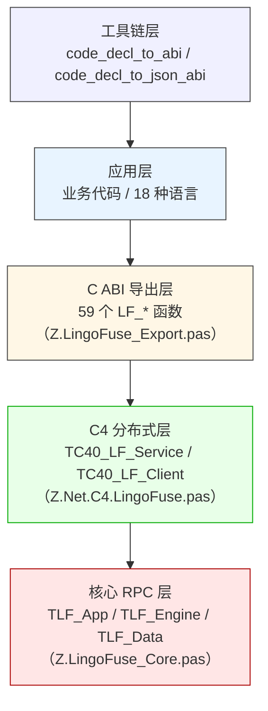

**新增的 L4 工具链层**：`code_decl_to_abi` 与 `code_decl_to_json_abi` 是**代码生成器**，不参与运行时。它们读一份 Pascal 单元或 C 头文件，输出多语言 Service/Call/Test 代码。这些生成代码再调用 L2 层的 C ABI 或直接走 HTTP。工具链层的引入让**手写 FFI 绑定**被**代码生成**取代。

### 0.6 多语言硬规则（40 条）

**通用规则（适用所有语言）**：

1. **回调必须 `cdecl`**（或语言的等价约定：Python `CFUNCTYPE`、C# `CallingConvention.Cdecl`、Rust `extern "C"`、Go `purego` / `cgo`、Java FFM `Linker.Option`）。
2. **托管语言回调必须保持强引用**（否则 GC 回收后崩溃）。
3. **`LF_GetOption` / `LF_Get_AppName` / `LF_Generate_AppName` / `LF_Get_P2P_Name` 返回的指针 5 秒后失效；`LF_Get_P2P_UID` 返回的是 `PP2P_UID___` 指针，同样 5 秒后失效**。
4. **输入句柄不释放，返回句柄必须释放**。
5. **`LF_FreeData` 对 auto 句柄只标记，10 分钟后才真正释放**。
6. **`LF_CreateData_Permanent` 创建的永久句柄不会自动回收**，必须手动 `LF_FreeData`。
7. **`LF_BindApp` 必须在 `LF_PrepareDone` 之后调用**，否则返回 0。
8. **`LF_FreeApp` 不真正释放 App**，仅移除绑定与定时器；真正释放在 `LF_Shutdown`。
9. **服务端必须先注册 `LingoFuse` 逻辑服务**，客户端才能发现。
10. **异步回调与网络事件回调在 TCompute 工作线程执行**，禁止 UI / 阻塞 / 同步调用。
11. **`LF_Sequenced_*` 保证同一 `(app, api)` 对内 FIFO**；跨 `(app, api)` 无顺序保证。
12. **每个回调自动获得发送方 UID / P2PName**（见 §10），**仅在回调 Input 参数中有效**。
13. **UID 是万能路由标识**：知道某客户端的 UID，就能调用其注册的**任何 API**（包括 app 与 p2p），不依赖 App 名（见 §9）。
14. **`LF_Shutdown` 后其他 `LF_*` 函数都视为无效**；清理顺序必须 `ExitMainThread → FreeApp → Shutdown`。
15. **`LF_Call` 超时返回 size=0 的句柄，不是 nil**；用 `LF_GetSize` 判断成功。
16. **同步族（`LF_Call`）返回的 handle 归调用者所有；异步族（`LF_Async_Call`）的 `Result_` handle 归框架所有，回调返回后立即失效**（见 §4.7）。
17. **本地短路：目标在本地进程内，调用不走网络**（见 §19.1）。
18. **服务器本地处理：请求到服务器后，服务器本地能处理就不转发**（见 §19.2）。
19. **App 名路由本地优先；P2PName 路由不做本地优先**（见 §8.2 / §8.4）。
20. **UID / P2PName 调用能命中目标客户端的全部已注册 API；App 名调用只能命中该 App 的注册表**（见 §8.6）。

**多语言专属规则**：

21. **【Pascal / Delphi】** `LF_LocalCall` / `LF_LocalNotify` **不注入发送方身份**。若需要本地调用也携带身份，请用 `LF_Call` 并依赖本地短路（见 §5.6、§10.3）。
22. **【Pascal / Delphi】** P2PName 异步 Call 若服务端找不到组名，**回调永不触发**（服务端 `cmd_P2PName_Call` 只 `DoStatus`，不回包）。调用方必须自行实现超时（见 §8.4）。
23. **【Python】** 同步族 handle 归调用者，异步族归框架（回调返回后立即释放）——混用会导致偶发 use-after-free。所有异步回调必须**在回调内完成所有操作**（读 Input / 写 Output 或拷贝数据），禁止跨线程保留裸 handle。
24. **【Python】** `_Aio` 变体是 `async def`，必须在 `asyncio.run()` 或已运行的 event loop 内 await。`_Async` 变体返回 `CallFuture`，支持 `.result(timeout=)`、`.add_done_callback(fn)`、`.cancel()`。
25. **【C++】** 必须先调用 `LF_LoadLibrary()`；返回 1 表示成功。`LF_LoadLibrary` 不是自动的，忘记调用会导致所有 `LF_*` 失败。
26. **【C++】** MSVC 必须加 `/utf-8`，否则 API 描述字符串的编码不对。
27. **【C#】** 生成的库必须**没有 `Main`**。有 `Main` 会导致 `CS0017: Program has more than one entry point defined`。测试程序在独立项目里。
28. **【C#】** 异步回调必须用 `TaskCompletionSource` + `RunContinuationsAsynchronously`，否则回调可能在 worker 线程上同步执行。
29. **【Rust】** panic 必须 `catch_unwind`，且建议用户回调也不要 panic。
30. **【Go】** 服务侧必须 `CGO_ENABLED=1`；`sys.LoadLibrary()` 必须先调用。
31. **【Java】** 必须 JDK 22+（FFM API）；JDK 21 及以下不可用。`LibraryLoader.selectPlatformFileName()` 必须先调用。
32. **【Node.js / TypeScript】** `LF_Async_Call` 的 `data` 指针必须是非 null（`op.dataPtr`），传 `null` 回调永不触发。`AsyncBridge` 的 timer 不能 `unref`，否则 `_reclaim` 不跑，5s 超时失效，进程提前退出。
33. **【Node.js / TypeScript】** `param` 必须在 promise settle 之后 dispose，不能在 `finally` 立即 dispose。`module.exports` 的 shorthand property 不能带引号：`{ 'key', }` 非法，`{ 'key': value, }` 合法。
34. **【Erlang】** ABI 层必须二进制 wire，禁止 JSON。NIF 层不 strip `#0`。Service main loop 必须处理 16 种消息形态：`lf_call` / `lf_p2p_call` / `lf_notify` / `lf_p2p_notify` × 有/无 `Identity` × 具体 API / 通用 API。`lingofuse:reply/2` 只能调用一次，用 `_ =` 而非 `ok =`。
35. **【Julia】** 强制 `--threads=2`（回调 consumer 不能落在 main 线程，否则死锁）；`@threadcall` 并发上限受 libuv 线程池约束（默认 4，可用 `UV_THREADPOOL_SIZE` 提升）。
36. **【Ruby】** Ruby 进程异常退出时，dispatcher 线程仍在运行 C 代码，`LingoFuse64.dll` 随进程消失导致 Access Violation。`at_exit` 块必须按顺序：`NativeBridge.stop` → `exit_main_thread` → `shutdown` → `Native.free_library`。
37. **【R】** `LF_Call` 不可重入，单进程自测需改用 `lf_local_call`。`*_async` 变体必须 `future::plan("sequential")`，`multisession` / `multicore` 会 fork worker 进程导致内部调用永远失败。停止 R 服务推荐写 `service.exit` 哨兵文件，不用 Ctrl+C。
38. **【Fortran】** `internal_call_<api>` 是 stub，返回零值（设计意图）。Fortran 天生没有 async 支持，暂不生成异步变体。回调命名是 `<api>_callback`（不是 `callback_<api>`）。
39. **【Dart】** `BridgeHost.start()` 必须是 `main()` 第一行。`ABI_TARGET_APP` 必须用 `const`（`Isolate.run` 会重新执行顶层代码，`let` 的运行时修改不会传递到子 isolate）。
40. **【Swift】** Swift 6.4 的 `#NoUsage` 诊断会误报"仅用于字符串插值"的变量为 unused，降版本或重构 cost 高。SPM 的 `.package(path:)` 的 identity 是路径最后一段的小写（不是 `Package.swift` 的 `name` 字段）。

### 0.7 关键默认值（跨语言统一）

| 项目 | 值 |
|------|---:|
| C ABI 导出符号数 | 59 |
| 默认 TCP 端口 | 9898 |
| DataHandle 空闲回收阈值 | 10 分钟 |
| 回收扫描间隔 | 5 秒 |
| `prepareDone` 初始化超时 | `max(Wait_Connection_Timeout, 5000) + 1000` 毫秒 |
| `Wait_Connection_Timeout` 默认 | 30000 ms |
| `Overlap_Connection` 默认 | false |
| `Wait_Connection_ReadyOk` 默认 | true |
| `Fixed_Sequenced_Time` 默认 | 20000 ms |
| `LF_Generate_AppName` 指针有效期 | ~5 秒 |
| `LF_Get_P2P_UID` 指针有效期 | ~5 秒 |
| `LF_GetOption` 指针有效期 | ~5 秒 |
| 顺序线程空闲退出 | 5 分钟 |
| **顺序线程退出后延迟释放** | **1 秒** |
| 异步 op 超时后的 grace 期 | 60 秒 |
| 状态队列容量 | 1000 |
| 广播缓存延迟 | ~3 秒 |
| 模拟主线程 C40Progress 节流 | 活跃 1ms / 空闲 10ms |
| P2PName 客户端名变化检测周期 | 1 秒 |

### 0.8 各语言最低版本要求

| 语言 | 最低版本 | 备注 |
|------|---------|------|
| Pascal | FPC 3.2+ / Delphi 10.4+ | 原生 FFI，核心引擎来源 |
| Python | CPython 3.7+ | `pip install -e .` 即用 |
| C++ | C++17 编译器 | 唯一有 GitHub CI |
| C# | .NET 6+ | `DllImportResolver` 自动选平台库 |
| Rust | Rust 2021 edition | `extern "C"` + `catch_unwind` |
| Go | Go 1.21+ | `purego` 无 cgo（Call 侧）；Service 侧需 `CGO_ENABLED=1` |
| Java | **JDK 22+** | FFM API |
| Node.js | Node.js 18+ | 内置 `fetch` |
| TypeScript | TypeScript 5.6+ / Node.js 18+ | `tsc --noEmit` 零错误 |
| Erlang | OTP 27+ | NIF 崩溃会拖垮 BEAM 节点 |
| Julia | Julia 1.9+ | **必须 `--threads=2`** |
| Zig | **Zig 0.17.0（锁定）** | 升级到 0.18+ 前需重新评估 |
| Swift | Swift 5.9+（推荐 6.4） | macOS / Linux 部署路径尚未实测 |
| Ruby | Ruby 4.0+（x64-mingw-ucrt） | 需 DevKit 编译 C 扩展 |
| Fortran | Fortran 2008 + C++17 | C++ 与 Fortran 编译器必须同源 |
| Dart | Dart 3.0+ | Flutter 移动端可用；Flutter Web 不可用 |
| R | R 4.0+ / Rtools45 | `LF_Call` 不可重入，单进程自测需 `lf_local_call` |

### 0.9 平台支持矩阵

| 语言 | Windows | Linux | macOS | 备注 |
|------|:-------:|:-----:|:-----:|------|
| Pascal | ✅ | ✅ | ✅ | 全平台 |
| Python | ✅ | ✅ | ✅ | CPython 支持的所有平台 |
| C++ | ✅ | ✅ | ✅ | 全平台 |
| C# | ✅ | ✅ | ✅ | .NET 6+ 支持的所有平台 |
| Rust | ✅ | ✅ | ✅ | 全平台 |
| Go | ✅ | ✅ | ✅ | 全平台 |
| Java | ✅ | ✅ | ✅ | JDK 22+ 支持的所有平台 |
| Node.js / TypeScript | ✅ | ✅ | ✅ | Node 18+ 支持的所有平台 |
| Erlang | ✅ | ✅ | ✅ | BEAM VM 支持的所有平台 |
| Julia | ✅ | ✅ | ✅ | 需 `--threads=2` |
| Zig | ✅ | 🟡 待测 | 🟡 待测 | 锁定 Zig 0.17.0 |
| Swift | 🟡 有工具链 | 🟡 社区验证 | ✅ 主要 | 生产建议 macOS / Linux |
| Ruby | ✅ x64-mingw-ucrt | 🟡 待验证 | 🟡 待验证 | 需要 DevKit |
| Fortran | ✅ | 🟡 理论可行 | 🟡 理论可行 | Windows 已验证 |
| Dart | ✅ | ✅ | ✅ | Flutter Web 不可用 |
| R | ✅ | ✅ | ✅ | R 4.0+ |

**关键结论**：LingoFuse 本身不支持 iOS / Android / WASM / 嵌入式。这些平台的语言绑定（Dart for Flutter、Swift for iOS 等）无法使用 Service 侧。如果需要在移动端提供接口，**把 Service 部署在服务器上，让移动端作为 Call 通过 bridge 访问**。

---

## 第 1 章 三层架构与设计哲学

### 1.1 三层职责

| 层 | 单元 | 职责 | 对用户的暴露程度 |
|----|------|------|:----------------:|
| **C ABI 导出层** | `Z.LingoFuse_Export.pas` | 59 个 `LF_*` 函数、UTF-8 转换、5 秒延迟释放、准备命令收集 | **全暴露**（跨语言入口） |
| **C4 分布式层** | `Z.Net.C4.LingoFuse.pas` | 服务/客户端管理、17 个 C4 内部命令、三套寻址、负载均衡、路由优化 | **部分暴露**（通过 `LF_*` 间接） |
| **核心 RPC 层** | `Z.LingoFuse_Core.pas` | App / Engine / Data / 二级内存池 / 顺序线程池 | **不直接暴露**（被 C4 层调用） |

### 1.2 依赖拓扑

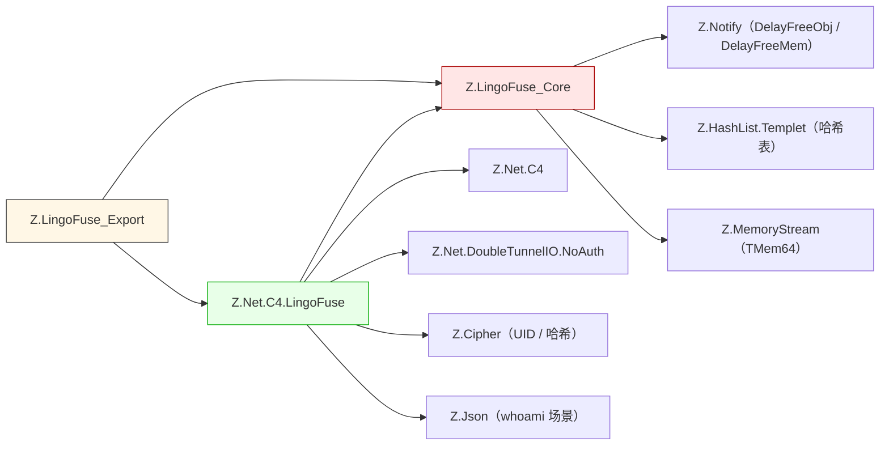

### 1.3 关键设计取舍

| 取舍 | 好处 | 代价 |
|------|------|------|
| **C ABI 而非 COM/C++** | 18 种语言通用 | 无类型安全，无 ABI 版本管理 |
| **句柄而非对象** | 跨语言无类型依赖 | 用户必须显式管理生命周期 |
| **自动回收 + 手动释放双轨** | 兼顾便利与安全 | 用户易误解自动回收是保证 |
| **`TLF_Data` 用 record 而非 class** | 二级内存池可复用，减少堆碎片 | 需要 `New` / `Dispose`，不能继承 |
| **本地优先路由** | 减少网络往返 | 同名 App 会优先本地执行 |
| **服务器本地处理** | 减少不必要转发 | 需要服务器进程本身有能力 |
| **模拟主线程** | C4 依赖主线程，C ABI 层托管 | 每进程只能启动一次 |
| **自动身份注入** | 业务层零侵入拿到发送方身份 | 每次请求载荷增加 40+ 字节 |
| **顺序线程池** | FIFO + 并发 | 线程空闲会退出重建 |
| **三套寻址** | 适配不同路由场景 | 学习成本高，易混用 |
| **同步 / 异步 handle 所有权相反** | 同步简单，异步可流式 | 用户易混用两族的释放规则（见 §4.7） |
| **UID / P2PName 万能路由** | 定向调用无门槛 | App 名寻址的不对称需理解 |

### 1.4 语言支持矩阵

| 语言 | 目录 | 状态 | 一句话说明 |
|------|------|------|------------|
| Pascal | `pascal/` | 🟢 生产就绪 | 原生 FFI，核心引擎来源 |
| Python | `Py/` | 🟢 生产就绪 | `pip install -e .` 即用 |
| C++ | `cpp/` | 🟢 生产就绪 | 唯一有 GitHub CI |
| C# / .NET | `csharp/` | 🟢 生产就绪 | P/Invoke + RAII + `CallbackDispatcher` |
| TypeScript | `ts/` | 🟢 生产就绪 | v2.0，223 项测试 |
| **JavaScript（Node.js）** | `js/` | 🟢 生产就绪 | v2.0，223 项测试，CommonJS + ESM 双入口。**浏览器端 JavaScript 不走此绑定，走 `bridge.py`** |
| Rust | `rust/` | 🟢 生产就绪 | v2.0，174 项测试 |
| Go | `go/` | 🟢 生产就绪 | purego 无 cgo |
| Dart | `dart/` | 🟢 生产就绪 | Flutter 移动端（iOS/Android）可用；Flutter Web 不可用 |
| Java | `java/` | 🟢 生产就绪 | JDK 22+ FFM API |
| Swift | `swift/` | 🟢 生产就绪 | v1.1，261 项 XCTest |
| Zig | `zig/` | 🟢 生产就绪 | 锁定 Zig 0.17.0 |
| Erlang | `erlang/` | 🟢 生产就绪 | OTP 27+ |
| Ruby | `ruby/` | 🟢 生产就绪 | v2.0，331 项测试 |
| Fortran | `fortran/` | 🟢 生产就绪 | 474 项断言 |
| Julia | `julia/` | 🟢 生产就绪 | 强制 `--threads=2` |
| R | `r/` | 🟢 生产就绪 | 四层架构 + Job 队列 |
| **PHP** | `php/` | 🟡 调用者接入 | **经 `bridge.py` HTTP 网关，只能作为调用者**。不是原生 FFI |

**经代码生成器 / 桥接支持**：

| 语言 / 平台 | 方式 | 成熟度 |
|-------------|------|--------|
| Node.js / 浏览器 | `bridge.py` HTTP 网关 | 可用，非原生 |
| Kotlin / Lua / Elixir / Nim / Crystal | 经 LingoFuse-Tools 代码生成器接入 | 生成代码可用，需自行验证 |
| aarch64 / loongarch64 / RISC-V | 边缘设备移植计划 | 持续推进中，未生产就绪 |

### 1.5 工具链生态

| 工具链 | 定位 | 输入 | 输出 | 支持语言 |
|--------|------|------|------|---------|
| **code_decl_to_abi** | 二进制 ABI 生成器 | Pascal 单元 / C 头文件 | Service/Call/Test 源码 + 构建脚本 | **17 种** |
| **code_decl_to_json_abi** | HTTP/JSON ABI 生成器 | Pascal 单元 / C 头文件 | Service/Call/Test 源码 + 构建脚本 | **20+ 种** |

**关键差异**：

| 维度 | code_decl_to_abi | code_decl_to_json_abi |
|------|-----------------|----------------------|
| 线协议 | 二进制（`[status][payload]`） | HTTP POST + JSON |
| 是否需要桥接 | Service 不需要；Call 需要 `bridge.py` | Service 不需要；Call 必须 `bridge.py` |
| 是否需要 LingoFuse 原生库 | Call 侧视语言而定（模式 A 不需要，模式 B 需要） | Service 侧必须；Call 侧视语言而定 |
| 平台支持 | 受 LingoFuse 原生库限制 | 模式 A 的语言支持更广（含移动端、WASM） |
| 适用场景 | 两端都是 LingoFuse 原生，高并发服务 | 一端是浏览器 / 外部 HTTP 客户端 |

**两套工具链的共享内核**：相同的输入格式、相同的中间模型（LV1）、相同的三大家族类型系统。**差异只在生成的目标代码的线格式**。

---

## 第 2 章 核心概念与术语

### 2.1 核心对象

| 对象 | 类型 | 语义 |
|------|------|------|
| **`TDataHnd`** | 不透明指针 | 二进制数据句柄，携带 API 名 + 发送方身份 + 业务载荷 |
| **`TAppHnd`** | 不透明指针 | 逻辑应用容器，可注册多个 API |
| **`TP2P_UID___`** | `array[0..31] of Byte` | 32 字节会话 UID，`TunnelLink` 时生成 |
| **`PP2P_UID___`** | `^TP2P_UID___` | 指向 32 字节 UID 的指针（`LF_Get_P2P_UID` 返回值类型） |
| **`TAppName`** | UTF-8 字符串 | 应用名，网络路由的键 |

**各语言的等价类型**：

| 概念 | Pascal | Python | C++ | C# | Rust | Go | Java | Node.js / TS |
|------|--------|--------|-----|-----|------|-----|------|--------------|
| DataHandle | `TDataHnd` | `DataHandle` | `lingofuse::DataHandle` | `DataHandle` | `data_handle::DataHandle` | `*lingofuse.DataHandle` | `DataHandle` | `DataHandle` |
| AppHandle | `TAppHnd` | `AppHandle` | `lingofuse::App` | `AppHandle` | `AppHandle` | `*lingofuse.AppHandle` | `AppHandle` | `AppHandle` |
| UID | `TP2P_UID___` | `bytes` | `std::array<uint8_t,32>` | `P2PUid` | `Uid` | `sys.TP2P_UID` | `byte[]` | `Uint8Array(32)` |

### 2.2 API 模式

| 模式 | 语义 | 是否等待响应 | 注册函数 |
|------|------|:-----------:|---------|
| **Call** | 请求-响应 | ✅ | `LF_RegisterCall*` |
| **Notify** | 单向通知 | ❌ | `LF_RegisterNotify*` |

**两种模式的跨语言一致性**：

| 语言 | Call 注册 | Notify 注册 | 同步调用 | 异步调用 | Notify |
|------|-----------|-------------|----------|----------|--------|
| Pascal | `LF_RegisterCallEx` | `LF_RegisterNotifyEx` | `LF_CallEx` | `LF_Async_Call` | `LF_NotifyEx` |
| Python | `LF_RegisterCall` | `LF_RegisterNotify` | `LF_Call` | `LF_Async_Call` | `LF_Notify` |
| C++ | `lingofuse::App::registerCall` | `lingofuse::App::registerNotify` | `lingofuse::call` | `lingofuse::callAsync` | `lingofuse::notify` |
| C# | `AppHandle.RegisterCall` | `AppHandle.RegisterNotify` | `Framework.Call` | `Async.Call` | `Framework.Notify` |
| Rust | `AppHandle::register_call` | `AppHandle::register_notify` | `framework::call` | `framework::call_async` | `framework::notify` |
| Go | `AppHandle.RegisterCall` | `AppHandle.RegisterNotify` | `lingofuse.Call` | `lingofuse.CallAsync` | `lingofuse.Notify` |
| Java | `AppHandle.registerCall` | `AppHandle.registerNotify` | `Framework.call` | `Framework.callAsync` | `Framework.notify` |
| Node.js / TS | `app.registerCall` | `app.registerNotify` | `framework.call` | `framework.callAsync` | `framework.notify` |

### 2.3 三套寻址对照

| 寻址 | 索引键 | 路由方式 | 本地命中 | 服务端选择策略 | 典型用途 |
|------|--------|---------|:--------:|---------------|---------|
| **App 名** | UTF-8 字符串 | 精确匹配 App 名 | ✅ | 最久未用 | 固定服务 |
| **UID** | 32 字节二进制 | 按会话 UID 定位 | ✅ | 直接命中 | **定向到具体客户端** |
| **P2PName** | UTF-8 字符串 | 按组名负载均衡 / 粘性 | ❌ | `Cycle_Anchor` / `FixedSequenced` | 同质服务集群 |

### 2.4 三套路由的命中差异

| 调用方式 | 目标端搜索范围 | 命中 App 注册 | 命中 P2P 注册 |
|----------|----------------|:-------------:|:-------------:|
| **UID 调用** | 目标客户端全部已注册 API | ✅ | ✅ |
| **P2PName 调用** | 被选中客户端的全部已注册 API | ✅ | ✅ |
| **App 名调用** | 目标 App 的注册表 | ✅ | ❌ |

**记忆要点**：

- **UID / P2PName 是"客户端级"路由键** —— 先定位到"某个客户端"，再在它的本地 API 表里找。App 注册的和 P2P 注册的函数都在同一张本地表里。
- **App 名是"应用级"路由键** —— 只在该 App 的注册表里找，P2P 注册的函数挂在全局 `___LF_P2P_APP___` 下，不在业务 App 的表里。

### 2.5 生命周期阶段

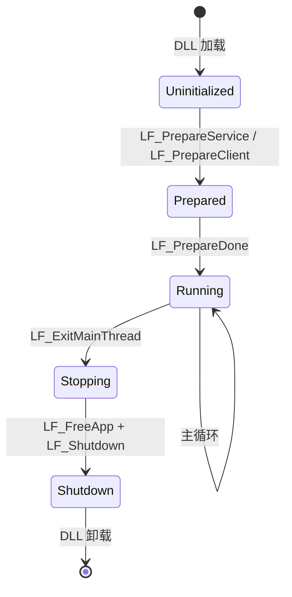

### 2.6 术语速查

| 术语 | 含义 |
|------|------|
| **C4 网格** | LingoFuse 的分布式服务网格，服务器之间的发现、广播、跨节点路由 |
| **TunnelLink** | 客户端与服务端之间的逻辑连接，成功时生成 UID |
| **SelfClient** | Service 进程内部自己连自己的 client，用于让 Service 注册的 API 对 mesh 可见 |
| **Bridge** | `bridge.py` / `bridge.exe`，HTTP ↔ RPC 转发工具 |
| **Beacon** | 注册 agent 工具的 LingoFuse 服务（默认 `agent_main_app`） |
| **UID 万能路由** | 知道某客户端的 UID，就能调用其注册的任何 API，不依赖 App 名 |
| **本地短路** | 目标在本地进程内，调用不走网络，直接本地执行 |
| **服务器本地处理** | 请求到服务器后，服务器本地能处理就不转发 |
| **Sequenced 族** | 序列化调用/通知，按路由键 FIFO |
| **Side data** | 发送方在发送请求时自动写入的身份元数据（`FromUID` / `FromP2PName`） |
| **Auto recycle handle** | `LF_CreateData` 创建的句柄，10 分钟空闲后自动回收 |
| **Permanent handle** | `LF_CreateData_Permanent` 创建的句柄，不会自动回收 |
| **Cycle_Anchor** | P2PName 路由的负载均衡机制，按"最久未用"选择 UID |
| **Fixed_Sequenced_Time** | P2PName 路由的粘性窗口，默认 20 秒 |
| **ABI 线格式** | `[status:uint8_t][payload]`，status `0x00` = 成功，`0xFF` = 失败 |
| **LV0 JSON** | 解析器原始输出，含源文本位置、原始类型拼写、修饰符 |
| **LV1 Model** | 规范化后的中间模型，所有生成器的唯一输入 |

---

## 第 3 章 生命周期与初始化（多语言）

### 3.1 典型初始化顺序（跨语言统一）

**Service 侧**：

```
prepareService(endpoint, endpoint)
    → 创建 App
    → 注册 API（LF_RegisterCallEx / registerCall / ...）
    → prepareClient(endpoint, App)
    → prepareDone()
```

**Pascal 侧的完整示例**：

```pascal
uses
  SysUtils,
  lingofuse_import,
  <Unit>_abi_service_unit;

var
  App: TAppHnd___;
begin
  LF_ResetPrepare();
  LF_Set_Opt_Quiet(True);
  LF_Set_Opt_ConsoleOutput(True);

  LF_PrepareServiceEx('ipc:<Unit>_abi', 'ipc:<Unit>_abi');

  App := LF_CreateAppEx(DEFAULT_APP_NAME, DEFAULT_APP_DESC);
  if App = nil then Halt(1);

  Register_All_ABI_APIs(App);

  LF_Set_Opt_P2P_Name('<Unit>_service_test_p2p');
  Register_All_P2P_ABI_APIs();

  if LF_PrepareClientEx('ipc:<Unit>_abi', App) = -1 then
  begin
    LF_FreeApp(App);
    Halt(1);
  end;

  if LF_PrepareDone() <> 1 then
  begin
    LF_ExitMainThread();
    LF_FreeApp(App);
    LF_Shutdown();
    Halt(1);
  end;

  ReadLn;

  LF_ExitMainThread();
  LF_FreeApp(App);
  LF_Shutdown();
end.
```

**Python 侧**：

```python
from lingofuse._lf_native import (
    LF_ResetPrepare, LF_PrepareService, LF_PrepareClient, LF_PrepareDone,
    LF_CreateApp, LF_RegisterCall, LF_RegisterNotify,
    LF_ExitMainThread, LF_Shutdown,
)
from lingofuse.lf_io import cstr

ENDPOINT = "ipc:<Unit>_http_json"

LF_SetOptionEx("Wait_Connection_ReadyOk", "False")
LF_SetOptionEx("Overlap_Connection", "True")
LF_ResetPrepare()

LF_PrepareService(cstr(ENDPOINT), cstr(ENDPOINT))

app = LF_CreateAppEx(cstr("<Unit>"), cstr("HTTP/JSON service for <Unit>"))
LF_RegisterCallEx(app, cstr("Add"), cstr("Adds two integers"), None, callback_add)
LF_RegisterCallEx(app, cstr("Sub"), cstr("Subtracts b from a"), None, callback_sub)

LF_PrepareClient(cstr(ENDPOINT), app)
if LF_PrepareDone() != 1:
    raise RuntimeError("prepare_done failed")

import signal
signal.pause()

LF_ExitMainThread()
app.free()
LF_Shutdown()
```

**C++ 侧**：

```cpp
#include "LingoFuse.hpp"
#include "<Unit>_http_json_service.hpp"

int run_service() {
    lingofuse::LibraryLoader loader;   // 加载 LingoFuse64.dll

    lingofuse::setOption("Wait_Connection_ReadyOk", "False");
    lingofuse::setOption("Overlap_Connection", "True");
    lingofuse::resetPrepare();

    if (lingofuse::prepareService("<Unit>_http_json_endpoint",
                                  "<Unit>_http_json_endpoint") < 0) {
        return 1;
    }

    {
        lingofuse::App app("<Unit>", "HTTP/JSON service for <Unit>");
        if (!app) return 1;

        register_all_http_json_apis(app);

        if (lingofuse::prepareClient("<Unit>_http_json_endpoint", app.get()) < 0) {
            return 1;
        }

        if (lingofuse::prepareDone() != 1) {
            return 1;
        }

        std::signal(SIGINT, _on_signal);
        while (!g_stop_requested.load()) {
            std::this_thread::sleep_for(std::chrono::milliseconds(500));
        }

        lingofuse::exitMainThread();
    }

    lingofuse::shutdown();
    return 0;
}
```

**C# 侧**：

```csharp
public static int RunService() {
    Framework.SetOption("Wait_Connection_ReadyOk", "False");
    Framework.SetOption("Overlap_Connection", "True");
    Framework.ResetPrepare();

    if (Framework.PrepareService(AppInfo.Endpoint, AppInfo.Endpoint) < 0) {
        Console.Error.WriteLine("[FATAL] PrepareService failed");
        return 1;
    }

    AppHandle? app = null;
    try {
        app = new AppHandle(AppInfo.Name, AppInfo.Desc);
        RegisterAPIs(app);

        if (Framework.PrepareClient(AppInfo.Endpoint, app) < 0) {
            Console.Error.WriteLine("[FATAL] PrepareClient failed");
            return 1;
        }

        if (Framework.PrepareDone() != 1) {
            Console.Error.WriteLine("[FATAL] PrepareDone failed");
            return 1;
        }

        var stop = new ManualResetEventSlim(false);
        Console.CancelKeyPress += (s, e) => { e.Cancel = true; stop.Set(); };
        while (!stop.IsSet) Thread.Sleep(500);

        return 0;
    } finally {
        try { NetworkEvents.Clear(); } catch { }
        try { Framework.ExitMainThread(); } catch { }
        try { app?.Dispose(); } catch { }
        try { Framework.Shutdown(); } catch { }
    }
}
```

**Rust / Go / Java / Node.js / TS / Erlang / Julia / Zig / Swift / Ruby / Fortran / Dart / R 的初始化顺序**：与 Pascal 完全一致（`prepareService` → 创建 App + 注册 API → `prepareClient` → `prepareDone`），**区别只在方法名与参数形式**。详见 §20 各语言逐一展开。

### 3.2 初始化各阶段详解

#### 3.2.1 `LF_ResetPrepare`

**作用**：清空 `Prepare_Commands`（待执行的服务/客户端脚本列表）和 `AppHnd_Bind_Tag_List`。

**何时调用**：
- **首次初始化前**：无害，建议调用。
- **重新初始化前**：**必须**调用，否则重复地址会报 `prepare error: repeat listen/connection`。

**机理**：内部把 `Prepare_Commands` 和 `AppHnd_Bind_Tag_List` 都 `Clear`，重置 `Tag_Seed` 相关状态。

#### 3.2.2 `LF_PrepareService`

**签名**：`function LF_PrepareService(ListeningAddr, PhysicsAddr: PAnsiChar): Integer`

**参数**：
- `ListeningAddr`：本地监听地址，如 `0.0.0.0:9898` / `ipc:my_app`。
- `PhysicsAddr`：对外通告地址，如 `192.168.1.100:9898` / `ipc:my_app`。

**返回**：`Tag_Seed`（≥ 1 递增整数）；重复地址返回 -1。

**机理**：
1. 把地址存到 `Prepare_Commands`（不立即启动服务）。
2. 内部生成 C4 脚本命令 `Service("Listen", "Host", Port, "LingoFuse@Tag=N")`。
3. 若 `Init_Succeeded and Simulated_Main_Thread_Running`（已调用过 `PrepareDone` 且主线程活跃），立即在 `MainThreadProgress` 投递执行。

**端口默认**：不指定端口时默认 `9898`。**IPC 模式**：地址以 `ipc:` 开头时端口参数被忽略。

#### 3.2.3 `LF_PrepareClient`

**签名**：`function LF_PrepareClient(PhysicsAddr: PAnsiChar; appHnd: TAppHnd): Integer`

**参数**：
- `PhysicsAddr`：服务端地址。
- `appHnd`：要绑定的 App，可为 `nil`（仅建隧道）。

**返回**：`Tag_Seed`；重复地址（`Overlap_Connection=False` 时）返回 -1。

**机理**：
1. 内部生成 C4 脚本命令 `KeepAlive("Host", Port, "LingoFuse@Tag=N")`。
2. `Overlap_Connection=True` 时用 `NewKeepAlive` 命令。
3. 记入 `AppHnd_Bind_Tag_List`，等 C4 客户端连接成功后通过 `ClientConnected` 事件自动绑定 App。

#### 3.2.4 `LF_PrepareDone`

**签名**：`function LF_PrepareDone: Integer`

**返回**：1 = 成功；0 = 失败或已启动。

**机理**：
1. 若 `Simulated_Main_Thread_Running` 已为 True，**立即返回 0**（防止重复启动）。
2. 调用 `Open_Core_Dispatch_Thread` 启动 C4 调度器。
3. 调用 `Begin_Simulator_Main_Thread(Simulated_Main_Thread)` 启动模拟主线程。
4. **阻塞等待**：最多 `max(Wait_Connection_Timeout, 5000) + 1000` 毫秒。
5. 返回 `if_(Init_Succeeded, 1, 0)`。

**关键陷阱**：**超时后仍可能返回 1**（见 `LF-NET-007`）。

#### 3.2.5 `LF_ExitMainThread`

**签名**：`procedure LF_ExitMainThread`

**机理**：
1. 置 `Simulated_Main_Thread_Running := False`。
2. **等待主线程完全退出**（`Simulator_Main_Thread_Activted` 变 False）。

**主线程退出前清理**（`Simulated_Main_Thread` 末尾）：
1. `C40Clean`（清理 C4 状态）
2. `LF_Notify_Sequence_Thread_Pool.Stop`
3. `LF_DataPool.Free_All_Hnd`（**释放所有数据句柄，包括 permanent**）
4. `LF_DataMemory.Free_All_PLF_Data_Memory`

**关键陷阱**：之后**不能再用任何数据句柄**（见 `LF-MECH-003`）。

### 3.3 完整状态标志

| 标志 | 含义 | 检查 API |
|------|------|---------|
| `Init_In_Progress` | 主线程初始化中 | 无 |
| `Init_Succeeded` | 初始化成功 | `LF_CheckMainThread` 间接反映 |
| `Simulated_Main_Thread_Running` | 主线程模拟器运行中 | `LF_CheckMainThread()` = 1 |
| `Simulator_Main_Thread_Activted` | 底层线程活跃 | `LF_CheckMainThread()` = 1 |

### 3.4 各语言初始化踩坑速查

| 语言 | 症状 | 根因 | 修复 |
|------|------|------|------|
| **Pascal** | `LF_PrepareDone` 返回 0 | 同一进程已调用过 | 重启进程 |
| **Pascal** | `LF_BindApp` 返回 0 | 主线程未启动 | 确保 `LF_PrepareDone` 返回 1 |
| **Python** | `ModuleNotFoundError: lingofuse` | 未安装 | `pip install py-lingofuse` |
| **Python** | 回调内崩溃 | 回调外持有 handle | 回调内完成所有操作 |
| **C++** | `LF_PrepareClient returned -1` | 端点已被占用 | 换端点或杀旧进程 |
| **C++** | `LF_PrepareDone failed` | 同一进程已调用过 | 重启进程 |
| **C++** | `Can't find unit Z.Core` | `-Fu` 路径没配 | 加 `-Fu<ZCore 路径>` |
| **C#** | `DllNotFoundException: LingoFuse64` | DLL 未复制 | 复制到 bin 目录 |
| **C#** | `CS0017: Program has more than one entry point` | 库文件有 `Main` | 库必须无 `Main`，测试程序独立 |
| **C#** | `Could not load type 'lingofuse.AppHandle'` | LingoFuse.dll 引用缺失 | `dotnet add reference` |
| **Rust** | `linking with cc failed` | 缺 C 链接器 | 装 MSVC Build Tools 或 gcc |
| **Rust** | `lingofuse not found` | 未 `cargo add` | `cargo add lingofuse --path ../LingoFuse/rust` |
| **Go** | `module github.com/PassByYou888/LingoFuse not found` | 未 `go get` | `go get github.com/PassByYou888/LingoFuse/go` |
| **Go** | cgo 相关错误 | `CGO_ENABLED=0` | `CGO_ENABLED=1 go build` |
| **Java** | `UnsatisfiedLinkError: LingoFuse64` | 原生库缺失 | 加到 `-Djava.library.path` |
| **Java** | `ClassNotFoundException: lingofuse.AppHandle` | `lingofuse.jar` 缺失 | 装 LingoFuse Java 包 |
| **Java** | `ClassNotFoundException: jackson.databind.JsonNode` | Jackson 缺失 | 下载 `jackson-databind.jar` |
| **Node.js** | `prepareService failed` | 端点已被占用 | 换端点或杀旧进程 |
| **Node.js** | 进程提前退出 | `AsyncBridge` 的 timer 被 `unref` | 删除 `unref()` 调用 |
| **TypeScript** | `tsc --noEmit` 报错 | `lingofuse-ts/package.json` 的 `exports` 指向错误 | 修正 `exports` 加 `./dist/` 前缀 |
| **Erlang** | `no such file or directory: lingofuse_nif.dll` | NIF 缺失 | `setup_erlang_tests.ps1` 会复制 |
| **Erlang** | `app_not_registered` | App 未在 15 秒内可见 | 检查 `wait_self_registered` 超时 |
| **Julia** | `--threads=2 or more required` | 单线程 | 加 `--threads=2` |
| **Julia** | `prepare_client returned -1` | 端点已被占用 | 换端点或杀旧进程 |
| **Zig** | `framework.init failed` | LingoFuse64.dll 缺失 | 复制到 `zig_service_test/` |
| **Swift** | `libraryLoadFailed` | `liblingofuse.dylib` 缺失 | 复制到可执行文件旁 |
| **Swift** | `prepareServiceFailed` | 端点已被占用 | 换端点或杀旧进程 |
| **Ruby** | `cannot load such file -- lingofuse` | gem 未安装 | `gem install lingofuse` |
| **Ruby** | 进程不退出 | `NativeBridge` 线程未 join | 生成代码已用 `exit!` 强制退出 |
| **Ruby** | `$C0000005` Access Violation | dispatcher 线程在 DLL 卸载后运行 | `at_exit` 块按顺序清理 |
| **Fortran** | `gfortran: command not found` | 未装 | `apt install gfortran` 或 MinGW-w64 |
| **Fortran** | `undefined reference to 'lf_*'` | `lf_fortran.cpp` 未链接 | 用 `setup_fortran_tests.ps1` |
| **Dart** | `Error: Couldn't resolve the package 'lingofuse'` | 未 `dart pub get` | `dart pub get` |
| **Dart** | `prepareDone returned false` | `Wait_Connection_ReadyOk` 未关 | 设置 `False` |
| **R** | `Package 'lingofuse' is required` | 未装 | `setup_r_tests.ps1 -InstallMissing` |
| **R** | `Cannot locate the LingoFuse runtime` | 未设 `LINGOFUSE_RUNTIME` | 设环境变量 |

---

# 第二部分 API 详细参考

## 第 4 章 数据句柄完整参考

### 4.1 数据句柄的本质

`TDataHnd___ = Pointer`，指向内部 `TLF_Data` record（`Z.LingoFuse_Core.pas`）。

**`TLF_Data` record 结构**（源码）：

```pascal
TLF_Data = record
private
  auto_recycle___: boolean;      // LF_CreateData=True；LF_CreateData_Permanent=False
  deleted___: boolean;
  updated___: boolean;
  calling___: TAtomInt;           // 进行中的远程调用数
  time___: TTimeTick;
  class procedure Free_Data___(hnd: PLF_Data); static;
public
  Data_Param: TMemory_Param_Tool; // 输入模式：非 nil
  Data_Result: TMem64;            // 输出模式：非 nil
  Data_Info: TLF_String;
end;
```

**关键设计**：
- **`Data_Param` 与 `Data_Result` 互斥**：同一句柄只有一个非 nil。
  - **输入句柄**（`New_Param` / `New_Param_From`）：`Data_Param <> nil`，携带 `FromUID` / `FromP2PName` / `apiName` / `Param`。
  - **输出句柄**（`New_Result` / `New_Result_From`）：`Data_Result <> nil`，只有结果字节。
- **`calling___` 计数器**：远程调用进行中时 > 0，保护句柄不被超时回收。
- **`updated___` 标志**：任何读写操作都置 True，让扫描知道句柄仍活跃。

### 4.2 数据句柄生命周期

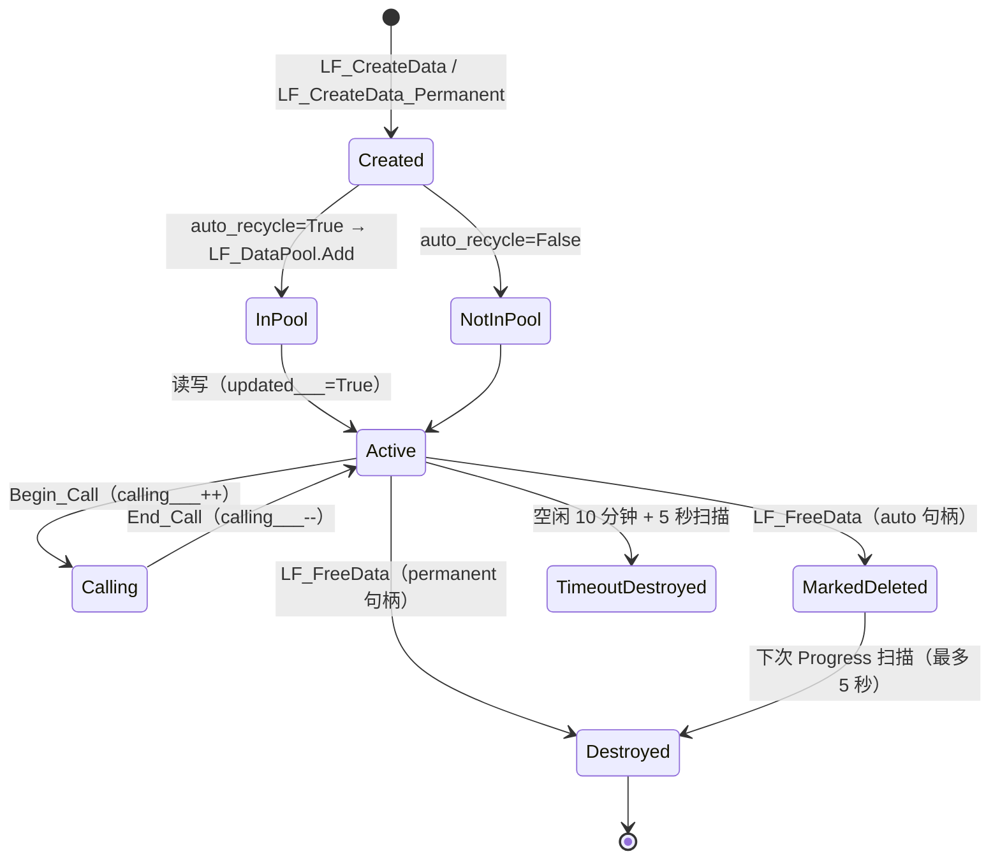

### 4.3 创建与释放 API

#### 4.3.1 `LF_CreateData(MethodName: PAnsiChar): TDataHnd`

**内部机理**：
1. 内部 `TLF_Data.New_Param(apiName, auto_recycle=True)`：
   - 从 `LF_DataMemory.Get_New_PLF_Data` 取一个 `TLF_Data` record（或 `New`）。
   - 设 `auto_recycle___ := True`。
   - 创建 `Data_Param := TMemory_Param_Tool.Create`，把 `apiName` 存入。
   - 加入 `LF_DataPool`。
2. 返回 `PLF_Data` 指针作为 `TDataHnd___`。

**副作用**：
- **加入自动回收池**：10 分钟空闲后被 `TLF_DataPool.Progress` 释放。
- **`LF_FreeData` 后只标记**：`deleted___ := True`，不立即释放。

**辅助**：`LF_CreateDataEx(MethodName: string)` 自动 UTF-8 转换。

#### 4.3.2 `LF_CreateData_Permanent(MethodName: PAnsiChar): TDataHnd`

**内部机理**：
1. 内部 `TLF_Data.New_Param(apiName, auto_recycle=False)`：
   - 从 `LF_DataMemory` 取 record。
   - **不加入 `LF_DataPool`**。
   - 设 `auto_recycle___ := False`。
2. **`LF_FreeData` 会同步立即释放**（不是标记）。

**适用场景**：跨整个进程生命周期的请求模板。

**关键陷阱**：
- **"永久"不等于"永不释放"**：必须显式 `LF_FreeData`。
- **初始化窗口创建会泄漏**：`LF_PrepareDone` 之前 / `LF_ExitMainThread` 之后，`LF_FreeData` 是 **no-op**（因为 `Simulator_Main_Thread_Activted` 为 False）。

#### 4.3.3 `LF_FreeData(Hnd: TDataHnd)`

**内部机理**：
```pascal
procedure TLF_Data.Free_Data(hnd: PLF_Data);
begin
  if hnd = nil then exit;
  if hnd^.auto_recycle___ then
      hnd^.deleted___ := True       // 只标记，等扫描
  else TLF_Data.Free_Data___(hnd);  // 永久句柄：立即释放
end;
```

**注意**：
- **自动回收句柄**：只标记 `deleted___ := True`，实际释放最多延迟 5 秒。
- **永久句柄**：立即 `Free_Data___`（释放 `Data_Param` / `Data_Result` / `calling___`，record 推回 `LF_DataMemory`）。

#### 4.3.4 各语言 DataHandle 的创建与释放

| 语言 | 创建 | 释放 | 注意 |
|------|------|------|------|
| Pascal | `LF_CreateDataEx(api)` | `LF_FreeData(hnd)` | 输入句柄不释放，返回句柄必须释放 |
| Python | `DataHandle(api)` | `hnd.dispose()` | 异步回调内不得 dispose `Result_` |
| C++ | `lingofuse::DataHandle(api)` | `.dispose()` / RAII | 异步回调内不 dispose `Result_` |
| C# | `new DataHandle(api)` | `.Dispose()` / `using` | 异步回调内不 dispose `Result_` |
| Rust | `DataHandle::new(api)` | `.drop()` / RAII | 异步回调内不 dispose `Result_` |
| Go | `lingofuse.NewDataHandle(api)` | `.Close()` / `defer` | 异步回调内不 Close `Result_` |
| Java | `new DataHandle(api)` | `.close()` / try-with-resources | 异步回调内不 close `Result_` |
| Node.js / TS | `new DataHandle(api)` | `.dispose()` | 异步回调外不 dispose；param 延迟 dispose |

### 4.4 读写操作 API

#### 4.4.1 `LF_GetBuffer(Hnd): Pointer`

**内部机理**：
```pascal
function TLF_Data.GetBuffer: Pointer;
begin
  Result := nil;
  if Data_Param <> nil then
      Result := Data_Param.Param.Memory
  else if Data_Result <> nil then
      Result := Data_Result.Memory;
  updated___ := True;    // 刷新时间戳
end;
```

**关键**：
- **返回内部缓冲指针**。`LF_WriteBuffer` / `LF_SetSize` 后可能失效（重分配）。
- **副作用**：`updated___ := True`，重置 10 分钟空闲倒计时。

#### 4.4.2 `LF_WriteBuffer(Hnd, Buff, Size): Int64`

**内部机理**：
```pascal
function TLF_Data.WriteBuff(Buff: Pointer; Size: Int64): Int64;
begin
  Result := 0;
  if Data_Param <> nil then
      Result := Data_Param.Param.WritePtr(Buff, Size)
  else if Data_Result <> nil then
      Result := Data_Result.WritePtr(Buff, Size);
  updated___ := True;
end;
```

**关键**：
- 从**当前位置**写入，位置前进。
- 内部 `TMem64.WritePtr` 自动扩容。
- **副作用**：刷新时间戳。

#### 4.4.3 位置与大小操作

| API | 内部机理 | 副作用 |
|-----|---------|--------|
| `LF_GetPos` | 返回 `Data_Param.Param.Position` 或 `Data_Result.Position` | 刷新时间戳 |
| `LF_SetPos` | 设置 `Position`；超出大小隐式扩容 | 刷新时间戳 |
| `LF_GetSize` | 返回 `Data_Param.Param.Size` 或 `Data_Result.Size` | 刷新时间戳 |
| `LF_SetSize` | 调整大小；新增空间**未初始化** | 刷新时间戳 |

### 4.5 原子类型读写 API

所有类型都是**小端字节序**（`Move` 直接写内存，依赖主机字节序）。

| 写入 | 读取（out）| 读取（无 out）|
|------|-----------|--------------|
| `LF_WriteInt8` ~ `LF_WriteDouble` | `LF_ReadInt8` ~ `LF_ReadDouble` | 同左 |
| `LF_WriteString` | `LF_ReadString`（out）| `LF_ReadString` |
| `LF_WriteStringBytes` | `LF_ReadStringBytes`（out）| `LF_ReadStringBytes` |

#### 4.5.1 `LF_WriteString` 的特殊行为

**内部机理**：
```pascal
function LF_WriteString(Hnd: TDataHnd___; const Value: string): boolean;
var utf8: TBytes; len: integer;
begin
  if Value = '' then
  begin
    Result := LF_WriteUInt8(Hnd, 0);   // 空字符串也写一个 #0
    Exit;
  end;
  utf8 := TEncoding.UTF8.GetBytes(Value);
  len := Length(utf8);
  LF_WriteBuffer(Hnd, @utf8[0], len);
  Result := LF_WriteUInt8(Hnd, 0);     // 总是追加 #0
end;
```

**关键**：**总是追加 #0**。跨语言传输 JSON 时，接收方（如 Python）需要剥离尾部 #0。

#### 4.5.2 `LF_ReadString` 的容错模式

**内部机理**：
```pascal
function LF_ReadString(Hnd: TDataHnd___; out Value: string): boolean;
var p: PByteArray; b, e, sz: int64;
begin
  p := LF_GetBuffer(Hnd);
  sz := LF_GetSize(Hnd);
  b := LF_GetPos(Hnd);
  e := b;
  while (e < sz) and (p^[e] <> 0) do Inc(e);  // 扫描到 #0
  // ...
  LF_SetPos(Hnd, e + 1);                      // 跳过 #0
  Value := UTF8ToString(Buff);
end;
```

**关键**：**扫描到 #0 停止**；**若缓冲区末尾都没有 #0，读到末尾**（容错模式）。若后续还有数据，会一起被读走（见 `LF-DATA-004`）。

#### 4.5.3 `LF_ReadStringBytes` / `LF_WriteStringBytes`

**不追加 #0**，直接用 NUL 作为终止符。适合传输原始字节（如 JSON body）。

### 4.6 P2P 信息查询 API

> **⚠️ 使用前提（必读）**：`LF_Get_P2P_UID` 和 `LF_Get_P2P_Name` **不是"读句柄本身的业务数据"**，而是**从输入句柄侧读取"发送方在发送请求时自动写入的 P2P 身份元数据"**。
>
> - **数据来源**：发送方构造请求时，由客户端 `TC40_LF_Client.Send_*` 系列方法内部调用 `TMemory_Param_Tool.Rebuild_UID_and_P2PName`，把 `FromUID`（32 字节）+ `FromP2PName`（UTF-8 字符串）**自动写入到请求载荷的前部**。接收方拿到的 `Input` 句柄中 `Data_Param.FromUID` / `Data_Param.FromP2PName` 就是这两个值。**无需业务层手动传递**（见第 10 章）。
> - **只能在"触发事件的回调"的 `Input` 参数中使用**：只有**从网络（或经 `Send_*` 路径的本地调用）"接收"到的输入句柄**才携带这两个字段。
> - **不能在"自己创建"的句柄上使用**：`LF_CreateData` / `LF_CreateData_Permanent` 创建的输入句柄，其 `FromUID` 为 `Null_UID()`、`FromP2PName` 为空——因为没有"发送方"。
> - **不能在输出句柄上使用**：`Output`（Call 模式的结果句柄）只有 `Data_Result`，没有 `Data_Param`；调用这两个函数会打印警告并返回空值。
> - **典型可用位置**：
>   - `On_Call(Trigger, Input, Output)` 里的 `Input`。
>   - `On_Notify(Trigger, Input)` 里的 `Input`。
>   - `LF_Call` 命中本地短路时的回调 `Input`。
> - **典型不可用位置**：
>   - `LF_LocalCall` / `LF_LocalNotify` 回调里的 `Input`（**不经过 `Rebuild_UID_and_P2PName`**，见 §5.6、`LF-LOCAL-001`）。
>   - `LF_Async_Call` 的 `OnResult(Data, Result_)` 里的 `Result_`（它是**输出句柄**）。
>   - 你自己 `LF_CreateData` 出来的请求句柄（没有"发送方"）。

#### 4.6.1 `LF_Get_P2P_UID(Hnd): PP2P_UID___`

**签名**（`lingofuse_import.pas`）：
```pascal
function LF_Get_P2P_UID(Hnd: TDataHnd___): PP2P_UID___; cdecl; external liblingofuse name 'LF_Get_P2P_UID';
```

**内部机理**（`Z.LingoFuse_Export.pas`）：
```pascal
function LF_Get_P2P_UID(Hnd: TDataHnd___): PP2P_UID___;
begin
  New(Result);                                  // ← 分配指针
  if (Hnd <> nil) and (PLF_Data(Hnd)^.Data_Param <> nil) then
      Result^ := PLF_Data(Hnd)^.Get_P2P_UID()   // ← 从 Data_Param.FromUID 拷贝
  else Result^ := Null_UID();
  DelayFreeMem(5.0, Result);                    // ← 5 秒后自动释放
end;
```

**契约**：
- **返回 `PP2P_UID___` 指针**，指向 32 字节 `TUID___`。
- **只对输入句柄有效**（`Data_Param <> nil`）。对输出句柄 / 自建句柄调用会警告 + 返回 `Null_UID()`。
- **`Hnd = nil` 时仍走 `New(Result)` + `DelayFreeMem`**。返回非 NULL 指针指向全零 UID。
- **并发安全**：每次调用独立分配独立延迟释放，互不影响。
- **标准用法（Pascal 侧）**：
  ```pascal
  var
    UID: TP2P_UID___;
    UIDPtr: PP2P_UID___;
  begin
    UIDPtr := LF_Get_P2P_UID(Input);    // 返回指针
    if UIDPtr <> nil then
        UID := UIDPtr^;                 // 立即解引用拷贝；框架约 5 秒后释放指针
    // ... 使用 UID ...
  end;
  ```

#### 4.6.2 `LF_Get_P2P_Name(Hnd): PAnsiChar` / `LF_Get_P2P_NameEx(Hnd): string`

**契约**：
- **只对输入句柄有效**。对输出句柄 / 自建句柄调用返回 `''`。
- **返回指针 5 秒后自动释放**（`Z.Notify.DelayFreeMem(5.0, Result)`）。**必须立即复制**。
- 推荐用 `LF_Get_P2P_NameEx` 自动复制。
- 数据来源：发送时由 `Rebuild_UID_and_P2PName` 写入的 `FromP2PName` 字段。

#### 4.6.3 各语言的身份读取对照

| 语言 | UID 读取 | P2PName 读取 | 注意事项 |
|------|---------|-------------|---------|
| Pascal | `LF_Get_P2P_UID(Input)` 返回 `PP2P_UID___` | `LF_Get_P2P_NameEx(Input)` | 立即解引用拷贝 |
| Python | `inp.get_p2p_uid()` 返回 `bytes` | `inp.get_p2p_name()` 返回 `str` | 内部立即拷贝 |
| C++ | `inp.getP2PUid()` 返回 `std::array<uint8_t,32>` | `inp.getP2PName()` 返回 `std::string` | 立即拷贝 |
| C# | `input.P2PUid` 返回 `P2PUid` | `input.P2PName` 返回 `string` | 立即拷贝 |
| Rust | `input.p2p_uid()` 返回 `Uid` | `input.p2p_name()` 返回 `&str` | 立即拷贝 |
| Go | `inp.GetP2PUID()` 返回 `(sys.TP2P_UID, error)` | `inp.GetP2PName()` 返回 `(string, error)` | 立即拷贝 |
| Java | `in.getP2pUid()` 返回 `byte[]` | `in.getP2pName()` 返回 `String` | 立即拷贝 |
| Node.js / TS | `inp.getP2PUid()` 返回 `Uint8Array` | `inp.getP2PName()` 返回 `string` | 立即拷贝 |
| Erlang | `Identity` map 的 `uid` / `p2p_name` 字段 | — | 通过 `with_identity => true` 获得 |
| Julia | `input.uid` / `input.p2p_name` | — | 通过回调参数获得 |
| Zig | `input.p2pUid()` / `input.p2pName()` | — | 立即拷贝 |
| Swift | `input.p2pUid()` 返回 `Uid` | `input.p2pName()` 返回 `String` | 立即拷贝 |
| Ruby | `input.p2p_uid` 返回 `String`（32 字节二进制） | `input.p2p_name` 返回 `String` | 立即拷贝 |
| Fortran | `lf_data_get_p2p_uid(input, uid)` | `lf_data_get_p2p_name(input, p2p_name)` | 立即拷贝 |
| Dart | `ctx.senderUid` 返回 `Uint8List` | `ctx.senderP2PName` 返回 `String` | 回调参数 |
| R | `ctx$sender_uid` 返回 `raw(32)` | `ctx$sender_p2p_name` 返回 `character` | 回调参数 |

### 4.7 Handle 所有权模型

> **这是本指南第三核心的一节**。所有跨语言集成者必须清楚：**同步族与异步族返回的 handle 所有权完全相反**。二者的函数签名、返回类型、外观都相同，但契约相反。

#### 4.7.1 两大调用家族的 Handle 所有权对比

LingoFuse C ABI 有**两大调用家族**：

| 家族 | 函数 | 返回 handle 的所有者 | 释放方式 |
|------|------|:-------------------:|---------|
| **同步族** | `LF_Call` / `LF_UID_Call` / `LF_P2PNAME_Call` | **调用者** | 调用者显式 `LF_FreeData` |
| **异步族** | `LF_Async_Call` / `LF_UID_Async_Call` / `LF_P2PNAME_Async_Call` | **框架** | 回调返回后**立即**由框架释放 |

**源码依据**：

**同步族**（`Z.LingoFuse_Export.pas`）：

```pascal
function LF_Call(appName: pansichar; Param: TDataHnd___; Timeout_: uint64): TDataHnd___;
begin
  ...
  Output := Cli.Wait_Execute_Call(...);
  ...
  // ← auto_recycle = True，调用者拥有
  Result := TLF_Data.New_Result_From(Output, True);
  ...
end;
```

**异步族**（`Z.Net.C4.LingoFuse.pas` 的 `TLF_Async_Call_Bridge.Do_Th`）：

```pascal
procedure TLF_Async_Call_Bridge.Do_Th;
var
  result_param_: PLF_Data;
begin
  // ← auto_recycle = False，框架拥有
  result_param_ := TLF_Data.New_Result_From(Result_M64.Swap_To_New_Instance, False);
  try
    if Assigned(OnResult) then
      OnResult(Data_, result_param_);  // ← 回调拿到指针
  except
  end;
  // ← 立即释放！不是"~1 秒后"，不是"延迟"，是立即。
  TLF_Data.Free_Data(result_param_);
  DelayFreeObj(1.0, Self);             // ← 1 秒后释放的是 Bridge 对象，不是 handle
end;
```

**关键差异**：

- `New_Result_From(..., True)` → `auto_recycle = True` → `LF_FreeData` 只是标记，**真正释放延迟到池扫描**。
- `New_Result_From(..., False)` → `auto_recycle = False` → `LF_FreeData` **立即同步释放**。

#### 4.7.2 异步族 Handle 的"死亡时刻"

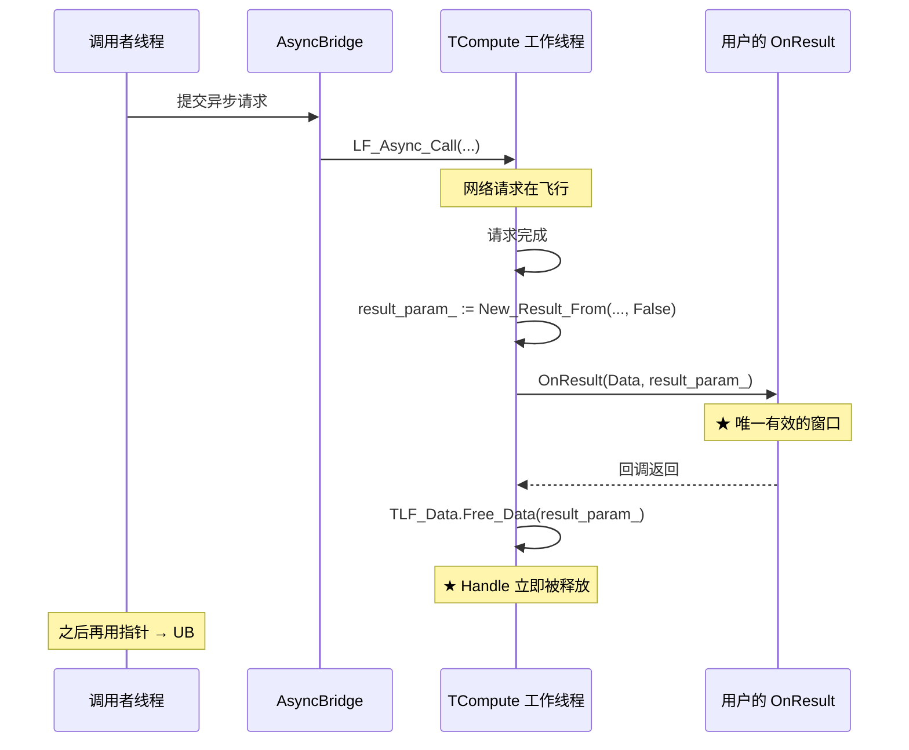

**契约**：

- 回调返回后，handle **立即失效**。
- 在回调外使用该 handle 是**未定义行为**（use-after-free）。
- 调用 `LF_FreeData` 是**双重释放**（double-free）。

#### 4.7.3 为什么违反契约会"偶尔正常、偶尔失败"

**根本原因**：`Free_Data` 是**池化回收**：

```pascal
class procedure TLF_Data.Free_Data___(hnd: PLF_Data);
begin
  hnd^.Data_Info := '';
  DisposeObjectAndNil(hnd^.Data_Param);
  DisposeObjectAndNil(hnd^.Data_Result);   // ← TMem64 被释放
  DisposeObjectAndNil(hnd^.calling___);
  LF_DataMemory.Free_PLF_Data(hnd);        // ← PLF_Data 回池
end;
```

**UB 的表现取决于**：

- 分配器是否已经复用这块内存。
- 其它线程是否在同一时刻分配了新的 `TMem64`。
- 线程调度是否让调用者线程在 `Free_Data` 之后才运行。

**因此**：

| Payload 特征 | 表现 | 原因 |
|-------------|------|------|
| **小 payload**（比如返回 `int 7`，2 字节） | 通常"看起来正常" | 分配器还没复用这块小内存 |
| **大 payload**（比如返回 dict，17+ 字节） | 通常"返回空/垃圾" | 有更大概率已被复用 |

**⚠️ 这是最容易误诊的场景**：用"`int` vs `dict`"这样的**类型二分法**会误导诊断。它不是"类型差异"，是"payload 大小影响内存复用时机"。**二分法要问对问题**。

#### 4.7.4 各语言的正确使用模式

**Pascal**：

```pascal
// 模式 A：同步调用（推荐用于网关/代理场景）
res_ptr := LF_Call(app, hnd, timeout_ms);
try
  LF_SetPos(res_ptr, 0);            // 重置位置
  result_bytes := read_string_bytes(res_ptr);
finally
  LF_FreeData(res_ptr);             // ← 合法，调用者拥有
end;

// 模式 B：异步调用（必须在回调内完成所有事）
procedure OnResult(Data, res_ptr: Pointer); cdecl;
begin
  // ✓ 在这个回调内 handle 有效
  LF_SetPos(res_ptr, 0);
  data := read_string_bytes(res_ptr);

  // ✓ 把数据拷贝出来（bytes 是新的对象）
  my_queue.push(data);

  // ❌ 禁止把 res_ptr 传出去
  // ❌ 禁止 LF_FreeData(res_ptr)
end;
```

**Python**：

```python
# 模式 A：同步调用
try:
    res = lf.call(app, hnd, timeout=5000)
    # 使用 res
finally:
    res.dispose()

# 模式 B：异步调用（必须在回调内完成所有事）
def on_result(result, error, user_data):
    if result is not None:
        data = result.read_all_bytes()   # ✓ 立即拷贝
        my_queue.put(data)
        result.dispose()                  # ✓ 合法，归调用者

    # ❌ 不要持有 result 到回调外

lf.async_call(app, hnd, callback=on_result)

# 模式 C：使用 CallFuture 接口
future = lf.async_call_future(app, hnd, timeout=5000)
try:
    data = future.result(timeout=5.0)     # 内部拷贝
finally:
    future.cancel()                       # 清理
```

**C++**：

```cpp
// 模式 A：同步调用
lingofuse::DataHandle res = lingofuse::call(app, hnd, 5000);
if (res) {
    std::vector<uint8_t> data = res.readAllBytes();
    res.dispose();                        // 合法
}

// 模式 B：异步调用
lingofuse::callAsync(app, hnd, [](lingofuse::AsyncResult r) {
    if (r.err) { /* 失败处理 */ }
    else {
        // ✓ 在回调内读数据
        std::vector<uint8_t> data = r.value.readAllBytes();
        // ✓ 拷贝出来
        my_queue.push(std::move(data));
        // ❌ 不要把 r.value 传出去
        // ❌ 不要 r.value.dispose()
    }
});
```

**C#**：

```csharp
// 模式 A：同步调用
using (var res = Framework.Call(app, hnd, 5000)) {
    if (res != null) {
        byte[] data = res.ReadAllBytes();
    }
}

// 模式 B：异步调用
var tcs = new TaskCompletionSource<byte[]>(TaskCreationOptions.RunContinuationsAsynchronously);
Async.Call(app, hnd, 5000, (result, err) => {
    if (err != null) { tcs.TrySetException(err); return; }
    byte[] data = result.ReadAllBytes();   // ✓ 立即拷贝
    tcs.TrySetResult(data);
    // ❌ 不要持有 result 到回调外
});

byte[] result = await tcs.Task;
```

**Rust**：

```rust
// 模式 A：同步调用
let res = framework::call(app, hnd, 5000)?;
if res.is_some() {
    let data = res.read_all_bytes()?;
    // res Drop 自动释放
}

// 模式 B：异步调用
framework::call_async(app, hnd, move |r| {
    match r {
        Ok(v) => {
            // ✓ 在回调内读数据
            let data = v.read_all_bytes().unwrap_or_default();
            let _ = my_tx.send(data);
            // ✓ 拷贝出来
            // ❌ 不要把 v 传出去
        }
        Err(e) => { /* 失败处理 */ }
    }
})?;
```

**Go**：

```go
// 模式 A：同步调用
res, err := lingofuse.Call(app, hnd, 5000)
if err == nil && res != nil {
    data, _ := res.ReadAllBytes()
    res.Close()  // 合法
}

// 模式 B：异步调用
ch := make(chan []byte, 1)
lingofuse.CallAsync(app, hnd, 5000, func(result *lingofuse.DataHandle, err error) {
    if err != nil { close(ch); return }
    data, _ := result.ReadAllBytes()   // ✓ 立即拷贝
    ch <- data
    // ❌ 不要持有 result 到回调外
})
data := <-ch
```

**Java**：

```java
// 模式 A：同步调用
try (DataHandle res = Framework.call(app, hnd, 5000)) {
    if (res != null) {
        byte[] data = res.readAllBytes();
    }
}

// 模式 B：异步调用
CompletableFuture<byte[]> future = new CompletableFuture<>();
Async.call(app, hnd, 5000, (result, err) -> {
    if (err != null) { future.completeExceptionally(err); return; }
    try {
        byte[] data = result.readAllBytes();   // ✓ 立即拷贝
        future.complete(data);
    } catch (Throwable t) {
        future.completeExceptionally(t);
    }
    // ❌ 不要持有 result 到回调外
});
byte[] data = future.get(10, TimeUnit.SECONDS);
```

**Node.js / TypeScript**：

```javascript
// 模式 A：同步调用（Node.js 是异步的，但仍可视为"同步族"因为返回 Promise）
const res = await framework.call(app, hnd, 5000);
try {
    const data = res.readAllBytes();
} finally {
    res.dispose();
}

// 模式 B：异步调用
framework.callAsync(app, hnd, 5000, (result, err) => {
    if (err) { /* 失败处理 */ return; }
    const data = result.readAllBytes();   // ✓ 立即拷贝
    myQueue.push(data);
    // ❌ 不要持有 result 到回调外
    // ❌ 不要 result.dispose()（归框架所有）
});
```

#### 4.7.5 Handle 所有权速查表

| 来源 | 所有者 | 释放者 | 能否跨线程 |
|------|:------:|:------:|:----------:|
| `LF_CreateData` | 用户 | 用户 | ⚠️ 需外部锁 |
| `LF_CreateData_Permanent` | 用户 | 用户 | ⚠️ 需外部锁 |
| `LF_Call` 返回 | 用户 | 用户 | ✅ 可以 |
| `LF_UID_Call` 返回 | 用户 | 用户 | ✅ 可以 |
| `LF_P2PNAME_Call` 返回 | 用户 | 用户 | ✅ 可以 |
| `LF_LocalCall` 返回 | 用户 | 用户 | ✅ 可以 |
| `LF_Async_Call` 回调内 | **框架** | **框架** | ❌ 禁止跨线程 |
| `LF_UID_Async_Call` 回调内 | **框架** | **框架** | ❌ 禁止跨线程 |
| `LF_P2PNAME_Async_Call` 回调内 | **框架** | **框架** | ❌ 禁止跨线程 |

#### 4.7.6 对跨语言绑定的含义

- **所有托管语言的绑定层**：必须在回调内**读取并拷贝数据**，然后交给用户；不要让用户接触裸指针。
- **Julia / Erlang / R**：`@cfunction` / NIF / C 扩展回调内的 `output` 指针，若有异步所有权问题，**必须在回调内完成所有操作**，不能通过 Channel / Queue 传裸指针。
- **Python / C# / Java**：ctypes / P/Invoke / FFM 的异步回调中，返回的 handle 若来自异步族，**必须在回调内完成所有操作**。
- **GC 语言**：不感知 C 侧的指针生命周期。**只有两种安全策略**：
  1. 在回调内**完全处理**（读 Input / 写 Output）。
  2. 在回调内**把数据拷贝出来**（bytes/array），然后再跨线程处理。

---

## 第 5 章 应用句柄完整参考

### 5.1 应用句柄的本质

`TAppHnd___ = Pointer`，指向内部 `TLF_App`（`Z.LingoFuse_Core.pas`）。

**`TLF_App` 类结构**（源码）：

```pascal
TLF_App = class
private
  FUpdateEventPool: TLF_UpdateEventPool;
  FUpdated: boolean;
  procedure Do_LFRegEvent;
  procedure DoTimer();
public
  Name: TLF_String;
  Desc: TLF_String;
  Engine: TLF_Engine;
  constructor Create(Owner_Pool_: boolean);
  destructor Destroy; override;
  procedure FakeFree;
  procedure DoChange();
  procedure Subscribe_Update(Bind: TCore_Object; OnUpdate: TOn_LFUpdate);
  procedure Remove_Update(Bind: TCore_Object);
end;
```

**关键机制**：
- **每个 App 拥有一个 `TLF_Engine`**，引擎内含 `TLF_MethodPool`（API 表）。
- **`FUpdateEventPool`**：订阅者池（如 `TC40_LF_Client`），API 变动时通知。
- **`DoChange`**：API 变动时调用，`FUpdated := True`，并 `Reset_Timer`，让 1 秒后统一广播。

### 5.2 创建与释放 API

#### 5.2.1 `LF_CreateApp(appName, Desc): TAppHnd`

**内部机理**：
1. `TLF_App.Create(Owner_Pool_=True)`：
   - 创建 `TLF_Engine`。
   - 创建 `FUpdateEventPool`。
   - `Subscribe_Timer_M(self, 1000, DoTimer)`：注册 1 秒定时器用于 API 变动广播。
   - **加入 `LF_App_Pool`**（Owner_Pool_=True）。
2. 设置 `Name` / `Desc`（空 Desc 自动替换为 `'No Description'`）。

**关键**：
- 创建的 App **自动加入 `LF_App_Pool`**。
- **`Desc` 为空时自动填 `'No Description'`**。

#### 5.2.2 `LF_FreeApp(appHnd)`

**内部机理**（源码 `Z.LingoFuse_Export.pas`）：
```pascal
procedure LF_FreeApp(appHnd: TAppHnd___);
begin
  if not Core_Dispatch_Order_Activted then exit;   // ① Shutdown guard
  if appHnd = nil then exit;
  app := appHnd;
  // ② 解绑所有 TC40_LF_Client
  arry := C40_ClientPool.FastSearchClass(TC40_LF_Client);
  for i := 0 to length(arry) - 1 do
  begin
    Cli := arry[i] as TC40_LF_Client;
    if Cli.app = app then Cli.app := nil;
  end;
  // ③ 停止顺序线程
  LF_Notify_Sequence_Thread_Pool.Kill_App(app);
  LF_Call_Sequence_Thread_Pool.Kill_App(app);
  // ④ FakeFree（仅移除定时器）
  app.FakeFree;
end;
```

**关键**：
- **不真正释放 App**：只解绑 + 停顺序线程 + 移定时器。
- **对象仍在 `LF_App_Pool`**：真正释放在 `LF_Shutdown`。
- **Shutdown guard**：`Core_Dispatch_Order_Activted = False` 时 no-op。

#### 5.2.3 `LF_Generate_AppName(): PAnsiChar`

**内部机理**：
```pascal
function LF_Generate_AppName: pansichar;
begin
  // ① 拼接所有物理隧道的地址和 RemoteID
  for i := 0 to C40_PhysicsTunnelPool.Count - 1 do
    tmp.Append(Build_Host_URL(...) + '&' + IntToStr(...RemoteID));
  // ② 拼进程名 + PID
  tmp.Append('&' + Make_LingoFuse_Process_Name.Text);
  // ③ 拼自增计数器
  tmp.Append('&' + IntToStr(AtomInc(Generate_AppName_Call_Num)));
  // ④ 前缀
  tmp := C_Generate_Prefix + tmp;    // '@__generate__@...'
  // ⑤ 返回 UTF-8 指针，5 秒后释放
  Result := tmp.BuildUTF8AnsiChar();
  Z.Notify.DelayFreeMem(5.0, Result);
end;
```

**无客户端时的精确输出**：

```
@__generate__@&<进程名:PID>&<计数器>
```

**有客户端时**：

```
@__generate__@<addr1>&<remoteID1>&<addr2>&<remoteID2>&...&<进程名:PID>&<计数器>
```

**关键**：
- **不是 `@__generate__@<空>&<进程名>&<计数器>`，而是直接 `&` 开头**（因为循环体从未执行，`tmp` 仍为空，然后 `Append('&' + ...)` 直接追加）。
- 计数器从 1 开始递增（`AtomInc` 返回递增后的值）。
- **必须在 `LF_PrepareDone` 之后调用**。
- **返回指针 5 秒后失效**。

#### 5.2.4 `LF_Get_AppName(appHnd): PAnsiChar`

**契约**：
- **`appHnd = nil` 时返回 nil**（安全）。
- **返回指针 5 秒后失效**。

#### 5.2.5 `LF_BindApp(appHnd): Integer`

**内部机理**（源码 `Z.LingoFuse_Export.pas`）：
```pascal
function LF_BindApp(appHnd: TAppHnd___): Integer;
begin
  Result := 0;
  if appHnd = nil then exit;
  app := appHnd;
  // ① 主线程必须活跃
  if not Simulator_Main_Thread_Activted then
  begin
    DoStatus('LF_BindApp: Main thread is not active - cannot bind app.');
    exit;
  end;
  // ② 遍历所有 TC40_LF_Client，绑定 app = nil 的
  arry := C40_ClientPool.FastSearchClass(TC40_LF_Client);
  for i := 0 to length(arry) - 1 do
  begin
    Cli := arry[i] as TC40_LF_Client;
    if Cli.app = nil then
    begin
      Cli.app := app;
      inc(Result);
      // ... 打印日志
    end;
  end;
end;
```

**契约**：
- **主线程必须已启动**（`Simulator_Main_Thread_Activted = True`）。
- **只绑定 `Cli.app = nil` 的客户端**。
- **不覆盖已绑定的客户端**。
- **返回成功绑定的客户端数**。
- **绑定顺序 = 客户端创建顺序**（`C40_ClientPool` 是 `TGenericsList`，内部顺序由客户端创建顺序决定）。
- 若 `Result = 0`，打印 `'LF_BindApp: All clients are already occupied'`。

### 5.3 应用句柄的可见性

**关键**：
- **App 注册的 API 通过"App 名"可达**。
- **App 注册的 API 也通过"UID"和"P2PName"可达**（UID / P2PName 是客户端级路由键）。
- **App 注册的 API 不通过"P2P 注册"路径可达**——P2P 注册是另一个独立命名空间。

### 5.4 App 注册 vs P2P 注册

| 维度 | App 注册（`AppHandle.register_call`） | P2P 注册（`P2PRegistry.register_call`） |
|------|-------------------------------------|---------------------------------------|
| **底层 API** | `LF_RegisterCall` / `LF_RegisterNotify` | `LF_Register_P2P_Call` / `LF_Register_P2P_Notify` |
| **命名空间** | 业务 App 的 API 表 | 进程级 `___LF_P2P_APP___` 的 API 表 |
| **生命周期** | 随 `AppHandle.close()` 解绑 | 存活到 `LF_Shutdown` |
| **App 名调用命中** | ✅ | ❌ |
| **UID 调用命中** | ✅ | ✅ |
| **P2PName 调用命中** | ✅ | ✅ |
| **典型用途** | 业务 API | 全局工具（whoami / ping / status） |

**架构含义**：

| 想做的事 | 推荐做法 |
|----------|---------|
| 业务 API，且希望被 App 名发现 | `register_call` |
| 只暴露给 UID / P2PName，不希望被 App 名发现 | `register_p2p_call` |
| 全局工具，任何客户端都能按 UID / 组名调用 | `register_p2p_call` |

#### 5.4.1 各语言的 App 注册与 P2P 注册

| 语言 | App 注册 | P2P 注册 |
|------|----------|----------|
| Pascal | `LF_RegisterCallEx(app, ...)` | `LF_Register_P2P_Call(...)` |
| Python | `app.register_call(...)` | `lf.register_p2p_call(...)` |
| C++ | `app.registerCall(...)` | `lingofuse::p2p::registerCall(...)` |
| C# | `app.RegisterCall(...)` | `Framework.RegisterP2PCall(...)` |
| Rust | `app.register_call(...)` | `p2p::register_call(...)` |
| Go | `app.RegisterCall(...)` | `lingofuse.RegisterP2PCall(...)` |
| Java | `app.registerCall(...)` | `P2PRegistry.registerCall(...)` |
| Node.js / TS | `app.registerCall(...)` | `p2p.registerCall(...)` |
| Erlang | `lingofuse:register_call/4` | `lingofuse:register_p2p_call/4` |
| Julia | `app.register_call(...)` | `p2p.register_call(...)` |
| Zig | `app.registerCall(...)` | `p2p.registerCall(...)` |
| Swift | `app.registerCall(...)` | `P2P.registerCall(...)` |
| Ruby | `app.register_call(...)` | `LingoFuse::P2PRegistration.register_call(...)` |
| Fortran | `lf_register_call(...)` | `lf_register_p2p_call(...)` |
| Dart | `app.registerCall(...)` | `FrameBridge.instance.registerP2PCall(...)` |
| R | `lf_register_call(...)` | `lf_register_p2p_call(...)` |

### 5.5 本地调用 API

#### 5.5.1 `LF_LocalCall(appHnd, Param): TDataHnd`

**内部机理**：
```pascal
function LF_LocalCall(appHnd: TAppHnd___; Param: TDataHnd___): TDataHnd___;
begin
  Result := nil;
  if appHnd = nil then exit;
  if Param = nil then exit;
  app := appHnd;
  tmp := TMem64.Create;
  try
    // ① 把 Param 编码为 TMem64
    PLF_Data(Param).Data_Param.EncryptToMem(tmp);
    // ② Begin_Call（calling___++）
    PLF_Data(Param).Begin_Call;
    // ③ 执行
    Result := TLF_Data.New_Result_From(app.Engine.Execute_Call(tmp), True);
  finally
    // ④ End_Call（calling___--）
    PLF_Data(Param).End_Call;
    DisposeObject(tmp);
  end;
end;
```

**契约**：
- **输入句柄不释放**（调用方负责）。
- **返回新句柄**（调用方负责）。
- **内部 `Begin_Call` / `End_Call` 保护输入句柄**（`calling___ > 0` 时不会被超时回收）。
- **本地执行**，不经过网络。
- **`New_Result_From(..., True)`** → `auto_recycle = True` → **返回的 handle 归调用者**。

#### 5.5.2 `LF_LocalNotify(appHnd, Param)`

**内部机理**：
```pascal
procedure LF_LocalNotify(appHnd: TAppHnd___; Param: TDataHnd___);
begin
  // ... 类似 LF_LocalCall，但没有 Output
  PLF_Data(Param).Data_Param.EncryptToMem(tmp);
  PLF_Data(Param).Begin_Call;
  app.Engine.Execute_Notify(tmp);
  PLF_Data(Param).End_Call;
end;
```

**关键**：无返回值。

### 5.6 本地调用的身份注入

**关键**：**`LF_LocalCall` / `LF_LocalNotify` 不经过 `Rebuild_UID_and_P2PName`**，因此：

- 若 `Param` 是 `LF_CreateData` 创建的，其 `FromUID` 为 `Null_UID()`，`FromP2PName` 为空——**没有"发送方"**。
- 若 `Param` 是从网络接收的，其 `FromUID` / `FromP2PName` 保留。
- **回调的 `Input` 上，`LF_Get_P2P_UID` / `LF_Get_P2P_Name` 对自建句柄返回空值**。

**对照：经 `TC40_LF_Client.Send_*` 路径的本地调用会注入身份**：

`TC40_LF_Client.Send_Execute_Notify` 源码：
```pascal
procedure TC40_LF_Client.Send_Execute_Notify(app_Name__: TLF_String; Param: TMem64);
begin
  tmp_param := TMemory_Param_Tool.Rebuild_UID_and_P2PName(Param, FLast_UID, LF_P2P_name.V);
  try
    api_Name__ := TMemory_Param_Tool.Get_apiName(tmp_param);
    tmp_cli__ := Find_Local_API(app_Name__, api_Name__, True);   // 本地查找
    if tmp_cli__ <> nil then
      begin
        tmp_cli__.APP.Engine.Execute_Notify(tmp_param);           // 本地执行，但已注入身份
        exit;
      end;
    ...
  finally
    DisposeObject(tmp_param);
  end;
end;
```

**含义**：
- **`LF_Call` 命中本地短路时，回调 `Input` 携带身份**。
- **`LF_LocalCall` 直接调 `Engine.Execute_*`，不注入身份**。
- **如需本地调用也携带身份**：用 `LF_Call`（会命中本地短路，仍注入身份）。

**相关坑**：`LF-LOCAL-001`。

#### 5.6.1 各语言的本地调用

| 语言 | 本地调用 | 本地 Notify | 是否注入身份 |
|------|---------|-------------|:------------:|
| Pascal | `LF_LocalCall(app, hnd)` | `LF_LocalNotify(app, hnd)` | ❌ |
| Python | `lf.local_call(app, hnd)` | `lf.local_notify(app, hnd)` | ❌ |
| C++ | `lingofuse::localCall(app, hnd)` | `lingofuse::localNotify(app, hnd)` | ❌ |
| C# | `Framework.LocalCall(app, hnd)` | `Framework.LocalNotify(app, hnd)` | ❌ |
| Rust | `framework::local_call(app, hnd)` | `framework::local_notify(app, hnd)` | ❌ |
| Go | `lingofuse.LocalCall(app, hnd)` | `lingofuse.LocalNotify(app, hnd)` | ❌ |
| Java | `Framework.localCall(app, hnd)` | `Framework.localNotify(app, hnd)` | ❌ |
| Node.js / TS | `framework.localCall(app, hnd)` | `framework.localNotify(app, hnd)` | ❌ |
| Erlang | `lingofuse:local_call(app, hnd)` | `lingofuse:local_notify(app, hnd)` | ❌ |
| R | `lf_local_call(app, hnd)` | `lf_local_notify(app, hnd)` | ❌ |

**关键提醒**：**所有语言的 `local_call` / `local_notify` 都不注入身份**。这是框架层的统一契约，不是某语言的 bug。

---

## 第 6 章 API 注册机制

### 6.1 注册模式对比

| 模式 | cdecl 风格 | 对象方法 | 嵌套/匿名 | 同步变体 |
|------|:----------:|:--------:|:---------:|:--------:|
| **Call** | `LF_RegisterCall` | `LF_RegisterCall_M` | `LF_RegisterCall_P` | `LF_RegisterSyncCall_M` / `_P` |
| **Notify** | `LF_RegisterNotify` | `LF_RegisterNotify_M` | `LF_RegisterNotify_P` | `LF_RegisterSyncNotify_M` / `_P` |

**同步变体**：`RegisterSyncCall_M` 等会把回调编组到主线程（通过 `TSoft_Synchronize_Tool`），需要自定义主循环时调用 `LF_Sync` 驱动。

### 6.2 注册回调的签名

```pascal
// cdecl 风格
TLF_Call_Event   = procedure(Trigger: Pointer; Input, Output: TDataHnd___); cdecl;
TLF_Notify_Event = procedure(Trigger: Pointer; Input: TDataHnd___); cdecl;

// 对象方法
TLF_Call_M   = procedure(Input, Output: TDataHnd___) of object;
TLF_Notify_M = procedure(Input: TDataHnd___) of object;

// 嵌套（FPC）/ 匿名（Delphi）
{$IFDEF FPC}
TLF_Call_P   = procedure(Input, Output: TDataHnd___) is nested;
TLF_Notify_P = procedure(Input: TDataHnd___) is nested;
{$ELSE}
TLF_Call_P   = reference to procedure(Input, Output: TDataHnd___);
TLF_Notify_P = reference to procedure(Input: TDataHnd___);
{$ENDIF}
```

**各语言的回调签名**：

| 语言 | Call 回调 | Notify 回调 | 约定 |
|------|-----------|-------------|------|
| Pascal | `procedure(Trigger: Pointer; Input, Output: TDataHnd); cdecl` | `procedure(Trigger: Pointer; Input: TDataHnd); cdecl` | 必须 `cdecl` |
| Python | `def callback(trigger, input, output)` | `def callback(trigger, input)` | 配合 `@server.expose` 装饰器 |
| C++ | `void LF_CDECL Callback(void*, void*, void*)` | `void LF_CDECL Callback(void*, void*)` | `extern "C"` + `__cdecl` |
| C# | `void Callback(IntPtr trigger, IntPtr input, IntPtr output)` | `void Callback(IntPtr trigger, IntPtr input)` | `[UnmanagedFunctionPointer(CallingConvention.Cdecl)]` |
| Rust | `extern "C" fn callback(trigger: *mut c_void, input: *mut c_void, output: *mut c_void)` | `extern "C" fn callback(trigger: *mut c_void, input: *mut c_void)` | `catch_unwind` 包装 |
| Go | `func callback(trigger, input, output uintptr)` | `func callback(trigger, input uintptr)` | `purego` / `cgo` |
| Java | `void callback(Invoker trigger, Invoker input, Invoker output)` | `void callback(Invoker trigger, Invoker input)` | FFM API，Java 22+ |
| Node.js / TS | `function cb(trigger: unknown, input: unknown, output: unknown)` | `function cb(trigger: unknown, input: unknown)` | `koffi.register(...)` |
| Erlang | `{lf_call, Ref, Api, Payload}` 消息 | `{lf_notify, Api, Payload}` 消息 | NIF 发送，Erlang 进程 receive |
| Julia | `function callback(trigger, input, output)` | `function callback(trigger, input)` | `@cfunction` / `@threadcall` |
| Zig | `fn callback(trigger: ?*anyopaque, input: ?*anyopaque, output: ?*anyopaque) callconv(.C) void` | `fn callback(trigger: ?*anyopaque, input: ?*anyopaque) callconv(.C) void` | `callconv(.C)` |
| Swift | `func callback(_ trigger: UnsafeMutableRawPointer?, _ input: UnsafeMutableRawPointer?, _ output: UnsafeMutableRawPointer?)` | `func callback(_ trigger: UnsafeMutableRawPointer?, _ input: UnsafeMutableRawPointer?)` | `@convention(c)` |
| Ruby | `def callback(input, output)` | `def callback(input)` | `LingoFuse::Native.lf_register_call` |
| Fortran | `subroutine callback(input, output) bind(C)` | `subroutine callback(input) bind(C)` | `bind(C)`，不是 `cdecl` |
| Dart | `Uint8List callback(CallContext ctx)` | `void callback(CallContext ctx)` | `CallbackDispatcher` |
| R | `function(input_raw, ctx)` | `function(input_raw, ctx)` | `with_context = TRUE` |

### 6.3 `LF_RegisterCall` 的内部机理

**源码 `TLF_Engine.Reg_Call`**：
```pascal
function TLF_Engine.Reg_Call(MethodName, Desc: TLF_String; Trigger: Pointer; On_Call: TLF_Call_Event): boolean;
var api_: TLF_MethodInfo;
begin
  Result := False;
  if LF_MethodPool.Exists_Key(MethodName) then
      exit;                    // 重名 → 返回 False
  api_ := TLF_MethodInfo.Create;
  api_.Name := MethodName;
  api_.Desc := Desc;
  api_.Mode := TLF_Mode.LF_Call__;
  api_.Trigger := Trigger;
  api_.On_Call := On_Call;
  LF_MethodPool.Add(MethodName, api_, False);
  APP.DoChange();              // 触发 App 的变更（1 秒后广播）
  Result := True;
end;
```

**关键**：
- **不允许覆盖已存在的 API 名**（返回 False）。
- **触发 `APP.DoChange`** → `FUpdated := True` + `Reset_Timer` → 1 秒后广播。
- **回调通过 `LF_ReadBuffer(Input, ...)` 读参数，`LF_WriteBuffer(Output, ...)` 写结果**。
- **回调内可用 `LF_Get_P2P_UID(Input)` / `LF_Get_P2P_Name(Input)` 获取发送方身份**（**仅对 Input 有效**）。

### 6.4 模式匹配规则

**关键**：Call 注册的 API 用 Notify 调用（或反之），会**打印警告但执行**：

| 注册模式 | 调用方式 | 行为 |
|---------|---------|------|
| Call | Call | ✅ 正常 |
| Call | Notify | ⚠️ 打印警告，执行 `On_Call`，Output 丢弃 |
| Notify | Call | ⚠️ 打印警告，执行 `On_Notify`，Output 为空 |
| Notify | Notify | ✅ 正常 |

**警告文本**：
- Call 注册 Notify 调用：`'Warning: API "%s" is registered as Notify but invoked as Call; no return value will be produced.'`
- Notify 注册 Call 调用：`'Warning: API "%s" is registered as Call but invoked via Notify; any returned value will be discarded.'`

### 6.5 `LF_Register_P2P_Call` / `LF_Register_P2P_Notify`

**与 App 级注册的差异**：
- 注册到全局 `LF_P2P_APP`（应用名 `___LF_P2P_APP___`）。
- **通过 P2PName 和 UID 调用时**，优先命中这些 API。
- **通过 App 名调用时，不一定命中**（取决于 App 名路由）。

**典型用途**：注册全局工具函数（如 `whoami`、`Status` 转发）。

### 6.6 P2P 注册 vs App 注册的可见性差异

**这是最容易踩坑的地方**：**App 名调用不能命中 P2P 注册函数。**

| 调用方式 | 目标端搜索范围 | 命中 App 注册 | 命中 P2P 注册 |
|----------|----------------|:-------------:|:-------------:|
| **UID 调用** | 目标客户端全部已注册 API | ✅ | ✅ |
| **P2PName 调用** | 被选中客户端的全部已注册 API | ✅ | ✅ |
| **App 名调用** | 目标 App 的注册表 | ✅ | ❌ |

**为什么会这样**：

- **UID / P2PName 是"客户端级"路由键**：先定位到"某个客户端"，再由该客户端在自己的本地 API 表里找目标函数。App 注册的和 P2P 注册的函数都在同一张本地表里。
- **App 名是"应用级"路由键**：它定位到"某个 App"，只在该 App 的注册表里找。P2P 注册函数挂在全局 `___LF_P2P_APP___` 下，不在业务 App 的表里，所以 App 名调用命不中。

**架构含义**：

| 想做的事 | 推荐路由 |
|----------|---------|
| 定向到某个具体客户端，并调用它任意已注册函数 | **UID** |
| 同质 worker 组，组内任一节点处理 | **P2PName** |
| 固定服务名，按 App 名发现 | **App 名** |
| 只暴露给 UID/P2P 调用，不希望被 App 名发现 | **P2P 注册** |

---

## 第 7 章 本地调用与路由短路

### 7.1 `LF_LocalCall` / `LF_LocalNotify` 的定位

**`LF_LocalCall` 是"本地短路"的显式版本**。它直接调 `Engine.Execute_Call`，不经过 C4 客户端层，因此：

- **不注入发送方身份**（见 §5.6）。
- **不触发网络路由**（即使目标 App 在远端，也不会转发到远端）。
- **必须由调用方显式持有目标 App 的 handle**。

**与 `LF_Call` 的对比**：

| 维度 | `LF_LocalCall` | `LF_Call` |
|------|----------------|-----------|
| 目标定位 | 必须显式传 App handle | 按 App 名自动查找（本地优先 + 远端） |
| 本地短路 | 是（唯一路径） | 是（命中本地时短路） |
| 发送方身份 | 不注入 | 注入（经 `Rebuild_UID_and_P2PName`） |
| 网络转发 | 不转发 | 可转发到远端 |
| 适用场景 | 纯本地同进程调用 | 跨进程 / 跨机器 / 本地短路 |

### 7.2 各语言的本地调用

| 语言 | 本地调用 | 本地 Notify |
|------|---------|-------------|
| Pascal | `LF_LocalCall(app, hnd)` | `LF_LocalNotify(app, hnd)` |
| Python | `lf.local_call(app, hnd)` | `lf.local_notify(app, hnd)` |
| C++ | `lingofuse::localCall(app, hnd)` | `lingofuse::localNotify(app, hnd)` |
| C# | `Framework.LocalCall(app, hnd)` | `Framework.LocalNotify(app, hnd)` |
| Rust | `framework::local_call(app, hnd)` | `framework::local_notify(app, hnd)` |
| Go | `lingofuse.LocalCall(app, hnd)` | `lingofuse.LocalNotify(app, hnd)` |
| Java | `Framework.localCall(app, hnd)` | `Framework.localNotify(app, hnd)` |
| Node.js / TS | `framework.localCall(app, hnd)` | `framework.localNotify(app, hnd)` |
| Erlang | `lingofuse:local_call(app, hnd)` | `lingofuse:local_notify(app, hnd)` |
| R | `lf_local_call(app, hnd)` | `lf_local_notify(app, hnd)` |

### 7.3 本地调用 vs 本地短路

**两个概念不同**：

- **本地调用**（`LF_LocalCall`）：**显式**选择本地路径，不经过网络。
- **本地短路**（`LF_Call` 命中本地）：**隐式**由路由层决定——如果目标在本地，`LF_Call` **自动**短路到本地，不走网络。

**本地短路的触发条件**（源码 `TC40_LF_Client.Send_Execute_Notify`）：

```pascal
// ① 先查本地：本进程内是否有同名 App 且有目标 API
tmp_cli__ := Find_Local_API(app_Name__, api_Name__, True);
if tmp_cli__ <> nil then
  begin
    tmp_cli__.APP.Engine.Execute_Notify(tmp_param);   // 本地执行
    exit;
  end;
// ② 再查远端
...
```

**关键**：

- **`LF_Call` 的本地短路会注入发送方身份**（因为走的是 `Send_*` 路径，经过了 `Rebuild_UID_and_P2PName`）。
- **`LF_LocalCall` 不注入发送方身份**（直接调 `Engine.Execute_*`）。

### 7.4 本地调用踩坑

| 症状 | 根因 | 修复 |
|------|------|------|
| 本地调用回调内 `LF_Get_P2P_UID(Input)` 返回全零 | `LF_LocalCall` 不注入身份 | 用 `LF_Call`（会命中本地短路，仍注入身份） |
| 本地调用不转发到远端 | `LF_LocalCall` 只本地执行 | 用 `LF_Call` |
| 本地调用后 handle 被意外回收 | `calling___` 未正确增减 | 用 `try..finally` 确保 `End_Call` |
| `LF_LocalCall` 找不到 API | App 未注册该 API | 检查 `LF_RegisterCallEx` 是否成功 |

---

# 第三部分 路由与寻址机制

## 第 8 章 三套寻址详解

### 8.1 三套寻址概览

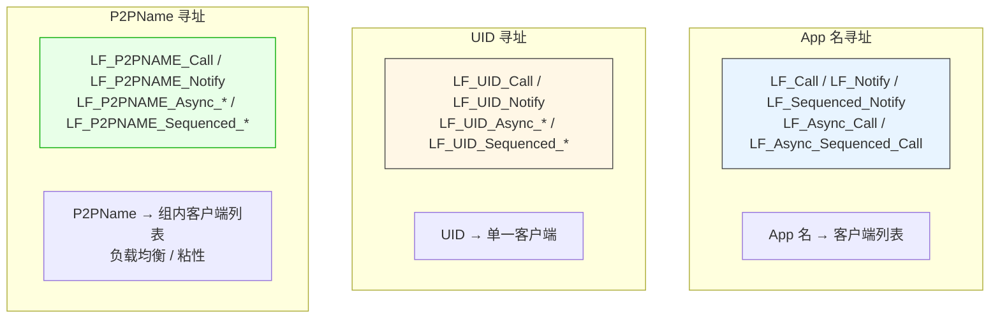

### 8.2 App 名寻址

**API 清单**：
- `LF_Call(appName, Param, Timeout)`
- `LF_Async_Call(appName, Param, Data, OnResult)`
- `LF_Async_Sequenced_Call(appName, Param, Data, OnResult)`
- `LF_Notify(appName, Param)`
- `LF_Sequenced_Notify(appName, Param)`

**路由算法**（客户端 `Send_Execute_Notify`）：

```pascal
// ① 先查本地：本进程内是否有同名 App 且有目标 API
tmp_cli__ := Find_Local_API(app_Name__, api_Name__, True);
if tmp_cli__ <> nil then
  begin
    tmp_cli__.APP.Engine.Execute_Notify(tmp_param);   // 本地执行
    exit;
  end;

// ② 再查远端缓存：本地缓存的远端 App 信息
tmp_cli__ := Find_Remote_API(app_Name__, api_Name__, True);
if tmp_cli__ <> nil then
    tmp_cli__.Send_Execute_Notify_Impl(app_Name__, tmp_param)  // 通过客户端转发
else
    Send_Execute_Notify_Impl(app_Name__, tmp_param);           // 通过自己的连接发
```

**关键**：
- **本地优先**：本进程有同名 App 且 API 匹配 → 本地执行，**不走网络**。
- **缓存加速**：`LF_Local_API_Cache` / `LF_Remote_API_Cache` 缓存 `'AppName.ApiName'` → `TC40_LF_ClientList`。
- **缓存失效**：
  - **服务端**：`cmd_Init_APP_Info` / `cmd_No_App_Info` / `DoUserOut_Event`。
  - **客户端**：`cmd_update_service_api_info`（收到广播） / `DoNetworkOffline`（物理断开）。

### 8.3 UID 寻址

**API 清单**：
- `LF_UID_Call(UID, Param, Timeout)`
- `LF_UID_Async_Call(UID, Param, Data, OnResult)`
- `LF_UID_Async_Sequenced_Call(UID, Param, Data, OnResult)`
- `LF_UID_Notify(UID, Param)`
- `LF_UID_Sequenced_Notify(UID, Param)`

**路由算法**（客户端 `Send_UID_Execute_Notify`）：

```pascal
// ① 先查本地：本进程内是否有相同 UID 的客户端
target_app := Find_Local_UID_App(UID_, api_Name__);
if target_app <> nil then
  begin
    target_app.Engine.Execute_Notify(tmp_param);   // 本地执行
    exit;
  end;

// ② 再查远端缓存：本地缓存的远端 UID 信息
tmp_cli__ := Find_Remote_UID_API(UID_, api_Name__, True);
if tmp_cli__ <> nil then
    tmp_cli__.Send_UID_Execute_Notify_Impl(UID_, tmp_param)
else
    Send_UID_Execute_Notify_Impl(UID_, tmp_param);  // 通过服务端 UID 路由
```

**服务端 `FUID_Pool`**：
- **Key**：32 字节 `TUID___`。
- **Value**：`TUID_Data`（recv_io + send_io 对）。
- **数据来源**：客户端通过 `Update_UID` 命令上报。
- **查找**：`FUID_Pool.Get_Value_Ptr___(UID_)` → O(1)。

**UID 生成机制**：

**客户端 UID 在 `TunnelLink` 成功时生成**：

```pascal
if Is_Null_UID(FLast_UID) then
    FLast_UID := Generate_Global_UID(PhysicsTunnel.UID,
                                      DTNoAuth.RecvTunnel.ServerState^.UID,
                                      DTNoAuth.SendTunnel.ServerState^.UID)
else
    FLast_UID := Generate_Global_UID(FLast_UID,
                                      PhysicsTunnel.UID,
                                      DTNoAuth.RecvTunnel.ServerState^.UID,
                                      DTNoAuth.SendTunnel.ServerState^.UID);
```

- **首次连接**：`Generate_Global_UID(物理隧道 UID, 接收隧道服务端 UID, 发送隧道服务端 UID)`。
- **重连**：`Generate_Global_UID(旧 UID, 物理隧道 UID, 接收隧道服务端 UID, 发送隧道服务端 UID)`。
- `Generate_Global_UID` 来自 `Z.Net`，用 SHA3-256 生成 256 位 UID，混合当前时间 + Tick + 全局种子 + 输入。

**关键**：
- **UID 是会话级标识**：`TunnelLink` 成功时生成，重连后会变化。
- **本地优先**：本进程有相同 UID 的客户端 → 本地执行。
- **服务端哈希池**：UID 是服务端的路由键，跨客户端定位。

### 8.4 P2PName 寻址

**API 清单**：
- `LF_P2PNAME_Call(p2p_name, Param, Timeout)`
- `LF_P2PNAME_Async_Call(p2p_name, Param, Data, OnResult)`
- `LF_P2PNAME_Async_Sequenced_Call(p2p_name, Param, Data, OnResult)`
- `LF_P2PNAME_Notify(p2p_name, Param)`
- `LF_P2PNAME_Sequenced_Notify(p2p_name, Param)`

**路由算法**：
- **不做本地查找**，**总是走网络**。
- 服务端通过 `FP2PName_Pool` 找一组 UID，按负载均衡或粘性策略选一个。

**两种选择策略的精确映射**：

| 命令 | 策略 | 实现 |
|------|------|------|
| `cmd_P2PName_Call` | **`Find_P2PName_LoadBalance`** | `Cycle_Anchor` 轮询 + 负载均衡 |
| `cmd_P2PName_Notify` | **`Find_P2PName_LoadBalance`** | 同上 |
| `cmd_P2PName_Sequenced_Notify` | **`Find_P2PName_FixedSequenced`** | `Fixed_Sequenced_Time` 粘性 |
| `cmd_P2PName_Sequenced_Call` | **`Find_P2PName_FixedSequenced`** | 同上 |

**负载均衡实现（Cycle_Anchor）**：
- **全局原子递增计数器** `Cycle_Anchor_Seed`（`Get_Cycle_Anchor`）。
- 每个 `(p2p_name, api)` 任务维护每个 UID 的 anchor 值。
- **anchor 小的先被选中**，选中后更新为新的全局值（排到末尾）。
- **效果**：轮询 + 负载均衡。
- **精度**：每次调用都精确选到最久未用的 UID。

**粘性实现（FixedSequenced）**：
- 按最后处理时间排序，取最小。
- 若超过 `Fixed_Sequenced_Time`（默认 20 秒）没被选中，换一个。
- **效果**：同一 UID 连续处理 20 秒，然后切换。

**关键**：
- **P2PName 是用户自定义字符串**，通过 `LF_Set_Opt_P2P_Name` 设置。
- **服务端不区分同名 UID 的物理位置**，只按 P2PName 归组。
- **本地优先路由不适用**（总是走网络）。

**⚠️ P2PName 异步 Call 的悬挂行为**：

服务端 `cmd_P2PName_Call` 若找不到组名，**只 `DoStatus`，不回包**。因此：

- **`LF_P2PNAME_Async_Call` 若服务端找不到组名，回调永不触发**。
- 客户端 `LF_P2PNAME_Async_Call` 返回 1（已入队），但回调永不触发。
- **调用方必须自行实现超时**。

**⚠️ P2PName 空字符串调用行为**：

`LF_P2PNAME_Call("", param, timeout)` 会发到服务端，服务端 `Find_P2PName_LoadBalance('')` 返回 nil，报 `no found p2pname:""`，**不回包**。

### 8.5 三套寻址的对比

| 维度 | App 名 | UID | P2PName |
|------|--------|-----|---------|
| 索引键 | UTF-8 字符串 | 32 字节二进制 | UTF-8 字符串 |
| 路由粒度 | 应用级 | 会话级 | 组级 |
| 本地优先 | ✅ | ✅ | ❌ |
| 服务端哈希池 | App 索引 | `FUID_Pool` | `FP2PName_Pool` |
| 负载均衡 | ❌（App 名唯一） | ❌（UID 唯一） | ✅（Cycle_Anchor） |
| 粘性 | ❌ | ❌ | ✅（FixedSequenced，20 秒） |
| 命中 App 注册 | ✅ | ✅ | ✅ |
| 命中 P2P 注册 | ❌ | ✅ | ✅ |
| 典型用途 | 固定服务 | **定向到具体客户端** | 同质服务集群 |

### 8.6 UID / P2PName 自动搜索 App 注册函数

**核心事实**：**UID 和 P2PName 调用会自动搜索目标客户端的 App 注册函数。**

**机制**：

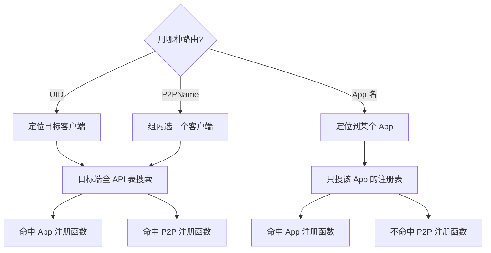

**对比表**：

| 调用方式 | 目标端搜索范围 | 命中 App 注册 | 命中 P2P 注册 |
|----------|----------------|:-------------:|:-------------:|
| **UID 调用** | 目标客户端全部已注册 API | ✅ | ✅ |
| **P2PName 调用** | 被选中客户端的全部已注册 API | ✅ | ✅ |
| **App 名调用** | 目标 App 的注册表 | ✅ | ❌ |

**源码依据**：

**UID 路由**（`Find_Local_UID_App` → `Find_API_From_P2P_APP`）：
```pascal
function Find_API_From_P2P_APP(api_name__: SystemString): TLF_App;
begin
  Result := nil;
  // ① 先查 P2P APP
  if LF_P2P_APP.Engine.LF_MethodPool.Exists_Key(api_name__) then
    begin
      Result := LF_P2P_APP;
      exit;
    end;
  // ② 再查业务 App 池
  LF_App_Pool.Lock;
  try
    if LF_App_Pool.Num > 0 then
      with LF_App_Pool.Invert_Repeat_ do
        repeat
          if queue^.Data.Engine.LF_MethodPool.Exists_Key(api_name__) then
            begin
              Result := queue^.Data;
              exit;
            end;
        until not Prev;
  finally
      LF_App_Pool.UnLock;
  end;
end;
```

**App 名路由**（`Find_Local_API`）：只在指定 `app_Name__` 的 App 的 `LF_MethodPool` 中查找。

### 8.7 各语言的寻址调用

| 语言 | App 名调用 | UID 调用 | P2PName 调用 |
|------|-----------|----------|--------------|
| Pascal | `LF_CallEx(app, hnd, timeout)` | `LF_UID_Call(uid, hnd, timeout)` | `LF_P2PNAME_Call(p2p, hnd, timeout)` |
| Python | `lf.call(app, hnd, timeout)` | `lf.uid_call(uid, hnd, timeout)` | `lf.p2pname_call(p2p, hnd, timeout)` |
| C++ | `lingofuse::call(app, hnd, timeout)` | `lingofuse::callByUid(uid, hnd, timeout)` | `lingofuse::callByP2PName(p2p, hnd, timeout)` |
| C# | `Framework.Call(app, hnd, timeout)` | `Framework.CallByUid(uid, hnd, timeout)` | `Framework.CallByP2PName(p2p, hnd, timeout)` |
| Rust | `framework::call(app, hnd, timeout)` | `framework::call_by_uid(uid, hnd, timeout)` | `framework::call_by_p2p_name(p2p, hnd, timeout)` |
| Go | `lingofuse.Call(app, hnd, timeout)` | `lingofuse.CallByUid(uid, hnd, timeout)` | `lingofuse.CallByP2PName(p2p, hnd, timeout)` |
| Java | `Framework.call(app, hnd, timeout)` | `Framework.callByUid(uid, hnd, timeout)` | `Framework.callByP2PName(p2p, hnd, timeout)` |
| Node.js / TS | `framework.call(app, hnd, timeout)` | `framework.callByUid(uid, hnd, timeout)` | `framework.callByP2PName(p2p, hnd, timeout)` |
| Erlang | `lingofuse:call(App, Hnd, Timeout)` | `lingofuse:uid_call(Uid, Hnd, Timeout)` | `lingofuse:p2p_call(P2p, Hnd, Timeout)` |

---

## 第 9 章 跨寻址路由与 UID 万能路由

### 9.1 UID 是万能路由标识

**关键机制**：**UID 可以瞄准一个具体客户端，调用它注册的任意 API**（包括通过 App 名注册的 API 和通过 P2P 注册的 API），**不需要知道 App 名**。

**原理**：

1. **客户端在 `TunnelLink` 成功时生成 `FLast_UID`**。
2. **客户端通过 `Update_UID` 命令上报 UID 和 P2PName**。
3. **服务端 `FUID_Pool` 建立 UID → recv_io 映射**。
4. **调用 `LF_UID_Call(UID, Param, Timeout)` 时**：
   - 客户端先在本地查找相同 UID 的客户端。
   - 未命中 → 把命令发给服务端。
   - 服务端通过 `FUID_Pool` 找到 recv_io → 转发给目标客户端。
5. **目标客户端执行时**：
   - 通过 `Find_Local_UID_App(UID_, api_Name__)` 找到本地 App。
   - 执行该 App 的 API。

**关键**：
- **UID 与 App 名解耦**：UID 是会话标识，App 名是应用标识，两者独立。
- **`LF_UID_Call` 可以调用任意 API**（只要目标客户端有对应的 App 和 API）。
- **不需要知道 App 名**。

### 9.2 UID 万能路由的使用场景

#### 场景 1：服务端主动推送到特定客户端

```pascal
// 服务端知道某客户端的 UID（从之前的回调中提取）
procedure OnClientCalled(Trigger: Pointer; Input, Output: TDataHnd); cdecl;
var
  UID: TP2P_UID___;
  UIDPtr: PP2P_UID___;
begin
  // 仅在 Input 参数（发送方输入句柄）上有效；返回的是指针
  UIDPtr := LF_Get_P2P_UID(Input);
  if UIDPtr <> nil then
      UID := UIDPtr^;   // 立即解引用拷贝；框架约 5 秒后自动释放指针
  // ... 存起来
end;

// 稍后主动推送
LF_UID_Notify(StoredUID, DataHnd);   // 无需知道 App 名
```

#### 场景 2：跨客户端定向调用

```pascal
// 客户端 A 想调用客户端 B 的 API
// 不需要知道 B 的 App 名，只要知道 B 的 UID
LF_UID_Call(B_UID, DataHnd, 3000);
```

#### 场景 3：会话粘性路由

```pascal
// 同一会话的后续调用都走同一客户端
LF_UID_Sequenced_Notify(SessionUID, DataHnd);   // FIFO 保证
```

### 9.3 P2PName 跨 API 路由

**P2PName 也能调用任意 API**：

```pascal
// 假设有 N 个 worker 都注册了 'process' API，P2PName = 'worker_group'
LF_P2PNAME_Call('worker_group', DataHnd, 5000);
// 服务端在 N 个 worker 中按负载均衡选一个
```

**关键**：
- **P2PName 是组名**：多个客户端设置同一 P2PName，服务端做负载均衡。
- **不区分具体客户端**：调用方不需要知道是哪个 worker。
- **不区分 API 注册来源**：App 注册或 P2P 注册都可以。

### 9.4 跨寻址路由的典型架构

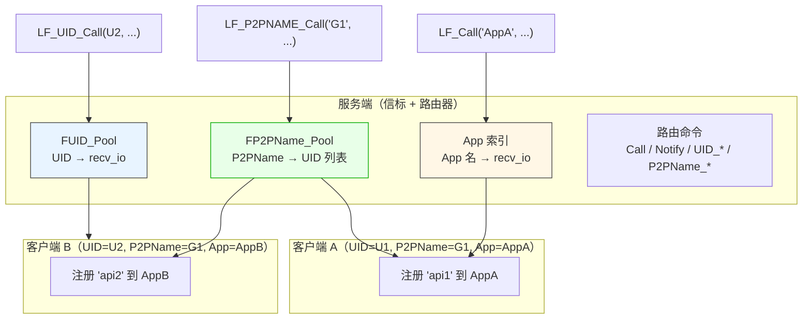

### 9.5 whoami 模式：发现自己的 UID 和 P2PName

**问题**：客户端如何知道自己服务端分配的 UID 和 P2PName？

**方案**：服务端注册一个 `whoami` API，返回调用方的 UID 和 P2PName。

**服务端**：

```pascal
procedure Cb_WhoAmI(Trigger: Pointer; Input, Output: TDataHnd); cdecl;
var
  UID: TP2P_UID___;
  UIDPtr: PP2P_UID___;
  P2P: string;
begin
  // 仅在回调的 Input 参数上有效；返回指针
  UIDPtr := LF_Get_P2P_UID(Input);
  if UIDPtr <> nil then
      UID := UIDPtr^                    // 立即解引用拷贝
  else
      FillChar(UID, SizeOf(UID), 0);
  P2P := LF_Get_P2P_NameEx(Input);
  LF_WriteBuffer(Output, @UID[0], SizeOf(UID));
  LF_WriteString(Output, P2P);
end;

// 注册到 LF_P2P_APP（进程级），任何客户端都能调用
LF_Register_P2P_Call('whoami', 'Query caller identity', nil, @Cb_WhoAmI);
```

**客户端**：

```pascal
function Probe_WhoAmI(out UID: TP2P_UID___; out P2PName: string): Boolean;
var
  Req, Res: LF.TDataHandle;
begin
  Result := False;
  FillChar(UID, SizeOf(UID), 0);
  P2PName := '';
  Req := LF.TDataHandle.Create('whoami');
  try
    Res := LF.CallApp('AnyApp', Req, 5000);   // 走任意 App
    try
      if (Res = nil) or (Res.Size < SizeOf(UID) + 1) then Exit;
      Res.Pos := 0;
      Res.ReadBuffer(UID, SizeOf(UID));
      P2PName := Res.ReadString;
      Result := True;
    finally Res.Free; end;
  finally Req.Free; end;
end;
```

**之后**：客户端持有自己的 UID 和 P2PName，可以用于 UID 定向调用、P2PName 组内调用、或其他客户端发现。

#### 9.5.1 各语言的 whoami 实现

**Python**：

```python
# 服务端
@server.expose("whoami")
def whoami(trigger, inp, out):
    uid = inp.get_p2p_uid()      # 内部立即拷贝成 32 字节 bytes
    name = inp.get_p2p_name()    # 立即拷贝成 str
    out.write_json({
        "uid_hex": uid.hex(),
        "p2p_name": name,
    })

# 客户端
def probe_identity():
    req = DataHandle("whoami")
    try:
        resp = lf.call("AnyApp", req, 5000)
        try:
            data = resp.read_all_bytes()
            obj = json.loads(data)
            return bytes.fromhex(obj["uid_hex"]), obj["p2p_name"]
        finally:
            resp.dispose()
    finally:
        req.dispose()
```

**C++**：

```cpp
// 服务端
static void LF_CDECL whoami_cb(void*, void* in, void* out) {
    lingofuse::DataHandle inp(static_cast<TDataHnd>(in), false);
    lingofuse::DataHandle out_h(static_cast<TDataHnd>(out), false);

    std::array<std::uint8_t, 32> uid = inp.getP2PUid(); // 立即拷贝
    std::string name = inp.getP2PName();                // 立即拷贝

    out_h.writeJson({
        {"uid_hex", to_hex(uid)},
        {"p2p_name", name}
    });
}

// 客户端
std::pair<std::array<std::uint8_t, 32>, std::string> probeIdentity() {
    lingofuse::DataHandle req("whoami");
    lingofuse::DataHandle resp = lingofuse::call("AnyApp", req, 5000);
    // ... 解析 ...
}
```

**C#**：

```csharp
// 服务端
static void WhoAmICb(DataHandle inH, DataHandle outH) {
    P2PUid uid = inH.P2PUid;
    string p2p = inH.P2PName;
    var json = new { uid_hex = uid.ToHex(), p2p_name = p2p };
    outH.WriteJson(json);
}

// 客户端
static (P2PUid uid, string p2p) ProbeIdentity() {
    using var req = new DataHandle("whoami");
    using var resp = Framework.Call("AnyApp", req, 5000);
    // ... 解析 ...
}
```

**Rust**：

```rust
// 服务端
fn whoami_cb(trigger: *mut c_void, input: *mut c_void, output: *mut c_void) {
    let input = unsafe { &mut *(input as *mut DataHandle) };
    let output = unsafe { &mut *(output as *mut DataHandle) };
    let uid = input.p2p_uid();
    let p2p = input.p2p_name();
    // 写回
}

// 客户端
let req = DataHandle::new("whoami");
let resp = framework::call("AnyApp", &req, 5000)?;
// ... 解析 ...
```

**Go**：

```go
// 服务端
func cbWhoAmI(inp, out *lingofuse.DataHandle) {
    uid, _ := inp.GetP2PUID()
    p2pName, _ := inp.GetP2PName()
    // 写回
}

// 客户端
req, _ := lingofuse.NewDataHandle("whoami")
defer req.Close()
resp, _ := lingofuse.Call("AnyApp", req, 5000)
defer resp.Close()
// ... 解析 ...
```

**Java**：

```java
// 服务端
static void cbWhoAmI(DataHandle in, DataHandle out) {
    byte[] uid = in.getP2pUid();
    String p2p = in.getP2pName();
    // 写回
}

// 客户端
try (DataHandle req = new DataHandle("whoami")) {
    try (DataHandle resp = Framework.call("AnyApp", req, 5000)) {
        // ... 解析 ...
    }
}
```

**Node.js / TS**：

```javascript
// 服务端
const cbWhoAmI = _koffi.register(whoAmICb, LfCallFuncPtr);
function whoAmICb(trigger, input, output) {
    const inp = DataHandle.fromRaw(input, false);
    const outh = DataHandle.fromRaw(output, false);
    const uid = inp.getP2PUid();     // 立即拷贝
    const p2p = inp.getP2PName();    // 立即拷贝
    outh.writeUInt8(0x00);
    outh.writeBytes(uid);
    outh.writeString(p2p);
}

// 客户端
async function probeIdentity() {
    const req = new DataHandle("whoami");
    const resp = await framework.callAsync("AnyApp", req, 5000);
    try {
        // ... 解析 ...
    } finally {
        resp.dispose();
    }
}
```

**Erlang**：

```erlang
%% 服务端（在 lf_call 处理分支里）
handle_request(<<"LF_TEST_WHOAMI">>, Ref, _Payload, Identity) ->
    UID = maps:get(uid, Identity, <<0:256>>),
    P2P = maps:get(p2p_name, Identity, <<>>),
    Reply = <<0, UID/binary, P2P/binary, 0>>,
    _ = lingofuse:reply(Ref, Reply),
    ok;

%% 客户端
probe_client_identity() ->
    {ok, Req} = lingofuse:create_data(<<"whoami">>),
    try
        {ok, Resp} = lingofuse:call(<<"AnyApp">>, Req, 5000),
        try
            %% 解析 Resp
            ok
        after
            lingofuse:free_data(Resp)
        end
    after
        lingofuse:free_data(Req)
    end.
```

---

## 第 10 章 自动发送方身份识别

### 10.1 核心机制

**框架自动在每个远程请求载荷的头部注入发送方身份**。客户端发送前由 `Rebuild_UID_and_P2PName` 注入：

```
[apiName: string]
[FromUID: 32 bytes]         ← 发送方会话 UID
[FromP2PName: string]       ← 发送方 P2PName
[Param.Size: Int32]
[Param: bytes]              ← 业务参数
```

**重要**：
- **`FromUID` / `FromP2PName` 是"发送方元数据"**，由发送侧客户端自动写入，接收侧不需要也不应该手动传。
- **接收侧只能在回调的 `Input` 参数中通过 `LF_Get_P2P_UID(Input)` / `LF_Get_P2P_Name(Input)` 获取这两个值**。
- **不能对自建句柄或 Output 句柄调用这两个函数**（返回空 / 警告）。
- **`LF_Get_P2P_UID` 返回的是 `PP2P_UID___` 指针（不是值）**，框架约 5 秒后自动释放指针。

### 10.2 编码/解码实现

**编码（`TMemory_Param_Tool.EncryptToMem`）**：

```pascal
procedure TMemory_Param_Tool.EncryptToMem(m64: TMem64);
begin
  m64.Clear;
  m64.WriteString(apiName.Text);              // API 名
  m64.WritePtr(@FromUID[0], SizeOf(TUID___)); // 32 字节 UID
  m64.WriteString(FromP2PName.Text);          // P2PName
  m64.WriteInt32(Param.Size);                 // 业务参数长度
  m64.WritePtr(Param.Memory, Param.Size);     // 业务参数
end;
```

**解码（`DecryptFromMem`）**：

```pascal
procedure TMemory_Param_Tool.DecryptFromMem(m64: TMem64);
begin
  if m64.ProtectedMode then
    begin
      // 只读映射：直接读
      m64.Position := 0;
      apiName.Text := m64.ReadString.Text;
      m64.ReadPtr(@FromUID[0], SizeOf(TUID___));
      FromP2PName.Text := m64.ReadString.Text;
      Param.Size := m64.ReadInt32;
      m64.ReadPtr(Param.Memory, Param.Size);
      Param.Position := 0;
    end
  else
    begin
      // 可写：O(1) 交换 + 零拷贝映射
      tmp.SwapInstance(m64);
      tmp.Position := 0;
      apiName.Text := tmp.ReadString.Text;
      tmp.ReadPtr(@FromUID[0], SizeOf(TUID___));
      FromP2PName.Text := tmp.ReadString.Text;
      i32 := tmp.ReadInt32;
      Param.Mapping(tmp.PosAsPtr, i32);       // 零拷贝
      Param.Position := 0;
    end;
end;
```

### 10.3 注入时机

**经 `TC40_LF_Client.Send_*` 路径的调用会注入身份**：

```pascal
procedure TC40_LF_Client.Send_Execute_Notify_Impl(app_Name__: TLF_String; Param: TMem64);
begin
  DTNoAuth.SendTunnel.SendCompleteBuffer_StreamNotify('Notify',
    TDFE.Create
      .WriteString(app_Name__)
      .WriteMem64(Param)     // ← Param 已经被 Rebuild 过
      .DelayFree
    );
end;

procedure TC40_LF_Client.Send_Execute_Notify(app_Name__: TLF_String; Param: TMem64);
var
  tmp_param: TMem64;
begin
  tmp_param := TMemory_Param_Tool.Rebuild_UID_and_P2PName(Param, FLast_UID, LF_P2P_name.V);
  try
    // ... 本地查找 / 远端转发 ...
    // 无论哪条路径，tmp_param 都已带身份
  finally
    DisposeObject(tmp_param);
  end;
end;
```

**关键**：**所有 `Send_*` 方法都调用 `Rebuild_UID_and_P2PName`**，因此：

| 调用路径 | 是否注入身份 |
|---------|:-----------:|
| `LF_Call` / `LF_Notify` / `LF_Sequenced_*` | ✅ |
| `LF_Call` 命中本地短路 | ✅ |
| `LF_UID_Call` / `LF_UID_Notify` | ✅ |
| `LF_P2PNAME_Call` / `LF_P2PNAME_Notify` | ✅ |
| **`LF_LocalCall` / `LF_LocalNotify`** | ❌ |

**`LF_LocalCall` / `LF_LocalNotify` 不经过 `Rebuild_UID_and_P2PName`**（见 §5.6、`LF-LOCAL-001`）。

### 10.4 覆盖范围

| 命令 | 方向 | 是否注入 |
|------|------|:--------:|
| `Notify` / `Sequenced_Notify` / `Call` / `Sequenced_Call` | 双向 | ✅ |
| `UID_Notify` / `UID_Sequenced_Notify` / `UID_Call` / `UID_Sequenced_Call` | 双向 | ✅ |
| `P2PName_Notify` / `P2PName_Sequenced_Notify` / `P2PName_Call` / `P2PName_Sequenced_Call` | 双向 | ✅ |
| **经 `Send_*` 路径的本地调用** | — | ✅ |
| **`LF_LocalCall` / `LF_LocalNotify`** | — | ❌ |

### 10.5 UID 生成机制

**客户端 UID 在 `TunnelLink` 成功时生成**：

```pascal
procedure TC40_LF_Client.Do_DT_P2PVM_NoAuth_Custom_Client_TunnelLink(...);
begin
  if Is_Null_UID(FLast_UID) then
      FLast_UID := Generate_Global_UID(PhysicsTunnel.UID, DTNoAuth.RecvTunnel.ServerState^.UID, DTNoAuth.SendTunnel.ServerState^.UID)
  else
      FLast_UID := Generate_Global_UID(FLast_UID, PhysicsTunnel.UID, DTNoAuth.RecvTunnel.ServerState^.UID, DTNoAuth.SendTunnel.ServerState^.UID);
end;
```

**关键**：
- **基于物理隧道 UID + C4 服务端 UID 派生**。
- **每次重连都重新生成**：服务端不能假设同一客户端跨重连的 UID 相同。
- **服务端 `FUID_Pool` 会随重连更新**。

### 10.6 典型使用场景

| 场景 | 用法 |
|------|------|
| **调用鉴权** | 比较 `LF_Get_P2P_Name(Input)` 与白名单 |
| **审计日志** | 记录 `LF_Get_P2P_UID(Input)`（十六进制）和 `LF_Get_P2P_Name(Input)` |
| **会话管理** | 以 `UID` 为 key 维护 Session |
| **按组路由** | 按 `P2PName` 分流到不同 worker |
| **多租户** | `P2PName` 作为租户标识 |
| **广播过滤** | 排除特定 `UID` 的调用方 |
| **whoami** | 服务端返回调用方 UID / P2PName，客户端自我发现 |

> **再次强调**：以上所有用法都要求从**回调的 `Input` 参数**调用 `LF_Get_P2P_UID` / `LF_Get_P2P_Name`。**不要**在任何"自己创建"的句柄或输出句柄上调用。**也不要**在 `LF_LocalCall` / `LF_LocalNotify` 的回调中调用（不注入身份）。

### 10.7 各语言身份读取示例

**Python**：

```python
@server.expose("whoami")
def whoami(trigger, inp, out):
    uid = inp.get_p2p_uid()      # 内部立即拷贝成 32 字节 bytes
    name = inp.get_p2p_name()    # 立即拷贝成 str
    out.write_json({"uid_hex": uid.hex(), "p2p_name": name})
```

**C++**：

```cpp
static void LF_CDECL whoami_cb(void*, void* in, void* out) {
    lingofuse::DataHandle inp(static_cast<TDataHnd>(in), false);
    lingofuse::DataHandle out_h(static_cast<TDataHnd>(out), false);

    std::array<std::uint8_t, 32> uid = inp.getP2PUid(); // 立即拷贝
    std::string name = inp.getP2PName();                // 立即拷贝

    out_h.writeJson({
        {"uid_hex", to_hex(uid)},
        {"p2p_name", name}
    });
}
```

**C#**：

```csharp
static void WhoAmICb(DataHandle inH, DataHandle outH) {
    P2PUid uid = inH.P2PUid;          // 立即拷贝
    string p2p = inH.P2PName;         // 立即拷贝
    outH.WriteJson(new { uid_hex = uid.ToHex(), p2p_name = p2p });
}
```

**Rust**：

```rust
fn whoami_cb(_trigger: *mut c_void, input: *mut c_void, output: *mut c_void) {
    let input = unsafe { &mut *(input as *mut DataHandle) };
    let output = unsafe { &mut *(output as *mut DataHandle) };

    let uid = input.p2p_uid();        // 立即拷贝
    let p2p = input.p2p_name();       // 立即拷贝

    output.write_uint8(0x00);
    output.write_bytes(&uid.raw_bytes());
    output.write_string(p2p);
}
```

**Go**：

```go
func cbWhoAmI(inp, out *lingofuse.DataHandle) {
    uid, _ := inp.GetP2PUID()          // 立即拷贝
    p2pName, _ := inp.GetP2PName()     // 立即拷贝

    _ = out.WriteUint8(0x00)
    _ = out.WriteBytes(uid.Bytes[:])
    _ = out.WriteString(p2pName)
}
```

**Java**：

```java
static void cbWhoAmI(DataHandle in, DataHandle out) {
    byte[] uid = in.getP2pUid();       // 立即拷贝
    String p2p = in.getP2pName();      // 立即拷贝

    out.writeInt8((byte) 0);
    out.writeBytes(uid);
    out.writeString(p2p);
}
```

**Node.js / TS**：

```javascript
function whoAmICb(trigger, input, output) {
    const inp = DataHandle.fromRaw(input, false);
    const outh = DataHandle.fromRaw(output, false);

    const uid = inp.getP2PUid();       // 立即拷贝
    const p2p = inp.getP2PName();      // 立即拷贝

    outh.writeUInt8(0x00);
    outh.writeBytes(uid);
    outh.writeString(p2p);
}
```

**Erlang**：

```erlang
%% 在 lf_call 处理分支里
handle_request(<<"LF_TEST_WHOAMI">>, Ref, _Payload, Identity) ->
    UID = maps:get(uid, Identity, <<0:256>>),
    P2P = maps:get(p2p_name, Identity, <<>>),
    Reply = <<0, UID/binary, P2P/binary, 0>>,
    _ = lingofuse:reply(Ref, Reply),
    ok.
```

**Julia**：

```julia
function whoami_callback(input)
    uid = input.uid
    p2p = input.p2p_name
    # ...
end
```

**Ruby**：

```ruby
def self.cb_whoami(input, output)
    uid = input.p2p_uid || ("\x00" * 32).b
    p2p = input.p2p_name || ''
    output.write_uint8(0x00)
    output.write_bytes(uid)
    output.write_string(p2p)
end
```

**Dart**：

```dart
Uint8List cbWhoAmI(CallContext ctx) {
    final w = AbiWriter();
    w.writeUInt8(STATUS_OK);
    final uid = ctx.senderUid;
    if (uid.length == 32) {
        w.writeBytes(uid);
    } else {
        w.writeBytes(Uint8List(32));
    }
    w.writeString(ctx.senderP2PName);
    return w.takeBytes();
}
```

**R**：

```r
callback_whoami <- function(input_raw, ctx) {
    uid <- ctx$sender_uid
    p2p <- ctx$sender_p2p_name
    # ...
}
```

**关键一致性**：**所有语言的身份读取都是从回调的输入句柄（或 `Identity` map / `CallContext`）里拷贝**，不存在跨语言不兼容的情况。区别只在 API 名与参数形式。

---

# 第四部分 高级主题

## 第 11 章 运行时选项详解

> **本章对 `LF_SetOption` 每个选项做深度展开**：内部机理、生效时机、依赖关系、别名、推荐值。各语言的等价 API 在各小节末尾给出。

### 11.1 `LF_SetOption` 的执行语义

```pascal
procedure LF_SetOption(Option, Value: pansichar);
begin
  with TSetOpt_Inst.Create do
    begin
      opt := DS(Option);
      V := DS(Value);
      if Simulator_Main_Thread_Activted then
        MainThreadPost.PostM_NP(DoRun)   // 主线程运行后：投递到主线程异步执行
      else
        begin
          DoRun();                          // 主线程未运行：立即执行
          Free;
        end;
    end;
end;
```

**关键**：
- **主线程未运行时**：立即同步执行。
- **主线程运行后**：通过 `MainThreadPost.PostM_NP` 投递到主线程，**存在微小延迟**。
- **陷阱**：主线程已启动后，选项不是同步生效。若紧接着依赖该选项（例如改 `Overlap_Connection` 后立即 `PrepareClient`），可能读到旧值。
- **未知选项**：静默忽略（最后一个 `else` 缺失）。

### 11.2 网络相关选项

#### 11.2.1 `Overlap_Connection`

- **类型**：Boolean
- **默认**：`False`
- **别名**：`Overlap_Client` / `OverlapConnection` / `OverlapClient` / `OverlapConnect`
- **内部机理**：
  - 控制 `LF_PrepareClient` 对**重复地址**的行为。
  - `False`：每个物理地址只允许一个客户端隧道，第二次 `LF_PrepareClient` 返回 -1（**丢弃新 App 参数**）。
  - `True`：每次 `LF_PrepareClient` 都创建新隧道（`NewKeepAlive` 命令）。
- **生效时机**：**必须在 `LF_PrepareClient` 之前设置**。
- **运行时切换的精确影响**：
  - 只影响**下一次 `LF_PrepareClient`**。
  - **已创建的隧道不重排、不回滚、不自动添加/删除**。
  - **建议**：`Overlap_Connection` 应在 `LF_ResetPrepare` 之前设定好。
- **推荐配置**：

  | 场景 | 推荐值 | 理由 |
  |------|:------:|------|
  | 单 App per 地址 | `False` | 节省资源 |
  | 多 App per 地址 | `True` | 每个 App 需独立隧道 |
  | 动态 Client + BindApp | `False` + `LF_BindApp` | 一个空隧道 + 事后绑定 |

#### 11.2.2 `Wait_Connection_ReadyOk`

- **类型**：Boolean
- **默认**：`True`
- **别名**：`Wait_API_Prepare_Done` / `API_Prepare_Done_Wait` / `WaitConnect` / `Wait_Ready` / `WaitReady`
- **内部机理**：控制 `LF_PrepareDone` 是否**等待所有客户端就绪**。
- **生效时机**：`LF_PrepareDone` 前。

#### 11.2.3 `Wait_Connection_Timeout`

- **类型**：Integer（毫秒）
- **默认**：`30000`（30 秒）
- **别名**：`Wait_TimeOut` / `API_Prepare_Done_TimeOut` / `WaitTimeOut`
- **内部机理**：`LF_PrepareDone` 内部超时 = `max(Wait_Connection_Timeout, 5000) + 1000` 毫秒。

#### 11.2.4 `password` / `passwd`

- **类型**：String
- **默认**：`'DTC40@ZSERVER'`
- **内部机理**：写入 `Z.Net.C4.C40_Password`，作为 P2PVM 和 C4 网络的认证密码。
- **`LF_GetOption('password')` 返回 `'********'`（掩码）**。

### 11.3 IPC 相关选项

| 选项 | 别名 | 内部机理 |
|------|------|---------|
| `IPC_Serv_ThreadCount` | `IPC_ThreadCount` / `IPC_Server_ThreadCount` | 写入 `TZNet_Server_IPC.IPC_Serv_ThreadCount` |
| `IPC_Serv_MaxQueueLength` | `IPC_MaxQueueLength` / `IPC_Server_MaxQueueLength` | 写入 `TZNet_Server_IPC.IPC_Serv_MaxQueueLength` |
| `IPC_Serv_MaxMsgSize` | `IPC_MaxMsgSize` / `IPC_Server_MaxMsgSize` | 写入 `TZNet_Server_IPC.IPC_Serv_MaxMsgSize` |

**生效时机**：**必须在 IPC 服务端启动前设置**。

### 11.4 状态相关选项

| 选项 | 类型 | 默认 | 别名 | 内部机理 |
|------|------|------|------|---------|
| `ShowThreadID` | Boolean | `True` | `ShowThread` / `Show_Thread` | 写入 `Z.status.StatusThreadID` |
| `ConsoleOutput` | Boolean | `True` | `Console_Output` | 写入 `Z.status.ConsoleOutput` |
| `Quiet` | Boolean | `False` | — | 写入 `Z.Net.C4.C40SetQuietMode` |

### 11.5 数据句柄相关选项

#### 11.5.1 `DataHandle_Idle_Timeout`

- **类型**：Integer（毫秒）
- **默认**：`600000`（10 分钟）
- **别名**：`Data_Idle_Timeout` / `Idle_Timeout`
- **内部机理**：写入 `LF_DataPool.LF_DataHandle_Idle_Timeout`。
  - `> 0`：启用空闲回收。
  - `= 0`：**禁用空闲回收**。

#### 11.5.2 `DataHandle_Pool_Scan_Interval`

- **类型**：Integer（毫秒）
- **默认**：`5000`（5 秒）
- **别名**：`Data_Scan_Interval` / `DataHandle_Scan_Interval`
- **内部机理**：写入 `LF_DataPool.LF_DataHandle_Pool_Scan_Interval`。
  - `> 0`：每次 `Progress` 检查是否超过此间隔才扫描。
  - `= 0`：**每次 Progress 都扫描**（性能下降）。

### 11.6 P2P 相关选项

#### 11.6.1 `LF_P2P_name`

- **类型**：String
- **默认**：`''`（空字符串）
- **别名**：`P2P_name` / `LF_P2P` / `P2P`
- **内部机理**：
  - 写入 `Z.LingoFuse_Core.LF_P2P_name`（`TLF_AtomString`）。
  - **客户端通过 `Update_UID` 命令上报给服务端**。
  - **每次发送请求时自动注入到载荷中**（`Rebuild_UID_and_P2PName` 的第三个参数）。
- **生效时机**：
  - 客户端 `Progress` 每秒检查 `FLast_P2PName` 是否变化，变化则调用 `Update_UID_Info`。
  - **请求发送时实时读取 `LF_P2P_name.V`**，所以改变后立即生效于下次请求。
- **推荐用法**：
  ```pascal
  LF.Set_Opt_P2P_Name('worker_group');   // 客户端加入组
  // 服务端通过 LF_P2PNAME_Call('worker_group', ...) 调用组内任一客户端
  ```

#### 11.6.2 `Fixed_Sequenced_Time` / `Fixed_Sequenced_Life`

- **类型**：Integer（毫秒）
- **默认**：`20000`（20 秒）
- **内部机理**：写入 `Z.LingoFuse_Core.Fixed_Sequenced_Time`。
  - 控制 `Find_Fixed_Sequenced_API` / `Find_P2PName_FixedSequenced` 的**粘性时间**。
  - 同一 UID 连续处理超过此值后，切换到其他 UID。
- **语义**：
  - `P2PName` 路由的 `Sequenced` 变体使用此值决定粘性窗口。
  - **最优值**：短任务 5-10 秒；长任务 60 秒+；强粘性场景可设 1 小时。

### 11.7 命令相关选项

#### 11.7.1 `No_Reponse_Cmd_NULL_Flush_Threshold`

- **类型**：Integer
- **默认**：`5000`
- **内部机理**：写入 `Z.LingoFuse_Core.No_Reponse_Cmd_NULL_Flush_Threshold`。
  - 控制**无响应命令（Notify）的 NULL 刷新阈值**。
  - 每发送 N 条 Notify 后，自动发送一条 NULL 命令，让服务端确认。

### 11.8 调试相关选项

#### 11.8.1 `debug` / `debug_cmd` / `debug_command` / `debugcommand`

- **类型**：String
- **内部机理**：
  - **每次调用都会创建一个 `TC40_Console_Help`** 并执行命令。
  - 支持所有 C4 控制台命令：`service` / `tunnel` / `HPC_Thread_Info` / `ZDB2_Info` / `RegInfo` 等。
- **`LF_GetOption('debug')` 返回 `'(no value: debug is write-only)'`**（只写）。
- **⚠️ 开销大**：生产环境慎用。

### 11.9 选项速查表

| 选项 | 类型 | 默认 | 生效时机 | 别名数量 |
|------|------|------|---------|:--------:|
| `Overlap_Connection` | Boolean | `False` | `PrepareClient` 前 | 4 |
| `Wait_Connection_ReadyOk` | Boolean | `True` | `PrepareDone` 前 | 5 |
| `Wait_Connection_Timeout` | Integer (ms) | `30000` | `PrepareDone` 前 | 3 |
| `password` / `passwd` | String | `'DTC40@ZSERVER'` | 全局立即 | 1 |
| `IPC_Serv_ThreadCount` | Integer | 平台相关 | IPC 服务端启动前 | 2 |
| `IPC_Serv_MaxQueueLength` | Integer | 平台相关 | IPC 服务端启动前 | 2 |
| `IPC_Serv_MaxMsgSize` | Integer | 平台相关 | IPC 服务端启动前 | 2 |
| `ShowThreadID` | Boolean | `True` | 全局立即 | 2 |
| `ConsoleOutput` | Boolean | `True` | 全局立即 | 1 |
| `Quiet` | Boolean | `False` | 全局立即 | 0 |
| `DataHandle_Idle_Timeout` | Integer (ms) | `600000` | `PrepareDone` 后 | 2 |
| `DataHandle_Pool_Scan_Interval` | Integer (ms) | `5000` | `PrepareDone` 后 | 2 |
| `LF_P2P_name` | String | `''` | 下次请求 | 3 |
| `Fixed_Sequenced_Time` | Integer (ms) | `20000` | 全局立即 | 1 |
| `No_Reponse_Cmd_NULL_Flush_Threshold` | Integer | `5000` | 全局立即 | 0 |
| `debug` | String | — | 全局立即 | 3 |

### 11.10 各语言的选项设置

| 语言 | 设置方式 |
|------|---------|
| Pascal | `LF_SetOptionEx('Name', 'Value')` / `LF.Set_Opt_<Name>(...)` |
| Python | `LF_SetOptionEx('Name', 'Value')` / `Options.set_opt_<name>(...)` |
| C++ | `lingofuse::setOption("Name", "Value")` |
| C# | `Framework.SetOption("Name", "Value")` |
| Rust | `framework::set_option("Name", "Value")` |
| Go | `lingofuse.SetOption("Name", "Value")` |
| Java | `Framework.setOption("Name", "Value")` / `Options.set<Name>(...)` |
| Node.js / TS | `framework.setOption("Name", "Value")` |
| Erlang | `lingofuse:set_option(<<"Name">>, <<"Value">>)` |
| Julia | `set_option("Name", "Value")` |
| Zig | `lf.options.set<Name>(...)` |
| Swift | `Framework.setOption("Name", "Value")` |
| Ruby | `LingoFuse::Options.set_opt_<name>(...)` |
| Fortran | `lf_set_option("Name", "Value")` |
| Dart | `Framework.setOption("Name", "Value")` |
| R | `lingofuse::lf_set_opt_<name>(...)` |

---

## 第 12 章 网络准备与模拟主线程

### 12.1 模拟主线程的角色

**问题**：C4 依赖主线程驱动（`C40Progress`），但 C ABI 层不控制用户主循环。

**方案**：`LF_PrepareDone` 启动一个**模拟主线程**（`Simulated_Main_Thread`），在内部循环驱动 C4。

**`Simulated_Main_Thread` 主循环**：

```pascal
while Simulated_Main_Thread_Running do
  begin
    C40Progress(if_(LF_RunningCount.V > 0, 1, 10));  // 动态节流
    try
        LF_DataPool.Progress();                       // 数据池扫描
    except
    end;
  end;
```

**关键**：
- **动态节流**：活跃调用时 1ms，空闲时 10ms。
- **同时驱动** C4 网络 + 数据池扫描。
- **每进程只能启动一次**（`LF-MAIN-001`）。

### 12.2 自定义主循环

**方案 1**：仍使用 `LF_PrepareDone` 启动模拟主线程（推荐）。
- 模拟主线程在后台工作。
- 用户主循环只需处理 UI / 业务。

**方案 2**：不用 `LF_PrepareDone`，手动驱动。
- 需要同时调用 `LF_Sync` + `C40Progress` + `LF_DataPool.Progress`。
- **不推荐**。

### 12.3 部署模式（无序启动）

**问题**：分布式系统中，客户端和服务端启动顺序不确定。

**方案**：`Wait_Connection_ReadyOk=False`。

```pascal
LF.Set_Opt_Wait_Connection_ReadyOk(False);
LF.Set_Opt_Wait_Connection_Timeout(5000);   // 即使不用等待，也要设小值
LF.PrepareClient(endpoint, App);
if LF.PrepareDone <> 1 then Halt(1);

// 关键 App 单独等待
if not WaitForApp('CriticalApp', 60000) then
  WriteLn('Critical app not ready');

function WaitForApp(const AppName: string; TimeoutMs: Integer): Boolean;
var tk: TTimeTick;
begin
  tk := GetTimeTick;
  while GetTimeTick - tk < TimeoutMs do
  begin
    if LF.CheckAppEx(AppName) then Exit(True);
    TCompute.Sleep(200);
  end;
  Result := False;
end;
```

**关键**：`LF_PrepareDone` 会立即返回，但不保证目标服务已就绪。

### 12.4 各语言的主循环

| 语言 | 主循环方式 |
|------|-----------|
| Pascal | `while Running do begin LF.Sync; Check_Soft_Thread_Synchronize(10); Sleep(10); end;` |
| Python | `while running: lf.sync(); time.sleep(0.01)` |
| C++ | `while (running) { std::this_thread::sleep_for(10ms); }`（`prepareDone` 已启动模拟主线程） |
| C# | `while (running) Thread.Sleep(10);`（`prepareDone` 已启动模拟主线程） |
| Rust | `while running { std::thread::sleep(Duration::from_millis(10)); }` |
| Go | `for running { time.Sleep(10 * time.Millisecond) }` |
| Java | `while (running) Thread.sleep(10);`（`prepareDone` 已启动模拟主线程） |
| Node.js | `setInterval(() => {}, 1 << 30)`（保持事件循环） |
| TypeScript | `setInterval(() => {}, 1 << 30)` |
| Erlang | `loop(App)` receive 循环 |
| Julia | `while true; sleep(1); end`（`prepareDone` 已启动模拟主线程） |
| Zig | 手动轮询（`getchar()` 阻塞） |
| Swift | `_ = readLine()`（阻塞）或 `while true { sleep(1) }` |
| Ruby | `until stop; sleep(0.5); end` |
| Fortran | `call lf_sleep_ms(30000)` 或 Ctrl+C |
| Dart | `await _waitForShutdown()`（`SIGINT` 监听） |
| R | `while (TRUE) { handled <- lf_poll(50); ... }` |

**关键差异**：

- **Pascal / Python / Rust / Go / Java / Julia**：需要在主循环中显式驱动 `LF_Sync` 或类似调用（`LF_PrepareDone` 已启动模拟主线程时，主循环只需处理业务）。
- **C++ / C# / Swift / Zig**：`LF_PrepareDone` 已启动模拟主线程，主循环只需等待。
- **Node.js / TypeScript**：`setInterval` 保持事件循环。
- **Erlang**：`receive` 循环处理消息。
- **R**：`lf_poll` 驱动事件循环。

### 12.5 主循环踩坑

| 症状 | 根因 | 修复 |
|------|------|------|
| `LF_PrepareDone` 返回 0 | 同一进程已调用过 | 重启进程 |
| 客户端连接后收不到广播 | 主循环未驱动 | 加 `LF_Sync` 或 `Check_Soft_Thread_Synchronize` |
| 进程不退出 | 主循环阻塞 | 用条件变量 / 信号 / `exit` |
| `LF_ExitMainThread` 后崩溃 | 主线程仍在运行 | 先 `LF_ExitMainThread`，再 `LF_Shutdown` |

---

## 第 13 章 状态、查询与网络事件

### 13.1 状态管理

#### 13.1.1 `LF_GetStatusCount(): Integer`

**内部机理**：
```pascal
function LF_GetStatusCount(): Integer;
begin
  Status_Lock.Lock;
  try
      Result := Status_Pool.Num;      // 当前队列长度
  finally
      Status_Lock.UnLock;
  end;
end;
```

**关键**：队列**上限 1000 条**，超过丢弃最旧。

#### 13.1.2 `LF_GetStatus(): PAnsiChar`

**内部机理**：
```pascal
function LF_GetStatus(): pansichar;
begin
  Result := @Status_Return_Buffer;    // 静态 64KB 缓冲
  Status_Lock.Lock;
  try
    Status_Return_Buffer[0] := 0;
    if Status_Pool.Num > 0 then
    begin
      L := length(Status_Pool.First^.Data);
      if L > 0 then
      begin
        CopyPtr(@Status_Pool.First^.Data[0], @Status_Return_Buffer, Min(L, SizeOf(Status_Return_Buffer) - 1));
        Status_Return_Buffer[Min(L, SizeOf(Status_Return_Buffer) - 1)] := 0;
      end;
      Status_Pool.Next;   // 出队
    end;
  finally
      Status_Lock.UnLock;
  end;
end;
```

**关键**：
- **返回静态缓冲**：下次调用会覆盖。
- **64 KB 上限**：超出部分截断。
- **出队**：每次调用取出一条并移除。

#### 13.1.3 `LF_PostStatus(status: PAnsiChar)`

**内部机理**：
```pascal
procedure LF_PostStatus(status: pansichar);
begin
  if not Simulator_Main_Thread_Activted then
      DoStatus('LF_PostStatus: Main thread not running; message queued directly. message: %s', [DS(status).Text]);
  s := DS(status);
  Status_Lock.Lock;
  try
      Post_To_DoStatus_Queue(TCompute.CurrentThread, s.Text, 0);
  finally
      Status_Lock.UnLock;
  end;
end;
```

**关键**：
- **主线程未运行时**：打印警告，但**仍入队**。
- **加锁后入队**。

### 13.2 查询 API

#### 13.2.1 `LF_CheckMainThread(): Integer`

**内部机理**：返回 `if_(Simulator_Main_Thread_Activted, 1, 0)`。

#### 13.2.2 `LF_CheckApp(appName): Integer`

**内部机理**：
```pascal
function LF_CheckApp(appName: pansichar): Integer;
begin
  Result := if_((Find_Local_APP(DS(appName), False) <> nil) or (Find_Remote_APP(DS(appName), False) <> nil), 1, 0);
end;
```

**关键**：
- **本地 + 远端缓存**都查。
- **广播延迟约 3 秒**：刚注册/注销的 App 有延迟。

#### 13.2.3 `LF_CheckApi(appName, apiName): Integer`

**同理**：查 `Find_Local_Api` / `Find_Remote_Api`。

#### 13.2.4 `LF_Check_UID(UID)` / `LF_Check_UID_Api(UID, apiName)`

**内部机理**：
```pascal
function LF_Check_UID(UID: TP2P_UID___): Integer;
begin
  Result := if_(Find_Local_UID(UID) or (Find_Remote_UID(UID)), 1, 0);
end;
```

#### 13.2.5 `LF_Check_P2PNAME(p2p_name)` / `LF_Check_P2PNAME_Api(p2p_name, apiName)`

**同理**。

### 13.3 网络事件

#### 13.3.1 `LF_Set_Network_Event(On_Connect, On_Disconnect)`

**内部机理**：
```pascal
procedure LF_Set_Network_Event(On_Connect_, On_Disconnect_: TLF_Network_Event);
begin
  On_Network_Connect_Event := On_Connect_;
  On_Network_Disconnect_Event := On_Disconnect_;
end;
```

**触发链（Connect）**：

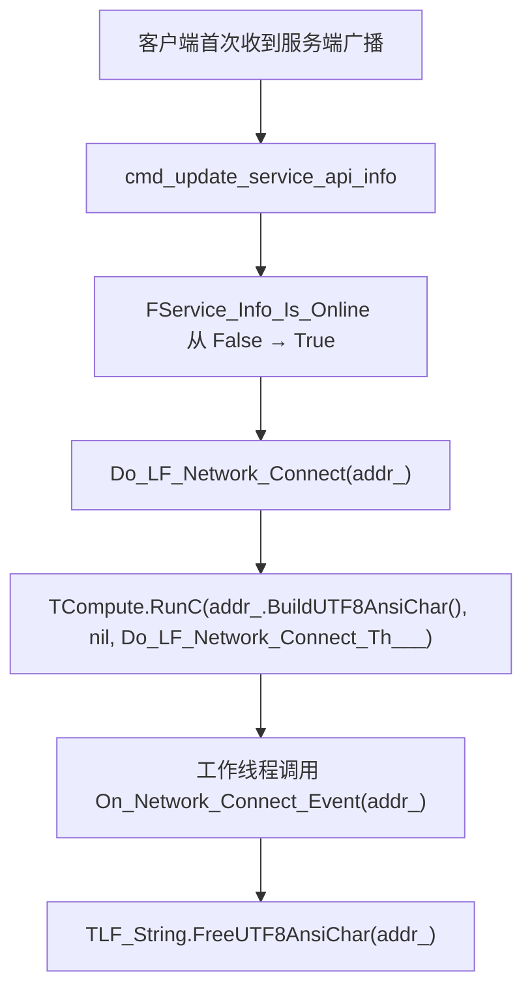

**关键**：
- **Connect 不是 TCP 建链**：是"首次收到服务端 API 广播"。
- **Disconnect 是物理链路断开**。
- **回调在 TCompute 工作线程执行**。
- **`addr_` 回调返回后立即失效**。

#### 13.3.2 使用范式

```pascal
procedure OnConnect(addr: PAnsiChar); cdecl;
var s: string;
begin
  s := UTF8ToString(addr);   // 立即复制
  TThread.Queue(nil,
    procedure
    begin
      Memo1.Lines.Add('Connected: ' + s);   // 主线程操作 UI
    end);
end;

procedure OnDisconnect(addr: PAnsiChar); cdecl;
begin
  TThread.Queue(nil,
    procedure
    begin
      Memo1.Lines.Add('Disconnected');
    end);
end;

LF_Set_Network_Event(@OnConnect, @OnDisconnect);

// 卸载（LF_Shutdown 前可选）
LF_Set_Network_Event(nil, nil);
```

#### 13.3.3 各语言的网络事件

| 语言 | 注册 | 注意事项 |
|------|------|---------|
| Pascal | `LF_Set_Network_Event(@OnConnect, @OnDisconnect)` | `addr` 立即复制 |
| Python | `lf.set_network_event(on_connect, on_disconnect)` | 回调在 worker 线程 |
| C++ | `lingofuse::setNetworkEvent(onConnect, onDisconnect)` | 回调在 worker 线程 |
| C# | `NetworkEvents.Set(onConnect, onDisconnect)` | 回调在 worker 线程 |
| Rust | `framework::set_network_event(on_connect, on_disconnect)` | 回调在 worker 线程 |
| Go | `lingofuse.SetNetworkEvent(onConnect, onDisconnect)` | 回调在 goroutine |
| Java | `NetworkEvents.set(onConnect, onDisconnect)` | 回调在 worker 线程 |
| Node.js / TS | `network.setNetworkEvent(onConnect, onDisconnect)` | 回调在 worker 线程 |
| Erlang | `lingofuse:set_network_event(fun on_connect/1, fun on_disconnect/1)` | 回调在 NIF 线程 |

**关键**：**所有语言的 `addr`（或等价物）在回调返回后立即失效**。**必须立即复制**。

---

## 第 14 章 线程模型与并发

### 14.1 四类线程

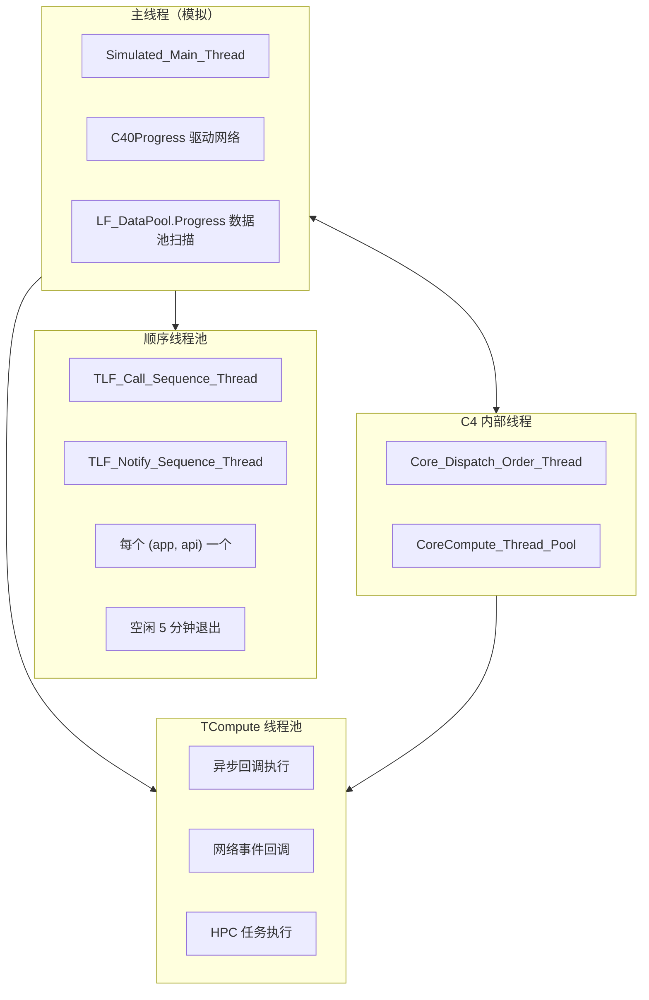

### 14.2 各线程的职责

| 线程 | 职责 | 用户可交互 |
|------|------|:----------:|
| **模拟主线程** | C4 进度、数据池扫描 | 不可（内部） |
| **TCompute 线程池** | 异步回调、网络事件、HPC | **回调内**可交互 |
| **顺序线程池** | FIFO 序列化调用/通知 | **回调内**可交互 |
| **C4 内部线程** | 网络收发 | 不可 |

### 14.3 线程安全矩阵

| 组件 | 线程安全 |
|------|:--------:|
| 所有导出函数（除状态日志） | ✅ 完全线程安全 |
| 同一数据句柄的并发写 | ❌ 需外部同步 |
| 回调中的全局变量 | ❌ 需外部同步 |
| `LF_DataPool.Progress` | ✅ 内部有锁 |
| `LF_SyncTool` | ✅ 内部有临界区 |
| 网络事件回调的 `addr_` | ❌ 回调返回后失效 |

### 14.4 回调线程归属速查

| 回调类型 | 执行线程 |
|---------|---------|
| `On_Call`（Call 模式） | 主线程 / 顺序线程 |
| `On_Notify`（Notify 模式） | 主线程 / 顺序线程 |
| `LF_Async_Call.OnResult` | TCompute 工作线程 |
| `LF_Async_Sequenced_Call.OnResult` | TCompute 工作线程 / 顺序线程 |
| `LF_UID_Async_*.OnResult` | TCompute 工作线程 |
| `LF_P2PNAME_Async_*.OnResult` | TCompute 工作线程 |
| `LF_Set_Network_Event.On_Connect` | TCompute 工作线程 |
| `LF_Set_Network_Event.On_Disconnect` | TCompute 工作线程 |
| `RegisterSyncCall_M` / `RegisterSyncNotify_M` | 主线程（需 `LF_Sync` 驱动） |

### 14.5 线程安全最佳实践

1. **跨线程只调 `LF_*` 函数**：完全线程安全。
2. **同一句柄的写操作加锁**：读写位置不是原子操作。
3. **回调中不阻塞、不调 `LF_Call`**：会自锁死。
4. **UI 操作编组到主线程**：`TThread.Queue` / `Synchronize`。
5. **托管语言回调保持强引用**：防止 GC 回收。
6. **网络事件 `addr_` 立即复制**：回调返回后失效。
7. **异步回调的 handle 必须在回调内处理完**：禁止跨线程保留。

### 14.6 异步回调的 Handle 生命周期

#### 14.6.1 时序对比：同步族 vs 异步族

**同步族（`LF_Call`）**：

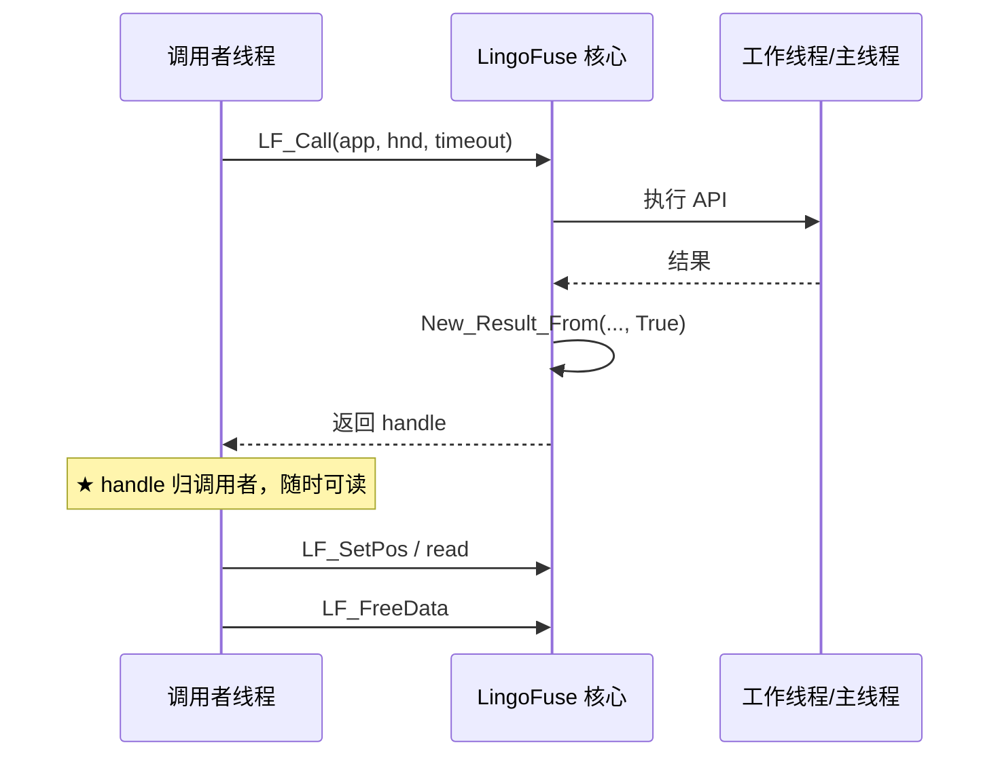

**异步族（`LF_Async_Call`）**：

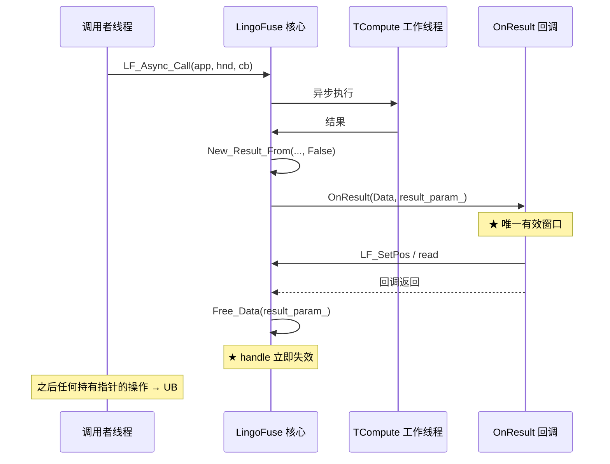

#### 14.6.2 与线程模型的耦合

**异步族 handle 的生命周期**：

- **起点**：`TLF_Async_Call_Bridge.Do_Th` 内的 `New_Result_From(..., False)`。
- **终点**：`TLF_Async_Call_Bridge.Do_Th` 内的 `Free_Data(result_param_)`。
- **起点与终点都在 TCompute 工作线程内**，且**中间只隔着 `OnResult` 回调调用**。
- **调用者线程完全感知不到这个窗口**——它只收到一个 future（或等价物）的完成通知，而 handle 已经失效。

**这是跨语言绑定的根本陷阱**：从调用者线程的视角，"调用完成"意味着"可以拿到结果"；但从 C 侧的视角，"调用完成"意味着"handle 已被释放"。

#### 14.6.3 三种安全策略

| 策略 | 实现方式 | 适用场景 |
|------|---------|---------|
| **A. 用同步族** | 网关/代理/HTTP 桥接等本就阻塞的场景 | `LF_Call` 家族 |
| **B. 回调内拷贝** | 异步回调内 `read_string_bytes` 拷出 bytes | `LF_Async_Call` 家族 |
| **C. 高级封装** | 绑定层的 Future 接口在回调内读取并拷出 | 所有托管语言 |

**任何在回调外保留裸 handle 的做法都是错的**。

#### 14.6.4 与自动回收的对比

| 维度 | 自动回收 handle | 异步族 handle |
|------|----------------|---------------|
| `auto_recycle___` | `True` | `False` |
| 空闲回收 | 10 分钟 + 5 秒扫描 | 不适用（不进池） |
| 释放时机 | `LF_FreeData` 标记 + 池扫描 | 回调返回瞬间 |
| 活性窗口 | 分钟级 | 微秒-毫秒级 |
| 保护机制 | 3 层（阈值 + 刷新 + calling） | 无 |
| 跨线程保留 | ⚠️ 需外部锁 | ❌ 禁止 |

**数量级差异**：自动回收 handle 的"活性窗口"是**分钟级**，异步族 handle 是**毫秒级**。

### 14.7 各语言的线程模型

| 语言 | 主线程 | 回调线程 | 异步模型 |
|------|--------|---------|----------|
| Pascal | 模拟主线程 | TCompute 工作线程 | `TThread.Queue` 回主线程 |
| Python | 模拟主线程 | TCompute 工作线程 | `asyncio` event loop（`_Aio` 变体）/ Future（`_Async` 变体） |
| C++ | 模拟主线程 | TCompute 工作线程 | `std::promise` + `std::future` |
| C# | 模拟主线程 | TCompute 工作线程 | `TaskCompletionSource` + `async/await` |
| Rust | 模拟主线程 | TCompute 工作线程 | 闭包 + `std::sync::mpsc` |
| Go | 模拟主线程 | TCompute 工作线程 | Channel + goroutine |
| Java | 模拟主线程 | TCompute 工作线程 | 回调式 |
| Node.js / TS | 模拟主线程 | TCompute 工作线程 | Promise / `async-await` |
| Erlang | Erlang 主进程 | NIF 线程 | `receive` 消息 |
| Julia | 模拟主线程 | TCompute 工作线程 | `Task` / `Threads.@spawn` |
| Zig | 模拟主线程 | TCompute 工作线程 | `std.atomic` + 轮询 |
| Swift | 模拟主线程 | TCompute 工作线程 | `Task.detached` + `DispatchSemaphore` |
| Ruby | 模拟主线程 | TCompute 工作线程 | Future |
| Fortran | 模拟主线程 | TCompute 工作线程 | 回调式（`c_funloc`） |
| Dart | 模拟主线程 | TCompute 工作线程 | `Isolate.run` + `Completer` |
| R | 模拟主线程 | TCompute 工作线程 | `future` 包 + `Job` 队列 |

### 14.8 线程模型踩坑

| 症状 | 根因 | 修复 |
|------|------|------|
| 回调内死锁 | 回调内调用 `LF_Call` | 异步提交到工作线程 |
| UI 崩溃 | 回调内直接操作 UI | `TThread.Queue` / `Dispatcher.Invoke` / `MainActor.run` |
| 进程不退出 | worker 线程未结束 | 显式 `shutdown` |
| 异步回调外 handle 失效 | 持有裸 handle | 回调内拷贝数据 |
| 顺序线程竞态 | 高并发创建/销毁 App | 减少 App 创建频率 |
| `LF_PrepareDone` 返回 0 | 同一进程已调用过 | 重启进程 |

---

## 第 15 章 内存与生命周期管理

### 15.1 三层内存池架构

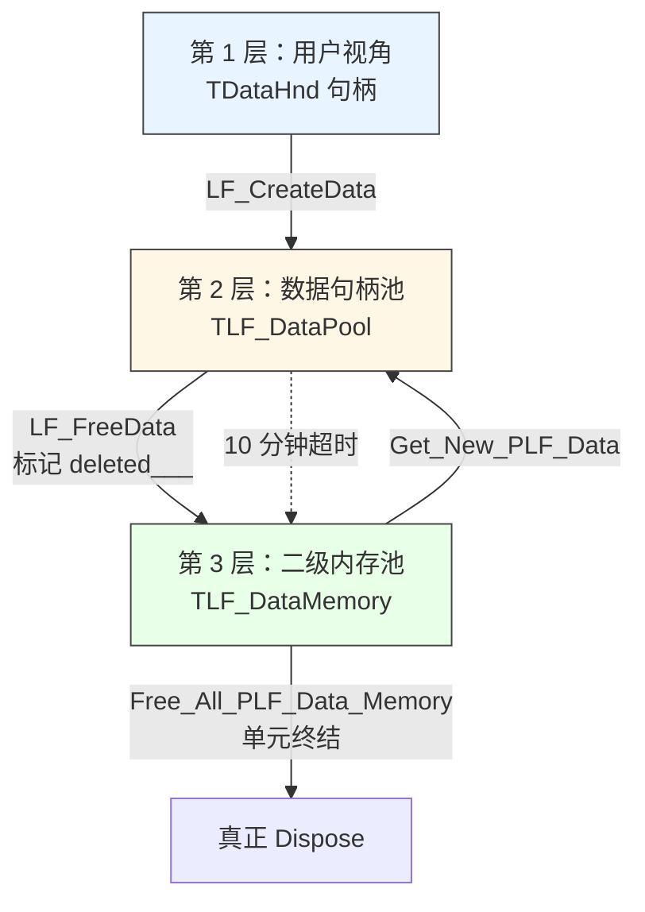

### 15.2 每层的职责

| 层 | 名称 | 职责 |
|:--:|------|------|
| 1 | 用户句柄 | 用户持有的 `TDataHnd` |
| 2 | 数据句柄池 | 跟踪活跃句柄；扫描并回收空闲/删除的 |
| 3 | 二级内存池 | 缓存已回收的 `TLF_Data` record，减少 `New`/`Dispose` |

### 15.3 `TLF_DataPool.Progress` 三路分支

**每 5 秒扫描一次**：

```pascal
for each handle in LF_DataPool:
  if handle.updated___ or handle.calling___ > 0 then
      handle.time___ := now;
      handle.updated___ := False;
  else if handle.deleted___ then
      加入"用户主动释放"列表;
      标记回收;
  else if now - handle.time___ > 10 分钟 then
      加入"超时释放"列表;
      标记回收;
```

**关键**：
- **`updated___` 或 `calling___ > 0`**：刷新时间戳。
- **`deleted___`**：用户主动释放。
- **超时**：空闲 10 分钟。
- **释放发生在池外**：避免锁内 Dispose。

### 15.4 顺序线程的退出与释放

**源码**（`Z.LingoFuse_Core.pas` `TLF_Call_Sequence_Thread.Do_Run_Th` 末尾）：

```pascal
if (Internal_Queue_Data___ <> nil) and (Internal_Queue_Pool___ <> nil) then
  begin
    Internal_Queue_Pool___.Lock;
    try Internal_Queue_Pool___.Remove(Internal_Queue_Data___);
    finally Internal_Queue_Pool___.UnLock; end;
  end;
DelayFreeObj(1.0, self);   // ← 1 秒（v6.0 文档误记为 5 秒）
```

### 15.5 `calling___` 计数器

**作用**：保护进行中的远程调用。

**实现**：
```pascal
procedure TLF_Data.Begin_Call;
begin
  calling___.UnLock(calling___.LockP^ + 1);
  updated___ := True;
end;

procedure TLF_Data.End_Call;
begin
  calling___.UnLock(calling___.LockP^ - 1);
  updated___ := True;
end;
```

**关键**：
- **所有 `LF_Call` / `LF_LocalCall` / `LF_Notify` / `LF_Sequenced_Notify` 内部自动 `Begin_Call` / `End_Call`**。
- **用户不需要手动调用**（C ABI 层没有暴露）。

### 15.6 `LF_CreateData_Permanent` 语义

- **`auto_recycle___ = False`**：不加入 `LF_DataPool`。
- **`LF_FreeData` 同步立即释放**（不是标记）。
- **不受 10 分钟超时影响**（因为它根本不在池里）。
- **初始化窗口创建会泄漏**：`LF_PrepareDone` 前 / `LF_ExitMainThread` 后，`LF_FreeData` 是 no-op。

### 15.7 `LF_App` 的两阶段析构

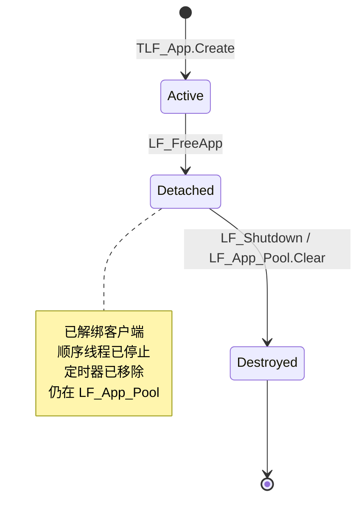

### 15.8 内存泄漏排查清单

| # | 泄漏源 | 检查方法 | 修复 |
|:-:|--------|---------|------|
| 1 | 未 `LF_FreeData` 数据句柄 | 长期运行内存增长 | 用 `try..finally` |
| 2 | 未 `LF_FreeApp` 应用句柄 | `LF_App_Pool` 增长 | 按清理顺序释放 |
| 3 | `LF_CreateData_Permanent` 未释放 | 显式查找 | 显式 `LF_FreeData` |
| 4 | DLL 未调用 `LF_Shutdown` | DLL 卸载后仍占内存 | 加卸载钩子 |
| 5 | 顺序通知线程未退出 | 检查 TCompute 线程数 | 空闲 5 分钟后自动退出 |
| 6 | 二级池中的 record 未释放 | 检查 `LF_DataMemory` 池大小 | 单元终结时自动释放 |
| 7 | 回调闭包捕获了大对象 | 检查匿名函数 | 使用弱引用 |
| 8 | 异步回调外持有 handle 导致 double-free | 检查 `LF_FreeData` 是否被调用于异步 handle | 只在回调内处理异步 handle |

### 15.9 顺序线程竞态

**源码**（`TLF_Notify_Sequence_Thread.Do_Run_Th` 末尾 + `Kill_App`）：

```pascal
// Do_Run_Th 末尾
if (Internal_Queue_Data___ <> nil) and (Internal_Queue_Pool___ <> nil) then
  begin
    Internal_Queue_Pool___.Lock;
    try Internal_Queue_Pool___.Remove(Internal_Queue_Data___);
    finally Internal_Queue_Pool___.UnLock; end;
  end;
DelayFreeObj(1.0, self);

// Kill_App 内部
queue^.Data^.Data.Second.Critical.Lock;
try
  queue^.Data^.Data.Second.Internal_Queue_Pool___ := nil;   // ← 与上面检查竞争
  queue^.Data^.Data.Second.Internal_Queue_Data___ := nil;
finally queue^.Data^.Data.Second.Critical.UnLock; end;
```

**竞态分析**：`Do_Run_Th` 检查 `Internal_Queue_Pool___ <> nil` 时**未加锁**，`Kill_App` 可能在此之前置 nil。

**理论风险**：**低概率崩溃**。

**缓解**：`LF_FreeApp` 之前确保顺序线程已停止；避免在高并发下频繁创建/销毁 App。

### 15.10 各语言的内存管理

| 语言 | 内存模型 | 注意事项 |
|------|---------|---------|
| Pascal | 手动 `New` / `Dispose` | 必须 `LF_FreeData` |
| Python | 引用计数 + GC | `DataHandle` 需显式 `.dispose()` |
| C++ | RAII | `DataHandle` 析构自动释放 |
| C# | GC | `IDisposable` + `using` |
| Rust | 所有权 + 借用检查 | `Drop` 自动释放 |
| Go | GC | `defer` 延迟释放 |
| Java | GC | `try-with-resources` |
| Node.js / TS | GC | `dispose()` 必须显式调用 |
| Erlang | 进程 GC | 无显式释放，垃圾回收自动 |
| Julia | GC | `finalize` 或 GC 自动 |
| Zig | 手动 `defer` / `errdefer` | 必须显式释放 |
| Swift | ARC | 自动引用计数 |
| Ruby | GC | `dispose` 或 `ObjectSpace` |
| Fortran | 手动 `deallocate` | 必须显式释放 |
| Dart | GC | `dispose()` 显式调用 |
| R | GC | `finalize` 或 GC 自动 |

**关键提醒**：**所有托管语言（Python / C# / Go / Java / Node.js / TS / Julia / Swift / Ruby / Dart / R）的 `DataHandle` 仍必须显式释放**——GC 只回收内存，不调用 `LF_FreeData`。忘记释放会导致 native 侧 handle 池耗尽。

---

## 第 16 章 跨语言绑定与 ABI 契约

### 16.1 C ABI 边界


### 16.2 通用规则

1. **回调必须 `cdecl`**（或语言的等价约定：`CFUNCTYPE` / `extern "C"` / `@convention(c)`）。
2. **托管语言回调必须保持强引用**。
3. **字符串用 UTF-8**（`PAnsiChar`）。
4. **`TP2P_UID___` 是 32 字节数组**。
5. **返回指针 5 秒后失效**（`LF_GetOption` / `LF_Get_AppName` / `LF_Generate_AppName` / `LF_Get_P2P_Name` / `LF_Get_P2P_UID`）。
6. **`LF_WriteString` 总是追加 #0**，`LF_ReadString` 容错读。
7. **发送方身份自动可用**，无需额外声明；**只在回调的 Input 参数中有效**。
8. **同步族与异步族的 handle 所有权相反**：同步族归调用者，异步族归框架（回调返回后立即释放）。

### 16.3 各语言注意事项速查

| 语言 | 关键点 |
|------|--------|
| **C / C++** | `extern "C"`；`cdecl`；异步回调内拷贝数据；MSVC 必须 `/utf-8` |
| **C# / .NET** | `CallingConvention.Cdecl`；回调强引用；异步回调内拷贝数据；库必须无 `Main` |
| **Python** | `CFUNCTYPE`（cdecl）；回调强引用（模块级变量）；异步回调内拷贝数据；`@server.expose` 装饰器 |
| **Java** | JDK 22+ FFM API；upcallStub 保持强引用；异步回调内拷贝数据 |
| **Rust** | `extern "C"`；panic 必须 `catch_unwind`；异步回调内拷贝数据 |
| **Go** | `purego` 或 `cgo`；回调保持引用；异步回调内拷贝数据；Service 侧需 `CGO_ENABLED=1` |
| **Swift** | Swift 5.9+；`@convention(c)`；异步回调内拷贝数据 |
| **Zig** | `@cImport`；`extern "C"`；异步回调内拷贝数据 |
| **Erlang** | NIF 崩溃会拖垮 BEAM；OTP 27+；异步回调内拷贝数据；loop 必须处理 `lf_p2p_call` |
| **Ruby** | Fiddle 或 C 扩展；DevKit；异步回调内拷贝数据 |
| **Fortran** | `iso_c_binding`；编译器同源；异步回调内拷贝数据 |
| **Julia** | `--threads=2`；`ccall`；异步回调内拷贝数据 |
| **R** | 四层架构 + Job 队列；异步回调内拷贝数据；`future::plan("sequential")` |
| **Dart** | `DynamicLibrary.open`；Flutter Web 不可用；异步回调内拷贝数据；`BridgeHost.start()` 必须首行 |
| **Node.js / TS** | `koffi` 或 Fiddle；异步回调内拷贝数据；`AsyncBridge` timer 不 `unref` |
| **Pascal** | 原生 FFI；`cdecl`；`LF_LocalCall` 不注入身份 |

### 16.4 P2PName 跨语言时序

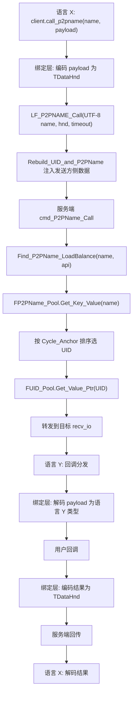

**P2PName 跨语言契约表**：

| 维度 | 契约 |
|------|------|
| 字符串编码 | UTF-8 + NUL 结尾 |
| 空字符串 | 服务端报 `no found p2pname:""`，不回包 |
| 长度上限 | 无显式限制 |
| 异步悬挂 | 服务端找不到组名时回调永不触发 |
| 超时机制 | 调用方自行实现（C ABI 无超时参数） |
| 回调线程 | TCompute 工作线程 |
| Handle 所有权 | 同步族归调用者，异步族归框架 |

### 16.5 发送方身份识别的跨语言声明

```c
/* LF_Get_P2P_UID: 返回指针（指向 32 字节 UID），由框架 DelayFreeMem(5.0, ...) 自动释放 */
PP2P_UID___ LF_Get_P2P_UID(TDataHnd___ Hnd);

/* LF_Get_P2P_Name: 返回 UTF-8 字符串指针，5 秒后自动释放 */
const char* LF_Get_P2P_Name(TDataHnd___ Hnd);
```

- `TP2P_UID___` 是 32 字节数组，跨语言建议声明为 `uint8_t[32]`。
- `PP2P_UID___` 是**指向 `TP2P_UID___` 的指针**（`uint8_t (*)[32]` 或 `uint8_t*`）。
- **使用位置限制（必读）**：
  - **仅在触发事件的回调 `Input` 参数上有效**。
  - **不能对自建句柄（`LF_CreateData` 创建的）调用**。
  - **不能对输出句柄（如 `OnResult` 的 `Result_`）调用**。
  - **不能在 `LF_LocalCall` / `LF_LocalNotify` 回调中调用**。

### 16.6 异步 handle 的跨语言声明

```c
// 异步回调的原型（cdecl）
typedef void (*TLF_Async_Call_OnResult)(void* Data, TDataHnd___ Result_);
```

**跨语言契约**：

- `Data` 是调用者提供的 opaque 指针，LingoFuse 不管理其生命周期。
- `Result_` 是**框架拥有的 handle**：
  - 回调返回后**立即失效**。
  - 回调内**禁止**调用 `LF_FreeData(Result_)`。
  - 回调内**必须**完成所有读取（或把数据拷出来）。

### 16.7 ABI 线格式（多语言统一契约）

这是 `code_decl_to_abi` 工具链的核心契约：

**请求载荷**：
```
[业务参数 1][业务参数 2]...[业务参数 N]
```

每个参数按类型编码（小端，字符串 NUL 结尾）。

**响应载荷**：
```
[status:u8][result]
```

- `status == 0x00`：`result` 按返回类型编码
- `status == 0xFF`：`result` 是 UTF-8 错误消息（NUL 结尾）

**这套协议与 cpp / rust / go / pascal / python / csharp / java / nodejs / typescript / erlang / julia / zig / swift / ruby / fortran / dart / r 完全一致**，因此跨语言互调成立。

**类型映射表**：

| ABI 类型 | 字节数 | 编码 |
|----------|:------:|------|
| `shortint` | 1 | 补码 |
| `smallint` | 2 | 补码，小端 |
| `integer` / `longint` | 4 | 补码，小端 |
| `int64` | 8 | 补码，小端 |
| `byte` | 1 | 原码 |
| `word` | 2 | 原码，小端 |
| `cardinal` / `dword` / `longword` | 4 | 原码，小端 |
| `uint64` | 8 | 原码，小端 |
| `double` / `extended` / `real` | 8 | IEEE 754 双精度，小端 |
| `single` | 4 | IEEE 754 单精度，小端 |
| `string`（参数） | 变长 | UTF-8 + `0x00` 终止符 |
| `string`（返回） | 变长 | UTF-8 + `0x00` 终止符 |
| `void`（返回） | 0 | 只有状态字节 `0x00` |

### 16.8 多语言绑定的共性

**所有 17 种原生 FFI 绑定的共同点**：

1. **都封装 C ABI**：Pascal / Python / C++ / C# / Rust / Go / Java / Node.js / TS / Erlang / Julia / Zig / Swift / Ruby / Fortran / Dart / R 都是 C ABI 的包装。
2. **都提供 `DataHandle` / `AppHandle` 类型**：名字可能不同，语义一致。
3. **都支持三套寻址**：App 名 / UID / P2PName。
4. **都支持同步调用与异步调用**：形式不同，语义一致。
5. **都暴露发送方身份**：从回调 Input 读取 UID / P2PName。
6. **都有 `register_call` / `register_notify`**：形式不同，语义一致。
7. **都受 `LF_ExitMainThread` → `LF_FreeApp` → `LF_Shutdown` 清理顺序约束**。

**PHP 是第 18 种一方绑定，但它经 `bridge.py`，不是原生 FFI**。

### 16.9 多语言绑定的差异点

| 维度 | 差异 |
|------|------|
| **初始化方式** | Pascal / C++ / Zig 需 `LF_LoadLibrary`；Python / C# / Java 自动或半自动 |
| **异步模型** | Python `asyncio`；C++ `std::future`；C# `Task`；Rust 闭包；Go Channel；Java 回调；Node.js Promise；Erlang `receive`；Julia `Task`；Swift `async/await`；Dart `Future`；R `future` 包 |
| **handle 释放** | Pascal 手动；C++ RAII；C# `IDisposable`；Rust `Drop`；Go `defer`；Java `try-with-resources`；Node.js `dispose()`；Julia GC |
| **线程模型** | 各语言原生线程 / 协程 / 进程 |
| **平台支持** | 受 LingoFuse 原生库限制 |
| **已知限制** | Java 需 JDK 22+；Julia 需 `--threads=2`；Erlang 需 OTP 27+；Zig 锁定 0.17.0 |

---

## 第 17 章 清理与关闭

### 17.1 硬约束的清理顺序

```
LF_ExitMainThread    →    LF_FreeApp    →    LF_Shutdown
```

**为什么这个顺序**：

1. **`LF_ExitMainThread`**：停止模拟主线程，触发 `C40Clean`、顺序线程池停止、数据句柄全部释放。
2. **`LF_FreeApp`**：解绑所有 `TC40_LF_Client` 的 `app` 引用，停止顺序线程，`FakeFree` 移除定时器。
3. **`LF_Shutdown`**：清空 `LF_App_Pool`（真正释放 App），释放所有数据句柄，卸载 IPC 库。

**错误顺序的后果**：

```pascal
// ❌ 错误：先 Shutdown 后 FreeApp
LF_Shutdown;
LF_FreeApp(App);   // App 已在 Shutdown 时释放，UAF
```

### 17.2 `LF_Shutdown` 的完整步骤

1. **清空网络事件回调**：`On_Network_Connect_Event := nil` / `On_Network_Disconnect_Event := nil`。
2. **停止所有序列化通知线程**。
3. **释放所有剩余数据句柄**：`LF_DataPool.Free_All_Hnd`。
4. **退出模拟主线程**：`LF_ExitMainThread`。
5. **清空全局应用池**：`LF_App_Pool.Clear`。
6. **卸载 IPC 库**：`UnloadIPCLibrary`。
7. **关闭核心调度线程**：`if IsLibrary then Close_Core_Dispatch_Thread`。

**幂等性**：多次调用 `LF_Shutdown` 应该是幂等的。每个内部步骤都有前置检查（空池跳过、未激活跳过）。

### 17.3 `LF_Shutdown` 后可以重新初始化

```pascal
LF_Shutdown;
LF_ResetPrepare;             // 清空准备队列
LF_PrepareService(...);
LF_PrepareClient(...);
if LF_PrepareDone = 1 then   // 重新启动
  ...
```

**关键**：`LF_Shutdown` 会重置 `Simulated_Main_Thread_Running`，因此 `LF_PrepareDone` 可以再次成功。

### 17.4 DLL 场景

**必须显式 `LF_Shutdown`**：

```pascal
// DLL 出口函数中
procedure DllUnload; stdcall;
begin
  LF_Shutdown;   // 必须显式调用
end;
```

**原因**：DLL 可能被宿主进程提前卸载，LingoFuse 的 `finalization` 可能不会执行。

### 17.5 各语言的清理顺序

| 语言 | 关闭顺序 | 额外注意事项 |
|------|----------|--------------|
| Pascal | `LF_ExitMainThread` → `LF_FreeApp` → `LF_Shutdown` | 顺序不可颠倒 |
| Python | `LF_ExitMainThread` → `app.free()` → `LF_Shutdown` | 在 `finally` 块中 |
| C++ | `exitMainThread` → App 析构 → `shutdown` | `LibraryLoader` 析构时 `LF_FreeLibrary` |
| C# | `NetworkEvents.Clear` → `ExitMainThread` → `app.Dispose` → `Shutdown` | 顺序不可颠倒 |
| Rust | `AppHandle::drop` → `framework::shutdown` | Drop 顺序由变量声明顺序决定 |
| Go | `ExitMainThread` → `app.Close()` → `Shutdown` | `defer` 顺序相反 |
| Java | `NetworkEvents.clear` → `ExitMainThread` → `app.close()` → `Shutdown` → `AsyncBridge.shutdownInstance` | `AsyncBridge` 在最后 |
| Node.js | `AsyncBridge.shutdownInstance` → `network.clearNetworkEvent` → `exitMainThread` → `app.dispose()` → `shutdown` | `AsyncBridge` 必须最先 |
| TypeScript | 同 Node.js | — |
| Erlang | `exit_main_thread` → `free_app` → `shutdown` | — |
| Julia | `stop_callback_consumer()` → `exit_main_thread` → `dispose!(app)` → `shutdown` | 先停 consumer |
| Zig | `exitMainThread` → `app.deinit()` → `shutdown` | — |
| Swift | `NetworkEvents.clearNetworkEvent` → `ExitMainThread` → `app.dispose()` → `Shutdown` → `LF_FreeLibrary` | 最后释放库 |
| Ruby | `LingoFuse::NativeBridge.stop` → `Framework.exit_main_thread` → `Framework.shutdown` → `Native.free_library` | `NativeBridge.stop` 必须最先 |
| Fortran | `lf_exit_main_thread` → `lf_app_destroy` → `lf_shutdown` | — |
| Dart | `app.dispose()` → `Framework.exitMainThread()` → `Framework.shutdown()` → `BridgeHost.instance.stop()` | `BridgeHost.stop` 在最后 |
| R | `lf_exit_main_thread` → `lf_free_app` → `lf_shutdown` | 推荐哨兵文件触发，不用 Ctrl+C |

### 17.6 清理踩坑

| 症状 | 根因 | 修复 |
|------|------|------|
| 关闭时崩溃 | 顺序错误 | 按 `ExitMainThread → FreeApp → Shutdown` |
| 进程不退出 | 线程未结束 | 显式 `shutdown` + `process.exit` |
| `$C0000005` Access Violation | dispatcher 线程在 DLL 卸载后运行 | 先停 dispatcher，再卸载 DLL |
| 二次释放崩溃 | 重复 `LF_FreeData` | 用 RAII / `dispose` 幂等 |
| `LF_Shutdown` 后调用 `LF_*` 崩溃 | 已 shutdown | 重新初始化 |
| `LF_PrepareDone` 返回 0 | 同一进程已调用过 | 重启进程 |

---

# 第五部分 P2P 与分布式

## 第 18 章 P2P 分布式负载

### 18.1 核心判断：1 对多即分布式

> **只要出现"1 对多"，就可以分布式。**
>
> - 1 个 App 名，被多个程序注册；
> - 1 个 P2PName，被多个程序注册；
> - 1 个调用方，连接多个服务器；
> - 1 个 API 名，被多个 worker 暴露。

LingoFuse 的 C4 网格会自动形成候选池，并按策略选择目标。

### 18.2 三种负载粒度

| 粒度 | 路由键 | 选择方式 | 本地优先 |
|------|--------|---------|:--------:|
| 应用级 | App 名 | 多客户端候选，最久未用 | ✅ |
| 组级 | P2PName | 服务端组内负载/粘性 | ❌ |
| 会话级 | UID | 定向，不负载 | ✅（本地 UID 优先） |

### 18.3 一个 App 名被多个程序注册

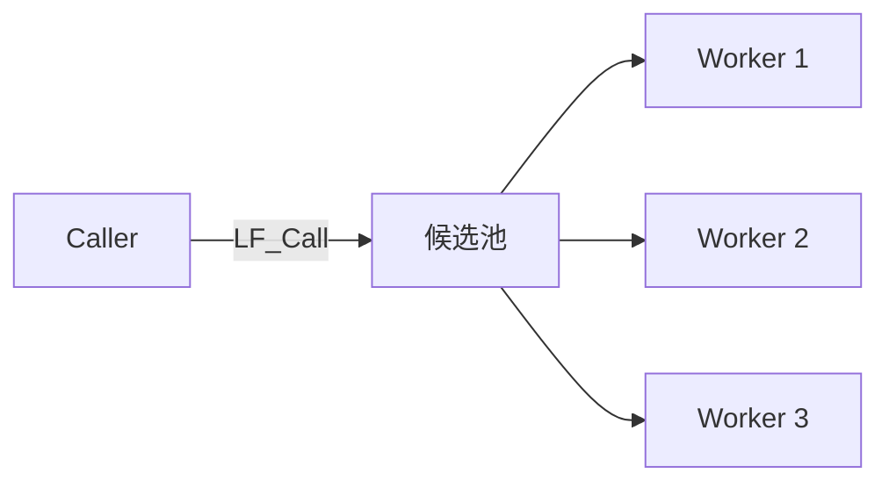

**规则**：
- App 名路由**本地优先**。
- 本地没有同名 App，才走远端候选。
- 多个候选时按"最久未用"负载均衡。
- 广播缓存有约 3 秒延迟。
- 不要用同一个 App 名在同一进程里做"本地 vs 远程"测试。

### 18.4 一个 P2PName 被多个程序注册

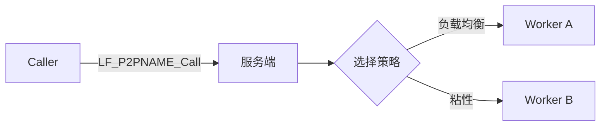

**规则**：
- P2PName 路由**不做本地优先**，总是交给服务端/网格。
- 服务端维护"组名到 UID 列表"。
- 默认按 `Cycle_Anchor` 做负载均衡。
- `Fixed_Sequenced_Time` 默认 20 秒，提供粘性。
- 适合无状态 worker、计算节点、编解码节点、GPU 节点。

### 18.5 你的程序连接多个服务器

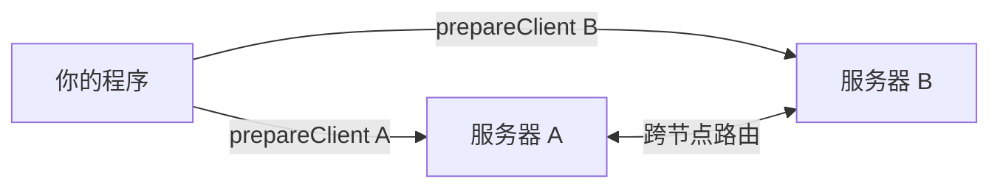

**条件与边界**：
- 你的程序可以 `prepareClient` 多个服务器地址。
- **前提**：服务器之间通过 C4 协议建立了物理连接（互相 `Client` / `Auto` 连接），**形成 C4 网格**。
- **若服务器之间不互通**，它们就是**孤岛**，不会自动跨服务器负载。
- **额外配置**：不需要额外配置广播/路由；只要服务器之间通过 C4 网格连接，跨节点路由自动生效。
- **具体机制**：每个 C4 服务端通过 `QueryInfo` 命令查询其他服务端的服务信息，分发服务收集并广播。

### 18.6 序列化族与高流量计算

**LingoFuse 的序列化族**：
- `LF_Sequenced_Notify`
- `LF_Sequenced_Call`
- `LF_Async_Sequenced_Call`
- UID / P2PName 的 Sequenced 变体

**保证**：
- 同一 `(App, API)` 对内 FIFO；
- 同一 `(UID, API)` 内 FIFO；
- 同一 `(P2PName, API)` 对内 FIFO，但可能分配到不同 UID；
- 不同键之间可并发。

**为什么和 Matlab / R / Julia / 视频 / 音频天生合拍**：

| 场景 | 数据形态 | 序列化后的优势 |
|------|---------|---------------|
| Matlab 计算 | 矩阵、数组、仿真迭代 | 每轮迭代 FIFO，结果按序回传 |
| R 统计 | 数据帧、批处理 | 批次顺序稳定，避免乱序污染 |
| Julia 高并发 | 任务块、GPU 批次 | 同 API 内 FIFO，跨 API 并发 |
| 视频流 | 帧序列、GOP | 帧序不丢，按帧处理与反馈 |
| 音频流 | PCM / Opus 块 | 块序稳定，低延迟反馈 |
| 大规模数据流 | 分块二进制 | 二进制句柄，少编码开销 |

### 18.7 为什么几乎自动化、高效

- **自动化发现**：注册 API，服务端广播，调用方缓存候选。
- **自动化负载**：App 名多注册 / P2PName 多注册，自动选目标。
- **自动化顺序**：Sequenced 族按路由键 FIFO。
- **自动化句柄池**：DataHandle 创建、池化、回收。
- **自动化异步**：`LF_Async_*` + Future，回调内拷贝结果。
- **二进制高效**：句柄可写原始字节，视频/音频/矩阵少一次编码。
- **零拷贝映射**：解码时 `Param.Mapping` 可零拷贝映射。
- **跨语言统一**：C ABI 让 Matlab / R / Julia / Python / C++ 都能接。

### 18.8 P2P 分布式负载最佳实践

1. **UID 只在回调 `Input` 里读。**
2. **读到指针立即拷贝。**
3. **断网前 UID 可做通讯标识符。** 重连后重新 `whoami`。
4. **想要分布式，就制造 1 对多。**
5. **同质 worker 用 P2PName。** 不要用 App 名做组播。
6. **需要顺序用 Sequenced。**
7. **大流量用二进制句柄。**
8. **多服务器要确认服务器支持跨节点路由。**
9. **不要在回调里调同步 `LF_Call` / `LF_Notify` / `LF_LocalCall`。**
10. **异步 handle 归框架所有，回调返回立即释放。**

### 18.9 各语言的 P2P 使用对照

| 语言 | P2PName 设置 | P2PName 调用 | 负载均衡策略 |
|------|-------------|-------------|-------------|
| Pascal | `LF.Set_Opt_P2P_Name('group')` | `LF_P2PNAME_Call('group', ...)` | `Cycle_Anchor` |
| Python | `lf.set_opt_p2p_name('group')` | `lf.p2pname_call('group', ...)` | `Cycle_Anchor` |
| C++ | `lingofuse::setOption("LF_P2P_name", "group")` | `lingofuse::callByP2PName("group", ...)` | `Cycle_Anchor` |
| C# | `Options.SetP2PName("group")` | `Framework.CallByP2PName("group", ...)` | `Cycle_Anchor` |
| Rust | `framework::set_option("LF_P2P_name", "group")` | `framework::call_by_p2p_name("group", ...)` | `Cycle_Anchor` |
| Go | `lingofuse.SetOption("LF_P2P_name", "group")` | `lingofuse.CallByP2PName("group", ...)` | `Cycle_Anchor` |
| Java | `Options.setP2pName("group")` | `Framework.callByP2PName("group", ...)` | `Cycle_Anchor` |
| Node.js / TS | `framework.setOption("LF_P2P_name", "group")` | `framework.callByP2PName("group", ...)` | `Cycle_Anchor` |
| Erlang | `lingofuse:set_option(<<"LF_P2P_name">>, <<"group">>)` | `lingofuse:p2p_call(<<"group">>, ...)` | `Cycle_Anchor` |
| Julia | `set_option("LF_P2P_name", "group")` | `p2pname_call("group", ...)` | `Cycle_Anchor` |
| Zig | `lf.options.setP2PName("group")` | `lf.p2pNameCall("group", ...)` | `Cycle_Anchor` |
| Swift | `Options.setP2PName("group")` | `Framework.callByP2PName("group", ...)` | `Cycle_Anchor` |
| Ruby | `LingoFuse::Options.set_opt_p2p_name("group")` | `LingoFuse::Framework.p2pname_call("group", ...)` | `Cycle_Anchor` |
| Fortran | `lf_set_opt_p2p_name("group")` | `lf_p2pname_call("group", ...)` | `Cycle_Anchor` |
| Dart | `Framework.setOptP2PName("group")` | `Framework.p2pnameCall("group", ...)` | `Cycle_Anchor` |
| R | `lingofuse::lf_set_opt_p2p_name("group")` | `lingofuse::lf_p2pname_call("group", ...)` | `Cycle_Anchor` |

---

## 第 19 章 路由优化：本地短路与服务器本地处理

### 19.1 本地短路（目标在本地，不走网络）

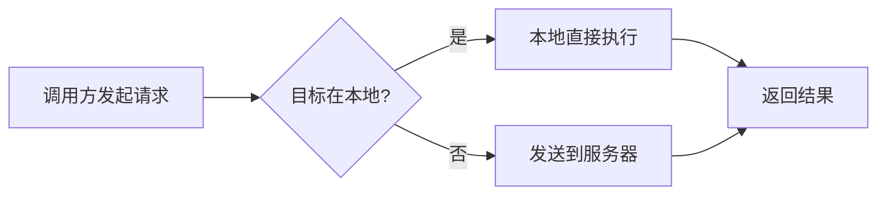

**说明**：
- 如果调用方进程内已经注册了目标 App / UID / P2PName 对应的函数，LingoFuse 会**本地优先执行**，不经过网络。
- 这减少了网络往返，降低了延迟。
- 注意：**App 名路由默认就是本地优先；UID 路由也本地优先；P2PName 路由不做本地优先**。

**源码依据**：

```pascal
// 客户端 Send_Execute_Notify 的第一步
tmp_cli__ := Find_Local_API(app_Name__, api_Name__, True);
if tmp_cli__ <> nil then
  begin
    tmp_cli__.APP.Engine.Execute_Notify(tmp_param);   // 本地直接执行
    exit;
  end;
```

### 19.2 服务器本地处理（请求到了服务器，但服务器自己能处理）

```mermaid
flowchart LR
    A[请求到达服务器] --> B{服务器本地能处理?}
    B -->|是| C[服务器本地执行]
    B -->|否| D[转发到目标客户端]
    C --> E[返回结果]
    D --> E
```

**说明**：
- 当请求经过服务器时，服务器会先检查自己进程内是否有对应的 App / API。
- 如果有，服务器**直接本地处理**，不再向其他客户端转发。
- 这避免了不必要的网络转发，提高了整体效率。
- **这个优化对 App 名、UID、P2PName 路由都适用**。

**源码依据**：

```pascal
// 服务端 cmd_Call 的第一步
tmp_cli__ := Find_Local_API(app_Name__, api_Name__, True);
if tmp_cli__ <> nil then
  begin
    // 服务器本地处理，不转发
    RunHPC_CompleteBuffer_StreamM(Sender, nil, tmp_cli__, InData, OutData, Run_Call_Worker);
    exit;
  end;
// 否则才广播给其他客户端
```

### 19.3 两级优化合并图

```mermaid
flowchart TB
    A[调用方] --> B{本地能处理?}
    B -->|是| C[本地执行]
    B -->|否| D[发送到服务器]
    D --> E{服务器本地能处理?}
    E -->|是| F[服务器本地执行]
    E -->|否| G[转发到目标客户端]
    C --> H[返回结果]
    F --> H
    G --> H
```

### 19.4 本地短路的意外性

**问题**：多节点测试时，`LF_Call` 可能实际本地执行，与预期不符。

**原因**：C4 路由优先查找本地 App 实例。

**修复**：
- 明确当前进程是否注册了同名 App。
- 需要远程调用时避免本地同名 App。
- 或用不同 App 名区分本地/远程。

**相关坑**：`LF-ROUTE-001`。

### 19.5 服务器本地处理的影响

**问题**：服务器进程本身注册了同名 App 时，请求可能不会被转发到其他客户端。

**原因**：服务器进程优先处理本地能处理的请求。

**修复**：
- 明确服务器进程是否应该注册业务 App。
- 服务器通常只作为信标（Beacon），不注册业务 App。
- 如果服务器要注册，需要明确它的处理能力。

**相关坑**：`LF-ROUTE-009`。

---

# 第六部分 多语言绑定深度解析

## 第 20 章 十八种绑定逐一展开

### 20.1 Pascal 绑定

**定位**：原生 FFI，核心引擎来源。**所有机制的参考实现**。

**入口模块**：
- `lingofuse_import.pas`：C ABI 声明。
- `lingofuse_helper.pas`：辅助封装（`TDataHandle` 等）。

**初始化**：
```pascal
LF_LoadLibrary;
LF_SetOptionEx('Quiet', 'True');
LF_ResetPrepare;
LF_PrepareServiceEx('ipc:my_app', 'ipc:my_app');
App := LF_CreateAppEx('MyApp', 'My App');
LF_RegisterCallEx(App, 'api_name', 'description', nil, @Callback);
LF_PrepareClientEx('ipc:my_app', App);
if LF_PrepareDone <> 1 then Halt(1);
```

**回调**：
```pascal
procedure MyCallback(Trigger: Pointer; Input, Output: TDataHnd); cdecl;
begin
  // 读参数
  // 处理
  // 写结果
end;
```

**专属坑**：
- `LF_LocalCall` 不注入身份（`LF-LOCAL-001`）。
- P2PName 异步 Call 找不到组名时永久悬挂（`LF-ROUTE-012`）。
- 回调必须 `cdecl`（`LF-APP-001`）。
- 顺序线程退出后延迟 1 秒释放（不是 5 秒，`LF-SEQ-003`）。

### 20.2 Python 绑定

**定位**：`pip install -e .` 即用，含 `@expose` 装饰器与 HTTP 网关。

**入口模块**：
- `lingofuse/_lf_native.py`：C ABI 绑定。
- `lingofuse/lf_io.py`：I/O 辅助。
- `lingofuse/async_support.py`：异步支持。

**初始化**：
```python
from lingofuse._lf_native import (
    LF_ResetPrepare, LF_PrepareService, LF_PrepareClient, LF_PrepareDone,
    LF_CreateApp, LF_RegisterCall, LF_RegisterNotify,
    LF_ExitMainThread, LF_Shutdown,
)
from lingofuse.lf_io import cstr

LF_SetOptionEx("Quiet", "True")
LF_ResetPrepare()
LF_PrepareService(cstr("ipc:my_app"), cstr("ipc:my_app"))
app = LF_CreateApp(cstr("MyApp"), cstr("My App"))
LF_RegisterCall(app, cstr("api"), cstr("desc"), None, callback)
LF_PrepareClient(cstr("ipc:my_app"), app)
if LF_PrepareDone() != 1: raise SystemExit(1)
```

**回调**：
```python
@server.expose("api_name")
def callback(trigger, inp, out):
    # 读参数
    # 处理
    # 写结果
```

**专属坑**：
- 同步族 handle 归调用者，异步族归框架（回调返回后立即释放）——混用会导致偶发 use-after-free。
- 所有异步回调必须**在回调内完成所有操作**。
- `_Aio` 变体必须在 `asyncio.run()` 内 await。
- `_Async` 变体返回 `CallFuture`，支持 `.result(timeout=)`。

### 20.3 C++ 绑定

**定位**：唯一有 GitHub CI，原生 C ABI 零开销，异步模型 + 侧数据读取。

**入口模块**：
- `LingoFuse.hpp`：C++ 包装。
- `lf_io.hpp`：I/O 辅助。
- `LingoFuse.c`：C ABI 动态加载器。

**初始化**：
```cpp
#include "LingoFuse.hpp"
int main() {
    lingofuse::LibraryLoader loader;
    lingofuse::setOption("Quiet", "True");
    lingofuse::resetPrepare();
    lingofuse::prepareService("ipc:my_app", "ipc:my_app");

    lingofuse::App app("MyApp", "My App");
    app.registerCall("api", "desc", nullptr, callback);

    lingofuse::prepareClient("ipc:my_app", app.get());
    if (lingofuse::prepareDone() != 1) return 1;
    // ...
    lingofuse::exitMainThread();
    lingofuse::shutdown();
}
```

**回调**：
```cpp
static void LF_CDECL callback(void*, void* in, void* out) {
    lingofuse::DataHandle inp(static_cast<TDataHnd>(in), false);
    lingofuse::DataHandle out_h(static_cast<TDataHnd>(out), false);
    // 读参数
    // 处理
    // 写结果
}
```

**专属坑**：
- `LF_LoadLibrary()` 必须先调用；返回 1 表示成功。
- MSVC 必须加 `/utf-8`。
- `EABI_RemoteError` 是同步调用失败的异常类型。
- `AsyncResult` 内含 `err`（`std::optional<std::string>`）与 `value`（`DataHandle`）。

### 20.4 C# 绑定

**定位**：P/Invoke + RAII + 统一 JSON I/O + `CallbackDispatcher` + 回调风格异步。

**入口模块**：
- `LingoFuse` 命名空间：`Framework` / `AppHandle` / `DataHandle` / `P2PUid` / `Async` / `NetworkEvents` / `Options` / `AsyncBridge`。
- `DllImportResolver`：自动选择平台库。

**初始化**：
```csharp
using LingoFuse;

Framework.SetOption("Quiet", "True");
Framework.ResetPrepare();
Framework.PrepareService("ipc:my_app", "ipc:my_app");

using var app = new AppHandle("MyApp", "My App");
app.RegisterCall("api", "desc", callback);

Framework.PrepareClient("ipc:my_app", app);
if (Framework.PrepareDone() != 1) return;
```

**回调**：
```csharp
static void Callback(IntPtr trigger, IntPtr input, IntPtr output) {
    var inH = new DataHandle(input, false);
    var outH = new DataHandle(output, false);
    // 读参数
    // 处理
    // 写结果
}
```

**专属坑**：
- 生成的库必须**没有 `Main`**（`CS0017`）。
- 异步回调必须用 `TaskCompletionSource` + `RunContinuationsAsynchronously`。
- `P2PUid` 是 32 字节 UID 的封装。
- `DllImportResolver` 自动按平台选择 DLL。

### 20.5 Rust 绑定

**定位**：闭包式异步，`call_async_wait` 返回 `Vec<u8>`。

**入口 crate**：
- `lingofuse` crate：`framework` / `AppHandle` / `DataHandle` / `Uid` / `p2p` / `options` / `error`。

**初始化**：
```rust
use lingofuse::{framework, AppHandle};

framework::set_option("Quiet", "True")?;
framework::reset_prepare();
framework::prepare_service("ipc:my_app", "ipc:my_app")?;

let app = AppHandle::new("MyApp", "My App")?;
app.register_call("api", "desc", callback)?;

framework::prepare_client("ipc:my_app", Some(&app))?;
if !framework::prepare_done()? { return Err("failed".into()); }
```

**回调**：
```rust
fn callback(_trigger: *mut c_void, input: *mut c_void, output: *mut c_void) {
    let input = unsafe { &mut *(input as *mut DataHandle) };
    let output = unsafe { &mut *(output as *mut DataHandle) };
    // 读参数
    // 处理
    // 写结果
}
```

**专属坑**：
- panic 必须 `catch_unwind`。
- `ABI_TARGET_APP` / `ABI_TIMEOUT` 是 `RwLock<&'static str>` / `AtomicU64`。
- 异步回调签名：`FnOnce(Result<T, Error>) + Send + 'static`。
- `Error` 内含 `ErrorCode` 枚举。

### 20.6 Go 绑定

**定位**：purego 无 cgo，交叉编译友好；死锁看门狗补偿 runtime 误判。

**入口模块**：
- `github.com/PassByYou888/LingoFuse/go/lingofuse`：主包。
- `github.com/PassByYou888/LingoFuse/go/sys`：系统调用。

**初始化**：
```go
package main

import (
    "github.com/PassByYou888/LingoFuse/go/lingofuse"
    "github.com/PassByYou888/LingoFuse/go/sys"
)

func main() {
    sys.LoadLibrary()
    defer sys.FreeLibrary()

    lingofuse.SetOption("Quiet", "True")
    lingofuse.ResetPrepare()
    lingofuse.PrepareService("ipc:my_app", "ipc:my_app")

    app, _ := lingofuse.NewAppHandle("MyApp", "My App")
    defer app.Close()
    app.RegisterCall("api", "desc", callback)

    lingofuse.PrepareClient("ipc:my_app", app)
    lingofuse.PrepareDone()

    lingofuse.ExitMainThread()
    lingofuse.Shutdown()
}
```

**回调**：
```go
func callback(inp, out *lingofuse.DataHandle) {
    // 读参数
    // 处理
    // 写结果
}
```

**专属坑**：
- `sys.LoadLibrary()` 必须先调用。
- `CGO_ENABLED=1`（Service 侧）。
- `panicToError` 捕获 panic。
- `ABI_Timeout` 是 `time.Duration`。

### 20.7 Java 绑定

**定位**：JDK 22+ FFM API，纯 Java 无 JNI；145 项测试，`ArenaReaper` 处理超时 stub。

**入口包**：
- `lingofuse`：`Framework` / `AppHandle` / `DataHandle` / `P2PUid` / `Options` / `NetworkEvents` / `AsyncBridge` / `P2PRegistry`。
- `lingofuse.ffi`：`LibraryLoader`。

**初始化**：
```java
import lingofuse.AppHandle;
import lingofuse.Framework;
import lingofuse.Options;
import lingofuse.ffi.LibraryLoader;

public class Main {
    public static void main(String[] args) throws Exception {
        LibraryLoader.selectPlatformFileName();

        Options.setQuiet(true);
        Framework.resetPrepare();
        Framework.prepareService("ipc:my_app", "ipc:my_app");

        try (AppHandle app = new AppHandle("MyApp", "My App")) {
            app.registerCall("api", "desc", Main::callback);

            Framework.prepareClient("ipc:my_app", app);
            if (Framework.prepareDone() != 1) return;

            Framework.exitMainThread();
        }

        Framework.shutdown();
    }

    static void callback(DataHandle in, DataHandle out) {
        // ...
    }
}
```

**专属坑**：
- JDK 22+（FFM API）。
- `LibraryLoader.selectPlatformFileName()` 必须先调用。
- 异步签名：`TypedAsyncResultHandler<T>.onResult(T value, Throwable err)`。
- `EABIRemoteError` 同步失败异常。
- `AsyncBridge.shutdownInstance()` 退出前必须调用。

### 20.8 Node.js 绑定

**定位**：`koffi` FFI，CommonJS + ESM 双入口，与 TS 字节级互通。

**入口模块**：
- `lingofuse-js`：`loadLibrary` / `framework` / `AsyncBridge` / `network` / `DataHandle` / `AppHandle`。

**初始化**：
```javascript
const lf = require('lingofuse-js');

lf.loadLibrary();
lf.framework.setOption('Quiet', 'True');
lf.framework.resetPrepare();
lf.framework.prepareService('ipc:my_app', 'ipc:my_app');

const app = new lf.AppHandle('MyApp', 'My App');
app.registerCall('api', 'desc', callback);

lf.framework.prepareClient('ipc:my_app', app);
if (lf.framework.prepareDone() !== 1) process.exit(1);
```

**回调**：
```javascript
const cb = lf.koffi.register((trigger, input, output) => {
    const inp = lf.DataHandle.fromRaw(input, false);
    const outh = lf.DataHandle.fromRaw(output, false);
    // ...
}, lf.LfCallFuncPtr);
```

**专属坑**：
- `LF_Async_Call` 的 `data` 指针必须是非 null（`op.dataPtr`）。
- `AsyncBridge` 的 timer 不能 `unref`。
- `param` 必须在 promise settle 之后 dispose。
- `AsyncBridge.shutdownInstance()` 退出前必须调用。

### 20.9 TypeScript 绑定

**定位**：类型化函数签名，`CallPromise<T>` 返回，可配置的 `HttpJsonCallOptions`。

**入口模块**：
- `lingofuse-ts`：`loadLibrary` / `framework` / `AsyncBridge` / `network` / `DataHandle` / `AppHandle` / `async`。

**初始化**：
```typescript
import * as lf from "lingofuse-ts";

lf.loadLibrary();
lf.framework.setOption("Quiet", "True");
lf.framework.resetPrepare();
lf.framework.prepareService("ipc:my_app", "ipc:my_app");

const app = new lf.AppHandle("MyApp", "My App");
app.registerCall("api", "desc", callback);

lf.framework.prepareClient("ipc:my_app", app);
if (lf.framework.prepareDone() !== 1) process.exit(1);
```

**专属坑**：
- `lingofuse-ts/package.json` 的 `exports` 字段必须加 `./dist/` 前缀。
- `CallPromise<T>` 只实现 `PromiseLike<T>`，`_race` 用 `PromiseLike<T>` 兜底。
- `module.exports` 的 shorthand property 不能带引号。

### 20.10 Erlang 绑定

**定位**：OTP 27+，NIF 跨平台构建，37 个 C ABI 完整封装，零运行时依赖。

**入口模块**：
- `lingofuse`：`create_data` / `register_call` / `register_call_sync` / `register_p2p_call` / `reply` / `call` / `uid_call` / `p2p_call` / `create_app` / `prepare_service` / `prepare_client` / `prepare_done` / `exit_main_thread` / `shutdown`。
- `lingofuse_json`：用户层 JSON 工具（**不是 ABI 层的一部分**）。

**初始化**：
```erlang
ok = lingofuse:ensure_loaded(),
ok = lingofuse:set_option(<<"Quiet">>, <<"True">>),
ok = lingofuse:reset_prepare(),
{ok, _Tag} = lingofuse:prepare_service(<<"ipc:my_app">>, <<"ipc:my_app">>),

{ok, App} = lingofuse:create_app(<<"MyApp">>, <<"My App">>),
ok = lingofuse:register_call_sync(App, <<"api">>, <<"desc">>, self(), #{}),

{ok, _} = lingofuse:prepare_client(<<"ipc:my_app">>, App),
{ok, 1} = lingofuse:prepare_done(),
```

**回调**：
```erlang
loop(App) ->
    receive
        {lf_call, Ref, <<"api">>, Payload, Identity} when is_integer(Ref) ->
            %% 处理
            _ = lingofuse:reply(Ref, Reply),
            loop(App);
        _Other -> loop(App)
    end.
```

**专属坑**：
- ABI 层必须二进制 wire，禁止 JSON。
- NIF 层不 strip `#0`。
- Service main loop 必须处理 16 种消息形态（`lf_call` / `lf_p2p_call` / `lf_notify` / `lf_p2p_notify` × 有/无 Identity × 具体/通用）。
- `lingofuse:reply/2` 只能调用一次，用 `_ =` 而非 `ok =`。
- `sleep(15000)` 让 SelfClient 完成 Link + 上报。
- `?CALL_MODULE` macro 在 OTP 29 下变量未绑定，必须内联 atom。

### 20.11 Julia 绑定

**定位**：C shim + `@threadcall` 跨线程回调隔离，**强制 `--threads=2`**。

**入口模块**：
- `LingoFuse`：`App` / `DataHandle` / `Uid` / `call` / `future` / `set_option` / `reset_prepare` / `prepare_service` / `prepare_client` / `prepare_done` / `exit_main_thread` / `shutdown`。

**初始化**：
```julia
import LingoFuse
const LF = LingoFuse

LF.set_option("Quiet", "True")
LF.reset_prepare()
LF.prepare_service("ipc:my_app", "ipc:my_app")

app = LF.App("MyApp", "My App")
LF.register_call(app, "api", "desc", callback)

LF.prepare_client("ipc:my_app", app)
LF.prepare_done()
```

**回调**：
```julia
function callback(input)
    uid = input.uid
    p2p = input.p2p_name
    # ...
end
```

**专属坑**：
- 强制 `--threads=2`（回调 consumer 不能落在 main 线程，否则死锁）。
- `@threadcall` 并发上限受 libuv 线程池约束（默认 4，可用 `UV_THREADPOOL_SIZE` 提升）。
- Linux / macOS / Apple Silicon 尚未验证。

### 20.12 Zig 绑定

**定位**：锁定 Zig 0.17.0，`c/lf_json.cpp` 保 JSON 字节一致，140+ 项测试。

**入口模块**：
- `lingofuse`：`framework` / `AppHandle` / `DataHandle` / `Uid` / `options` / `p2p` / `call` / `async_call`。

**初始化**：
```zig
const lf = @import("lingofuse");

try lf.framework.init();
defer lf.framework.deinit();

lf.options.setQuiet(true) catch {};
lf.framework.resetPrepare();
_ = try lf.framework.prepareService("ipc:my_app", "ipc:my_app");

var app = try lf.AppHandle.create("MyApp", "My App");
defer app.deinit();
try app.registerCall("api", "desc", callback);

_ = try lf.framework.prepareClient("ipc:my_app", &app);
_ = lf.framework.prepareDone();
```

**回调**：
```zig
fn callback(_trigger: ?*anyopaque, input: ?*anyopaque, output: ?*anyopaque) callconv(.C) void {
    // ...
}
```

**专属坑**：
- 锁定 Zig 0.17.0，升级到 0.18+ 前需重新评估破坏性 API 变更。
- `build.zig.zon` 的 fingerprint 错误需手动 patch。
- Linux / macOS / 32 位平台尚未验证。

### 20.13 Swift 绑定

**定位**：v1.1，261 项 XCTest，`@convention(c)` 回调，C++ ↔ Swift 双向字节级互调已验证。

**入口模块**：
- `LingoFuse`：`Framework` / `AppHandle` / `DataHandle` / `Uid` / `Options` / `Target` / `AsyncSupport` / `LfIo` / `Errors`。

**初始化**：
```swift
import LingoFuse

guard LF_LoadLibrary() == 1 else { exit(1) }
defer { LF_FreeLibrary() }

Framework.setOption("Quiet", "True")
Framework.resetPrepare()
try Framework.prepareService(listeningAddr: "ipc:my_app", physicsAddr: "ipc:my_app")

let app = try AppHandle(name: "MyApp", description: "My App")
try app.registerCall("api", "desc", callback)

try Framework.prepareClient(physicsAddr: "ipc:my_app", app: app)
if !Framework.prepareDone() { exit(1) }
```

**回调**：
```swift
func callback(_ trigger: UnsafeMutableRawPointer?, _ input: UnsafeMutableRawPointer?, _ output: UnsafeMutableRawPointer?) {
    // ...
}
```

**专属坑**：
- Swift 5.9+（推荐 6.4）。
- Swift 6.4 的 `#NoUsage` 诊断会误报。
- SPM 的 `.package(path:)` 的 identity 是路径最后一段的小写。
- macOS / Linux 部署路径尚未实测。

### 20.14 Ruby 绑定

**定位**：v2.0，331 项测试，Fiddle + C 扩展，完整 caller / server 双向能力。

**入口模块**：
- `lingofuse`：`NativeBridge` / `Framework` / `DataHandle` / `AppHandle` / `Options` / `Status` / `P2PRegistration` / `AsyncSupport` / `CallFuture`。

**初始化**：
```ruby
require 'lingofuse'

LingoFuse::Framework.reset_prepare
LingoFuse::Framework.prepare_service('ipc:my_app', 'ipc:my_app')

app = LingoFuse::AppHandle.new('MyApp', 'My App')
app.register_call('api', 'desc', &method(:callback))

LingoFuse::Framework.prepare_client('ipc:my_app', app)
unless LingoFuse::Framework.prepare_done
  exit 1
end
```

**回调**：
```ruby
def self.callback(input, output)
    # ...
end
```

**专属坑**：
- Ruby 4.0+（x64-mingw-ucrt）与 DevKit。
- `at_exit` 块必须按顺序：`NativeBridge.stop` → `exit_main_thread` → `shutdown` → `Native.free_library`。
- `HTTP_CALL_BASE_URL` 是只读的（不要给它赋值）。
- 进程不退出时用 `exit!` 强制退出。

### 20.15 Fortran 绑定

**定位**：474 项断言，`iso_c_binding` + C++ 桥接层，Fortran 2008。

**入口模块**：
- `lf_fortran_mod`：所有 `lf_*` 函数的 Fortran 封装。
- `lf_fortran.cpp`：C++ 桥接层。
- `LingoFuse.c`：C ABI 动态加载器。

**初始化**：
```fortran
program service_main
  use iso_c_binding
  use lf_fortran_mod
  implicit none

  call lf_load_library()
  call lf_reset_prepare()
  call lf_set_opt_wait_ready_ok(.false.)
  call lf_set_opt_overlap_connection(.true.)

  call lf_prepare_service('ipc:my_app', 'ipc:my_app')

  app = lf_app_create('MyApp', 'My App')
  call lf_register_call(app, 'api', 'desc', c_funloc(callback))

  call lf_prepare_client('ipc:my_app', app)
  if (lf_prepare_done() /= 1) stop 1
end program
```

**回调**：
```fortran
subroutine callback(input, output) bind(C)
    type(c_ptr), value :: input, output
    ! ...
end subroutine
```

**专属坑**：
- Fortran 2008 + C++17 工具链，且 C++ 与 Fortran 编译器必须来自同一套发行版。
- 无 async 支持。
- 回调命名是 `<api>_callback`（不是 `callback_<api>`）。
- Linux / macOS 理论可行但未实测。

### 20.16 Dart 绑定

**定位**：完整 caller + server 能力，Flutter 移动端可用；C 桥接解决跨线程同步回调。

**入口模块**：
- `lingofuse`：`BridgeHost` / `Framework` / `AppHandle` / `DataHandle` / `Options` / `CallContext` / `AbiReader` / `AbiWriter`。

**初始化**：
```dart
import 'package:lingofuse/lingofuse.dart';

Future<void> main() async {
  await BridgeHost.start();

  Framework.setOptQuiet(true);
  Framework.resetPrepare();
  Framework.prepareService('ipc:my_app', 'ipc:my_app');

  final app = AppHandle('MyApp', 'My App');
  app.registerCall('api', 'desc', callback);

  Framework.prepareClient('ipc:my_app', app: app);
  if (!Framework.prepareDone()) exit(1);
}
```

**回调**：
```dart
Uint8List callback(CallContext ctx) {
    // ...
    return response_bytes;
}
```

**专属坑**：
- `BridgeHost.start()` 必须是 `main()` 第一行。
- `ABI_TARGET_APP` 必须用 `const`（`Isolate.run` 会重新执行顶层代码）。
- Flutter Web 项目不可用（Dart FFI 不可用）。
- 32 位 Windows 项目未测试。

### 20.17 R 绑定

**定位**：四层架构 + Job 队列跨线程回调；RAII 句柄；字符串 / 二进制双模式；R 4.6.1 + Rtools45。

**入口模块**：
- `lingofuse`：`lf_load` / `lf_call` / `lf_call_bin` / `lf_uid_call_bin` / `lf_p2pname_call_bin` / `lf_notify_bin` / `lf_poll` / `lf_run` / `lf_register_call` / `lf_register_notify` / `lf_register_p2p_call` / `lf_register_p2p_notify` / `lf_cleanup`。

**初始化**：
```r
library(lingofuse)

runtime_dir <- find_runtime()
lf_load(runtime_dir)

lf_prepare_service("ipc:my_app", "ipc:my_app")
app <- lf_create_app("MyApp", "My App")

lf_register_call(app, "api", "desc",
                 function(input_raw, ctx) { ... },
                 bin = TRUE, with_context = TRUE)

lf_prepare_client("ipc:my_app", app)
if (lf_prepare_done() != 1) stop("prepare_done failed")
```

**回调**：
```r
callback <- function(input_raw, ctx) {
    # ...
}
```

**专属坑**：
- `LF_Call` 不可重入，单进程自测需改用 `lf_local_call`。
- `*_async` 变体必须 `future::plan("sequential")`。
- 停止 R 服务推荐写 `service.exit` 哨兵文件，不用 Ctrl+C。
- 受外部二进制依赖限制，无法提交 CRAN。

### 20.18 PHP 绑定（经 bridge.py，非原生 FFI）

**定位**：PHP 无 LingoFuse 原生库支持，只能作为 Call 侧，通过 `bridge.py` HTTP 网关访问服务。

**入口模块**：
- `lingofuse-php`：HTTP 客户端封装。

**使用**：
```php
require_once 'lingofuse.php';

$api = new LingoFuseApi('http://127.0.0.1:8081/<Unit>');
$result = $api->call('Add', [1, 2]);
```

**专属坑**：
- PHP 无 Service 侧能力。
- 需要 `curl` 扩展或 `allow_url_fopen=On`。
- 依赖 `bridge.py` 运行。

---

# 第七部分 工具链

## 第 21 章 code_decl_to_abi 二进制 ABI 工具链

### 21.1 工具链定位

**`code_decl_to_abi` 是跨语言二进制 ABI 代码生成器**。它读一份 Pascal 单元或 C 头文件，输出一组**匹配的 service 侧与 caller 侧源码**，覆盖 **17 种目标语言**。

**输入**：一份完整的 Pascal unit 或一份完整的 C header。

**输出**（每个请求的目标语言一套）：
- **一份 service 侧库**：将声明的 routine 注册为可远程调用的 API；
- **一份 caller 侧库**：为每个 routine 暴露一个强类型函数；
- **测试程序**（`*_test*` 或 `*_main*`）；
- **测试环境初始化脚本**（`setup_*_tests.ps1`）以及**构建脚本**（`CMakeLists.txt`、`pom.xml`、`Project.toml`、`build.zig`、`build.zig.zon`、`runtests.jl` 等）。

### 21.2 三个前端

| 前端 | 文件 | 受众 |
|------|------|------|
| **GUI** | `code_decl_to_abi_frm.pas` | 桌面交互 |
| **CLI** | `code_decl_to_abi_cmdline.pas` | 脚本 / CI / 自动化 |
| **MCP** | `code_decl_to_abi_mcp_api_tool_provider_unit.pas` | 通过 LingoFuse beacon 接入的 AI Agent |

三个前端驱动**同一批生成器函数**。

### 21.3 语言支持矩阵

| # | 目标语言 | `--lang` ID | Service | Caller | Test 程序 | Setup 脚本 | 生态构建文件 |
|---|----------|------------|:-------:|:------:|:---------:|:----------:|--------------|
| 1 | **Pascal** | `pascal` | ✅ | ✅ | ✅ | — | — |
| 2 | **Python** | `python` | ✅ | ✅ | ✅ | — | — |
| 3 | **C++** | `cpp` | ✅ | ✅ | ✅ | — | `CMakeLists.txt` |
| 4 | **C#** | `csharp` | ✅ | ✅ | ✅ | — | — |
| 5 | **Rust** | `rust` | ✅ | ✅ | ✅ | `setup_rust_tests.ps1` | `Cargo.toml` |
| 6 | **Go** | `go` | ✅ | ✅ | ✅ | `setup_go_tests.ps1` | `go.mod` / `go.sum` |
| 7 | **Java** | `java` | ✅ | ✅ | ✅ | `setup_java_tests.ps1` | `pom.xml` |
| 8 | **Node.js** | `nodejs` | ✅ | ✅ | ✅ | `setup_node_tests.ps1` | `package.json` |
| 9 | **TypeScript** | `http_ts` | ✅ | ✅ | ✅ | `setup_ts_tests.ps1` | `tsconfig.json` / `package.json` |
| 10 | **Erlang** | `erlang` | ✅ | ✅ | ✅ | `setup_erlang_tests.ps1` | `rebar.config` |
| 11 | **Julia** | `julia` | ✅ | ✅ | ✅ | `setup_julia_tests.ps1` | `Project.toml` / `runtests.jl` |
| 12 | **Zig** | `zig` | ✅ | ✅ | ✅ | `setup_zig_tests.ps1` | `build.zig` / `build.zig.zon` |
| 13 | **Swift** | `swift` | ✅ | ✅ | ✅ | `setup_swift_tests.ps1` | `Package.swift` |
| 14 | **Ruby** | `ruby` | ✅ | ✅ | ✅ | `setup_ruby_tests.ps1` | — |
| 15 | **Fortran** | `fortran` | ✅ | ✅ | ✅ | `setup_fortran_tests.ps1` | — |
| 16 | **Dart** | `dart` | ✅ | ✅ | ✅ | `setup_dart_tests.ps1` | `pubspec.yaml` |
| 17 | **R** | `r` | ✅ | ✅ | ✅ | `setup_R_tests.ps1` | — |

**Source languages**：`pascal`、`c`。

### 21.4 中间模型（LV0 / LV1）

```mermaid
flowchart TD
    A["Source text"] -->|"parse"| B["LV0 JSON<br/>（解析器原始输出）"]
    B -->|"normalize"| C["LV1 Model<br/>（生成器的唯一输入）"]
```

**LV1 Model 形状**：

```json
{
  "UnitName": "MyUnit",
  "Functions": [
    {
      "Name": "Add",
      "IsFunction": true,
      "Comment": "Adds two integers and returns the sum.",
      "ReturnType": "int64",
      "Params": [
        {
          "Name": "a",
          "Typ": "Integer",
          "PascalType": "int64",
          "Description": "First operand"
        },
        {
          "Name": "b",
          "Typ": "Integer",
          "PascalType": "int64",
          "Description": "Second operand"
        }
      ]
    }
  ]
}
```

**关键**：**每个生成器都用 `PascalType`（不是 `Typ`）来决定目标类型**。

### 21.5 类型系统

**三大家族**：

| 家族 | 源类型 | 归一化类型 |
|------|--------|-----------|
| **整数** | `Integer` / `Int64` / `Cardinal` / `LongInt` / `DWord` / `Word` / `SmallInt` / `Byte` / `UInt64` / `LongWord` | `int64` |
| **浮点** | `Double` / `Single` / `Extended` / `Real` | `double` |
| **字符串** | `string` / `AnsiString` / `UnicodeString` / `PChar` / `PAnsiChar` / `PWideChar` / `TP_String` / `TPascalString` / `TUPascalString` / `U_String` | `string` |

**任何三大家族之外的类型会导致整条声明被静默丢弃**。

### 21.6 ABI 线协议（二进制）

```mermaid
flowchart LR
    A["Request = [field1][field2]...[fieldN]"] --> B["Response = [status:uint8_t][payload]"]
    B --> C["status = 0x00<br/>payload = 序列化结果"]
    B --> D["status = 0xFF<br/>payload = UTF-8 错误消息"]
```

**字段编码**：

| 类型 | 编码 |
|------|------|
| 整数 | 小端定宽 |
| 浮点 | IEEE 754 |
| 字符串 | 原始 UTF-8 字节 + 一个 NUL 终止符 |

**所有 17 种语言的生成器必须遵循此协议**，否则跨语言互调失败。

### 21.7 各语言 Call/Service 接入

**Service 库**（服务侧）：
- 必须使用 LingoFuse 原生库与语言绑定。
- 必须先 `prepareService` + 创建 App + 注册 API + `prepareClient` + `prepareDone`。
- 核心用户代码是 `internal_call_<Api>` 桩（业务逻辑）。

**Call 库**（调用侧）：
- 全部 17 种语言都通过桥接程序访问服务（bridge.py / bridge.exe）。
- 分**模式 A（直接 HTTP）** 与**模式 B（LingoFuse Mesh）**。
- 模式 A 不需要 LingoFuse 原生库；模式 B 需要。

**模式 A 语言**：Python / JavaScript / Node.js / TS / PHP / Rust / Go / Java / Delphi / Dart / Swift / Ruby / Erlang。

**模式 B 语言**：Pascal / C++ / C# / Zig / Fortran / Julia / R。

### 21.8 工具链踩坑

| 症状 | 根因 | 修复 |
|------|------|------|
| `Cannot determine link language` | CMake `project()` 只声明 `CXX` | 声明 `C CXX` |
| `internal_call_*` 缺 `void` 返回类型 | 生成器无条件生成 | 按 `IsFunction` 分支 |
| `module.exports` 语法错误 | shorthand property 带引号 | 改用 `'key': value,` |
| `_wrapUid` 触发 `TS2352` | 从 `Uint8Array` cast 到 `{ bytes?: unknown }` | 简化 `_wrapUid` |
| `lingofuse-ts` 找不到 | `package.json` 的 `exports` 指向错误 | 加 `./dist/` 前缀 |
| `Invoke-TsFile` stdout 混入返回值 | PowerShell `&` 捕获 stdout | 加 `\| Out-Host` |
| SPM identity 误用 | `.package(path:)` identity 是路径最后一段小写 | 用 `Split-Path -Leaf` 小写 |
| SPM import 用错模块名 | 用 enum 名而非 module 名 | 用 `target.name` |
| `LF_LoadLibrary` 从未调用 | 生成器漏掉 | 顶层加 `LF_LoadLibrary()` |
| Free Pascal 没有 `\\` 转义 | Pascal 字符串不用 `\\` | 用单反斜杠 |
| `function test_X` 不是 async | 生成器错误 | 改 `async function` |
| `_reportFail` 只写 stderr | 失败被吞 | 双写 stdout + stderr |
| `shutdown 顺序错误` | pending async op 未清理 | 补 `AsyncBridge.shutdownInstance` |
| `create_and_register_abi_app 漏 P2P 注册` | 与 cpp 不一致 | 显式调 `register_all_p2p_abi_apis` |
| `stats delta 不足` | Notify 丢包 | 容忍丢包或降期望值 |
| `ABI_TARGET_APP 从 let 改 const` | `Isolate.run` 重新执行顶层代码 | 用 `const` |
| `bridge.py 未运行` | 所有 Call 失败 | 启动 bridge |
| `endpoint 不一致` | 服务与 bridge 用不同 endpoint | 统一字符串 |

---

## 第 22 章 code_decl_to_json_abi HTTP/JSON 工具链

### 22.1 工具链定位

**`code_decl_to_json_abi` 是跨语言 HTTP/JSON 代码生成器**。它读一份 Pascal 单元或 C 头文件，输出一组**HTTP POST + JSON** 接口代码，覆盖 **20+ 种目标语言**。

**与二进制 ABI 工具链的对比**：

| 维度 | code_decl_to_abi | code_decl_to_json_abi |
|------|-----------------|----------------------|
| 线协议 | 二进制（`[status][payload]`） | HTTP POST + JSON |
| 是否需要桥接 | Service 不需要；Call 需要 | Service 不需要；Call 必须 |
| 是否需要 LingoFuse 原生库 | Call 侧视语言而定 | Service 侧必须；Call 侧视语言而定 |
| 平台支持 | 受 LingoFuse 原生库限制 | 模式 A 的语言支持更广 |
| 适用场景 | 两端都是 LingoFuse 原生，高并发服务 | 一端是浏览器 / 外部 HTTP 客户端 |

### 22.2 三个前端

| 前端 | 触发条件 | 目标用户 |
|------|----------|----------|
| **GUI** | 无参数启动 | 人类工程师 |
| **CLI** | 带 ≥1 个参数启动 | 构建脚本、CI |
| **MCP** | GUI 启动后自动运行 | 智能体、远程工具 |

### 22.3 三个 MCP 工具

| # | 工具 | 用途 |
|:-:|------|------|
| 1 | `CodeDeclToJsonAbi_Generate(Source, Language)` | 解析 + 生成全部产物，返回文件清单 |
| 2 | `CodeDeclToJsonAbi_ListFiles()` | 返回产物文件名列表 |
| 3 | `CodeDeclToJsonAbi_GetFile(FileName)` | 按名字返回单个文件的完整内容 |

### 22.4 三步工作流

```
1. Generate(Source, "pascal" | "c")  → {"status":"ok","count":20,"files":[...]}
2. ListFiles()                       → {"status":"ok","count":20,"files":[...]}
3. GetFile("CMakeLists.txt")         → {"status":"ok","name":"...","text":"..."}
```

**没有第 3 步**。没有中间检查工具。**没有 README 产物**。

### 22.5 HTTP/JSON 线协议

**URL 组成**：
```
HTTP_CALL_BASE_URL + "/" + <api-name>
```

**请求形状**（服务侧接收）：
```json
{"args": [v1, v2, ...]}      // 位置参数（推荐）
{"a": v1, "b": v2, ...}      // 命名参数
```

**响应形状**（服务侧返回）：
```json
{"code": 0, "result": <value>}   // 成功
{"code": -1, "error": "<message>"}  // 失败
```

**桥接程序的角色**：HTTP ↔ RPC 转发器。所有 Call 产物都通过它访问服务。

### 22.6 与二进制 ABI 的关键差异

| 维度 | 二进制 ABI | HTTP/JSON ABI |
|------|-----------|---------------|
| 桥接程序 | 只有 Call 侧需要 | Service 和 Call 都直接通过 LingoFuse mesh；Call 通过 bridge |
| 序列化 | 二进制（小端定宽 + NUL 结尾） | JSON（文本） |
| 状态字节 | `0x00` / `0xFF` | JSON 的 `code` 字段 |
| 性能 | 高（无文本编码） | 较低（JSON 解析开销） |
| 可调试性 | 低（二进制） | 高（可 curl） |
| 跨语言难度 | 高（需要精确的二进制编码） | 低（JSON 通用） |

### 22.7 工具链踩坑

| 症状 | 根因 | 修复 |
|------|------|------|
| `bridge.py 未运行` | 所有 Call 失败 | 启动 bridge |
| CORS 错误 | 桥接未返回 `Access-Control-Allow-Origin` | 桥接加 `--cors '*'` |
| `file://` 下 fetch 失败 | 浏览器 `file://` 限制 | 用 `python3 -m http.server` 提供 |
| `int64` 精度损失 | JS `Number` 是 IEEE-754 double | 服务侧返回字符串 |
| `code=-3` | 桥接预检查缓存未更新 | 桥接加 `--no-precheck` |
| `code=-4` | 桥接协议错误 | 检查桥接版本 |
| `CMakeLists.txt` 被覆盖 | 两个单元生成到同目录 | 一个目录一个单元 |
| `test_main___.cpp` 被删 | 删了固定名文件 | 保留所有固定名文件在一起 |

---

# 第八部分 踩坑知识库

## 第 23 章 踩坑知识库

> **ID 命名规则**：`LF-<子系统>-<三位序号>`（通用机制）或 `LF-<语言>-<三位序号>`（语言专属）。

### 23.1 应用/句柄层（LF-APP-*）

**LF-APP-001：回调必须 `cdecl`**

- **症状**：进程崩溃 / 回调进不去 / `Trigger` 变垃圾指针 / 换环境后崩。
- **根因**：C ABI 要求 `cdecl`；Delphi 默认 `register`、FPC 默认 `fastcall`。
- **修复**：
  ```pascal
  procedure GoodCallback(Trigger: Pointer; Input, Output: TDataHnd); cdecl;
  ```
- **相关坑**：`LF-CB-001`

**LF-APP-002：`LF_FreeApp` 是两阶段析构**

- **症状**：内存不降反升；频繁创建/销毁 App 的服务，`LF_App_Pool` 持续增长。
- **根因**：`LF_FreeApp` 只做解绑 + 停顺序线程 + 移定时器，对象仍在 `LF_App_Pool` 中，等 `LF_Shutdown` 时清理。
- **正确做法**：
  - 长期运行：避免频繁创建/销毁 App。
  - 短期任务：`LF_Shutdown` 后重启框架。
- **相关坑**：`LF-CLEAN-001`、`LF-CLEAN-002`

**LF-APP-003：`LF_Generate_AppName` 必须在 `LF_PrepareDone` 之后**

- **症状**：名字缺少隧道地址和 RemoteID；服务端刷屏 `no found app`；客户端收不到消息。
- **根因**：需要拼接隧道信息，`LF_PrepareDone` 之前不存在。
- **修复**：见 §3.2.5 时序。
- **相关坑**：`LF-XLANG-001`、`LF-NET-003`

**LF-APP-004：`LF_Generate_AppName` / `LF_Get_AppName` 返回指针 5 秒失效**

- **症状**：字符串变成乱码、空字符串，或访问违规。
- **根因**：`Z.Notify.DelayFreeMem(5.0, Result)` 自动释放。
- **修复**：用 `Ex` 版本立即复制。
- **相关坑**：`LF-APP-003`、`LF-DATA-002`

**LF-APP-005：`LF_BindApp` 只绑定"未绑定"的客户端**

- **症状**：返回值 0，新 App 从未绑定。
- **根因**：只绑定 `Cli.app = nil` 的客户端；需要主线程活跃。
- **修复**：
  1. `Overlap_Connection=True` + 新建隧道。
  2. 准备不同的物理地址。
  3. `PrepareClient` 阶段直接传 App。
- **绑定顺序**：按客户端创建顺序。
- **相关坑**：`LF-NET-001`、`LF-NET-004`

**LF-APP-006：`Overlap_Connection=False` 时第二个 App 被静默忽略**

- **症状**：第二次 `LF_PrepareClient` 返回新 tag，但新 App 从未绑定；后续调用超时。
- **根因**：`Overlap_Connection=False` 时，每个物理地址只允许一个客户端隧道。
- **修复**：`LF_Set_Opt_Overlap_Connection(True)`。
- **相关坑**：`LF-NET-001`、`LF-APP-005`

**LF-APP-007：`LF_FreeApp` 有 shutdown guard**

- **症状**：`LF_Shutdown` 后调用 `LF_FreeApp` 是 no-op。
- **根因**：`if not Core_Dispatch_Order_Activted then exit`。
- **修复**：清理顺序 `ExitMainThread → FreeApp → Shutdown`。
- **相关坑**：`LF-CLEAN-001`、`LF-APP-002`

### 23.2 回调层（LF-CB-*）

**LF-CB-001：回调必须显式 `cdecl`**
- **说明**：与 `LF-APP-001` 同一条。

**LF-CB-002：回调中禁止调用阻塞型 LingoFuse 函数**

- **症状**：整个进程死锁。
- **根因**：回调持有内部锁，远程调用需要同一把锁。
- **修复**：异步提交到工作线程。

**LF-CB-003：回调中禁止长时间阻塞**

- **症状**：C4 线程池线程不可用，高并发下请求排队。
- **修复**：回调只做"读输入 + 入队 + 立即返回"。

**LF-CB-004：回调必须线程安全**

- **症状**：偶发崩溃，多核机器上概率更高。
- **修复**：用临界区保护共享状态；UI 用 `RegisterSyncCall_M`。

**LF-CB-005：同步回调必须由主循环驱动 `LF_Sync`**

- **症状**：同步回调永不执行。
- **修复**：主循环中定期调用 `LF_Sync`。

### 23.3 数据句柄层（LF-DATA-*）

**LF-DATA-001：句柄必须显式释放**

- **症状**：高强度调用下内存持续增长。
- **根因**：自动回收是**异步兜底**（10 分钟空闲 + 5 秒扫描）。
- **修复**：用 `try..finally` 保证释放。

**LF-DATA-002：句柄不能在回调中释放**

- **症状**：崩溃 / 数据错乱。
- **修复**：回调中不释放 `Input` / `Output`；跨线程用值拷贝。

**LF-DATA-003：`Data_Param` 与 `Data_Result` 互斥**

**LF-DATA-004：`LF_ReadString` 的容错模式可能读走全部剩余字节**

**LF-DATA-005：`LF_WriteString` 总是追加 #0**

**LF-DATA-006：二级内存池 `TLF_DataMemory`**

**LF-DATA-007：`calling___` 计数器保护进行中的远程调用**

**LF-DATA-008：`LF_CreateData_Permanent` 的正确与错误使用**

### 23.4 网络准备层（LF-NET-*）

**LF-NET-001：每个物理地址只能有一个客户端**

**LF-NET-002：`LF_PrepareDone` 阻塞等待客户端就绪**

**LF-NET-003：`LF_PrepareDone` 在同一进程内只有第一次返回 1**

**LF-NET-004：`Wait_Connection_ReadyOk=False` 下的重试逻辑必须自己实现**

**LF-NET-005：网络事件回调在后台 TCompute 工作线程执行**

**LF-NET-006：网络事件回调的 `addr_` 在回调返回后立即失效**

**LF-NET-007：`LF_PrepareDone` 超时后仍返回 1**

### 23.5 远程调用层（LF-CALL-*）

**LF-CALL-001：`LF_Call` 超时返回大小为 0 的句柄（不是 nil）**

**LF-CALL-002：`LF_Notify` 不保证送达，`LF_Sequenced_Notify` 才保证顺序**

### 23.6 序列化通知层（LF-SEQ-*）

**LF-SEQ-001：序列化通知线程空闲 5 分钟后自动终止**

**LF-SEQ-002：`LF_Sequenced_Notify` 的 FIFO 保证仅限同一 `(App, API)` 对**

**LF-SEQ-003：顺序线程退出后延迟 1 秒释放**
- **症状**：若依赖 v6.0 文档所述的 5 秒来假设生命周期，可能出现悬空引用。
- **根因**：源码为 `DelayFreeObj(1.0, self)`。
- **修复**：不要依赖"5 秒安全窗口"，顺序线程退出后不保留任何引用。
- **相关坑**：`LF-MEM-004`

### 23.7 查询与缓存层（LF-CHK-*）

**LF-CHK-001：`LF_CheckApp` / `LF_CheckApi` 基于缓存，延迟约 3 秒**

### 23.8 运行时选项层（LF-OPT-*）

**LF-OPT-001：`LF_SetOption` 未知选项静默忽略**

**LF-OPT-002：运行时选项不持久化**

**LF-OPT-003：`Overlap_Connection` 的完整语义与推荐配置**

### 23.9 清理与生命周期（LF-CLEAN-*）

**LF-CLEAN-001：正确的清理顺序是 `ExitMainThread` → `FreeApp` → `Shutdown`**

**LF-CLEAN-002：`LF_Shutdown` 后可以重新初始化**

**LF-CLEAN-003：DLL 场景下必须显式 `LF_Shutdown`**

### 23.10 线程模型（LF-THREAD-*）

**LF-THREAD-001：所有导出函数线程安全**

**LF-THREAD-002：数据句柄的并发写不安全**

### 23.11 类型与编译（LF-TYPE-*）

**LF-TYPE-001：FPC 下 `var` 和 `out` 编码为同一引用类别**

**LF-TYPE-002：跨语言接口只能用基础类型**

### 23.12 跨语言数据交换（LF-XLANG-*）

**LF-XLANG-001：字符串必须遵循 #0 终止符约定**

**LF-XLANG-002：UTF-8 全程贯通，不经 `string` 中转**

**LF-XLANG-003：字节序统一为小端**
- Z 框架**不支持大端平台**。`Z.Define.inc` 中 `{$IFDEF BIG_ENDIAN}` 会触发 `{$MESSAGE FATAL}` 编译错误。

### 23.13 模拟主线程（LF-MAIN-*）

**LF-MAIN-001：模拟主线程每进程只能启动一次**

**LF-MAIN-002：模拟主线程驱动的所有后台任务**

**LF-MAIN-003：`LF_ExitMainThread` 与资源释放的关系**

**LF-MAIN-004：`LF_DataPool.Progress` 的三路分支语义**

### 23.14 内存与生命周期（LF-MEM-*）

**LF-MEM-001：三层内存池架构**

**LF-MEM-002：`TLF_Data` 是 record，不是 class**

**LF-MEM-003：`TLF_App` 的两阶段析构**

**LF-MEM-004：`TLF_Notify_Sequence_Thread` 的延迟释放是 1 秒**
- **机制**：`DelayFreeObj(1.0, self)`。
- **影响**：不要依赖"5 秒安全窗口"。
- **相关坑**：`LF-SEQ-003`

**LF-MEM-005：内存泄漏排查清单**

### 23.15 LF 核心机制（LF-MECH-*）

| ID | 机制 | 一句话风险 |
|---|------|-----------|
| `LF-MECH-001` | 数据句柄自动回收 | 自动回收是异步兜底，不是释放保证 |
| `LF-MECH-002` | `LF_FreeData` no-op 窗口 | PrepareDone 前 / ExitMainThread 后释放无效 |
| `LF-MECH-003` | `LF_ExitMainThread` 清空句柄 | 包括 permanent 句柄，之后不能再用 |
| `LF-MECH-004` | `LF_PrepareDone` 单次成功 | 第二次返回 0 不是失败；超时仍可能返回 1 |
| `LF-MECH-005` | `LF_FreeApp` 两阶段析构 | FreeApp 不立即释放，Shutdown 才销毁 |
| `LF-MECH-006` | 回调线程模型 | 回调在后台工作线程，禁止阻塞和调用 LF_Call |
| `LF-MECH-007` | 网络事件语义 | Connect 不是 TCP 建链；addr 立即失效 |
| `LF-MECH-008` | 地址唯一性与 Overlap | 默认同地址第二个 App 会被静默忽略 |
| `LF-MECH-009` | LF_Call 超时与幂等 | 超时返回 size=0 句柄；服务端可能继续执行 |
| `LF-MECH-010` | 本地优先路由 | 本地同名 App 会优先执行，不走网络 |
| `LF-MECH-011` | 广播缓存延迟 | CheckApp / CheckApi 有约 3 秒延迟 |
| `LF-MECH-012` | 序列化通知线程 | FIFO 仅同一 (App, API) 对；线程空闲会终止 |
| `LF-MECH-013` | 运行时选项机制 | 未知选项静默忽略；不持久化 |
| `LF-MECH-014` | calling 计数器与内存池 | 长调用保护句柄；二级池复用 record |
| `LF-MECH-015` | 清理顺序与 DLL | ExitMainThread → FreeApp → Shutdown |
| `LF-MECH-016` | NUL 线格式契约 | 字符串写入追加 #0；容错读取可能读走剩余 |
| `LF-MECH-017` | Side data 注入机制 | 发送方自动写入；只在回调 Input 有效 |
| `LF-MECH-018` | 异步 handle 立即释放 | 异步族 handle 回调返回即释放；同步族归调用者 |

### 23.16 本地调用（LF-LOCAL-*）

**LF-LOCAL-001：`LF_LocalCall` / `LF_LocalNotify` 不注入发送方身份**

- **症状**：本地调用回调内 `LF_Get_P2P_UID(Input)` 返回全零，`LF_Get_P2P_Name(Input)` 返回空串。
- **根因**：`LF_LocalCall` / `LF_LocalNotify`（`Z.LingoFuse_Export.pas`）直接调用 `PLF_Data(Param).Data_Param.EncryptToMem(tmp)`，**不经过 `Rebuild_UID_and_P2PName`**。
- **对照**：**经 `TC40_LF_Client.Send_*` 路径的本地调用（即 `LF_Call` 命中本地短路）会注入身份**。
- **修复**：
  - 需要本地调用携带身份 → 用 `LF_Call`（会命中本地短路，仍注入身份）。
  - 或自行在 `Param` 上写入发送方身份。
- **相关坑**：§5.6、§10.3、`LF-MECH-017`。

### 23.17 路由与寻址（LF-ROUTE-*）

**LF-ROUTE-001：本地优先路由的意外性**

**LF-ROUTE-002：UID 是会话级标识，重连后会变化**

**LF-ROUTE-003：P2PName 路由不做本地查找**

**LF-ROUTE-004：UID 万能路由可以调用任意 API**

**LF-ROUTE-005：P2PName 负载均衡的 Cycle_Anchor 机制**

**LF-ROUTE-006：P2PName 粘性的 FixedSequenced 机制**

**LF-ROUTE-007：whoami 模式是 UID 路由的前置**

**LF-ROUTE-008：三种寻址的 API 不能混用参数类型**

**LF-ROUTE-009：服务器本地处理的意外性**

**LF-ROUTE-010：UID / P2PName 调用能命中 App 注册函数，App 名调用不能命中 P2P 注册函数**

**LF-ROUTE-011：多服务器自动分布式的边界**
- **说明**：你的程序可以 `prepareClient` 多个服务器地址。**前提**：服务器之间通过 C4 协议建立了物理连接（互相 `Client` / `Auto` 连接），**形成 C4 网格**。
- **若服务器之间不互通**，它们就是孤岛，不会自动跨服务器负载。
- **额外配置**：不需要额外配置广播/路由；只要服务器之间通过 C4 网格连接，跨节点路由自动生效。

**LF-ROUTE-012：P2PName 异步 Call 若服务端找不到组名，回调永不触发**
- **症状**：`LF_P2PNAME_Async_Call("no_such_group", ...)` 返回 1（已入队），但回调永不触发。
- **根因**：服务端 `cmd_P2PName_Call` 在 `Find_P2PName_LoadBalance` 返回 nil 时只 `DoStatus('no found p2pname:"%s"')`，**不回包**。
- **对照**：同步 `LF_P2PNAME_Call` 会超时返回 size=0 句柄；异步版本则**永久悬挂**。
- **修复**：调用方必须自行实现超时。

**LF-ROUTE-013：Erlang 的 `Find_Local_UID_App` 不检查 UID 归属**
- **症状**：Client 的 `LF_UID_Call(client_uid, "NoParamFunc")` 发给 Server；Server 就地执行，不回包给 Client；Client 5 秒超时。
- **根因**：`Z.Net.C4.LingoFuse.pas` 的 `Find_Local_UID_App` 只查 API 是否在本地 App 里，完全不管 UID 归属。
- **修复**：先查 UID 对应的客户端是否在本地，如果不在本地则返回 nil 让 `cmd_UID_Call` 转发。

**LF-ROUTE-014：Erlang 的 `cmd_UID_Call` 找不到目标时静默返回**
- **症状**：Client 调用 `LF_UID_Call(unknown_uid, ...)` 或 `LF_UID_Call(service_uid, unknown_api)`；Server 静默返回，没有回 `0xFF + error`；Client 5 秒后 timeout。
- **修复**：找不到时发送 `0xFF + error` 回包。

### 23.18 异步调用与 Handle 所有权（LF-ASYNC-*）

**LF-ASYNC-001：异步族的 `Result_` handle 归框架所有，回调返回后立即释放**

- **症状**：
  - 在回调外读取 `Result_` → 空数据 / 垃圾数据。
  - 在回调外对 `Result_` 调 `LF_FreeData` → double-free / 崩溃。
  - 症状表现为"偶发"：小 payload 看起来正常，大 payload 返回空。
- **根因**：
  - 同步族返回 `New_Result_From(..., True)`，`auto_recycle = True`，归调用者。
  - 异步族在 `TLF_Async_Call_Bridge.Do_Th` 内 `New_Result_From(..., False)`，`auto_recycle = False`，**回调返回后立即 `Free_Data`**。
- **修复**：
  1. **模式 A**：用同步族。所有权契约简单。
  2. **模式 B**：用异步族，在回调内**读并拷出数据**。
  3. **模式 C**：用绑定层提供的 Future 接口。
- **相关坑**：`LF-ASYNC-002`、`LF-ASYNC-003`、`LF-ASYNC-006`、`LF-DATA-002`

**LF-ASYNC-002：异步 handle 禁止跨线程保留**

**LF-ASYNC-003：异步 handle 禁止 `LF_FreeData`**

**LF-ASYNC-004：注释中的"~1 秒"是误导**

- **根因**：注释说"1 秒后释放"，实际是"回调返回后**立即**释放"。"1 秒"是 `DelayFreeObj(1.0, Self)` 释放 **Bridge 对象**，不是 `Result_` handle。
- **教训**：注释是二手信息。遇到可疑行为，读源码。

**LF-ASYNC-005：`int` vs `dict` 二分法是伪分类**

- **根因**：真正的变量是 **payload 大小 → 内存复用时机**。
- **修复**：二分法要问对问题。

**LF-ASYNC-006：同步族与异步族所有权不能混用**

**LF-ASYNC-007：异步 handle 的活性窗口是微秒-毫秒级**

**LF-ASYNC-008：绑定层必须把异步 handle 处理封装在回调内**

### 23.19 语言专属（LF-\<LANG\>-*）

#### 23.19.1 Pascal（LF-PASCAL-*）

**LF-PASCAL-001：FPC 下 `var` 和 `out` 编码为同一引用类别** — 与 `LF-TYPE-001` 同。

**LF-PASCAL-002：`LF_LocalCall` 不注入身份** — 与 `LF-LOCAL-001` 同。

**LF-PASCAL-003：P2PName 异步 Call 永久悬挂** — 与 `LF-ROUTE-012` 同。

**LF-PASCAL-004：顺序线程退出后延迟 1 秒释放** — 与 `LF-SEQ-003` / `LF-MEM-004` 同。

#### 23.19.2 Python（LF-PY-*）

**LF-PY-001：同步族 handle 归调用者，异步族归框架——混用导致 use-after-free**

- **症状**：偶发崩溃、返回空数据。
- **根因**：`lf.call()` 返回的 handle 归调用者；`lf.async_call()` 回调内的 `result` 归框架（回调返回后立即释放）。
- **修复**：
  - 同步族：`try: res = lf.call(...); finally: res.dispose()`。
  - 异步族：回调内**立即拷贝数据**，不要 `result.dispose()`。

**LF-PY-002：`_Aio` 变体必须在 `asyncio.run()` 内 await**

**LF-PY-003：`_Async` 变体返回 `CallFuture`，不是 `Promise`**

**LF-PY-004：Python 回调必须用 `@server.expose` 装饰器（或显式构造 `CFUNCTYPE` 实例）**

- **症状**：回调不触发。
- **根因**：裸函数不是 ctypes 兼容的。
- **修复**：用 `@server.expose("api_name")` 装饰，或显式 `CFUNCTYPE(...)(callback_fn)`。

**LF-PY-005：`pip install -e .` 后才可用**

#### 23.19.3 C++（LF-CPP-*）

**LF-CPP-001：必须先调用 `LF_LoadLibrary()`**

- **症状**：所有 `LF_*` 调用失败，`LF_CreateApp` 返回 NULL。
- **根因**：C++ 侧不自动加载运行时。
- **修复**：`int main() { if (LF_LoadLibrary() != 1) return 1; ... }`。

**LF-CPP-002：MSVC 必须加 `/utf-8`**

- **症状**：API 描述字符串编码错误。
- **根因**：默认以系统 codepage 编码。
- **修复**：CMake 加 `/utf-8` 编译选项。

**LF-CPP-003：`EABI_RemoteError` 是同步调用失败的异常类型**

**LF-CPP-004：`AsyncResult` 内含 `err` 与 `value`**

**LF-CPP-005：`LibraryLoader` 是 RAII**

#### 23.19.4 C#（LF-CS-*）

**LF-CS-001：库文件必须没有 `Main`**

- **症状**：`CS0017: Program has more than one entry point defined`。
- **根因**：库文件带 `Main`，与宿主程序冲突。
- **修复**：库无 `Main`，测试程序独立项目。

**LF-CS-002：异步回调必须用 `TaskCompletionSource` + `RunContinuationsAsynchronously`**

- **症状**：回调可能在 worker 线程上同步执行。
- **根因**：默认 `TaskCompletionSource` 可能在 worker 线程上运行 continuation。
- **修复**：`new TaskCompletionSource<T>(TaskCreationOptions.RunContinuationsAsynchronously)`。

**LF-CS-003：`DllImportResolver` 自动选平台库**

**LF-CS-004：`P2PUid` 是 32 字节 UID 的封装**

#### 23.19.5 Rust（LF-RS-*）

**LF-RS-001：panic 必须 `catch_unwind`**

- **症状**：用户回调 panic 导致 UB。
- **根因**：panic 不能跨越 FFI 边界。
- **修复**：`std::panic::catch_unwind(|| { ... })`。

**LF-RS-002：`ABI_TARGET_APP` / `ABI_TIMEOUT` 是原子量**

**LF-RS-003：异步签名 `FnOnce(Result<T, Error>) + Send + 'static`**

**LF-RS-004：`Error` 内含 `ErrorCode` 枚举**

#### 23.19.6 Go（LF-GO-*）

**LF-GO-001：`sys.LoadLibrary()` 必须先调用**

**LF-GO-002：Service 侧需 `CGO_ENABLED=1`**

**LF-GO-003：`panicToError` 捕获 panic**

**LF-GO-004：`ABI_Timeout` 是 `time.Duration`**

**LF-GO-005：死锁看门狗补偿 runtime 误判**

#### 23.19.7 Java（LF-JAVA-*）

**LF-JAVA-001：JDK 22+（FFM API）**

- **症状**：JDK 21 及以下不可用。
- **根因**：FFM API 是 JDK 22 引入的。
- **修复**：升级到 JDK 22+。

**LF-JAVA-002：`LibraryLoader.selectPlatformFileName()` 必须先调用**

**LF-JAVA-003：`EABIRemoteError` 同步失败异常**

**LF-JAVA-004：`AsyncBridge.shutdownInstance()` 退出前必须调用**

#### 23.19.8 Node.js（LF-NODE-*）

**LF-NODE-001：`LF_Async_Call` 的 `data` 指针必须是非 null**

- **症状**：回调永不触发。
- **根因**：native 侧依赖 `data` 指针关联 op。传 `null` 会导致 `Do_Result` 无法触发回调。
- **修复**：用 `op.dataPtr`（由 `koffi.alloc("uint8", 1)` 分配）。

**LF-NODE-002：`AsyncBridge` 的 timer 不能 `unref`**

- **症状**：进程提前退出 / `await` 永远卡死 / Access violation。
- **根因**：`_timer.unref()` 让 Node 在"事件循环只剩这个 timer"时直接退出，`_reclaim` 不跑，5s 超时失效。
- **修复**：删除 `unref()`，改为按需创建 timer（有活跃 op 时保持事件循环，无活跃 op 时销毁）。

**LF-NODE-003：`param` 必须在 promise settle 之后 dispose**

- **症状**：use-after-free。
- **根因**：`LF_Async_Call` 只是投递请求，native 侧的 `TLF_Async_Call_Bridge` 可能还在读 `Param` 的 buffer。
- **修复**：`promise.then(dispose, dispose)`。

**LF-NODE-004：`module.exports` 的 shorthand property 不能带引号**

- **症状**：`SyntaxError: Unexpected string`。
- **根因**：`{ 'key', }` 非法，`{ 'key': value, }` 合法，`{ key, }` 合法。
- **修复**：用 `'key': value,` 形式。

**LF-NODE-005：`AsyncBridge.shutdownInstance()` 退出前必须调用**

- **症状**：pending async op 未清理 → Access violation。
- **修复**：`try { lf.AsyncBridge.shutdownInstance(); } catch (_) {}`。

#### 23.19.9 TypeScript（LF-TS-*）

**LF-TS-001：`lingofuse-ts/package.json` 的 `exports` 必须加 `./dist/` 前缀**

- **症状**：`TS2307: Cannot find module 'lingofuse-ts/data-handle'`。
- **根因**：`exports` 指向包根而非 `dist/`。
- **修复**：所有子路径加 `./dist/` 前缀 + `types` 字段。

**LF-TS-002：`CallPromise<T>` 只实现 `PromiseLike<T>`**

- **症状**：直接传给 `Promise<T>` 参数报类型不兼容。
- **修复**：`_race` 用 `PromiseLike<T>` 兜底。

**LF-TS-003：`_wrapUid` 的 `as` cast 触发 `TS2352`**

- **修复**：简化 `_wrapUid`，只接受 `Uint8Array | string`。

**LF-TS-004：`tsc --noEmit` 零错误是硬要求**

#### 23.19.10 Erlang（LF-ERL-*）

**LF-ERL-001：`Find_Local_UID_App` 不检查 UID 归属** — 与 `LF-ROUTE-013` 同。

**LF-ERL-002：`cmd_UID_Call` 找不到目标时静默返回** — 与 `LF-ROUTE-014` 同。

**LF-ERL-003：ABI 层必须二进制 wire，禁止 JSON**

- **症状**：Pascal / C++ ↔ Erlang 互不通。
- **根因**：Erlang 生成器用 `lingofuse_json`，Pascal/C++ 用二进制。
- **修复**：改用 `lingofuse:read_*` / `write_*` 类型化原语。

**LF-ERL-004：NIF 层不 strip `#0`**

- **症状**：`int32 42`（wire `2A 00 00 00`）被 strip 后变 3 字节。
- **根因**：`read_and_strip_nul` 无条件剥末尾 `#0`。
- **修复**：删除 `read_and_strip_nul`，新增 `read_input_payload`（不 strip）。

**LF-ERL-005：Service main loop 必须处理 16 种消息形态**

- **症状**：UID / P2PName 路由全部 timeout。
- **根因**：loop 只匹配 `lf_call` / `lf_notify`，不匹配 `lf_p2p_call` / `lf_p2p_notify`。
- **修复**：扩展 loop 到 16 个分支。

**LF-ERL-006：`lingofuse:reply/2` 只能调用一次**

- **症状**：`{badmatch, {error, unknown_ref}}`。
- **根因**：二次 reply 返回 `{error, unknown_ref}`。
- **修复**：用 `_ = lingofuse:reply(...)` 而非 `ok =`。

**LF-ERL-007：`sleep(15000)` 让 SelfClient 完成 Link + 上报**

- **症状**：Service ready 后 Client 立即调用，5 秒超时。
- **根因**：`Wait_Connection_ReadyOk=False` 时 `prepareDone` 立即返回，SelfClient 的 Link 和上报是异步的。
- **修复**：`sleep(1500)` → `sleep(15000)`。

**LF-ERL-008：`?CALL_MODULE` macro 在 OTP 29 下变量未绑定**

- **症状**：`variable 'NoParamFunc' is unbound`。
- **修复**：内联 atom 字面量。

**LF-ERL-009：`whereis(lf_test_pid)` 未注册**

- **症状**：`test_service_initiates_call` 15 秒超时。
- **根因**：`run_tests/1` 从未调用 `register_test_pid/0`。
- **修复**：用参数传递 pid，不用 `register/whereis`。

**LF-ERL-010：`flush_lf_messages` 未覆盖 16 种 tuple 形态**

- **修复**：覆盖全部 16 种。

**LF-ERL-011：Windows + rebar3 的 junction 导致 `file:copy` 自杀**

- **症状**：83005 字节 DLL → 0 字节。
- **根因**：`_build/test/lib/lingofuse/priv` → `../../../../priv` 是 junction；`file:copy(Src, Dst)` 打开 `Dst`（write 模式）时截断为 0。
- **修复**：`same_stat` 判断（`size` + `mtime` 相同则跳过）。

**LF-ERL-012：`-compile({nowarn_unused_function, ...})` 遗漏**

- **症状**：`Warning: function lf_decode_ret_int64/1 is unused`。
- **修复**：在 helper 区开头加 `-compile({nowarn_unused_function, [...]}).`。

**LF-ERL-013：P2PName 异步 Call 悬挂** — 与 `LF-ROUTE-012` 同。

**LF-ERL-014：`LF_Get_Self_UID` 缺失（old dll）**

- **症状**：`get_self_uid=no (old dll)`。
- **影响**：只是诊断信息，不影响核心路由。
- **修复**：升级 DLL。

#### 23.19.11 Julia（LF-JULIA-*）

**LF-JULIA-001：强制 `--threads=2`**

- **症状**：单线程下死锁。
- **根因**：回调 consumer 不能落在 main 线程。
- **修复**：`julia --threads=2`。

**LF-JULIA-002：`@threadcall` 并发上限受 libuv 线程池约束**

- **默认**：4 线程。
- **提升**：`UV_THREADPOOL_SIZE` 环境变量。

**LF-JULIA-003：Linux / macOS / Apple Silicon 尚未验证**

#### 23.19.12 Zig（LF-ZIG-*）

**LF-ZIG-001：锁定 Zig 0.17.0**

- **症状**：升级到 0.18+ 前需重新评估破坏性 API 变更。
- **修复**：不要轻易升级。

**LF-ZIG-002：`build.zig.zon` 的 fingerprint 错误需手动 patch**

#### 23.19.13 Swift（LF-SWIFT-*）

**LF-SWIFT-001：Swift 6.4 的 `#NoUsage` 诊断误报**

- **症状**：`let r = try ...; "\(r)"` 被误报 unused。
- **修复**：降版本或重构（cost 高）。

**LF-SWIFT-002：SPM 的 `.package(path:)` identity 是路径最后一段小写**

- **症状**：`unknown package 'LingoFuse' in dependencies`。
- **根因**：`package:` 参数的值应为 identity（路径最后一段小写），不是 `Package.swift` 的 `name` 字段。
- **修复**：`(Split-Path -Leaf $normalizedLingofuse).ToLower()`。

**LF-SWIFT-003：macOS / Linux 部署路径尚未实测**

#### 23.19.14 Ruby（LF-RUBY-*）

**LF-RUBY-001：`at_exit` 块必须按顺序清理**

- **症状**：`$C0000005` Access Violation。
- **根因**：dispatcher 线程在 `LingoFuse64.dll` 卸载后运行。
- **修复**：`NativeBridge.stop` → `exit_main_thread` → `shutdown` → `Native.free_library`。

**LF-RUBY-002：`HTTP_CALL_BASE_URL` 是只读的**

- **症状**：`dynamic constant assignment`。
- **修复**：用 `Module.base_url = "..."`。

**LF-RUBY-003：进程不退出用 `exit!`**

- **修复**：`exit!` 强制退出。

**LF-RUBY-004：`DataHandle#raw` 归一化为 `Integer`**

- **症状**：`TypeError`。
- **根因**：Fiddle 路径返回 `Fiddle::Pointer`。
- **修复**：`@handle.respond_to?(:to_i) ? @handle.to_i : @handle`。

**LF-RUBY-005：`p2p_registration.rb` 缺 `NativeBridge.start`**

- **症状**：只注册 P2P API 时，dispatcher 线程不启动，远程调用到达时回调入队但无人消费。
- **修复**：`register_api` 开头加 `LingoFuse::NativeBridge.start if LingoFuse::NativeBridge.available?`。

#### 23.19.15 Fortran（LF-FORTRAN-*）

**LF-FORTRAN-001：C++ 与 Fortran 编译器必须同源**

- **症状**：`undefined reference to '__gfortran_*'`。
- **根因**：C++ 与 Fortran 编译器来自不同发行版。
- **修复**：用同一套 MinGW-w64 / MSYS2。

**LF-FORTRAN-002：无 async 支持**

- **原因**：Fortran 天生没有 async 支持。
- **替代**：用 OpenMP / 线程池。

**LF-FORTRAN-003：回调命名是 `<api>_callback`**

**LF-FORTRAN-004：`internal_call_<api>` 是 stub，返回零值**

**LF-FORTRAN-005：Linux / macOS 理论可行但未实测**

#### 23.19.16 Dart（LF-DART-*）

**LF-DART-001：`BridgeHost.start()` 必须是 `main()` 第一行**

- **症状**：FFI 桥未加载。
- **修复**：首行 `await BridgeHost.start()`。

**LF-DART-002：`ABI_TARGET_APP` 必须用 `const`**

- **症状**：子 isolate 读到的值与主 isolate 不一致。
- **根因**：`Isolate.run` 会重新执行顶层代码，`let` 的运行时修改不会传递到子 isolate。
- **修复**：`const String ABI_TARGET_APP = '...'`。

**LF-DART-003：Flutter Web 项目不可用**

- **原因**：Dart FFI 不可用。
- **修复**：改用 JS bridge。

**LF-DART-004：32 位 Windows 项目未测试**

**LF-DART-005：stats delta 期望值是理论值**

- **症状**：Notify 丢包时 delta 少 1-2。
- **修复**：降期望值或加延迟。

#### 23.19.17 R（LF-R-*）

**LF-R-001：`LF_Call` 不可重入**

- **症状**：单进程自测时死锁。
- **修复**：改用 `lf_local_call`。

**LF-R-002：`*_async` 变体必须 `future::plan("sequential")`**

- **症状**：`The *_async variants require future::plan('sequential')`。
- **根因**：`multisession` / `multicore` 会 fork worker 进程，LingoFuse 运行时在子进程中没有初始化。
- **修复**：`future::plan(future::sequential)`。

**LF-R-003：停止 R 服务推荐写哨兵文件**

- **原因**：Ctrl+C 可能留下终端状态异常。
- **修复**：`'' > "service.exit"`。

**LF-R-004：`bit64` 包依赖**

- **症状**：`int64` / `uint64` 参数/返回值无法使用。
- **修复**：`install.packages('bit64')`。

**LF-R-005：API surface 必须完整**

- **症状**：`setup_R_tests.ps1` 报 API 缺失。
- **修复**：升级 `lingofuse` R 包。

### 23.20 工具链专属（LF-TOOL-*）

**LF-TOOL-001：`code_decl_to_abi` 生成的 C# 库必须没有 `Main`**

- **症状**：`CS0017: Program has more than one entry point defined`。
- **修复**：库无 `Main`，测试程序独立项目。

**LF-TOOL-002：`code_decl_to_abi` 生成的 C++ 必须 `project(name C CXX)`**

- **症状**：`Cannot determine link language`。
- **根因**：`project()` 只声明 `CXX`，而 `LingoFuse.c` 是 C 源。
- **修复**：`project(name C CXX)`。

**LF-TOOL-003：`code_decl_to_abi` 的 `CMakeLists.txt` 不复制运行时 DLL**

- **症状**：链接器找不到 `LingoFuse`。
- **修复**：手动复制 DLL 到可执行文件旁，或设置 `PATH` / `LD_LIBRARY_PATH`。

**LF-TOOL-004：`code_decl_to_abi` 的 `CMakeLists.txt` / `test_main___.cpp` 是固定名**

- **症状**：两个单元生成到同目录时被覆盖。
- **修复**：一个目录一个单元。

**LF-TOOL-005：`code_decl_to_json_abi` 的 `bridge.py` 必须始终运行**

- **症状**：所有 Call 产物都报 `Network error`。
- **修复**：启动 `bridge.py` 并保持运行。

**LF-TOOL-006：`code_decl_to_json_abi` 的 `launch_bridge.ps1` 是专属产物**

- **说明**：`code_decl_to_abi` 不产出 `launch_bridge.ps1`。

**LF-TOOL-007：`code_decl_to_json_abi` 的 `GetFile` 是纯读取**

- **说明**：不会重跑生成器。要刷新，重新调用 `Generate`。

**LF-TOOL-008：`code_decl_to_json_abi` 的 `Language` 参数只接受 `pascal` / `c`**

- **症状**：传 `python` / `cpp` / `csharp` 返回 `{"error":"Unsupported language. Use ''pascal'' or ''c''."}`。
- **修复**：传 `pascal` 或 `c`（源语言，不是目标语言）。

**LF-TOOL-009：`code_decl_to_json_abi` 的 `int64` 在 JS 客户端丢精度**

- **症状**：`2^53 + 1` 被静默四舍五入。
- **根因**：JS `Number` 是 IEEE-754 double。
- **修复**：服务侧返回字符串。

**LF-TOOL-010：`code_decl_to_abi` 的三大家族之外类型会被静默丢弃**

- **症状**：期望的函数不在输出中。
- **根因**：`Boolean` / `Variant` / 数组 / 记录 / 类 / 接口 / 枚举 / 集合 / 指针 / `TDateTime` 等都不在三大家族内。
- **修复**：用 `Integer`（0/1）替代 Boolean；用 JSON 字符串替代复杂类型。

---

## 第 24 章 各语言最佳实践速查

### 24.1 Pascal

```pascal
// 推荐模式
LF_Set_Opt_Quiet(True);
LF_Set_Opt_Overlap_Connection(True);
LF_ResetPrepare;
LF_PrepareServiceEx('ipc:app', 'ipc:app');
App := LF_CreateAppEx('App', 'Desc');
LF_RegisterCallEx(App, 'api', 'desc', nil, @Callback);
LF_PrepareClientEx('ipc:app', App);
if LF_PrepareDone <> 1 then Halt(1);
try
  // 业务
finally
  LF_ExitMainThread;
  LF_FreeApp(App);
  LF_Shutdown;
end;
```

**关键**：回调 `cdecl`；`LF_LocalCall` 不注入身份；清理顺序 `ExitMainThread → FreeApp → Shutdown`。

### 24.2 Python

```python
import lingofuse as lf

lf.set_option("Quiet", "True")
lf.set_option("Overlap_Connection", "True")
lf.reset_prepare()
lf.prepare_service("ipc:app", "ipc:app")

app = lf.create_app("App", "Desc")
app.register_call("api", "desc", callback)

lf.prepare_client("ipc:app", app)
if lf.prepare_done() != 1: raise SystemExit(1)

try:
    # 业务
finally:
    lf.exit_main_thread()
    lf.shutdown()
```

**关键**：同步族 handle 归调用者，异步族归框架；异步回调内立即拷贝数据。

### 24.3 C++

```cpp
lingofuse::LibraryLoader loader;
lingofuse::setOption("Quiet", "True");
lingofuse::resetPrepare();
lingofuse::prepareService("ipc:app", "ipc:app");

{
    lingofuse::App app("App", "Desc");
    app.registerCall("api", "desc", nullptr, callback);
    lingofuse::prepareClient("ipc:app", app.get());
    if (lingofuse::prepareDone() != 1) return 1;
    // 业务
}

lingofuse::exitMainThread();
lingofuse::shutdown();
```

**关键**：`LF_LoadLibrary()` 必须在最前；MSVC 加 `/utf-8`。

### 24.4 C#

```csharp
Framework.SetOption("Quiet", "True");
Framework.ResetPrepare();
Framework.PrepareService("ipc:app", "ipc:app");

using var app = new AppHandle("App", "Desc");
app.RegisterCall("api", "desc", callback);
Framework.PrepareClient("ipc:app", app);
if (Framework.PrepareDone() != 1) return;

Framework.ExitMainThread();
Framework.Shutdown();
```

**关键**：库必须无 `Main`；异步用 `TaskCompletionSource` + `RunContinuationsAsynchronously`。

### 24.5 Rust

```rust
framework::set_option("Quiet", "True")?;
framework::reset_prepare();
framework::prepare_service("ipc:app", "ipc:app")?;

{
    let app = AppHandle::new("App", "Desc")?;
    app.register_call("api", "desc", callback)?;
    framework::prepare_client("ipc:app", Some(&app))?;
    if !framework::prepare_done()? { return Err("failed".into()); }
    // 业务
}

framework::exit_main_thread();
framework::shutdown();
```

**关键**：panic 必须 `catch_unwind`。

### 24.6 Go

```go
sys.LoadLibrary()
defer sys.FreeLibrary()

lingofuse.SetOption("Quiet", "True")
lingofuse.ResetPrepare()
lingofuse.PrepareService("ipc:app", "ipc:app")

app, _ := lingofuse.NewAppHandle("App", "Desc")
defer app.Close()
app.RegisterCall("api", "desc", callback)

lingofuse.PrepareClient("ipc:app", app)
lingofuse.PrepareDone()

lingofuse.ExitMainThread()
lingofuse.Shutdown()
```

**关键**：`sys.LoadLibrary()` 必须先调用；Service 侧需 `CGO_ENABLED=1`。

### 24.7 Java

```java
LibraryLoader.selectPlatformFileName();
Options.setQuiet(true);
Framework.resetPrepare();
Framework.prepareService("ipc:app", "ipc:app");

try (AppHandle app = new AppHandle("App", "Desc")) {
    app.registerCall("api", "desc", callback);
    Framework.prepareClient("ipc:app", app);
    if (Framework.prepareDone() != 1) return;
    Framework.exitMainThread();
}

Framework.shutdown();
```

**关键**：JDK 22+；`LibraryLoader.selectPlatformFileName()` 必须先调用。

### 24.8 Node.js / TypeScript

```javascript
lf.loadLibrary();
lf.framework.setOption('Quiet', 'True');
lf.framework.resetPrepare();
lf.framework.prepareService('ipc:app', 'ipc:app');

const app = new lf.AppHandle('App', 'Desc');
app.registerCall('api', 'desc', callback);
lf.framework.prepareClient('ipc:app', app);
if (lf.framework.prepareDone() !== 1) process.exit(1);

try { lf.AsyncBridge.shutdownInstance(); } catch {}
try { lf.network.clearNetworkEvent(); } catch {}
try { lf.framework.exitMainThread(); } catch {}
try { app.dispose(); } catch {}
try { lf.framework.shutdown(); } catch {}
```

**关键**：`AsyncBridge` 的 timer 不能 `unref`；`shutdownInstance` 必须最先调用。

### 24.9 Erlang

```erlang
ok = lingofuse:set_option(<<"Quiet">>, <<"True">>),
ok = lingofuse:reset_prepare(),
{ok, _} = lingofuse:prepare_service(<<"ipc:app">>, <<"ipc:app">>),

{ok, App} = lingofuse:create_app(<<"App">>, <<"Desc">>),
ok = lingofuse:register_call_sync(App, <<"api">>, <<"desc">>, self(), #{}),

{ok, _} = lingofuse:prepare_client(<<"ipc:app">>, App),
{ok, 1} = lingofuse:prepare_done(),

%% loop 必须处理 lf_call / lf_p2p_call / lf_notify / lf_p2p_notify × 有/无 Identity × 具体/通用
loop(App) ->
    receive
        {lf_call, Ref, Api, Payload, Identity} when is_integer(Ref) -> ...
        {lf_p2p_call, Ref, Api, Payload, Identity} when is_integer(Ref) -> ...
        {lf_notify, Api, Payload, Identity} when is_binary(Api) -> ...
        {lf_p2p_notify, Api, Payload, Identity} when is_binary(Api) -> ...
        _Other -> loop(App)
    end.
```

**关键**：二进制 wire；NIF 不 strip `#0`；`reply` 用 `_ =`；16 个 loop 分支。

### 24.10 Julia

```julia
LF.set_option("Quiet", "True")
LF.reset_prepare()
LF.prepare_service("ipc:app", "ipc:app")

app = LF.App("App", "Desc")
LF.register_call(app, "api", "desc", callback)
LF.prepare_client("ipc:app", app)
LF.prepare_done()

# 必须 --threads=2
```

**关键**：强制 `--threads=2`。

### 24.11 Zig

```zig
try lf.framework.init();
defer lf.framework.deinit();

lf.options.setQuiet(true) catch {};
lf.framework.resetPrepare();
_ = try lf.framework.prepareService("ipc:app", "ipc:app");

var app = try lf.AppHandle.create("App", "Desc");
defer app.deinit();
try app.registerCall("api", "desc", callback);

_ = try lf.framework.prepareClient("ipc:app", &app);
_ = lf.framework.prepareDone();
```

**关键**：锁定 Zig 0.17.0。

### 24.12 Swift

```swift
guard LF_LoadLibrary() == 1 else { exit(1) }
defer { LF_FreeLibrary() }

Framework.setOption("Quiet", "True")
Framework.resetPrepare()
try Framework.prepareService(listeningAddr: "ipc:app", physicsAddr: "ipc:app")

let app = try AppHandle(name: "App", description: "Desc")
try app.registerCall("api", "desc", callback)
try Framework.prepareClient(physicsAddr: "ipc:app", app: app)
if !Framework.prepareDone() { exit(1) }
```

**关键**：Swift 5.9+；SPM identity 是路径最后一段小写。

### 24.13 Ruby

```ruby
LingoFuse::Framework.reset_prepare
LingoFuse::Framework.prepare_service('ipc:app', 'ipc:app')

app = LingoFuse::AppHandle.new('App', 'Desc')
app.register_call('api', 'desc', &method(:callback))
LingoFuse::Framework.prepare_client('ipc:app', app)
unless LingoFuse::Framework.prepare_done
  exit 1
end

at_exit do
    LingoFuse::NativeBridge.stop rescue nil
    LingoFuse::Framework.exit_main_thread rescue nil
    LingoFuse::Framework.shutdown rescue nil
    LingoFuse::Native.free_library rescue nil
end
```

**关键**：`at_exit` 必须按顺序；`HTTP_CALL_BASE_URL` 只读。

### 24.14 Fortran

```fortran
call lf_load_library()
call lf_reset_prepare()
call lf_set_opt_wait_ready_ok(.false.)
call lf_set_opt_overlap_connection(.true.)
call lf_prepare_service('ipc:app', 'ipc:app')

app = lf_app_create('App', 'Desc')
call lf_register_call(app, 'api', 'desc', c_funloc(callback))

call lf_prepare_client('ipc:app', app)
if (lf_prepare_done() /= 1) stop 1
```

**关键**：C++ 与 Fortran 编译器必须同源；无 async。

### 24.15 Dart

```dart
Future<void> main() async {
  await BridgeHost.start();  // 必须是第一行

  Framework.setOptQuiet(true);
  Framework.resetPrepare();
  Framework.prepareService('ipc:app', 'ipc:app');

  final app = AppHandle('App', 'Desc');
  app.registerCall('api', 'desc', callback);
  Framework.prepareClient('ipc:app', app: app);
  if (!Framework.prepareDone()) exit(1);
}
```

**关键**：`BridgeHost.start()` 必须首行；`ABI_TARGET_APP` 用 `const`。

### 24.16 R

```r
library(lingofuse)
lf_load(find_runtime())
lf_prepare_service("ipc:app", "ipc:app")
app <- lf_create_app("App", "Desc")
lf_register_call(app, "api", "desc", callback, bin = TRUE, with_context = TRUE)
lf_prepare_client("ipc:app", app)
if (lf_prepare_done() != 1) stop("failed")

# 停止：写 service.exit 哨兵文件
```

**关键**：`LF_Call` 不可重入；`future::plan("sequential")`。

---

## 第 25 章 LLM 生态坑索引

> **本章只做索引**。LLM 生态（Python 端、MCP 网关、LTB、stdio 传输等）是另一个领域，详细内容见 `LingoFuse_LLM_Pitfalls_For_AI.md`。

### 25.1 LLM 生态坑 ID 映射表

| LLM 生态坑 ID | 主题 | 与多语言层的对应 |
|--------------|------|------------------|
| P0-1 | `client_name` 必须是真实 App 名 | `LF-APP-003` |
| P0-3 | 回调中不能调阻塞 LingoFuse 函数 | `LF-CB-002` |
| P2-1 | 编码问题 | `LF-XLANG-002` |
| P4-2 | GUI 清理顺序 | `LF-CLEAN-001` |
| P7-3 | LTB 预连接 | `LF-NET-003` / `LF-MAIN-001` |
| P9 系列 | Structured Output | `LF-JSON-001` / `LF-JSON-002` |
| P10-1 | 子对象调 parse 致父树悬空 | `LF-JSON-001` |
| P10-2 | JSON 经 AnsiString 中转丢字符 | `LF-JSON-002` |
| P10-3 | GBK 回退 SetLength 单位错 | `LF-JSON-003` |
| P11 | 异步回调 handle 外泄 | `LF-ASYNC-001` / `LF-ASYNC-002` |
| P12 | `LF_Get_P2P_UID` 返回值由数组变指针 | §4.6.1 / `LF-ROUTE-002` |
| P13 | 服务器本地处理导致的"请求不转发" | `LF-ROUTE-009` |
| P14 | App 名调用不能命中 P2P 注册函数 | `LF-ROUTE-010` / §6.6 |
| P15 | 本地调用不注入发送方身份 | `LF-LOCAL-001` / §5.6 |
| P16 | P2PName 异步 Call 找不到组名时永久悬挂 | `LF-ROUTE-012` / §8.4 |

---

# 附录

## 附录 A 错误消息原文索引

| 错误消息原文 | 章节 | 简述 |
|-------------|------|------|
| `no found app("...") api("...")` | `LF-APP-003` | client_name 未注册或生成过早 |
| `LF_PrepareClient returned -1` | `LF-NET-001` | 地址重复 |
| `repeat connection` | `LF-NET-001` | 重复地址 |
| `prepare error: repeat listen` | `LF-NET-001` | 重复监听地址 |
| `LF_PrepareDone failed` | `LF-NET-002` | 等待超时 |
| `LF_PrepareDone returned 0` | `LF-NET-003` / `LF-MAIN-001` | 二次调用 |
| `LF_BindApp: Main thread is not active` | `LF-APP-005` | 主线程未启动 |
| `LF_BindApp: All clients are already occupied` | `LF-APP-005` | 无空闲客户端 |
| `3029 function header doesn't match` | `LF-TYPE-001` | var/out 同签名 |
| `Can't find unit Z.Core` | 编译配置 | 单元搜索路径未配置 |
| `Queue "..." is already occupied` | 端口占用 | 端点被占用 |
| `Callback type mismatch` | `LF-APP-001` | 缺 cdecl |
| `Timeout` / 大小为 0 的结果 | `LF-CALL-001` | 调用超时 |
| `Module not found: LingoFuse64.dll` | 部署 | 动态库未找到 |
| `hint: Data handle pool "N" handles were idle...` | `LF-DATA-001` | 数据句柄自动回收日志 |
| `Sequenced notify api "..." thread idle timeout` | `LF-SEQ-001` | 顺序通知线程空闲退出日志 |
| `LingoFuse Main Thread Begin/Exit` | `LF-MAIN-001` / `LF-MAIN-003` | 模拟主线程日志 |
| `[warning] Get_P2P_UID(): P2P Info only backcall "input" parameter.` | §4.6.1 / §10.4 | 对输出/自建句柄调用 |
| `no found uid:%s api("%s")` | `LF-ROUTE-004` | UID 路由找不到目标 |
| `no found p2pname:"%s" api:"%s"` | `LF-ROUTE-005` / `LF-ROUTE-012` | P2PName 路由找不到目标；异步版本将永久悬挂 |
| `LF_SetOption: opt="%s" val="%s"` | §11.1 | 选项设置日志 |
| `LF_P2P_name = %s` | §11.6.1 | P2PName 设置日志 |
| 网络事件回调中访问冲突 | `LF-NET-005` | UI 跨线程访问 |
| 网络事件 `addr_` 变乱码 / 空 | `LF-NET-006` | `addr_` 悬空 |
| `unrecognized type json_schema` | `LF-JSON-001` | JSON Schema 组装错误 |
| `options.response_format` 丢失 | `LF-JSON-001` | 父树悬空 |
| `ToBytes` 访问冲突 | `LF-JSON-001` | 父树悬空 |
| Schema 里 emoji / 韩文变 `?` | `LF-JSON-002` | AnsiString 中转 |
| GBK 回退输出乱码 / 截断 | `LF-JSON-003` | SetLength 单位错 |
| 异步回调后读到空 / 崩溃（无明确错误消息） | `LF-ASYNC-001` / `LF-ASYNC-002` / `LF-ASYNC-003` | 异步 handle 外泄 / double-free |
| 请求未被转发到目标客户端 | `LF-ROUTE-009` | 服务器本地处理 |
| App 名调用 P2P 注册函数失败 | `LF-ROUTE-010` | 路由不对称 |
| 本地调用回调内 P2P 身份为空 | `LF-LOCAL-001` | 不经过 Rebuild_UID_and_P2PName |
| `variable 'Xxx' is unbound`（Erlang） | `LF-ERL-008` | `?CALL_MODULE` macro |
| `{badmatch, {error, unknown_ref}}`（Erlang） | `LF-ERL-006` | 二次 reply |
| `{invalid_byte, 0}`（Erlang） | `LF-ERL-004` / `LF-ERL-003` | JSON 解码遇 #0 |
| `{invalid_byte, 42}`（Erlang） | `LF-ERL-004` | NIF strip 了 int32 高位字节 |
| `-threads=2 or more required`（Julia） | `LF-JULIA-001` | 单线程 |
| `libraryLoadFailed`（Swift） | `LF-SWIFT-002` | DLL 缺失 |
| `dynamic constant assignment`（Ruby） | `LF-RUBY-002` | 给常量赋值 |
| `$C0000005` Access Violation（Ruby / 通用） | `LF-RUBY-001` / `LF-CLEAN-001` | dispatcher 线程在 DLL 卸载后运行 / 清理顺序错误 |
| `CS0017: Program has more than one entry point`（C#） | `LF-CS-001` | 库文件带 Main |
| `TS2307: Cannot find module 'lingofuse-ts/data-handle'`（TS） | `LF-TS-001` | `exports` 指向错误 |
| `SyntaxError: Unexpected string`（Node.js） | `LF-NODE-004` | shorthand property 带引号 |
| `Cannot determine link language`（CMake） | `LF-TOOL-002` | `project()` 只声明 `CXX` |
| `The *_async variants require future::plan('sequential')`（R） | `LF-R-002` | future 计划不兼容 |

---

## 附录 B ID 总览与维护约定

### B.1 当前 ID 总览（v2.0）

| ID 前缀 | 条目数 | 说明 |
|---------|:------:|------|
| `LF-APP` | 7 | 应用/句柄层 |
| `LF-CB` | 5 | 回调层 |
| `LF-DATA` | 8 | 数据句柄层 |
| `LF-NET` | 7 | 网络准备层 |
| `LF-CALL` | 2 | 远程调用层 |
| `LF-SEQ` | 3 | 序列化通知层 |
| `LF-CHK` | 1 | 查询与缓存 |
| `LF-OPT` | 3 | 运行时选项 |
| `LF-CLEAN` | 3 | 清理与生命周期 |
| `LF-THREAD` | 2 | 线程模型 |
| `LF-TYPE` | 2 | 类型与编译 |
| `LF-XLANG` | 3 | 跨语言数据交换 |
| `LF-MAIN` | 4 | 模拟主线程 |
| `LF-MEM` | 5 | 内存与生命周期 |
| `LF-MECH` | 18 | LF 核心机制 |
| `LF-ROUTE` | 14 | 路由与寻址 |
| `LF-ASYNC` | 8 | 异步调用与 Handle 所有权 |
| `LF-LOCAL` | 1 | 本地调用 |
| `LF-PASCAL` | 4 | Pascal 专属 |
| `LF-PY` | 5 | Python 专属 |
| `LF-CPP` | 5 | C++ 专属 |
| `LF-CS` | 4 | C# 专属 |
| `LF-RS` | 4 | Rust 专属 |
| `LF-GO` | 5 | Go 专属 |
| `LF-JAVA` | 4 | Java 专属 |
| `LF-NODE` | 5 | Node.js 专属 |
| `LF-TS` | 4 | TypeScript 专属 |
| `LF-ERL` | 14 | Erlang 专属 |
| `LF-JULIA` | 3 | Julia 专属 |
| `LF-ZIG` | 2 | Zig 专属 |
| `LF-SWIFT` | 3 | Swift 专属 |
| `LF-RUBY` | 5 | Ruby 专属 |
| `LF-FORTRAN` | 5 | Fortran 专属 |
| `LF-DART` | 5 | Dart 专属 |
| `LF-R` | 5 | R 专属 |
| `LF-TOOL` | 10 | 工具链专属 |
| **合计** | **194** | v7.0 为 95；v2.0 新增 99 条 |

### B.2 维护约定

1. **ID 分配**：按子系统递增，**不复用已删除的 ID**。
2. **必填字段**：ID、标题、触发条件、症状、根因、修复。
3. **可选字段**：最小复现、相关坑。
4. **交叉引用**：`相关坑` 字段双向维护。
5. **新增子系统**：需要 ≥ 3 条同源坑时才建立独立子系统前缀。

---

## 附录 C 给 AI 使用者的检索规则

### C.1 检索优先级

1. **先查本知识库**：用 ID（`LF-XXX-NNN`）或关键词。
2. **路由相关**：先查 §8、§9 和 §23.17（`LF-ROUTE-*`）。
3. **P2P 分布式负载相关**：先查 §18。
4. **路由优化相关**：先查 §19。
5. **本地调用身份**：先查 §5.6、§10.3、`LF-LOCAL-001`。
6. **选项相关**：先查 §11。
7. **主线程相关**：先查 §12 和 §23.13（`LF-MAIN-*`）。
8. **内存相关**：先查 §15 和 §23.14（`LF-MEM-*`）。
9. **Handle 所有权相关**：先查 §4.7 和 §23.18（`LF-ASYNC-*`）。
10. **机制级通用问题**：先查 §23.15（`LF-MECH-*`）。
11. **语言专属问题**：先查 §23.19（`LF-<LANG>-*`）。
12. **工具链问题**：先查 §21、§22 和 §23.20（`LF-TOOL-*`）。
13. **未命中**：查 §25 的 LLM 生态索引。

### C.2 结构化输出模板

```
【ID】LF-XXX-NNN
【症状】...
【根因】...
【修复】...
【相关坑】...
```

---

## 附录 D 核心铁律（多语言版）

### D.1 通用铁律

1. **回调必须 `cdecl`**，且禁止在回调中调用 `LF_Call` / `LF_Notify` / `LF_LocalCall`。
2. **数据句柄必须显式 `LF_FreeData`**，不能用自动回收当保险（10 分钟空闲 + 5 秒扫描）。
3. **清理顺序必须是 `ExitMainThread` → `FreeApp` → `Shutdown`**。
4. **`TZ_JsonObject` 是树**：`Parae` / `Assign` / `LoadFromStream` / `ParseText` 只能在 root 上调用；JSON 组装中间容器用 `TZ_JsonString`。
5. **`LF_PrepareDone` 每进程只能成功启动一次**；`LF_ExitMainThread` 会清空所有数据句柄（包括 permanent）。
6. **`LF_CreateData_Permanent` 创建的句柄不会自动回收**；`LF_FreeData` 在 `LF_PrepareDone` 前 / `LF_ExitMainThread` 后是 no-op。
7. **网络事件回调在 TCompute 工作线程执行**，`addr_` 在回调返回后立即失效。

### D.2 路由相关铁律

8. **UID 是万能路由标识**：知道 UID 就能调用目标客户端的任意 API，不需要知道 App 名。
9. **P2PName 路由不做本地查找**：总是走网络，服务端做负载均衡 / 粘性。
10. **App 名路由本地优先**：本进程有同名 App 就本地执行，不走网络。
11. **三种寻址的 API 参数类型不同**：App 名 / P2PName 用 `PAnsiChar`，UID 用 32 字节数组。
12. **服务器本地处理**：请求到达服务器后，服务器本地能处理就不转发。
13. **App 名调用不能命中 P2P 注册函数**；UID / P2PName 调用能命中所有已注册函数。

### D.3 机制相关铁律

14. **`LF_Call` 超时返回 size=0 句柄，不是 nil**；重试需业务幂等。
15. **多 App 同地址必须 `Overlap_Connection=True` 或 `LF_BindApp`**。
16. **回调中禁止阻塞和调用 `LF_Call` / `LF_Notify` / `LF_LocalCall`**。
17. **`LF_Shutdown` 后其他 `LF_*` 函数都视为无效**。

### D.4 异步 Handle 所有权铁律

18. **同步族（`LF_Call` / `LF_UID_Call` / `LF_P2PNAME_Call`）返回的 handle 归调用者所有**，调用者负责 `LF_FreeData`。
19. **异步族（`LF_Async_Call` / `LF_UID_Async_Call` / `LF_P2PNAME_Async_Call`）的 `Result_` handle 归框架所有**，回调返回后立即失效；**禁止**在回调外使用，**禁止** `LF_FreeData`。
20. **异步回调内的 handle 活性窗口 = 回调调用期间**；需要跨线程使用时**必须先拷贝数据**。
21. **二分法要问对问题**：类型差异（`int` vs `dict`）往往是伪分类；真变量是**内存复用时机**。
22. **注释是二手信息**：遇到可疑行为，读源码，不读注释。"~1 秒后释放"注释是误导。

### D.5 P2P 身份查询铁律

23. **`LF_Get_P2P_UID` / `LF_Get_P2P_Name` 的数据来源是"发送方在发送请求时自动写入的元数据"**，**不是读句柄本身的业务数据**。
24. **这两个函数仅在"触发事件的回调的 `Input` 参数"上有效**；对自建句柄、输出句柄调用无效（返回空 / 警告）。
25. **`LF_Get_P2P_UID` 返回 `PP2P_UID___` 指针**；框架约 5 秒后自动释放，调用者**只读拷贝**，**不手动释放**，**不长期保存**。
26. **`LF_LocalCall` / `LF_LocalNotify` 不注入发送方身份**。若需本地调用也携带身份，用 `LF_Call`。

### D.6 P2P 分布式负载铁律

27. **想要分布式，就制造 1 对多**：多程序注册同一 App 名，或多程序注册同一 P2PName。
28. **同质 worker 用 P2PName，不要用 App 名做组播**（App 名有本地优先）。
29. **需要顺序用 Sequenced**：同一 `(App, API)` 或 `(P2PName, API)` 内 FIFO。
30. **大流量用二进制句柄**：视频帧、音频块、矩阵、张量，直接写 buffer。
31. **多服务器要确认服务器支持跨节点路由**（需 C4 网格连接），否则只是多个孤岛。
32. **P2PName 异步 Call 找不到组名时回调永不触发**；调用方必须自行实现超时。

### D.7 多语言绑定铁律

33. **每个语言的 Service 侧都必须 `prepareService` → 创建 App + 注册 API → `prepareClient` → `prepareDone`**，顺序不可颠倒。
34. **每个语言的清理顺序必须是 `exitMainThread` → `freeApp` → `shutdown`**；有 `AsyncBridge` / `NativeBridge` 的语言还要先停 dispatcher。
35. **每个语言的回调都必须在回调内完成所有操作**；禁止跨线程保留裸 handle。
36. **`LF_LoadLibrary`（Pascal / C++ / Zig / Swift）或等价物必须先调用**；Python / C# 自动；Go 用 `sys.LoadLibrary`；Java 用 `LibraryLoader.selectPlatformFileName`。
37. **托管语言回调必须保持强引用**：Python 用模块级变量；C# 用静态字段；Java 用 upcallStub；Node.js / TS 用 `koffi.register` 的结果模块级持有。
38. **Erlang 必须二进制 wire，NIF 不 strip `#0`，Service loop 必须处理 16 种消息形态**。
39. **Node.js / TS 的 `AsyncBridge` timer 不能 `unref`，`param` 必须延迟 dispose，`AsyncBridge.shutdownInstance` 退出前必须调用**。
40. **Julia 必须 `--threads=2`；R 的 `*_async` 必须 `future::plan("sequential")`；Dart 的 `ABI_TARGET_APP` 必须 `const`**。

### D.8 工具链铁律

41. **`code_decl_to_abi` 的所有 17 种语言必须严格遵守 `[status:uint8_t][payload]` 线协议**。
42. **`code_decl_to_json_abi` 的所有 Call 产物都必须通过 `bridge.py` 访问服务**。
43. **`bridge.py` 必须始终运行**（只要有任何 Call 产物在运行）。
44. **工具链的三大家族类型（整数 / 浮点 / 字符串）之外的类型会导致整条声明被静默丢弃**。
45. **C# 生成的库必须没有 `Main`**；C++ 必须 `project(name C CXX)`；Swift SPM 的 `package:` 参数必须是 identity。

---

## 附录 E 多语言接线对照表

### E.1 初始化对照

| 语言 | 加载库 | 设置选项 | 监听服务 | 创建 App | 注册 API | 连接 | 启动 |
|------|--------|---------|----------|----------|----------|------|------|
| Pascal | `LF_LoadLibrary` | `LF_SetOptionEx` | `LF_PrepareServiceEx` | `LF_CreateAppEx` | `LF_RegisterCallEx` | `LF_PrepareClientEx` | `LF_PrepareDone` |
| Python | 自动 | `LF_SetOptionEx` | `LF_PrepareService` | `LF_CreateApp` | `LF_RegisterCall` | `LF_PrepareClient` | `LF_PrepareDone` |
| C++ | `LF_LoadLibrary` | `lingofuse::setOption` | `prepareService` | `lingofuse::App` 构造 | `app.registerCall` | `prepareClient` | `prepareDone` |
| C# | 自动 | `Framework.SetOption` | `Framework.PrepareService` | `new AppHandle` | `app.RegisterCall` | `Framework.PrepareClient` | `Framework.PrepareDone` |
| Rust | 自动 | `framework::set_option` | `framework::prepare_service` | `AppHandle::new` | `app.register_call` | `framework::prepare_client` | `framework::prepare_done` |
| Go | `sys.LoadLibrary` | `lingofuse.SetOption` | `lingofuse.PrepareService` | `lingofuse.NewAppHandle` | `app.RegisterCall` | `lingofuse.PrepareClient` | `lingofuse.PrepareDone` |
| Java | `LibraryLoader.selectPlatformFileName` | `Options.setQuiet` | `Framework.prepareService` | `new AppHandle` | `app.registerCall` | `Framework.prepareClient` | `Framework.prepareDone` |
| Node.js / TS | `lf.loadLibrary` | `lf.framework.setOption` | `lf.framework.prepareService` | `new lf.AppHandle` | `app.registerCall` | `lf.framework.prepareClient` | `lf.framework.prepareDone` |
| Erlang | `lingofuse:ensure_loaded` | `lingofuse:set_option` | `lingofuse:prepare_service` | `lingofuse:create_app` | `lingofuse:register_call_sync` | `lingofuse:prepare_client` | `lingofuse:prepare_done` |
| Julia | 自动 | `set_option` | `prepare_service` | `App` 构造 | `register_call` | `prepare_client` | `prepare_done` |
| Zig | `lf.framework.init` | `lf.options.setQuiet` | `lf.framework.prepareService` | `lf.AppHandle.create` | `app.registerCall` | `lf.framework.prepareClient` | `lf.framework.prepareDone` |
| Swift | `LF_LoadLibrary` | `Framework.setOption` | `Framework.prepareService` | `AppHandle(name:)` | `app.registerCall` | `Framework.prepareClient` | `Framework.prepareDone` |
| Ruby | 自动 | `Options.set_opt_quiet` | `Framework.prepare_service` | `AppHandle.new` | `app.register_call` | `Framework.prepare_client` | `Framework.prepare_done` |
| Fortran | `lf_load_library` | `lf_set_option` | `lf_prepare_service` | `lf_app_create` | `lf_register_call` | `lf_prepare_client` | `lf_prepare_done` |
| Dart | `BridgeHost.start` | `Framework.setOptQuiet` | `Framework.prepareService` | `AppHandle(...)` | `app.registerCall` | `Framework.prepareClient` | `Framework.prepareDone` |
| R | `lf_load` | `lf_set_opt_quiet` | `lf_prepare_service` | `lf_create_app` | `lf_register_call` | `lf_prepare_client` | `lf_prepare_done` |

### E.2 调用对照

| 语言 | App 名调用 | UID 调用 | P2PName 调用 | 本地调用 |
|------|-----------|----------|--------------|----------|
| Pascal | `LF_CallEx` | `LF_UID_Call` | `LF_P2PNAME_Call` | `LF_LocalCall` |
| Python | `lf.call` | `lf.uid_call` | `lf.p2pname_call` | `lf.local_call` |
| C++ | `lingofuse::call` | `lingofuse::callByUid` | `lingofuse::callByP2PName` | `lingofuse::localCall` |
| C# | `Framework.Call` | `Framework.CallByUid` | `Framework.CallByP2PName` | `Framework.LocalCall` |
| Rust | `framework::call` | `framework::call_by_uid` | `framework::call_by_p2p_name` | `framework::local_call` |
| Go | `lingofuse.Call` | `lingofuse.CallByUid` | `lingofuse.CallByP2PName` | `lingofuse.LocalCall` |
| Java | `Framework.call` | `Framework.callByUid` | `Framework.callByP2PName` | `Framework.localCall` |
| Node.js / TS | `framework.call` | `framework.callByUid` | `framework.callByP2PName` | `framework.localCall` |
| Erlang | `lingofuse:call` | `lingofuse:uid_call` | `lingofuse:p2p_call` | `lingofuse:local_call` |
| Julia | `call` | `call_by_uid` | `call_by_p2p_name` | `local_call` |
| Zig | `lf.call` | `lf.callByUid` | `lf.callByP2PName` | `lf.localCall` |
| Swift | `Framework.call` | `Framework.callByUid` | `Framework.callByP2PName` | `Framework.localCall` |
| Ruby | `Framework.call` | `Framework.uid_call` | `Framework.p2pname_call` | `Framework.local_call` |
| Fortran | `lf_call` | `lf_uid_call` | `lf_p2pname_call` | `lf_local_call` |
| Dart | `Framework.call` | `Framework.uidCall` | `Framework.p2pnameCall` | `Framework.localCall` |
| R | `lf_call` | `lf_uid_call` | `lf_p2pname_call` | `lf_local_call` |

### E.3 异步对照

| 语言 | 异步调用 | 异步回调 | 异步 Notify |
|------|---------|----------|-------------|
| Pascal | `LF_Async_Call` | `OnResult(Data, Result_)` | `LF_Async_Notify` |
| Python | `lf.async_call` | `on_result(result, error, user_data)` | `lf.async_notify` |
| C++ | `lingofuse::callAsync` | `[](AsyncResult r) { ... }` | `lingofuse::notifyAsync` |
| C# | `Async.Call` | `(result, err) => { ... }` | `Async.Notify` |
| Rust | `framework::call_async` | `FnOnce(Result<T, Error>)` | `framework::notify_async` |
| Go | `lingofuse.CallAsync` | `func(result, err)` | `lingofuse.NotifyAsync` |
| Java | `Async.call` | `TypedAsyncResultHandler<T>` | `Async.notify` |
| Node.js / TS | `framework.callAsync` | `(result, err) => { ... }` | `framework.notifyAsync` |
| Erlang | `lingofuse:call_async` | `spawn` + `receive` | `lingofuse:notify_async` |
| Julia | `call_async` | `Task` | `notify_async` |
| Zig | `lf.callAsync` | 回调 | `lf.notifyAsync` |
| Swift | `Framework.callAsync` | `async throws` | `Framework.notifyAsync` |
| Ruby | `Framework.call_async` | Future | `Framework.notify_async` |
| Fortran | 无（暂不生成） | — | 无 |
| Dart | `Framework.callAsync` | `(result, error)` 回调 | `Framework.notifyAsync` |
| R | `lf_call_async` | `future` 包 | `lf_notify_async` |

### E.4 关闭对照

| 语言 | 关闭顺序 |
|------|----------|
| Pascal | `LF_ExitMainThread` → `LF_FreeApp` → `LF_Shutdown` |
| Python | `LF_ExitMainThread` → `app.free()` → `LF_Shutdown` |
| C++ | `exitMainThread` → App 析构 → `shutdown` |
| C# | `NetworkEvents.Clear` → `ExitMainThread` → `app.Dispose` → `Shutdown` |
| Rust | `AppHandle::drop` → `framework::shutdown` |
| Go | `ExitMainThread` → `app.Close()` → `Shutdown` |
| Java | `NetworkEvents.clear` → `ExitMainThread` → `app.close()` → `Shutdown` → `AsyncBridge.shutdownInstance` |
| Node.js / TS | `AsyncBridge.shutdownInstance` → `network.clearNetworkEvent` → `exitMainThread` → `app.dispose()` → `shutdown` |
| Erlang | `exit_main_thread` → `free_app` → `shutdown` |
| Julia | `stop_callback_consumer()` → `exit_main_thread` → `dispose!(app)` → `shutdown` |
| Zig | `exitMainThread` → `app.deinit()` → `shutdown` |
| Swift | `NetworkEvents.clearNetworkEvent` → `ExitMainThread` → `app.dispose()` → `Shutdown` → `LF_FreeLibrary` |
| Ruby | `NativeBridge.stop` → `exit_main_thread` → `shutdown` → `Native.free_library` |
| Fortran | `lf_exit_main_thread` → `lf_app_destroy` → `lf_shutdown` |
| Dart | `app.dispose()` → `Framework.exitMainThread()` → `Framework.shutdown()` → `BridgeHost.instance.stop()` |
| R | `lf_exit_main_thread` → `lf_free_app` → `lf_shutdown` |

### E.5 工具链支持对照

| 语言 | code_decl_to_abi（Service） | code_decl_to_abi（Call） | code_decl_to_json_abi（Service） | code_decl_to_json_abi（Call） |
|------|:---------------------------:|:------------------------:|:--------------------------------:|:-----------------------------:|
| Pascal | ✅ | ✅ | ✅ | ✅ |
| Python | ✅ | ✅ | ✅ | ✅ |
| C++ | ✅ | ✅ | ✅ | ✅ |
| C# | ✅ | ✅ | ✅ | ✅ |
| Rust | ✅ | ✅ | ✅ | ✅ |
| Go | ✅ | ✅ | ✅ | ✅ |
| Java | ✅ | ✅ | ✅ | ✅ |
| Node.js | ✅ | ✅ | ✅ | ✅ |
| TypeScript | ✅ | ✅ | ✅ | ✅ |
| Erlang | ✅ | ✅ | ✅ | ✅ |
| Julia | ✅ | ✅ | ✅ | ✅ |
| Zig | ✅ | ✅ | ✅ | ✅ |
| Swift | ✅ | ✅ | ✅ | ✅ |
| Ruby | ✅ | ✅ | ✅ | ✅ |
| Fortran | ✅ | ✅ | ✅ | ✅ |
| Dart | ✅ | ✅ | ✅ | ✅ |
| R | ✅ | ✅ | ✅ | ✅ |
| JavaScript | ❌ | ❌（无原生 FFI） | ❌ | ✅ |
| PHP | ❌ | ❌ | ❌ | ✅ |
| Delphi | ❌ | ❌ | ❌ | ✅ |

**关键结论**：

- **JavaScript / PHP / Delphi 无 Service 侧**（无法加载 LingoFuse 原生库）。
- **所有 17 种原生 FFI 绑定都有 code_decl_to_abi 的 Service 与 Call**。
- **所有 17 种原生 FFI 绑定都有 code_decl_to_json_abi 的 Service 与 Call**。
- **JavaScript / PHP / Delphi 只能通过 code_decl_to_json_abi 作为 Call**（模式 A 直接 HTTP）。

---

## 文档版本

- **v2.0（诚实验证版 · 只收录有源文档依据的内容）**
- **最后更新**：2026-10-27
- **维护者**：LingoFuse 团队
- **v2.0 核心承诺**：
  - **本文档只收录有源文档直接依据的内容**。不确定的内容已全部移到独立的不确定知识库 `LingoFuse_Uncertain_Knowledge_Base.md`。
  - **v1.0 中编造的条目已全部删除**：`@LFCallFunc` / `@LFNotifyFunc` 装饰器（已改为 `@server.expose`）、LF-R-006（已删除）、LF-DIST-* 伪踩坑分类（已并入 §18）。
  - **口径统一**：18 种一方绑定 = 17 种原生 FFI + 1 种经 bridge 的 PHP。code_decl_to_abi 支持 17 种，code_decl_to_json_abi 支持 20+ 种。
  - **所有 API 机理深度保留**：`LF_GetBuffer` / `LF_WriteBuffer` / `LF_Get_P2P_UID` / `LF_Get_P2P_Name` / `LF_CreateData` / `LF_CreateData_Permanent` / `LF_FreeData` / `LF_CreateApp` / `LF_FreeApp` / `LF_Generate_AppName` / `LF_BindApp` / `LF_LocalCall` / `LF_LocalNotify` / `LF_RegisterCall` / `LF_GetStatus` / `LF_PostStatus` / `LF_SetOption` 等全部保留源码级机理说明。
  - **完整踩坑知识库**：194 条 ID，每条含症状、根因、修复、相关坑，按通用机制（150 条）与语言专属（44 条）分区。
  - **完整工具链参考**：输入格式、LV0/LV1 模型、类型系统、生成器矩阵、ABI 线协议、各语言 Service/Call/Test 接入、测试方法、工具链踩坑。
  - **完整附录**：错误消息索引（40+ 条）、ID 总览（194 条）、AI 检索规则、核心铁律（45 条）、多语言接线对照（初始化 / 调用 / 异步 / 关闭 / 工具链支持）。

---

**文档结束**