# LingoFuse Multi-Language Complete Guide (v2.0 · authoritative knowledge base)

> Chinese version: [LingoFuse_MultiLanguage_Complete_Guide.md](LingoFuse_MultiLanguage_Complete_Guide.md)

> **Positioning**: an authoritative reference for AI and human developers, covering the LingoFuse core runtime, 18 language bindings, both code-generation toolchains (`code_decl_to_abi` / `code_decl_to_json_abi`) and the complete pitfall knowledge base.
>
> **Principle of this edition**: this document only records content that has **direct evidence in the source documents**. **Anything uncertain has been moved into a separate uncertain-knowledge base** (`LingoFuse_Uncertain_Knowledge_Base.md`). Readers may assume that every assertion in this document can be taken at face value.

---

## 📖 Table of contents

**Part I Fundamentals and architecture**
- [Chapter 0 Quick orientation](#chapter-0-quick-orientation)
- [Chapter 1 Three-layer architecture and design philosophy](#chapter-1-three-layer-architecture-and-design-philosophy)
- [Chapter 2 Core concepts and terms](#chapter-2-core-concepts-and-terms)
- [Chapter 3 Lifecycle and initialisation (multi-language)](#chapter-3-lifecycle-and-initialisation-multi-language)

**Part II Detailed API reference**
- [Chapter 4 Complete reference for data handles](#chapter-4-complete-reference-for-data-handles)
- [Chapter 5 Complete reference for application handles](#chapter-5-complete-reference-for-application-handles)
- [Chapter 6 The API registration mechanism](#chapter-6-the-api-registration-mechanism)
- [Chapter 7 Local calls and routing short-circuit](#chapter-7-local-calls-and-routing-short-circuit)

**Part III Routing and addressing**
- [Chapter 8 The three addressing modes in detail](#chapter-8-the-three-addressing-modes-in-detail)
- [Chapter 9 Cross-addressing routing and UID universal routing](#chapter-9-cross-addressing-routing-and-uid-universal-routing)
- [Chapter 10 Automatic sender identification](#chapter-10-automatic-sender-identification)

**Part IV Advanced topics**
- [Chapter 11 Runtime options in detail](#chapter-11-runtime-options-in-detail)
- [Chapter 12 Network preparation and the simulated main thread](#chapter-12-network-preparation-and-the-simulated-main-thread)
- [Chapter 13 Status, queries and network events](#chapter-13-status-queries-and-network-events)
- [Chapter 14 Thread model and concurrency](#chapter-14-thread-model-and-concurrency)
- [Chapter 15 Memory and lifetime management](#chapter-15-memory-and-lifetime-management)
- [Chapter 16 Cross-language bindings and the ABI contract](#chapter-16-cross-language-bindings-and-the-abi-contract)
- [Chapter 17 Cleanup and shutdown](#chapter-17-cleanup-and-shutdown)

**Part V P2P and distribution**
- [Chapter 18 P2P distributed load](#chapter-18-p2p-distributed-load)
- [Chapter 19 Routing optimisation: local short-circuit and server-side local handling](#chapter-19-routing-optimisation-local-short-circuit-and-server-side-local-handling)

**Part VI Deep dive into the language bindings**
- [Chapter 20 The eighteen bindings, one by one](#chapter-20-the-eighteen-bindings-one-by-one)

**Part VII Toolchains**
- [Chapter 21 The code_decl_to_abi binary ABI toolchain](#chapter-21-the-code_decl_to_abi-binary-abi-toolchain)
- [Chapter 22 The code_decl_to_json_abi HTTP/JSON toolchain](#chapter-22-the-code_decl_to_json_abi-httpjson-toolchain)

**Part VIII Pitfall knowledge base**
- [Chapter 23 The pitfall knowledge base](#chapter-23-the-pitfall-knowledge-base)
- [Chapter 24 Per-language best-practice quick reference](#chapter-24-per-language-best-practice-quick-reference)
- [Chapter 25 LLM ecosystem pitfall index](#chapter-25-llm-ecosystem-pitfall-index)

**Appendices**
- [Appendix A Error message text index](#appendix-a-error-message-text-index)
- [Appendix B ID overview and maintenance conventions](#appendix-b-id-overview-and-maintenance-conventions)
- [Appendix C Retrieval rules for AI users](#appendix-c-retrieval-rules-for-ai-users)
- [Appendix D Core iron rules (multi-language edition)](#appendix-d-core-iron-rules-multi-language-edition)
- [Appendix E Multi-language wiring comparison table](#appendix-e-multi-language-wiring-comparison-table)

---

# Part I Fundamentals and architecture

## Chapter 0 Quick orientation

### 0.1 One-sentence positioning

**LingoFuse is a cross-language RPC bus.** It exposes the RPC capability of the Pascal side to 18 languages through a C ABI (17 with native FFI + 1 PHP through the bridge), and is itself a complete distributed RPC engine supporting **three addressing modes** (App name / UID / P2PName), **automatic sender identification**, **local short-circuit routing**, **server-side local handling**, the **C4 service mesh**, the **sequenced family** and **P2P distributed load**.

**The LingoFuse ecosystem consists of three parts**:

| Layer | Component | Description |
|----|------|------|
| **Core runtime** | `LingoFuse64.dll` / `liblingofuse.so` / `liblingofuse.dylib` | C ABI export layer + C4 distribution layer + core RPC layer |
| **Language bindings** | 17 native FFI (Pascal / Python / C++ / C# / TypeScript / JavaScript(Node.js) / Rust / Go / Dart / Java / Swift / Zig / Erlang / Ruby / Fortran / Julia / R) + 1 PHP through the bridge (18 in total) | An independent FFI wrapper per language |
| **Toolchains** | `code_decl_to_abi` (17 target languages), `code_decl_to_json_abi` (20+ target languages) | Generate multi-language Service/Call/Test code from declaration files |

### 0.2 Clarifying the counts

"How many languages does LingoFuse support" has four different answers, and they mean different things:

| Measure | Number | Exact meaning |
|------|:----:|----------|
| **First-party bindings in `readme.md`** | **18** | 17 native FFI + 1 PHP through the bridge |
| **Native FFI bindings** | **17** | Pascal / Python / C++ / C# / TypeScript / JavaScript(Node.js) / Rust / Go / Dart / Java / Swift / Zig / Erlang / Ruby / Fortran / Julia / R |
| **`code_decl_to_abi` coverage** | **17** | Exactly the same set as the native FFI bindings (no PHP) |
| **`code_decl_to_json_abi` coverage** | **20+** | The 17 above + JavaScript (browser) + PHP + Delphi + the Bridge startup script |

### 0.3 Ten sentences to remember first

1. **The best way to obtain a P2P UID is, inside the "call being requested", to invoke `LF_Get_P2P_UID` on the callback's `Input` parameter.**
   That is the high-level binding's `get_p2p_uid()` / `getP2PUid()`.

2. **The UID you get is the session UID that is "unique until the link drops".**
   Within one connection lifetime it works as a communication identifier; after reconnecting it changes and must be re-discovered.

3. **Distributed load is everywhere: any one-to-many relationship can be distributed.**
   One App name registered by several programs; one P2PName registered by several programs; your program connecting to several servers that support cross-node routing.

4. **UID and P2PName calls automatically search the target client's App-registered functions.**
   This is routing behaviour: every registered API on the target side can be hit.

5. **Conversely, an App-name call can only hit functions registered under that App, never P2P-registered functions.**
   That is the asymmetry of the routing layer.

6. **Routing optimisation: local short-circuit + server-side local handling.**
   If the target is local, the call does not go over the network; if the request reaches a server that can handle it locally, the server handles it directly instead of forwarding.

7. **With serialisation support, P2P + high-traffic computation + large-scale data streams are a natural fit.**
   Video frames, audio blocks, Matlab / R / Julia computation jobs and simulation iterations can all be executed and fed back through serialised calls.

8. **【Multi-language】The handle ownership of the synchronous and asynchronous families is exactly opposite.**
   Handles returned by the synchronous family (`LF_Call` / `LF_UID_Call` / `LF_P2PNAME_Call`) belong to the caller; the `Result_` handle of the asynchronous family (`LF_Async_Call` / `LF_UID_Async_Call` / `LF_P2PNAME_Async_Call`) belongs to the framework and **is released immediately after the callback returns**.

9. **【Multi-language】Every language binding uses exactly the same initialisation order: `prepareService` → create App + register APIs → `prepareClient` → `prepareDone`.**
   Only the method names and parameter forms differ. **The order cannot be reversed**.

10. **【Multi-language】The only guarantee of cross-language interoperability is "strictly identical binary wire format".**
    `[status:uint8_t][payload]`, status `0x00` = success, `0xFF` = failure (UTF-8 error message + NUL). A Service generated in any language can be called by a Call generated in any language.

### 0.4 What it can solve

| Scenario | Which addressing | Entry API | Multi-language binding names |
|------|-----------|---------|-------------|
| Cross-language in-process RPC | Local App name | `LF_LocalCall` | Pascal `LF_LocalCall` / Python `lf_local_call` / C++ `lingofuse::localCall` |
| Cross-process / cross-machine fixed service | App name | `LF_Call` / `LF_Async_Call` | `Call` / `call` / `callApp` in each language |
| **Targeting one specific client** | **UID** | **`LF_UID_Call` / `LF_UID_Notify`** | `callUid` / `call_by_uid` in each language |
| **Group load balancing** | **P2PName** | **`LF_P2PNAME_Call` / `LF_P2PNAME_Notify`** | `callP2PName` / `call_by_p2p` in each language |
| **The receiver needs to identify the sender** | any | `LF_Get_P2P_UID` / `LF_Get_P2P_Name` inside the callback | `getP2PUid` / `getP2PName` in each language |
| **FIFO ordering is required** | any | `LF_Sequenced_Notify` / `LF_Async_Sequenced_Call` | `sequencedNotify` / `asyncSequencedCall` in each language |
| **High-traffic computation (video, audio, matrices)** | P2PName + Sequenced | `LF_P2PNAME_Sequenced_Notify` + binary handles | `p2pSequencedNotify` in each language |

### 0.5 The four-layer structure

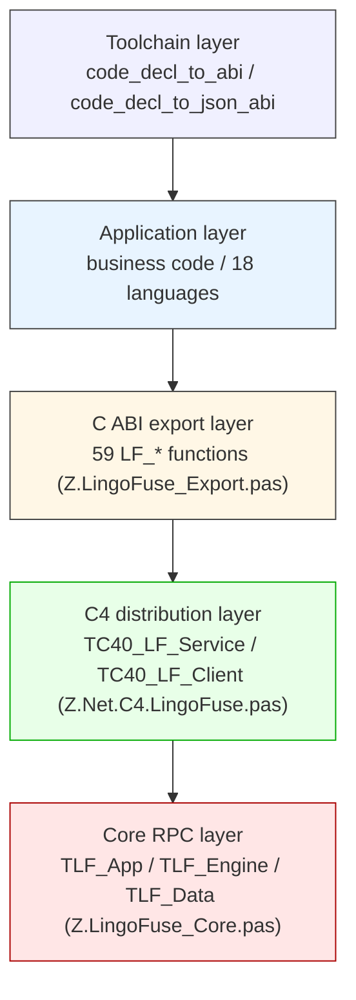

**The newly added L4 toolchain layer**: `code_decl_to_abi` and `code_decl_to_json_abi` are **code generators** and take no part at runtime. They read a Pascal unit or a C header and emit multi-language Service/Call/Test code. That generated code then calls the L2 C ABI or goes straight over HTTP. The toolchain layer means **hand-written FFI bindings** are replaced by **code generation**.

### 0.6 Multi-language hard rules (40)

**General rules (apply to every language)**:

1. **Callbacks must be `cdecl`** (or the language's equivalent: Python `CFUNCTYPE`, C# `CallingConvention.Cdecl`, Rust `extern "C"`, Go `purego` / `cgo`, Java FFM `Linker.Option`).
2. **Managed-language callbacks must keep a strong reference** (otherwise a GC collection causes a crash).
3. **Pointers returned by `LF_GetOption` / `LF_Get_AppName` / `LF_Generate_AppName` / `LF_Get_P2P_Name` become invalid after 5 seconds; `LF_Get_P2P_UID` returns a `PP2P_UID___` pointer that likewise becomes invalid after 5 seconds**.
4. **Input handles are not released; returned handles must be released**.
5. **`LF_FreeData` on an auto handle only marks it; the real release happens after 10 minutes**.
6. **Permanent handles created by `LF_CreateData_Permanent` are never auto-recycled** and must be released manually with `LF_FreeData`.
7. **`LF_BindApp` must be called after `LF_PrepareDone`**, otherwise it returns 0.
8. **`LF_FreeApp` does not really free the App**, it only removes bindings and timers; the real release happens in `LF_Shutdown`.
9. **The server must first register the logical service `LingoFuse`** before clients can discover it.
10. **Async callbacks and network event callbacks execute on TCompute worker threads**; UI work / blocking / synchronous calls are forbidden there.
11. **`LF_Sequenced_*` guarantees FIFO within one `(app, api)` pair**; there is no ordering guarantee across `(app, api)` pairs.
12. **Every callback automatically receives the sender's UID / P2PName** (see §10), **valid only on the callback's Input parameter**.
13. **UID is the universal routing identifier**: knowing a client's UID lets you call **any API it has registered** (including app and p2p), without depending on the App name (see §9).
14. **After `LF_Shutdown` every other `LF_*` function is considered invalid**; the cleanup order must be `ExitMainThread → FreeApp → Shutdown`.
15. **`LF_Call` on timeout returns a handle of size=0, not nil**; use `LF_GetSize` to judge success.
16. **Handles returned by the synchronous family (`LF_Call`) belong to the caller; the `Result_` handle of the asynchronous family (`LF_Async_Call`) belongs to the framework and becomes invalid immediately after the callback returns** (see §4.7).
17. **Local short-circuit: when the target is inside the local process, the call does not go over the network** (see §19.1).
18. **Server-side local handling: once a request reaches a server, the server handles it locally instead of forwarding when it can** (see §19.2).
19. **App-name routing prefers local; P2PName routing has no local preference** (see §8.2 / §8.4).
20. **UID / P2PName calls can hit every registered API on the target client; App-name calls can only hit that App's registry** (see §8.6).

**Multi-language specific rules**:

21. **【Pascal / Delphi】** `LF_LocalCall` / `LF_LocalNotify` **do not inject sender identity**. If local calls must carry identity, use `LF_Call` and rely on local short-circuit (see §5.6, §10.3).
22. **【Pascal / Delphi】** For a P2PName async Call, if the server cannot find the group name, **the callback never fires** (the server's `cmd_P2PName_Call` only calls `DoStatus` and sends no reply). The caller must implement its own timeout (see §8.4).
23. **【Python】** Synchronous-family handles belong to the caller, asynchronous-family handles to the framework (released immediately after the callback returns) — mixing them causes occasional use-after-free. All async callbacks must **do everything inside the callback** (read Input / write Output or copy the data); retaining a raw handle across threads is forbidden.
24. **【Python】** The `_Aio` variants are `async def` and must be awaited inside `asyncio.run()` or an already-running event loop. The `_Async` variants return a `CallFuture` supporting `.result(timeout=)`, `.add_done_callback(fn)` and `.cancel()`.
25. **【C++】** `LF_LoadLibrary()` must be called first; returning 1 means success. `LF_LoadLibrary` is not automatic — forgetting it makes every `LF_*` call fail.
26. **【C++】** MSVC must be given `/utf-8`, or the encoding of API description strings will be wrong.
27. **【C#】** A generated library must **not contain `Main`**. A `Main` causes `CS0017: Program has more than one entry point defined`. Test programs live in separate projects.
28. **【C#】** The async bridge's `TaskCompletionSource` does **not** set `RunContinuationsAsynchronously` (keeping semantics consistent with BCL built-in async APIs). With a SyncContext, continuations post back to it; without one they are inlined on the completing thread. An explicit `ConfigureAwait(false)` by the user forces inlining.
29. **【Rust】** Panics must be caught with `catch_unwind`, and user callbacks are advised not to panic either.
30. **【Go】** The service side requires `CGO_ENABLED=1`; `sys.LoadLibrary()` must be called first.
31. **【Java】** JDK 22+ is required (FFM API); JDK 21 and below do not work. `LibraryLoader.selectPlatformFileName()` must be called first.
32. **【Node.js / TypeScript】** The `data` pointer of `LF_Async_Call` must be non-null (`op.dataPtr`); passing `null` means the callback never fires. The `AsyncBridge` timer must not be `unref`'d, otherwise `_reclaim` never runs, the 5-second timeout stops working and the process exits early.
33. **【Node.js / TypeScript】** `param` must be disposed after the promise settles, not immediately in `finally`. Shorthand properties in `module.exports` must not carry quotes: `{ 'key', }` is illegal, `{ 'key': value, }` is legal.
34. **【Erlang】** The ABI layer must use binary wire format; JSON is forbidden. The NIF layer does not strip `#0`. The Service main loop must handle 16 message shapes: `lf_call` / `lf_p2p_call` / `lf_notify` / `lf_p2p_notify` × with/without `Identity` × specific API / generic API. `lingofuse:reply/2` may only be called once; use `_ =` rather than `ok =`.
35. **【Julia】** `--threads=2` is mandatory (a callback consumer must not land on the main thread or it deadlocks); `@threadcall` concurrency is bounded by the libuv thread pool (4 by default, raised through `UV_THREADPOOL_SIZE`).
36. **【Ruby】** When a Ruby process exits abnormally, the dispatcher thread is still running C code, and `LingoFuse64.dll` disappears with the process, causing an Access Violation. The `at_exit` block must run in order: `NativeBridge.stop` → `exit_main_thread` → `shutdown` → `Native.free_library`.
37. **【R】** `LF_Call` is not reentrant; single-process self-testing must switch to `lf_local_call`. The `*_async` variants require `future::plan("sequential")`; `multisession` / `multicore` fork worker processes and make internal calls fail forever. To stop an R service it is recommended to write a `service.exit` sentinel file rather than pressing Ctrl+C.
38. **【Fortran】** `internal_call_<api>` is a stub returning zero values (by design). Fortran has no native async support, so async variants are not generated for now. Callback naming is `<api>_callback` (not `callback_<api>`).
39. **【Dart】** `BridgeHost.start()` must be the first line of `main()`. `ABI_TARGET_APP` must be a `const` (`Isolate.run` re-executes top-level code, so runtime changes to a `let` are not propagated into the child isolate).
40. **【Swift】** Swift 6.4's `#NoUsage` diagnostic wrongly reports variables "used only in string interpolation" as unused, and downgrading or refactoring is costly. For SPM's `.package(path:)`, the identity is the lowercase of the last path segment (not the `name` field of `Package.swift`).

### 0.7 Key defaults (uniform across languages)

| Item | Value |
|------|---:|
| C ABI exported symbols | 59 |
| Default TCP port | 9898 |
| DataHandle idle recycling threshold | 10 minutes |
| Recycling scan interval | 5 seconds |
| `prepareDone` initialisation timeout | `(Wait_Connection_Timeout < 500 ? 5000 : Wait_Connection_Timeout) + 1000` milliseconds |
| Default `Wait_Connection_Timeout` | 30000 ms |
| Default `Overlap_Connection` | false |
| Default `Wait_Connection_ReadyOk` | true |
| Default `Fixed_Sequenced_Time` | 20000 ms |
| `LF_Generate_AppName` pointer lifetime | ~5 seconds |
| `LF_Get_P2P_UID` pointer lifetime | ~5 seconds |
| `LF_GetOption` pointer lifetime | ~5 seconds |
| Sequence thread idle exit | 5 minutes |
| **Delayed release after a sequence thread exits** | **1 second** |
| Grace period after an async op timeout | 60 seconds |
| Status queue capacity | 1000 |
| Broadcast cache delay | ~3 seconds |
| Simulated main thread C40Progress throttle | 1ms active / 10ms idle |
| P2PName client-name change detection period | 1 second |

### 0.8 Minimum version requirements per language

| Language | Minimum version | Notes |
|------|---------|------|
| Pascal | FPC 3.2+ / Delphi 10.4+ | Native FFI, origin of the core engine |
| Python | CPython 3.7+ | Works after `pip install -e .` |
| C++ | A C++17 compiler | The only one with GitHub CI |
| C# | .NET 6+ | `DllImportResolver` picks the platform library automatically |
| Rust | Rust 2021 edition | `extern "C"` + `catch_unwind` |
| Go | Go 1.21+ | `purego` without cgo (Call side); the Service side needs `CGO_ENABLED=1` |
| Java | **JDK 22+** | FFM API |
| Node.js | Node.js 18+ | Built-in `fetch` |
| TypeScript | TypeScript 5.6+ / Node.js 18+ | `tsc --noEmit` with zero errors |
| Erlang | OTP 27+ | A NIF crash takes the BEAM node down |
| Julia | Julia 1.9+ | **`--threads=2` is mandatory** |
| Zig | **Zig 0.17.0 (pinned)** | Re-evaluate before upgrading to 0.18+ |
| Swift | Swift 5.9+ (6.4 recommended) | macOS / Linux deployment paths not yet measured |
| Ruby | Ruby 4.0+ (x64-mingw-ucrt) | Requires DevKit to build the C extension |
| Fortran | Fortran 2008 + C++17 | The C++ and Fortran compilers must come from the same distribution |
| Dart | Dart 3.0+ | Works on Flutter mobile; Flutter Web does not |
| R | R 4.0+ / Rtools45 | `LF_Call` is not reentrant; single-process self-testing needs `lf_local_call` |

### 0.9 Platform support matrix

| Language | Windows | Linux | macOS | Notes |
|------|:-------:|:-----:|:-----:|------|
| Pascal | ✅ | 🟡 verify yourself | 🟡 verify yourself | Core engine implementation language; Windows verified |
| Python | ✅ | 🟡 verify yourself | 🟡 verify yourself | Any platform CPython supports |
| C++ | ✅ | 🟡 verify yourself | 🟡 verify yourself | Test programs compile cross-platform |
| C# | ✅ | 🟡 verify yourself | 🟡 verify yourself | Any platform .NET 6+ supports |
| Rust | ✅ | 🟡 verify yourself | 🟡 verify yourself | cargo test works cross-platform |
| Go | ✅ | 🟡 verify yourself | 🟡 verify yourself | go test works cross-platform |
| Java | ✅ | 🟡 verify yourself | 🟡 verify yourself | Any platform JDK 22+ supports |
| Node.js / TypeScript | ✅ | 🟡 verify yourself | 🟡 verify yourself | Any platform Node 18+ supports |
| Erlang | ✅ | 🟡 verify yourself | 🟡 verify yourself | Any platform the BEAM VM supports |
| Julia | ✅ | 🟡 verify yourself | 🟡 verify yourself | Requires `--threads=2` |
| Zig | ✅ | 🟡 verify yourself | 🟡 verify yourself | Zig 0.17.0 pinned |
| Swift | ✅ (toolchain) | 🟡 verify yourself | 🟡 verify yourself | Swift 5.9+ / 6.4 |
| Ruby | ✅ x64-mingw-ucrt | 🟡 verify yourself | 🟡 verify yourself | Requires DevKit |
| Fortran | ✅ | 🟡 verify yourself | 🟡 verify yourself | Windows verified |
| Dart | ✅ | 🟡 verify yourself | 🟡 verify yourself | Flutter Web does not work |
| R | ✅ | 🟡 verify yourself | 🟡 verify yourself | R 4.0+ |

**Scope**: Windows x64 is verified; Linux / macOS build and test paths must be verified by the user. The `Binary/` directory only provides Windows prebuilt libraries; Linux / macOS must build from source (the build path is not systematically verified, see `src/CONTRIBUTING.md`). Cross-platform multi-language programming support is currently lacking.
**Key conclusion**: LingoFuse itself does not support iOS / Android / WASM / embedded. Language bindings for those platforms (Dart for Flutter, Swift for iOS, etc.) cannot use the Service side. If an interface must be served to mobile, **deploy the Service on a server and let mobile act as a Call through the bridge**.

---

## Chapter 1 Three-layer architecture and design philosophy

### 1.1 Responsibilities of the three layers

| Layer | Unit | Responsibility | Exposure to users |
|----|------|------|:----------------:|
| **C ABI export layer** | `Z.LingoFuse_Export.pas` | 59 `LF_*` functions, UTF-8 conversion, 5-second deferred release, preparation-command collection | **Fully exposed** (the cross-language entry point) |
| **C4 distribution layer** | `Z.Net.C4.LingoFuse.pas` | Service/client management, 17 internal C4 commands, three addressing modes, load balancing, routing optimisation | **Partially exposed** (indirectly through `LF_*`) |
| **Core RPC layer** | `Z.LingoFuse_Core.pas` | App / Engine / Data / secondary memory pool / sequence thread pool | **Not exposed directly** (called by the C4 layer) |

### 1.2 Dependency topology

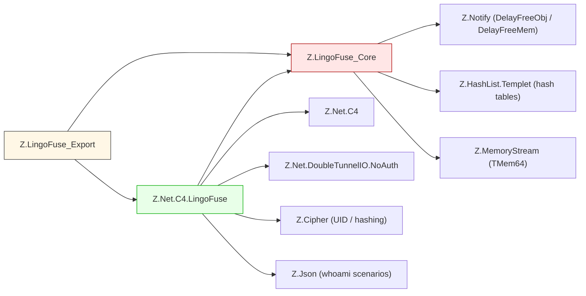

### 1.3 Key design trade-offs

| Trade-off | Benefit | Cost |
|------|------|------|
| **C ABI instead of COM/C++** | Universally usable by 18 languages | No type safety, no ABI version management |
| **Handles instead of objects** | No type dependency across languages | Users must manage lifetimes explicitly |
| **Auto-recycle + manual release dual track** | Convenience and safety together | Users easily mistake auto-recycle for a guarantee |
| **`TLF_Data` as a record rather than a class** | Secondary memory pool reuse, less heap fragmentation | Requires `New` / `Dispose`, no inheritance |
| **Local-priority routing** | Fewer network round trips | An App with the same name executes locally first |
| **Server-side local handling** | Fewer unnecessary forwards | Requires the server process itself to be capable |
| **Simulated main thread** | C4 depends on a main thread, the C ABI layer manages it | Only one per process |
| **Automatic identity injection** | Business code gets the sender identity with zero intrusion | Adds 40+ bytes to every request payload |
| **Sequence thread pool** | FIFO + concurrency | Idle threads exit and get recreated |
| **Three addressing modes** | Adapted to different routing scenarios | Steep learning curve, easy to mix up |
| **Opposite handle ownership for sync / async** | Sync is simple, async can stream | Users easily mix the two families' release rules (see §4.7) |
| **UID / P2PName universal routing** | Targeted calls without friction | The asymmetry of App-name addressing must be understood |

### 1.4 Language support matrix

| Language | Directory | Status | One line |
|------|------|------|------------|
| Pascal | `pascal/` | 🟢 Production ready | Native FFI, origin of the core engine |
| Python | `Py/` | 🟢 Production ready | Works after `pip install -e .` |
| C++ | `cpp/` | 🟢 Production ready | The only one with GitHub CI |
| C# / .NET | `csharp/` | 🟢 Production ready | P/Invoke + RAII + `CallbackDispatcher` |
| TypeScript | `ts/` | 🟢 Production ready | v2.0, 223 tests |
| **JavaScript (Node.js)** | `js/` | 🟢 Production ready | v2.0, 223 tests, CommonJS + ESM dual entry. **Browser JavaScript does not use this binding, it uses `bridge.py`** |
| Rust | `rust/` | 🟢 Production ready | v2.0, 174 tests |
| Go | `go/` | 🟢 Production ready | purego without cgo |
| Dart | `dart/` | 🟢 Production ready | Flutter mobile (iOS/Android) works; Flutter Web does not |
| Java | `java/` | 🟢 Production ready | JDK 22+ FFM API |
| Swift | `swift/` | 🟢 Production ready | v1.1, 261 XCTest cases |
| Zig | `zig/` | 🟢 Production ready | Zig 0.17.0 pinned |
| Erlang | `erlang/` | 🟢 Production ready | OTP 27+ |
| Ruby | `ruby/` | 🟢 Production ready | v2.0, 331 tests |
| Fortran | `fortran/` | 🟢 Production ready | 474 assertions |
| Julia | `julia/` | 🟢 Production ready | `--threads=2` mandatory |
| R | `r/` | 🟢 Production ready | Four-layer architecture + Job queue |
| **PHP** | `php/` | 🟡 Caller access | **Through the `bridge.py` HTTP gateway, caller only**. Not native FFI |

**Supported through code generators / bridging**:

| Language / platform | Method | Maturity |
|-------------|------|--------|
| Node.js / browser | `bridge.py` HTTP gateway | Usable, non-native |
| Kotlin / Lua / Elixir / Nim / Crystal | Through the LingoFuse-Tools code generator | Generated code usable, verify yourself |
| aarch64 / loongarch64 / RISC-V | Edge-device porting plan | Ongoing, not production ready |

### 1.5 Toolchain ecosystem

| Toolchain | Positioning | Input | Output | Supported languages |
|--------|------|------|------|---------|
| **code_decl_to_abi** | Binary ABI generator | Pascal unit / C header | Service/Call/Test sources + build scripts | **17** |
| **code_decl_to_json_abi** | HTTP/JSON ABI generator | Pascal unit / C header | Service/Call/Test sources + build scripts | **20+** |

**Key differences**:

| Dimension | code_decl_to_abi | code_decl_to_json_abi |
|------|-----------------|----------------------|
| Wire protocol | Binary (`[status][payload]`) | HTTP POST + JSON |
| Bridging required | Service no; Call needs `bridge.py` | Service no; Call must use `bridge.py` |
| LingoFuse native library required | Call side depends on the language (pattern A no, pattern B yes) | Service side must; Call side depends on the language |
| Platform support | Limited by the LingoFuse native library | Pattern A languages have wider support (including mobile, WASM) |
| Applicable scenario | Both ends are LingoFuse-native, high-concurrency services | One end is a browser / external HTTP client |

**Shared kernel of the two toolchains**: the same input format, the same intermediate model (LV1), the same three-family type system. **The only difference is the wire format of the generated target code**.

---

## Chapter 2 Core concepts and terms

### 2.1 Core objects

| Object | Type | Semantics |
|------|------|------|
| **`TDataHnd`** | Opaque pointer | Binary data handle, carrying the API name + sender identity + business payload |
| **`TAppHnd`** | Opaque pointer | Logical application container, can register multiple APIs |
| **`TP2P_UID___`** | `array[0..31] of Byte` | 32-byte session UID, generated at `TunnelLink` |
| **`PP2P_UID___`** | `^TP2P_UID___` | Pointer to the 32-byte UID (the return type of `LF_Get_P2P_UID`) |
| **`TAppName`** | UTF-8 string | Application name, the key for network routing |

**Equivalent types in each language**:

| Concept | Pascal | Python | C++ | C# | Rust | Go | Java | Node.js / TS |
|------|--------|--------|-----|-----|------|-----|------|--------------|
| DataHandle | `TDataHnd` | `DataHandle` | `lingofuse::DataHandle` | `DataHandle` | `data_handle::DataHandle` | `*lingofuse.DataHandle` | `DataHandle` | `DataHandle` |
| AppHandle | `TAppHnd` | `AppHandle` | `lingofuse::App` | `AppHandle` | `AppHandle` | `*lingofuse.AppHandle` | `AppHandle` | `AppHandle` |
| UID | `TP2P_UID___` | `bytes` | `std::array<uint8_t,32>` | `P2PUid` | `Uid` | `sys.TP2P_UID` | `byte[]` | `Uint8Array(32)` |

### 2.2 API modes

| Mode | Semantics | Waits for a response | Registration function |
|------|------|:-----------:|---------|
| **Call** | Request-response | ✅ | `LF_RegisterCall*` |
| **Notify** | One-way notification | ❌ | `LF_RegisterNotify*` |

**Cross-language consistency of the two modes**:

| Language | Call registration | Notify registration | Synchronous call | Asynchronous call | Notify |
|------|-----------|-------------|----------|----------|--------|
| Pascal | `LF_RegisterCallEx` | `LF_RegisterNotifyEx` | `LF_CallEx` | `LF_Async_Call` | `LF_NotifyEx` |
| Python | `LF_RegisterCall` | `LF_RegisterNotify` | `LF_Call` | `LF_Async_Call` | `LF_Notify` |
| C++ | `lingofuse::App::registerCall` | `lingofuse::App::registerNotify` | `lingofuse::call` | `lingofuse::callAsync` | `lingofuse::notify` |
| C# | `AppHandle.RegisterCall` | `AppHandle.RegisterNotify` | `Framework.Call` | `Async.Call` | `Framework.Notify` |
| Rust | `AppHandle::register_call` | `AppHandle::register_notify` | `framework::call` | `framework::call_async` | `framework::notify` |
| Go | `AppHandle.RegisterCall` | `AppHandle.RegisterNotify` | `lingofuse.Call` | `lingofuse.CallAsync` | `lingofuse.Notify` |
| Java | `AppHandle.registerCall` | `AppHandle.registerNotify` | `Framework.call` | `Framework.callAsync` | `Framework.notify` |
| Node.js / TS | `app.registerCall` | `app.registerNotify` | `framework.call` | `framework.callAsync` | `framework.notify` |

### 2.3 The three addressing modes compared

| Addressing | Index key | Routing | Local hit | Server-side selection strategy | Typical use |
|------|--------|---------|:--------:|---------------|---------|
| **App name** | UTF-8 string | Exact App-name match | ✅ | Least recently used | Fixed services |
| **UID** | 32-byte binary | Locate by session UID | ✅ | Direct hit | **Targeting a specific client** |
| **P2PName** | UTF-8 string | Group-name load balancing / stickiness | ❌ | `Cycle_Anchor` / `FixedSequenced` | Homogeneous service clusters |

### 2.4 How the three routing modes differ in hits

| Call style | Search scope on the target side | Hits App registrations | Hits P2P registrations |
|----------|----------------|:-------------:|:-------------:|
| **UID call** | Every API registered on the target client | ✅ | ✅ |
| **P2PName call** | Every API registered on the selected client | ✅ | ✅ |
| **App-name call** | The target App's registry | ✅ | ❌ |

**Points to remember**:

- **UID / P2PName are "client-level" routing keys** — first locate "a certain client", then look in its local API table. App-registered and P2P-registered functions live in the same local table.
- **App name is an "application-level" routing key** — it only looks in that App's registry; P2P-registered functions hang under the global `___LF_P2P_APP___`, not in the business App's table.

### 2.5 Lifecycle stages

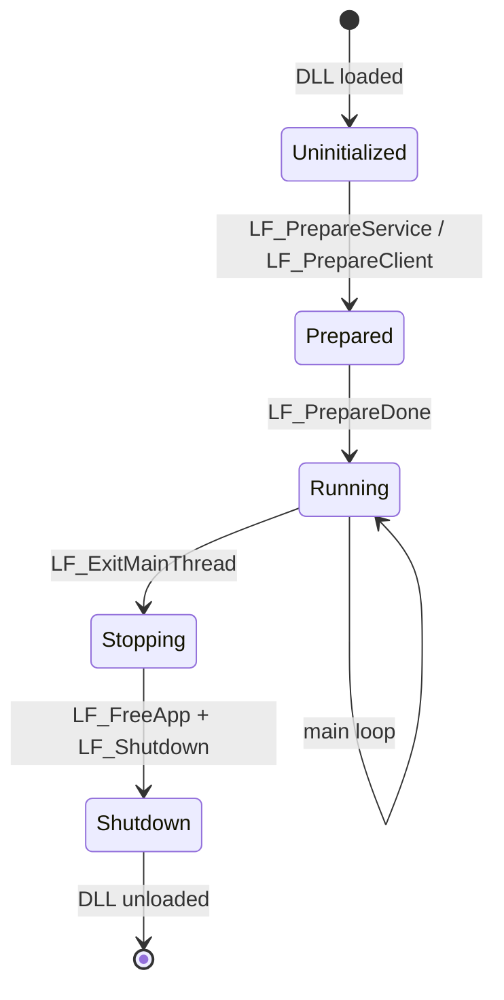

### 2.6 Terminology quick reference

| Term | Meaning |
|------|------|
| **C4 mesh** | LingoFuse's distributed service mesh: discovery, broadcast and cross-node routing between servers |
| **TunnelLink** | The logical connection between a client and a server; a UID is generated when it succeeds |
| **SelfClient** | A Service process connecting to itself as a client, making the Service's registered APIs visible to the mesh |
| **Bridge** | `bridge.py` / `bridge.exe`, the HTTP ↔ RPC forwarding tool |
| **Beacon** | The LingoFuse service that registers agent tools (default `agent_main_app`) |
| **UID universal routing** | Knowing a client's UID lets you call any API it has registered, without depending on the App name |
| **Local short-circuit** | The target is inside the local process, so the call bypasses the network and executes locally |
| **Server-side local handling** | Once a request reaches a server, the server handles it locally instead of forwarding |
| **Sequenced family** | Sequenced calls/notifications, FIFO by routing key |
| **Side data** | Identity metadata the sender writes automatically when sending a request (`FromUID` / `FromP2PName`) |
| **Auto recycle handle** | A handle created by `LF_CreateData`, auto-recycled after 10 minutes idle |
| **Permanent handle** | A handle created by `LF_CreateData_Permanent`, never auto-recycled |
| **Cycle_Anchor** | The load-balancing mechanism of P2PName routing, choosing the UID by "least recently used" |
| **Fixed_Sequenced_Time** | The stickiness window of P2PName routing, 20 seconds by default |
| **ABI wire format** | `[status:uint8_t][payload]`, status `0x00` = success, `0xFF` = failure |
| **LV0 JSON** | The parser's raw output, including source text positions, original type spellings and modifiers |
| **LV1 Model** | The normalised intermediate model, the only input to every generator |

---

## Chapter 3 Lifecycle and initialisation (multi-language)

### 3.1 Typical initialisation order (uniform across languages)

**Service side**:

```
prepareService(endpoint, endpoint)
    → create App
    → register APIs (LF_RegisterCallEx / registerCall / ...)
    → prepareClient(endpoint, App)
    → prepareDone()
```

**Complete example on the Pascal side**:

```pascal
uses
  SysUtils,
  lingofuse_import,
  <Unit>_abi_service_unit;

var
  App: TAppHnd___;
begin
  LF_ResetPrepare();
  LF_Set_Opt_Quiet(True);
  LF_Set_Opt_ConsoleOutput(True);

  LF_PrepareServiceEx('ipc:<Unit>_abi', 'ipc:<Unit>_abi');

  App := LF_CreateAppEx(DEFAULT_APP_NAME, DEFAULT_APP_DESC);
  if App = nil then Halt(1);

  Register_All_ABI_APIs(App);

  LF_Set_Opt_P2P_Name('<Unit>_service_test_p2p');
  Register_All_P2P_ABI_APIs();

  if LF_PrepareClientEx('ipc:<Unit>_abi', App) = -1 then
  begin
    LF_FreeApp(App);
    Halt(1);
  end;

  if LF_PrepareDone() <> 1 then
  begin
    LF_ExitMainThread();
    LF_FreeApp(App);
    LF_Shutdown();
    Halt(1);
  end;

  ReadLn;

  LF_ExitMainThread();
  LF_FreeApp(App);
  LF_Shutdown();
end.
```

**Python side**:

```python
from lingofuse._lf_native import (
    LF_ResetPrepare, LF_PrepareService, LF_PrepareClient, LF_PrepareDone,
    LF_CreateApp, LF_RegisterCall, LF_RegisterNotify,
    LF_ExitMainThread, LF_Shutdown,
)
from lingofuse.lf_io import cstr

ENDPOINT = "ipc:<Unit>_http_json"

LF_SetOptionEx("Wait_Connection_ReadyOk", "False")
LF_SetOptionEx("Overlap_Connection", "True")
LF_ResetPrepare()

LF_PrepareService(cstr(ENDPOINT), cstr(ENDPOINT))

app = LF_CreateAppEx(cstr("<Unit>"), cstr("HTTP/JSON service for <Unit>"))
LF_RegisterCallEx(app, cstr("Add"), cstr("Adds two integers"), None, callback_add)
LF_RegisterCallEx(app, cstr("Sub"), cstr("Subtracts b from a"), None, callback_sub)

LF_PrepareClient(cstr(ENDPOINT), app)
if LF_PrepareDone() != 1:
    raise RuntimeError("prepare_done failed")

import signal
signal.pause()

LF_ExitMainThread()
app.free()
LF_Shutdown()
```

**C++ side**:

```cpp
#include "LingoFuse.hpp"
#include "<Unit>_http_json_service.hpp"

int run_service() {
    lingofuse::LibraryLoader loader;   // loads LingoFuse64.dll

    lingofuse::setOption("Wait_Connection_ReadyOk", "False");
    lingofuse::setOption("Overlap_Connection", "True");
    lingofuse::resetPrepare();

    if (lingofuse::prepareService("<Unit>_http_json_endpoint",
                                  "<Unit>_http_json_endpoint") < 0) {
        return 1;
    }

    {
        lingofuse::App app("<Unit>", "HTTP/JSON service for <Unit>");
        if (!app) return 1;

        register_all_http_json_apis(app);

        if (lingofuse::prepareClient("<Unit>_http_json_endpoint", app.get()) < 0) {
            return 1;
        }

        if (lingofuse::prepareDone() != 1) {
            return 1;
        }

        std::signal(SIGINT, _on_signal);
        while (!g_stop_requested.load()) {
            std::this_thread::sleep_for(std::chrono::milliseconds(500));
        }

        lingofuse::exitMainThread();
    }

    lingofuse::shutdown();
    return 0;
}
```

**C# side**:

```csharp
public static int RunService() {
    Framework.SetOption("Wait_Connection_ReadyOk", "False");
    Framework.SetOption("Overlap_Connection", "True");
    Framework.ResetPrepare();

    if (Framework.PrepareService(AppInfo.Endpoint, AppInfo.Endpoint) < 0) {
        Console.Error.WriteLine("[FATAL] PrepareService failed");
        return 1;
    }

    AppHandle? app = null;
    try {
        app = new AppHandle(AppInfo.Name, AppInfo.Desc);
        RegisterAPIs(app);

        if (Framework.PrepareClient(AppInfo.Endpoint, app) < 0) {
            Console.Error.WriteLine("[FATAL] PrepareClient failed");
            return 1;
        }

        if (Framework.PrepareDone() != 1) {
            Console.Error.WriteLine("[FATAL] PrepareDone failed");
            return 1;
        }

        var stop = new ManualResetEventSlim(false);
        Console.CancelKeyPress += (s, e) => { e.Cancel = true; stop.Set(); };
        while (!stop.IsSet) Thread.Sleep(500);

        return 0;
    } finally {
        try { NetworkEvents.Clear(); } catch { }
        try { Framework.ExitMainThread(); } catch { }
        try { app?.Dispose(); } catch { }
        try { Framework.Shutdown(); } catch { }
    }
}
```

**The initialisation order for Rust / Go / Java / Node.js / TS / Erlang / Julia / Zig / Swift / Ruby / Fortran / Dart / R**: exactly the same as Pascal (`prepareService` → create App + register APIs → `prepareClient` → `prepareDone`), **only the method names and parameter forms differ**. See §20 for each language in turn.

### 3.2 Detailed breakdown of the initialisation stages

#### 3.2.1 `LF_ResetPrepare`

**Effect**: clears `Prepare_Commands` (the list of pending service/client scripts) and `AppHnd_Bind_Tag_List`.

**When to call**:
- **Before the first initialisation**: harmless, recommended.
- **Before re-initialising**: **mandatory**, otherwise a repeated address produces `prepare error: repeat listen/connection`.

**Mechanism**: internally `Clear`s both `Prepare_Commands` and `AppHnd_Bind_Tag_List`, resetting the `Tag_Seed`-related state.

#### 3.2.2 `LF_PrepareService`

**Signature**: `function LF_PrepareService(ListeningAddr, PhysicsAddr: PAnsiChar): Integer`

**Parameters**:
- `ListeningAddr`: local listening address, e.g. `0.0.0.0:9898` / `ipc:my_app`.
- `PhysicsAddr`: externally advertised address, e.g. `192.168.1.100:9898` / `ipc:my_app`.

**Returns**: `Tag_Seed` (an incrementing integer ≥ 1); a repeated address returns -1.

**Mechanism**:
1. Stores the addresses in `Prepare_Commands` (the service is not started immediately).
2. Internally generates the C4 script command `Service("Listen", "Host", Port, "LingoFuse@Tag=N")`.
3. If `Init_Succeeded and Simulated_Main_Thread_Running` (i.e. `PrepareDone` has already been called and the main thread is active), the command is posted to `MainThreadProgress` for immediate execution.

**Default port**: `9898` when no port is given. **IPC mode**: when the address starts with `ipc:`, the port parameter is ignored.

#### 3.2.3 `LF_PrepareClient`

**Signature**: `function LF_PrepareClient(PhysicsAddr: PAnsiChar; appHnd: TAppHnd): Integer`

**Parameters**:
- `PhysicsAddr`: the server address.
- `appHnd`: the App to bind, may be `nil` (tunnel only).

**Returns**: `Tag_Seed`; a repeated address (with `Overlap_Connection=False`) returns -1.

**Mechanism**:
1. Internally generates the C4 script command `KeepAlive("Host", Port, "LingoFuse@Tag=N")`.
2. When `Overlap_Connection=True`, the `NewKeepAlive` command is used instead.
3. Records the entry in `AppHnd_Bind_Tag_List` and binds the App automatically through the `ClientConnected` event once the C4 client connects.

#### 3.2.4 `LF_PrepareDone`

**Signature**: `function LF_PrepareDone: Integer`

**Returns**: 1 = success; 0 = failure or already started.

**Mechanism**:
1. If `Simulated_Main_Thread_Running` is already True, **returns 0 immediately** (preventing a double start).
2. Calls `Open_Core_Dispatch_Thread` to start the C4 scheduler.
3. Calls `Begin_Simulator_Main_Thread(Simulated_Main_Thread)` to start the simulated main thread.
4. **Blocks and waits**: at most `(Wait_Connection_Timeout < 500 ? 5000 : Wait_Connection_Timeout) + 1000` milliseconds.
5. Returns `if_(Init_Succeeded, 1, 0)`.

**Key pitfall**: **it may still return 1 after a timeout** (see `LF-NET-007`).

#### 3.2.5 `LF_ExitMainThread`

**Signature**: `procedure LF_ExitMainThread`

**Mechanism**:
1. Sets `Simulated_Main_Thread_Running := False`.
2. **Waits for the main thread to exit completely** (`Simulator_Main_Thread_Activted` becomes False).

**Cleanup before the main thread exits** (at the end of `Simulated_Main_Thread`):
1. `C40Clean` (clears C4 state)
2. `LF_Notify_Sequence_Thread_Pool.Stop`
3. `LF_DataPool.Free_All_Hnd` (**releases every data handle, including permanent ones**)
4. `LF_DataMemory.Free_All_PLF_Data_Memory`

**Key pitfall**: afterwards **no data handle may be used** (see `LF-MECH-003`).

### 3.3 The complete set of state flags

| Flag | Meaning | Checking API |
|------|------|---------|
| `Init_In_Progress` | Main thread initialising | none |
| `Init_Succeeded` | Initialisation succeeded | `LF_CheckMainThread` reflects it indirectly |
| `Simulated_Main_Thread_Running` | The main thread simulator is running | `LF_CheckMainThread()` = 1 |
| `Simulator_Main_Thread_Activted` | The underlying thread is active | `LF_CheckMainThread()` = 1 |

### 3.4 Per-language initialisation pitfall quick reference

| Language | Symptom | Root cause | Fix |
|------|------|------|------|
| **Pascal** | `LF_PrepareDone` returns 0 | Already called in this process | Restart the process |
| **Pascal** | `LF_BindApp` returns 0 | Main thread not started | Make sure `LF_PrepareDone` returns 1 |
| **Python** | `ModuleNotFoundError: lingofuse` | Not installed | `pip install py-lingofuse` |
| **Python** | Crash inside the callback | Handle retained outside the callback | Do everything inside the callback |
| **C++** | `LF_PrepareClient returned -1` | Endpoint already in use | Change the endpoint or kill the old process |
| **C++** | `LF_PrepareDone failed` | Already called in this process | Restart the process |
| **C++** | `Can't find unit Z.Core` | `-Fu` path not configured | Add `-Fu<ZCore path>` |
| **C#** | `DllNotFoundException: LingoFuse64` | DLL not copied | Copy it into the bin directory |
| **C#** | `CS0017: Program has more than one entry point` | The library has a `Main` | The library must have no `Main`; test programs are separate |
| **C#** | `Could not load type 'lingofuse.AppHandle'` | Missing LingoFuse.dll reference | `dotnet add reference` |
| **Rust** | `linking with cc failed` | Missing C linker | Install MSVC Build Tools or gcc |
| **Rust** | `lingofuse not found` | Not added with `cargo add` | `cargo add lingofuse --path ../LingoFuse/rust` |
| **Go** | `module github.com/PassByYou888/LingoFuse not found` | `go get` not run | `go get github.com/PassByYou888/LingoFuse/go` |
| **Go** | cgo-related errors | `CGO_ENABLED=0` | `CGO_ENABLED=1 go build` |
| **Java** | `UnsatisfiedLinkError: LingoFuse64` | Native library missing | Add it to `-Djava.library.path` |
| **Java** | `ClassNotFoundException: lingofuse.AppHandle` | `lingofuse.jar` missing | Install the LingoFuse Java package |
| **Java** | `ClassNotFoundException: jackson.databind.JsonNode` | Jackson missing | Download `jackson-databind.jar` |
| **Node.js** | `prepareService failed` | Endpoint already in use | Change the endpoint or kill the old process |
| **Node.js** | Process exits early | The `AsyncBridge` timer was `unref`'d | Remove the `unref()` call |
| **TypeScript** | `tsc --noEmit` errors | `exports` in `lingofuse-ts/package.json` point to the wrong paths | Fix `exports` by adding the `./dist/` prefix |
| **Erlang** | `no such file or directory: lingofuse_nif.dll` | NIF missing | `setup_erlang_tests.ps1` copies it |
| **Erlang** | `app_not_registered` | The App was not visible within 15 seconds | Check the `wait_self_registered` timeout |
| **Julia** | `--threads=2 or more required` | Single-threaded | Add `--threads=2` |
| **Julia** | `prepare_client returned -1` | Endpoint already in use | Change the endpoint or kill the old process |
| **Zig** | `framework.init failed` | LingoFuse64.dll missing | Copy it into `zig_service_test/` |
| **Swift** | `libraryLoadFailed` | `liblingofuse.dylib` missing | Copy it next to the executable |
| **Swift** | `prepareServiceFailed` | Endpoint already in use | Change the endpoint or kill the old process |
| **Ruby** | `cannot load such file -- lingofuse` | Gem not installed | `gem install lingofuse` |
| **Ruby** | Process does not exit | The `NativeBridge` thread is not joined | Generated code already forces exit with `exit!` |
| **Ruby** | `$C0000005` Access Violation | The dispatcher thread runs after the DLL is unloaded | Clean up in order inside an `at_exit` block |
| **Fortran** | `gfortran: command not found` | Not installed | `apt install gfortran` or MinGW-w64 |
| **Fortran** | `undefined reference to 'lf_*'` | `lf_fortran.cpp` not linked | Use `setup_fortran_tests.ps1` |
| **Dart** | `Error: Couldn't resolve the package 'lingofuse'` | `dart pub get` not run | `dart pub get` |
| **Dart** | `prepareDone returned false` | `Wait_Connection_ReadyOk` not disabled | Set it to `False` |
| **R** | `Package 'lingofuse' is required` | Not installed | `setup_r_tests.ps1 -InstallMissing` |
| **R** | `Cannot locate the LingoFuse runtime` | `LINGOFUSE_RUNTIME` not set | Set the environment variable |

---

# Part II Detailed API reference

## Chapter 4 Complete reference for data handles

### 4.1 The nature of a data handle

`TDataHnd___ = Pointer`, pointing at the internal `TLF_Data` record (`Z.LingoFuse_Core.pas`).

**The `TLF_Data` record structure** (source):

```pascal
TLF_Data = record
private
  auto_recycle___: boolean;      // LF_CreateData=True; LF_CreateData_Permanent=False
  deleted___: boolean;
  updated___: boolean;
  calling___: TAtomInt;           // number of remote calls in progress
  time___: TTimeTick;
  class procedure Free_Data___(hnd: PLF_Data); static;
public
  Data_Param: TMemory_Param_Tool; // input mode: non-nil
  Data_Result: TMem64;            // output mode: non-nil
  Data_Info: TLF_String;
end;
```

**Key design points**:
- **`Data_Param` and `Data_Result` are mutually exclusive**: only one is non-nil on any handle.
  - **Input handles** (`New_Param` / `New_Param_From`): `Data_Param <> nil`, carrying `FromUID` / `FromP2PName` / `apiName` / `Param`.
  - **Output handles** (`New_Result` / `New_Result_From`): `Data_Result <> nil`, holding only the result bytes.
- **The `calling___` counter**: > 0 while a remote call is in progress, protecting the handle from timeout recycling.
- **The `updated___` flag**: set True by any read or write, telling the scan that the handle is still active.

### 4.2 Data handle lifecycle

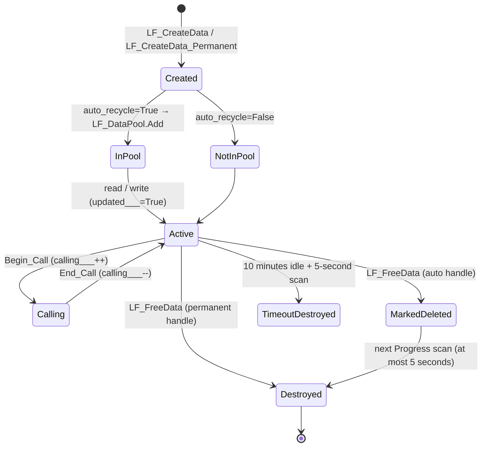

### 4.3 Creation and release APIs

#### 4.3.1 `LF_CreateData(MethodName: PAnsiChar): TDataHnd`

**Mechanism**:
1. Internally `TLF_Data.New_Param(apiName, auto_recycle=True)`:
   - Takes a `TLF_Data` record from `LF_DataMemory.Get_New_PLF_Data` (or `New`s one).
   - Sets `auto_recycle___ := True`.
   - Creates `Data_Param := TMemory_Param_Tool.Create` and stores `apiName` in it.
   - Adds the handle to `LF_DataPool`.
2. Returns the `PLF_Data` pointer as the `TDataHnd___`.

**Side effects**:
- **Joins the auto-recycle pool**: released by `TLF_DataPool.Progress` after 10 minutes idle.
- **`LF_FreeData` only marks it afterwards**: `deleted___ := True`, with no immediate release.

**Helper**: `LF_CreateDataEx(MethodName: string)` converts to UTF-8 automatically.

#### 4.3.2 `LF_CreateData_Permanent(MethodName: PAnsiChar): TDataHnd`

**Mechanism**:
1. Internally `TLF_Data.New_Param(apiName, auto_recycle=False)`:
   - Takes a record from `LF_DataMemory`.
   - **Does not add it to `LF_DataPool`**.
   - Sets `auto_recycle___ := False`.
2. **`LF_FreeData` releases it synchronously and immediately** (not just a mark).

**When to use it**: request templates that live for the whole process lifetime.

**Key pitfalls**:
- **"Permanent" does not mean "never released"**: `LF_FreeData` must be called explicitly.
- **Creating during the initialisation window leaks**: before `LF_PrepareDone` / after `LF_ExitMainThread`, `LF_FreeData` is a **no-op** (because `Simulator_Main_Thread_Activted` is False).

#### 4.3.3 `LF_FreeData(Hnd: TDataHnd)`

**Mechanism**:
```pascal
procedure TLF_Data.Free_Data(hnd: PLF_Data);
begin
  if hnd = nil then exit;
  if hnd^.auto_recycle___ then
      hnd^.deleted___ := True       // only mark it, wait for the scan
  else TLF_Data.Free_Data___(hnd);  // permanent handle: release immediately
end;
```

**Notes**:
- **Auto-recycled handles**: only `deleted___ := True`; the real release is deferred by at most 5 seconds.
- **Permanent handles**: `Free_Data___` runs immediately (releasing `Data_Param` / `Data_Result` / `calling___` and pushing the record back to `LF_DataMemory`).

#### 4.3.4 DataHandle creation and release per language

| Language | Create | Release | Notes |
|------|------|------|------|
| Pascal | `LF_CreateDataEx(api)` | `LF_FreeData(hnd)` | Input handles are not released; returned handles must be |
| Python | `DataHandle(api)` | `hnd.dispose()` | Never dispose `Result_` inside an async callback |
| C++ | `lingofuse::DataHandle(api)` | `.dispose()` / RAII | Do not dispose `Result_` inside an async callback |
| C# | `new DataHandle(api)` | `.Dispose()` / `using` | Do not dispose `Result_` inside an async callback |
| Rust | `DataHandle::new(api)` | `.drop()` / RAII | Do not dispose `Result_` inside an async callback |
| Go | `lingofuse.NewDataHandle(api)` | `.Close()` / `defer` | Do not `Close` `Result_` inside an async callback |
| Java | `new DataHandle(api)` | `.close()` / try-with-resources | Do not `close` `Result_` inside an async callback |
| Node.js / TS | `new DataHandle(api)` | `.dispose()` | Do not dispose outside the async callback; dispose `param` late |

### 4.4 Read/write API

#### 4.4.1 `LF_GetBuffer(Hnd): Pointer`

**Mechanism**:
```pascal
function TLF_Data.GetBuffer: Pointer;
begin
  Result := nil;
  if Data_Param <> nil then
      Result := Data_Param.Param.Memory
  else if Data_Result <> nil then
      Result := Data_Result.Memory;
  updated___ := True;    // refresh the timestamp
end;
```

**Key points**:
- **Returns a pointer to the internal buffer**. It may become invalid after `LF_WriteBuffer` / `LF_SetSize` (reallocation).
- **Side effect**: `updated___ := True`, resetting the 10-minute idle countdown.

#### 4.4.2 `LF_WriteBuffer(Hnd, Buff, Size): Int64`

**Mechanism**:
```pascal
function TLF_Data.WriteBuff(Buff: Pointer; Size: Int64): Int64;
begin
  Result := 0;
  if Data_Param <> nil then
      Result := Data_Param.Param.WritePtr(Buff, Size)
  else if Data_Result <> nil then
      Result := Data_Result.WritePtr(Buff, Size);
  updated___ := True;
end;
```

**Key points**:
- Writes from the **current position**, and the position advances.
- `TMem64.WritePtr` grows the buffer internally.
- **Side effect**: refreshes the timestamp.

#### 4.4.3 Position and size operations

| API | Mechanism | Side effect |
|-----|---------|--------|
| `LF_GetPos` | Returns `Data_Param.Param.Position` or `Data_Result.Position` | Refreshes the timestamp |
| `LF_SetPos` | Sets `Position`; beyond the current size it grows implicitly | Refreshes the timestamp |
| `LF_GetSize` | Returns `Data_Param.Param.Size` or `Data_Result.Size` | Refreshes the timestamp |
| `LF_SetSize` | Resizes; the new space is **uninitialised** | Refreshes the timestamp |

### 4.5 Atomic type read/write API

All types are **little-endian** (`Move` writes memory directly and depends on the host byte order).

| Write | Read (with out) | Read (return value) |
|------|-----------|--------------|
| `LF_WriteInt8` ~ `LF_WriteDouble` | `LF_ReadInt8` ~ `LF_ReadDouble` | same as left |
| `LF_WriteString` | `LF_ReadString` (out) | `LF_ReadString` |
| `LF_WriteStringBytes` | `LF_ReadStringBytes` (out) | `LF_ReadStringBytes` |

#### 4.5.1 Special behaviour of `LF_WriteString`

**Mechanism**:
```pascal
function LF_WriteString(Hnd: TDataHnd___; const Value: string): boolean;
var utf8: TBytes; len: integer;
begin
  if Value = '' then
  begin
    Result := LF_WriteUInt8(Hnd, 0);   // an empty string still writes one #0
    Exit;
  end;
  utf8 := TEncoding.UTF8.GetBytes(Value);
  len := Length(utf8);
  LF_WriteBuffer(Hnd, @utf8[0], len);
  Result := LF_WriteUInt8(Hnd, 0);     // always appends #0
end;
```

**Key point**: **`#0` is always appended**. When JSON travels across languages, the receiver (e.g. Python) must strip the trailing `#0`.

#### 4.5.2 The tolerant mode of `LF_ReadString`

**Mechanism**:
```pascal
function LF_ReadString(Hnd: TDataHnd___; out Value: string): boolean;
var p: PByteArray; b, e, sz: int64;
begin
  p := LF_GetBuffer(Hnd);
  sz := LF_GetSize(Hnd);
  b := LF_GetPos(Hnd);
  e := b;
  while (e < sz) and (p^[e] <> 0) do Inc(e);  // scan until #0
  // ...
  LF_SetPos(Hnd, e + 1);                      // skip #0
  Value := UTF8ToString(Buff);
end;
```

**Key points**: **stops at `#0`**; **if there is no `#0` up to the end of the buffer, it reads to the end** (tolerant mode). If more data follows, it is consumed as part of the string (see `LF-DATA-004`).

#### 4.5.3 `LF_ReadStringBytes` / `LF_WriteStringBytes`

**No `#0` is appended**, but NUL is still used as the terminator. Suitable for raw bytes (such as a JSON body).

### 4.6 P2P information query APIs

> **⚠️ Precondition for use (must read)**: `LF_Get_P2P_UID` and `LF_Get_P2P_Name` **do not "read the handle's own business data"**; they **read, from the input handle side, the "P2P identity metadata the sender wrote automatically when sending the request"**.
>
> - **Data source**: when the sender builds a request, the client's `TC40_LF_Client.Send_*` methods internally call `TMemory_Param_Tool.Rebuild_UID_and_P2PName`, writing `FromUID` (32 bytes) + `FromP2PName` (UTF-8 string) **into the front of the request payload automatically**. In the `Input` handle the receiver gets, `Data_Param.FromUID` / `Data_Param.FromP2PName` are those two values. **No manual passing by the business layer is needed** (see Chapter 10).
> - **Usable only on the `Input` parameter of a "callback that triggers the event"**: only input handles **"received" from the network (or from a local call that went through the `Send_*` path)** carry these two fields.
> - **Not usable on a handle you "created yourself"**: an input handle created by `LF_CreateData` / `LF_CreateData_Permanent` has `FromUID` = `Null_UID()` and an empty `FromP2PName` — because there is no "sender".
> - **Not usable on an output handle**: `Output` (the result handle in Call mode) has only `Data_Result` and no `Data_Param`; calling these two functions on it prints a warning and returns an empty value.
> - **Typical usable positions**:
>   - `Input` inside `On_Call(Trigger, Input, Output)`.
>   - `Input` inside `On_Notify(Trigger, Input)`.
>   - The callback's `Input` when `LF_Call` hits the local short-circuit.
> - **Typical non-usable positions**:
>   - `Input` inside an `LF_LocalCall` / `LF_LocalNotify` callback (**does not go through `Rebuild_UID_and_P2PName`**, see §5.6, `LF-LOCAL-001`).
>   - `Result_` inside `OnResult(Data, Result_)` of `LF_Async_Call` (it is an **output handle**).
>   - The request handle you created yourself with `LF_CreateData` (there is no "sender").

#### 4.6.1 `LF_Get_P2P_UID(Hnd): PP2P_UID___`

**Signature** (`lingofuse_import.pas`):
```pascal
function LF_Get_P2P_UID(Hnd: TDataHnd___): PP2P_UID___; cdecl; external liblingofuse name 'LF_Get_P2P_UID';
```

**Mechanism** (`Z.LingoFuse_Export.pas`):
```pascal
function LF_Get_P2P_UID(Hnd: TDataHnd___): PP2P_UID___;
begin
  New(Result);                                  // ← allocate a pointer
  if (Hnd <> nil) and (PLF_Data(Hnd)^.Data_Param <> nil) then
      Result^ := PLF_Data(Hnd)^.Get_P2P_UID()   // ← copy from Data_Param.FromUID
  else Result^ := Null_UID();
  DelayFreeMem(5.0, Result);                    // ← auto-released after 5 seconds
end;
```

**Contract**:
- **Returns a `PP2P_UID___` pointer**, pointing at a 32-byte `TUID___`.
- **Valid only for input handles** (`Data_Param <> nil`). On an output handle / self-built handle it warns and returns `Null_UID()`.
- **When `Hnd = nil` it still goes through `New(Result)` + `DelayFreeMem`**. It returns a non-NULL pointer to an all-zero UID.
- **Concurrency-safe**: each call allocates and defers independently, with no interference.
- **Standard usage (Pascal side)**:
  ```pascal
  var
    UID: TP2P_UID___;
    UIDPtr: PP2P_UID___;
  begin
    UIDPtr := LF_Get_P2P_UID(Input);    // returns a pointer
    if UIDPtr <> nil then
        UID := UIDPtr^;                 // dereference and copy immediately; the framework releases the pointer after ~5 seconds
    // ... use UID ...
  end;
  ```

#### 4.6.2 `LF_Get_P2P_Name(Hnd): PAnsiChar` / `LF_Get_P2P_NameEx(Hnd): string`

**Contract**:
- **Valid only for input handles**. On an output handle / self-built handle it returns `''`.
- **The returned pointer is auto-released after 5 seconds** (`Z.Notify.DelayFreeMem(5.0, Result)`). **It must be copied immediately**.
- `LF_Get_P2P_NameEx` is recommended because it copies automatically.
- Data source: the `FromP2PName` field written by `Rebuild_UID_and_P2PName` at send time.

#### 4.6.3 Identity reading per language

| Language | UID read | P2PName read | Notes |
|------|---------|-------------|---------|
| Pascal | `LF_Get_P2P_UID(Input)` returns `PP2P_UID___` | `LF_Get_P2P_NameEx(Input)` | Dereference and copy immediately |
| Python | `inp.get_p2p_uid()` returns `bytes` | `inp.get_p2p_name()` returns `str` | Copies internally |
| C++ | `inp.getP2PUid()` returns `std::array<uint8_t,32>` | `inp.getP2PName()` returns `std::string` | Copies immediately |
| C# | `input.P2PUid` returns `P2PUid` | `input.P2PName` returns `string` | Copies immediately |
| Rust | `input.p2p_uid()` returns `Uid` | `input.p2p_name()` returns `&str` | Copies immediately |
| Go | `inp.GetP2PUID()` returns `(sys.TP2P_UID, error)` | `inp.GetP2PName()` returns `(string, error)` | Copies immediately |
| Java | `in.getP2pUid()` returns `byte[]` | `in.getP2pName()` returns `String` | Copies immediately |
| Node.js / TS | `inp.getP2PUid()` returns `Uint8Array` | `inp.getP2PName()` returns `string` | Copies immediately |
| Erlang | The `uid` / `p2p_name` fields of the `Identity` map | — | Obtained through `with_identity => true` |
| Julia | `input.uid` / `input.p2p_name` | — | Obtained from callback parameters |
| Zig | `input.p2pUid()` / `input.p2pName()` | — | Copies immediately |
| Swift | `input.p2pUid()` returns `Uid` | `input.p2pName()` returns `String` | Copies immediately |
| Ruby | `input.p2p_uid` returns `String` (32 binary bytes) | `input.p2p_name` returns `String` | Copies immediately |
| Fortran | `lf_data_get_p2p_uid(input, uid)` | `lf_data_get_p2p_name(input, p2p_name)` | Copies immediately |
| Dart | `ctx.senderUid` returns `Uint8List` | `ctx.senderP2PName` returns `String` | From callback parameters |
| R | `ctx$sender_uid` returns `raw(32)` | `ctx$sender_p2p_name` returns `character` | From callback parameters |

### 4.7 The handle ownership model

> **This is the third core section of this guide**. Every cross-language integrator must understand: **the ownership of handles returned by the synchronous family and the asynchronous family are exactly opposite**. Both families have identical function signatures, return types and appearance — but opposite contracts.

#### 4.7.1 Handle ownership of the two call families

The LingoFuse C ABI has **two call families**:

| Family | Functions | Owner of the returned handle | How it is released |
|------|------|:-------------------:|---------|
| **Synchronous family** | `LF_Call` / `LF_UID_Call` / `LF_P2PNAME_Call` | **Caller** | The caller explicitly calls `LF_FreeData` |
| **Asynchronous family** | `LF_Async_Call` / `LF_UID_Async_Call` / `LF_P2PNAME_Async_Call` | **Framework** | Released by the framework **immediately** after the callback returns |

**Source evidence**:

**Synchronous family** (`Z.LingoFuse_Export.pas`):

```pascal
function LF_Call(appName: pansichar; Param: TDataHnd___; Timeout_: uint64): TDataHnd___;
begin
  ...
  Output := Cli.Wait_Execute_Call(...);
  ...
  // ← auto_recycle = True, the caller owns it
  Result := TLF_Data.New_Result_From(Output, True);
  ...
end;
```

**Asynchronous family** (`TLF_Async_Call_Bridge.Do_Th` in `Z.Net.C4.LingoFuse.pas`):

```pascal
procedure TLF_Async_Call_Bridge.Do_Th;
var
  result_param_: PLF_Data;
begin
  // ← auto_recycle = False, the framework owns it
  result_param_ := TLF_Data.New_Result_From(Result_M64.Swap_To_New_Instance, False);
  try
    if Assigned(OnResult) then
      OnResult(Data_, result_param_);  // ← the callback receives the pointer
  except
  end;
  // ← released immediately! Not "~1 second later", not "delayed" — immediately.
  TLF_Data.Free_Data(result_param_);
  DelayFreeObj(1.0, Self);             // ← what is released 1 second later is the Bridge object, not the handle
end;
```

**Key difference**:

- `New_Result_From(..., True)` → `auto_recycle = True` → `LF_FreeData` only marks; **the real release is deferred to the pool scan**.
- `New_Result_From(..., False)` → `auto_recycle = False` → `LF_FreeData` **releases synchronously and immediately**.

#### 4.7.2 The "moment of death" of an async-family handle

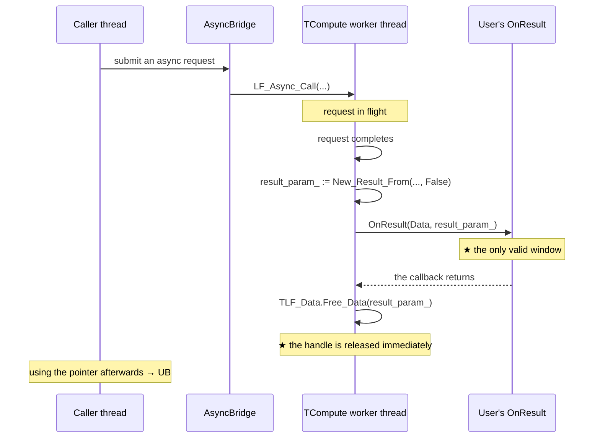

**Contract**:

- After the callback returns, the handle **becomes invalid immediately**.
- Using that handle outside the callback is **undefined behaviour** (use-after-free).
- Calling `LF_FreeData` on it is a **double free**.

#### 4.7.3 Why breaking the contract "sometimes works, sometimes fails"

**Root cause**: `Free_Data` is **pooled recycling**:

```pascal
class procedure TLF_Data.Free_Data___(hnd: PLF_Data);
begin
  hnd^.Data_Info := '';
  DisposeObjectAndNil(hnd^.Data_Param);
  DisposeObjectAndNil(hnd^.Data_Result);   // ← TMem64 is freed
  DisposeObjectAndNil(hnd^.calling___);
  LF_DataMemory.Free_PLF_Data(hnd);        // ← PLF_Data goes back to the pool
end;
```

**How UB manifests depends on**:

- whether the allocator has already reused this piece of memory;
- whether another thread allocated a new `TMem64` at the same moment;
- whether thread scheduling lets the caller thread run only after `Free_Data`.

**Therefore**:

| Payload characteristic | Symptom | Reason |
|-------------|------|------|
| **Small payload** (e.g. returns `int 7`, 2 bytes) | Usually "looks fine" | The allocator has not reused this small block yet |
| **Large payload** (e.g. returns a dict, 17+ bytes) | Usually "empty / garbage" | Much more likely to have been reused |

**⚠️ This is the most commonly misdiagnosed scenario**: a **type dichotomy** such as "`int` vs `dict`" misleads diagnosis. It is not a "type difference"; it is "payload size affects when memory gets reused". **The dichotomy asks the wrong question**.

#### 4.7.4 Correct usage patterns per language

**Pascal**:

```pascal
// Pattern A: synchronous call (recommended for gateway / proxy scenarios)
res_ptr := LF_Call(app, hnd, timeout_ms);
try
  LF_SetPos(res_ptr, 0);            // reset position
  result_bytes := read_string_bytes(res_ptr);
finally
  LF_FreeData(res_ptr);             // ← legitimate, the caller owns it
end;

// Pattern B: asynchronous call (everything must be done inside the callback)
procedure OnResult(Data, res_ptr: Pointer); cdecl;
begin
  // ✓ the handle is valid inside this callback
  LF_SetPos(res_ptr, 0);
  data := read_string_bytes(res_ptr);

  // ✓ copy the data out (bytes is a new object)
  my_queue.push(data);

  // ❌ never pass res_ptr outside
  // ❌ never call LF_FreeData(res_ptr)
end;
```

**Python**:

```python
# Pattern A: synchronous call
try:
    res = lf.call(app, hnd, timeout=5000)
    # use res
finally:
    res.dispose()

# Pattern B: asynchronous call (everything must be done inside the callback)
def on_result(result, error, user_data):
    if result is not None:
        data = result.read_all_bytes()   # ✓ copy immediately
        my_queue.put(data)
        result.dispose()                  # ✓ legitimate, owned by the caller

    # ❌ do not retain result beyond the callback

lf.async_call(app, hnd, callback=on_result)

# Pattern C: use the CallFuture interface
future = lf.async_call_future(app, hnd, timeout=5000)
try:
    data = future.result(timeout=5.0)     # copies internally
finally:
    future.cancel()                       # clean up
```

**C++**:

```cpp
// Pattern A: synchronous call
lingofuse::DataHandle res = lingofuse::call(app, hnd, 5000);
if (res) {
    std::vector<uint8_t> data = res.readAllBytes();
    res.dispose();                        // legitimate
}

// Pattern B: asynchronous call
lingofuse::callAsync(app, hnd, [](lingofuse::AsyncResult r) {
    if (r.err) { /* handle failure */ }
    else {
        // ✓ read the data inside the callback
        std::vector<uint8_t> data = r.value.readAllBytes();
        // ✓ copy it out
        my_queue.push(std::move(data));
        // ❌ do not pass r.value outside
        // ❌ do not call r.value.dispose()
    }
});
```

**C#**:

```csharp
// Pattern A: synchronous call
using (var res = Framework.Call(app, hnd, 5000)) {
    if (res != null) {
        byte[] data = res.ReadAllBytes();
    }
}

// Pattern B: asynchronous call
var tcs = new TaskCompletionSource<byte[]>(TaskCreationOptions.RunContinuationsAsynchronously);
Async.Call(app, hnd, 5000, (result, err) => {
    if (err != null) { tcs.TrySetException(err); return; }
    byte[] data = result.ReadAllBytes();   // ✓ copy immediately
    tcs.TrySetResult(data);
    // ❌ do not retain result beyond the callback
});

byte[] result = await tcs.Task;
```

**Rust**:

```rust
// Pattern A: synchronous call
let res = framework::call(app, hnd, 5000)?;
if res.is_some() {
    let data = res.read_all_bytes()?;
    // res is released automatically on Drop
}

// Pattern B: asynchronous call
framework::call_async(app, hnd, move |r| {
    match r {
        Ok(v) => {
            // ✓ read the data inside the callback
            let data = v.read_all_bytes().unwrap_or_default();
            let _ = my_tx.send(data);
            // ✓ copied out
            // ❌ do not pass v outside
        }
        Err(e) => { /* handle failure */ }
    }
})?;
```

**Go**:

```go
// Pattern A: synchronous call
res, err := lingofuse.Call(app, hnd, 5000)
if err == nil && res != nil {
    data, _ := res.ReadAllBytes()
    res.Close()  // legitimate
}

// Pattern B: asynchronous call
ch := make(chan []byte, 1)
lingofuse.CallAsync(app, hnd, 5000, func(result *lingofuse.DataHandle, err error) {
    if err != nil { close(ch); return }
    data, _ := result.ReadAllBytes()   // ✓ copy immediately
    ch <- data
    // ❌ do not retain result beyond the callback
})
data := <-ch
```

**Java**:

```java
// Pattern A: synchronous call
try (DataHandle res = Framework.call(app, hnd, 5000)) {
    if (res != null) {
        byte[] data = res.readAllBytes();
    }
}

// Pattern B: asynchronous call
CompletableFuture<byte[]> future = new CompletableFuture<>();
Async.call(app, hnd, 5000, (result, err) -> {
    if (err != null) { future.completeExceptionally(err); return; }
    try {
        byte[] data = result.readAllBytes();   // ✓ copy immediately
        future.complete(data);
    } catch (Throwable t) {
        future.completeExceptionally(t);
    }
    // ❌ do not retain result beyond the callback
});
byte[] data = future.get(10, TimeUnit.SECONDS);
```

**Node.js / TypeScript**:

```javascript
// Pattern A: synchronous call (Node.js is async, but still the "synchronous family" because it returns a Promise)
const res = await framework.call(app, hnd, 5000);
try {
    const data = res.readAllBytes();
} finally {
    res.dispose();
}

// Pattern B: asynchronous call
framework.callAsync(app, hnd, 5000, (result, err) => {
    if (err) { /* handle failure */ return; }
    const data = result.readAllBytes();   // ✓ copy immediately
    myQueue.push(data);
    // ❌ do not retain result beyond the callback
    // ❌ do not call result.dispose() (it belongs to the framework)
});
```

#### 4.7.5 Handle ownership cheat sheet

| Source | Owner | Releaser | Can it cross threads? |
|------|:------:|:------:|:----------:|
| `LF_CreateData` | User | User | ⚠️ needs an external lock |
| `LF_CreateData_Permanent` | User | User | ⚠️ needs an external lock |
| `LF_Call` return | User | User | ✅ yes |
| `LF_UID_Call` return | User | User | ✅ yes |
| `LF_P2PNAME_Call` return | User | User | ✅ yes |
| `LF_LocalCall` return | User | User | ✅ yes |
| Inside the `LF_Async_Call` callback | **Framework** | **Framework** | ❌ must not cross threads |
| Inside the `LF_UID_Async_Call` callback | **Framework** | **Framework** | ❌ must not cross threads |
| Inside the `LF_P2PNAME_Async_Call` callback | **Framework** | **Framework** | ❌ must not cross threads |

#### 4.7.6 What this means for cross-language bindings

- **Every managed-language binding layer**: must **read and copy the data inside the callback** before handing it to the user; users should never touch raw pointers.
- **Julia / Erlang / R**: for the `output` pointer inside a `@cfunction` / NIF / C-extension callback, if there are async ownership issues, **all operations must be completed inside the callback**; raw pointers must not be handed over through a Channel / Queue.
- **Python / C# / Java**: in ctypes / P/Invoke / FFM async callbacks, if the returned handle comes from the asynchronous family, **all operations must be completed inside the callback**.
- **GC languages**: do not observe C-side pointer lifetimes. **There are only two safe strategies**:
  1. **Handle everything inside the callback** (read Input / write Output).
  2. **Copy the data out inside the callback** (bytes/array), then process it across threads.

---

## Chapter 5 Complete reference for application handles

### 5.1 The nature of an application handle

`TAppHnd___ = Pointer`, pointing at the internal `TLF_App` (`Z.LingoFuse_Core.pas`).

**The `TLF_App` class structure** (source):

```pascal
TLF_App = class
private
  FUpdateEventPool: TLF_UpdateEventPool;
  FUpdated: boolean;
  procedure Do_LFRegEvent;
  procedure DoTimer();
public
  Name: TLF_String;
  Desc: TLF_String;
  Engine: TLF_Engine;
  constructor Create(Owner_Pool_: boolean);
  destructor Destroy; override;
  procedure FakeFree;
  procedure DoChange();
  procedure Subscribe_Update(Bind: TCore_Object; OnUpdate: TOn_LFUpdate);
  procedure Remove_Update(Bind: TCore_Object);
end;
```

**Key mechanisms**:
- **Each App owns a `TLF_Engine`**, which contains `TLF_MethodPool` (the API table).
- **`FUpdateEventPool`**: the subscriber pool (e.g. `TC40_LF_Client`), notified when APIs change.
- **`DoChange`**: called when APIs change; sets `FUpdated := True` and calls `Reset_Timer` so that a single broadcast happens 1 second later.

### 5.2 Creation and release APIs

#### 5.2.1 `LF_CreateApp(appName, Desc): TAppHnd`

**Mechanism**:
1. `TLF_App.Create(Owner_Pool_=True)`:
   - Creates `TLF_Engine`.
   - Creates `FUpdateEventPool`.
   - `Subscribe_Timer_M(self, 1000, DoTimer)`: registers a 1-second timer for API-change broadcast.
   - **Adds itself to `LF_App_Pool`** (Owner_Pool_=True).
2. Sets `Name` / `Desc` (an empty Desc is replaced by `'No Description'`).

**Key points**:
- A created App **automatically joins `LF_App_Pool`**.
- **An empty `Desc` is automatically filled with `'No Description'`**.

#### 5.2.2 `LF_FreeApp(appHnd)`

**Mechanism** (source `Z.LingoFuse_Export.pas`):
```pascal
procedure LF_FreeApp(appHnd: TAppHnd___);
begin
  if not Core_Dispatch_Order_Activted then exit;   // ① shutdown guard
  if appHnd = nil then exit;
  app := appHnd;
  // ② unbind every TC40_LF_Client
  arry := C40_ClientPool.FastSearchClass(TC40_LF_Client);
  for i := 0 to length(arry) - 1 do
  begin
    Cli := arry[i] as TC40_LF_Client;
    if Cli.app = app then Cli.app := nil;
  end;
  // ③ stop the sequence threads
  LF_Notify_Sequence_Thread_Pool.Kill_App(app);
  LF_Call_Sequence_Thread_Pool.Kill_App(app);
  // ④ FakeFree (removes the timer only)
  app.FakeFree;
end;
```

**Key points**:
- **It does not really free the App**: it only unbinds, stops the sequence threads and removes the timer.
- **The object stays in `LF_App_Pool`**: the real release happens in `LF_Shutdown`.
- **Shutdown guard**: it is a no-op when `Core_Dispatch_Order_Activted = False`.

#### 5.2.3 `LF_Generate_AppName(): PAnsiChar`

**Mechanism**:
```pascal
function LF_Generate_AppName: pansichar;
begin
  // ① append the address and RemoteID of every physical tunnel
  for i := 0 to C40_PhysicsTunnelPool.Count - 1 do
    tmp.Append(Build_Host_URL(...) + '&' + IntToStr(...RemoteID));
  // ② append the process name + PID
  tmp.Append('&' + Make_LingoFuse_Process_Name.Text);
  // ③ append an incrementing counter
  tmp.Append('&' + IntToStr(AtomInc(Generate_AppName_Call_Num)));
  // ④ prefix
  tmp := C_Generate_Prefix + tmp;    // '@__generate__@...'
  // ⑤ return a UTF-8 pointer, released after 5 seconds
  Result := tmp.BuildUTF8AnsiChar();
  Z.Notify.DelayFreeMem(5.0, Result);
end;
```

**Exact output with no clients**:

```
@__generate__@&<process name:PID>&<counter>
```

**With clients**:

```
@__generate__@<addr1>&<remoteID1>&<addr2>&<remoteID2>&...&<process name:PID>&<counter>
```

**Key points**:
- **It is not `@__generate__@<empty>&<process name>&<counter>`, but starts directly with `&`** (because the loop body never runs, `tmp` is still empty, and `Append('&' + ...)` appends directly).
- The counter increments from 1 (`AtomInc` returns the incremented value).
- **It must be called after `LF_PrepareDone`**.
- **The returned pointer becomes invalid after 5 seconds**.

#### 5.2.4 `LF_Get_AppName(appHnd): PAnsiChar`

**Contract**:
- **Returns nil when `appHnd = nil`** (safe).
- **The returned pointer becomes invalid after 5 seconds**.

#### 5.2.5 `LF_BindApp(appHnd): Integer`

**Mechanism** (source `Z.LingoFuse_Export.pas`):
```pascal
function LF_BindApp(appHnd: TAppHnd___): Integer;
begin
  Result := 0;
  if appHnd = nil then exit;
  app := appHnd;
  // ① the main thread must be active
  if not Simulator_Main_Thread_Activted then
  begin
    DoStatus('LF_BindApp: Main thread is not active - cannot bind app.');
    exit;
  end;
  // ② walk every TC40_LF_Client and bind those whose app = nil
  arry := C40_ClientPool.FastSearchClass(TC40_LF_Client);
  for i := 0 to length(arry) - 1 do
  begin
    Cli := arry[i] as TC40_LF_Client;
    if Cli.app = nil then
    begin
      Cli.app := app;
      inc(Result);
      // ... print a log line
    end;
  end;
end;
```

**Contract**:
- **The main thread must already be started** (`Simulator_Main_Thread_Activted = True`).
- **Only clients with `Cli.app = nil` are bound**.
- **Already-bound clients are not overwritten**.
- **Returns the number of clients successfully bound**.
- **Binding order = client creation order** (`C40_ClientPool` is a `TGenericsList`, whose internal order follows client creation order).
- If `Result = 0`, it prints `'LF_BindApp: All clients are already occupied'`.

### 5.3 Visibility of application handles

**Key points**:
- **APIs registered on an App are reachable through the "App name"**.
- **APIs registered on an App are also reachable through "UID" and "P2PName"** (UID / P2PName are client-level routing keys).
- **APIs registered on an App are not reachable through the "P2P registration" path** — P2P registration is a separate namespace.

### 5.4 App registration vs P2P registration

| Dimension | App registration (`AppHandle.register_call`) | P2P registration (`P2PRegistry.register_call`) |
|------|-------------------------------------|---------------------------------------|
| **Underlying API** | `LF_RegisterCall` / `LF_RegisterNotify` | `LF_Register_P2P_Call` / `LF_Register_P2P_Notify` |
| **Namespace** | The business App's API table | The process-level `___LF_P2P_APP___` API table |
| **Lifetime** | Unbound with `AppHandle.close()` | Lives until `LF_Shutdown` |
| **Hit by an App-name call** | ✅ | ❌ |
| **Hit by a UID call** | ✅ | ✅ |
| **Hit by a P2PName call** | ✅ | ✅ |
| **Typical use** | Business APIs | Global tools (whoami / ping / status) |

**Architectural implications**:

| What you want to do | Recommended approach |
|----------|---------|
| A business API that should be discoverable by App name | `register_call` |
| Exposed only to UID / P2PName, not discoverable by App name | `register_p2p_call` |
| A global tool any client can call by UID / group name | `register_p2p_call` |

#### 5.4.1 App registration vs P2P registration per language

| Language | App registration | P2P registration |
|------|----------|----------|
| Pascal | `LF_RegisterCallEx(app, ...)` | `LF_Register_P2P_Call(...)` |
| Python | `app.register_call(...)` | `lf.register_p2p_call(...)` |
| C++ | `app.registerCall(...)` | `lingofuse::p2p::registerCall(...)` |
| C# | `app.RegisterCall(...)` | `Framework.RegisterP2PCall(...)` |
| Rust | `app.register_call(...)` | `p2p::register_call(...)` |
| Go | `app.RegisterCall(...)` | `lingofuse.RegisterP2PCall(...)` |
| Java | `app.registerCall(...)` | `P2PRegistry.registerCall(...)` |
| Node.js / TS | `app.registerCall(...)` | `p2p.registerCall(...)` |
| Erlang | `lingofuse:register_call/4` | `lingofuse:register_p2p_call/4` |
| Julia | `app.register_call(...)` | `p2p.register_call(...)` |
| Zig | `app.registerCall(...)` | `p2p.registerCall(...)` |
| Swift | `app.registerCall(...)` | `P2P.registerCall(...)` |
| Ruby | `app.register_call(...)` | `LingoFuse::P2PRegistration.register_call(...)` |
| Fortran | `lf_register_call(...)` | `lf_register_p2p_call(...)` |
| Dart | `app.registerCall(...)` | `FrameBridge.instance.registerP2PCall(...)` |
| R | `lf_register_call(...)` | `lf_register_p2p_call(...)` |

### 5.5 Local call APIs

#### 5.5.1 `LF_LocalCall(appHnd, Param): TDataHnd`

**Mechanism**:
```pascal
function LF_LocalCall(appHnd: TAppHnd___; Param: TDataHnd___): TDataHnd___;
begin
  Result := nil;
  if appHnd = nil then exit;
  if Param = nil then exit;
  app := appHnd;
  tmp := TMem64.Create;
  try
    // ① encode Param into a TMem64
    PLF_Data(Param).Data_Param.EncryptToMem(tmp);
    // ② Begin_Call (calling___++)
    PLF_Data(Param).Begin_Call;
    // ③ execute
    Result := TLF_Data.New_Result_From(app.Engine.Execute_Call(tmp), True);
  finally
    // ④ End_Call (calling___--)
    PLF_Data(Param).End_Call;
    DisposeObject(tmp);
  end;
end;
```

**Contract**:
- **The input handle is not released** (the caller owns it).
- **A new handle is returned** (the caller owns it).
- **Internal `Begin_Call` / `End_Call` protect the input handle** (while `calling___ > 0` it cannot be recycled by the timeout).
- **Executes locally**, never over the network.
- **`New_Result_From(..., True)`** → `auto_recycle = True` → **the returned handle belongs to the caller**.

#### 5.5.2 `LF_LocalNotify(appHnd, Param)`

**Mechanism**:
```pascal
procedure LF_LocalNotify(appHnd: TAppHnd___; Param: TDataHnd___);
begin
  // ... same as LF_LocalCall, but with no Output
  PLF_Data(Param).Data_Param.EncryptToMem(tmp);
  PLF_Data(Param).Begin_Call;
  app.Engine.Execute_Notify(tmp);
  PLF_Data(Param).End_Call;
end;
```

**Key point**: no return value.

### 5.6 Identity injection for local calls

**Key point**: **`LF_LocalCall` / `LF_LocalNotify` do not go through `Rebuild_UID_and_P2PName`**, therefore:

- If `Param` was created by `LF_CreateData`, its `FromUID` is `Null_UID()` and `FromP2PName` is empty — **there is no "sender"**.
- If `Param` was received from the network, its `FromUID` / `FromP2PName` are preserved.
- **On the callback's `Input`, `LF_Get_P2P_UID` / `LF_Get_P2P_Name` return empty values for a self-built handle**.

**Contrast: a local call through the `TC40_LF_Client.Send_*` path does inject identity**:

`TC40_LF_Client.Send_Execute_Notify` source:
```pascal
procedure TC40_LF_Client.Send_Execute_Notify(app_Name__: TLF_String; Param: TMem64);
begin
  tmp_param := TMemory_Param_Tool.Rebuild_UID_and_P2PName(Param, FLast_UID, LF_P2P_name.V);
  try
    api_Name__ := TMemory_Param_Tool.Get_apiName(tmp_param);
    tmp_cli__ := Find_Local_API(app_Name__, api_Name__, True);   // local lookup
    if tmp_cli__ <> nil then
      begin
        tmp_cli__.APP.Engine.Execute_Notify(tmp_param);           // local execution, but identity already injected
        exit;
      end;
    ...
  finally
    DisposeObject(tmp_param);
  end;
end;
```

**Implications**:
- **When `LF_Call` hits the local short-circuit, the callback's `Input` carries identity**.
- **`LF_LocalCall` calls `Engine.Execute_*` directly and injects no identity**.
- **If a local call must also carry identity**: use `LF_Call` (it hits the local short-circuit and still injects identity).

**Related pitfall**: `LF-LOCAL-001`.

#### 5.6.1 Local calls per language

| Language | Local call | Local Notify | Identity injected? |
|------|---------|-------------|:------------:|
| Pascal | `LF_LocalCall(app, hnd)` | `LF_LocalNotify(app, hnd)` | ❌ |
| Python | `lf.local_call(app, hnd)` | `lf.local_notify(app, hnd)` | ❌ |
| C++ | `lingofuse::localCall(app, hnd)` | `lingofuse::localNotify(app, hnd)` | ❌ |
| C# | `Framework.LocalCall(app, hnd)` | `Framework.LocalNotify(app, hnd)` | ❌ |
| Rust | `framework::local_call(app, hnd)` | `framework::local_notify(app, hnd)` | ❌ |
| Go | `lingofuse.LocalCall(app, hnd)` | `lingofuse.LocalNotify(app, hnd)` | ❌ |
| Java | `Framework.localCall(app, hnd)` | `Framework.localNotify(app, hnd)` | ❌ |
| Node.js / TS | `framework.localCall(app, hnd)` | `framework.localNotify(app, hnd)` | ❌ |
| Erlang | `lingofuse:local_call(app, hnd)` | `lingofuse:local_notify(app, hnd)` | ❌ |
| R | `lf_local_call(app, hnd)` | `lf_local_notify(app, hnd)` | ❌ |

**Key reminder**: **`local_call` / `local_notify` inject no identity in any language**. This is a uniform framework contract, not a bug in any particular language.

---

## Chapter 6 The API registration mechanism

### 6.1 Registration styles compared

| Style | cdecl style | Object method | Nested/anonymous | Synchronous variant |
|------|:----------:|:--------:|:---------:|:--------:|
| **Call** | `LF_RegisterCall` | `LF_RegisterCall_M` | `LF_RegisterCall_P` | `LF_RegisterSyncCall_M` / `_P` |
| **Notify** | `LF_RegisterNotify` | `LF_RegisterNotify_M` | `LF_RegisterNotify_P` | `LF_RegisterSyncNotify_M` / `_P` |

**Synchronous variants**: `RegisterSyncCall_M` and friends marshal the callback to the main thread (through `TSoft_Synchronize_Tool`), and require `LF_Sync` as the driver when a custom main loop is used.

### 6.2 Registration callback signatures

```pascal
// cdecl style
TLF_Call_Event   = procedure(Trigger: Pointer; Input, Output: TDataHnd___); cdecl;
TLF_Notify_Event = procedure(Trigger: Pointer; Input: TDataHnd___); cdecl;

// object methods
TLF_Call_M   = procedure(Input, Output: TDataHnd___) of object;
TLF_Notify_M = procedure(Input: TDataHnd___) of object;

// nested (FPC) / anonymous (Delphi)
{$IFDEF FPC}
TLF_Call_P   = procedure(Input, Output: TDataHnd___) is nested;
TLF_Notify_P = procedure(Input: TDataHnd___) is nested;
{$ELSE}
TLF_Call_P   = reference to procedure(Input, Output: TDataHnd___);
TLF_Notify_P = reference to procedure(Input: TDataHnd___);
{$ENDIF}
```

**Callback signatures per language**:

| Language | Call callback | Notify callback | Convention |
|------|-----------|-------------|------|
| Pascal | `procedure(Trigger: Pointer; Input, Output: TDataHnd); cdecl` | `procedure(Trigger: Pointer; Input: TDataHnd); cdecl` | Must be `cdecl` |
| Python | `def callback(trigger, input, output)` | `def callback(trigger, input)` | Together with the `@server.expose` decorator |
| C++ | `void LF_CDECL Callback(void*, void*, void*)` | `void LF_CDECL Callback(void*, void*)` | `extern "C"` + `__cdecl` |
| C# | `void Callback(IntPtr trigger, IntPtr input, IntPtr output)` | `void Callback(IntPtr trigger, IntPtr input)` | `[UnmanagedFunctionPointer(CallingConvention.Cdecl)]` |
| Rust | `extern "C" fn callback(trigger: *mut c_void, input: *mut c_void, output: *mut c_void)` | `extern "C" fn callback(trigger: *mut c_void, input: *mut c_void)` | Wrapped in `catch_unwind` |
| Go | `func callback(trigger, input, output uintptr)` | `func callback(trigger, input uintptr)` | `purego` / `cgo` |
| Java | `void callback(Invoker trigger, Invoker input, Invoker output)` | `void callback(Invoker trigger, Invoker input)` | FFM API, Java 22+ |
| Node.js / TS | `function cb(trigger: unknown, input: unknown, output: unknown)` | `function cb(trigger: unknown, input: unknown)` | `koffi.register(...)` |
| Erlang | A `{lf_call, Ref, Api, Payload}` message | A `{lf_notify, Api, Payload}` message | Sent by the NIF, received by the Erlang process |
| Julia | `function callback(trigger, input, output)` | `function callback(trigger, input)` | `@cfunction` / `@threadcall` |
| Zig | `fn callback(trigger: ?*anyopaque, input: ?*anyopaque, output: ?*anyopaque) callconv(.C) void` | `fn callback(trigger: ?*anyopaque, input: ?*anyopaque) callconv(.C) void` | `callconv(.C)` |
| Swift | `func callback(_ trigger: UnsafeMutableRawPointer?, _ input: UnsafeMutableRawPointer?, _ output: UnsafeMutableRawPointer?)` | `func callback(_ trigger: UnsafeMutableRawPointer?, _ input: UnsafeMutableRawPointer?)` | `@convention(c)` |
| Ruby | `def callback(input, output)` | `def callback(input)` | `LingoFuse::Native.lf_register_call` |
| Fortran | `subroutine callback(input, output) bind(C)` | `subroutine callback(input) bind(C)` | `bind(C)`, not `cdecl` |
| Dart | `Uint8List callback(CallContext ctx)` | `void callback(CallContext ctx)` | `CallbackDispatcher` |
| R | `function(input_raw, ctx)` | `function(input_raw, ctx)` | `with_context = TRUE` |

### 6.3 How `LF_RegisterCall` works internally

**Source `TLF_Engine.Reg_Call`**:
```pascal
function TLF_Engine.Reg_Call(MethodName, Desc: TLF_String; Trigger: Pointer; On_Call: TLF_Call_Event): boolean;
var api_: TLF_MethodInfo;
begin
  Result := False;
  if LF_MethodPool.Exists_Key(MethodName) then
      exit;                    // duplicate name → return False
  api_ := TLF_MethodInfo.Create;
  api_.Name := MethodName;
  api_.Desc := Desc;
  api_.Mode := TLF_Mode.LF_Call__;
  api_.Trigger := Trigger;
  api_.On_Call := On_Call;
  LF_MethodPool.Add(MethodName, api_, False);
  APP.DoChange();              // trigger the App change (broadcast 1 second later)
  Result := True;
end;
```

**Key points**:
- **An existing API name cannot be overwritten** (returns False).
- **Triggers `APP.DoChange`** → `FUpdated := True` + `Reset_Timer` → broadcast 1 second later.
- **The callback reads parameters with `LF_ReadBuffer(Input, ...)` and writes results with `LF_WriteBuffer(Output, ...)`**.
- **Inside the callback, `LF_Get_P2P_UID(Input)` / `LF_Get_P2P_Name(Input)` yield the sender identity** (**valid for Input only**).

### 6.4 Mode matching rules

**Key point**: calling an API registered as Call with Notify (or vice versa) **prints a warning but still executes**:

| Registered as | Invoked as | Behaviour |
|---------|---------|------|
| Call | Call | ✅ Normal |
| Call | Notify | ⚠️ Prints a warning, runs `On_Call`, Output discarded |
| Notify | Call | ⚠️ Prints a warning, runs `On_Notify`, Output empty |
| Notify | Notify | ✅ Normal |

**Warning texts**:
- Call registered, invoked as Notify: `'Warning: API "%s" is registered as Notify but invoked as Call; no return value will be produced.'`
- Notify registered, invoked as Call: `'Warning: API "%s" is registered as Call but invoked via Notify; any returned value will be discarded.'`

### 6.5 `LF_Register_P2P_Call` / `LF_Register_P2P_Notify`

**Differences from App-level registration**:
- Registered into the global `LF_P2P_APP` (application name `___LF_P2P_APP___`).
- **When called through P2PName and UID**, these APIs are hit first.
- **When called through the App name, they are not necessarily hit** (depending on App-name routing).

**Typical use**: registering global utility functions (such as `whoami`, `Status` forwarding).

### 6.6 Visibility differences between P2P and App registration

**This is the easiest place to trip up**: **an App-name call cannot hit a P2P-registered function.**

| Call style | Search scope on the target side | Hits App registrations | Hits P2P registrations |
|----------|----------------|:-------------:|:-------------:|
| **UID call** | Every API registered on the target client | ✅ | ✅ |
| **P2PName call** | Every API registered on the selected client | ✅ | ✅ |
| **App-name call** | The target App's registry | ✅ | ❌ |

**Why it is like this**:

- **UID / P2PName are "client-level" routing keys**: they first locate "a certain client", which then looks up the target function in its own local API table. App-registered and P2P-registered functions are in the same local table.
- **App name is an "application-level" routing key**: it locates "a certain App" and only searches that App's registry. P2P-registered functions hang under the global `___LF_P2P_APP___`, not in the business App's table, so App-name calls cannot hit them.

**Architectural implications**:

| What you want to do | Recommended routing |
|----------|---------|
| Target a specific client and call any of its registered functions | **UID** |
| A homogeneous group of workers, handled by any node in the group | **P2PName** |
| A fixed service name, discovered by App name | **App name** |
| Expose only to UID/P2P calls, not discoverable by App name | **P2P registration** |

---

## Chapter 7 Local calls and routing short-circuit

### 7.1 Positioning of `LF_LocalCall` / `LF_LocalNotify`

**`LF_LocalCall` is the explicit version of "local short-circuit"**. It calls `Engine.Execute_Call` directly without going through the C4 client layer, and therefore:

- **Injects no sender identity** (see §5.6).
- **Triggers no network routing** (even if the target App is remote, it is not forwarded).
- **Requires the caller to hold the target App's handle explicitly**.

**Comparison with `LF_Call`**:

| Dimension | `LF_LocalCall` | `LF_Call` |
|------|----------------|-----------|
| Target resolution | Must pass the App handle explicitly | Resolved automatically by App name (local first + remote) |
| Local short-circuit | Yes (the only path) | Yes (short-circuits when the target is local) |
| Sender identity | Not injected | Injected (through `Rebuild_UID_and_P2PName`) |
| Network forwarding | Never | May forward to a remote peer |
| Applicable scenario | Purely local same-process calls | Cross-process / cross-machine / local short-circuit |

### 7.2 Local calls per language

| Language | Local call | Local Notify |
|------|---------|-------------|
| Pascal | `LF_LocalCall(app, hnd)` | `LF_LocalNotify(app, hnd)` |
| Python | `lf.local_call(app, hnd)` | `lf.local_notify(app, hnd)` |
| C++ | `lingofuse::localCall(app, hnd)` | `lingofuse::localNotify(app, hnd)` |
| C# | `Framework.LocalCall(app, hnd)` | `Framework.LocalNotify(app, hnd)` |
| Rust | `framework::local_call(app, hnd)` | `framework::local_notify(app, hnd)` |
| Go | `lingofuse.LocalCall(app, hnd)` | `lingofuse.LocalNotify(app, hnd)` |
| Java | `Framework.localCall(app, hnd)` | `Framework.localNotify(app, hnd)` |
| Node.js / TS | `framework.localCall(app, hnd)` | `framework.localNotify(app, hnd)` |
| Erlang | `lingofuse:local_call(app, hnd)` | `lingofuse:local_notify(app, hnd)` |
| R | `lf_local_call(app, hnd)` | `lf_local_notify(app, hnd)` |

### 7.3 Local call vs local short-circuit

**Two different concepts**:

- **Local call** (`LF_LocalCall`): **explicitly** choosing the local path, bypassing the network.
- **Local short-circuit** (`LF_Call` hitting locally): **implicitly** decided by the routing layer — if the target is local, `LF_Call` **automatically** short-circuits locally instead of going over the network.

**Trigger condition for local short-circuit** (source `TC40_LF_Client.Send_Execute_Notify`):

```pascal
// ① look locally first: is there an App with the same name in this process that has the target API
tmp_cli__ := Find_Local_API(app_Name__, api_Name__, True);
if tmp_cli__ <> nil then
  begin
    tmp_cli__.APP.Engine.Execute_Notify(tmp_param);   // execute locally
    exit;
  end;
// ② then look remotely
...
```

**Key points**:

- **The local short-circuit of `LF_Call` does inject sender identity** (because it goes through the `Send_*` path and therefore `Rebuild_UID_and_P2PName`).
- **`LF_LocalCall` injects no sender identity** (it calls `Engine.Execute_*` directly).

### 7.4 Local call pitfalls

| Symptom | Root cause | Fix |
|------|------|------|
| `LF_Get_P2P_UID(Input)` inside a local-call callback returns all zeros | `LF_LocalCall` injects no identity | Use `LF_Call` (it hits the local short-circuit and still injects identity) |
| A local call is not forwarded to a remote peer | `LF_LocalCall` only executes locally | Use `LF_Call` |
| The handle is recycled unexpectedly after a local call | `calling___` not incremented/decremented correctly | Use `try..finally` to guarantee `End_Call` |
| `LF_LocalCall` cannot find the API | The App did not register that API | Check whether `LF_RegisterCallEx` succeeded |

---

# Part III Routing and addressing

## Chapter 8 The three addressing modes in detail

### 8.1 Overview of the three addressing modes

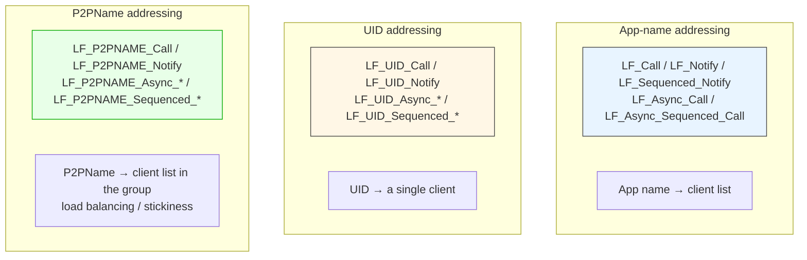

### 8.2 App-name addressing

**API list**:
- `LF_Call(appName, Param, Timeout)`
- `LF_Async_Call(appName, Param, Data, OnResult)`
- `LF_Async_Sequenced_Call(appName, Param, Data, OnResult)`
- `LF_Notify(appName, Param)`
- `LF_Sequenced_Notify(appName, Param)`

**Routing algorithm** (client `Send_Execute_Notify`):

```pascal
// ① look locally first: is there an App with the same name in this process that has the target API
tmp_cli__ := Find_Local_API(app_Name__, api_Name__, True);
if tmp_cli__ <> nil then
  begin
    tmp_cli__.APP.Engine.Execute_Notify(tmp_param);   // execute locally
    exit;
  end;

// ② then check the remote cache: locally cached remote App information
tmp_cli__ := Find_Remote_API(app_Name__, api_Name__, True);
if tmp_cli__ <> nil then
    tmp_cli__.Send_Execute_Notify_Impl(app_Name__, tmp_param)  // forward through that client
else
    Send_Execute_Notify_Impl(app_Name__, tmp_param);           // send through our own connection
```

**Key points**:
- **Local first**: if this process has an App with the same name whose API matches → executes locally, **never over the network**.
- **Cache acceleration**: `LF_Local_API_Cache` / `LF_Remote_API_Cache` map `'AppName.ApiName'` → `TC40_LF_ClientList`.
- **Cache invalidation**:
  - **Server side**: `cmd_Init_APP_Info` / `cmd_No_App_Info` / `DoUserOut_Event`.
  - **Client side**: `cmd_update_service_api_info` (broadcast received) / `DoNetworkOffline` (physical disconnect).

### 8.3 UID addressing

**API list**:
- `LF_UID_Call(UID, Param, Timeout)`
- `LF_UID_Async_Call(UID, Param, Data, OnResult)`
- `LF_UID_Async_Sequenced_Call(UID, Param, Data, OnResult)`
- `LF_UID_Notify(UID, Param)`
- `LF_UID_Sequenced_Notify(UID, Param)`

**Routing algorithm** (client `Send_UID_Execute_Notify`):

```pascal
// ① look locally first: is there a client with the same UID in this process
target_app := Find_Local_UID_App(UID_, api_Name__);
if target_app <> nil then
  begin
    target_app.Engine.Execute_Notify(tmp_param);   // execute locally
    exit;
  end;

// ② then check the remote cache: locally cached remote UID information
tmp_cli__ := Find_Remote_UID_API(UID_, api_Name__, True);
if tmp_cli__ <> nil then
    tmp_cli__.Send_UID_Execute_Notify_Impl(UID_, tmp_param)
else
    Send_UID_Execute_Notify_Impl(UID_, tmp_param);  // route through the server's UID pool
```

**Server-side `FUID_Pool`**:
- **Key**: 32-byte `TUID___`.
- **Value**: `TUID_Data` (the recv_io + send_io pair).
- **Data source**: clients report it through the `Update_UID` command.
- **Lookup**: `FUID_Pool.Get_Value_Ptr___(UID_)` → O(1).

**UID generation**:

**The client UID is generated when `TunnelLink` succeeds**:

```pascal
if Is_Null_UID(FLast_UID) then
    FLast_UID := Generate_Global_UID(PhysicsTunnel.UID,
                                      DTNoAuth.RecvTunnel.ServerState^.UID,
                                      DTNoAuth.SendTunnel.ServerState^.UID)
else
    FLast_UID := Generate_Global_UID(FLast_UID,
                                      PhysicsTunnel.UID,
                                      DTNoAuth.RecvTunnel.ServerState^.UID,
                                      DTNoAuth.SendTunnel.ServerState^.UID);
```

- **First connection**: `Generate_Global_UID(physical tunnel UID, receive tunnel server UID, send tunnel server UID)`.
- **Reconnect**: `Generate_Global_UID(old UID, physical tunnel UID, receive tunnel server UID, send tunnel server UID)`.
- `Generate_Global_UID` comes from `Z.Net` and produces a 256-bit UID with SHA3-256, mixing the current time + tick + a global seed + the inputs.

**Key points**:
- **The UID is a session-level identifier**: generated when `TunnelLink` succeeds, and changed after reconnecting.
- **Local first**: if this process has a client with the same UID → executes locally.
- **Server-side hash pool**: the UID is the server's routing key for locating clients across the mesh.

### 8.4 P2PName addressing

**API list**:
- `LF_P2PNAME_Call(p2p_name, Param, Timeout)`
- `LF_P2PNAME_Async_Call(p2p_name, Param, Data, OnResult)`
- `LF_P2PNAME_Async_Sequenced_Call(p2p_name, Param, Data, OnResult)`
- `LF_P2PNAME_Notify(p2p_name, Param)`
- `LF_P2PNAME_Sequenced_Notify(p2p_name, Param)`

**Routing algorithm**:
- **No local lookup**, **always over the network**.
- The server finds a set of UIDs through `FP2PName_Pool` and picks one using load balancing or stickiness.

**Exact mapping of the two selection strategies**:

| Command | Strategy | Implementation |
|------|------|------|
| `cmd_P2PName_Call` | **`Find_P2PName_LoadBalance`** | `Cycle_Anchor` round-robin + load balancing |
| `cmd_P2PName_Notify` | **`Find_P2PName_LoadBalance`** | Same as above |
| `cmd_P2PName_Sequenced_Notify` | **`Find_P2PName_FixedSequenced`** | `Fixed_Sequenced_Time` stickiness |
| `cmd_P2PName_Sequenced_Call` | **`Find_P2PName_FixedSequenced`** | Same as above |

**Load balancing (Cycle_Anchor)**:
- **A global atomic incrementing counter** `Cycle_Anchor_Seed` (`Get_Cycle_Anchor`).
- Each `(p2p_name, api)` task maintains an anchor value per UID.
- **The smallest anchor is selected first**, then updated to a new global value (moving it to the back).
- **Effect**: round-robin + load balancing.
- **Precision**: every call precisely selects the least recently used UID.

**Stickiness (FixedSequenced)**:
- Sort by the time last handled, take the minimum.
- If a UID has not been selected for longer than `Fixed_Sequenced_Time` (20 seconds by default), switch to it.
- **Effect**: the same UID keeps handling for 20 seconds, then switches.

**Key points**:
- **P2PName is a user-defined string**, set through `LF_Set_Opt_P2P_Name`.
- **The server does not distinguish the physical location of UIDs with the same name**; it only groups by P2PName.
- **Local-priority routing does not apply** (it always goes over the network).

**⚠️ Hanging behaviour of P2PName async Call**:

If the server's `cmd_P2PName_Call` cannot find the group name, it **only calls `DoStatus` and sends no reply**. Therefore:

- **If the server cannot find the group name, the callback of `LF_P2PNAME_Async_Call` never fires**.
- The client's `LF_P2PNAME_Async_Call` returns 1 (enqueued), but the callback never fires.
- **The caller must implement its own timeout**.

**⚠️ Behaviour of a P2PName call with an empty string**:

`LF_P2PNAME_Call("", param, timeout)` is sent to the server, whose `Find_P2PName_LoadBalance('')` returns nil and reports `no found p2pname:""`, **without replying**.

### 8.5 Comparison of the three addressing modes

| Dimension | App name | UID | P2PName |
|------|--------|-----|---------|
| Index key | UTF-8 string | 32-byte binary | UTF-8 string |
| Routing granularity | Application level | Session level | Group level |
| Local priority | ✅ | ✅ | ❌ |
| Server-side hash pool | App index | `FUID_Pool` | `FP2PName_Pool` |
| Load balancing | ❌ (App names are unique) | ❌ (UIDs are unique) | ✅ (`Cycle_Anchor`) |
| Stickiness | ❌ | ❌ | ✅ (`FixedSequenced`, 20 seconds) |
| Hits App registrations | ✅ | ✅ | ✅ |
| Hits P2P registrations | ❌ | ✅ | ✅ |
| Typical use | Fixed services | **Targeting a specific client** | Homogeneous service clusters |

### 8.6 UID / P2PName automatically search App-registered functions

**Core fact**: **UID and P2PName calls automatically search the target client's App-registered functions.**

**Mechanism**:

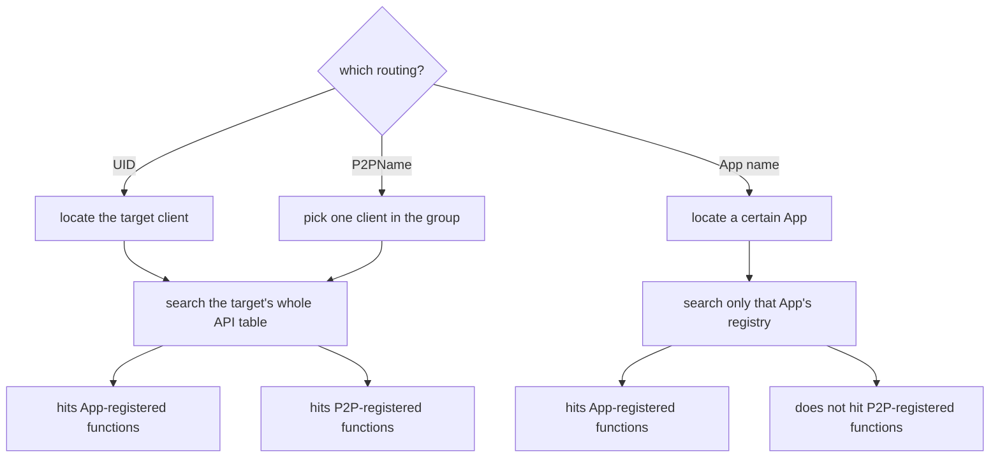

**Comparison table**:

| Call style | Search scope on the target side | Hits App registrations | Hits P2P registrations |
|----------|----------------|:-------------:|:-------------:|
| **UID call** | Every API registered on the target client | ✅ | ✅ |
| **P2PName call** | Every API registered on the selected client | ✅ | ✅ |
| **App-name call** | The target App's registry | ✅ | ❌ |

**Source evidence**:

**UID routing** (`Find_Local_UID_App` → `Find_API_From_P2P_APP`):
```pascal
function Find_API_From_P2P_APP(api_name__: SystemString): TLF_App;
begin
  Result := nil;
  // ① check the P2P APP first
  if LF_P2P_APP.Engine.LF_MethodPool.Exists_Key(api_name__) then
    begin
      Result := LF_P2P_APP;
      exit;
    end;
  // ② then check the business App pool
  LF_App_Pool.Lock;
  try
    if LF_App_Pool.Num > 0 then
      with LF_App_Pool.Invert_Repeat_ do
        repeat
          if queue^.Data.Engine.LF_MethodPool.Exists_Key(api_name__) then
            begin
              Result := queue^.Data;
              exit;
            end;
        until not Prev;
  finally
      LF_App_Pool.UnLock;
  end;
end;
```

**App-name routing** (`Find_Local_API`): searches only the `LF_MethodPool` of the App named `app_Name__`.

### 8.7 Addressing calls per language

| Language | App-name call | UID call | P2PName call |
|------|-----------|----------|--------------|
| Pascal | `LF_CallEx(app, hnd, timeout)` | `LF_UID_Call(uid, hnd, timeout)` | `LF_P2PNAME_Call(p2p, hnd, timeout)` |
| Python | `lf.call(app, hnd, timeout)` | `lf.uid_call(uid, hnd, timeout)` | `lf.p2pname_call(p2p, hnd, timeout)` |
| C++ | `lingofuse::call(app, hnd, timeout)` | `lingofuse::callByUid(uid, hnd, timeout)` | `lingofuse::callByP2PName(p2p, hnd, timeout)` |
| C# | `Framework.Call(app, hnd, timeout)` | `Framework.CallByUid(uid, hnd, timeout)` | `Framework.CallByP2PName(p2p, hnd, timeout)` |
| Rust | `framework::call(app, hnd, timeout)` | `framework::call_by_uid(uid, hnd, timeout)` | `framework::call_by_p2p_name(p2p, hnd, timeout)` |
| Go | `lingofuse.Call(app, hnd, timeout)` | `lingofuse.CallByUid(uid, hnd, timeout)` | `lingofuse.CallByP2PName(p2p, hnd, timeout)` |
| Java | `Framework.call(app, hnd, timeout)` | `Framework.callByUid(uid, hnd, timeout)` | `Framework.callByP2PName(p2p, hnd, timeout)` |
| Node.js / TS | `framework.call(app, hnd, timeout)` | `framework.callByUid(uid, hnd, timeout)` | `framework.callByP2PName(p2p, hnd, timeout)` |
| Erlang | `lingofuse:call(App, Hnd, Timeout)` | `lingofuse:uid_call(Uid, Hnd, Timeout)` | `lingofuse:p2p_call(P2p, Hnd, Timeout)` |


## Chapter 9 Cross-addressing routing and UID universal routing

### 9.1 The UID is a universal routing identifier

**Key mechanism**: **a UID can target one specific client and call any API it has registered** (including APIs registered under an App name and APIs registered through P2P), **without knowing the App name**.

**Principles**:

1. **The client generates `FLast_UID` when `TunnelLink` succeeds**.
2. **The client reports its UID and P2PName through the `Update_UID` command**.
3. **The server's `FUID_Pool` builds a UID → recv_io mapping**.
4. **When `LF_UID_Call(UID, Param, Timeout)` is called**:
   - The client first looks locally for a client with the same UID.
   - On a miss → the command is sent to the server.
   - The server finds the recv_io through `FUID_Pool` → forwards it to the target client.
5. **When the target client executes**:
   - `Find_Local_UID_App(UID_, api_Name__)` finds the local App.
   - It executes that App's API.

**Key points**:
- **UID and App name are decoupled**: the UID is the session identifier, the App name is the application identifier; they are independent.
- **`LF_UID_Call` can call any API** (as long as the target client has the corresponding App and API).
- **The App name does not need to be known**.

### 9.2 Use cases for UID universal routing

#### Scenario 1: the server actively pushing to a specific client

```pascal
// the server knows a client's UID (extracted from an earlier callback)
procedure OnClientCalled(Trigger: Pointer; Input, Output: TDataHnd); cdecl;
var
  UID: TP2P_UID___;
  UIDPtr: PP2P_UID___;
begin
  // valid only on the Input parameter (the sender's input handle); returns a pointer
  UIDPtr := LF_Get_P2P_UID(Input);
  if UIDPtr <> nil then
      UID := UIDPtr^;   // dereference and copy immediately; the framework releases the pointer after ~5 seconds
  // ... store it
end;

// push actively later
LF_UID_Notify(StoredUID, DataHnd);   // no need to know the App name
```

#### Scenario 2: targeted cross-client calls

```pascal
// client A wants to call client B's API
// it does not need to know B's App name, only B's UID
LF_UID_Call(B_UID, DataHnd, 3000);
```

#### Scenario 3: session-sticky routing

```pascal
// subsequent calls in the same session all go to the same client
LF_UID_Sequenced_Notify(SessionUID, DataHnd);   // FIFO guaranteed
```

### 9.3 P2PName cross-API routing

**P2PName can also call any API**:

```pascal
// suppose N workers all registered the 'process' API, P2PName = 'worker_group'
LF_P2PNAME_Call('worker_group', DataHnd, 5000);
// the server picks one of the N workers by load balancing
```

**Key points**:
- **P2PName is a group name**: several clients set the same P2PName and the server balances the load.
- **No specific client is distinguished**: the caller does not need to know which worker it is.
- **No distinction of API registration origin**: App or P2P registration both work.

### 9.4 Typical architecture of cross-addressing routing

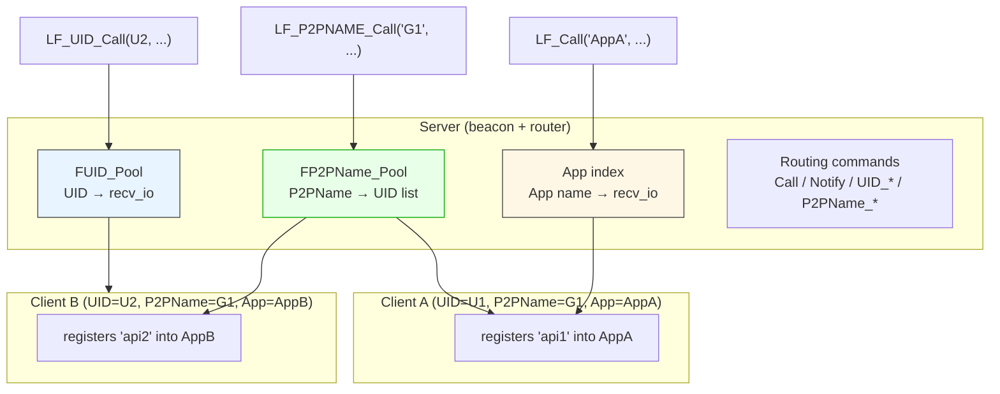

### 9.5 The whoami pattern: discovering your own UID and P2PName

**Problem**: how does a client learn the UID and P2PName the server assigned to it?

**Solution**: the server registers a `whoami` API that returns the caller's UID and P2PName.

**Server side**:

```pascal
procedure Cb_WhoAmI(Trigger: Pointer; Input, Output: TDataHnd); cdecl;
var
  UID: TP2P_UID___;
  UIDPtr: PP2P_UID___;
  P2P: string;
begin
  // valid only on the callback's Input parameter; returns a pointer
  UIDPtr := LF_Get_P2P_UID(Input);
  if UIDPtr <> nil then
      UID := UIDPtr^                    // dereference and copy immediately
  else
      FillChar(UID, SizeOf(UID), 0);
  P2P := LF_Get_P2P_NameEx(Input);
  LF_WriteBuffer(Output, @UID[0], SizeOf(UID));
  LF_WriteString(Output, P2P);
end;

// register into LF_P2P_APP (process level) so that any client can call it
LF_Register_P2P_Call('whoami', 'Query caller identity', nil, @Cb_WhoAmI);
```

**Client side**:

```pascal
function Probe_WhoAmI(out UID: TP2P_UID___; out P2PName: string): Boolean;
var
  Req, Res: LF.TDataHandle;
begin
  Result := False;
  FillChar(UID, SizeOf(UID), 0);
  P2PName := '';
  Req := LF.TDataHandle.Create('whoami');
  try
    Res := LF.CallApp('AnyApp', Req, 5000);   // any App will do
    try
      if (Res = nil) or (Res.Size < SizeOf(UID) + 1) then Exit;
      Res.Pos := 0;
      Res.ReadBuffer(UID, SizeOf(UID));
      P2PName := Res.ReadString;
      Result := True;
    finally Res.Free; end;
  finally Req.Free; end;
end;
```

**Afterwards**: the client holds its own UID and P2PName and can use them for targeted UID calls, in-group P2PName calls, or discovery by other clients.

#### 9.5.1 whoami implementation per language

**Python**:

```python
# server
@server.expose("whoami")
def whoami(trigger, inp, out):
    uid = inp.get_p2p_uid()      # copied internally into 32 bytes immediately
    name = inp.get_p2p_name()    # copied into str immediately
    out.write_json({
        "uid_hex": uid.hex(),
        "p2p_name": name,
    })

# client
def probe_identity():
    req = DataHandle("whoami")
    try:
        resp = lf.call("AnyApp", req, 5000)
        try:
            data = resp.read_all_bytes()
            obj = json.loads(data)
            return bytes.fromhex(obj["uid_hex"]), obj["p2p_name"]
        finally:
            resp.dispose()
    finally:
        req.dispose()
```

**C++**:

```cpp
// server
static void LF_CDECL whoami_cb(void*, void* in, void* out) {
    lingofuse::DataHandle inp(static_cast<TDataHnd>(in), false);
    lingofuse::DataHandle out_h(static_cast<TDataHnd>(out), false);

    std::array<std::uint8_t, 32> uid = inp.getP2PUid(); // copy immediately
    std::string name = inp.getP2PName();                // copy immediately

    out_h.writeJson({
        {"uid_hex", to_hex(uid)},
        {"p2p_name", name}
    });
}

// client
std::pair<std::array<std::uint8_t, 32>, std::string> probeIdentity() {
    lingofuse::DataHandle req("whoami");
    lingofuse::DataHandle resp = lingofuse::call("AnyApp", req, 5000);
    // ... parse ...
}
```

**C#**:

```csharp
// server
static void WhoAmICb(DataHandle inH, DataHandle outH) {
    P2PUid uid = inH.P2PUid;
    string p2p = inH.P2PName;
    var json = new { uid_hex = uid.ToHex(), p2p_name = p2p };
    outH.WriteJson(json);
}

// client
static (P2PUid uid, string p2p) ProbeIdentity() {
    using var req = new DataHandle("whoami");
    using var resp = Framework.Call("AnyApp", req, 5000);
    // ... parse ...
}
```

**Rust**:

```rust
// server
fn whoami_cb(trigger: *mut c_void, input: *mut c_void, output: *mut c_void) {
    let input = unsafe { &mut *(input as *mut DataHandle) };
    let output = unsafe { &mut *(output as *mut DataHandle) };
    let uid = input.p2p_uid();
    let p2p = input.p2p_name();
    // write back
}

// client
let req = DataHandle::new("whoami");
let resp = framework::call("AnyApp", &req, 5000)?;
// ... parse ...
```

**Go**:

```go
// server
func cbWhoAmI(inp, out *lingofuse.DataHandle) {
    uid, _ := inp.GetP2PUID()
    p2pName, _ := inp.GetP2PName()
    // write back
}

// client
req, _ := lingofuse.NewDataHandle("whoami")
defer req.Close()
resp, _ := lingofuse.Call("AnyApp", req, 5000)
defer resp.Close()
// ... parse ...
```

**Java**:

```java
// server
static void cbWhoAmI(DataHandle in, DataHandle out) {
    byte[] uid = in.getP2pUid();
    String p2p = in.getP2pName();
    // write back
}

// client
try (DataHandle req = new DataHandle("whoami")) {
    try (DataHandle resp = Framework.call("AnyApp", req, 5000)) {
        // ... parse ...
    }
}
```

**Node.js / TS**:

```javascript
// server
const cbWhoAmI = _koffi.register(whoAmICb, LfCallFuncPtr);
function whoAmICb(trigger, input, output) {
    const inp = DataHandle.fromRaw(input, false);
    const outh = DataHandle.fromRaw(output, false);
    const uid = inp.getP2PUid();     // copy immediately
    const p2p = inp.getP2PName();    // copy immediately
    outh.writeUInt8(0x00);
    outh.writeBytes(uid);
    outh.writeString(p2p);
}

// client
async function probeIdentity() {
    const req = new DataHandle("whoami");
    const resp = await framework.callAsync("AnyApp", req, 5000);
    try {
        // ... parse ...
    } finally {
        resp.dispose();
    }
}
```

**Erlang**:

```erlang
%% server (in the lf_call handler branch)
handle_request(<<"LF_TEST_WHOAMI">>, Ref, _Payload, Identity) ->
    UID = maps:get(uid, Identity, <<0:256>>),
    P2P = maps:get(p2p_name, Identity, <<>>),
    Reply = <<0, UID/binary, P2P/binary, 0>>,
    _ = lingofuse:reply(Ref, Reply),
    ok;

%% client
probe_client_identity() ->
    {ok, Req} = lingofuse:create_data(<<"whoami">>),
    try
        {ok, Resp} = lingofuse:call(<<"AnyApp">>, Req, 5000),
        try
            %% parse Resp
            ok
        after
            lingofuse:free_data(Resp)
        end
    after
        lingofuse:free_data(Req)
    end.
```

---

## Chapter 10 Automatic sender identification

### 10.1 Core mechanism

**The framework automatically injects the sender identity at the head of every remote request payload**. The client does this through `Rebuild_UID_and_P2PName` before sending:

```
[apiName: string]
[FromUID: 32 bytes]         ← the sender's session UID
[FromP2PName: string]       ← the sender's P2PName
[Param.Size: Int32]
[Param: bytes]              ← business parameters
```

**Important**:
- **`FromUID` / `FromP2PName` are "sender metadata"**, written automatically by the sending client; the receiving side neither needs nor should pass them manually.
- **The receiving side can only obtain these two values on the callback's `Input` parameter, through `LF_Get_P2P_UID(Input)` / `LF_Get_P2P_Name(Input)`**.
- **These functions must not be called on a self-built handle or an Output handle** (they return empty / warn).
- **`LF_Get_P2P_UID` returns a `PP2P_UID___` pointer (not a value)**, and the framework releases the pointer after ~5 seconds.

### 10.2 Encoding / decoding implementation

**Encoding (`TMemory_Param_Tool.EncryptToMem`)**:

```pascal
procedure TMemory_Param_Tool.EncryptToMem(m64: TMem64);
begin
  m64.Clear;
  m64.WriteString(apiName.Text);              // API name
  m64.WritePtr(@FromUID[0], SizeOf(TUID___)); // 32-byte UID
  m64.WriteString(FromP2PName.Text);          // P2PName
  m64.WriteInt32(Param.Size);                 // business parameter length
  m64.WritePtr(Param.Memory, Param.Size);     // business parameters
end;
```

**Decoding (`DecryptFromMem`)**:

```pascal
procedure TMemory_Param_Tool.DecryptFromMem(m64: TMem64);
begin
  if m64.ProtectedMode then
    begin
      // read-only mapping: read directly
      m64.Position := 0;
      apiName.Text := m64.ReadString.Text;
      m64.ReadPtr(@FromUID[0], SizeOf(TUID___));
      FromP2PName.Text := m64.ReadString.Text;
      Param.Size := m64.ReadInt32;
      m64.ReadPtr(Param.Memory, Param.Size);
      Param.Position := 0;
    end
  else
    begin
      // writable: O(1) swap + zero-copy mapping
      tmp.SwapInstance(m64);
      tmp.Position := 0;
      apiName.Text := tmp.ReadString.Text;
      tmp.ReadPtr(@FromUID[0], SizeOf(TUID___));
      FromP2PName.Text := tmp.ReadString.Text;
      i32 := tmp.ReadInt32;
      Param.Mapping(tmp.PosAsPtr, i32);       // zero copy
      Param.Position := 0;
    end;
end;
```

### 10.3 When identity is injected

**Calls that go through the `TC40_LF_Client.Send_*` path do inject identity**:

```pascal
procedure TC40_LF_Client.Send_Execute_Notify_Impl(app_Name__: TLF_String; Param: TMem64);
begin
  DTNoAuth.SendTunnel.SendCompleteBuffer_StreamNotify('Notify',
    TDFE.Create
      .WriteString(app_Name__)
      .WriteMem64(Param)     // ← Param has already been rebuilt
      .DelayFree
    );
end;

procedure TC40_LF_Client.Send_Execute_Notify(app_Name__: TLF_String; Param: TMem64);
var
  tmp_param: TMem64;
begin
  tmp_param := TMemory_Param_Tool.Rebuild_UID_and_P2PName(Param, FLast_UID, LF_P2P_name.V);
  try
    // ... local lookup / remote forwarding ...
    // whichever path is taken, tmp_param already carries identity
  finally
    DisposeObject(tmp_param);
  end;
end;
```

**Key point**: **every `Send_*` method calls `Rebuild_UID_and_P2PName`**, therefore:

| Call path | Identity injected? |
|---------|:-----------:|
| `LF_Call` / `LF_Notify` / `LF_Sequenced_*` | ✅ |
| `LF_Call` hitting the local short-circuit | ✅ |
| `LF_UID_Call` / `LF_UID_Notify` | ✅ |
| `LF_P2PNAME_Call` / `LF_P2PNAME_Notify` | ✅ |
| **`LF_LocalCall` / `LF_LocalNotify`** | ❌ |

**`LF_LocalCall` / `LF_LocalNotify` do not go through `Rebuild_UID_and_P2PName`** (see §5.6, `LF-LOCAL-001`).

### 10.4 Coverage

| Command | Direction | Injected? |
|------|------|:--------:|
| `Notify` / `Sequenced_Notify` / `Call` / `Sequenced_Call` | Both | ✅ |
| `UID_Notify` / `UID_Sequenced_Notify` / `UID_Call` / `UID_Sequenced_Call` | Both | ✅ |
| `P2PName_Notify` / `P2PName_Sequenced_Notify` / `P2PName_Call` / `P2PName_Sequenced_Call` | Both | ✅ |
| **Local calls through the `Send_*` path** | — | ✅ |
| **`LF_LocalCall` / `LF_LocalNotify`** | — | ❌ |

### 10.5 UID generation

**The client UID is generated when `TunnelLink` succeeds**:

```pascal
procedure TC40_LF_Client.Do_DT_P2PVM_NoAuth_Custom_Client_TunnelLink(...);
begin
  if Is_Null_UID(FLast_UID) then
      FLast_UID := Generate_Global_UID(PhysicsTunnel.UID, DTNoAuth.RecvTunnel.ServerState^.UID, DTNoAuth.SendTunnel.ServerState^.UID)
  else
      FLast_UID := Generate_Global_UID(FLast_UID, PhysicsTunnel.UID, DTNoAuth.RecvTunnel.ServerState^.UID, DTNoAuth.SendTunnel.ServerState^.UID);
end;
```

**Key points**:
- **Derived from the physical tunnel UID + the C4 server UID**.
- **Regenerated on every reconnect**: the server cannot assume a client keeps the same UID across reconnects.
- **The server's `FUID_Pool` is updated on reconnect**.

### 10.6 Typical use cases

| Scenario | Usage |
|------|------|
| **Call authentication** | Compare `LF_Get_P2P_Name(Input)` against a whitelist |
| **Audit logging** | Record `LF_Get_P2P_UID(Input)` (hex) and `LF_Get_P2P_Name(Input)` |
| **Session management** | Keep sessions keyed by `UID` |
| **Group routing** | Route by `P2PName` to different workers |
| **Multi-tenancy** | Use `P2PName` as the tenant identifier |
| **Broadcast filtering** | Exclude callers with a specific `UID` |
| **whoami** | The server returns the caller's UID / P2PName so the client discovers itself |

> **Emphasis again**: all of the above require calling `LF_Get_P2P_UID` / `LF_Get_P2P_Name` on **the callback's `Input` parameter**. **Do not** call them on any "self-created" handle or output handle. **Do not** call them inside an `LF_LocalCall` / `LF_LocalNotify` callback either (no identity is injected there).

### 10.7 Identity reading examples per language

**Python**:

```python
@server.expose("whoami")
def whoami(trigger, inp, out):
    uid = inp.get_p2p_uid()      # copied internally into 32 bytes immediately
    name = inp.get_p2p_name()    # copied into str immediately
    out.write_json({"uid_hex": uid.hex(), "p2p_name": name})
```

**C++**:

```cpp
static void LF_CDECL whoami_cb(void*, void* in, void* out) {
    lingofuse::DataHandle inp(static_cast<TDataHnd>(in), false);
    lingofuse::DataHandle out_h(static_cast<TDataHnd>(out), false);

    std::array<std::uint8_t, 32> uid = inp.getP2PUid(); // copy immediately
    std::string name = inp.getP2PName();                // copy immediately

    out_h.writeJson({
        {"uid_hex", to_hex(uid)},
        {"p2p_name", name}
    });
}
```

**C#**:

```csharp
static void WhoAmICb(DataHandle inH, DataHandle outH) {
    P2PUid uid = inH.P2PUid;          // copy immediately
    string p2p = inH.P2PName;         // copy immediately
    outH.WriteJson(new { uid_hex = uid.ToHex(), p2p_name = p2p });
}
```

**Rust**:

```rust
fn whoami_cb(_trigger: *mut c_void, input: *mut c_void, output: *mut c_void) {
    let input = unsafe { &mut *(input as *mut DataHandle) };
    let output = unsafe { &mut *(output as *mut DataHandle) };

    let uid = input.p2p_uid();        // copy immediately
    let p2p = input.p2p_name();       // copy immediately

    output.write_uint8(0x00);
    output.write_bytes(&uid.raw_bytes());
    output.write_string(p2p);
}
```

**Go**:

```go
func cbWhoAmI(inp, out *lingofuse.DataHandle) {
    uid, _ := inp.GetP2PUID()          // copy immediately
    p2pName, _ := inp.GetP2PName()     // copy immediately

    _ = out.WriteUint8(0x00)
    _ = out.WriteBytes(uid.Bytes[:])
    _ = out.WriteString(p2pName)
}
```

**Java**:

```java
static void cbWhoAmI(DataHandle in, DataHandle out) {
    byte[] uid = in.getP2pUid();       // copy immediately
    String p2p = in.getP2pName();      // copy immediately

    out.writeInt8((byte) 0);
    out.writeBytes(uid);
    out.writeString(p2p);
}
```

**Node.js / TS**:

```javascript
function whoAmICb(trigger, input, output) {
    const inp = DataHandle.fromRaw(input, false);
    const outh = DataHandle.fromRaw(output, false);

    const uid = inp.getP2PUid();       // copy immediately
    const p2p = inp.getP2PName();      // copy immediately

    outh.writeUInt8(0x00);
    outh.writeBytes(uid);
    outh.writeString(p2p);
}
```

**Erlang**:

```erlang
%% inside the lf_call handler branch
handle_request(<<"LF_TEST_WHOAMI">>, Ref, _Payload, Identity) ->
    UID = maps:get(uid, Identity, <<0:256>>),
    P2P = maps:get(p2p_name, Identity, <<>>),
    Reply = <<0, UID/binary, P2P/binary, 0>>,
    _ = lingofuse:reply(Ref, Reply),
    ok.
```

**Julia**:

```julia
function whoami_callback(input)
    uid = input.uid
    p2p = input.p2p_name
    # ...
end
```

**Ruby**:

```ruby
def self.cb_whoami(input, output)
    uid = input.p2p_uid || ("\x00" * 32).b
    p2p = input.p2p_name || ''
    output.write_uint8(0x00)
    output.write_bytes(uid)
    output.write_string(p2p)
end
```

**Dart**:

```dart
Uint8List cbWhoAmI(CallContext ctx) {
    final w = AbiWriter();
    w.writeUInt8(STATUS_OK);
    final uid = ctx.senderUid;
    if (uid.length == 32) {
        w.writeBytes(uid);
    } else {
        w.writeBytes(Uint8List(32));
    }
    w.writeString(ctx.senderP2PName);
    return w.takeBytes();
}
```

**R**:

```r
callback_whoami <- function(input_raw, ctx) {
    uid <- ctx$sender_uid
    p2p <- ctx$sender_p2p_name
    # ...
}
```

**Key consistency**: **identity reading in every language copies from the callback's input handle (or the `Identity` map / `CallContext`)**, so there is no cross-language incompatibility. The only differences are the API name and the parameter form.

---

# Part IV Advanced topics

## Chapter 11 Runtime options in detail

> **This chapter expands every `LF_SetOption` option in depth**: internal mechanism, when it takes effect, dependencies, aliases, recommended values. The equivalent API for each language appears at the end of each subsection.

### 11.1 Execution semantics of `LF_SetOption`

```pascal
procedure LF_SetOption(Option, Value: pansichar);
begin
  with TSetOpt_Inst.Create do
    begin
      opt := DS(Option);
      V := DS(Value);
      if Simulator_Main_Thread_Activted then
        MainThreadPost.PostM_NP(DoRun)   // after the main thread runs: post to the main thread for async execution
      else
        begin
          DoRun();                          // main thread not running: execute immediately
          Free;
        end;
    end;
end;
```

**Key points**:
- **When the main thread is not running**: executes synchronously and immediately.
- **After the main thread runs**: posted to the main thread through `MainThreadPost.PostM_NP`, **with a small delay**.
- **Pitfall**: once the main thread has started, an option does not take effect synchronously. If you depend on that option immediately afterwards (for example changing `Overlap_Connection` and immediately calling `PrepareClient`), you may still read the old value.
- **Unknown options**: silently ignored (the final `else` branch is missing).

### 11.2 Network-related options

#### 11.2.1 `Overlap_Connection`

- **Type**: Boolean
- **Default**: `False`
- **Aliases**: `Overlap_Client` / `OverlapConnection` / `OverlapClient` / `OverlapConnect`
- **Internal mechanism**:
  - Controls how `LF_PrepareClient` behaves for **duplicate addresses**.
  - `False`: only one client tunnel is allowed per physical address; a second `LF_PrepareClient` returns -1 (**the new App parameters are discarded**).
  - `True`: every `LF_PrepareClient` creates a new tunnel (the `NewKeepAlive` command).
- **When it takes effect**: **must be set before `LF_PrepareClient`**.
- **Precise impact of switching at runtime**:
  - It affects **only the next `LF_PrepareClient`**.
  - **Existing tunnels are not reordered, rolled back, or automatically added/removed**.
  - **Recommendation**: set `Overlap_Connection` before `LF_ResetPrepare`.
- **Recommended configurations**:

  | Scenario | Recommended value | Reason |
  |------|:------:|------|
  | One App per address | `False` | Saves resources |
  | Multiple Apps per address | `True` | Each App needs its own tunnel |
  | Dynamic Client + BindApp | `False` + `LF_BindApp` | One empty tunnel + bind afterwards |

#### 11.2.2 `Wait_Connection_ReadyOk`

- **Type**: Boolean
- **Default**: `True`
- **Aliases**: `Wait_API_Prepare_Done` / `API_Prepare_Done_Wait` / `WaitConnect` / `Wait_Ready` / `WaitReady`
- **Internal mechanism**: controls whether `LF_PrepareDone` **waits for all clients to be ready**.
- **When it takes effect**: before `LF_PrepareDone`.

#### 11.2.3 `Wait_Connection_Timeout`

- **Type**: Integer (milliseconds)
- **Default**: `30000` (30 seconds)
- **Aliases**: `Wait_TimeOut` / `API_Prepare_Done_TimeOut` / `WaitTimeOut`
- **Internal mechanism**: the internal timeout of `LF_PrepareDone` = `(Wait_Connection_Timeout < 500 ? 5000 : Wait_Connection_Timeout) + 1000` milliseconds.

#### 11.2.4 `password` / `passwd`

> **Note on the default**: language READMEs describe the default inconsistently — `Z.LingoFuse.md` v4.0 and the R README say `'DTC40@ZSERVER'`; some language READMEs say "built-in" or "empty". **The source of truth is `C40_Password` in `Z.Net.C4.pas`**; production deployments must change the default password. See `doc/LF_Network_Join.md` for details.
- **Type**: String
- **Default**: `'DTC40@ZSERVER'`
- **Internal mechanism**: written into `Z.Net.C4.C40_Password` and used as the authentication password for P2PVM and the C4 network.
- **`LF_GetOption('password')` returns `'********'` (masked)**.

### 11.3 IPC-related options

| Option | Aliases | Internal mechanism |
|------|------|---------|
| `IPC_Serv_ThreadCount` | `IPC_ThreadCount` / `IPC_Server_ThreadCount` | Written into `TZNet_Server_IPC.IPC_Serv_ThreadCount` |
| `IPC_Serv_MaxQueueLength` | `IPC_MaxQueueLength` / `IPC_Server_MaxQueueLength` | Written into `TZNet_Server_IPC.IPC_Serv_MaxQueueLength` |
| `IPC_Serv_MaxMsgSize` | `IPC_MaxMsgSize` / `IPC_Server_MaxMsgSize` | Written into `TZNet_Server_IPC.IPC_Serv_MaxMsgSize` |

**When it takes effect**: **must be set before the IPC server starts**.

### 11.4 Status-related options

| Option | Type | Default | Aliases | Internal mechanism |
|------|------|------|------|---------|
| `ShowThreadID` | Boolean | `True` | `ShowThread` / `Show_Thread` | Written into `Z.status.StatusThreadID` |
| `ConsoleOutput` | Boolean | `True` | `Console_Output` | Written into `Z.status.ConsoleOutput` |
| `Quiet` | Boolean | `False` | — | Written into `Z.Net.C4.C40SetQuietMode` |

### 11.5 Data-handle-related options

#### 11.5.1 `DataHandle_Idle_Timeout`

- **Type**: Integer (milliseconds)
- **Default**: `600000` (10 minutes)
- **Aliases**: `Data_Idle_Timeout` / `Idle_Timeout`
- **Internal mechanism**: written into `LF_DataPool.LF_DataHandle_Idle_Timeout`.
  - `> 0`: idle reclamation enabled.
  - `= 0`: **idle reclamation disabled**.

#### 11.5.2 `DataHandle_Pool_Scan_Interval`

- **Type**: Integer (milliseconds)
- **Default**: `5000` (5 seconds)
- **Aliases**: `Data_Scan_Interval` / `DataHandle_Scan_Interval`
- **Internal mechanism**: written into `LF_DataPool.LF_DataHandle_Pool_Scan_Interval`.
  - `> 0`: each `Progress` checks whether this interval has elapsed before scanning.
  - `= 0`: **scans on every Progress** (performance degrades).

### 11.6 P2P-related options

#### 11.6.1 `LF_P2P_name`

- **Type**: String
- **Default**: `''` (empty string)
- **Aliases**: `P2P_name` / `LF_P2P` / `P2P`
- **Internal mechanism**:
  - Written into `Z.LingoFuse_Core.LF_P2P_name` (a `TLF_AtomString`).
  - **The client reports it to the server through the `Update_UID` command**.
  - **It is injected into every outgoing request payload automatically** (the third argument of `Rebuild_UID_and_P2PName`).
- **When it takes effect**:
  - The client `Progress` checks every second whether `FLast_P2PName` has changed, and calls `Update_UID_Info` if it has.
  - **`LF_P2P_name.V` is read live when a request is sent**, so a change applies to the next request immediately.
- **Recommended usage**:
  ```pascal
  LF.Set_Opt_P2P_Name('worker_group');   // the client joins the group
  // the server calls any client in the group through LF_P2PNAME_Call('worker_group', ...)
  ```

#### 11.6.2 `Fixed_Sequenced_Time` / `Fixed_Sequenced_Life`

- **Type**: Integer (milliseconds)
- **Default**: `20000` (20 seconds)
- **Internal mechanism**: written into `Z.LingoFuse_Core.Fixed_Sequenced_Time`.
  - Controls the **stickiness window** of `Find_Fixed_Sequenced_API` / `Find_P2PName_FixedSequenced`.
  - Once a UID has handled continuously for longer than this value, the router switches to another UID.
- **Semantics**:
  - The `Sequenced` variants of `P2PName` routing use this value to decide the stickiness window.
  - **Optimal values**: 5–10 seconds for short tasks; 60 seconds or more for long tasks; up to 1 hour for scenarios needing strong stickiness.

### 11.7 Command-related options

#### 11.7.1 `No_Reponse_Cmd_NULL_Flush_Threshold`

- **Type**: Integer
- **Default**: `5000`
- **Internal mechanism**: written into `Z.LingoFuse_Core.No_Reponse_Cmd_NULL_Flush_Threshold`.
  - Controls the **NULL flush threshold for response-less commands (Notify)**.
  - After every N Notify messages, a NULL command is sent automatically so the server can acknowledge.

### 11.8 Debug-related options

#### 11.8.1 `debug` / `debug_cmd` / `debug_command` / `debugcommand`

- **Type**: String
- **Internal mechanism**:
  - **Every call creates a `TC40_Console_Help`** and runs the command.
  - Supports all C4 console commands: `service` / `tunnel` / `HPC_Thread_Info` / `ZDB2_Info` / `RegInfo` and others.
- **`LF_GetOption('debug')` returns `'(no value: debug is write-only)'`** (write-only).
- **⚠️ Expensive**: use with caution in production.

### 11.9 Option quick-reference table

| Option | Type | Default | When it takes effect | Alias count |
|------|------|------|---------|:--------:|
| `Overlap_Connection` | Boolean | `False` | Before `PrepareClient` | 4 |
| `Wait_Connection_ReadyOk` | Boolean | `True` | Before `PrepareDone` | 5 |
| `Wait_Connection_Timeout` | Integer (ms) | `30000` | Before `PrepareDone` | 3 |
| `password` / `passwd` | String | `'DTC40@ZSERVER'` | Global, immediate | 1 |
| `IPC_Serv_ThreadCount` | Integer | Platform-dependent | Before IPC server start | 2 |
| `IPC_Serv_MaxQueueLength` | Integer | Platform-dependent | Before IPC server start | 2 |
| `IPC_Serv_MaxMsgSize` | Integer | Platform-dependent | Before IPC server start | 2 |
| `ShowThreadID` | Boolean | `True` | Global, immediate | 2 |
| `ConsoleOutput` | Boolean | `True` | Global, immediate | 1 |
| `Quiet` | Boolean | `False` | Global, immediate | 0 |
| `DataHandle_Idle_Timeout` | Integer (ms) | `600000` | After `PrepareDone` | 2 |
| `DataHandle_Pool_Scan_Interval` | Integer (ms) | `5000` | After `PrepareDone` | 2 |
| `LF_P2P_name` | String | `''` | Next request | 3 |
| `Fixed_Sequenced_Time` | Integer (ms) | `20000` | Global, immediate | 1 |
| `No_Reponse_Cmd_NULL_Flush_Threshold` | Integer | `5000` | Global, immediate | 0 |
| `debug` | String | — | Global, immediate | 3 |

### 11.10 Setting options per language

| Language | How to set |
|------|---------|
| Pascal | `LF_SetOptionEx('Name', 'Value')` / `LF.Set_Opt_<Name>(...)` |
| Python | `LF_SetOptionEx('Name', 'Value')` / `Options.set_opt_<name>(...)` |
| C++ | `lingofuse::setOption("Name", "Value")` |
| C# | `Framework.SetOption("Name", "Value")` |
| Rust | `framework::set_option("Name", "Value")` |
| Go | `lingofuse.SetOption("Name", "Value")` |
| Java | `Framework.setOption("Name", "Value")` / `Options.set<Name>(...)` |
| Node.js / TS | `framework.setOption("Name", "Value")` |
| Erlang | `lingofuse:set_option(<<"Name">>, <<"Value">>)` |
| Julia | `set_option("Name", "Value")` |
| Zig | `lf.options.set<Name>(...)` |
| Swift | `Framework.setOption("Name", "Value")` |
| Ruby | `LingoFuse::Options.set_opt_<name>(...)` |
| Fortran | `lf_set_option("Name", "Value")` |
| Dart | `Framework.setOption("Name", "Value")` |
| R | `lingofuse::lf_set_opt_<name>(...)` |

---

## Chapter 12 Network preparation and the simulated main thread

### 12.1 The role of the simulated main thread

**Problem**: C4 depends on a main thread to drive it (`C40Progress`), but the C ABI layer does not control the user's main loop.

**Solution**: `LF_PrepareDone` starts a **simulated main thread** (`Simulated_Main_Thread`) that drives C4 from an internal loop.

**The `Simulated_Main_Thread` main loop**:

```pascal
while Simulated_Main_Thread_Running do
  begin
    C40Progress(if_(LF_RunningCount.V > 0, 1, 10));  // dynamic throttling
    try
        LF_DataPool.Progress();                       // data pool scan
    except
    end;
  end;
```

**Key points**:
- **Dynamic throttling**: 1 ms while calls are active, 10 ms when idle.
- **It drives both** the C4 network and the data pool scan.
- **Only one per process** (`LF-MAIN-001`).

### 12.2 Custom main loops

**Option 1**: still use `LF_PrepareDone` to start the simulated main thread (recommended).
- The simulated main thread works in the background.
- The user's main loop only handles UI / business logic.

**Option 2**: skip `LF_PrepareDone` and drive things manually.
- You must call `LF_Sync` + `C40Progress` + `LF_DataPool.Progress` together.
- **Not recommended**.

### 12.3 Deployment mode (unordered startup)

**Problem**: in a distributed system, the startup order of clients and servers is not deterministic.

**Solution**: `Wait_Connection_ReadyOk=False`.

```pascal
LF.Set_Opt_Wait_Connection_ReadyOk(False);
LF.Set_Opt_Wait_Connection_Timeout(5000);   // even without waiting, set a small value
LF.PrepareClient(endpoint, App);
if LF.PrepareDone <> 1 then Halt(1);

// wait separately for a critical App
if not WaitForApp('CriticalApp', 60000) then
  WriteLn('Critical app not ready');

function WaitForApp(const AppName: string; TimeoutMs: Integer): Boolean;
var tk: TTimeTick;
begin
  tk := GetTimeTick;
  while GetTimeTick - tk < TimeoutMs do
  begin
    if LF.CheckAppEx(AppName) then Exit(True);
    TCompute.Sleep(200);
  end;
  Result := False;
end;
```

**Key point**: `LF_PrepareDone` returns immediately but does not guarantee that the target service is ready.

### 12.4 Main loops per language

| Language | Main loop style |
|------|-----------|
| Pascal | `while Running do begin LF.Sync; Check_Soft_Thread_Synchronize(10); Sleep(10); end;` |
| Python | `while running: lf.sync(); time.sleep(0.01)` |
| C++ | `while (running) { std::this_thread::sleep_for(10ms); }` (`prepareDone` already started the simulated main thread) |
| C# | `while (running) Thread.Sleep(10);` (`prepareDone` already started the simulated main thread) |
| Rust | `while running { std::thread::sleep(Duration::from_millis(10)); }` |
| Go | `for running { time.Sleep(10 * time.Millisecond) }` |
| Java | `while (running) Thread.sleep(10);` (`prepareDone` already started the simulated main thread) |
| Node.js | `setInterval(() => {}, 1 << 30)` (keeps the event loop alive) |
| TypeScript | `setInterval(() => {}, 1 << 30)` |
| Erlang | `loop(App)` with a receive loop |
| Julia | `while true; sleep(1); end` (`prepareDone` already started the simulated main thread) |
| Zig | manual polling (blocking on `getchar()`) |
| Swift | `_ = readLine()` (blocking) or `while true { sleep(1) }` |
| Ruby | `until stop; sleep(0.5); end` |
| Fortran | `call lf_sleep_ms(30000)` or Ctrl+C |
| Dart | `await _waitForShutdown()` (listening for `SIGINT`) |
| R | `while (TRUE) { handled <- lf_poll(50); ... }` |

**Key differences**:

- **Pascal / Python / Rust / Go / Java / Julia**: the main loop must explicitly drive `LF_Sync` or an equivalent call (when `LF_PrepareDone` has already started the simulated main thread, the main loop only needs to handle business logic).
- **C++ / C# / Swift / Zig**: `LF_PrepareDone` has already started the simulated main thread, so the main loop only waits.
- **Node.js / TypeScript**: `setInterval` keeps the event loop alive.
- **Erlang**: a `receive` loop processes messages.
- **R**: `lf_poll` drives the event loop.

### 12.5 Main-loop pitfalls

| Symptom | Root cause | Fix |
|------|------|------|
| `LF_PrepareDone` returns 0 | It has already been called in this process | Restart the process |
| A connected client receives no broadcasts | The main loop is not being driven | Add `LF_Sync` or `Check_Soft_Thread_Synchronize` |
| The process does not exit | The main loop blocks | Use a condition variable / signal / `exit` |
| A crash after `LF_ExitMainThread` | The main thread is still running | Call `LF_ExitMainThread` first, then `LF_Shutdown` |

---

## Chapter 13 Status, queries and network events

### 13.1 Status management

#### 13.1.1 `LF_GetStatusCount(): Integer`

**Internal mechanism**:
```pascal
function LF_GetStatusCount(): Integer;
begin
  Status_Lock.Lock;
  try
      Result := Status_Pool.Num;      // current queue length
  finally
      Status_Lock.UnLock;
  end;
end;
```

**Key point**: the queue is **capped at 1000 entries**; beyond that the oldest are dropped.

#### 13.1.2 `LF_GetStatus(): PAnsiChar`

**Internal mechanism**:
```pascal
function LF_GetStatus(): pansichar;
begin
  Result := @Status_Return_Buffer;    // static 64KB buffer
  Status_Lock.Lock;
  try
    Status_Return_Buffer[0] := 0;
    if Status_Pool.Num > 0 then
    begin
      L := length(Status_Pool.First^.Data);
      if L > 0 then
      begin
        CopyPtr(@Status_Pool.First^.Data[0], @Status_Return_Buffer, Min(L, SizeOf(Status_Return_Buffer) - 1));
        Status_Return_Buffer[Min(L, SizeOf(Status_Return_Buffer) - 1)] := 0;
      end;
      Status_Pool.Next;   // dequeue
    end;
  finally
      Status_Lock.UnLock;
  end;
end;
```

**Key points**:
- **It returns a static buffer**: the next call overwrites it.
- **64 KB limit**: anything beyond is truncated.
- **Dequeues**: each call takes one entry out and removes it.

#### 13.1.3 `LF_PostStatus(status: PAnsiChar)`

**Internal mechanism**:
```pascal
procedure LF_PostStatus(status: pansichar);
begin
  if not Simulator_Main_Thread_Activted then
      DoStatus('LF_PostStatus: Main thread not running; message queued directly. message: %s', [DS(status).Text]);
  s := DS(status);
  Status_Lock.Lock;
  try
      Post_To_DoStatus_Queue(TCompute.CurrentThread, s.Text, 0);
  finally
      Status_Lock.UnLock;
  end;
end;
```

**Key points**:
- **When the main thread is not running**: it prints a warning but **still enqueues**.
- **It enqueues under lock**.

### 13.2 Query APIs

#### 13.2.1 `LF_CheckMainThread(): Integer`

**Internal mechanism**: returns `if_(Simulator_Main_Thread_Activted, 1, 0)`.

#### 13.2.2 `LF_CheckApp(appName): Integer`

**Internal mechanism**:
```pascal
function LF_CheckApp(appName: pansichar): Integer;
begin
  Result := if_((Find_Local_APP(DS(appName), False) <> nil) or (Find_Remote_APP(DS(appName), False) <> nil), 1, 0);
end;
```

**Key points**:
- **Both the local and the remote cache are checked**.
- **Broadcast latency is about 3 seconds**: an App that has just registered/unregistered shows up with a delay.

#### 13.2.3 `LF_CheckApi(appName, apiName): Integer`

**Same idea**: it queries `Find_Local_Api` / `Find_Remote_Api`.

#### 13.2.4 `LF_Check_UID(UID)` / `LF_Check_UID_Api(UID, apiName)`

**Internal mechanism**:
```pascal
function LF_Check_UID(UID: TP2P_UID___): Integer;
begin
  Result := if_(Find_Local_UID(UID) or (Find_Remote_UID(UID)), 1, 0);
end;
```

#### 13.2.5 `LF_Check_P2PNAME(p2p_name)` / `LF_Check_P2PNAME_Api(p2p_name, apiName)`

**Same idea**.

### 13.3 Network events

#### 13.3.1 `LF_Set_Network_Event(On_Connect, On_Disconnect)`

**Internal mechanism**:
```pascal
procedure LF_Set_Network_Event(On_Connect_, On_Disconnect_: TLF_Network_Event);
begin
  On_Network_Connect_Event := On_Connect_;
  On_Network_Disconnect_Event := On_Disconnect_;
end;
```

**Trigger chain (Connect)**:

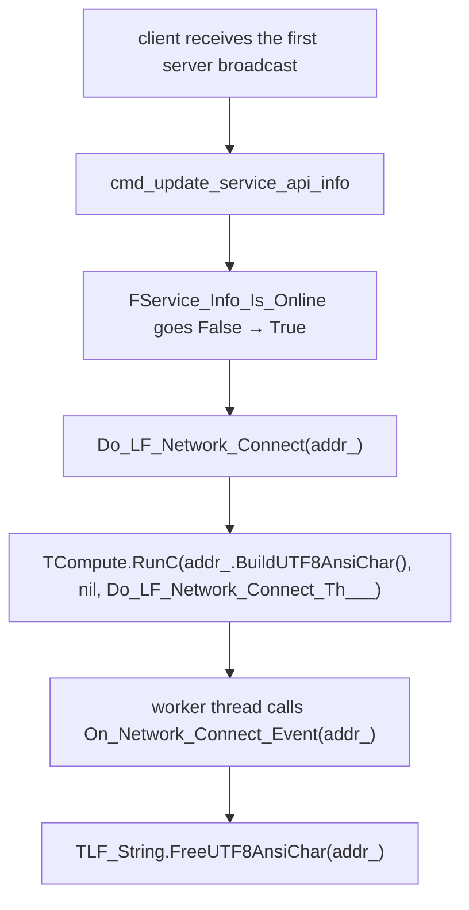

**Key points**:
- **Connect is not TCP connection establishment**: it means "the first server API broadcast has been received".
- **Disconnect means the physical link dropped**.
- **The callback runs on a TCompute worker thread**.
- **`addr_` becomes invalid as soon as the callback returns**.

#### 13.3.2 Usage pattern

```pascal
procedure OnConnect(addr: PAnsiChar); cdecl;
var s: string;
begin
  s := UTF8ToString(addr);   // copy immediately
  TThread.Queue(nil,
    procedure
    begin
      Memo1.Lines.Add('Connected: ' + s);   // UI work on the main thread
    end);
end;

procedure OnDisconnect(addr: PAnsiChar); cdecl;
begin
  TThread.Queue(nil,
    procedure
    begin
      Memo1.Lines.Add('Disconnected');
    end);
end;

LF_Set_Network_Event(@OnConnect, @OnDisconnect);

// uninstall (optional, before LF_Shutdown)
LF_Set_Network_Event(nil, nil);
```

#### 13.3.3 Network events per language

| Language | Registration | Notes |
|------|------|---------|
| Pascal | `LF_Set_Network_Event(@OnConnect, @OnDisconnect)` | Copy `addr` immediately |
| Python | `lf.set_network_event(on_connect, on_disconnect)` | Callback runs on a worker thread |
| C++ | `lingofuse::setNetworkEvent(onConnect, onDisconnect)` | Callback runs on a worker thread |
| C# | `NetworkEvents.Set(onConnect, onDisconnect)` | Callback runs on a worker thread |
| Rust | `framework::set_network_event(on_connect, on_disconnect)` | Callback runs on a worker thread |
| Go | `lingofuse.SetNetworkEvent(onConnect, onDisconnect)` | Callback runs on a goroutine |
| Java | `NetworkEvents.set(onConnect, onDisconnect)` | Callback runs on a worker thread |
| Node.js / TS | `network.setNetworkEvent(onConnect, onDisconnect)` | Callback runs on a worker thread |
| Erlang | `lingofuse:set_network_event(fun on_connect/1, fun on_disconnect/1)` | Callback runs on a NIF thread |

**Key point**: **`addr` (or its equivalent) becomes invalid in every language as soon as the callback returns**. **It must be copied immediately**.

---

## Chapter 14 Thread model and concurrency

### 14.1 Four kinds of threads

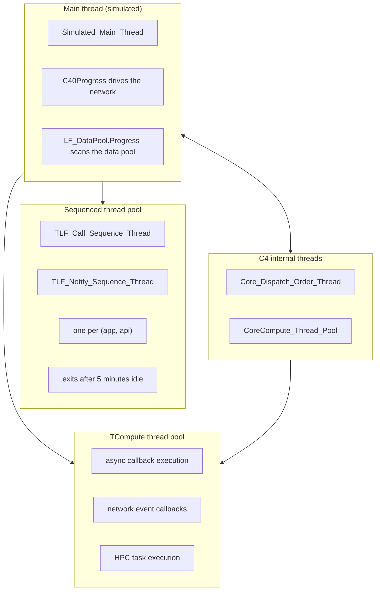

### 14.2 Responsibilities of each thread

| Thread | Responsibility | User can interact |
|------|------|:----------:|
| **Simulated main thread** | C4 progress, data pool scan | No (internal) |
| **TCompute thread pool** | async callbacks, network events, HPC | **Inside a callback**, yes |
| **Sequenced thread pool** | FIFO-serialized calls / notifications | **Inside a callback**, yes |
| **C4 internal threads** | network send/receive | No |

### 14.3 Thread-safety matrix

| Component | Thread safety |
|------|:--------:|
| All exported functions (except the status log) | ✅ Fully thread-safe |
| Concurrent writes to the same data handle | ❌ Needs external synchronization |
| Global variables inside callbacks | ❌ Needs external synchronization |
| `LF_DataPool.Progress` | ✅ Internally locked |
| `LF_SyncTool` | ✅ Internally uses a critical section |
| The `addr_` of a network event callback | ❌ Invalid after the callback returns |

### 14.4 Which thread runs which callback

| Callback type | Executing thread |
|---------|---------|
| `On_Call` (Call mode) | Main thread / sequenced thread |
| `On_Notify` (Notify mode) | Main thread / sequenced thread |
| `LF_Async_Call.OnResult` | TCompute worker thread |
| `LF_Async_Sequenced_Call.OnResult` | TCompute worker thread / sequenced thread |
| `LF_UID_Async_*.OnResult` | TCompute worker thread |
| `LF_P2PNAME_Async_*.OnResult` | TCompute worker thread |
| `LF_Set_Network_Event.On_Connect` | TCompute worker thread |
| `LF_Set_Network_Event.On_Disconnect` | TCompute worker thread |
| `RegisterSyncCall_M` / `RegisterSyncNotify_M` | Main thread (needs `LF_Sync` driving) |

### 14.5 Thread-safety best practices

1. **Across threads, call only `LF_*` functions**: fully thread-safe.
2. **Lock writes to the same handle**: read/write positions are not atomic operations.
3. **Do not block or call `LF_Call` inside a callback**: you will self-deadlock.
4. **Marshal UI work to the main thread**: `TThread.Queue` / `Synchronize`.
5. **Keep strong references to managed-language callbacks**: otherwise GC collects them.
6. **Copy `addr_` from network events immediately**: it is invalid after the callback returns.
7. **An async callback's handle must be fully handled inside the callback**: keeping it across threads is forbidden.

### 14.6 Handle lifetime of async callbacks

#### 14.6.1 Timing comparison: synchronous family vs asynchronous family

**Synchronous family (`LF_Call`)**:

```mermaid
sequenceDiagram
    participant Caller as caller thread
    participant Core as LingoFuse core
    participant Worker as worker/main thread

    Caller->>Core: LF_Call(app, hnd, timeout)
    Core->>Worker: execute the API
    Worker-->>Core: result
    Core->>Core: New_Result_From(..., True)
    Core-->>Caller: return handle
    Note over Caller: ★ the handle belongs to the caller; readable at any time
    Caller->>Core: LF_SetPos / read
    Caller->>Core: LF_FreeData
```

**Asynchronous family (`LF_Async_Call`)**:

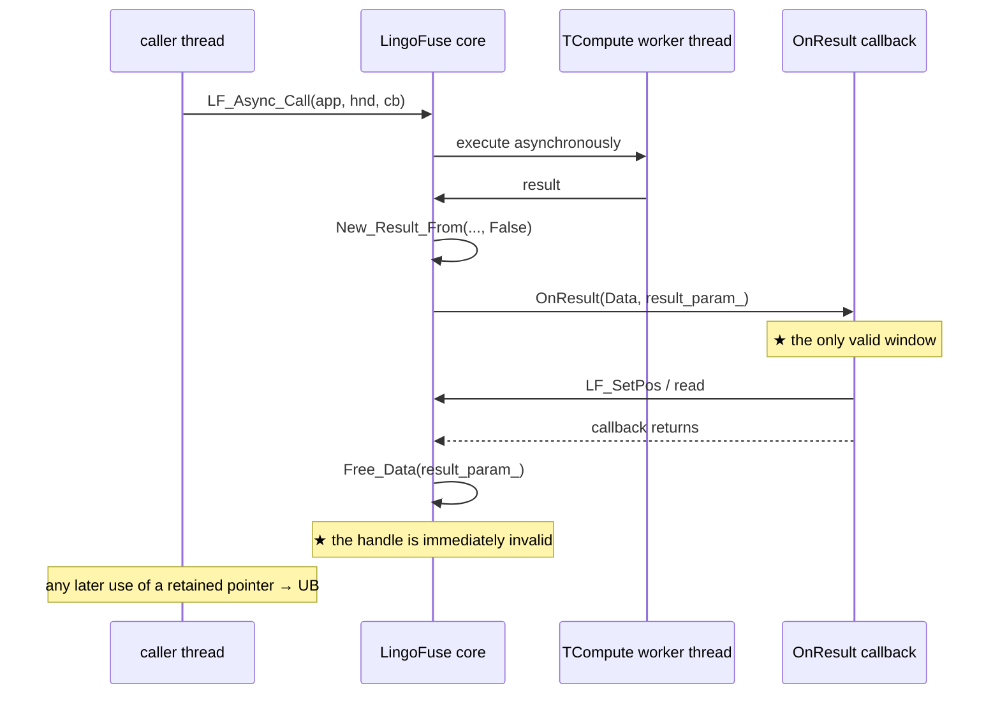

#### 14.6.2 Coupling with the thread model

**Lifetime of an asynchronous-family handle**:

- **Start**: `New_Result_From(..., False)` inside `TLF_Async_Call_Bridge.Do_Th`.
- **End**: `Free_Data(result_param_)` inside `TLF_Async_Call_Bridge.Do_Th`.
- **Both start and end happen inside the TCompute worker thread**, and **only the `OnResult` callback call lies in between**.
- **The caller thread has no visibility into this window at all** — it only receives a completion notification for a future (or equivalent), by which point the handle is already invalid.

**This is the fundamental pitfall of cross-language bindings**: from the caller thread's point of view, "the call finished" means "the result is available"; from the C side's point of view, "the call finished" means "the handle has already been released".

#### 14.6.3 Three safe strategies

| Strategy | How it works | When it applies |
|------|---------|---------|
| **A. Use the synchronous family** | Gateways/proxies/HTTP bridges that block anyway | The `LF_Call` family |
| **B. Copy inside the callback** | Copy the bytes out with `read_string_bytes` inside the async callback | The `LF_Async_Call` family |
| **C. High-level wrapper** | The binding layer's Future interface reads and copies inside the callback | All managed languages |

**Any approach that retains a raw handle outside the callback is wrong**.

#### 14.6.4 Comparison with auto-reclaimed handles

| Dimension | Auto-reclaimed handle | Async-family handle |
|------|----------------|---------------|
| `auto_recycle___` | `True` | `False` |
| Idle reclamation | 10 minutes + a 5-second scan | Not applicable (never enters the pool) |
| Release moment | `LF_FreeData` marks it + the pool scan | The instant the callback returns |
| Live window | Minutes | Microseconds to milliseconds |
| Protection | 3 layers (threshold + refresh + calling) | None |
| Retaining across threads | ⚠️ Needs an external lock | ❌ Forbidden |

**Orders of magnitude**: the "live window" of an auto-reclaimed handle is **minutes**; for an async-family handle it is **milliseconds**.

### 14.7 Thread model per language

| Language | Main thread | Callback thread | Async model |
|------|--------|---------|----------|
| Pascal | Simulated main thread | TCompute worker thread | `TThread.Queue` back to the main thread |
| Python | Simulated main thread | TCompute worker thread | `asyncio` event loop (`_Aio` variant) / Future (`_Async` variant) |
| C++ | Simulated main thread | TCompute worker thread | `std::promise` + `std::future` |
| C# | Simulated main thread | TCompute worker thread | `TaskCompletionSource` + `async/await` |
| Rust | Simulated main thread | TCompute worker thread | closure + `std::sync::mpsc` |
| Go | Simulated main thread | TCompute worker thread | channel + goroutine |
| Java | Simulated main thread | TCompute worker thread | callback style |
| Node.js / TS | Simulated main thread | TCompute worker thread | Promise / `async-await` |
| Erlang | Erlang main process | NIF thread | `receive` messages |
| Julia | Simulated main thread | TCompute worker thread | `Task` / `Threads.@spawn` |
| Zig | Simulated main thread | TCompute worker thread | `std.atomic` + polling |
| Swift | Simulated main thread | TCompute worker thread | `Task.detached` + `DispatchSemaphore` |
| Ruby | Simulated main thread | TCompute worker thread | Future |
| Fortran | Simulated main thread | TCompute worker thread | callback style (`c_funloc`) |
| Dart | Simulated main thread | TCompute worker thread | `Isolate.run` + `Completer` |
| R | Simulated main thread | TCompute worker thread | `future` package + `Job` queue |

### 14.8 Thread-model pitfalls

| Symptom | Root cause | Fix |
|------|------|------|
| Deadlock inside a callback | Calling `LF_Call` inside the callback | Submit asynchronously to a worker thread |
| UI crash | Touching the UI directly inside a callback | `TThread.Queue` / `Dispatcher.Invoke` / `MainActor.run` |
| The process does not exit | Worker threads have not ended | Explicit `shutdown` |
| The handle is invalid outside the async callback | A raw handle was retained | Copy the data inside the callback |
| Race in the sequenced thread | Creating/destroying Apps at high concurrency | Reduce the App creation rate |
| `LF_PrepareDone` returns 0 | It has already been called in this process | Restart the process |

---

## Chapter 15 Memory and lifetime management

### 15.1 Three-layer memory pool architecture

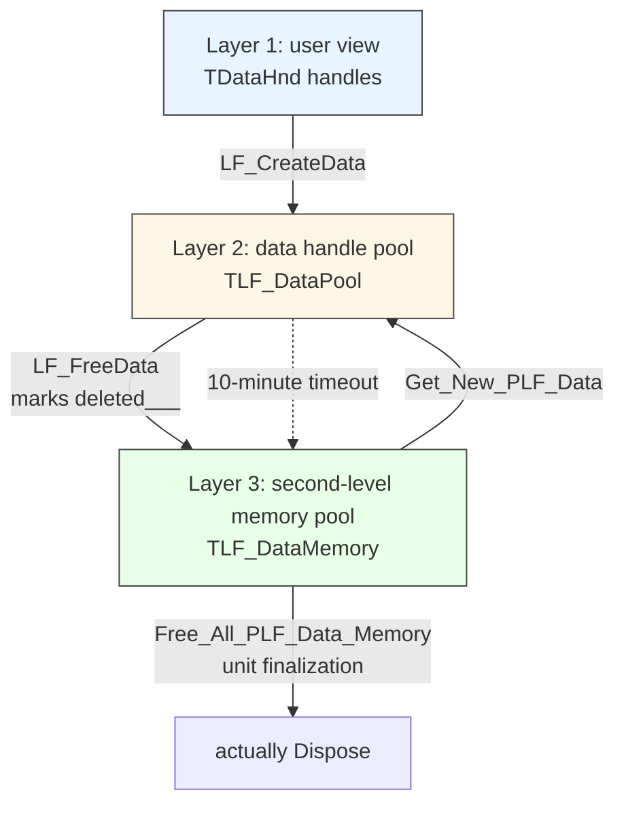

### 15.2 Responsibilities of each layer

| Layer | Name | Responsibility |
|:--:|------|------|
| 1 | User handle | The `TDataHnd` the user holds |
| 2 | Data handle pool | Tracks live handles; scans and reclaims idle/deleted ones |
| 3 | Second-level memory pool | Caches reclaimed `TLF_Data` records to reduce `New`/`Dispose` |

### 15.3 The three branches of `TLF_DataPool.Progress`

**It scans every 5 seconds**:

```pascal
for each handle in LF_DataPool:
  if handle.updated___ or handle.calling___ > 0 then
      handle.time___ := now;
      handle.updated___ := False;
  else if handle.deleted___ then
      add to the "user-released" list;
      mark for reclamation;
  else if now - handle.time___ > 10 minutes then
      add to the "timeout release" list;
      mark for reclamation;
```

**Key points**:
- **`updated___` or `calling___ > 0`**: refresh the timestamp.
- **`deleted___`**: released explicitly by the user.
- **Timeout**: idle for 10 minutes.
- **Release happens outside the pool**: avoids Dispose while holding the lock.

### 15.4 Exit and release of the sequenced thread

**Source** (end of `TLF_Call_Sequence_Thread.Do_Run_Th` in `Z.LingoFuse_Core.pas`):

```pascal
if (Internal_Queue_Data___ <> nil) and (Internal_Queue_Pool___ <> nil) then
  begin
    Internal_Queue_Pool___.Lock;
    try Internal_Queue_Pool___.Remove(Internal_Queue_Data___);
    finally Internal_Queue_Pool___.UnLock; end;
  end;
DelayFreeObj(1.0, self);   // ← 1 second (the v6.0 docs incorrectly say 5 seconds)
```

### 15.5 The `calling___` counter

**Purpose**: protect in-flight remote calls.

**Implementation**:
```pascal
procedure TLF_Data.Begin_Call;
begin
  calling___.UnLock(calling___.LockP^ + 1);
  updated___ := True;
end;

procedure TLF_Data.End_Call;
begin
  calling___.UnLock(calling___.LockP^ - 1);
  updated___ := True;
end;
```

**Key points**:
- **All `LF_Call` / `LF_LocalCall` / `LF_Notify` / `LF_Sequenced_Notify` call `Begin_Call` / `End_Call` internally and automatically**.
- **Users do not need to call them manually** (the C ABI layer does not expose them).

### 15.6 Semantics of `LF_CreateData_Permanent`

- **`auto_recycle___ = False`**: it is not added to `LF_DataPool`.
- **`LF_FreeData` releases it synchronously and immediately** (not a mark).
- **It is unaffected by the 10-minute timeout** (because it is never in the pool).
- **Creating one inside the initialization window leaks**: before `LF_PrepareDone` / after `LF_ExitMainThread`, `LF_FreeData` is a no-op.

### 15.7 Two-phase destruction of `LF_App`

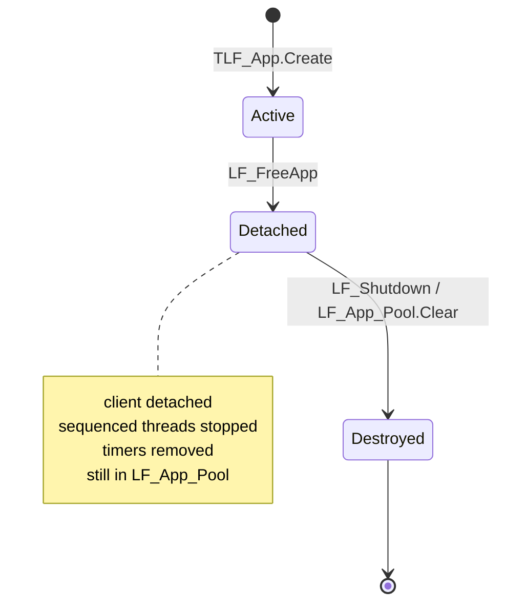

### 15.8 Memory leak troubleshooting checklist

| # | Leak source | How to check | Fix |
|:-:|--------|---------|------|
| 1 | Data handle never freed with `LF_FreeData` | Memory grows over a long run | Use `try..finally` |
| 2 | App handle never freed with `LF_FreeApp` | `LF_App_Pool` grows | Release in the documented cleanup order |
| 3 | `LF_CreateData_Permanent` never released | Search for them explicitly | Explicit `LF_FreeData` |
| 4 | The DLL never calls `LF_Shutdown` | Memory still held after the DLL unloads | Add an unload hook |
| 5 | Sequenced notification threads never exit | Check the TCompute thread count | They exit automatically after 5 minutes idle |
| 6 | Records in the second-level pool never released | Check the `LF_DataMemory` pool size | Released automatically at unit finalization |
| 7 | Callback closures capture large objects | Inspect the anonymous functions | Use weak references |
| 8 | Retaining a handle outside an async callback causes a double free | Check whether `LF_FreeData` is called on an async handle | Handle async handles only inside the callback |

### 15.9 Race in the sequenced thread

**Source** (end of `TLF_Notify_Sequence_Thread.Do_Run_Th` + `Kill_App`):

```pascal
// end of Do_Run_Th
if (Internal_Queue_Data___ <> nil) and (Internal_Queue_Pool___ <> nil) then
  begin
    Internal_Queue_Pool___.Lock;
    try Internal_Queue_Pool___.Remove(Internal_Queue_Data___);
    finally Internal_Queue_Pool___.UnLock; end;
  end;
DelayFreeObj(1.0, self);

// inside Kill_App
queue^.Data^.Data.Second.Critical.Lock;
try
  queue^.Data^.Data.Second.Internal_Queue_Pool___ := nil;   // ← races with the check above
  queue^.Data^.Data.Second.Internal_Queue_Data___ := nil;
finally queue^.Data^.Data.Second.Critical.UnLock; end;
```

**Race analysis**: `Do_Run_Th` checks `Internal_Queue_Pool___ <> nil` **without holding the lock**, while `Kill_App` may set it to nil just before that.

**Theoretical risk**: **a low-probability crash**.

**Mitigation**: make sure the sequenced thread has stopped before `LF_FreeApp`; avoid creating/destroying Apps frequently under high concurrency.

### 15.10 Memory management per language

| Language | Memory model | Notes |
|------|---------|---------|
| Pascal | Manual `New` / `Dispose` | Must call `LF_FreeData` |
| Python | Reference counting + GC | `DataHandle` needs an explicit `.dispose()` |
| C++ | RAII | The `DataHandle` destructor releases it |
| C# | GC | `IDisposable` + `using` |
| Rust | Ownership + borrow checking | `Drop` releases it |
| Go | GC | `defer` for deferred release |
| Java | GC | `try-with-resources` |
| Node.js / TS | GC | `dispose()` must be called explicitly |
| Erlang | Per-process GC | No explicit release; the garbage collector handles it |
| Julia | GC | `finalize` or automatic GC |
| Zig | Manual `defer` / `errdefer` | Must be released explicitly |
| Swift | ARC | Automatic reference counting |
| Ruby | GC | `dispose` or `ObjectSpace` |
| Fortran | Manual `deallocate` | Must be released explicitly |
| Dart | GC | Explicit `dispose()` |
| R | GC | `finalize` or automatic GC |

**Key reminder**: **`DataHandle` must still be released explicitly in every managed language (Python / C# / Go / Java / Node.js / TS / Julia / Swift / Ruby / Dart / R)** — the GC only reclaims memory, it does not call `LF_FreeData`. Forgetting to release exhausts the native-side handle pool.

---

## Chapter 16 Cross-language bindings and ABI contracts

### 16.1 The C ABI boundary

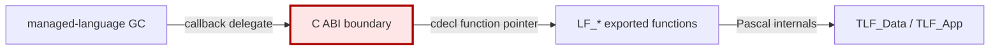

### 16.2 Universal rules

1. **Callbacks must be `cdecl`** (or the language's equivalent convention: `CFUNCTYPE` / `extern "C"` / `@convention(c)`).
2. **Managed-language callbacks must be kept as strong references**.
3. **Strings are UTF-8** (`PAnsiChar`).
4. **`TP2P_UID___` is a 32-byte array**.
5. **Returned pointers become invalid after 5 seconds** (`LF_GetOption` / `LF_Get_AppName` / `LF_Generate_AppName` / `LF_Get_P2P_Name` / `LF_Get_P2P_UID`).
6. **`LF_WriteString` always appends #0**, and `LF_ReadString` reads tolerantly.
7. **Sender identity is available automatically**, with no extra declaration; **it is valid only on the callback's Input parameter**.
8. **Handle ownership is inverted between the synchronous and asynchronous families**: the synchronous family belongs to the caller, the asynchronous family belongs to the framework (released as soon as the callback returns).

### 16.3 Per-language notes at a glance

| Language | Key points |
|------|--------|
| **C / C++** | `extern "C"`; `cdecl`; copy data inside async callbacks; MSVC requires `/utf-8` |
| **C# / .NET** | `CallingConvention.Cdecl`; strong references for callbacks; copy data inside async callbacks; the library must have no `Main` |
| **Python** | `CFUNCTYPE` (cdecl); strong references for callbacks (module-level variables); copy data inside async callbacks; the `@server.expose` decorator |
| **Java** | JDK 22+ FFM API; keep upcallStub as a strong reference; copy data inside async callbacks |
| **Rust** | `extern "C"`; panics must go through `catch_unwind`; copy data inside async callbacks |
| **Go** | `purego` or `cgo`; keep references to callbacks; copy data inside async callbacks; the service side needs `CGO_ENABLED=1` |
| **Swift** | Swift 5.9+; `@convention(c)`; copy data inside async callbacks |
| **Zig** | `@cImport`; `extern "C"`; copy data inside async callbacks |
| **Erlang** | A NIF crash takes down the BEAM; OTP 27+; copy data inside async callbacks; the loop must handle `lf_p2p_call` |
| **Ruby** | Fiddle or a C extension; DevKit; copy data inside async callbacks |
| **Fortran** | `iso_c_binding`; the compiler must match; copy data inside async callbacks |
| **Julia** | `--threads=2`; `ccall`; copy data inside async callbacks |
| **R** | Four-layer architecture + Job queue; copy data inside async callbacks; `future::plan("sequential")` |
| **Dart** | `DynamicLibrary.open`; unavailable on Flutter Web; copy data inside async callbacks; `BridgeHost.start()` must be the first line |
| **Node.js / TS** | `koffi` or Fiddle; copy data inside async callbacks; the `AsyncBridge` timer must not `unref` |
| **Pascal** | Native FFI; `cdecl`; `LF_LocalCall` injects no identity |

### 16.4 Cross-language P2PName sequence

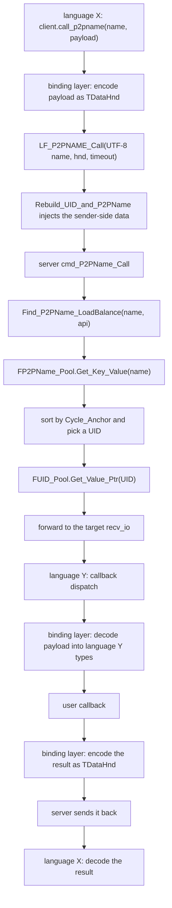

**Cross-language P2PName contract table**:

| Dimension | Contract |
|------|------|
| String encoding | UTF-8 + NUL terminator |
| Empty string | The server reports `no found p2pname:""` and sends no reply |
| Length limit | No explicit limit |
| Async hanging | If the server cannot find the group name, the callback never fires |
| Timeout mechanism | Implemented by the caller (the C ABI has no timeout parameter) |
| Callback thread | TCompute worker thread |
| Handle ownership | The synchronous family belongs to the caller, the asynchronous family to the framework |

### 16.5 Cross-language declarations for sender identification

```c
/* LF_Get_P2P_UID: returns a pointer (to a 32-byte UID); the framework releases it automatically via DelayFreeMem(5.0, ...) */
PP2P_UID___ LF_Get_P2P_UID(TDataHnd___ Hnd);

/* LF_Get_P2P_Name: returns a UTF-8 string pointer; released automatically after 5 seconds */
const char* LF_Get_P2P_Name(TDataHnd___ Hnd);
```

- `TP2P_UID___` is a 32-byte array; for cross-language use declare it as `uint8_t[32]`.
- `PP2P_UID___` is **a pointer to `TP2P_UID___`** (`uint8_t (*)[32]` or `uint8_t*`).
- **Where it may be used (must read)**:
  - **Only on the `Input` parameter of the callback that triggered the event**.
  - **It must not be called on a self-built handle (one created with `LF_CreateData`)**.
  - **It must not be called on an output handle (such as `Result_` in `OnResult`)**.
  - **It must not be called inside an `LF_LocalCall` / `LF_LocalNotify` callback**.

### 16.6 Cross-language declarations for async handles

```c
// prototype of an async callback (cdecl)
typedef void (*TLF_Async_Call_OnResult)(void* Data, TDataHnd___ Result_);
```

**Cross-language contract**:

- `Data` is an opaque pointer supplied by the caller; LingoFuse does not manage its lifetime.
- `Result_` is **a framework-owned handle**:
  - It becomes **invalid as soon as the callback returns**.
  - It is **forbidden** to call `LF_FreeData(Result_)` inside the callback.
  - All reads **must** be completed inside the callback (or the data copied out).

### 16.7 The ABI wire format (one contract shared by all languages)

This is the core contract of the `code_decl_to_abi` toolchain:

**Request payload**:
```
[business param 1][business param 2]...[business param N]
```

Each parameter is encoded by type (little-endian, NUL-terminated strings).

**Response payload**:
```
[status:u8][result]
```

- `status == 0x00`: `result` is encoded according to the return type
- `status == 0xFF`: `result` is a UTF-8 error message (NUL-terminated)

**This protocol is identical across cpp / rust / go / pascal / python / csharp / java / nodejs / typescript / erlang / julia / zig / swift / ruby / fortran / dart / r**, which is why cross-language calls work.

**Type mapping table**:

| ABI type | Bytes | Encoding |
|----------|:------:|------|
| `shortint` | 1 | Two's complement |
| `smallint` | 2 | Two's complement, little-endian |
| `integer` / `longint` | 4 | Two's complement, little-endian |
| `int64` | 8 | Two's complement, little-endian |
| `byte` | 1 | Unsigned |
| `word` | 2 | Unsigned, little-endian |
| `cardinal` / `dword` / `longword` | 4 | Unsigned, little-endian |
| `uint64` | 8 | Unsigned, little-endian |
| `double` / `extended` / `real` | 8 | IEEE 754 double precision, little-endian |
| `single` | 4 | IEEE 754 single precision, little-endian |
| `string` (parameter) | Variable | UTF-8 + `0x00` terminator |
| `string` (return) | Variable | UTF-8 + `0x00` terminator |
| `void` (return) | 0 | Only the status byte `0x00` |

### 16.8 What multi-language bindings have in common

**What all 17 native FFI bindings share**:

1. **They all wrap the C ABI**: Pascal / Python / C++ / C# / Rust / Go / Java / Node.js / TS / Erlang / Julia / Zig / Swift / Ruby / Fortran / Dart / R are all wrappers around the C ABI.
2. **They all provide `DataHandle` / `AppHandle` types**: the names may differ, the semantics are identical.
3. **They all support the three addressing modes**: App name / UID / P2PName.
4. **They all support synchronous and asynchronous calls**: different forms, identical semantics.
5. **They all expose sender identity**: read UID / P2PName from the callback Input.
6. **They all have `register_call` / `register_notify`**: different forms, identical semantics.
7. **They are all constrained by the cleanup order `LF_ExitMainThread` → `LF_FreeApp` → `LF_Shutdown`**.

**PHP is the 18th first-party binding, but it goes through `bridge.py`, not native FFI**.

### 16.9 Where multi-language bindings differ

| Dimension | Differences |
|------|------|
| **Initialization** | Pascal / C++ / Zig need `LF_LoadLibrary`; Python / C# / Java are automatic or semi-automatic |
| **Async model** | Python `asyncio`; C++ `std::future`; C# `Task`; Rust closures; Go channels; Java callbacks; Node.js Promise; Erlang `receive`; Julia `Task`; Swift `async/await`; Dart `Future`; R `future` package |
| **Handle release** | Pascal manual; C++ RAII; C# `IDisposable`; Rust `Drop`; Go `defer`; Java `try-with-resources`; Node.js `dispose()`; Julia GC |
| **Thread model** | Each language's native threads / coroutines / processes |
| **Platform support** | Limited by the native LingoFuse library |
| **Known limitations** | Java needs JDK 22+; Julia needs `--threads=2`; Erlang needs OTP 27+; Zig is pinned to 0.17.0 |

---

## Chapter 17 Cleanup and shutdown

### 17.1 The hard-constrained cleanup order

```
LF_ExitMainThread    →    LF_FreeApp    →    LF_Shutdown
```

**Why this order**:

1. **`LF_ExitMainThread`**: stops the simulated main thread, triggers `C40Clean`, stops the sequenced thread pools, and releases all data handles.
2. **`LF_FreeApp`**: detaches all `TC40_LF_Client` `app` references, stops sequenced threads, and removes timers through `FakeFree`.
3. **`LF_Shutdown`**: clears `LF_App_Pool` (really releasing the Apps), releases all data handles, and unloads the IPC library.

**Consequence of the wrong order**:

```pascal
// ❌ wrong: Shutdown before FreeApp
LF_Shutdown;
LF_FreeApp(App);   // App was already released during Shutdown → UAF
```

### 17.2 The complete steps of `LF_Shutdown`

1. **Clear the network event callbacks**: `On_Network_Connect_Event := nil` / `On_Network_Disconnect_Event := nil`.
2. **Stop all serialized notification threads**.
3. **Release all remaining data handles**: `LF_DataPool.Free_All_Hnd`.
4. **Exit the simulated main thread**: `LF_ExitMainThread`.
5. **Clear the global App pool**: `LF_App_Pool.Clear`.
6. **Unload the IPC library**: `UnloadIPCLibrary`.
7. **Shut down the core dispatch thread**: `if IsLibrary then Close_Core_Dispatch_Thread`.

**Idempotence**: repeated `LF_Shutdown` calls should be idempotent. Every internal step has a precondition check (skip empty pools, skip inactive state).

### 17.3 Re-initializing after `LF_Shutdown`

```pascal
LF_Shutdown;
LF_ResetPrepare;             // clear the preparation queue
LF_PrepareService(...);
LF_PrepareClient(...);
if LF_PrepareDone = 1 then   // start again
  ...
```

**Key point**: `LF_Shutdown` resets `Simulated_Main_Thread_Running`, so `LF_PrepareDone` can succeed again.

### 17.4 The DLL scenario

**`LF_Shutdown` must be called explicitly**:

```pascal
// in a DLL export function
procedure DllUnload; stdcall;
begin
  LF_Shutdown;   // must be called explicitly
end;
```

**Reason**: a DLL may be unloaded early by the host process, in which case LingoFuse's `finalization` may never run.

### 17.5 Cleanup order per language

| Language | Shutdown order | Extra notes |
|------|----------|--------------|
| Pascal | `LF_ExitMainThread` → `LF_FreeApp` → `LF_Shutdown` | The order must not be reversed |
| Python | `LF_ExitMainThread` → `app.free()` → `LF_Shutdown` | In a `finally` block |
| C++ | `exitMainThread` → App destructor → `shutdown` | `LF_FreeLibrary` in the `LibraryLoader` destructor |
| C# | `NetworkEvents.Clear` → `ExitMainThread` → `app.Dispose` → `Shutdown` | The order must not be reversed |
| Rust | `AppHandle::drop` → `framework::shutdown` | The Drop order follows variable declaration order |
| Go | `ExitMainThread` → `app.Close()` → `Shutdown` | `defer` unwinds in reverse |
| Java | `NetworkEvents.clear` → `ExitMainThread` → `app.close()` → `Shutdown` → `AsyncBridge.shutdownInstance` | `AsyncBridge` last |
| Node.js | `AsyncBridge.shutdownInstance` → `network.clearNetworkEvent` → `exitMainThread` → `app.dispose()` → `shutdown` | `AsyncBridge` must be first |
| TypeScript | Same as Node.js | — |
| Erlang | `exit_main_thread` → `free_app` → `shutdown` | — |
| Julia | `stop_callback_consumer()` → `exit_main_thread` → `dispose!(app)` → `shutdown` | Stop the consumer first |
| Zig | `exitMainThread` → `app.deinit()` → `shutdown` | — |
| Swift | `NetworkEvents.clearNetworkEvent` → `ExitMainThread` → `app.dispose()` → `Shutdown` → `LF_FreeLibrary` | Release the library last |
| Ruby | `LingoFuse::NativeBridge.stop` → `Framework.exit_main_thread` → `Framework.shutdown` → `Native.free_library` | `NativeBridge.stop` must be first |
| Fortran | `lf_exit_main_thread` → `lf_app_destroy` → `lf_shutdown` | — |
| Dart | `app.dispose()` → `Framework.exitMainThread()` → `Framework.shutdown()` → `BridgeHost.instance.stop()` | `BridgeHost.stop` last |
| R | `lf_exit_main_thread` → `lf_free_app` → `lf_shutdown` | Trigger through a sentinel file instead of Ctrl+C |

### 17.6 Cleanup pitfalls

| Symptom | Root cause | Fix |
|------|------|------|
| Crash on shutdown | Wrong order | Follow `ExitMainThread → FreeApp → Shutdown` |
| The process does not exit | Threads have not ended | Explicit `shutdown` + `process.exit` |
| `$C0000005` Access Violation | The dispatcher thread runs after the DLL is unloaded | Stop the dispatcher first, then unload the DLL |
| Crash on double release | `LF_FreeData` called twice | Use RAII / an idempotent `dispose` |
| Crash calling `LF_*` after `LF_Shutdown` | Already shut down | Re-initialize |
| `LF_PrepareDone` returns 0 | It has already been called in this process | Restart the process |

---

# Part V P2P and distribution

## Chapter 18 P2P distributed load

### 18.1 The core judgement: one-to-many is already distributed

> **Whenever a "one-to-many" relationship exists, you can distribute.**
>
> - One App name registered by several programs;
> - One P2PName registered by several programs;
> - One caller connecting to several servers;
> - One API name exposed by several workers.

LingoFuse's C4 mesh forms a candidate pool automatically and picks a target by policy.

### 18.2 The three load granularities

| Granularity | Routing key | Selection | Local priority |
|------|--------|---------|:--------:|
| Application level | App name | Multiple client candidates, least recently used | ✅ |
| Group level | P2PName | Server-side in-group load balancing / stickiness | ❌ |
| Session level | UID | Targeted, no load balancing | ✅ (local UID first) |

### 18.3 One App name registered by several programs

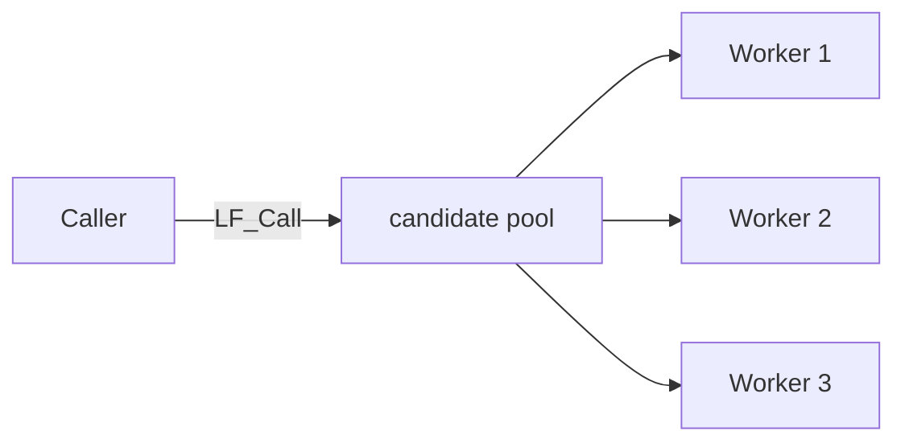

**Rules**:
- App-name routing is **local-first**.
- Only when there is no App with that name locally does it use remote candidates.
- Among several candidates it balances by "least recently used".
- The broadcast cache lags by about 3 seconds.
- Do not use the same App name for a "local vs remote" test inside one process.

### 18.4 One P2PName registered by several programs

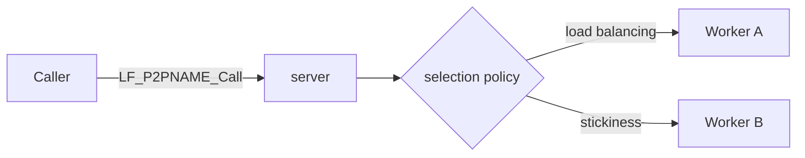

**Rules**:
- P2PName routing is **not local-first**; it always hands over to the server / mesh.
- The server maintains a "group name to UID list" mapping.
- By default it balances load through `Cycle_Anchor`.
- `Fixed_Sequenced_Time` defaults to 20 seconds and provides stickiness.
- Suits stateless workers, compute nodes, codec nodes and GPU nodes.

### 18.5 Your program connecting to several servers

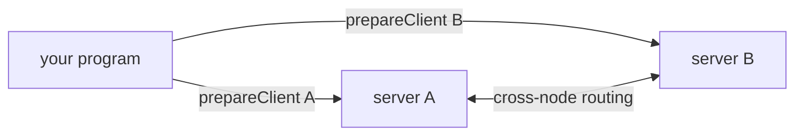

**Conditions and boundaries**:
- Your program can `prepareClient` several server addresses.
- **Precondition**: the servers have established physical connections to each other over the C4 protocol (`Client` / `Auto` connections), **forming a C4 mesh**.
- **If the servers do not interconnect**, they are **islands** and will not balance load across servers automatically.
- **Extra configuration**: none is needed for broadcast/routing; as long as the servers are connected through the C4 mesh, cross-node routing works automatically.
- **Mechanism**: each C4 server queries other servers' service information through the `QueryInfo` command, and the distribution service collects and broadcasts it.

### 18.6 The Sequenced family and high-throughput computing

**LingoFuse's Sequenced family**:
- `LF_Sequenced_Notify`
- `LF_Sequenced_Call`
- `LF_Async_Sequenced_Call`
- The Sequenced variants for UID / P2PName

**Guarantees**:
- FIFO within the same `(App, API)` pair;
- FIFO within the same `(UID, API)`;
- FIFO within the same `(P2PName, API)` pair, although it may be dispatched to different UIDs;
- Different keys may run concurrently.

**Why it fits Matlab / R / Julia / video / audio so naturally**:

| Scenario | Data shape | Benefit of sequencing |
|------|---------|---------------|
| Matlab computing | matrices, arrays, simulation iterations | every iteration is FIFO, results return in order |
| R statistics | data frames, batch processing | stable batch order, no out-of-order contamination |
| Julia high concurrency | task chunks, GPU batches | FIFO within an API, concurrency across APIs |
| Video streams | frame sequences, GOPs | frame order preserved, per-frame processing and feedback |
| Audio streams | PCM / Opus chunks | stable chunk order, low-latency feedback |
| Large data streams | chunked binary | binary handles, less encoding overhead |

### 18.7 Why it is almost automatic and efficient

- **Automatic discovery**: register an API, the server broadcasts it, callers cache candidates.
- **Automatic load**: multiple registrations of an App name / P2PName automatically pick a target.
- **Automatic ordering**: the Sequenced family is FIFO per routing key.
- **Automatic handle pool**: DataHandles are created, pooled and reclaimed.
- **Automatic async**: `LF_Async_*` + Future, with results copied inside the callback.
- **Efficient binary**: handles can carry raw bytes, saving one encoding pass for video/audio/matrices.
- **Zero-copy mapping**: `Param.Mapping` can map the decoded data without copying.
- **Unified across languages**: the C ABI lets Matlab / R / Julia / Python / C++ all connect.

### 18.8 P2P distributed load best practices

1. **Read UID only from the callback's `Input`.**
2. **Copy immediately once you have the pointer.**
3. **A UID is a valid communication identifier until the connection drops.** Run `whoami` again after reconnecting.
4. **To distribute, create a one-to-many relationship.**
5. **Use P2PName for homogeneous workers.** Do not use App names for multicast.
6. **Use Sequenced when ordering matters.**
7. **Use binary handles for high throughput.**
8. **With several servers, confirm they support cross-node routing.**
9. **Do not call synchronous `LF_Call` / `LF_Notify` / `LF_LocalCall` inside a callback.**
10. **Async handles belong to the framework and are released as soon as the callback returns.**

### 18.9 P2P usage per language

| Language | Set P2PName | Call by P2PName | Load-balancing policy |
|------|-------------|-------------|-------------|
| Pascal | `LF.Set_Opt_P2P_Name('group')` | `LF_P2PNAME_Call('group', ...)` | `Cycle_Anchor` |
| Python | `lf.set_opt_p2p_name('group')` | `lf.p2pname_call('group', ...)` | `Cycle_Anchor` |
| C++ | `lingofuse::setOption("LF_P2P_name", "group")` | `lingofuse::callByP2PName("group", ...)` | `Cycle_Anchor` |
| C# | `Options.SetP2PName("group")` | `Framework.CallByP2PName("group", ...)` | `Cycle_Anchor` |
| Rust | `framework::set_option("LF_P2P_name", "group")` | `framework::call_by_p2p_name("group", ...)` | `Cycle_Anchor` |
| Go | `lingofuse.SetOption("LF_P2P_name", "group")` | `lingofuse.CallByP2PName("group", ...)` | `Cycle_Anchor` |
| Java | `Options.setP2pName("group")` | `Framework.callByP2PName("group", ...)` | `Cycle_Anchor` |
| Node.js / TS | `framework.setOption("LF_P2P_name", "group")` | `framework.callByP2PName("group", ...)` | `Cycle_Anchor` |
| Erlang | `lingofuse:set_option(<<"LF_P2P_name">>, <<"group">>)` | `lingofuse:p2p_call(<<"group">>, ...)` | `Cycle_Anchor` |
| Julia | `set_option("LF_P2P_name", "group")` | `p2pname_call("group", ...)` | `Cycle_Anchor` |
| Zig | `lf.options.setP2PName("group")` | `lf.p2pNameCall("group", ...)` | `Cycle_Anchor` |
| Swift | `Options.setP2PName("group")` | `Framework.callByP2PName("group", ...)` | `Cycle_Anchor` |
| Ruby | `LingoFuse::Options.set_opt_p2p_name("group")` | `LingoFuse::Framework.p2pname_call("group", ...)` | `Cycle_Anchor` |
| Fortran | `lf_set_opt_p2p_name("group")` | `lf_p2pname_call("group", ...)` | `Cycle_Anchor` |
| Dart | `Framework.setOptP2PName("group")` | `Framework.p2pnameCall("group", ...)` | `Cycle_Anchor` |
| R | `lingofuse::lf_set_opt_p2p_name("group")` | `lingofuse::lf_p2pname_call("group", ...)` | `Cycle_Anchor` |

---

## Chapter 19 Routing optimizations: local short-circuit and server-local handling

### 19.1 Local short-circuit (the target is local, so the network is skipped)

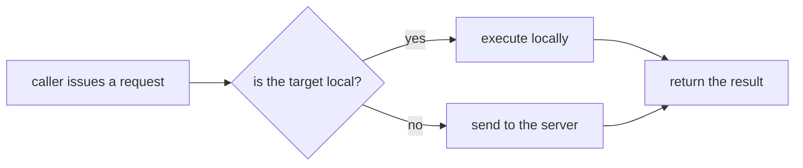

**Explanation**:
- If the caller's own process already has the function behind the target App / UID / P2PName, LingoFuse **executes it locally first**, without going over the network.
- This removes a network round trip and lowers latency.
- Note: **App-name routing is local-first by default; UID routing is also local-first; P2PName routing is not local-first**.

**Source evidence**:

```pascal
// the first step of the client's Send_Execute_Notify
tmp_cli__ := Find_Local_API(app_Name__, api_Name__, True);
if tmp_cli__ <> nil then
  begin
    tmp_cli__.APP.Engine.Execute_Notify(tmp_param);   // execute directly locally
    exit;
  end;
```

### 19.2 Server-local handling (the request reaches the server, which can handle it itself)

```mermaid
flowchart LR
    A[request reaches the server] --> B{can the server handle it locally?}
    B -->|yes| C[the server executes locally]
    B -->|no| D[forward to the target client]
    C --> E[return the result]
    D --> E
```

**Explanation**:
- When a request passes through the server, the server first checks whether its own process has the matching App / API.
- If it does, the server **handles it locally** and does not forward it to any other client.
- This avoids unnecessary network forwarding and improves overall efficiency.
- **This optimization applies to App-name, UID and P2PName routing alike**.

**Source evidence**:

```pascal
// the first step of the server's cmd_Call
tmp_cli__ := Find_Local_API(app_Name__, api_Name__, True);
if tmp_cli__ <> nil then
  begin
    // the server handles it locally, no forwarding
    RunHPC_CompleteBuffer_StreamM(Sender, nil, tmp_cli__, InData, OutData, Run_Call_Worker);
    exit;
  end;
// only otherwise is it broadcast to the other clients
```

### 19.3 The combined two-level optimization

```mermaid
flowchart TB
    A[caller] --> B{can it be handled locally?}
    B -->|yes| C[execute locally]
    B -->|no| D[send to the server]
    D --> E{can the server handle it locally?}
    E -->|yes| F[the server executes locally]
    E -->|no| G[forward to the target client]
    C --> H[return the result]
    F --> H
    G --> H
```

### 19.4 Surprises with the local short-circuit

**Problem**: in multi-node tests, `LF_Call` may in fact execute locally, contrary to expectation.

**Cause**: C4 routing looks for a local App instance first.

**Fix**:
- Determine explicitly whether the current process has an App with the same name registered.
- When a remote call is required, avoid a local App with the same name.
- Or use different App names to separate local from remote.

**Related pitfall**: `LF-ROUTE-001`.

### 19.5 Impact of server-local handling

**Problem**: when the server process itself has an App with the same name registered, a request may not be forwarded to other clients.

**Cause**: the server process handles requests it can handle locally first.

**Fix**:
- Decide explicitly whether the server process should register business Apps.
- A server is usually only a beacon and registers no business Apps.
- If the server does register one, make its handling capability explicit.

**Related pitfall**: `LF-ROUTE-009`.

---

# Part VI In-depth look at the multi-language bindings

## Chapter 20 The eighteen bindings, one by one

### 20.1 The Pascal binding

**Positioning**: native FFI, the source of the core engine. **The reference implementation of every mechanism**.

**Entry modules**:
- `lingofuse_import.pas`: the C ABI declarations.
- `lingofuse_helper.pas`: helper wrappers (`TDataHandle` and friends).

**Initialization**:
```pascal
LF_LoadLibrary;
LF_SetOptionEx('Quiet', 'True');
LF_ResetPrepare;
LF_PrepareServiceEx('ipc:my_app', 'ipc:my_app');
App := LF_CreateAppEx('MyApp', 'My App');
LF_RegisterCallEx(App, 'api_name', 'description', nil, @Callback);
LF_PrepareClientEx('ipc:my_app', App);
if LF_PrepareDone <> 1 then Halt(1);
```

**Callback**:
```pascal
procedure MyCallback(Trigger: Pointer; Input, Output: TDataHnd); cdecl;
begin
  // read parameters
  // process
  // write the result
end;
```

**Pitfalls specific to this binding**:
- `LF_LocalCall` injects no identity (`LF-LOCAL-001`).
- A P2PName async Call hangs forever when the group name cannot be found (`LF-ROUTE-012`).
- Callbacks must be `cdecl` (`LF-APP-001`).
- A sequenced thread is released 1 second after it exits (not 5 seconds, `LF-SEQ-003`).

### 20.2 The Python binding

**Positioning**: works right after `pip install -e .`, with an `@expose` decorator and an HTTP gateway.

**Entry modules**:
- `lingofuse/_lf_native.py`: the C ABI bindings.
- `lingofuse/lf_io.py`: I/O helpers.
- `lingofuse/async_support.py`: async support.

**Initialization**:
```python
from lingofuse._lf_native import (
    LF_ResetPrepare, LF_PrepareService, LF_PrepareClient, LF_PrepareDone,
    LF_CreateApp, LF_RegisterCall, LF_RegisterNotify,
    LF_ExitMainThread, LF_Shutdown,
)
from lingofuse.lf_io import cstr

LF_SetOptionEx("Quiet", "True")
LF_ResetPrepare()
LF_PrepareService(cstr("ipc:my_app"), cstr("ipc:my_app"))
app = LF_CreateApp(cstr("MyApp"), cstr("My App"))
LF_RegisterCall(app, cstr("api"), cstr("desc"), None, callback)
LF_PrepareClient(cstr("ipc:my_app"), app)
if LF_PrepareDone() != 1: raise SystemExit(1)
```

**Callback**:
```python
@server.expose("api_name")
def callback(trigger, inp, out):
    # read parameters
    # process
    # write the result
```

**Pitfalls specific to this binding**:
- Synchronous-family handles belong to the caller and asynchronous-family handles to the framework (released as soon as the callback returns) — mixing them causes occasional use-after-free.
- Every async callback **must complete all of its work inside the callback**.
- The `_Aio` variant must be awaited inside `asyncio.run()`.
- The `_Async` variant returns a `CallFuture` that supports `.result(timeout=)`.

### 20.3 The C++ binding

**Positioning**: the only binding with GitHub CI, zero-overhead native C ABI, async model + side-data reading.

**Entry modules**:
- `LingoFuse.hpp`: the C++ wrapper.
- `lf_io.hpp`: I/O helpers.
- `LingoFuse.c`: the C ABI dynamic loader.

**Initialization**:
```cpp
#include "LingoFuse.hpp"
int main() {
    lingofuse::LibraryLoader loader;
    lingofuse::setOption("Quiet", "True");
    lingofuse::resetPrepare();
    lingofuse::prepareService("ipc:my_app", "ipc:my_app");

    lingofuse::App app("MyApp", "My App");
    app.registerCall("api", "desc", nullptr, callback);

    lingofuse::prepareClient("ipc:my_app", app.get());
    if (lingofuse::prepareDone() != 1) return 1;
    // ...
    lingofuse::exitMainThread();
    lingofuse::shutdown();
}
```

**Callback**:
```cpp
static void LF_CDECL callback(void*, void* in, void* out) {
    lingofuse::DataHandle inp(static_cast<TDataHnd>(in), false);
    lingofuse::DataHandle out_h(static_cast<TDataHnd>(out), false);
    // read parameters
    // process
    // write the result
}
```

**Pitfalls specific to this binding**:
- `LF_LoadLibrary()` must be called first; it returns 1 on success.
- MSVC requires `/utf-8`.
- `EABI_RemoteError` is the exception type for a failed synchronous call.
- `AsyncResult` carries `err` (`std::optional<std::string>`) and `value` (`DataHandle`).

### 20.4 The C# binding

**Positioning**: P/Invoke + RAII + unified JSON I/O + `CallbackDispatcher` + callback-style async.

**Entry modules**:
- The `LingoFuse` namespace: `Framework` / `AppHandle` / `DataHandle` / `P2PUid` / `Async` / `NetworkEvents` / `Options` / `AsyncBridge`.
- `DllImportResolver`: picks the platform library automatically.

**Initialization**:
```csharp
using LingoFuse;

Framework.SetOption("Quiet", "True");
Framework.ResetPrepare();
Framework.PrepareService("ipc:my_app", "ipc:my_app");

using var app = new AppHandle("MyApp", "My App");
app.RegisterCall("api", "desc", callback);

Framework.PrepareClient("ipc:my_app", app);
if (Framework.PrepareDone() != 1) return;
```

**Callback**:
```csharp
static void Callback(IntPtr trigger, IntPtr input, IntPtr output) {
    var inH = new DataHandle(input, false);
    var outH = new DataHandle(output, false);
    // read parameters
    // process
    // write the result
}
```

**Pitfalls specific to this binding**:
- The generated library must have **no `Main`** (`CS0017`).
- Async callbacks must use `TaskCompletionSource` + `RunContinuationsAsynchronously`.
- `P2PUid` wraps the 32-byte UID.
- `DllImportResolver` picks the DLL per platform automatically.

### 20.5 The Rust binding

**Positioning**: closure-based async; `call_async_wait` returns `Vec<u8>`.

**Entry crate**:
- The `lingofuse` crate: `framework` / `AppHandle` / `DataHandle` / `Uid` / `p2p` / `options` / `error`.

**Initialization**:
```rust
use lingofuse::{framework, AppHandle};

framework::set_option("Quiet", "True")?;
framework::reset_prepare();
framework::prepare_service("ipc:my_app", "ipc:my_app")?;

let app = AppHandle::new("MyApp", "My App")?;
app.register_call("api", "desc", callback)?;

framework::prepare_client("ipc:my_app", Some(&app))?;
if !framework::prepare_done()? { return Err("failed".into()); }
```

**Callback**:
```rust
fn callback(_trigger: *mut c_void, input: *mut c_void, output: *mut c_void) {
    let input = unsafe { &mut *(input as *mut DataHandle) };
    let output = unsafe { &mut *(output as *mut DataHandle) };
    // read parameters
    // process
    // write the result
}
```

**Pitfalls specific to this binding**:
- Panics must go through `catch_unwind`.
- `ABI_TARGET_APP` / `ABI_TIMEOUT` are `RwLock<&'static str>` / `AtomicU64`.
- Async callback signature: `FnOnce(Result<T, Error>) + Send + 'static`.
- `Error` wraps an `ErrorCode` enum.

### 20.6 The Go binding

**Positioning**: purego without cgo, friendly to cross-compilation; a deadlock watchdog compensates for runtime misjudgement.

**Entry modules**:
- `github.com/PassByYou888/LingoFuse/go/lingofuse`: the main package.
- `github.com/PassByYou888/LingoFuse/go/sys`: system calls.

**Initialization**:
```go
package main

import (
    "github.com/PassByYou888/LingoFuse/go/lingofuse"
    "github.com/PassByYou888/LingoFuse/go/sys"
)

func main() {
    sys.LoadLibrary()
    defer sys.FreeLibrary()

    lingofuse.SetOption("Quiet", "True")
    lingofuse.ResetPrepare()
    lingofuse.PrepareService("ipc:my_app", "ipc:my_app")

    app, _ := lingofuse.NewAppHandle("MyApp", "My App")
    defer app.Close()
    app.RegisterCall("api", "desc", callback)

    lingofuse.PrepareClient("ipc:my_app", app)
    lingofuse.PrepareDone()

    lingofuse.ExitMainThread()
    lingofuse.Shutdown()
}
```

**Callback**:
```go
func callback(inp, out *lingofuse.DataHandle) {
    // read parameters
    // process
    // write the result
}
```

**Pitfalls specific to this binding**:
- `sys.LoadLibrary()` must be called first.
- `CGO_ENABLED=1` (on the Service side).
- `panicToError` captures panics.
- `ABI_Timeout` is a `time.Duration`.

### 20.7 The Java binding

**Positioning**: JDK 22+ FFM API, pure Java without JNI; 145 tests; `ArenaReaper` handles timed-out stubs.

**Entry packages**:
- `lingofuse`: `Framework` / `AppHandle` / `DataHandle` / `P2PUid` / `Options` / `NetworkEvents` / `AsyncBridge` / `P2PRegistry`.
- `lingofuse.ffi`: `LibraryLoader`.

**Initialization**:
```java
import lingofuse.AppHandle;
import lingofuse.Framework;
import lingofuse.Options;
import lingofuse.ffi.LibraryLoader;

public class Main {
    public static void main(String[] args) throws Exception {
        LibraryLoader.selectPlatformFileName();

        Options.setQuiet(true);
        Framework.resetPrepare();
        Framework.prepareService("ipc:my_app", "ipc:my_app");

        try (AppHandle app = new AppHandle("MyApp", "My App")) {
            app.registerCall("api", "desc", Main::callback);

            Framework.prepareClient("ipc:my_app", app);
            if (Framework.prepareDone() != 1) return;

            Framework.exitMainThread();
        }

        Framework.shutdown();
    }

    static void callback(DataHandle in, DataHandle out) {
        // ...
    }
}
```

**Pitfalls specific to this binding**:
- JDK 22+ (FFM API).
- `LibraryLoader.selectPlatformFileName()` must be called first.
- Async signature: `TypedAsyncResultHandler<T>.onResult(T value, Throwable err)`.
- `EABIRemoteError` is the exception for a failed synchronous call.
- `AsyncBridge.shutdownInstance()` must be called before exiting.

### 20.8 The Node.js binding

**Positioning**: `koffi` FFI, dual CommonJS + ESM entry points, byte-level interoperability with TS.

**Entry modules**:
- `lingofuse-js`: `loadLibrary` / `framework` / `AsyncBridge` / `network` / `DataHandle` / `AppHandle`.

**Initialization**:
```javascript
const lf = require('lingofuse-js');

lf.loadLibrary();
lf.framework.setOption('Quiet', 'True');
lf.framework.resetPrepare();
lf.framework.prepareService('ipc:my_app', 'ipc:my_app');

const app = new lf.AppHandle('MyApp', 'My App');
app.registerCall('api', 'desc', callback);

lf.framework.prepareClient('ipc:my_app', app);
if (lf.framework.prepareDone() !== 1) process.exit(1);
```

**Callback**:
```javascript
const cb = lf.koffi.register((trigger, input, output) => {
    const inp = lf.DataHandle.fromRaw(input, false);
    const outh = lf.DataHandle.fromRaw(output, false);
    // ...
}, lf.LfCallFuncPtr);
```

**Pitfalls specific to this binding**:
- The `data` pointer of `LF_Async_Call` must be non-null (`op.dataPtr`).
- The `AsyncBridge` timer must not be `unref`'d.
- `param` must be disposed after the promise settles.
- `AsyncBridge.shutdownInstance()` must be called before exiting.

### 20.9 The TypeScript binding

**Positioning**: typed function signatures, `CallPromise<T>` returns, configurable `HttpJsonCallOptions`.

**Entry modules**:
- `lingofuse-ts`: `loadLibrary` / `framework` / `AsyncBridge` / `network` / `DataHandle` / `AppHandle` / `async`.

**Initialization**:
```typescript
import * as lf from "lingofuse-ts";

lf.loadLibrary();
lf.framework.setOption("Quiet", "True");
lf.framework.resetPrepare();
lf.framework.prepareService("ipc:my_app", "ipc:my_app");

const app = new lf.AppHandle("MyApp", "My App");
app.registerCall("api", "desc", callback);

lf.framework.prepareClient("ipc:my_app", app);
if (lf.framework.prepareDone() !== 1) process.exit(1);
```

**Pitfalls specific to this binding**:
- The `exports` field in `lingofuse-ts/package.json` must use the `./dist/` prefix.
- `CallPromise<T>` implements only `PromiseLike<T>`, and `_race` falls back to `PromiseLike<T>`.
- Shorthand properties in `module.exports` must not be quoted.

### 20.10 The Erlang binding

**Positioning**: OTP 27+, cross-platform NIF build, a complete wrapper around 37 exported functions (the subset the binding actually uses, not all 59), zero runtime dependencies.

**Entry modules**:
- `lingofuse`: `create_data` / `register_call` / `register_call_sync` / `register_p2p_call` / `reply` / `call` / `uid_call` / `p2p_call` / `create_app` / `prepare_service` / `prepare_client` / `prepare_done` / `exit_main_thread` / `shutdown`.
- `lingofuse_json`: a user-level JSON utility (**not part of the ABI layer**).

**Initialization**:
```erlang
ok = lingofuse:ensure_loaded(),
ok = lingofuse:set_option(<<"Quiet">>, <<"True">>),
ok = lingofuse:reset_prepare(),
{ok, _Tag} = lingofuse:prepare_service(<<"ipc:my_app">>, <<"ipc:my_app">>),

{ok, App} = lingofuse:create_app(<<"MyApp">>, <<"My App">>),
ok = lingofuse:register_call_sync(App, <<"api">>, <<"desc">>, self(), #{}),

{ok, _} = lingofuse:prepare_client(<<"ipc:my_app">>, App),
{ok, 1} = lingofuse:prepare_done(),
```

**Callback**:
```erlang
loop(App) ->
    receive
        {lf_call, Ref, <<"api">>, Payload, Identity} when is_integer(Ref) ->
            %% process
            _ = lingofuse:reply(Ref, Reply),
            loop(App);
        _Other -> loop(App)
    end.
```

**Pitfalls specific to this binding**:
- The ABI layer must use the binary wire format; JSON is forbidden.
- The NIF layer does not strip `#0`.
- The service main loop must handle 16 message shapes (`lf_call` / `lf_p2p_call` / `lf_notify` / `lf_p2p_notify` × with/without Identity × specific/generic).
- `lingofuse:reply/2` may be called only once; use `_ =` rather than `ok =`.
- `sleep(15000)` lets SelfClient finish linking and reporting.
- Under OTP 29 the `?CALL_MODULE` macro leaves the variable unbound, so the atom must be inlined.

### 20.11 The Julia binding

**Positioning**: C shim + `@threadcall` to isolate cross-thread callbacks, **requires `--threads=2`**.

**Entry modules**:
- `LingoFuse`: `App` / `DataHandle` / `Uid` / `call` / `future` / `set_option` / `reset_prepare` / `prepare_service` / `prepare_client` / `prepare_done` / `exit_main_thread` / `shutdown`.

**Initialization**:
```julia
import LingoFuse
const LF = LingoFuse

LF.set_option("Quiet", "True")
LF.reset_prepare()
LF.prepare_service("ipc:my_app", "ipc:my_app")

app = LF.App("MyApp", "My App")
LF.register_call(app, "api", "desc", callback)

LF.prepare_client("ipc:my_app", app)
LF.prepare_done()
```

**Callback**:
```julia
function callback(input)
    uid = input.uid
    p2p = input.p2p_name
    # ...
end
```

**Pitfalls specific to this binding**:
- `--threads=2` is mandatory (the callback consumer must not land on the main thread, which would deadlock).
- `@threadcall` concurrency is bounded by the libuv thread pool (4 by default; raise it with `UV_THREADPOOL_SIZE`).
- Linux / macOS / Apple Silicon are not yet verified.

### 20.12 The Zig binding

**Positioning**: pinned to Zig 0.17.0, `c/lf_json.cpp` keeps JSON bytes identical, about 50 `test` blocks + 170+ smoke assertions.

**Entry modules**:
- `lingofuse`: `framework` / `AppHandle` / `DataHandle` / `Uid` / `options` / `p2p` / `call` / `async_call`.

**Initialization**:
```zig
const lf = @import("lingofuse");

try lf.framework.init();
defer lf.framework.deinit();

lf.options.setQuiet(true) catch {};
lf.framework.resetPrepare();
_ = try lf.framework.prepareService("ipc:my_app", "ipc:my_app");

var app = try lf.AppHandle.create("MyApp", "My App");
defer app.deinit();
try app.registerCall("api", "desc", callback);

_ = try lf.framework.prepareClient("ipc:my_app", &app);
_ = lf.framework.prepareDone();
```

**Callback**:
```zig
fn callback(_trigger: ?*anyopaque, input: ?*anyopaque, output: ?*anyopaque) callconv(.C) void {
    // ...
}
```

**Pitfalls specific to this binding**:
- Zig 0.17.0 is pinned; reassess breaking API changes before moving to 0.18+.
- The `build.zig.zon` fingerprint error must be patched by hand.
- Linux / macOS / 32-bit platforms are not yet verified.

### 20.13 The Swift binding

**Positioning**: v1.1, 261 XCTest cases, `@convention(c)` callbacks, C++ ↔ Swift byte-level interoperability verified in both directions.

**Entry modules**:
- `LingoFuse`: `Framework` / `AppHandle` / `DataHandle` / `Uid` / `Options` / `Target` / `AsyncSupport` / `LfIo` / `Errors`.

**Initialization**:
```swift
import LingoFuse

guard LF_LoadLibrary() == 1 else { exit(1) }
defer { LF_FreeLibrary() }

Framework.setOption("Quiet", "True")
Framework.resetPrepare()
try Framework.prepareService(listeningAddr: "ipc:my_app", physicsAddr: "ipc:my_app")

let app = try AppHandle(name: "MyApp", description: "My App")
try app.registerCall("api", "desc", callback)

try Framework.prepareClient(physicsAddr: "ipc:my_app", app: app)
if !Framework.prepareDone() { exit(1) }
```

**Callback**:
```swift
func callback(_ trigger: UnsafeMutableRawPointer?, _ input: UnsafeMutableRawPointer?, _ output: UnsafeMutableRawPointer?) {
    // ...
}
```

**Pitfalls specific to this binding**:
- Swift 5.9+ (6.4 recommended).
- The `#NoUsage` diagnostic in Swift 6.4 produces false positives.
- The identity of SPM's `.package(path:)` is the lowercased last path segment.
- macOS / Linux deployment paths are not yet measured.

### 20.14 The Ruby binding

**Positioning**: v2.0, 331 tests, Fiddle + a C extension, full bidirectional caller / server capability.

**Entry modules**:
- `lingofuse`: `NativeBridge` / `Framework` / `DataHandle` / `AppHandle` / `Options` / `Status` / `P2PRegistration` / `AsyncSupport` / `CallFuture`.

**Initialization**:
```ruby
require 'lingofuse'

LingoFuse::Framework.reset_prepare
LingoFuse::Framework.prepare_service('ipc:my_app', 'ipc:my_app')

app = LingoFuse::AppHandle.new('MyApp', 'My App')
app.register_call('api', 'desc', &method(:callback))

LingoFuse::Framework.prepare_client('ipc:my_app', app)
unless LingoFuse::Framework.prepare_done
  exit 1
end
```

**Callback**:
```ruby
def self.callback(input, output)
    # ...
end
```

**Pitfalls specific to this binding**:
- Ruby 4.0+ (x64-mingw-ucrt) and DevKit.
- The `at_exit` blocks must run in order: `NativeBridge.stop` → `exit_main_thread` → `shutdown` → `Native.free_library`.
- `HTTP_CALL_BASE_URL` is read-only (do not assign to it).
- When the process will not exit, force it with `exit!`.

### 20.15 The Fortran binding

**Positioning**: 474 assertions, `iso_c_binding` + a C++ bridge layer, Fortran 2008.

**Entry modules**:
- `lf_fortran_mod`: Fortran wrappers for all `lf_*` functions.
- `lf_fortran.cpp`: the C++ bridge layer.
- `LingoFuse.c`: the C ABI dynamic loader.

**Initialization**:
```fortran
program service_main
  use iso_c_binding
  use lf_fortran_mod
  implicit none

  call lf_load_library()
  call lf_reset_prepare()
  call lf_set_opt_wait_ready_ok(.false.)
  call lf_set_opt_overlap_connection(.true.)

  call lf_prepare_service('ipc:my_app', 'ipc:my_app')

  app = lf_app_create('MyApp', 'My App')
  call lf_register_call(app, 'api', 'desc', c_funloc(callback))

  call lf_prepare_client('ipc:my_app', app)
  if (lf_prepare_done() /= 1) stop 1
end program
```

**Callback**:
```fortran
subroutine callback(input, output) bind(C)
    type(c_ptr), value :: input, output
    ! ...
end subroutine
```

**Pitfalls specific to this binding**:
- A Fortran 2008 + C++17 toolchain, and the C++ and Fortran compilers must come from the same distribution.
- No async support.
- Callbacks are named `<api>_callback` (not `callback_<api>`).
- Linux / macOS should work in theory but is not measured.

### 20.16 The Dart binding

**Positioning**: full caller + server capability, usable on Flutter mobile; a C bridge solves cross-thread synchronous callbacks.

**Entry modules**:
- `lingofuse`: `BridgeHost` / `Framework` / `AppHandle` / `DataHandle` / `Options` / `CallContext` / `AbiReader` / `AbiWriter`.

**Initialization**:
```dart
import 'package:lingofuse/lingofuse.dart';

Future<void> main() async {
  await BridgeHost.start();

  Framework.setOptQuiet(true);
  Framework.resetPrepare();
  Framework.prepareService('ipc:my_app', 'ipc:my_app');

  final app = AppHandle('MyApp', 'My App');
  app.registerCall('api', 'desc', callback);

  Framework.prepareClient('ipc:my_app', app: app);
  if (!Framework.prepareDone()) exit(1);
}
```

**Callback**:
```dart
Uint8List callback(CallContext ctx) {
    // ...
    return response_bytes;
}
```

**Pitfalls specific to this binding**:
- `BridgeHost.start()` must be the first line of `main()`.
- `ABI_TARGET_APP` must be `const` (`Isolate.run` re-executes top-level code).
- Unusable in Flutter Web projects (Dart FFI is unavailable there).
- 32-bit Windows projects are untested.

### 20.17 The R binding

**Positioning**: four-layer architecture + a Job queue for cross-thread callbacks; RAII handles; string / binary dual mode; R 4.6.1 + Rtools45.

**Entry modules**:
- `lingofuse`: `lf_load` / `lf_call` / `lf_call_bin` / `lf_uid_call_bin` / `lf_p2pname_call_bin` / `lf_notify_bin` / `lf_poll` / `lf_run` / `lf_register_call` / `lf_register_notify` / `lf_register_p2p_call` / `lf_register_p2p_notify` / `lf_cleanup`.

**Initialization**:
```r
library(lingofuse)

runtime_dir <- find_runtime()
lf_load(runtime_dir)

lf_prepare_service("ipc:my_app", "ipc:my_app")
app <- lf_create_app("MyApp", "My App")

lf_register_call(app, "api", "desc",
                 function(input_raw, ctx) { ... },
                 bin = TRUE, with_context = TRUE)

lf_prepare_client("ipc:my_app", app)
if (lf_prepare_done() != 1) stop("prepare_done failed")
```

**Callback**:
```r
callback <- function(input_raw, ctx) {
    # ...
}
```

**Pitfalls specific to this binding**:
- `LF_Call` is not reentrant; single-process self-tests must use `lf_local_call` instead.
- The `*_async` variants require `future::plan("sequential")`.
- Stopping the R service is best done by writing a `service.exit` sentinel file rather than with Ctrl+C.
- It cannot be submitted to CRAN because of the external binary dependency.

### 20.18 The PHP binding (through bridge.py, not native FFI)

**Positioning**: PHP has no native LingoFuse library support, so it can only act as a Call side, reaching services through the `bridge.py` HTTP gateway.

**Entry modules**:
- `lingofuse-php`: the HTTP client wrapper.

**Usage**:
```php
require_once 'lingofuse.php';

$api = new LingoFuseApi('http://127.0.0.1:8081/<Unit>');
$result = $api->call('Add', [1, 2]);
```

**Pitfalls specific to this binding**:
- PHP has no Service-side capability.
- Requires the `curl` extension or `allow_url_fopen=On`.
- Depends on `bridge.py` running.

---

# Part VII Toolchain

## Chapter 21 The code_decl_to_abi binary ABI toolchain

### 21.1 Toolchain positioning

**`code_decl_to_abi` is a cross-language binary ABI code generator**. It reads a Pascal unit or a C header and emits a **matching set of service-side and caller-side sources**, across **17 target languages**.

**Input**: one complete Pascal unit or one complete C header.

**Output** (one set per requested target language):
- **A service-side library**: registers the declared routines as remotely callable APIs;
- **A caller-side library**: exposes one strongly typed function per routine;
- **Test programs** (`*_test*` or `*_main*`);
- **Test environment setup scripts** (`setup_*_tests.ps1`) and **build scripts** (`CMakeLists.txt`, `pom.xml`, `Project.toml`, `build.zig`, `build.zig.zon`, `runtests.jl`, and so on).

### 21.2 The three front ends

| Front end | File | Audience |
|------|------|------|
| **GUI** | `code_decl_to_abi_frm.pas` | Desktop interaction |
| **CLI** | `code_decl_to_abi_cmdline.pas` | Scripts / CI / automation |
| **MCP** | `code_decl_to_abi_mcp_api_tool_provider_unit.pas` | AI agents connected through the LingoFuse beacon |

All three front ends drive **the same set of generator functions**.

### 21.3 Language support matrix

| # | Target language | `--lang` ID | Service | Caller | Test program | Setup script | Ecosystem build files |
|---|----------|------------|:-------:|:------:|:---------:|:----------:|--------------|
| 1 | **Pascal** | `pascal` | ✅ | ✅ | ✅ | — | — |
| 2 | **Python** | `python` | ✅ | ✅ | ✅ | — | — |
| 3 | **C++** | `cpp` | ✅ | ✅ | ✅ | — | `CMakeLists.txt` |
| 4 | **C#** | `csharp` | ✅ | ✅ | ✅ | — | — |
| 5 | **Rust** | `rust` | ✅ | ✅ | ✅ | `setup_rust_tests.ps1` | `Cargo.toml` |
| 6 | **Go** | `go` | ✅ | ✅ | ✅ | `setup_go_tests.ps1` | `go.mod` / `go.sum` |
| 7 | **Java** | `java` | ✅ | ✅ | ✅ | `setup_java_tests.ps1` | `pom.xml` |
| 8 | **Node.js** | `nodejs` | ✅ | ✅ | ✅ | `setup_node_tests.ps1` | `package.json` |
| 9 | **TypeScript** | `http_ts` | ✅ | ✅ | ✅ | `setup_ts_tests.ps1` | `tsconfig.json` / `package.json` |
| 10 | **Erlang** | `erlang` | ✅ | ✅ | ✅ | `setup_erlang_tests.ps1` | `rebar.config` |
| 11 | **Julia** | `julia` | ✅ | ✅ | ✅ | `setup_julia_tests.ps1` | `Project.toml` / `runtests.jl` |
| 12 | **Zig** | `zig` | ✅ | ✅ | ✅ | `setup_zig_tests.ps1` | `build.zig` / `build.zig.zon` |
| 13 | **Swift** | `swift` | ✅ | ✅ | ✅ | `setup_swift_tests.ps1` | `Package.swift` |
| 14 | **Ruby** | `ruby` | ✅ | ✅ | ✅ | `setup_ruby_tests.ps1` | — |
| 15 | **Fortran** | `fortran` | ✅ | ✅ | ✅ | `setup_fortran_tests.ps1` | — |
| 16 | **Dart** | `dart` | ✅ | ✅ | ✅ | `setup_dart_tests.ps1` | `pubspec.yaml` |
| 17 | **R** | `r` | ✅ | ✅ | ✅ | `setup_R_tests.ps1` | — |

**Source languages**: `pascal`, `c`.

### 21.4 The intermediate model (LV0 / LV1)

```mermaid
flowchart TD
    A["Source text"] -->|"parse"| B["LV0 JSON<br/>(raw parser output)"]
    B -->|"normalize"| C["LV1 Model<br/>(the generators' only input)"]
```

**The shape of the LV1 Model**:

```json
{
  "UnitName": "MyUnit",
  "Functions": [
    {
      "Name": "Add",
      "IsFunction": true,
      "Comment": "Adds two integers and returns the sum.",
      "ReturnType": "int64",
      "Params": [
        {
          "Name": "a",
          "Typ": "Integer",
          "PascalType": "int64",
          "Description": "First operand"
        },
        {
          "Name": "b",
          "Typ": "Integer",
          "PascalType": "int64",
          "Description": "Second operand"
        }
      ]
    }
  ]
}
```

**Key point**: **every generator uses `PascalType` (not `Typ`) to decide the target type**.

### 21.5 The type system

**Three families**:

| Family | Source types | Normalized type |
|------|--------|-----------|
| **Integer** | `Integer` / `Int64` / `Cardinal` / `LongInt` / `DWord` / `Word` / `SmallInt` / `Byte` / `UInt64` / `LongWord` | `int64` |
| **Floating point** | `Double` / `Single` / `Extended` / `Real` | `double` |
| **String** | `string` / `AnsiString` / `UnicodeString` / `PChar` / `PAnsiChar` / `PWideChar` / `TP_String` / `TPascalString` / `TUPascalString` / `U_String` | `string` |

**Any type outside the three families causes the whole declaration to be dropped silently**.

### 21.6 The ABI wire protocol (binary)

```mermaid
flowchart LR
    A["Request = [field1][field2]...[fieldN]"] --> B["Response = [status:uint8_t][payload]"]
    B --> C["status = 0x00<br/>payload = serialized result"]
    B --> D["status = 0xFF<br/>payload = UTF-8 error message"]
```

**Field encoding**:

| Type | Encoding |
|------|------|
| Integer | Little-endian, fixed width |
| Floating point | IEEE 754 |
| String | Raw UTF-8 bytes + one NUL terminator |

**All 17 language generators must follow this protocol**, otherwise cross-language calls fail.

### 21.7 Call/Service integration per language

**Service library** (server side):
- It must use the native LingoFuse library and the language binding.
- It must run `prepareService` + create an App + register APIs + `prepareClient` + `prepareDone`.
- The core user code is the `internal_call_<Api>` stub (the business logic).

**Call library** (caller side):
- All 17 languages reach services through the bridge program (bridge.py / bridge.exe).
- There are **mode A (direct HTTP)** and **mode B (LingoFuse Mesh)**.
- Mode A needs no native LingoFuse library; mode B does.

**Mode A languages**: Python / JavaScript / Node.js / TS / PHP / Rust / Go / Java / Delphi / Dart / Swift / Ruby / Erlang.

**Mode B languages**: Pascal / C++ / C# / Zig / Fortran / Julia / R.

### 21.8 Toolchain pitfalls

| Symptom | Root cause | Fix |
|------|------|------|
| `Cannot determine link language` | CMake `project()` declares only `CXX` | Declare `C CXX` |
| `internal_call_*` missing a `void` return type | The generator emits it unconditionally | Branch on `IsFunction` |
| `module.exports` syntax error | Shorthand property quoted | Use `'key': value,` |
| `_wrapUid` triggers `TS2352` | Casting from `Uint8Array` to `{ bytes?: unknown }` | Simplify `_wrapUid` |
| `lingofuse-ts` cannot be found | `package.json` `exports` points to the wrong place | Add the `./dist/` prefix |
| `Invoke-TsFile` stdout pollutes the return value | PowerShell `&` captures stdout | Add `\| Out-Host` |
| SPM identity misused | `.package(path:)` identity is the lowercased last path segment | Use a lowercased `Split-Path -Leaf` |
| SPM import uses the wrong module name | Uses the enum name instead of the module name | Use `target.name` |
| `LF_LoadLibrary` never called | Missed by the generator | Add `LF_LoadLibrary()` at the top level |
| Free Pascal has no `\\` escape | Pascal strings do not use `\\` | Use a single backslash |
| `function test_X` is not async | Generator bug | Change to `async function` |
| `_reportFail` writes only to stderr | Failures get swallowed | Write to both stdout and stderr |
| `shutdown order wrong` | Pending async ops not cleaned up | Add `AsyncBridge.shutdownInstance` |
| `create_and_register_abi_app misses P2P registration` | Inconsistent with cpp | Call `register_all_p2p_abi_apis` explicitly |
| `stats delta too small` | Notify packet loss | Tolerate loss or lower the expectation |
| `ABI_TARGET_APP changed from let to const` | `Isolate.run` re-executes top-level code | Use `const` |
| `bridge.py not running` | All Calls fail | Start the bridge |
| `endpoint mismatch` | Service and bridge use different endpoints | Unify the string |

---

## Chapter 22 The code_decl_to_json_abi HTTP/JSON toolchain

### 22.1 Toolchain positioning

**`code_decl_to_json_abi` is a cross-language HTTP/JSON code generator**. It reads a Pascal unit or a C header and emits a set of **HTTP POST + JSON** interface sources across **20+ target languages**.

**Comparison with the binary ABI toolchain**:

| Dimension | code_decl_to_abi | code_decl_to_json_abi |
|------|-----------------|----------------------|
| Wire protocol | Binary (`[status][payload]`) | HTTP POST + JSON |
| Bridge needed? | Service no; Call yes | Service no; Call yes, always |
| Native LingoFuse library needed? | Call side depends on the language | Service side yes; Call side depends on the language |
| Platform support | Limited by the native LingoFuse library | Mode A languages are supported more broadly |
| Typical scenario | Both ends native LingoFuse, high-concurrency services | One end is a browser / external HTTP client |

### 22.2 The three front ends

| Front end | Trigger | Target user |
|------|----------|----------|
| **GUI** | Started with no arguments | Human engineers |
| **CLI** | Started with ≥1 argument | Build scripts, CI |
| **MCP** | Runs automatically after the GUI starts | Agents, remote tools |

### 22.3 The three MCP tools

| # | Tool | Purpose |
|:-:|------|------|
| 1 | `CodeDeclToJsonAbi_Generate(Source, Language)` | Parse + generate all artifacts, returning a file list |
| 2 | `CodeDeclToJsonAbi_ListFiles()` | Return the list of artifact file names |
| 3 | `CodeDeclToJsonAbi_GetFile(FileName)` | Return the full content of one file by name |

### 22.4 The three-step workflow

```
1. Generate(Source, "pascal" | "c")  → {"status":"ok","count":20,"files":[...]}
2. ListFiles()                       → {"status":"ok","count":20,"files":[...]}
3. GetFile("CMakeLists.txt")         → {"status":"ok","name":"...","text":"..."}
```

**There is no step 3 alternative**. There is no intermediate inspection tool. **There is no README artifact**.

### 22.5 The HTTP/JSON wire protocol

**URL composition**:
```
HTTP_CALL_BASE_URL + "/" + <api-name>
```

**Request shape** (received by the service side):
```json
{"args": [v1, v2, ...]}      // positional arguments (recommended)
{"a": v1, "b": v2, ...}      // named arguments
```

**Response shape** (returned by the service side):
```json
{"code": 0, "result": <value>}   // success
{"code": -1, "error": "<message>"}  // failure
```

**The bridge's role**: an HTTP ↔ RPC forwarder. Every Call artifact reaches services through it.

### 22.6 Key differences from the binary ABI

| Dimension | Binary ABI | HTTP/JSON ABI |
|------|-----------|---------------|
| Bridge program | Needed only on the Call side | Service and Call both go through the LingoFuse mesh directly; Call goes through the bridge |
| Serialization | Binary (little-endian fixed width + NUL terminators) | JSON (text) |
| Status byte | `0x00` / `0xFF` | The JSON `code` field |
| Performance | High (no text encoding) | Lower (JSON parsing overhead) |
| Debuggability | Low (binary) | High (curl-able) |
| Cross-language difficulty | High (requires exact binary encoding) | Low (JSON is universal) |

### 22.7 Toolchain pitfalls

| Symptom | Root cause | Fix |
|------|------|------|
| `bridge.py not running` | All Calls fail | Start the bridge |
| CORS error | The bridge does not return `Access-Control-Allow-Origin` | Start the bridge with `--cors '*'` |
| fetch fails under `file://` | Browser `file://` restrictions | Serve through `python3 -m http.server` |
| `int64` precision loss | JS `Number` is an IEEE-754 double | Have the service return a string |
| `code=-3` | The bridge precheck cache is not updated | Start the bridge with `--no-precheck` |
| `code=-4` | Bridge protocol error | Check the bridge version |
| `CMakeLists.txt` overwritten | Two units generated into the same directory | One unit per directory |
| `test_main___.cpp` deleted | A fixed-name file was deleted | Keep all fixed-name files together |

---

# Part VIII The pitfall knowledge base

## Chapter 23 The pitfall knowledge base

> **ID naming rule**: `LF-<subsystem>-<three-digit number>` (general mechanisms) or `LF-<language>-<three-digit number>` (language-specific).

### 23.1 App / handle layer (LF-APP-*)

**LF-APP-001: callbacks must be `cdecl`**

- **Symptoms**: the process crashes / the callback never runs / `Trigger` becomes a garbage pointer / crashes after moving to another environment.
- **Root cause**: the C ABI requires `cdecl`; Delphi defaults to `register` and FPC to `fastcall`.
- **Fix**:
  ```pascal
  procedure GoodCallback(Trigger: Pointer; Input, Output: TDataHnd); cdecl;
  ```
- **Related pitfalls**: `LF-CB-001`

**LF-APP-002: `LF_FreeApp` is a two-phase destructor**

- **Symptoms**: memory never goes down; for services that create/destroy Apps frequently, `LF_App_Pool` keeps growing.
- **Root cause**: `LF_FreeApp` only detaches, stops sequenced threads and removes timers; the object stays in `LF_App_Pool` until `LF_Shutdown`.
- **Correct practice**:
  - Long-running: avoid creating/destroying Apps frequently.
  - Short tasks: restart the framework after `LF_Shutdown`.
- **Related pitfalls**: `LF-CLEAN-001`, `LF-CLEAN-002`

**LF-APP-003: `LF_Generate_AppName` must run after `LF_PrepareDone`**

- **Symptoms**: the name is missing the tunnel address and RemoteID; the server floods `no found app`; the client receives no messages.
- **Root cause**: it needs the tunnel information, which does not exist before `LF_PrepareDone`.
- **Fix**: see the timing in §3.2.5.
- **Related pitfalls**: `LF-XLANG-001`, `LF-NET-003`

**LF-APP-004: `LF_Generate_AppName` / `LF_Get_AppName` return a pointer that expires after 5 seconds**

- **Symptoms**: the string turns into garbage or becomes empty, or an access violation occurs.
- **Root cause**: `Z.Notify.DelayFreeMem(5.0, Result)` releases it automatically.
- **Fix**: use the `Ex` variants, which copy immediately.
- **Related pitfalls**: `LF-APP-003`, `LF-DATA-002`

**LF-APP-005: `LF_BindApp` binds only clients that are "unbound"**

- **Symptoms**: it returns 0 and the new App is never bound.
- **Root cause**: it binds only clients with `Cli.app = nil`, and the main thread must be active.
- **Fix**:
  1. `Overlap_Connection=True` + create a new tunnel.
  2. Prepare a different physical address.
  3. Pass the App directly during `PrepareClient`.
- **Binding order**: in client creation order.
- **Related pitfalls**: `LF-NET-001`, `LF-NET-004`

**LF-APP-006: with `Overlap_Connection=False` the second App is silently ignored**

- **Symptoms**: the second `LF_PrepareClient` returns a new tag, but the new App is never bound; later calls time out.
- **Root cause**: with `Overlap_Connection=False`, only one client tunnel is allowed per physical address.
- **Fix**: `LF_Set_Opt_Overlap_Connection(True)`.
- **Related pitfalls**: `LF-NET-001`, `LF-APP-005`

**LF-APP-007: `LF_FreeApp` has a shutdown guard**

- **Symptoms**: calling `LF_FreeApp` after `LF_Shutdown` is a no-op.
- **Root cause**: `if not Core_Dispatch_Order_Activted then exit`.
- **Fix**: cleanup order `ExitMainThread → FreeApp → Shutdown`.
- **Related pitfalls**: `LF-CLEAN-001`, `LF-APP-002`

### 23.2 Callback layer (LF-CB-*)

**LF-CB-001: callbacks must be explicitly `cdecl`**
- **Note**: the same entry as `LF-APP-001`.

**LF-CB-002: blocking LingoFuse functions must not be called inside a callback**

- **Symptoms**: the whole process deadlocks.
- **Root cause**: the callback holds an internal lock that the remote call also needs.
- **Fix**: submit asynchronously to a worker thread.

**LF-CB-003: do not block for long inside a callback**

- **Symptoms**: C4 thread pool threads become unavailable and requests queue up under high concurrency.
- **Fix**: a callback should only "read the input + enqueue + return immediately".

**LF-CB-004: callbacks must be thread-safe**

- **Symptoms**: occasional crashes, more likely on multi-core machines.
- **Fix**: protect shared state with critical sections; use `RegisterSyncCall_M` for UI work.

**LF-CB-005: synchronous callbacks require the main loop to drive `LF_Sync`**

- **Symptoms**: synchronous callbacks never execute.
- **Fix**: call `LF_Sync` periodically from the main loop.

### 23.3 Data handle layer (LF-DATA-*)

**LF-DATA-001: handles must be released explicitly**

- **Symptoms**: memory keeps growing under heavy call volume.
- **Root cause**: automatic reclamation is an **asynchronous fallback** (10 minutes idle + a 5-second scan).
- **Fix**: guarantee the release with `try..finally`.

**LF-DATA-002: handles must not be released inside a callback**

- **Symptoms**: crashes / data corruption.
- **Fix**: do not release `Input` / `Output` inside the callback; copy values across threads.

**LF-DATA-003: `Data_Param` and `Data_Result` are mutually exclusive**

**LF-DATA-004: the tolerant mode of `LF_ReadString` may consume all remaining bytes**

**LF-DATA-005: `LF_WriteString` always appends #0**

**LF-DATA-006: the second-level memory pool `TLF_DataMemory`**

**LF-DATA-007: the `calling___` counter protects in-flight remote calls**

**LF-DATA-008: correct and incorrect uses of `LF_CreateData_Permanent`**

### 23.4 Network preparation layer (LF-NET-*)

**LF-NET-001: only one client per physical address**

**LF-NET-002: `LF_PrepareDone` blocks until clients are ready**

**LF-NET-003: `LF_PrepareDone` returns 1 only the first time within a process**

**LF-NET-004: with `Wait_Connection_ReadyOk=False` you must implement your own retry logic**

**LF-NET-005: network event callbacks run on a background TCompute worker thread**

**LF-NET-006: the `addr_` of a network event callback becomes invalid as soon as the callback returns**

**LF-NET-007: `LF_PrepareDone` still returns 1 after a timeout**

### 23.5 Remote call layer (LF-CALL-*)

**LF-CALL-001: a timed-out `LF_Call` returns a handle of size 0 (not nil)**

**LF-CALL-002: `LF_Notify` does not guarantee delivery; only `LF_Sequenced_Notify` guarantees order**

### 23.6 Serialized notification layer (LF-SEQ-*)

**LF-SEQ-001: serialized notification threads terminate automatically after 5 minutes idle**

**LF-SEQ-002: the FIFO guarantee of `LF_Sequenced_Notify` applies only within the same `(App, API)` pair**

**LF-SEQ-003: a sequenced thread is released 1 second after it exits**
- **Symptoms**: if you assume the 5-second lifetime described in the v6.0 docs, you may end up with a dangling reference.
- **Root cause**: the source says `DelayFreeObj(1.0, self)`.
- **Fix**: do not rely on a "5-second safety window"; keep no references to a sequenced thread after it exits.
- **Related pitfalls**: `LF-MEM-004`

### 23.7 Query and cache layer (LF-CHK-*)

**LF-CHK-001: `LF_CheckApp` / `LF_CheckApi` are cache-based, with about a 3-second delay**

### 23.8 Runtime option layer (LF-OPT-*)

**LF-OPT-001: `LF_SetOption` silently ignores unknown options**

**LF-OPT-002: runtime options are not persisted**

**LF-OPT-003: the full semantics of `Overlap_Connection` and its recommended settings**

### 23.9 Cleanup and lifetime (LF-CLEAN-*)

**LF-CLEAN-001: the correct cleanup order is `ExitMainThread` → `FreeApp` → `Shutdown`**

**LF-CLEAN-002: you can re-initialize after `LF_Shutdown`**

**LF-CLEAN-003: in the DLL scenario `LF_Shutdown` must be called explicitly**

### 23.10 Thread model (LF-THREAD-*)

**LF-THREAD-001: all exported functions are thread-safe**

**LF-THREAD-002: concurrent writes to a data handle are not safe**

### 23.11 Types and compilation (LF-TYPE-*)

**LF-TYPE-001: under FPC, `var` and `out` are encoded as the same reference category**

**LF-TYPE-002: cross-language interfaces may use only primitive types**

### 23.12 Cross-language data exchange (LF-XLANG-*)

**LF-XLANG-001: strings must follow the #0 terminator convention**

**LF-XLANG-002: UTF-8 throughout, never routed through `string`**

**LF-XLANG-003: byte order is uniformly little-endian**
- The Z framework **does not support big-endian platforms**. In `Z.Define.inc`, `{$IFDEF BIG_ENDIAN}` triggers a `{$MESSAGE FATAL}` compile error.

### 23.13 Simulated main thread (LF-MAIN-*)

**LF-MAIN-001: the simulated main thread can be started only once per process**

**LF-MAIN-002: every background task the simulated main thread drives**

**LF-MAIN-003: the relationship between `LF_ExitMainThread` and resource release**

**LF-MAIN-004: the semantics of the three branches in `LF_DataPool.Progress`**

### 23.14 Memory and lifetime (LF-MEM-*)

**LF-MEM-001: the three-layer memory pool architecture**

**LF-MEM-002: `TLF_Data` is a record, not a class**

**LF-MEM-003: the two-phase destruction of `TLF_App`**

**LF-MEM-004: the deferred release of `TLF_Notify_Sequence_Thread` is 1 second**
- **Mechanism**: `DelayFreeObj(1.0, self)`.
- **Impact**: do not rely on a "5-second safety window".
- **Related pitfalls**: `LF-SEQ-003`

**LF-MEM-005: the memory leak troubleshooting checklist**

### 23.15 LF core mechanisms (LF-MECH-*)

| ID | Mechanism | Risk in one line |
|---|------|-----------|
| `LF-MECH-001` | Automatic data handle reclamation | Auto-reclamation is an async fallback, not a release guarantee |
| `LF-MECH-002` | The `LF_FreeData` no-op window | Releasing before PrepareDone / after ExitMainThread has no effect |
| `LF-MECH-003` | `LF_ExitMainThread` clears handles | Including permanent handles, which can no longer be used |
| `LF-MECH-004` | `LF_PrepareDone` succeeds once | A second call returning 0 is not a failure; a timeout may still return 1 |
| `LF-MECH-005` | Two-phase destruction of `LF_FreeApp` | FreeApp does not release immediately; only Shutdown destroys |
| `LF-MECH-006` | The callback thread model | Callbacks run on background worker threads; never block or call LF_Call |
| `LF-MECH-007` | The meaning of network events | Connect is not TCP establishment; addr is invalid immediately |
| `LF-MECH-008` | Address uniqueness and Overlap | By default a second App on the same address is silently ignored |
| `LF-MECH-009` | LF_Call timeouts and idempotence | A timeout returns a size=0 handle; the server may still execute |
| `LF-MECH-010` | Local-first routing | A local App with the same name executes first, skipping the network |
| `LF-MECH-011` | Broadcast cache latency | CheckApp / CheckApi lag by about 3 seconds |
| `LF-MECH-012` | Serialized notification threads | FIFO applies only within the same (App, API) pair; idle threads terminate |
| `LF-MECH-013` | The runtime option mechanism | Unknown options are silently ignored; nothing is persisted |
| `LF-MECH-014` | The calling counter and memory pool | Long calls protect handles; the second-level pool reuses records |
| `LF-MECH-015` | Cleanup order and DLLs | ExitMainThread → FreeApp → Shutdown |
| `LF-MECH-016` | The NUL wire-format contract | Writing a string appends #0; tolerant reads may consume the rest |
| `LF-MECH-017` | The side-data injection mechanism | Written automatically by the sender; valid only on the callback Input |
| `LF-MECH-018` | Async handles are released immediately | Async-family handles are released when the callback returns; sync-family handles belong to the caller |

### 23.16 Local calls (LF-LOCAL-*)

**LF-LOCAL-001: `LF_LocalCall` / `LF_LocalNotify` inject no sender identity**

- **Symptoms**: inside a local-call callback, `LF_Get_P2P_UID(Input)` returns all zeros and `LF_Get_P2P_Name(Input)` returns an empty string.
- **Root cause**: `LF_LocalCall` / `LF_LocalNotify` (`Z.LingoFuse_Export.pas`) call `PLF_Data(Param).Data_Param.EncryptToMem(tmp)` directly and **do not go through `Rebuild_UID_and_P2PName`**.
- **Contrast**: **a local call through the `TC40_LF_Client.Send_*` path (that is, `LF_Call` hitting the local short-circuit) does inject identity**.
- **Fix**:
  - If the local call must carry identity → use `LF_Call` (it hits the local short-circuit and still injects identity).
  - Or write the sender identity onto `Param` yourself.
- **Related pitfalls**: §5.6, §10.3, `LF-MECH-017`.

### 23.17 Routing and addressing (LF-ROUTE-*)

**LF-ROUTE-001: the surprises of local-first routing**

**LF-ROUTE-002: the UID is a session-level identifier and changes after reconnecting**

**LF-ROUTE-003: P2PName routing performs no local lookup**

**LF-ROUTE-004: UID universal routing can call any API**

**LF-ROUTE-005: the Cycle_Anchor mechanism behind P2PName load balancing**

**LF-ROUTE-006: the FixedSequenced mechanism behind P2PName stickiness**

**LF-ROUTE-007: the whoami pattern is a prerequisite for UID routing**

**LF-ROUTE-008: the APIs of the three addressing modes cannot be mixed with different parameter types**

**LF-ROUTE-009: the surprises of server-local handling**

**LF-ROUTE-010: UID / P2PName calls can hit App-registered functions, but App-name calls cannot hit P2P-registered functions**

**LF-ROUTE-011: the boundaries of automatic multi-server distribution**
- **Note**: your program can `prepareClient` several server addresses. **Precondition**: the servers have established physical connections over the C4 protocol (`Client` / `Auto` connections), **forming a C4 mesh**.
- **If the servers do not interconnect**, they are islands and will not balance load across servers automatically.
- **Extra configuration**: none is needed for broadcast/routing; as long as the servers are connected through the C4 mesh, cross-node routing works automatically.

**LF-ROUTE-012: if the server cannot find the group name, a P2PName async Call never fires its callback**
- **Symptoms**: `LF_P2PNAME_Async_Call("no_such_group", ...)` returns 1 (enqueued), but the callback never fires.
- **Root cause**: when `Find_P2PName_LoadBalance` returns nil, the server's `cmd_P2PName_Call` only calls `DoStatus('no found p2pname:"%s"')` and **sends no reply**.
- **Contrast**: a synchronous `LF_P2PNAME_Call` times out and returns a size=0 handle; the async version **hangs forever**.
- **Fix**: the caller must implement its own timeout.

**LF-ROUTE-013: Erlang's `Find_Local_UID_App` does not check UID ownership**
- **Symptoms**: the Client's `LF_UID_Call(client_uid, "NoParamFunc")` reaches the Server; the Server executes it in place without replying to the Client; the Client times out after 5 seconds.
- **Root cause**: `Find_Local_UID_App` in `Z.Net.C4.LingoFuse.pas` only checks whether the API exists in a local App, ignoring UID ownership entirely.
- **Fix**: first check whether the client for that UID is local; if not, return nil so that `cmd_UID_Call` forwards it.

**LF-ROUTE-014: Erlang's `cmd_UID_Call` returns silently when it cannot find the target**
- **Symptoms**: the Client calls `LF_UID_Call(unknown_uid, ...)` or `LF_UID_Call(service_uid, unknown_api)`; the Server returns silently without replying `0xFF + error`; the Client times out after 5 seconds.
- **Fix**: send a `0xFF + error` reply when the target is not found.

### 23.18 Async calls and handle ownership (LF-ASYNC-*)

**LF-ASYNC-001: the asynchronous family's `Result_` handle is owned by the framework and released as soon as the callback returns**

- **Symptoms**:
  - Reading `Result_` outside the callback → empty or garbage data.
  - Calling `LF_FreeData` on `Result_` outside the callback → double-free / crash.
  - The symptoms look "occasional": small payloads appear fine, large payloads come back empty.
- **Root cause**:
  - The synchronous family returns `New_Result_From(..., True)` with `auto_recycle = True`, owned by the caller.
  - The asynchronous family calls `New_Result_From(..., False)` inside `TLF_Async_Call_Bridge.Do_Th` with `auto_recycle = False`, and **calls `Free_Data` as soon as the callback returns**.
- **Fix**:
  1. **Mode A**: use the synchronous family. The ownership contract is simple.
  2. **Mode B**: use the asynchronous family and **read and copy the data out inside the callback**.
  3. **Mode C**: use the Future interface provided by the binding layer.
- **Related pitfalls**: `LF-ASYNC-002`, `LF-ASYNC-003`, `LF-ASYNC-006`, `LF-DATA-002`

**LF-ASYNC-002: async handles must not be retained across threads**

**LF-ASYNC-003: `LF_FreeData` must not be called on an async handle**

**LF-ASYNC-004: the "~1 second" in the comments is misleading**

- **Root cause**: the comment says "released after 1 second", but the reality is "released **immediately** when the callback returns". The "1 second" refers to `DelayFreeObj(1.0, Self)` releasing the **Bridge object**, not the `Result_` handle.
- **Lesson**: comments are second-hand information. When behaviour looks suspicious, read the source.

**LF-ASYNC-005: the `int` vs `dict` dichotomy is a false classification**

- **Root cause**: the real variable is **payload size → when memory is reused**.
- **Fix**: ask the right question before dichotomizing.

**LF-ASYNC-006: the ownership of the synchronous and asynchronous families cannot be mixed**

**LF-ASYNC-007: the live window of an async handle is microseconds to milliseconds**

**LF-ASYNC-008: the binding layer must wrap async handle processing inside the callback**

### 23.19 Language-specific (LF-\<LANG\>-*)

#### 23.19.1 Pascal (LF-PASCAL-*)

**LF-PASCAL-001: under FPC, `var` and `out` are encoded as the same reference category** — the same as `LF-TYPE-001`.

**LF-PASCAL-002: `LF_LocalCall` injects no identity** — the same as `LF-LOCAL-001`.

**LF-PASCAL-003: a P2PName async Call hangs forever** — the same as `LF-ROUTE-012`.

**LF-PASCAL-004: a sequenced thread is released 1 second after it exits** — the same as `LF-SEQ-003` / `LF-MEM-004`.

#### 23.19.2 Python (LF-PY-*)

**LF-PY-001: synchronous-family handles belong to the caller, asynchronous-family handles to the framework — mixing them causes use-after-free**

- **Symptoms**: occasional crashes, empty results.
- **Root cause**: the handle returned by `lf.call()` belongs to the caller; the `result` inside an `lf.async_call()` callback belongs to the framework (released as soon as the callback returns).
- **Fix**:
  - Synchronous family: `try: res = lf.call(...); finally: res.dispose()`.
  - Asynchronous family: **copy the data immediately** inside the callback; do not `result.dispose()`.

**LF-PY-002: the `_Aio` variant must be awaited inside `asyncio.run()`**

**LF-PY-003: the `_Async` variant returns a `CallFuture`, not a `Promise`**

**LF-PY-004: Python callbacks must use the `@server.expose` decorator (or an explicitly constructed `CFUNCTYPE` instance)**

- **Symptoms**: the callback never fires.
- **Root cause**: a bare function is not ctypes-compatible.
- **Fix**: decorate with `@server.expose("api_name")`, or build an explicit `CFUNCTYPE(...)(callback_fn)`.

**LF-PY-005: usable only after `pip install -e .`**

#### 23.19.3 C++ (LF-CPP-*)

**LF-CPP-001: `LF_LoadLibrary()` must be called first**

- **Symptoms**: every `LF_*` call fails and `LF_CreateApp` returns NULL.
- **Root cause**: the C++ side does not load the runtime automatically.
- **Fix**: `int main() { if (LF_LoadLibrary() != 1) return 1; ... }`.

**LF-CPP-002: MSVC requires `/utf-8`**

- **Symptoms**: API description strings are mis-encoded.
- **Root cause**: the system codepage is used by default.
- **Fix**: add the `/utf-8` compile option in CMake.

**LF-CPP-003: `EABI_RemoteError` is the exception type for a failed synchronous call**

**LF-CPP-004: `AsyncResult` carries both `err` and `value`**

**LF-CPP-005: `LibraryLoader` is RAII**

#### 23.19.4 C# (LF-CS-*)

**LF-CS-001: the library file must have no `Main`**

- **Symptoms**: `CS0017: Program has more than one entry point defined`.
- **Root cause**: the library has a `Main`, which conflicts with the host program.
- **Fix**: no `Main` in the library; keep test programs in a separate project.

**LF-CS-002: async callbacks must use `TaskCompletionSource` + `RunContinuationsAsynchronously`**

- **Symptoms**: the callback may run synchronously on a worker thread.
- **Root cause**: a default `TaskCompletionSource` may run continuations on a worker thread.
- **Fix**: `new TaskCompletionSource<T>(TaskCreationOptions.RunContinuationsAsynchronously)`.

**LF-CS-003: `DllImportResolver` picks the platform library automatically**

**LF-CS-004: `P2PUid` wraps the 32-byte UID**

#### 23.19.5 Rust (LF-RS-*)

**LF-RS-001: panics must go through `catch_unwind`**

- **Symptoms**: a user callback panic causes UB.
- **Root cause**: a panic cannot cross an FFI boundary.
- **Fix**: `std::panic::catch_unwind(|| { ... })`.

**LF-RS-002: `ABI_TARGET_APP` / `ABI_TIMEOUT` are atomics**

**LF-RS-003: the async signature is `FnOnce(Result<T, Error>) + Send + 'static`**

**LF-RS-004: `Error` wraps an `ErrorCode` enum**

#### 23.19.6 Go (LF-GO-*)

**LF-GO-001: `sys.LoadLibrary()` must be called first**

**LF-GO-002: the Service side needs `CGO_ENABLED=1`**

**LF-GO-003: `panicToError` captures panics**

**LF-GO-004: `ABI_Timeout` is a `time.Duration`**

**LF-GO-005: the deadlock watchdog compensates for runtime misjudgement**

#### 23.19.7 Java (LF-JAVA-*)

**LF-JAVA-001: JDK 22+ (FFM API)**

- **Symptoms**: unusable on JDK 21 and below.
- **Root cause**: the FFM API was introduced in JDK 22.
- **Fix**: upgrade to JDK 22+.

**LF-JAVA-002: `LibraryLoader.selectPlatformFileName()` must be called first**

**LF-JAVA-003: `EABIRemoteError` is the exception for a failed synchronous call**

**LF-JAVA-004: `AsyncBridge.shutdownInstance()` must be called before exiting**

#### 23.19.8 Node.js (LF-NODE-*)

**LF-NODE-001: the `data` pointer of `LF_Async_Call` must be non-null**

- **Symptoms**: the callback never fires.
- **Root cause**: the native side relies on the `data` pointer to associate the op. Passing `null` means `Do_Result` cannot trigger the callback.
- **Fix**: use `op.dataPtr` (allocated by `koffi.alloc("uint8", 1)`).

**LF-NODE-002: the `AsyncBridge` timer must not be `unref`'d**

- **Symptoms**: the process exits early / `await` hangs forever / access violation.
- **Root cause**: `_timer.unref()` lets Node exit as soon as "only this timer is left in the event loop", so `_reclaim` never runs and the 5-second timeout breaks.
- **Fix**: remove `unref()` and create the timer on demand (keep the event loop alive while ops are active, destroy it when none are).

**LF-NODE-003: `param` must be disposed after the promise settles**

- **Symptoms**: use-after-free.
- **Root cause**: `LF_Async_Call` only posts the request; the native `TLF_Async_Call_Bridge` may still be reading `Param`'s buffer.
- **Fix**: `promise.then(dispose, dispose)`.

**LF-NODE-004: shorthand properties in `module.exports` must not be quoted**

- **Symptoms**: `SyntaxError: Unexpected string`.
- **Root cause**: `{ 'key', }` is illegal; `{ 'key': value, }` and `{ key, }` are legal.
- **Fix**: use the `'key': value,` form.

**LF-NODE-005: `AsyncBridge.shutdownInstance()` must be called before exiting**

- **Symptoms**: pending async ops are not cleaned up → access violation.
- **Fix**: `try { lf.AsyncBridge.shutdownInstance(); } catch (_) {}`.

#### 23.19.9 TypeScript (LF-TS-*)

**LF-TS-001: the `exports` field in `lingofuse-ts/package.json` must use the `./dist/` prefix**

- **Symptoms**: `TS2307: Cannot find module 'lingofuse-ts/data-handle'`.
- **Root cause**: `exports` points at the package root instead of `dist/`.
- **Fix**: prefix every subpath with `./dist/` and add the `types` field.

**LF-TS-002: `CallPromise<T>` implements only `PromiseLike<T>`**

- **Symptoms**: passing it directly where `Promise<T>` is expected raises an incompatible-type error.
- **Fix**: have `_race` fall back to `PromiseLike<T>`.

**LF-TS-003: the `as` cast in `_wrapUid` triggers `TS2352`**

- **Fix**: simplify `_wrapUid` to accept only `Uint8Array | string`.

**LF-TS-004: zero errors from `tsc --noEmit` is a hard requirement**

#### 23.19.10 Erlang (LF-ERL-*)

**LF-ERL-001: `Find_Local_UID_App` does not check UID ownership** — the same as `LF-ROUTE-013`.

**LF-ERL-002: `cmd_UID_Call` returns silently when it cannot find the target** — the same as `LF-ROUTE-014`.

**LF-ERL-003: the ABI layer must use the binary wire format; JSON is forbidden**

- **Symptoms**: Pascal / C++ ↔ Erlang cannot communicate.
- **Root cause**: the Erlang generator uses `lingofuse_json` while Pascal/C++ use binary.
- **Fix**: switch to the typed `lingofuse:read_*` / `write_*` primitives.

**LF-ERL-004: the NIF layer does not strip `#0`**

- **Symptoms**: `int32 42` (wire `2A 00 00 00`) is stripped and becomes 3 bytes.
- **Root cause**: `read_and_strip_nul` strips the trailing `#0` unconditionally.
- **Fix**: delete `read_and_strip_nul` and add `read_input_payload` (no stripping).

**LF-ERL-005: the Service main loop must handle 16 message shapes**

- **Symptoms**: UID / P2PName routing all time out.
- **Root cause**: the loop matches only `lf_call` / `lf_notify` and not `lf_p2p_call` / `lf_p2p_notify`.
- **Fix**: extend the loop to all 16 branches.

**LF-ERL-006: `lingofuse:reply/2` may be called only once**

- **Symptoms**: `{badmatch, {error, unknown_ref}}`.
- **Root cause**: a second reply returns `{error, unknown_ref}`.
- **Fix**: use `_ = lingofuse:reply(...)` rather than `ok =`.

**LF-ERL-007: `sleep(15000)` lets SelfClient finish linking and reporting**

- **Symptoms**: the Client calls immediately once the Service is ready and times out after 5 seconds.
- **Root cause**: with `Wait_Connection_ReadyOk=False`, `prepareDone` returns immediately while SelfClient's link and report are asynchronous.
- **Fix**: `sleep(1500)` → `sleep(15000)`.

**LF-ERL-008: the `?CALL_MODULE` macro leaves the variable unbound under OTP 29**

- **Symptoms**: `variable 'NoParamFunc' is unbound`.
- **Fix**: inline the atom literal.

**LF-ERL-009: `whereis(lf_test_pid)` is not registered**

- **Symptoms**: `test_service_initiates_call` times out after 15 seconds.
- **Root cause**: `run_tests/1` never calls `register_test_pid/0`.
- **Fix**: pass the pid as a parameter instead of using `register/whereis`.

**LF-ERL-010: `flush_lf_messages` does not cover all 16 tuple shapes**

- **Fix**: cover all 16.

**LF-ERL-011: on Windows, a rebar3 junction makes `file:copy` kill itself**

- **Symptoms**: an 83005-byte DLL becomes 0 bytes.
- **Root cause**: `_build/test/lib/lingofuse/priv` → `../../../../priv` is a junction; opening `Dst` in write mode with `file:copy(Src, Dst)` truncates it to 0.
- **Fix**: a `same_stat` check (skip when `size` + `mtime` are identical).

**LF-ERL-012: `-compile({nowarn_unused_function, ...})` missing**

- **Symptoms**: `Warning: function lf_decode_ret_int64/1 is unused`.
- **Fix**: add `-compile({nowarn_unused_function, [...]}).` at the top of the helper section.

**LF-ERL-013: P2PName async Call hangs** — the same as `LF-ROUTE-012`.

**LF-ERL-014: `LF_Get_Self_UID` missing (old dll)**

- **Symptoms**: `get_self_uid=no (old dll)`.
- **Impact**: diagnostic information only; core routing is unaffected.
- **Fix**: upgrade the DLL.

#### 23.19.11 Julia (LF-JULIA-*)

**LF-JULIA-001: `--threads=2` is mandatory**

- **Symptoms**: deadlock with a single thread.
- **Root cause**: the callback consumer must not land on the main thread.
- **Fix**: `julia --threads=2`.

**LF-JULIA-002: `@threadcall` concurrency is bounded by the libuv thread pool**

- **Default**: 4 threads.
- **Raise it**: the `UV_THREADPOOL_SIZE` environment variable.

**LF-JULIA-003: Linux / macOS / Apple Silicon not yet verified**

#### 23.19.12 Zig (LF-ZIG-*)

**LF-ZIG-001: pinned to Zig 0.17.0**

- **Symptoms**: reassess breaking API changes before moving to 0.18+.
- **Fix**: do not upgrade casually.

**LF-ZIG-002: the `build.zig.zon` fingerprint error must be patched by hand**

#### 23.19.13 Swift (LF-SWIFT-*)

**LF-SWIFT-001: the `#NoUsage` diagnostic in Swift 6.4 produces false positives**

- **Symptoms**: `let r = try ...; "\(r)"` is wrongly reported as unused.
- **Fix**: downgrade or refactor (high cost).

**LF-SWIFT-002: the identity of SPM's `.package(path:)` is the lowercased last path segment**

- **Symptoms**: `unknown package 'LingoFuse' in dependencies`.
- **Root cause**: the value of the `package:` argument must be the identity (the lowercased last path segment), not the `name` field of `Package.swift`.
- **Fix**: `(Split-Path -Leaf $normalizedLingofuse).ToLower()`.

**LF-SWIFT-003: macOS / Linux deployment paths not yet measured**

#### 23.19.14 Ruby (LF-RUBY-*)

**LF-RUBY-001: the `at_exit` blocks must clean up in order**

- **Symptoms**: `$C0000005` Access Violation.
- **Root cause**: the dispatcher thread runs after `LingoFuse64.dll` is unloaded.
- **Fix**: `NativeBridge.stop` → `exit_main_thread` → `shutdown` → `Native.free_library`.

**LF-RUBY-002: `HTTP_CALL_BASE_URL` is read-only**

- **Symptoms**: `dynamic constant assignment`.
- **Fix**: use `Module.base_url = "..."`.

**LF-RUBY-003: use `exit!` when the process will not exit**

- **Fix**: force the exit with `exit!`.

**LF-RUBY-004: `DataHandle#raw` normalization to `Integer`**

- **Symptoms**: `TypeError`.
- **Root cause**: the Fiddle path returns a `Fiddle::Pointer`.
- **Fix**: `@handle.respond_to?(:to_i) ? @handle.to_i : @handle`.

**LF-RUBY-005: `p2p_registration.rb` is missing `NativeBridge.start`**

- **Symptoms**: when only P2P APIs are registered, the dispatcher thread never starts, so incoming remote calls are enqueued with nobody consuming them.
- **Fix**: add `LingoFuse::NativeBridge.start if LingoFuse::NativeBridge.available?` at the start of `register_api`.

#### 23.19.15 Fortran (LF-FORTRAN-*)

**LF-FORTRAN-001: the C++ and Fortran compilers must come from the same distribution**

- **Symptoms**: `undefined reference to '__gfortran_*'`.
- **Root cause**: the C++ and Fortran compilers come from different distributions.
- **Fix**: use one MinGW-w64 / MSYS2 toolchain.

**LF-FORTRAN-002: no async support**

- **Reason**: Fortran has no native async support.
- **Alternative**: use OpenMP / a thread pool.

**LF-FORTRAN-003: callbacks are named `<api>_callback`**

**LF-FORTRAN-004: `internal_call_<api>` is a stub that returns zero values**

**LF-FORTRAN-005: Linux / macOS should work in theory but is not measured**

#### 23.19.16 Dart (LF-DART-*)

**LF-DART-001: `BridgeHost.start()` must be the first line of `main()`**

- **Symptoms**: the FFI bridge is not loaded.
- **Fix**: put `await BridgeHost.start()` on the first line.

**LF-DART-002: `ABI_TARGET_APP` must be `const`**

- **Symptoms**: the value read in a child isolate differs from the main isolate.
- **Root cause**: `Isolate.run` re-executes top-level code, so runtime modifications of a `let` do not propagate to the child isolate.
- **Fix**: `const String ABI_TARGET_APP = '...'`.

**LF-DART-003: unusable in Flutter Web projects**

- **Reason**: Dart FFI is unavailable there.
- **Fix**: switch to a JS bridge.

**LF-DART-004: 32-bit Windows projects untested**

**LF-DART-005: the stats delta expectations are theoretical values**

- **Symptoms**: the delta is 1–2 short when Notify drops packets.
- **Fix**: lower the expectation or add a delay.

#### 23.19.17 R (LF-R-*)

**LF-R-001: `LF_Call` is not reentrant**

- **Symptoms**: deadlock during single-process self-tests.
- **Fix**: switch to `lf_local_call`.

**LF-R-002: the `*_async` variants require `future::plan("sequential")`**

- **Symptoms**: `The *_async variants require future::plan('sequential')`.
- **Root cause**: `multisession` / `multicore` fork worker processes in which the LingoFuse runtime is not initialized.
- **Fix**: `future::plan(future::sequential)`.

**LF-R-003: stopping the R service is best done with a sentinel file**

- **Reason**: Ctrl+C may leave the terminal in a bad state.
- **Fix**: `'' > "service.exit"`.

**LF-R-004: dependency on the `bit64` package**

- **Symptoms**: `int64` / `uint64` parameters and returns are unusable.
- **Fix**: `install.packages('bit64')`.

**LF-R-005: the API surface must be complete**

- **Symptoms**: `setup_R_tests.ps1` reports missing APIs.
- **Fix**: upgrade the `lingofuse` R package.

### 23.20 Toolchain-specific (LF-TOOL-*)

**LF-TOOL-001: the C# library generated by `code_decl_to_abi` must have no `Main`**

- **Symptoms**: `CS0017: Program has more than one entry point defined`.
- **Fix**: no `Main` in the library; keep test programs in a separate project.

**LF-TOOL-002: the C++ generated by `code_decl_to_abi` must use `project(name C CXX)`**

- **Symptoms**: `Cannot determine link language`.
- **Root cause**: `project()` declares only `CXX` while `LingoFuse.c` is a C source.
- **Fix**: `project(name C CXX)`.

**LF-TOOL-003: the `CMakeLists.txt` from `code_decl_to_abi` does not copy the runtime DLL**

- **Symptoms**: the linker cannot find `LingoFuse`.
- **Fix**: copy the DLL next to the executable by hand, or set `PATH` / `LD_LIBRARY_PATH`.

**LF-TOOL-004: the `CMakeLists.txt` / `test_main___.cpp` from `code_decl_to_abi` use fixed names**

- **Symptoms**: they are overwritten when two units are generated into the same directory.
- **Fix**: one unit per directory.

**LF-TOOL-005: `bridge.py` from `code_decl_to_json_abi` must always be running**

- **Symptoms**: every Call artifact reports `Network error`.
- **Fix**: start `bridge.py` and keep it running.

**LF-TOOL-006: `launch_bridge.ps1` from `code_decl_to_json_abi` is specific to that toolchain**

- **Note**: `code_decl_to_abi` does not produce a `launch_bridge.ps1`.

**LF-TOOL-007: `GetFile` in `code_decl_to_json_abi` is a pure read**

- **Note**: it does not re-run the generator. To refresh, call `Generate` again.

**LF-TOOL-008: the `Language` parameter of `code_decl_to_json_abi` accepts only `pascal` / `c`**

- **Symptoms**: passing `python` / `cpp` / `csharp` returns `{"error":"Unsupported language. Use ''pascal'' or ''c''."}`.
- **Fix**: pass `pascal` or `c` (the source language, not the target language).

**LF-TOOL-009: `int64` loses precision on JS clients in `code_decl_to_json_abi`**

- **Symptoms**: `2^53 + 1` is silently rounded.
- **Root cause**: JS `Number` is an IEEE-754 double.
- **Fix**: have the service return a string.

**LF-TOOL-010: types outside the three families are silently dropped by `code_decl_to_abi`**

- **Symptoms**: an expected function is missing from the output.
- **Root cause**: `Boolean` / `Variant` / arrays / records / classes / interfaces / enums / sets / pointers / `TDateTime` and so on are all outside the three families.
- **Fix**: use `Integer` (0/1) instead of Boolean; use JSON strings instead of complex types.

---

## Chapter 24 Best-practice quick reference per language

### 24.1 Pascal

```pascal
// recommended pattern
LF_Set_Opt_Quiet(True);
LF_Set_Opt_Overlap_Connection(True);
LF_ResetPrepare;
LF_PrepareServiceEx('ipc:app', 'ipc:app');
App := LF_CreateAppEx('App', 'Desc');
LF_RegisterCallEx(App, 'api', 'desc', nil, @Callback);
LF_PrepareClientEx('ipc:app', App);
if LF_PrepareDone <> 1 then Halt(1);
try
  // business logic
finally
  LF_ExitMainThread;
  LF_FreeApp(App);
  LF_Shutdown;
end;
```

**Key points**: callbacks are `cdecl`; `LF_LocalCall` injects no identity; cleanup order `ExitMainThread → FreeApp → Shutdown`.

### 24.2 Python

```python
import lingofuse as lf

lf.set_option("Quiet", "True")
lf.set_option("Overlap_Connection", "True")
lf.reset_prepare()
lf.prepare_service("ipc:app", "ipc:app")

app = lf.create_app("App", "Desc")
app.register_call("api", "desc", callback)

lf.prepare_client("ipc:app", app)
if lf.prepare_done() != 1: raise SystemExit(1)

try:
    # business logic
finally:
    lf.exit_main_thread()
    lf.shutdown()
```

**Key points**: synchronous-family handles belong to the caller and asynchronous-family handles to the framework; copy data immediately inside an async callback.

### 24.3 C++

```cpp
lingofuse::LibraryLoader loader;
lingofuse::setOption("Quiet", "True");
lingofuse::resetPrepare();
lingofuse::prepareService("ipc:app", "ipc:app");

{
    lingofuse::App app("App", "Desc");
    app.registerCall("api", "desc", nullptr, callback);
    lingofuse::prepareClient("ipc:app", app.get());
    if (lingofuse::prepareDone() != 1) return 1;
    // business logic
}

lingofuse::exitMainThread();
lingofuse::shutdown();
```

**Key points**: `LF_LoadLibrary()` must come first; MSVC needs `/utf-8`.

### 24.4 C#

```csharp
Framework.SetOption("Quiet", "True");
Framework.ResetPrepare();
Framework.PrepareService("ipc:app", "ipc:app");

using var app = new AppHandle("App", "Desc");
app.RegisterCall("api", "desc", callback);
Framework.PrepareClient("ipc:app", app);
if (Framework.PrepareDone() != 1) return;

Framework.ExitMainThread();
Framework.Shutdown();
```

**Key points**: the library must have no `Main`; for async use `TaskCompletionSource` + `RunContinuationsAsynchronously`.

### 24.5 Rust

```rust
framework::set_option("Quiet", "True")?;
framework::reset_prepare();
framework::prepare_service("ipc:app", "ipc:app")?;

{
    let app = AppHandle::new("App", "Desc")?;
    app.register_call("api", "desc", callback)?;
    framework::prepare_client("ipc:app", Some(&app))?;
    if !framework::prepare_done()? { return Err("failed".into()); }
    // business logic
}

framework::exit_main_thread();
framework::shutdown();
```

**Key points**: panics must go through `catch_unwind`.

### 24.6 Go

```go
sys.LoadLibrary()
defer sys.FreeLibrary()

lingofuse.SetOption("Quiet", "True")
lingofuse.ResetPrepare()
lingofuse.PrepareService("ipc:app", "ipc:app")

app, _ := lingofuse.NewAppHandle("App", "Desc")
defer app.Close()
app.RegisterCall("api", "desc", callback)

lingofuse.PrepareClient("ipc:app", app)
lingofuse.PrepareDone()

lingofuse.ExitMainThread()
lingofuse.Shutdown()
```

**Key points**: `sys.LoadLibrary()` must be called first; the Service side needs `CGO_ENABLED=1`.

### 24.7 Java

```java
LibraryLoader.selectPlatformFileName();
Options.setQuiet(true);
Framework.resetPrepare();
Framework.prepareService("ipc:app", "ipc:app");

try (AppHandle app = new AppHandle("App", "Desc")) {
    app.registerCall("api", "desc", callback);
    Framework.prepareClient("ipc:app", app);
    if (Framework.prepareDone() != 1) return;
    Framework.exitMainThread();
}

Framework.shutdown();
```

**Key points**: JDK 22+; `LibraryLoader.selectPlatformFileName()` must be called first.

### 24.8 Node.js / TypeScript

```javascript
lf.loadLibrary();
lf.framework.setOption('Quiet', 'True');
lf.framework.resetPrepare();
lf.framework.prepareService('ipc:app', 'ipc:app');

const app = new lf.AppHandle('App', 'Desc');
app.registerCall('api', 'desc', callback);
lf.framework.prepareClient('ipc:app', app);
if (lf.framework.prepareDone() !== 1) process.exit(1);

try { lf.AsyncBridge.shutdownInstance(); } catch {}
try { lf.network.clearNetworkEvent(); } catch {}
try { lf.framework.exitMainThread(); } catch {}
try { app.dispose(); } catch {}
try { lf.framework.shutdown(); } catch {}
```

**Key points**: the `AsyncBridge` timer must not be `unref`'d; `shutdownInstance` must be called first.

### 24.9 Erlang

```erlang
ok = lingofuse:set_option(<<"Quiet">>, <<"True">>),
ok = lingofuse:reset_prepare(),
{ok, _} = lingofuse:prepare_service(<<"ipc:app">>, <<"ipc:app">>),

{ok, App} = lingofuse:create_app(<<"App">>, <<"Desc">>),
ok = lingofuse:register_call_sync(App, <<"api">>, <<"desc">>, self(), #{}),

{ok, _} = lingofuse:prepare_client(<<"ipc:app">>, App),
{ok, 1} = lingofuse:prepare_done(),

%% the loop must handle lf_call / lf_p2p_call / lf_notify / lf_p2p_notify × with/without Identity × specific/generic
loop(App) ->
    receive
        {lf_call, Ref, Api, Payload, Identity} when is_integer(Ref) -> ...
        {lf_p2p_call, Ref, Api, Payload, Identity} when is_integer(Ref) -> ...
        {lf_notify, Api, Payload, Identity} when is_binary(Api) -> ...
        {lf_p2p_notify, Api, Payload, Identity} when is_binary(Api) -> ...
        _Other -> loop(App)
    end.
```

**Key points**: binary wire format; the NIF does not strip `#0`; use `_ =` for `reply`; 16 loop branches.

### 24.10 Julia

```julia
LF.set_option("Quiet", "True")
LF.reset_prepare()
LF.prepare_service("ipc:app", "ipc:app")

app = LF.App("App", "Desc")
LF.register_call(app, "api", "desc", callback)
LF.prepare_client("ipc:app", app)
LF.prepare_done()

# --threads=2 is mandatory

**Key point**: `--threads=2` is mandatory.

### 24.11 Zig

```zig
try lf.framework.init();
defer lf.framework.deinit();

lf.options.setQuiet(true) catch {};
lf.framework.resetPrepare();
_ = try lf.framework.prepareService("ipc:app", "ipc:app");

var app = try lf.AppHandle.create("App", "Desc");
defer app.deinit();
try app.registerCall("api", "desc", callback);

_ = try lf.framework.prepareClient("ipc:app", &app);
_ = lf.framework.prepareDone();
```

**Key point**: Zig 0.17.0 is pinned.

### 24.12 Swift

```swift
guard LF_LoadLibrary() == 1 else { exit(1) }
defer { LF_FreeLibrary() }

Framework.setOption("Quiet", "True")
Framework.resetPrepare()
try Framework.prepareService(listeningAddr: "ipc:app", physicsAddr: "ipc:app")

let app = try AppHandle(name: "App", description: "Desc")
try app.registerCall("api", "desc", callback)
try Framework.prepareClient(physicsAddr: "ipc:app", app: app)
if !Framework.prepareDone() { exit(1) }
```

**Key points**: Swift 5.9+; the SPM identity is the lowercased last path segment.

### 24.13 Ruby

```ruby
LingoFuse::Framework.reset_prepare
LingoFuse::Framework.prepare_service('ipc:app', 'ipc:app')

app = LingoFuse::AppHandle.new('App', 'Desc')
app.register_call('api', 'desc', &method(:callback))
LingoFuse::Framework.prepare_client('ipc:app', app)
unless LingoFuse::Framework.prepare_done
  exit 1
end

at_exit do
    LingoFuse::NativeBridge.stop rescue nil
    LingoFuse::Framework.exit_main_thread rescue nil
    LingoFuse::Framework.shutdown rescue nil
    LingoFuse::Native.free_library rescue nil
end
```

**Key points**: the `at_exit` blocks must run in order; `HTTP_CALL_BASE_URL` is read-only.

### 24.14 Fortran

```fortran
call lf_load_library()
call lf_reset_prepare()
call lf_set_opt_wait_ready_ok(.false.)
call lf_set_opt_overlap_connection(.true.)
call lf_prepare_service('ipc:app', 'ipc:app')

app = lf_app_create('App', 'Desc')
call lf_register_call(app, 'api', 'desc', c_funloc(callback))

call lf_prepare_client('ipc:app', app)
if (lf_prepare_done() /= 1) stop 1
```

**Key points**: the C++ and Fortran compilers must come from the same distribution; no async.

### 24.15 Dart

```dart
Future<void> main() async {
  await BridgeHost.start();  // must be the first line

  Framework.setOptQuiet(true);
  Framework.resetPrepare();
  Framework.prepareService('ipc:app', 'ipc:app');

  final app = AppHandle('App', 'Desc');
  app.registerCall('api', 'desc', callback);
  Framework.prepareClient('ipc:app', app: app);
  if (!Framework.prepareDone()) exit(1);
}
```

**Key points**: `BridgeHost.start()` must be the first line; `ABI_TARGET_APP` must be `const`.

### 24.16 R

```r
library(lingofuse)
lf_load(find_runtime())
lf_prepare_service("ipc:app", "ipc:app")
app <- lf_create_app("App", "Desc")
lf_register_call(app, "api", "desc", callback, bin = TRUE, with_context = TRUE)
lf_prepare_client("ipc:app", app)
if (lf_prepare_done() != 1) stop("failed")

# to stop: write a service.exit sentinel file
```

**Key points**: `LF_Call` is not reentrant; `future::plan("sequential")` is required.

---

## Chapter 25 Index of LLM-ecosystem pitfalls

> **This chapter is an index only**. The LLM ecosystem (the Python side, the MCP gateway, LTB, stdio transport and so on) is a separate domain; see `LingoFuse_LLM_Pitfalls_For_AI.md` for details.

### 25.1 LLM-ecosystem pitfall ID mapping

| LLM-ecosystem ID | Topic | Corresponding item in the multi-language layer |
|--------------|------|------------------|
| P0-1 | `client_name` must be a real App name | `LF-APP-003` |
| P0-3 | Blocking LingoFuse functions must not be called inside a callback | `LF-CB-002` |
| P2-1 | Encoding problems | `LF-XLANG-002` |
| P4-2 | GUI cleanup order | `LF-CLEAN-001` |
| P7-3 | LTB pre-connection | `LF-NET-003` / `LF-MAIN-001` |
| P9 series | Structured Output | `LF-JSON-001` / `LF-JSON-002` |
| P10-1 | A child object calls parse and dangles the parent tree | `LF-JSON-001` |
| P10-2 | JSON routed through AnsiString loses characters | `LF-JSON-002` |
| P10-3 | GBK fallback SetLength uses the wrong unit | `LF-JSON-003` |
| P11 | Async callback handle escapes | `LF-ASYNC-001` / `LF-ASYNC-002` |
| P12 | `LF_Get_P2P_UID` changed from returning an array to returning a pointer | §4.6.1 / `LF-ROUTE-002` |
| P13 | "Request not forwarded" caused by server-local handling | `LF-ROUTE-009` |
| P14 | An App-name call cannot hit a P2P-registered function | `LF-ROUTE-010` / §6.6 |
| P15 | Local calls inject no sender identity | `LF-LOCAL-001` / §5.6 |
| P16 | A P2PName async Call hangs forever when the group name cannot be found | `LF-ROUTE-012` / §8.4 |

---

# Appendices

## Appendix A Index of verbatim error messages

| Verbatim error message | Section | Brief explanation |
|-------------|------|------|
| `no found app("...") api("...")` | `LF-APP-003` | client_name not registered, or generated too early |
| `LF_PrepareClient returned -1` | `LF-NET-001` | Duplicate address |
| `repeat connection` | `LF-NET-001` | Duplicate address |
| `prepare error: repeat listen` | `LF-NET-001` | Duplicate listen address |
| `LF_PrepareDone failed` | `LF-NET-002` | Wait timed out |
| `LF_PrepareDone returned 0` | `LF-NET-003` / `LF-MAIN-001` | Second call |
| `LF_BindApp: Main thread is not active` | `LF-APP-005` | Main thread not started |
| `LF_BindApp: All clients are already occupied` | `LF-APP-005` | No idle client |
| `3029 function header doesn't match` | `LF-TYPE-001` | var/out share a signature |
| `Can't find unit Z.Core` | Build configuration | Unit search path not configured |
| `Queue "..." is already occupied` | Port in use | Endpoint already in use |
| `Callback type mismatch` | `LF-APP-001` | Missing cdecl |
| `Timeout` / a size-0 result | `LF-CALL-001` | Call timed out |
| `Module not found: LingoFuse64.dll` | Deployment | Dynamic library not found |
| `hint: Data handle pool "N" handles were idle...` | `LF-DATA-001` | Data handle auto-reclamation log |
| `Sequenced notify api "..." thread idle timeout` | `LF-SEQ-001` | Sequenced notification thread idle-exit log |
| `LingoFuse Main Thread Begin/Exit` | `LF-MAIN-001` / `LF-MAIN-003` | Simulated main thread log |
| `[warning] Get_P2P_UID(): P2P Info only backcall "input" parameter.` | §4.6.1 / §10.4 | Called on an output/self-built handle |
| `no found uid:%s api("%s")` | `LF-ROUTE-004` | UID routing cannot find the target |
| `no found p2pname:"%s" api:"%s"` | `LF-ROUTE-005` / `LF-ROUTE-012` | P2PName routing cannot find the target; the async version hangs forever |
| `LF_SetOption: opt="%s" val="%s"` | §11.1 | Option-setting log |
| `LF_P2P_name = %s` | §11.6.1 | P2PName-setting log |
| Access violation inside a network event callback | `LF-NET-005` | Cross-thread UI access |
| Network event `addr_` turns into garbage / empty | `LF-NET-006` | `addr_` is dangling |
| `unrecognized type json_schema` | `LF-JSON-001` | JSON Schema assembly error |
| `options.response_format` lost | `LF-JSON-001` | Parent tree dangling |
| `ToBytes` access violation | `LF-JSON-001` | Parent tree dangling |
| Emoji / Korean turns into `?` in the schema | `LF-JSON-002` | AnsiString routing |
| GBK fallback output is garbled / truncated | `LF-JSON-003` | SetLength unit error |
| Empty reads / crashes after an async callback (no explicit error message) | `LF-ASYNC-001` / `LF-ASYNC-002` / `LF-ASYNC-003` | Async handle escaping / double-free |
| Request not forwarded to the target client | `LF-ROUTE-009` | Server-local handling |
| App-name call fails on a P2P-registered function | `LF-ROUTE-010` | Routing asymmetry |
| P2P identity empty inside a local-call callback | `LF-LOCAL-001` | Does not go through Rebuild_UID_and_P2PName |
| `variable 'Xxx' is unbound` (Erlang) | `LF-ERL-008` | `?CALL_MODULE` macro |
| `{badmatch, {error, unknown_ref}}` (Erlang) | `LF-ERL-006` | Second reply |
| `{invalid_byte, 0}` (Erlang) | `LF-ERL-004` / `LF-ERL-003` | JSON decode hits #0 |
| `{invalid_byte, 42}` (Erlang) | `LF-ERL-004` | The NIF stripped the high byte of an int32 |
| `-threads=2 or more required` (Julia) | `LF-JULIA-001` | Single thread |
| `libraryLoadFailed` (Swift) | `LF-SWIFT-002` | DLL missing |
| `dynamic constant assignment` (Ruby) | `LF-RUBY-002` | Assigning to a constant |
| `$C0000005` Access Violation (Ruby / general) | `LF-RUBY-001` / `LF-CLEAN-001` | Dispatcher thread runs after the DLL unloads / wrong cleanup order |
| `CS0017: Program has more than one entry point` (C#) | `LF-CS-001` | The library file has a Main |
| `TS2307: Cannot find module 'lingofuse-ts/data-handle'` (TS) | `LF-TS-001` | `exports` points to the wrong place |
| `SyntaxError: Unexpected string` (Node.js) | `LF-NODE-004` | Quoted shorthand property |
| `Cannot determine link language` (CMake) | `LF-TOOL-002` | `project()` declares only `CXX` |
| `The *_async variants require future::plan('sequential')` (R) | `LF-R-002` | Incompatible future plan |

---

## Appendix B ID overview and maintenance conventions

### B.1 Current ID overview (v2.0)

| ID prefix | Entries | Description |
|---------|:------:|------|
| `LF-APP` | 7 | App / handle layer |
| `LF-CB` | 5 | Callback layer |
| `LF-DATA` | 8 | Data handle layer |
| `LF-NET` | 7 | Network preparation layer |
| `LF-CALL` | 2 | Remote call layer |
| `LF-SEQ` | 3 | Serialized notification layer |
| `LF-CHK` | 1 | Queries and caching |
| `LF-OPT` | 3 | Runtime options |
| `LF-CLEAN` | 3 | Cleanup and lifetime |
| `LF-THREAD` | 2 | Thread model |
| `LF-TYPE` | 2 | Types and compilation |
| `LF-XLANG` | 3 | Cross-language data exchange |
| `LF-MAIN` | 4 | Simulated main thread |
| `LF-MEM` | 5 | Memory and lifetime |
| `LF-MECH` | 18 | LF core mechanisms |
| `LF-ROUTE` | 14 | Routing and addressing |
| `LF-ASYNC` | 8 | Async calls and handle ownership |
| `LF-LOCAL` | 1 | Local calls |
| `LF-PASCAL` | 4 | Pascal-specific |
| `LF-PY` | 5 | Python-specific |
| `LF-CPP` | 5 | C++-specific |
| `LF-CS` | 4 | C#-specific |
| `LF-RS` | 4 | Rust-specific |
| `LF-GO` | 5 | Go-specific |
| `LF-JAVA` | 4 | Java-specific |
| `LF-NODE` | 5 | Node.js-specific |
| `LF-TS` | 4 | TypeScript-specific |
| `LF-ERL` | 14 | Erlang-specific |
| `LF-JULIA` | 3 | Julia-specific |
| `LF-ZIG` | 2 | Zig-specific |
| `LF-SWIFT` | 3 | Swift-specific |
| `LF-RUBY` | 5 | Ruby-specific |
| `LF-FORTRAN` | 5 | Fortran-specific |
| `LF-DART` | 5 | Dart-specific |
| `LF-R` | 5 | R-specific |
| `LF-TOOL` | 10 | Toolchain-specific |
| **Total** | **194** | v7.0 had 95; v2.0 adds 99 entries |

### B.2 Maintenance conventions

1. **ID assignment**: increment per subsystem, and **never reuse a deleted ID**.
2. **Required fields**: ID, title, trigger condition, symptoms, root cause, fix.
3. **Optional fields**: minimal reproduction, related pitfalls.
4. **Cross-references**: the `related pitfalls` field is maintained in both directions.
5. **New subsystems**: a separate subsystem prefix is created only when there are ≥ 3 pitfalls from the same source.

---

## Appendix C Retrieval rules for AI users

### C.1 Retrieval priority

1. **Check this knowledge base first**: by ID (`LF-XXX-NNN`) or by keyword.
2. **Routing-related**: check §8, §9 and §23.17 (`LF-ROUTE-*`) first.
3. **P2P distributed load-related**: check §18 first.
4. **Routing optimization-related**: check §19 first.
5. **Local call identity**: check §5.6, §10.3 and `LF-LOCAL-001` first.
6. **Options-related**: check §11 first.
7. **Main thread-related**: check §12 and §23.13 (`LF-MAIN-*`) first.
8. **Memory-related**: check §15 and §23.14 (`LF-MEM-*`) first.
9. **Handle ownership-related**: check §4.7 and §23.18 (`LF-ASYNC-*`) first.
10. **Mechanism-level general problems**: check §23.15 (`LF-MECH-*`) first.
11. **Language-specific problems**: check §23.19 (`LF-<LANG>-*`) first.
12. **Toolchain problems**: check §21, §22 and §23.20 (`LF-TOOL-*`) first.
13. **No hit**: check the LLM ecosystem index in §25.

### C.2 Structured output template

```
【ID】LF-XXX-NNN
【Symptoms】...
【Root cause】...
【Fix】...
【Related pitfalls】...
```

---

## Appendix D The core iron rules (multi-language edition)

### D.1 General iron rules

1. **Callbacks must be `cdecl`**, and calling `LF_Call` / `LF_Notify` / `LF_LocalCall` inside a callback is forbidden.
2. **Data handles must be released explicitly with `LF_FreeData`**; auto-reclamation is not insurance (10 minutes idle + a 5-second scan).
3. **The cleanup order must be `ExitMainThread` → `FreeApp` → `Shutdown`**.
4. **`TZ_JsonObject` is a tree**: `Parae` / `Assign` / `LoadFromStream` / `ParseText` may be called only on the root; use `TZ_JsonString` for intermediate JSON containers.
5. **`LF_PrepareDone` can start successfully only once per process**; `LF_ExitMainThread` clears all data handles (including permanent ones).
6. **Handles created with `LF_CreateData_Permanent` are not auto-reclaimed**; `LF_FreeData` is a no-op before `LF_PrepareDone` / after `LF_ExitMainThread`.
7. **Network event callbacks run on a TCompute worker thread**, and `addr_` becomes invalid as soon as the callback returns.

### D.2 Routing-related iron rules

8. **The UID is a universal routing identifier**: knowing the UID lets you call any API of the target client without knowing the App name.
9. **P2PName routing performs no local lookup**: it always goes over the network, and the server does the load balancing / stickiness.
10. **App-name routing is local-first**: if this process has an App with the same name, it executes locally without touching the network.
11. **The three addressing modes use different parameter types**: App name / P2PName use `PAnsiChar`, UID uses a 32-byte array.
12. **Server-local handling**: once a request reaches the server, the server handles it locally if it can and does not forward.
13. **An App-name call cannot hit P2P-registered functions**; UID / P2PName calls can hit every registered function.

### D.3 Mechanism-related iron rules

14. **A timed-out `LF_Call` returns a size=0 handle, not nil**; retries require business idempotence.
15. **Multiple Apps on the same address require `Overlap_Connection=True` or `LF_BindApp`**.
16. **Blocking and calling `LF_Call` / `LF_Notify` / `LF_LocalCall` inside a callback are forbidden**.
17. **After `LF_Shutdown`, every other `LF_*` function is invalid**.

### D.4 Async handle ownership iron rules

18. **Handles returned by the synchronous family (`LF_Call` / `LF_UID_Call` / `LF_P2PNAME_Call`) belong to the caller**, who is responsible for `LF_FreeData`.
19. **The `Result_` handle of the asynchronous family (`LF_Async_Call` / `LF_UID_Async_Call` / `LF_P2PNAME_Async_Call`) belongs to the framework** and becomes invalid as soon as the callback returns; using it outside the callback is **forbidden**, and `LF_FreeData` on it is **forbidden**.
20. **The live window of a handle inside an async callback = the duration of the callback call**; to use the data across threads you **must copy it first**.
21. **Dichotomies must ask the right question**: type differences (`int` vs `dict`) are often a false classification; the real variable is **when memory is reused**.
22. **Comments are second-hand information**: when behaviour looks suspicious, read the source, not the comments. The "released after ~1 second" comment is misleading.

### D.5 P2P identity query iron rules

23. **The data behind `LF_Get_P2P_UID` / `LF_Get_P2P_Name` is "metadata the sender writes automatically when it sends the request"**, **not the business data of the handle itself**.
24. **These two functions are valid only on "the `Input` parameter of the callback that triggered the event"**; calling them on a self-built handle or an output handle has no effect (empty return / warning).
25. **`LF_Get_P2P_UID` returns a `PP2P_UID___` pointer**; the framework releases it after about 5 seconds, and callers **only read and copy**, **do not release it manually**, and **do not keep it long-term**.
26. **`LF_LocalCall` / `LF_LocalNotify` inject no sender identity**. If a local call must also carry identity, use `LF_Call`.

### D.6 P2P distributed load iron rules

27. **To distribute, create a one-to-many relationship**: several programs registering the same App name, or several programs registering the same P2PName.
28. **Use P2PName for homogeneous workers; do not use an App name for multicast** (App names are local-first).
29. **Use Sequenced when ordering matters**: FIFO within the same `(App, API)` or `(P2PName, API)`.
30. **Use binary handles for high throughput**: video frames, audio chunks, matrices, tensors — write the buffer directly.
31. **With several servers, confirm they support cross-node routing** (a C4 mesh connection is required), otherwise you just have several islands.
32. **A P2PName async Call never fires its callback when the group name cannot be found**; the caller must implement its own timeout.

### D.7 Multi-language binding iron rules

33. **The Service side of every language must run `prepareService` → create an App + register APIs → `prepareClient` → `prepareDone`**, and the order must not be reversed.
34. **The cleanup order in every language must be `exitMainThread` → `freeApp` → `shutdown`**; languages with `AsyncBridge` / `NativeBridge` must also stop the dispatcher first.
35. **Callbacks in every language must complete all of their work inside the callback**; retaining a raw handle across threads is forbidden.
36. **`LF_LoadLibrary` (Pascal / C++ / Zig / Swift) or its equivalent must be called first**; Python / C# are automatic; Go uses `sys.LoadLibrary`; Java uses `LibraryLoader.selectPlatformFileName`.
37. **Managed-language callbacks must be kept as strong references**: module-level variables in Python; static fields in C#; upcallStub in Java; the result of `koffi.register` held at module level in Node.js / TS.
38. **Erlang must use the binary wire format, the NIF does not strip `#0`, and the Service loop must handle 16 message shapes**.
39. **In Node.js / TS the `AsyncBridge` timer must not be `unref`'d, `param` must be disposed late, and `AsyncBridge.shutdownInstance` must be called before exiting**.
40. **Julia requires `--threads=2`; R's `*_async` requires `future::plan("sequential")`; Dart's `ABI_TARGET_APP` must be `const`**.

### D.8 Toolchain iron rules

41. **All 17 languages supported by `code_decl_to_abi` must strictly follow the `[status:uint8_t][payload]` wire protocol**.
42. **Every Call artifact from `code_decl_to_json_abi` must reach services through `bridge.py`**.
43. **`bridge.py` must always be running** (as long as any Call artifact is running).
44. **A type outside the toolchain's three families (integer / floating point / string) causes the whole declaration to be dropped silently**.
45. **The C# library generated must have no `Main`**; C++ must use `project(name C CXX)`; the `package:` argument of Swift SPM must be the identity.

---

## Appendix E Multi-language wiring comparison tables

### E.1 Initialization comparison

| Language | Load library | Set options | Listen as service | Create App | Register API | Connect | Start |
|------|--------|---------|----------|----------|----------|------|------|
| Pascal | `LF_LoadLibrary` | `LF_SetOptionEx` | `LF_PrepareServiceEx` | `LF_CreateAppEx` | `LF_RegisterCallEx` | `LF_PrepareClientEx` | `LF_PrepareDone` |
| Python | Automatic | `LF_SetOptionEx` | `LF_PrepareService` | `LF_CreateApp` | `LF_RegisterCall` | `LF_PrepareClient` | `LF_PrepareDone` |
| C++ | `LF_LoadLibrary` | `lingofuse::setOption` | `prepareService` | `lingofuse::App` constructor | `app.registerCall` | `prepareClient` | `prepareDone` |
| C# | Automatic | `Framework.SetOption` | `Framework.PrepareService` | `new AppHandle` | `app.RegisterCall` | `Framework.PrepareClient` | `Framework.PrepareDone` |
| Rust | Automatic | `framework::set_option` | `framework::prepare_service` | `AppHandle::new` | `app.register_call` | `framework::prepare_client` | `framework::prepare_done` |
| Go | `sys.LoadLibrary` | `lingofuse.SetOption` | `lingofuse.PrepareService` | `lingofuse.NewAppHandle` | `app.RegisterCall` | `lingofuse.PrepareClient` | `lingofuse.PrepareDone` |
| Java | `LibraryLoader.selectPlatformFileName` | `Options.setQuiet` | `Framework.prepareService` | `new AppHandle` | `app.registerCall` | `Framework.prepareClient` | `Framework.prepareDone` |
| Node.js / TS | `lf.loadLibrary` | `lf.framework.setOption` | `lf.framework.prepareService` | `new lf.AppHandle` | `app.registerCall` | `lf.framework.prepareClient` | `lf.framework.prepareDone` |
| Erlang | `lingofuse:ensure_loaded` | `lingofuse:set_option` | `lingofuse:prepare_service` | `lingofuse:create_app` | `lingofuse:register_call_sync` | `lingofuse:prepare_client` | `lingofuse:prepare_done` |
| Julia | Automatic | `set_option` | `prepare_service` | `App` constructor | `register_call` | `prepare_client` | `prepare_done` |
| Zig | `lf.framework.init` | `lf.options.setQuiet` | `lf.framework.prepareService` | `lf.AppHandle.create` | `app.registerCall` | `lf.framework.prepareClient` | `lf.framework.prepareDone` |
| Swift | `LF_LoadLibrary` | `Framework.setOption` | `Framework.prepareService` | `AppHandle(name:)` | `app.registerCall` | `Framework.prepareClient` | `Framework.prepareDone` |
| Ruby | Automatic | `Options.set_opt_quiet` | `Framework.prepare_service` | `AppHandle.new` | `app.register_call` | `Framework.prepare_client` | `Framework.prepare_done` |
| Fortran | `lf_load_library` | `lf_set_option` | `lf_prepare_service` | `lf_app_create` | `lf_register_call` | `lf_prepare_client` | `lf_prepare_done` |
| Dart | `BridgeHost.start` | `Framework.setOptQuiet` | `Framework.prepareService` | `AppHandle(...)` | `app.registerCall` | `Framework.prepareClient` | `Framework.prepareDone` |
| R | `lf_load` | `lf_set_opt_quiet` | `lf_prepare_service` | `lf_create_app` | `lf_register_call` | `lf_prepare_client` | `lf_prepare_done` |

### E.2 Call comparison

| Language | App-name call | UID call | P2PName call | Local call |
|------|-----------|----------|--------------|----------|
| Pascal | `LF_CallEx` | `LF_UID_Call` | `LF_P2PNAME_Call` | `LF_LocalCall` |
| Python | `lf.call` | `lf.uid_call` | `lf.p2pname_call` | `lf.local_call` |
| C++ | `lingofuse::call` | `lingofuse::callByUid` | `lingofuse::callByP2PName` | `lingofuse::localCall` |
| C# | `Framework.Call` | `Framework.CallByUid` | `Framework.CallByP2PName` | `Framework.LocalCall` |
| Rust | `framework::call` | `framework::call_by_uid` | `framework::call_by_p2p_name` | `framework::local_call` |
| Go | `lingofuse.Call` | `lingofuse.CallByUid` | `lingofuse.CallByP2PName` | `lingofuse.LocalCall` |
| Java | `Framework.call` | `Framework.callByUid` | `Framework.callByP2PName` | `Framework.localCall` |
| Node.js / TS | `framework.call` | `framework.callByUid` | `framework.callByP2PName` | `framework.localCall` |
| Erlang | `lingofuse:call` | `lingofuse:uid_call` | `lingofuse:p2p_call` | `lingofuse:local_call` |
| Julia | `call` | `call_by_uid` | `call_by_p2p_name` | `local_call` |
| Zig | `lf.call` | `lf.callByUid` | `lf.callByP2PName` | `lf.localCall` |
| Swift | `Framework.call` | `Framework.callByUid` | `Framework.callByP2PName` | `Framework.localCall` |
| Ruby | `Framework.call` | `Framework.uid_call` | `Framework.p2pname_call` | `Framework.local_call` |
| Fortran | `lf_call` | `lf_uid_call` | `lf_p2pname_call` | `lf_local_call` |
| Dart | `Framework.call` | `Framework.uidCall` | `Framework.p2pnameCall` | `Framework.localCall` |
| R | `lf_call` | `lf_uid_call` | `lf_p2pname_call` | `lf_local_call` |

### E.3 Async comparison

| Language | Async call | Async callback | Async Notify |
|------|---------|----------|-------------|
| Pascal | `LF_Async_Call` | `OnResult(Data, Result_)` | `LF_Async_Notify` |
| Python | `lf.async_call` | `on_result(result, error, user_data)` | `lf.async_notify` |
| C++ | `lingofuse::callAsync` | `[](AsyncResult r) { ... }` | `lingofuse::notifyAsync` |
| C# | `Async.Call` | `(result, err) => { ... }` | `Async.Notify` |
| Rust | `framework::call_async` | `FnOnce(Result<T, Error>)` | `framework::notify_async` |
| Go | `lingofuse.CallAsync` | `func(result, err)` | `lingofuse.NotifyAsync` |
| Java | `Async.call` | `TypedAsyncResultHandler<T>` | `Async.notify` |
| Node.js / TS | `framework.callAsync` | `(result, err) => { ... }` | `framework.notifyAsync` |
| Erlang | `lingofuse:call_async` | `spawn` + `receive` | `lingofuse:notify_async` |
| Julia | `call_async` | `Task` | `notify_async` |
| Zig | `lf.callAsync` | Callback | `lf.notifyAsync` |
| Swift | `Framework.callAsync` | `async throws` | `Framework.notifyAsync` |
| Ruby | `Framework.call_async` | Future | `Framework.notify_async` |
| Fortran | None (not generated yet) | — | None |
| Dart | `Framework.callAsync` | `(result, error)` callback | `Framework.notifyAsync` |
| R | `lf_call_async` | `future` package | `lf_notify_async` |

### E.4 Shutdown comparison

| Language | Shutdown order |
|------|----------|
| Pascal | `LF_ExitMainThread` → `LF_FreeApp` → `LF_Shutdown` |
| Python | `LF_ExitMainThread` → `app.free()` → `LF_Shutdown` |
| C++ | `exitMainThread` → App destructor → `shutdown` |
| C# | `NetworkEvents.Clear` → `ExitMainThread` → `app.Dispose` → `Shutdown` |
| Rust | `AppHandle::drop` → `framework::shutdown` |
| Go | `ExitMainThread` → `app.Close()` → `Shutdown` |
| Java | `NetworkEvents.clear` → `ExitMainThread` → `app.close()` → `Shutdown` → `AsyncBridge.shutdownInstance` |
| Node.js / TS | `AsyncBridge.shutdownInstance` → `network.clearNetworkEvent` → `exitMainThread` → `app.dispose()` → `shutdown` |
| Erlang | `exit_main_thread` → `free_app` → `shutdown` |
| Julia | `stop_callback_consumer()` → `exit_main_thread` → `dispose!(app)` → `shutdown` |
| Zig | `exitMainThread` → `app.deinit()` → `shutdown` |
| Swift | `NetworkEvents.clearNetworkEvent` → `ExitMainThread` → `app.dispose()` → `Shutdown` → `LF_FreeLibrary` |
| Ruby | `NativeBridge.stop` → `exit_main_thread` → `shutdown` → `Native.free_library` |
| Fortran | `lf_exit_main_thread` → `lf_app_destroy` → `lf_shutdown` |
| Dart | `app.dispose()` → `Framework.exitMainThread()` → `Framework.shutdown()` → `BridgeHost.instance.stop()` |
| R | `lf_exit_main_thread` → `lf_free_app` → `lf_shutdown` |

### E.5 Toolchain support comparison

| Language | code_decl_to_abi (Service) | code_decl_to_abi (Call) | code_decl_to_json_abi (Service) | code_decl_to_json_abi (Call) |
|------|:---------------------------:|:------------------------:|:--------------------------------:|:-----------------------------:|
| Pascal | ✅ | ✅ | ✅ | ✅ |
| Python | ✅ | ✅ | ✅ | ✅ |
| C++ | ✅ | ✅ | ✅ | ✅ |
| C# | ✅ | ✅ | ✅ | ✅ |
| Rust | ✅ | ✅ | ✅ | ✅ |
| Go | ✅ | ✅ | ✅ | ✅ |
| Java | ✅ | ✅ | ✅ | ✅ |
| Node.js | ✅ | ✅ | ✅ | ✅ |
| TypeScript | ✅ | ✅ | ✅ | ✅ |
| Erlang | ✅ | ✅ | ✅ | ✅ |
| Julia | ✅ | ✅ | ✅ | ✅ |
| Zig | ✅ | ✅ | ✅ | ✅ |
| Swift | ✅ | ✅ | ✅ | ✅ |
| Ruby | ✅ | ✅ | ✅ | ✅ |
| Fortran | ✅ | ✅ | ✅ | ✅ |
| Dart | ✅ | ✅ | ✅ | ✅ |
| R | ✅ | ✅ | ✅ | ✅ |
| JavaScript | ❌ | ❌ (no native FFI) | ❌ | ✅ |
| PHP | ❌ | ❌ | ❌ | ✅ |
| Delphi | ❌ | ❌ | ❌ | ✅ |

**Key conclusions**:

- **JavaScript / PHP / Delphi have no Service side** (they cannot load the native LingoFuse library).
- **All 17 native FFI bindings have both Service and Call in code_decl_to_abi**.
- **All 17 native FFI bindings have both Service and Call in code_decl_to_json_abi**.
- **JavaScript / PHP / Delphi can only act as the Call side through code_decl_to_json_abi** (mode A, direct HTTP).

---

## Document version

- **v2.0 (honest verification edition · only source-backed content included)**
- **Last updated**: 2026-10-27
- **Maintainers**: the LingoFuse team
- **v2.0 core commitments**:
  - **This document only includes content that has direct support in the source documents**. Everything uncertain has been moved to the separate uncertainty knowledge base `LingoFuse_Uncertain_Knowledge_Base.md`.
  - **Every fabricated entry from v1.0 has been removed**: the `@LFCallFunc` / `@LFNotifyFunc` decorators (now `@server.expose`), LF-R-006 (deleted), and the LF-DIST-* pseudo pitfall category (merged into §18).
  - **Consistent terminology**: 18 first-party bindings = 17 native FFI + 1 PHP binding through the bridge. code_decl_to_abi supports 17; code_decl_to_json_abi supports 20+.
  - **All API mechanisms are preserved in depth**: `LF_GetBuffer` / `LF_WriteBuffer` / `LF_Get_P2P_UID` / `LF_Get_P2P_Name` / `LF_CreateData` / `LF_CreateData_Permanent` / `LF_FreeData` / `LF_CreateApp` / `LF_FreeApp` / `LF_Generate_AppName` / `LF_BindApp` / `LF_LocalCall` / `LF_LocalNotify` / `LF_RegisterCall` / `LF_GetStatus` / `LF_PostStatus` / `LF_SetOption` and the rest all keep their source-level mechanism explanations.
  - **A complete pitfall knowledge base**: 194 IDs, each with symptoms, root cause, fix and related pitfalls, split into general mechanisms (150) and language-specific items (44).
  - **A complete toolchain reference**: input formats, the LV0/LV1 model, the type system, the generator matrix, the ABI wire protocol, per-language Service/Call/Test integration, testing methods and toolchain pitfalls.
  - **Complete appendices**: the error-message index (40+ entries), the ID overview (194 entries), the AI retrieval rules, the core iron rules (45 items) and the multi-language wiring comparison (initialization / call / async / shutdown / toolchain support).

---

**End of document**
