# LingoFuse P2P & Distributed Load Concept

> **文件名**：`LingoFuse_P2P_Distributed_Load_Concept.md`  
> **内容语言**：中文  
> **定位**：概念文档，不是 API 手册。重点讲清 P2P 身份、UID 获取路径、路由行为、路由优化、分布式负载、序列化数据流。

---

## 0. 先记住七句话

1. **获取 P2P UID 的最佳路径，是在“被请求的调用”里，从回调的 `Input` 参数调用 `LF_Get_P2P_UID`。**  
   即高层绑定的 `get_p2p_uid()` / `getP2PUid()`。

2. **拿到的 UID 是“断网前唯一”的会话 UID。**  
   同一连接生命周期内可作为通讯标识符；重连后会变化，需要重新探测。

3. **分布式负载无处不在：只要是 1 对多，就可以分布式。**  
   一个 App 名被多个程序注册；一个 P2PName 被多个程序注册；你的程序连接多个服务器且服务器支持跨节点路由。

4. **UID 和 P2PName 调用会自动搜索目标客户端的 App 注册函数。**  
   这是路由行为：目标端所有已注册的 API 都能被命中。

5. **反过来，App 名调用只能命中 App 注册的函数，不能命中 P2P 注册的函数。**  
   这是路由层的不对称。

6. **路由优化：本地短路 + 服务器本地处理。**  
   如果目标在本地，调用不走网络；如果请求到了服务器，但服务器本地能处理，服务器直接处理，不转发。

7. **序列化支持之后，P2P + 高流量计算 + 大规模数据流是天生合拍。**  
   视频帧、音频块、Matlab / R / Julia 计算任务、仿真迭代，都可以序列化执行与反馈。

---

## 1. 三套路由总览

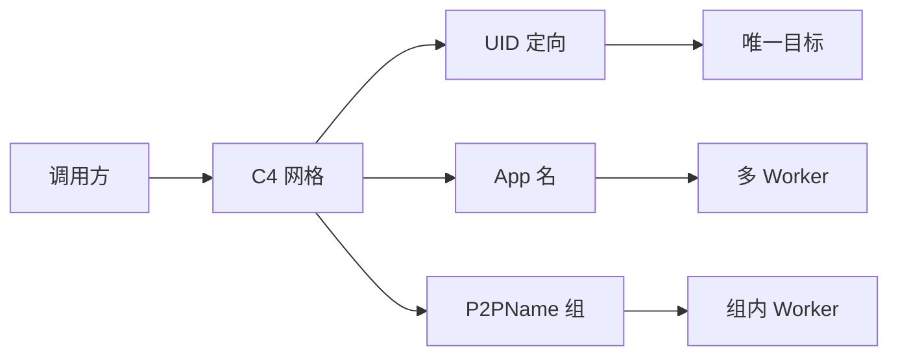

| 路由键      | 语义                 | 负载均衡     | 命中 App 注册 | 命中 P2P 注册 |
| ----------- | -------------------- | ------------:| -------------:| -------------:|
| **UID**     | 定向到具体客户端     | 否           | ✅             | ✅             |
| **App 名**  | 应用级发现，本地优先 | 多注册时自动 | ✅             | ❌             |
| **P2PName** | 组身份，服务端选一个 | 是           | ✅             | ✅             |

---

## 2. P2P UID：最佳获取路径就是“被请求的调用”

### 2.1 获取 UID 的四个关键动作

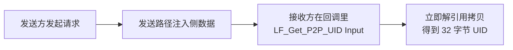

**为什么这是最佳路径？**  
UID 和 P2PName 不是句柄自身的业务属性，而是**发送方在发送请求时自动写入的“侧数据”**。接收方只能在“收到的输入句柄”里看到它们。

### 2.2 正确位置与错误位置

| 位置                                                  | 能否读 UID / P2PName | 说明                   |
| ----------------------------------------------------- | --------------------:| ---------------------- |
| `On_Call` 的 `Input`                                  | ✅                    | 最佳路径               |
| `On_Notify` 的 `Input`                                | ✅                    | 最佳路径               |
| 本地调用 `LF_LocalCall` / `LF_LocalNotify` 的 `Input` | ✅                    | 本地调用也会注入侧数据 |
| `Output` 输出句柄                                     | ❌                    | 没有发送方侧数据       |
| 自建 `LF_CreateData` 句柄                             | ❌                    | 没有“发送方”           |
| 异步回调 `Result_`                                    | ❌                    | 它是输出句柄           |

### 2.3 返回值契约：`LF_Get_P2P_UID` 返回指针

```pascal
function LF_Get_P2P_UID(Hnd: TDataHnd___): PP2P_UID___;
```

- 返回的是**指向 32 字节 UID 的指针**。
- 框架约 **5 秒后自动释放**。
- 调用者只读拷贝：`uid = uid_ptr^`。
- **不要手动释放，不要长期保存裸指针。**

### 2.4 三种语言的正确写法

**Pascal：**

```pascal
procedure MyApi(Trigger: Pointer; Input, Output: TDataHnd); cdecl;
var
  UIDPtr: PP2P_UID___;
  UID: TP2P_UID___;
  Name: string;
begin
  UIDPtr := LF_Get_P2P_UID(Input);
  UID := UIDPtr^;                   // 立即解引用拷贝
  Name := LF_Get_P2P_NameEx(Input); // 立即拷贝为 string
end;
```

**Python：**

```python
@server.expose("whoami")
def whoami(trigger, inp, out):
    uid = inp.get_p2p_uid()      # 内部立即拷贝成 32 字节 bytes
    name = inp.get_p2p_name()    # 立即拷贝成 str
    out.write_json({
        "uid_hex": uid.hex(),
        "p2p_name": name,
    })
```

**C++：**

```cpp
static void LF_CDECL whoami_cb(void*, void* in, void* out) {
    lingofuse::DataHandle inp(static_cast<TDataHnd>(in), false);
    lingofuse::DataHandle out_h(static_cast<TDataHnd>(out), false);

    std::array<std::uint8_t, 32> uid = inp.getP2PUid(); // 立即拷贝
    std::string name = inp.getP2PName();                // 立即拷贝

    out_h.writeJson({
        {"uid_hex", to_hex(uid)},
        {"p2p_name", name}
    });
}
```

---

## 3. UID 是“断网前唯一”的通讯标识符

### 3.1 UID 生命周期（横向短图）

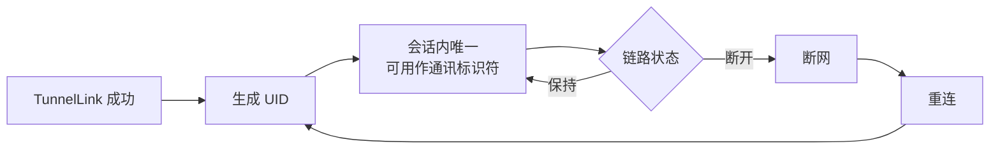

**关键结论：**

- UID 在 `TunnelLink` 成功时生成。
- 同一连接生命周期内唯一。
- **断网前，它可作为通讯标识符。**
- 断网重连后 UID 重新生成。
- 服务端 `FUID_Pool` 会随重连更新。
- 缓存 UID 的模块必须在重连后重新探测。

### 3.2 推荐的自发现模式：`whoami`

**服务端侧：**

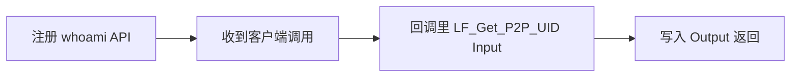

**客户端侧：**

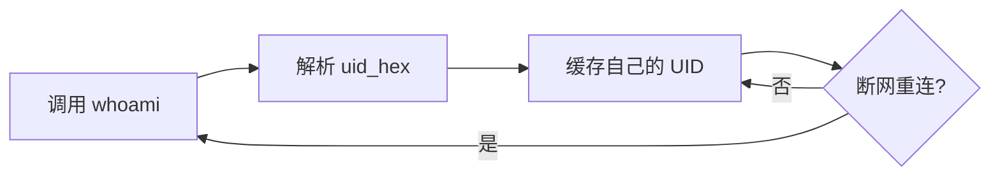

**客户端之后可以：**

- 用 `LF_UID_Call` 定向调用其他客户端。
- 把自己的 UID 告诉别的节点，作为通讯标识符。
- 用 UID 做会话键、审计键、粘性路由键。
- 在重连后重新 `whoami`，刷新 UID。

### 3.3 UID 万能路由（短图）

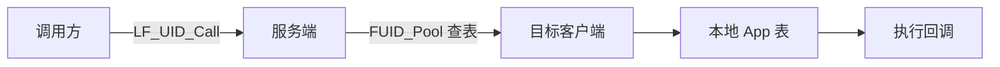

---

## 4. 关键路由行为：UID / P2P 调用会自动搜索 App 注册函数

### 4.1 路由行为对比（一张短图）

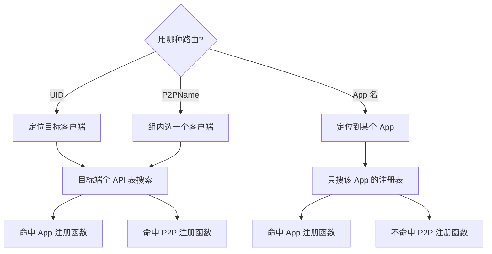

### 4.2 对比表

| 调用方式         | 目标端搜索范围               | 命中 App 注册 | 命中 P2P 注册 |
| ---------------- | ---------------------------- | -------------:| -------------:|
| **UID 调用**     | 目标客户端全部已注册 API     | ✅             | ✅             |
| **P2PName 调用** | 被选中客户端的全部已注册 API | ✅             | ✅             |
| **App 名调用**   | 目标 App 的注册表            | ✅             | ❌             |

### 4.3 为什么会这样

- **UID / P2PName 是“客户端级”路由键**。  
  先定位到“某个客户端”，再由该客户端在自己的本地 API 表里找目标函数。App 注册的和 P2P 注册的函数都在同一张本地表里。

- **App 名是“应用级”路由键**。  
  它定位到“某个 App”，只在该 App 的注册表里找。P2P 注册函数挂在全局 `___LF_P2P_APP___` 下，不在业务 App 的表里，所以 App 名调用命不中。

### 4.4 架构含义

| 想做的事                                     | 推荐路由     |
| -------------------------------------------- | ------------ |
| 定向到某个具体客户端，并调用它任意已注册函数 | **UID**      |
| 同质 worker 组，组内任一节点处理             | **P2PName**  |
| 固定服务名，按 App 名发现                    | **App 名**   |
| 只暴露给 UID/P2P 调用，不希望被 App 名发现   | **P2P 注册** |

---

## 5. 路由优化：本地短路与服务器本地处理

### 5.1 本地短路（目标在本地，不走网络）

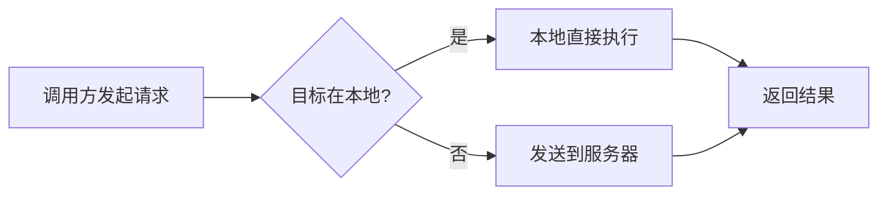

**说明：**

- 如果调用方进程内已经注册了目标 App / UID / P2PName 对应的函数，LingoFuse 会**本地优先执行**，不经过网络。
- 这减少了网络往返，降低了延迟。
- 注意：App 名路由默认就是本地优先；UID 和 P2PName 也会先查本地。

### 5.2 服务器本地处理（请求到了服务器，但服务器自己能处理）

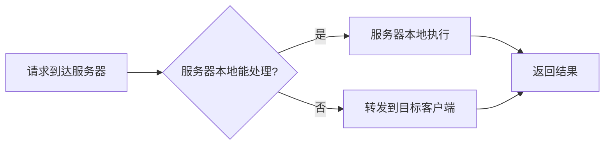

**说明：**

- 当请求经过服务器时，服务器会先检查自己进程内是否有对应的 App / API。
- 如果有，服务器**直接本地处理**，不再向其他客户端转发。
- 这避免了不必要的网络转发，提高了整体效率。
- 这个优化对 App 名、UID、P2PName 路由都适用。

### 5.3 两级优化合并图

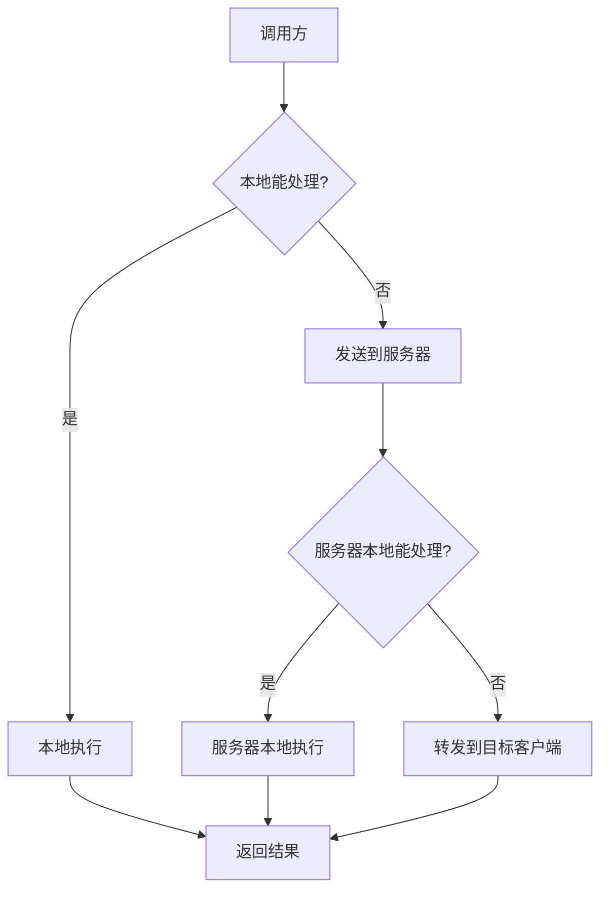

---

## 6. 分布式负载：1 对多即分布式

### 6.1 核心判断

> 只要出现“1 对多”，就可以分布式。
>
> - 1 个 App 名，被多个程序注册；
> - 1 个 P2PName，被多个程序注册；
> - 1 个调用方，连接多个服务器；
> - 1 个 API 名，被多个 worker 暴露。

LingoFuse 的 C4 网格会自动形成候选池，并按策略选择目标。

### 6.2 一个 App 名被多个程序注册（短图）

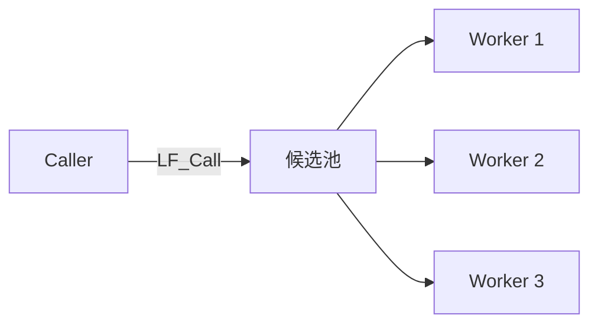

**规则：**

- App 名路由**本地优先**。
- 本地没有同名 App，才走远端候选。
- 多个候选时按“最久未用”负载均衡。
- 广播缓存有约 3 秒延迟。
- 不要用同一个 App 名在同一进程里做“本地 vs 远程”测试。

### 6.3 一个 P2PName 被多个程序注册（短图）

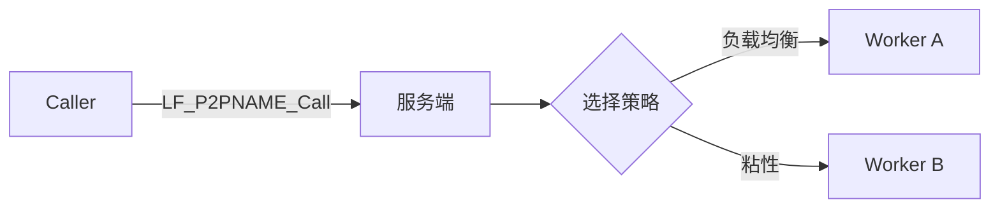

**规则：**

- P2PName 路由**不做本地优先**，总是交给服务端/网格。
- 服务端维护“组名到 UID 列表”。
- 默认按 `Cycle_Anchor` 做负载均衡。
- `Fixed_Sequenced_Time` 默认 20 秒，提供粘性。
- 适合无状态 worker、计算节点、编解码节点、GPU 节点。

### 6.4 你的程序连接多个服务器（短图）

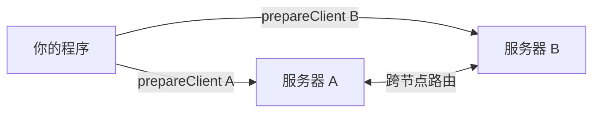

**条件与边界：**

- 你的程序可以 `prepareClient` 多个服务器地址。
- 如果这些服务器之间支持 C4 网格发现、广播、跨节点路由，请求可以自动分布到跨服务器注册的候选。
- 如果服务器之间不互通，它们就是孤岛，不会自动跨服务器负载。
- 多服务器连接扩大的是“可见候选池”，前提是“服务器支持”。

### 6.5 三种负载粒度

| 粒度   | 路由键  | 选择方式               | 本地优先           |
| ------ | ------- | ---------------------- | ------------------ |
| 应用级 | App 名  | 多客户端候选，最久未用 | ✅                  |
| 组级   | P2PName | 服务端组内负载/粘性    | ❌                  |
| 会话级 | UID     | 定向，不负载           | ✅（本地 UID 优先） |

---

## 7. 序列化支持：高流量计算与大规模数据流的天然轨道

### 7.1 序列化不是“慢”，而是“有序”

LingoFuse 的序列化族：

- `LF_Sequenced_Notify`
- `LF_Sequenced_Call`
- `LF_Async_Sequenced_Call`
- UID / P2PName 的 Sequenced 变体

保证：

- 同一 `(App, API)` 对内 FIFO；
- 同一 `(UID, API)` 内 FIFO；
- 同一 `(P2PName, API)` 对内 FIFO，但可能分配到不同 UID；
- 不同键之间可并发。

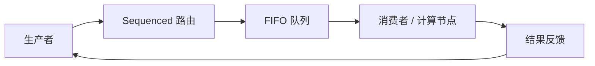

### 7.2 为什么和 Matlab / R / Julia / 视频 / 音频天生合拍？

| 场景         | 数据形态             | 序列化后的优势              |
| ------------ | -------------------- | --------------------------- |
| Matlab 计算  | 矩阵、数组、仿真迭代 | 每轮迭代 FIFO，结果按序回传 |
| R 统计       | 数据帧、批处理       | 批次顺序稳定，避免乱序污染  |
| Julia 高并发 | 任务块、GPU 批次     | 同 API 内 FIFO，跨 API 并发 |
| 视频流       | 帧序列、GOP          | 帧序不丢，按帧处理与反馈    |
| 音频流       | PCM / Opus 块        | 块序稳定，低延迟反馈        |
| 大规模数据流 | 分块二进制           | 二进制句柄，少编码开销      |

### 7.3 高流量计算管线（拆成两段短图）

**第一段：数据源到网格**

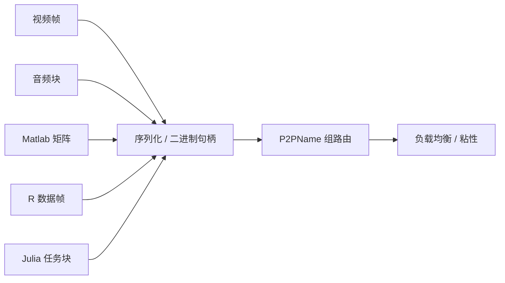

**第二段：网格到计算节点**

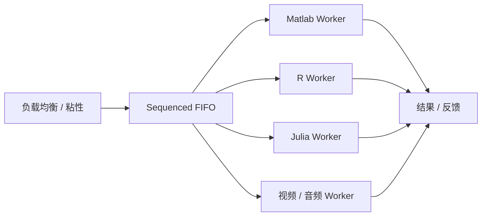

### 7.4 为什么几乎自动化、高效？

- **自动化发现**：注册 API，服务端广播，调用方缓存候选。
- **自动化负载**：App 名多注册 / P2PName 多注册，自动选目标。
- **自动化顺序**：Sequenced 族按路由键 FIFO。
- **自动化句柄池**：DataHandle 创建、池化、回收。
- **自动化异步**：`LF_Async_*` + Future，回调内拷贝结果。
- **二进制高效**：句柄可写原始字节，视频/音频/矩阵少一次编码。
- **零拷贝映射**：解码时 `Param.Mapping` 可零拷贝映射。
- **跨语言统一**：C ABI 让 Matlab / R / Julia / Python / C++ 都能接。

---

## 8. 最佳实践清单

1. **UID 只在回调 `Input` 里读。**  
   用 `LF_Get_P2P_UID` / `get_p2p_uid()` / `getP2PUid()`。

2. **读到指针立即拷贝。**  
   不保存裸指针，不手动释放，不跨回调使用。

3. **断网前 UID 可做通讯标识符。**  
   重连后重新 `whoami`，刷新缓存。

4. **想要分布式，就制造 1 对多。**  
   多个程序注册同一 App 名，或同一 P2PName。

5. **同质 worker 用 P2PName。**  
   不要用 App 名做组播，App 名有本地优先。

6. **需要顺序用 Sequenced。**  
   同一 `(App, API)` 或 `(P2PName, API)` 内 FIFO。

7. **大流量用二进制句柄。**  
   视频帧、音频块、矩阵、张量，直接写 buffer。

8. **多服务器要确认服务器支持跨节点路由。**  
   否则只是多个孤岛。

9. **不要在回调里调同步 `LF_Call` / `LF_Notify` / `LF_LocalCall`。**  
   会死锁。需要异步用 `LF_Async_*` 或自己的线程池。

10. **异步 handle 归框架所有，回调返回立即释放。**  
    必须回调内拷贝数据，禁止跨线程保留，禁止 `LF_FreeData`。

---

## 9. 反模式

| 反模式                         | 后果                   | 正确做法              |
| ------------------------------ | ---------------------- | --------------------- |
| 在自建句柄上 `get_p2p_uid()`   | 全零 UID               | 只在回调 `Input` 读   |
| 在 `Output` 上 `get_p2p_uid()` | 空 / 警告              | 输出句柄没有侧数据    |
| 把 `LF_Get_P2P_UID` 当值用     | 读到指针字节序         | 解引用 + 立即拷贝     |
| 异步回调外使用 `Result_`       | use-after-free         | 回调内拷贝            |
| 缓存 UID 不刷新                | 重连后失效             | 重连后 `whoami`       |
| 用 App 名做组播                | 本地优先，可能不走网络 | 用 P2PName            |
| 在回调里 `LF_Call`             | 死锁                   | 异步或线程池          |
| 多服务器但服务器不互通         | 不会跨服负载           | 确认 C4 网格支持      |
| 以为 App 名能命中 P2P 注册函数 | 调用失败               | 用 UID / P2PName 调用 |

---

## 10. 需要你确认的问题

1. **`lf_get_uid` 的正式名称**  
   文档里统一写成 `LF_Get_P2P_UID`。高层文档里叫 `get_uid`、`get_p2p_uid`，还是保留 C ABI 名？

2. **“断网前唯一”的表述**  
   是否要强调：断网重连后 UID 会变，所以它是“会话 UID”，不是“永久设备 ID”？

3. **多服务器自动分布式的边界**  
   “服务器支持”具体指什么？  

   - C4 服务端之间已经互通？  
   - 还是需要额外配置广播 / 路由？

4. **序列化支持的范围**  
   你指的是 `Sequenced_Call/Notify`，还是也包括用户自定义二进制序列化？  
   视频 / 音频是否要求帧级顺序、背压、丢帧策略？

5. **Matlab / R / Julia 的示例深度**  
   概念文档里要不要给出具体绑定代码？还是只画架构图、说明机制即可？

6. **是否需要性能数字**  
   目前没有实测基准。要不要补“理论吞吐 / 延迟模型”？

7. **图的形式**  
   现在用 Mermaid 的 `flowchart`。要不要导出成 PNG/SVG 一并交付？

8. **读者对象**  
   架构师、集成工程师、还是 AI 生成代码？不同读者影响术语密度。

9. **是否中英双语**  
   当前是中文。是否需要同时输出英文版？

10. **安全与鉴权**  
    UID 作为通讯标识符时，是否需要讨论“UID 可被伪造吗？如何鉴权？”

---

**交付说明**

- **文件名**：`LingoFuse_P2P_Distributed_Load_Concept.md`
- **图的形式**：全部使用 `flowchart`，横向短图为主，最长不超过 8 个节点。
- **时序图**：已全部移除。
- **大流程**：已拆成“第一段 / 第二段”。
- **新增内容**：
  - §5 路由优化：本地短路 + 服务器本地处理，并配有两张短流程图和一张合并图。
  - §4 说明 UID / P2P 调用自动搜索 App 注册函数的路由行为，以及 App 名调用不能命中 P2P 注册函数的不对称。
