# LingoFuse P2P & Distributed Load Concept

> Chinese version: [LingoFuse_P2P_Distributed_Load_Concept.md](LingoFuse_P2P_Distributed_Load_Concept.md)

> **File name**: `LingoFuse_P2P_Distributed_Load_Concept.md`
> **Content language**: Chinese
> **Positioning**: a concept document, not an API manual. Focused on P2P identity, how to obtain a UID, routing behaviour, routing optimizations, distributed load and sequenced data streams.

---

## 0. Seven sentences to remember first

1. **The best path to a P2P UID is inside a "request being called", reading it from the callback's `Input` parameter via `LF_Get_P2P_UID`.**
   That is `get_p2p_uid()` / `getP2PUid()` in the high-level bindings.

2. **The UID obtained is a session UID that is "unique until the network drops".**
   It can serve as a communication identifier within the same connection lifetime; it changes after a reconnect and must be re-probed.

3. **Distributed load is everywhere: anything 1-to-many can be distributed.**
   One App name registered by several programs; one P2PName registered by several programs; your program connecting to several servers that support cross-node routing.

4. **UID and P2PName calls automatically search the target client's App-registered functions.**
   That is routing behaviour: every API registered on the target end can be hit.

5. **Conversely, an App-name call only reaches App-registered functions, never P2P-registered ones.**
   That is the asymmetry of the routing layer.

6. **Routing optimizations: local short-circuit + server-side local handling.**
   If the target is local, the call never touches the network; if a request reaches the server but the server can handle it locally, the server handles it directly without forwarding.

7. **With sequencing support, P2P + high-traffic computation + large-scale data streams are a natural fit.**
   Video frames, audio chunks, Matlab / R / Julia computation jobs and simulation iterations can all be executed and fed back in sequence.

---

## 1. Overview of the three routing modes

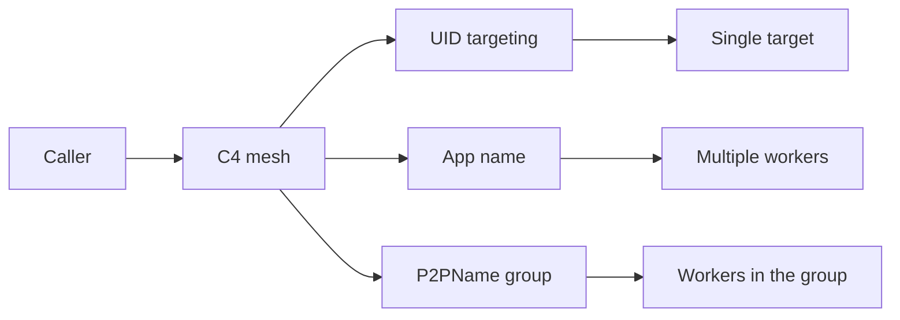

| Route key   | Semantics                       | Load balancing | Hits App registrations | Hits P2P registrations |
| ----------- | ------------------------------- | -------------: | -------------: | -------------: |
| **UID**     | Target one specific client      | No             | ✅             | ✅             |
| **App name**| Application-level discovery, local first | Automatic when multiply registered | ✅ | ❌ |
| **P2PName** | Group identity; the server picks one | Yes       | ✅             | ✅             |

---

## 2. P2P UID: the best path is the "request being called"

### 2.1 The four key actions for obtaining a UID

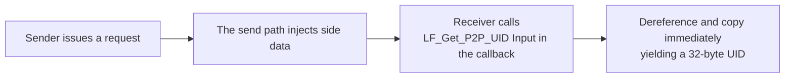

**Why is this the best path?**
UID and P2PName are not business attributes of the handle itself but **side data the sender writes automatically when sending the request**. The receiver can only see them on "the received input handle".

### 2.2 Correct and incorrect positions

| Position                                              | Can read UID / P2PName | Explanation                   |
| ----------------------------------------------------- | --------------------: | ---------------------- |
| `Input` of `On_Call`                                  | ✅                    | Best path               |
| `Input` of `On_Notify`                                | ✅                    | Best path               |
| `Input` of local calls `LF_LocalCall` / `LF_LocalNotify` | ✅                 | Local calls inject side data too |
| `Output` output handle                                | ❌                    | No sender-side data       |
| A self-created `LF_CreateData` handle                 | ❌                    | There is no "sender"           |
| The async callback's `Result_`                        | ❌                    | It is an output handle           |

### 2.3 Return-value contract: `LF_Get_P2P_UID` returns a pointer

```pascal
function LF_Get_P2P_UID(Hnd: TDataHnd___): PP2P_UID___;
```

- It returns **a pointer to a 32-byte UID**.
- The framework **releases it automatically after about 5 seconds**.
- The caller only reads and copies: `uid = uid_ptr^`.
- **Never free it manually, and never keep the raw pointer long-term.**

### 2.4 Correct usage in three languages

**Pascal:**

```pascal
procedure MyApi(Trigger: Pointer; Input, Output: TDataHnd); cdecl;
var
  UIDPtr: PP2P_UID___;
  UID: TP2P_UID___;
  Name: string;
begin
  UIDPtr := LF_Get_P2P_UID(Input);
  UID := UIDPtr^;                   // dereference and copy immediately
  Name := LF_Get_P2P_NameEx(Input); // copy into a string immediately
end;
```

**Python:**

```python
@server.expose("whoami")
def whoami(trigger, inp, out):
    uid = inp.get_p2p_uid()      # internally copied into 32-byte bytes immediately
    name = inp.get_p2p_name()    # copied into str immediately
    out.write_json({
        "uid_hex": uid.hex(),
        "p2p_name": name,
    })
```

**C++:**

```cpp
static void LF_CDECL whoami_cb(void*, void* in, void* out) {
    lingofuse::DataHandle inp(static_cast<TDataHnd>(in), false);
    lingofuse::DataHandle out_h(static_cast<TDataHnd>(out), false);

    std::array<std::uint8_t, 32> uid = inp.getP2PUid(); // copied immediately
    std::string name = inp.getP2PName();                // copied immediately

    out_h.writeJson({
        {"uid_hex", to_hex(uid)},
        {"p2p_name", name}
    });
}
```

---

## 3. A UID is a communication identifier "unique until the network drops"

### 3.1 UID lifecycle (short horizontal diagram)

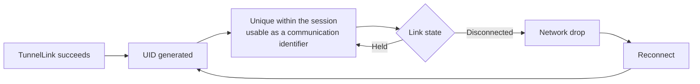

**Key conclusions:**

- A UID is generated when `TunnelLink` succeeds.
- It is unique within the same connection lifetime.
- **Before the network drops, it can serve as a communication identifier.**
- After a disconnect and reconnect the UID is regenerated.
- The server's `FUID_Pool` is updated on reconnect.
- Modules that cache the UID must re-probe after a reconnect.

### 3.2 The recommended self-discovery pattern: `whoami`

**Server side:**

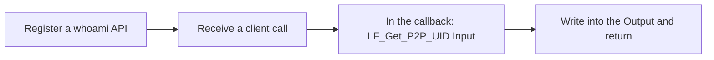

**Client side:**

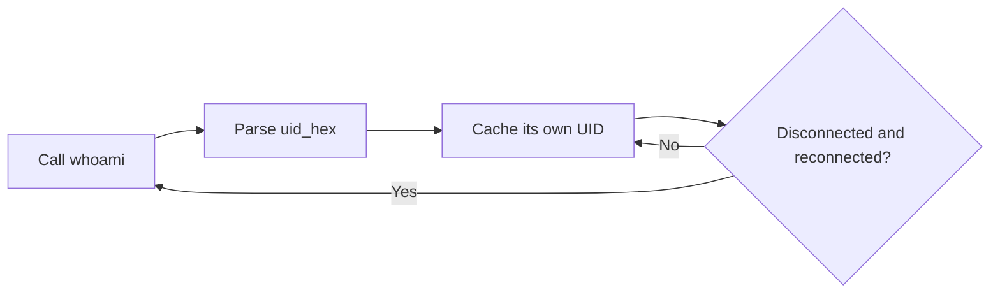

**Afterwards the client can:**

- Use `LF_UID_Call` to target other clients.
- Tell other nodes its UID as a communication identifier.
- Use the UID as a session key, audit key or sticky-routing key.
- Re-run `whoami` after a reconnect to refresh the UID.

### 3.3 UID universal routing (short diagram)

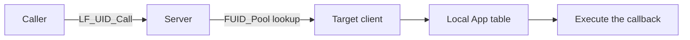

---

## 4. Key routing behaviour: UID / P2P calls automatically search App-registered functions

### 4.1 Routing behaviour comparison (one short diagram)

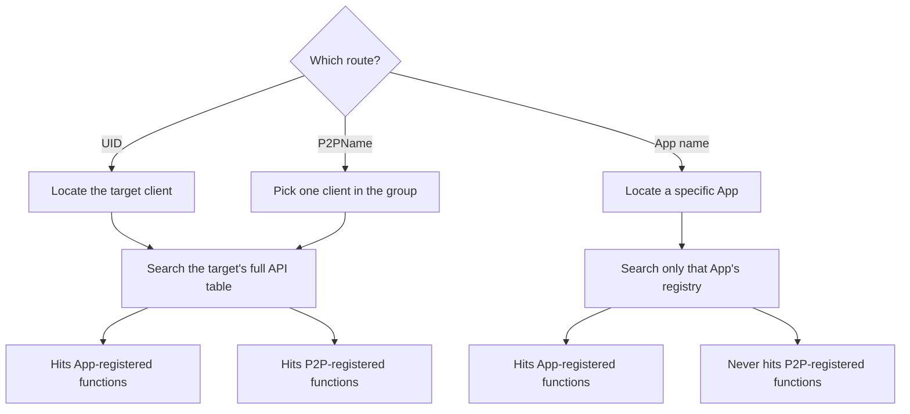

### 4.2 Comparison table

| Call mode         | Search scope on the target end               | Hits App registrations | Hits P2P registrations |
| ---------------- | -------------------------------------------- | -------------: | -------------: |
| **UID call**     | All APIs registered on the target client     | ✅             | ✅             |
| **P2PName call** | All APIs registered on the selected client   | ✅             | ✅             |
| **App-name call**| The target App's registry                    | ✅             | ❌             |

### 4.3 Why it is this way

- **UID / P2PName are "client-level" route keys.**
  They first locate "a specific client", which then looks for the target function in its own local API table. App-registered and P2P-registered functions live in the same local table.

- **An App name is an "application-level" route key.**
  It locates "a specific App" and searches only that App's registry. P2P-registered functions hang under the global `___LF_P2P_APP___`, not in the business App's table, so an App-name call can never hit them.

### 4.4 Architectural implications

| What you want to do                                       | Recommended route |
| --------------------------------------------------------- | ----------------- |
| Target a specific client and call any of its registered functions | **UID**  |
| A homogeneous worker group; any node handles it            | **P2PName**       |
| A fixed service name, discovered by App name               | **App name**      |
| Expose only to UID/P2P calls, not discoverable by App name | **P2P registration** |

---

## 5. Routing optimizations: local short-circuit and server-side local handling

### 5.1 Local short-circuit (the target is local, no network involved)

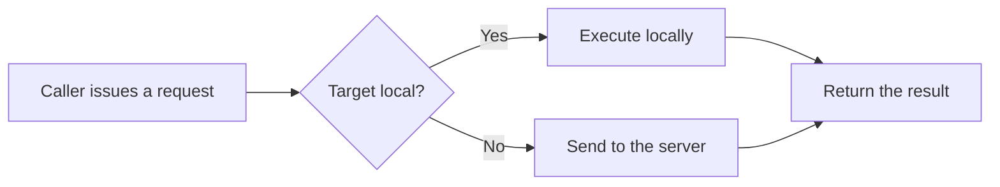

**Notes:**

- If the caller's process already registers the function behind the target App / UID / P2PName, LingoFuse **executes locally first**, without touching the network.
- This saves network round trips and lowers latency.
- Note: App-name routing is local-first by default; UID and P2PName also check locally first.

### 5.2 Server-side local handling (the request reaches the server, but the server can handle it)

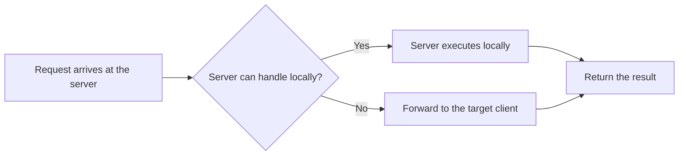

**Notes:**

- When a request passes through a server, the server first checks whether its own process has the corresponding App / API.
- If it does, the server **handles it locally** and forwards nothing to other clients.
- This avoids unnecessary network forwarding and raises overall efficiency.
- The optimization applies to App-name, UID and P2PName routing alike.

### 5.3 Combined two-level optimization diagram

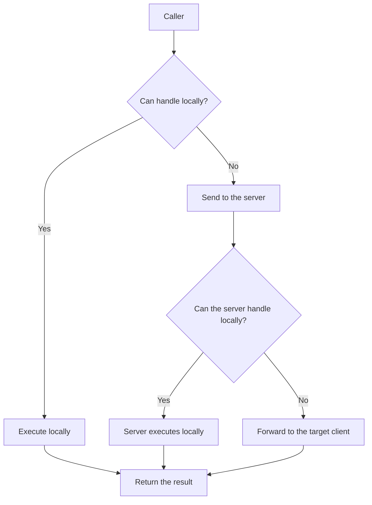

---

## 6. Distributed load: 1-to-many is distributed

### 6.1 The core judgement

> Anything that is "1-to-many" can be distributed.
>
> - One App name registered by several programs;
> - One P2PName registered by several programs;
> - One caller connected to several servers;
> - One API name exposed by several workers.

LingoFuse's C4 mesh automatically forms a candidate pool and selects a target by policy.

### 6.2 One App name registered by several programs (short diagram)

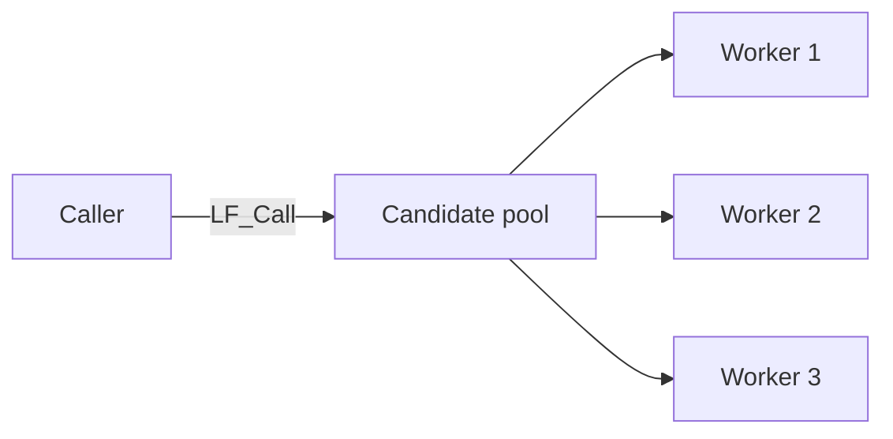

**Rules:**

- App-name routing is **local first**.
- Only when no same-named App exists locally does it use remote candidates.
- Among several candidates it balances by "least recently used".
- Broadcast caches carry roughly a 3-second delay.
- Never use the same App name inside one process to test "local vs remote".

### 6.3 One P2PName registered by several programs (short diagram)

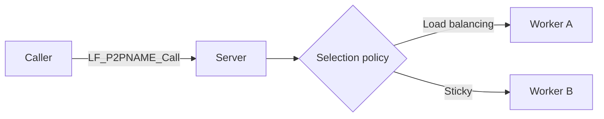

**Rules:**

- P2PName routing is **not local-first**; it always goes to the server/mesh.
- The server maintains a "group name to UID list" mapping.
- By default it balances with `Cycle_Anchor`.
- `Fixed_Sequenced_Time` defaults to 20 seconds and provides stickiness.
- Suits stateless workers, compute nodes, codec nodes and GPU nodes.

### 6.4 Your program connected to several servers (short diagram)

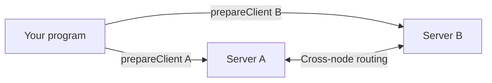

**Conditions and boundaries:**

- Your program can `prepareClient` against several server addresses.
- If those servers support C4 mesh discovery, broadcasting and cross-node routing, requests can be distributed automatically to candidates registered across servers.
- If the servers do not interoperate, they are islands and will not balance load across each other.
- Connecting to more servers enlarges the "visible candidate pool", provided "the servers support it".

### 6.5 Three granularities of load

| Granularity | Route key | Selection method                | Local first        |
| ----------- | --------- | ------------------------------- | ------------------ |
| Application | App name  | Several client candidates, least recently used | ✅      |
| Group       | P2PName   | Server-side in-group balancing / stickiness | ❌       |
| Session     | UID       | Targeted, no balancing          | ✅ (local UID first) |

---

## 7. Sequencing support: the natural track for high-traffic computation and large-scale data streams

### 7.1 Sequencing is not "slow", it is "ordered"

LingoFuse's sequenced family:

- `LF_Sequenced_Notify`
- `LF_Sequenced_Call`
- `LF_Async_Sequenced_Call`
- The UID / P2PName Sequenced variants

Guarantees:

- FIFO within the same `(App, API)` pair;
- FIFO within the same `(UID, API)`;
- FIFO within the same `(P2PName, API)` pair, though requests may be assigned to different UIDs;
- Concurrency between different keys.

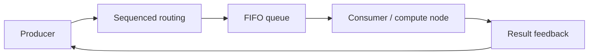

### 7.2 Why it is a natural fit for Matlab / R / Julia / video / audio

| Scenario     | Data shape                | Advantage after sequencing          |
| ------------ | ------------------------- | ------------------------------------ |
| Matlab computation | Matrices, arrays, simulation iterations | FIFO per iteration, results returned in order |
| R statistics | Data frames, batch processing | Stable batch order, no out-of-order contamination |
| Julia high concurrency | Task blocks, GPU batches | FIFO within one API, concurrency across APIs |
| Video streams | Frame sequences, GOPs | Frame order never lost; per-frame processing and feedback |
| Audio streams | PCM / Opus chunks | Stable chunk order, low-latency feedback |
| Large-scale data streams | Chunked binary | Binary handles, little encoding overhead |

### 7.3 High-traffic computation pipeline (split into two short diagrams)

**Part one: data source to mesh**

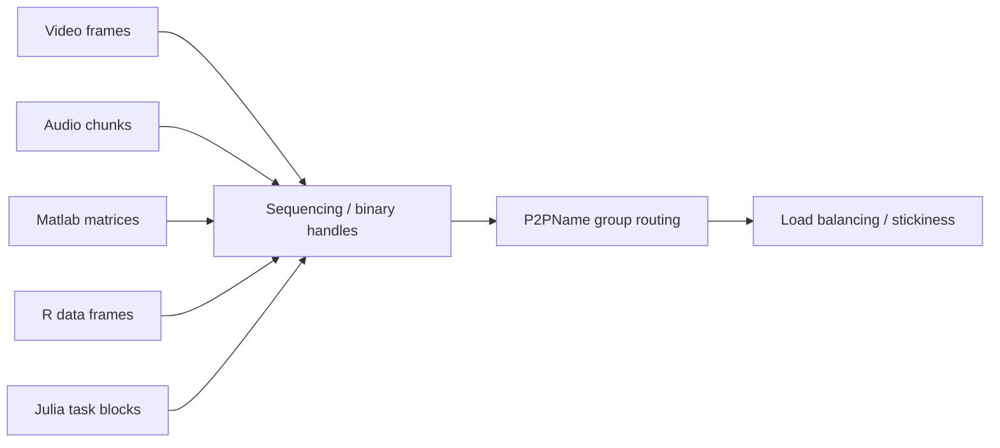

**Part two: mesh to compute nodes**

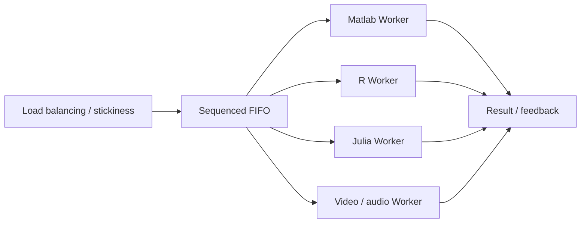

### 7.4 Why is it nearly automatic and efficient?

- **Automatic discovery**: register an API, the server broadcasts, callers cache candidates.
- **Automatic load**: multiple registrations under an App name / P2PName select a target automatically.
- **Automatic ordering**: the sequenced family is FIFO by route key.
- **Automatic handle pool**: DataHandle creation, pooling and recycling.
- **Automatic async**: `LF_Async_*` + Future, copying results inside the callback.
- **Efficient binary**: handles can carry raw bytes, saving one encode for video/audio/matrices.
- **Zero-copy mapping**: decoding can map `Param.Mapping` with zero copy.
- **Cross-language uniformity**: the C ABI lets Matlab / R / Julia / Python / C++ all connect.

---

## 8. Best-practice checklist

1. **Read a UID only from a callback's `Input`.**
   Use `LF_Get_P2P_UID` / `get_p2p_uid()` / `getP2PUid()`.

2. **Copy immediately when you get a pointer.**
   Never keep a raw pointer, never free it manually, never use it across callbacks.

3. **Before a network drop, a UID can serve as a communication identifier.**
   After reconnecting, run `whoami` again and refresh the cache.

4. **Want distribution? Manufacture 1-to-many.**
   Several programs registering the same App name, or the same P2PName.

5. **Use P2PName for homogeneous workers.**
   Do not use an App name as a multicast; App names are local-first.

6. **Use Sequenced when order matters.**
   FIFO within the same `(App, API)` or `(P2PName, API)`.

7. **Use binary handles for heavy traffic.**
   Video frames, audio chunks, matrices and tensors: write the buffer directly.

8. **With several servers, confirm they support cross-node routing.**
   Otherwise they are just islands.

9. **Never call the synchronous `LF_Call` / `LF_Notify` / `LF_LocalCall` inside a callback.**
   It deadlocks. For asynchrony use `LF_Async_*` or your own thread pool.

10. **Async handles belong to the framework and are released when the callback returns.**
    You must copy the data inside the callback; never retain it across threads and never call `LF_FreeData`.

---

## 9. Anti-patterns

| Anti-pattern                   | Consequence            | Correct practice      |
| ------------------------------ | ---------------------- | --------------------- |
| `get_p2p_uid()` on a self-created handle | All-zero UID | Read only on the callback's `Input` |
| `get_p2p_uid()` on `Output`    | Empty / warning        | Output handles carry no side data |
| Treating `LF_Get_P2P_UID` as a value | Reads the pointer's bytes | Dereference + copy immediately |
| Using `Result_` outside the async callback | use-after-free  | Copy inside the callback |
| Caching a UID and never refreshing it | Invalid after reconnect | `whoami` after reconnecting |
| Using an App name for multicast | Local-first, may never touch the network | Use P2PName |
| `LF_Call` inside a callback    | Deadlock               | Async or a thread pool |
| Several servers that do not interoperate | No cross-server balancing | Confirm C4 mesh support |
| Assuming an App name can hit P2P-registered functions | The call fails | Call via UID / P2PName |

---

## 10. Questions requiring your confirmation

1. **The official name of `lf_get_uid`**
   The documentation uniformly writes `LF_Get_P2P_UID`. In high-level docs should it be called `get_uid`, `get_p2p_uid`, or keep the C ABI name?

2. **The "unique until the network drops" wording**
   Should we stress that the UID changes after a reconnect, so it is a "session UID" rather than a "permanent device ID"?

3. **The boundary of multi-server automatic distribution**
   What exactly does "the servers support it" mean?

   - Are the C4 servers already interoperating?
   - Or is extra broadcast / routing configuration required?

4. **The scope of sequencing support**
   Do you mean `Sequenced_Call/Notify`, or also user-defined binary serialization?
   Do video / audio require frame-level ordering, back-pressure and frame-drop policy?

5. **The depth of the Matlab / R / Julia examples**
   Should this concept document include concrete binding code, or only architecture diagrams and mechanism explanations?

6. **Whether performance numbers are needed**
   There are no measured baselines yet. Should a "theoretical throughput / latency model" be added?

7. **The diagram format**
   Mermaid `flowchart` is used at present. Should PNG/SVG exports be delivered too?

8. **The intended reader**
   Architects, integration engineers, or AI-generated code? Different readers change term density.

9. **Whether bilingual output is needed**
   It is currently Chinese. Should an English version be produced as well?

10. **Security and authentication**
    When a UID serves as a communication identifier, should we discuss "can a UID be forged? How is it authenticated?"

---

**Delivery notes**

- **File name**: `LingoFuse_P2P_Distributed_Load_Concept.md`
- **Diagram format**: all `flowchart`, mostly short horizontal diagrams, never more than 8 nodes.
- **Sequence diagrams**: all removed.
- **Large flows**: split into "part one / part two".
- **New content**:
  - §5 routing optimizations: local short-circuit + server-side local handling, with two short flow diagrams and one combined diagram.
  - §4 explains the routing behaviour where UID / P2P calls automatically search App-registered functions, and the asymmetry that App-name calls cannot hit P2P-registered functions.


