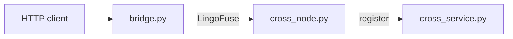
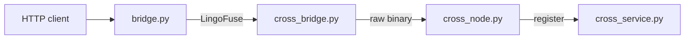

# Cross Demo User Guide

> Chinese version: [Cross_Demo_Guide_zh.md](Cross_Demo_Guide_zh.md)

This document describes the **Cross sample** in the LingoFuse Python binding, covering configuration and startup of the service registry, worker node, adapter and HTTP gateway, so you can experience LingoFuse's distributed RPC capabilities quickly.

---

## 1. Directory layout

```
Py/
├── init_demo_env.ps1                      # Windows environment setup script
├── cross/                                 # Cross sample root
│   ├── cross_service.py                   # Service registry (beacon)
│   ├── cross_node.py                      # Worker node (demo application)
│   ├── cross_call.py                      # Concurrent test client (calls the demo node directly)
│   ├── cross_bridge.py                    # LingoFuse adapter (JSON ↔ binary conversion)
│   ├── nodejs/                            # Node.js client
│   │   └── node_cross_client.js
│   ├── php/                               # PHP client
│   │   └── php_cross_client.php
│   └── webjs/                             # Browser client
│       └── web_cross_client.html
└── lingofuse/                             # Core binding package
    ├── bridge.py                          # Generic HTTP gateway (pure binary passthrough)
    └── ... (other core files)
```

---

## 2. Architecture overview

The Cross sample demonstrates three common LingoFuse deployment modes:

### 2.1 Direct mode (simplest)
- `cross_service.py` (service registry)
- `cross_node.py` (worker node)
- `bridge.py` connects to the node directly; it does not parse HTTP request bodies, only forwarding the raw binary data.



### 2.2 Adapter mode (layered)
- `cross_service.py` (service registry)
- `cross_node.py` (worker node)
- `cross_bridge.py` (adapter that accepts JSON requests and converts them into binary calls to the node)
- `bridge.py` connects to the adapter and likewise only forwards raw data.



Adapter mode decouples protocol conversion from business logic, which makes extension easier.

---

## 3. Environment setup

### 3.1 Dependencies
- Python 3.6+
- Flask (needed only by `bridge.py`)
- The LingoFuse dynamic library (`LingoFuse64.dll` / `liblingofuse.so`)

### 3.2 Environment variables
In PowerShell (Windows), run:
```powershell
.\init_demo_env.ps1
```
Or add them manually on Linux/macOS:
```bash
export PYTHONPATH="/path/to/Py:$PYTHONPATH"
export PATH="/path/to/Binary:$PATH"
```

### 3.3 Installing Flask
```bash
pip install flask
```

---

## 4. Startup steps

### 4.1 Basic mode (calling the demo node directly)

**Terminal 1 – service registry**
```bash
python cross/cross_service.py
```
Sample output:
```
[OK] Service registry ready on ipc:cross
[INFO] Press Enter to stop the service...
```

**Terminal 2 – worker node**
```bash
python cross/cross_node.py
```
Sample output:
```
[OK] Node ready on ipc:cross, waiting for requests...
```

**Terminal 3 – HTTP gateway (connected straight to the node)**
```bash
python lingofuse/bridge.py --endpoint ipc:cross --app demo --debug --port 8081
```
Sample output:
```
=== LingoFuse HTTP Bridge (Raw Passthrough) ===
Endpoint: ipc:cross
Default app: demo
Timeout: 5000ms
Threaded: True
Debug: True
Path format: /<app>/<api>  or  /<api> (uses default app)
[Bridge] Connected to LingoFuse service: ipc:cross
Starting HTTP service: http://0.0.0.0:8081
```

**Note**: `bridge.py` now uses **pure binary passthrough** mode and does not parse JSON request bodies. The path format is `/<app>/<api>`, or `/<api>` to use the default application.

### 4.2 Adapter mode (recommended)

**Terminal 1 – service registry**
```bash
python cross/cross_service.py
```

**Terminal 2 – worker node**
```bash
python cross/cross_node.py
```

**Terminal 3 – adapter**
```bash
python cross/cross_bridge.py
```
The default service endpoint is `ipc:cross_bridge_service`, and it connects to the node at `ipc:cross`.

**Terminal 4 – HTTP gateway connected to the adapter**
```bash
python lingofuse/bridge.py --endpoint ipc:cross_bridge_service --port 8081 --debug
```
Here `--app` is unnecessary, because the client specifies the application name explicitly in the path (for example `/cross_bridge/add`).

---

## 5. Test calls

### 5.1 Browser test
Open `cross/webjs/web_cross_client.html` and click the buttons:
- **Call add(10,20)**: expect `✅ 10 + 20 = 30`
- **Call inv_seri**: expect something like `✅ inv_seri result: received order [...] = sent order [...]`

The browser client has been changed to send the request body directly (`[10,20]` or `{}`) and to use the path `/cross_bridge/add`.

### 5.2 curl command-line test (adapter mode)

```bash
# add API – send [10,20]; the path names app and api explicitly
curl -X POST http://127.0.0.1:8081/cross_bridge/add \
     -H "Content-Type: application/json" \
     -d '[10,20]'
# returns {"code":0,"result":30}

# inv_seri API – send {} to use the default parameters
curl -X POST http://127.0.0.1:8081/cross_bridge/inv_seri \
     -H "Content-Type: application/json" \
     -d '{}'
# returns {"code":0,"result":"received order [...] = sent order [...]"}
```

### 5.3 Node.js client
```bash
cd cross/nodejs
node node_cross_client.js
```
Output:
```
10 + 20 = 30
inv_seri result: received order ...
```

### 5.4 PHP client
```bash
cd cross/php
php php_cross_client.php
```
Output is similar.

---

## 6. Configuration options

### 6.1 `cross_bridge.py` arguments
| Argument | Environment variable | Default | Description |
|------|---------|--------|------|
| `--endpoint` | `CROSS_BRIDGE_ENDPOINT` | `ipc:cross_bridge_service` | The adapter's own service endpoint |
| `--node-endpoint` | `CROSS_BRIDGE_NODE` | `ipc:cross` | The demo node endpoint |
| `--app-name` | `CROSS_BRIDGE_APP` | `cross_bridge` | The adapter application name |
| `--timeout` | `CROSS_BRIDGE_TIMEOUT` | `5000` | Call timeout (ms) |

### 6.2 `bridge.py` arguments
| Argument | Environment variable | Default | Description |
|------|---------|--------|------|
| `--host` | `LINGOFUSE_HOST` | `0.0.0.0` | HTTP listen address |
| `--port` | `LINGOFUSE_PORT` | `8081` | HTTP listen port |
| `--endpoint` | `LINGOFUSE_ENDPOINT` | `ipc:lingofuse_bridge` | LingoFuse service endpoint |
| `--timeout` | `LINGOFUSE_TIMEOUT` | `5000` | Default timeout (ms) |
| `--app` | `LINGOFUSE_APP` | `None` | Default target application (used only when the path holds just the API name) |
| `--threaded` / `--no-threaded` | - | `True` | Whether to enable multithreading |
| `--debug` | - | `False` | Enable debug logging (prints request/response content) |

> **Note**: the `--routes` and `--mode` arguments have been removed, because there is now only one routing mode (path-driven).

---

## 7. Frequently asked questions

### 7.1 The dynamic library fails to load
- Make sure `LingoFuse64.dll` (or the platform equivalent) is on the system `PATH` or in the current directory.
- On Windows you can run `init_demo_env.ps1` to add the `Binary` directory to `PATH` automatically.

### 7.2 Connection timeout
- Check whether `cross_service.py` is running.
- Check whether `cross_node.py` is running.
- Check whether `cross_bridge.py` is running (if you use it).

### 7.3 Port already in use
- Change the `--port` argument.
- If an IPC endpoint collides (for example `ipc:cross_bridge_service` is already taken), use another name such as `ipc:my_adapter`.

### 7.4 The browser fails to parse JSON
- Make sure `bridge.py` is up to date (it strips trailing `\0` bytes automatically).
- Make sure `cross_bridge.py` returns the standard form `{"code":0, "result":...}`.

---

## 8. Extending it

### 8.1 Adding a new API
1. Add a callback function in `cross_node.py` and register it with the `app`.
2. Add the matching JSON callback in `cross_bridge.py` (if you use it) that forwards to the node.
3. Clients reach it with the path `/<app>/<api>`, sending the required arguments as the request body.

### 8.2 Custom serialization
`bridge.py` performs no serialization at all; it forwards raw data. If you need JSON parsing, handle it in `cross_bridge.py` or in the backend node.

---

## 9. Summary

The Cross sample shows LingoFuse's deployment options end to end: service registration, node registration, adapter conversion and the HTTP gateway. The new `bridge.py` is a pure binary passthrough gateway, which simplifies the architecture and increases flexibility. Choose direct mode or adapter mode according to your needs, and use `bridge.py` to give any LingoFuse application an HTTP interface quickly.
