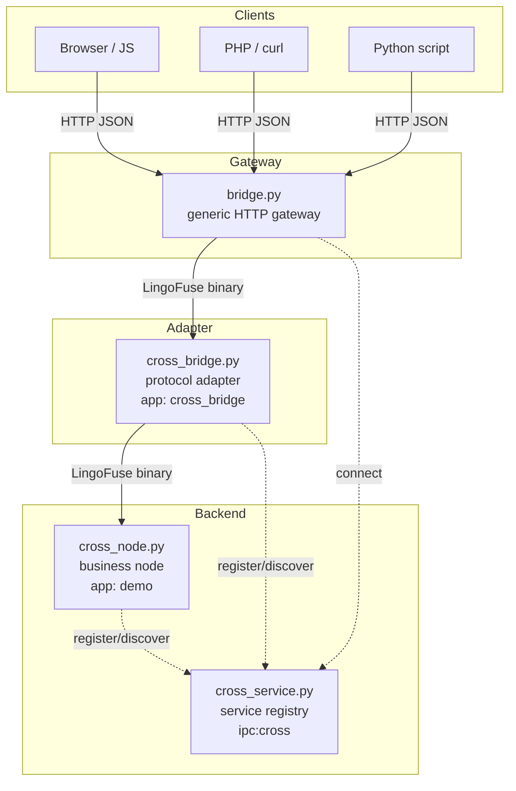
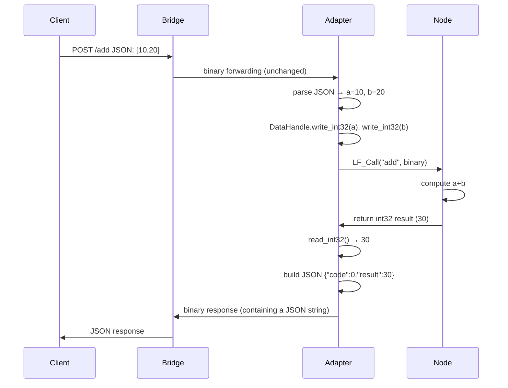
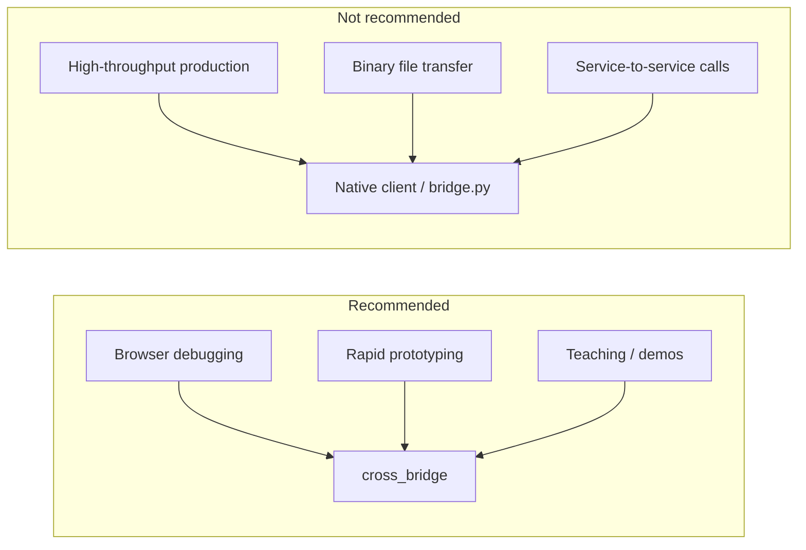
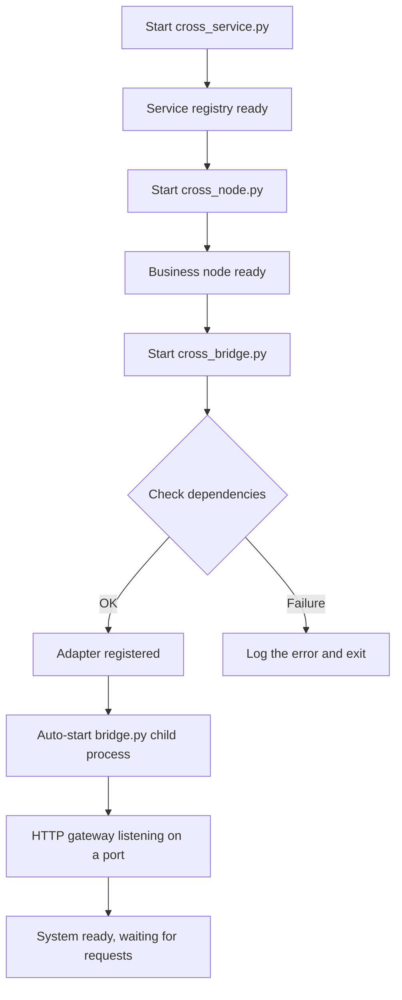
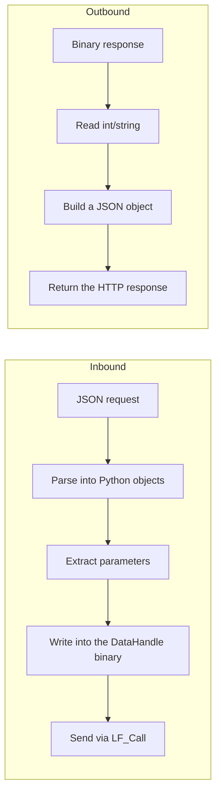
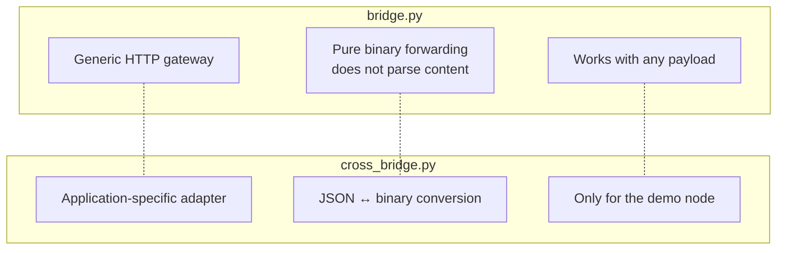
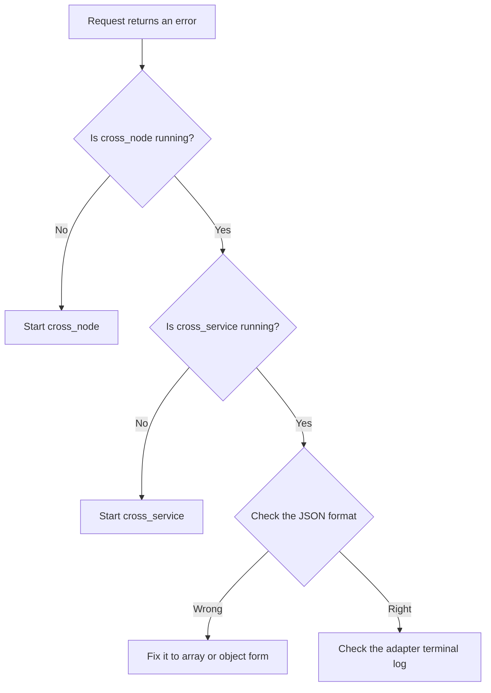

# cross_bridge_architecture_en.md

> Chinese version: [cross_bridge_architecture_zh.md](cross_bridge_architecture_zh.md)

## 1. Overview

`cross_bridge.py` is LingoFuse's **JSON ↔ binary protocol adapter**, letting dynamic languages such as JavaScript and PHP call a binary RPC node (`cross_node.py`) over HTTP/JSON. It suits demos, debugging and quick prototyping; for production, use `bridge.py` or a native client directly.

---

## 2. System architecture

> Solid lines = data flow, dashed lines = service registration and discovery.

---

## 3. Data flow: from JSON to binary and back

---

## 4. Use cases

---

## 5. Startup sequence

> `cross_bridge.py` starts a `bridge.py` child process automatically by default, but you can also start `bridge.py` separately by hand.

---

## 6. Protocol conversion details

**Supported APIs**:

| API | Input format | Output format |
|-----|---------|---------|
| `add` | `[a,b]` or `{"a":a,"b":b}` | `{"code":0,"result":a+b}` |
| `inv_seri` | an object or array containing `b,w,c,u64,s,f` (missing fields use defaults) | `{"code":0,"result":"formatted string"}` |

---

## 7. How bridge.py relates to cross_bridge.py

**How they work together**:
- `bridge.py` can be deployed standalone and connects directly to any LingoFuse service.
- `cross_bridge.py` starts `bridge.py` internally, so HTTP clients can reach the JSON adapter interface.
- In production, if you only need generic HTTP access, deploying `bridge.py` on its own is enough.

---

## 8. Troubleshooting

**Other common issues**:
- **Cross-origin**: `bridge.py` already sets CORS headers and allows all origins.
- **Performance**: JSON conversion adds latency; under high concurrency use a native client or the pure binary gateway.
- **Port in use**: change the HTTP port with the `--http-port` argument.

---

## 9. Summary

`cross_bridge.py` is a lightweight adapter that gives binary LingoFuse nodes (such as `cross_node.py`) a JSON interface, lowering the barrier for dynamic languages. It suits demos and development environments; for production, use `bridge.py` or a native LingoFuse client directly for the best performance and versatility.
