# LingoFuse HTTP Bridge — Knowledge Base (v6.0)

**Document version**: v6.0
**Component name**: `bridge` (distributed as `bridge.py` or `bridge.exe`)
**Document type**: Knowledge Base (for AI and humans)
**Reading goal**: Master the bridge's behavior, deployment, and test methodology without reading the source

---

> **Self-declaration of this knowledge base**
>
> 1. Every contract in this document is traceable to the actual bridge implementation. Every item marked 🟢 can be verified against the source.
> 2. This document **supersedes** v5.0. v5.0 documented the tri-directional bridge. v6.0 adds the **handle-ownership model** (why the inbound path must use the synchronous call family), a **test methodology chapter** (unit / integration / end-to-end), and the **debugging post-mortem** of the async-handle misuse that v5.0 shipped with.
> 3. If the source and this document conflict, **the source wins**.
> 4. All diagrams use Mermaid. All log output and code comments are English.
> 5. The bridge's history contains one important correctness fix (see Chapter 12, `BR-PIT-017` through `BR-PIT-020`). Any future maintainer who rewrites `handle_call` must read those items first.

---

## Table of Contents

**Part I — Orientation**
- [Chapter 0 — 30-Second Overview](#chapter-0--30-second-overview)
- [Chapter 1 — What the Bridge Actually Is](#chapter-1--what-the-bridge-actually-is)
- [Chapter 2 — Key Terms and the ID System](#chapter-2--key-terms-and-the-id-system)

**Part II — Contracts**
- [Chapter 3 — Inbound HTTP Direction (BR-IN-*)](#chapter-3--inbound-http-direction)
- [Chapter 4 — Outbound HTTP Direction (BR-OUT-*)](#chapter-4--outbound-http-direction)
- [Chapter 5 — JSON Repair Direction (BR-REP-*)](#chapter-5--json-repair-direction)
- [Chapter 6 — JSON Normalization Subsystem (BR-JSON-*)](#chapter-6--json-normalization-subsystem)
- [Chapter 7 — Operating Modes (BR-MODE-*)](#chapter-7--operating-modes)
- [Chapter 8 — Configuration System (BR-CFG-*)](#chapter-8--configuration-system)
- [Chapter 9 — Errors and Diagnostics (BR-ERR-*)](#chapter-9--errors-and-diagnostics)

**Part III — Operations**
- [Chapter 10 — Deployment on Linux and Windows (BR-DEP-*)](#chapter-10--deployment-on-linux-and-windows)
- [Chapter 11 — Extension and Modification (BR-EXT-*)](#chapter-11--extension-and-modification)
- [Chapter 12 — Pitfalls (BR-PIT-*)](#chapter-12--pitfalls)

**Part IV — Verification**
- [Chapter 13 — Test Methodology (BR-TEST-*)](#chapter-13--test-methodology)
- [Chapter 14 — Debugging Post-Mortem (BR-PM-*)](#chapter-14--debugging-post-mortem)

**Part V — Integration and Evolution**
- [Chapter 15 — Integration Guide (BR-INT-*)](#chapter-15--integration-guide)
- [Chapter 16 — Upgrade Guide (BR-UP-*)](#chapter-16--upgrade-guide)

**Part VI — Meta**
- [Chapter 17 — Self-Review and Index](#chapter-17--self-review-and-index)
- [Appendix A — ID Overview](#appendix-a--id-overview)
- [Appendix B — Configuration Cheat Sheet](#appendix-b--configuration-cheat-sheet)
- [Appendix C — Retrieval Rules for AI](#appendix-c--retrieval-rules-for-ai)

---

# Chapter 0 — 30-Second Overview

## 0.1 One-Sentence Definition

> **The bridge is a tri-directional POST gateway for LingoFuse. It can (A) accept HTTP POSTs and route them into LingoFuse Apps, (B) accept LingoFuse calls and forward them to external HTTP services, and (C) accept LingoFuse calls carrying malformed JSON and return the repaired text. All three directions share one LingoFuse endpoint. The HTTP listener in direction A can be disabled entirely, producing a pure forward-only relay.**

## 0.2 The Three Bridge Directions

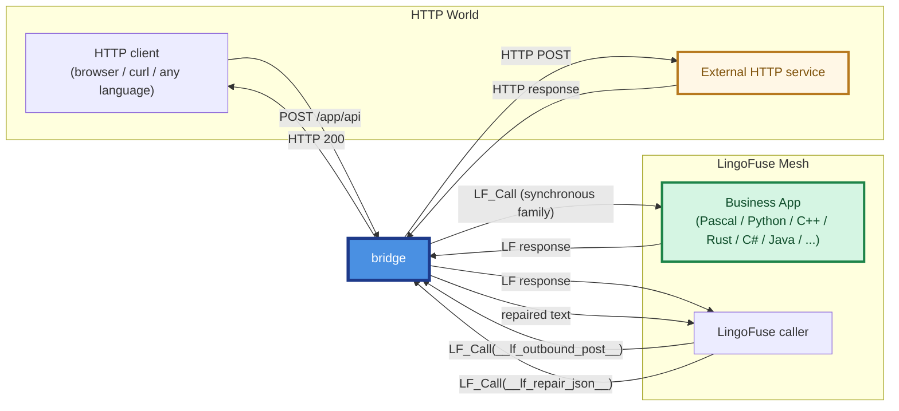

| Direction | Caller | Channel | Purpose |
|-----------|--------|---------|---------|
| **A — Inbound** | HTTP client | HTTP POST → `LF_Call` | Deliver an HTTP request into LingoFuse |
| **B — Outbound** | LingoFuse caller | `LF_Call` → HTTP POST | Send a LingoFuse request to an external HTTP service |
| **C — Repair** | LingoFuse caller | `LF_Call` → repair engine | Delegate malformed JSON to the unified repair engine |

## 0.3 Four Ironclad Rules

| # | Rule | Violation Result | ID |
|:-:|------|------------------|-----|
| 1 | **The URL path determines inbound routing**: `/<app>/<api>` or `/<api>` + `--app` | Returns `-2` (HTTP 400) | `BR-IN-003` |
| 2 | **`--endpoint` must match the backend**; the default is almost always wrong | Returns `-3` | `BR-ERR-003`, `BR-PIT-001` |
| 3 | **JSON normalization only applies to JSON-recognizable payloads**; all other bytes are forwarded unchanged | Binary safety preserved | `BR-JSON-001` |
| 4 | **The inbound path must call the LingoFuse *synchronous* family, never the *asynchronous* family**; the async family's result handle belongs to the framework and is released the moment its callback returns | Use-after-free, double-free, intermittent empty bodies | `BR-PIT-017`, `BR-PM-001` |

## 0.4 Which Chapter Should I Read?

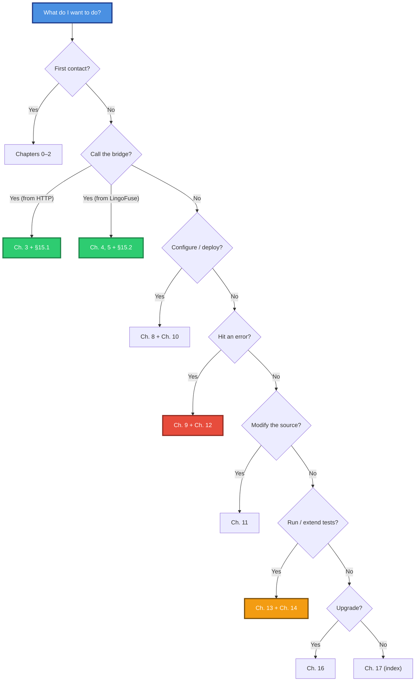

---

# Chapter 1 — What the Bridge Actually Is

## 1.1 The Bridge in One Picture

```mermaid
flowchart TB
    subgraph IdentityA["Identity A — HTTP Gateway"]
        direction LR
        A1["Listen on HTTP port"] --> A2["Parse URL path"] --> A3["Normalize JSON"] --> A4["LF_Call forward"]
    end

    subgraph IdentityB["Identity B — LF Outbound Proxy"]
        direction LR
        B1["Register LF App"] --> B2["Register outbound API"] --> B3["Receive LF_Call"] --> B4["Emit HTTP POST"] --> B5["Return JSON"]
    end

    subgraph IdentityC["Identity C — LF Repair Service"]
        direction LR
        C1["Register repair API"] --> C2["Receive LF_Call"] --> C3["Run repair engine"] --> C4["Return repaired text"]
    end

    IdentityA -.-> Shared["Shared LingoFuse endpoint<br/>(the same --endpoint)"]
    IdentityB -.-> Shared
    IdentityC -.-> Shared

    style IdentityA fill:#D5F5E3,stroke:#1E8449,stroke-width:3px,color:#0E4D2A
    style IdentityB fill:#E8F4FF,stroke:#1E3A8A,stroke-width:3px,color:#0D2F52
    style IdentityC fill:#FFF7E6,stroke:#B7791F,stroke-width:3px,color:#7E5109
    style Shared fill:#FADBD8,stroke:#922B21,stroke-width:3px,color:#641E16
```

## 1.2 Why the Three Directions Share One Endpoint

`--endpoint ipc:compute_grid` is used for three things at once:

1. **Inbound direction**: the bridge connects to the endpoint as a *client*, so it can `LF_Call` any business App.
2. **Outbound direction**: the bridge registers its own App on the endpoint as a *service*, so LingoFuse callers can discover and call `__lf_outbound_post__`.
3. **Repair direction**: the same App exposes `__lf_repair_json__` as a second Call API on the same registration.

This is a design choice: the bridge is both an ordinary node in the LingoFuse mesh and an addressable service.

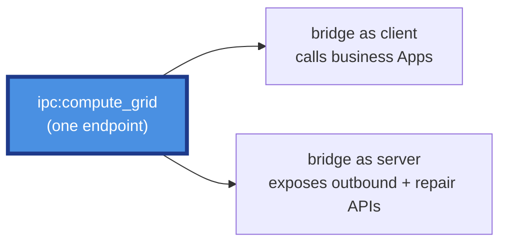

## 1.3 Deployment Topologies

### Topology A — Single instance (development / low traffic)

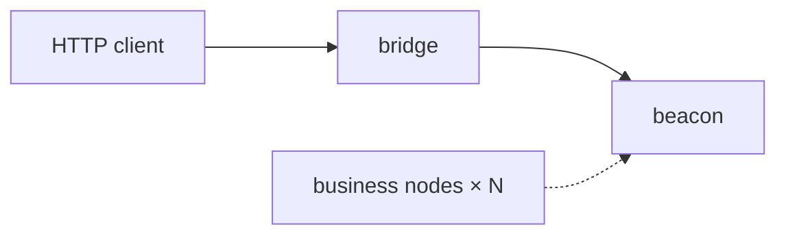

### Topology B — Multiple instances behind a load balancer (production)

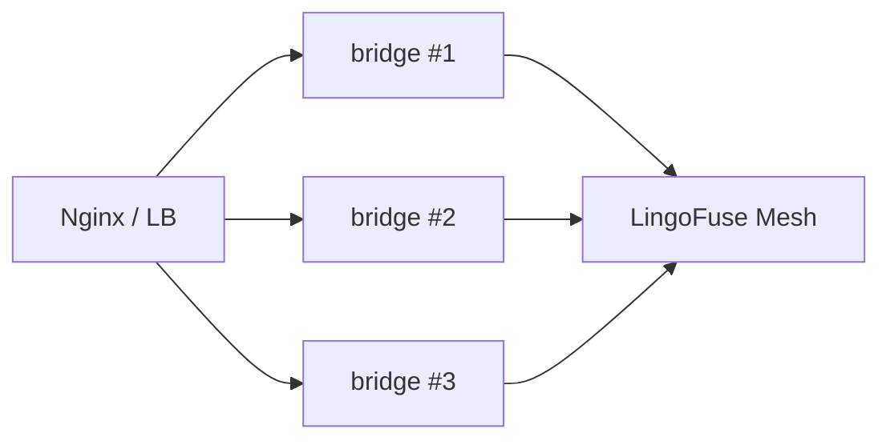

### Topology C — Reverse-proxy sidecar

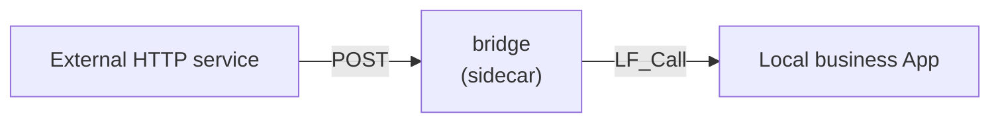

### Topology D — Forward-only relay

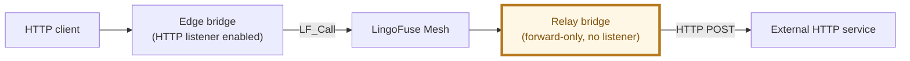

## 1.4 Key Design Principles

| Principle | Implementation | ID |
|-----------|---------------|-----|
| **Configuration is read-only after startup** | `config` is written once, then read-only | `BR-CFG-001` |
| **Thread safety** | No mutable shared state; every outbound HTTP call opens a fresh connection | `BR-GEN-002` |
| **Exception isolation** | Every callback catches exceptions and returns a well-formed response | `BR-OUT-005`, `BR-REP-005` |
| **Single JSON policy** | Every serialization uses the same canonical function | `BR-JSON-007` |
| **Namespace isolation** | Outbound API names are wrapped in double underscores | `BR-OUT-001` |
| **Rollback safety** | If network setup fails, every created resource is released | `BR-DEP-008` |
| **Binary safety** | Non-JSON payloads are returned unchanged; the bridge never guesses | `BR-JSON-001` |
| **Three-layer configuration** | Global variable → environment variable → command line, all converging on one config object | `BR-CFG-001` |
| **Synchronous-only inbound dispatch** | The inbound path uses `LF_Call` / `LF_UID_Call` / `LF_P2PNAME_Call`, never the async family | `BR-PIT-017` |
| **Callback-safe deserialization** | Any data the caller needs is copied out of the result handle *inside* the callback, never by reference | `BR-PIT-018` |

---

# Chapter 2 — Key Terms and the ID System

## 2.1 Glossary

| Term | Definition |
|------|------------|
| **Inbound direction** | HTTP → bridge → LingoFuse |
| **Outbound direction** | LingoFuse → bridge → HTTP |
| **Repair direction** | LingoFuse → bridge → repair engine |
| **Normalization** | Converting a byte payload into canonical UTF-8 JSON |
| **Passthrough** | Forwarding bytes unchanged when the payload is not JSON |
| **Canonical JSON** | JSON emitted as literal UTF-8 with no `\uXXXX` escapes |
| **Bridge App** | The bridge's own LingoFuse App (default name `__lf_http_bridge__`) |
| **outbound API** | The Call API exposed to LingoFuse callers for HTTP POST (default name `__lf_outbound_post__`) |
| **repair API** | The Call API exposed to LingoFuse callers for JSON repair (default name `__lf_repair_json__`) |
| **Forward-only mode** | An operating mode where the HTTP listener is disabled |
| **Beacon** | The LingoFuse service registration hub (`bridge_service`) |
| **Synchronous family** | `LF_Call` / `LF_UID_Call` / `LF_P2PNAME_Call` — the returned handle belongs to the caller |
| **Asynchronous family** | `LF_Async_Call` / `LF_UID_Async_Call` / `LF_P2PNAME_Async_Call` — the `Result_` handle belongs to the framework |

## 2.2 ID Naming Convention

Format: `BR-<subsystem>-<three-digit number>`

| Prefix | Subsystem | Chapter |
|--------|-----------|---------|
| `BR-GEN` | General / architecture | Chapter 1 |
| `BR-IN` | Inbound HTTP | Chapter 3 |
| `BR-OUT` | Outbound HTTP | Chapter 4 |
| `BR-REP` | JSON repair service | Chapter 5 |
| `BR-JSON` | JSON normalization | Chapter 6 |
| `BR-MODE` | Operating modes | Chapter 7 |
| `BR-CFG` | Configuration system | Chapter 8 |
| `BR-ERR` | Errors and diagnostics | Chapter 9 |
| `BR-DEP` | Deployment and operations | Chapter 10 |
| `BR-EXT` | Extension and modification | Chapter 11 |
| `BR-PIT` | Pitfalls | Chapter 12 |
| `BR-TEST` | Test methodology | Chapter 13 |
| `BR-PM` | Debugging post-mortem | Chapter 14 |
| `BR-INT` | Integration | Chapter 15 |
| `BR-UP` | Upgrade | Chapter 16 |

## 2.3 Evidence Levels

| Level | Meaning |
|:-----:|---------|
| 🟢 | Verified against source (there is a direct implementation) |
| 🟡 | Documentation transcription only |
| 🔴 | Speculative |

**Every entry in this knowledge base is 🟢.**

## 2.4 Citation Format

- Reference other IDs: `BR-IN-003`
- Reference a config field: `` `config.endpoint` ``
- Reference a source function: `` `_setup_network()` ``

---

# Chapter 3 — Inbound HTTP Direction

> **In one sentence**: an HTTP POST to `/<app>/<api>` is routed to API `<api>` on LingoFuse App `<app>`; the body is optionally normalized and forwarded via `LF_Call`; the response is optionally normalized and returned to the HTTP client.

## 3.1 ID: `BR-IN-001` — Routing Rules

- **Evidence level**: 🟢
- **Trigger**: any HTTP POST reaching the bridge (only when the HTTP listener is enabled)
- **Rules**:

| Path | `--app` | Routing result |
|------|---------|----------------|
| `/pas/exp` | any | `app='pas'`, `api='exp'` |
| `/exp` | `pas` | `app='pas'`, `api='exp'` |
| `/exp` | unset | **Error `-2` (HTTP 400)** |
| `/a/b/c` | any | `app='a'`, `api='b/c'` (the tail is joined into `api`) |
| `/uid/<hex64>/<api>` | any | UID addressing |
| `/p2p/<group>/<api>` | any | P2PName addressing |
| `/` | any | **Error `-2`** |

## 3.2 ID: `BR-IN-002` — Request Body Handling

- **Evidence level**: 🟢
- **Behavior**:
  1. Read the raw bytes of the HTTP body.
  2. If `config.normalize_json=True`, normalize the payload.
  3. Write to the LingoFuse DataHandle, always appending a NUL terminator.
- **Note**: **whether or not the payload is JSON, a NUL terminator is appended**. This is the LingoFuse wire-protocol convention.

## 3.3 ID: `BR-IN-003` — Path Parsing Error (`-2`)

- **Evidence level**: 🟢
- **Trigger**:
  - A single-segment path with no `--app` configured.
  - An empty path (`/`).
- **Response**: HTTP 400, body `{"code": -2, "error": "..."}`.
- **Fix**: use a two-segment path `/<app>/<api>`, or set `--app <default_app>`.

## 3.4 ID: `BR-IN-004` — Optional Pre-Check

- **Evidence level**: 🟢
- **Trigger**: `no_precheck=False` (default).
- **Behavior**: before forwarding, ask the mesh whether the target API is available; up to 3 attempts, 200 ms apart.
- **On failure**: return `-3` (HTTP 200).
- **Bypass**: `--no-precheck` or `LINGOFUSE_NO_PRECHECK=1`.
- **Use case**: when a broadcast delay (~3 s) makes the pre-check produce a false negative, retry or bypass it.

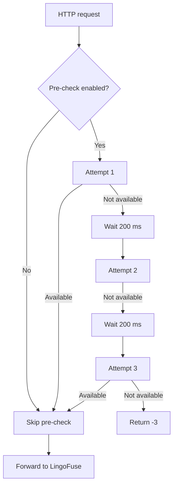

## 3.5 ID: `BR-IN-005` — Forwarding to LingoFuse (Synchronous Family)

- **Evidence level**: 🟢
- **Flow**:
  1. Create a DataHandle for `api_name`.
  2. Write the body (a NUL terminator is appended).
  3. Dispatch using the **synchronous** call primitive for the selected addressing mode:
     - App-name: `LF_Call(app_name, hnd, timeout_ms)`
     - UID: `LF_UID_Call(uid_array, hnd, timeout_ms)`
     - P2PName: `LF_P2PNAME_Call(group_name, hnd, timeout_ms)`
  4. **Reset the result handle position to 0** with `LF_SetPos(res_ptr, 0)` before reading.
  5. Read the response bytes with `read_string_bytes(res_ptr)`.
  6. Release the result handle with `LF_FreeData(res_ptr)` — legal because the **synchronous family returns a caller-owned handle**.
  7. Release the input handle (always, even on exception).
- **Key constraints**:
  - Every handle release happens on the exception path too.
  - The call timeout is in milliseconds.
  - **The synchronous family is chosen deliberately**; see `BR-PIT-017` for why the asynchronous family is unsafe here.

## 3.6 ID: `BR-IN-006` — Response Content-Type Mapping

- **Evidence level**: 🟢
- **Rules**: the response normalization status determines the `Content-Type`.

| Normalization status | Content-Type |
|----------------------|--------------|
| `canonical` | `application/json; charset=utf-8` |
| `recoded` | `application/json; charset=utf-8` |
| `repaired` | `application/json; charset=utf-8` |
| `passthrough` | `application/octet-stream` |

## 3.7 ID: `BR-IN-007` — Inbound Error Codes

| Code | HTTP | Trigger |
|:----:|:----:|---------|
| `-1` | 200 | Remote call failed (timeout, null handle, backend exception) |
| `-2` | **400** | Request shape error (path cannot be parsed) |
| `-3` | 200 | Pre-check failed |

## 3.8 ID: `BR-IN-008` — CORS Support

- **Evidence level**: 🟢
- **Behavior**: every response carries
  - `Access-Control-Allow-Origin: *`
  - `Access-Control-Allow-Headers: Content-Type`
  - `Access-Control-Allow-Methods: POST, GET, OPTIONS`
- **OPTIONS preflight**: returns `('', 200)` immediately.
- **Exception protection**: CORS header injection never prevents a response from being returned.

## 3.9 ID: `BR-IN-009` — Debug Logging

- **Evidence level**: 🟢
- **Trigger**: `--debug`.
- **Logged content**: request path, payload size, normalization status, response size, response status. Small payloads log their text; large payloads log the first 64 bytes in hex.

## 3.10 ID: `BR-IN-010` — Interaction with Forward-Only Mode

- **Evidence level**: 🟢
- **Contract**: when forward-only mode is enabled, no HTTP listener is started. Any HTTP request to the host is refused by the OS.

---

# Chapter 4 — Outbound HTTP Direction

> **In one sentence**: the bridge registers a Call API (default `__lf_http_bridge__.__lf_outbound_post__`); a LingoFuse caller sends a JSON request describing an HTTP POST; the bridge executes it and returns the response as JSON.

## 4.1 ID: `BR-OUT-001` — Namespace Isolation

- **Evidence level**: 🟢
- **Default App name**: `__lf_http_bridge__`
- **Default API name**: `__lf_outbound_post__`
- **Why double underscores**: a normal URL path cannot contain an unencoded `__`. So the bridge's API names can never collide with a business API routed through the inbound direction. This is *structural* isolation, not a naming convention.
- **Override methods**:
  - Command line: `--bridge-app <name>` `--bridge-api <name>`
  - Environment: `LINGOFUSE_BRIDGE_APP`, `LINGOFUSE_BRIDGE_API`

## 4.2 ID: `BR-OUT-002` — Request JSON Contract

- **Evidence level**: 🟢
- **Format**:

```json
{
    "url":     "http://example.com/api",
    "method":  "POST",
    "headers": { "X-Foo": "Bar" },
    "body":    { "any": "json" },
    "timeout": 10
}
```

- **Field constraints**:

| Field | Type | Required | Default | Constraint |
|-------|------|:--------:|---------|------------|
| `url` | string | ✅ | — | non-empty |
| `method` | string | ❌ | `"POST"` | must be in the allow-list (`BR-OUT-003`) |
| `headers` | object | ❌ | `{}` | JSON object |
| `body` | any | ❌ | `null` | any JSON value; null means no body |
| `timeout` | number | ❌ | `config.timeout_ms / 1000.0` | > 0 and ≤ 300 s |

## 4.3 ID: `BR-OUT-003` — HTTP Method Allow-List

- **Evidence level**: 🟢
- **Allow-list**: `GET`, `POST`, `PUT`, `PATCH`, `DELETE`, `HEAD`, `OPTIONS`
- **Out-of-list result**: `{"error": "Unsupported HTTP method: ..."}`

## 4.4 ID: `BR-OUT-004` — Body Serialization Policy

- **Evidence level**: 🟢
- **Key rule**: the outbound body must always be sent as **literal UTF-8 bytes**, never as `\uXXXX` escapes.
- **Content-Type injection**: if the caller did not provide a Content-Type, the bridge injects `application/json; charset=utf-8`. The check is case-insensitive.

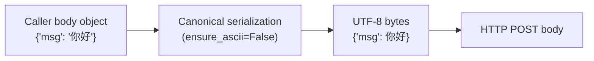

## 4.5 ID: `BR-OUT-005` — Exception Isolation

- **Evidence level**: 🟢
- **Contract**: **no exception is allowed to escape** into the LingoFuse core.

| Situation | Returned to the caller |
|-----------|-----------------------|
| HTTP request timed out | `{"error": "HTTP request timed out"}` |
| HTTP request failed (network / DNS / TLS) | `{"error": "HTTP request failed: ..."}` |
| Any other exception | `{"error": "Internal error: ..."}` |
| Even writing the response fails | Last resort: silently ignored |

## 4.6 ID: `BR-OUT-006` — Response JSON Contract

- **Evidence level**: 🟢
- **Success response**:

```json
{
    "status_code": 200,
    "headers":     { "content-type": "application/json", ... },
    "body":        { ... } | "raw string if not JSON"
}
```

- **Error response**:

```json
{ "error": "description" }
```

## 4.7 ID: `BR-OUT-007` — Response Header Normalization

- **Evidence level**: 🟢
- **Rules**: header names are lower-cased; values are converted to strings.

## 4.8 ID: `BR-OUT-008` — Timeout Protection

- **Evidence level**: 🟢
- **Upper bound**: 300 s.
- **Out-of-range handling**: a caller passing > 300 is **clamped to 300**, not rejected.

## 4.9 ID: `BR-OUT-009` — Callback Threading Model

- **Evidence level**: 🟢
- **Executing thread**: LingoFuse worker thread (**not** the HTTP listener thread, **not** the main thread).
- **Forbidden**: calling a blocking LingoFuse function inside the callback — this will deadlock.
- **Allowed**: opening a fresh outbound HTTP connection.

## 4.10 ID: `BR-OUT-010` — Interaction with Forward-Only Mode

- **Evidence level**: 🟢
- **Contract**: the outbound API is registered and served identically in **both** operating modes.

---

# Chapter 5 — JSON Repair Direction

> **In one sentence**: the bridge registers a second Call API (default `__lf_http_bridge__.__lf_repair_json__`); a LingoFuse caller sends any UTF-8 JSON text (possibly malformed); the bridge runs the unified repair engine on it and returns the repaired text.

## 5.1 ID: `BR-REP-001` — Why a Repair API

- **Evidence level**: 🟢
- **Motivation**:
  - LLMs frequently emit near-JSON that a strict parser rejects: trailing commas, single quotes, unbalanced braces, stray BOMs.
  - Every language in the mesh would otherwise need to vendor its own repair library.
  - The bridge already carries the canonical repair engine; exposing it as a Call API makes the repair policy **language-neutral**.

## 5.2 ID: `BR-REP-002` — Input Contract

- **Evidence level**: 🟢
- **Input payload**: UTF-8 (fallback GBK, Latin-1) encoded JSON text.
  - May be malformed.
  - May be missing a NUL terminator.
  - May contain a UTF-8 BOM or trailing NULs.

## 5.3 ID: `BR-REP-003` — Output Contract

- **Evidence level**: 🟢
- **Output payload**: UTF-8 encoded, NUL-terminated text. Its content is one of:

| Input | Output |
|-------|--------|
| Valid JSON | The original text, byte-for-byte unchanged |
| Malformed but repairable | The repaired text |
| Malformed and unrepairable | The original text, byte-for-byte unchanged |
| Undecodable bytes | The original raw bytes, byte-for-byte unchanged |
| Empty | An empty NUL-terminated payload |

## 5.4 ID: `BR-REP-004` — No-Escape Guarantee

- **Evidence level**: 🟢
- **Contract**: the returned text never contains a `\uXXXX` escape for any character that can be emitted literally in UTF-8.

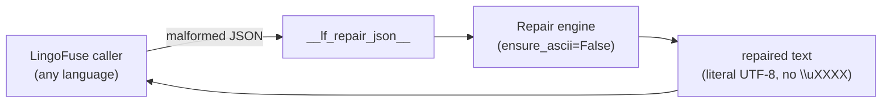

## 5.5 ID: `BR-REP-005` — Exception Isolation

- **Evidence level**: 🟢
- **Contract**: no exception is allowed to escape. On internal failure, an empty NUL-terminated payload is written and the failure is logged.

## 5.6 ID: `BR-REP-006` — Repair Layer Alignment

- **Evidence level**: 🟢
- **Contract**: the repair API uses the **same** engine as the bridge's inbound normalization (Layer 2).

## 5.7 ID: `BR-REP-007` — Encoding Fallback Chain

- **Evidence level**: 🟢
- **Order**: UTF-8 → GBK → Latin-1.

## 5.8 ID: `BR-REP-008` — Interaction with Forward-Only Mode

- **Evidence level**: 🟢
- **Contract**: the repair API is registered and served identically in **both** operating modes.

---

# Chapter 6 — JSON Normalization Subsystem

> **In one sentence**: the bridge "normalizes" byte payloads that can be recognized as JSON — turning them into canonical UTF-8 with no `\uXXXX` escapes; payloads that cannot be recognized are forwarded **byte-for-byte unchanged**.

## 6.1 ID: `BR-JSON-001` — Core Rule

- **Evidence level**: 🟢
- **Rules**:
  - Recognizable as JSON → emit canonical form.
  - Not recognizable → original bytes **unchanged**.
- **Binary safety**: a **hard guarantee**; never guess, never modify.

## 6.2 ID: `BR-JSON-002` — The Seven Normalization Steps

- **Evidence level**: 🟢

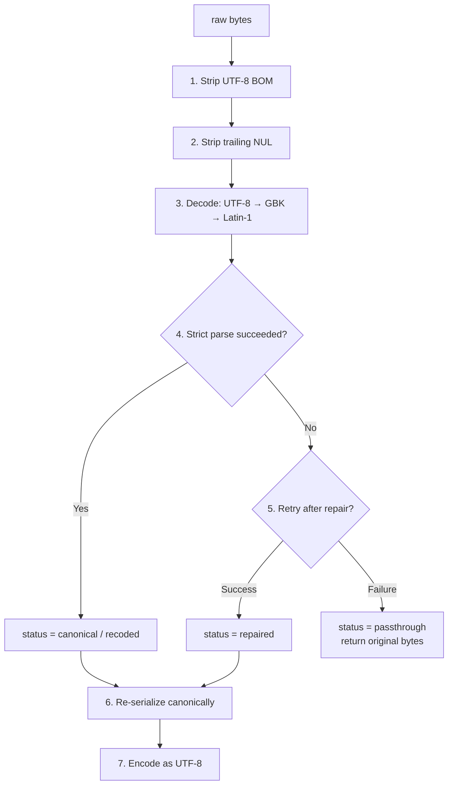

## 6.3 ID: `BR-JSON-003` — The Four Status Codes

| Status | Meaning | Output | Used For Content-Type |
|--------|---------|--------|-----------------------|
| `canonical` | Input is already valid UTF-8 JSON | Compact JSON | `application/json` |
| `recoded` | Input is valid JSON in another encoding | Converted to UTF-8 | `application/json` |
| `repaired` | Input required repair to become valid | Compact JSON | `application/json` |
| `passthrough` | Not recognizable as JSON | **Original bytes** | `application/octet-stream` |

## 6.4 ID: `BR-JSON-004` — Permitted Repairs

- **Evidence level**: 🟢
- **Conservative repairs**:
  1. Strip a UTF-8 BOM.
  2. Strip trailing NUL bytes.
  3. Strip a leading U+FEFF character.
  4. Remove trailing commas (`{"a":1,}` → `{"a":1}`).

## 6.5 ID: `BR-JSON-005` — Status Classification Truth Table

| Input | Output | Status |
|-------|--------|--------|
| `{"a":1}` | `{"a":1}` | canonical |
| `{"a":1,}` | `{"a":1}` | repaired |
| `EF BB BF{"a":1}` | `{"a":1}` | canonical |
| `{"a":"\u4f60\u597d"}` | `{"a":"你好"}` | canonical |
| `{"a":1}\x00` | `{"a":1}` | canonical |
| GBK `{"a":"你好"}` | UTF-8 `{"a":"你好"}` | recoded |
| `\x89PNG\r\n...` | unchanged | passthrough |
| `not json at all` | unchanged | passthrough |
| Empty bytes | unchanged | passthrough |
| UTF-16 BOM | unchanged | passthrough |

## 6.6 ID: `BR-JSON-006` — Idempotence

- **Evidence level**: 🟢
- **Contract**: normalizing an already-normalized payload produces the same bytes.

## 6.7 ID: `BR-JSON-007` — Single Source of Serialization Policy

- **Evidence level**: 🟢
- **Single source**: one canonical serializer, used by every direction.
- **Usage points in this component**:
  1. Inbound normalization (step 6).
  2. Outbound body serialization.
  3. Error response serialization.

## 6.8 ID: `BR-JSON-008` — Encoding Fallback Order

- **Evidence level**: 🟢
- **Attempt order**: UTF-8 → GBK → Latin-1.

## 6.9 ID: `BR-JSON-009` — Binary Safety Boundary

- **Evidence level**: 🟢
- **Safe cases**: any byte sequence, payloads containing NUL bytes, non-UTF-8 text.
- **Unsafe cases**: **none** (this is a hard guarantee).

---

# Chapter 7 — Operating Modes

> **In one sentence**: the bridge supports two operating modes — **full** (HTTP listener enabled) and **forward-only** (HTTP listener disabled, Call APIs still served) — controlled by a single boolean `forward_only`.

## 7.1 ID: `BR-MODE-001` — Mode Enumeration

- **Evidence level**: 🟢

| Mode | `forward_only` | HTTP listener | Outbound Call API | Repair Call API |
|------|:--------------:|:-------------:|:-----------------:|:---------------:|
| **Full** (default) | `False` | ✅ | ✅ | ✅ |
| **Forward-only** | `True` | ❌ | ✅ | ✅ |

## 7.2 ID: `BR-MODE-002` — Why a Forward-Only Mode

- **Evidence level**: 🟢
- **Use cases**:
  1. **Internal relay**: must not be reachable from the network.
  2. **Edge proxy already present**: HTTP handled elsewhere.
  3. **Restricted host environment**: port binding not permitted.

## 7.3 ID: `BR-MODE-003` — Behavior in Forward-Only Mode

- **Evidence level**: 🟢
- **Startup sequence**:
  1. Read configuration into the global config object.
  2. Configure logging.
  3. Print the startup banner (reports the mode).
  4. Register the bridge App and both Call APIs.
  5. **Skip** the HTTP listener; the main thread sleeps.
  6. On Ctrl+C, cleanup runs from the `finally` block.

## 7.4 ID: `BR-MODE-004` — Main Thread Behavior Comparison

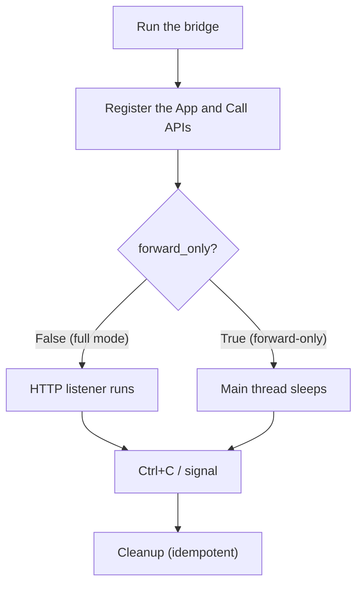

## 7.5 ID: `BR-MODE-005` — Mode Transition

- **Evidence level**: 🟢
- **Contract**: the mode is read **once** at startup. There is no runtime API to switch modes.

---

# Chapter 8 — Configuration System

> **In one sentence**: all configuration is loaded once and then frozen in a single global object; the precedence is **command line > environment variable > global variable pre-set > built-in default**; runtime code only reads the frozen config.

## 8.1 ID: `BR-CFG-001` — Configuration Loading Model

- **Evidence level**: 🟢

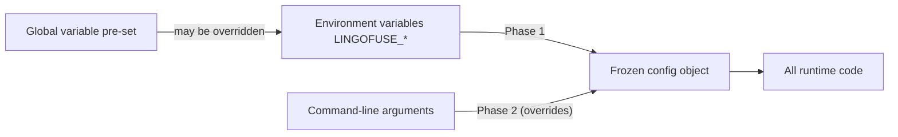

## 8.2 ID: `BR-CFG-002` — Complete Configuration Table

| Field | Environment variable | Command-line flag | Default | Notes |
|-------|----------------------|-------------------|---------|-------|
| `host` | `LINGOFUSE_HOST` | `--host` | `0.0.0.0` | Inbound listen address |
| `port` | `LINGOFUSE_PORT` | `--port` | `8081` | Inbound listen port |
| `forward_only` | `LINGOFUSE_FORWARD_ONLY` | `--forward-only` / `--no-forward-only` | `False` | Disables the HTTP listener |
| `endpoint` | `LINGOFUSE_ENDPOINT` | `--endpoint` | `ipc:lingofuse_bridge` | **Shared by all directions** |
| `timeout_ms` | `LINGOFUSE_TIMEOUT` | `--timeout` | `5000` | Default LingoFuse call timeout |
| `default_app` | `LINGOFUSE_APP` | `--app` | `None` | Default app for single-segment paths |
| `threaded` | `LINGOFUSE_THREADED` | `--threaded` / `--no-threaded` | `True` | HTTP multi-threading |
| `debug` | `LINGOFUSE_DEBUG` | `--debug` / `--no-debug` | `False` | Verbose logging |
| `no_precheck` | `LINGOFUSE_NO_PRECHECK` | `--no-precheck` / `--precheck` | `False` | Skip the availability pre-check |
| `normalize_json` | `LINGOFUSE_NORMALIZE_JSON` | `--normalize-json` / `--no-normalize-json` | `True` | Inbound JSON normalization |
| `log_file` | `LINGOFUSE_LOG_FILE` | `--log-file` | `None` | Log file path |
| `bridge_app_name` | `LINGOFUSE_BRIDGE_APP` | `--bridge-app` | `__lf_http_bridge__` | Outbound App name |
| `bridge_api_name` | `LINGOFUSE_BRIDGE_API` | `--bridge-api` | `__lf_outbound_post__` | Outbound API name |
| `bridge_repair_api_name` | `LINGOFUSE_BRIDGE_REPAIR_API` | `--bridge-repair-api` | `__lf_repair_json__` | Repair API name |

## 8.3 ID: `BR-CFG-003` — Boolean Environment Variable Format

- **Evidence level**: 🟢
- **Truthy**: `1`, `true`, `yes`, `on` (case-insensitive).
- **Falsy**: `0`, `false`, `no`, `off` (case-insensitive).
- **Invalid values**: logged as a warning, and the default is used.

## 8.4 ID: `BR-CFG-004` — Command-Line Help

- **Evidence level**: 🟢
- **Supported**: `--help` / `-h`.
- **Behavior**: prints the full usage, including the environment-variable reference, and exits with status 0.

## 8.5 ID: `BR-CFG-005` — Configuration Precedence

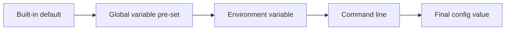

## 8.6 ID: `BR-CFG-006` — Configuration Freeze Contract

- **Evidence level**: 🟢
- **Contract**: after startup, no field of the config is written again.

## 8.7 ID: `BR-CFG-007` — `log_file`: Unset vs. Empty

- **Evidence level**: 🟢
- **Unset**: only stderr.
- **Explicit empty string**: treated as "no file"; also only stderr.

## 8.8 ID: `BR-CFG-008` — `default_app`: Unset vs. Empty

- **Evidence level**: 🟢
- **Unset**: single-segment paths return `-2`.
- **Empty string**: treated as unset (not recommended).

## 8.9 ID: `BR-CFG-009` — `Overlap_Connection` Implicit Setting

- **Evidence level**: 🟢
- **Timing**: set before preparing the LingoFuse client.
- **Value**: `True`.

## 8.10 ID: `BR-CFG-010` — `Wait_Connection_ReadyOk` Implicit Setting

- **Evidence level**: 🟢
- **Value**: `False` (deployment mode).

## 8.11 ID: `BR-CFG-011` — Language of Logs and Comments

- **Evidence level**: 🟢
- **Contract**: **all logs, comments, and docstrings are in English**.

## 8.12 ID: `BR-CFG-012` — Programmatic Use via the Global Variable Layer

- **Evidence level**: 🟢
- **Contract**: the config object is a plain module-level object. Code that embeds the bridge may assign to any of its fields before the run starts.

---

# Chapter 9 — Errors and Diagnostics

## 9.1 ID: `BR-ERR-001` — Error Response Format

- **Evidence level**: 🟢
- **Format**:

```json
{ "code": -3, "error": "API 'exp' not available for app 'pas'" }
```

## 9.2 ID: `BR-ERR-002` — Inbound Error Code Overview

| Code | HTTP | Meaning | Trigger | Fix |
|:----:|:----:|---------|---------|-----|
| `-1` | 200 | Remote call failed | Timeout / null handle / backend exception | Increase `--timeout`, check the backend |
| `-2` | **400** | Request shape error | Path cannot be parsed / no default app | Use `/<app>/<api>` or `--app` |
| `-3` | 200 | Pre-check failed | Availability check returned False 3 times | `--no-precheck` or start the backend |

## 9.3 ID: `BR-ERR-003` — Outbound Error Format

- **Evidence level**: 🟢
- **Format**: `{ "error": "description" }`

## 9.4 ID: `BR-ERR-004` — Error Message Index

| Message | Code | Trigger | Fix |
|---------|:----:|---------|-----|
| `No default app set (use --app)` | `-2` | Single-segment path + no `--app` | `--app <name>` or a two-segment path |
| `Missing API name in path` | `-2` | Path is `/` | Check the URL |
| `API 'X' not available for app 'Y'` | `-3` | Availability check failed | `--no-precheck` or bring the backend up |
| `Call timeout` | `-1` | Call timed out | Increase `--timeout` |
| `Remote call returned a null handle` | `-1` | Call returned NULL | Check backend health |
| `Failed to create DataHandle` | `-1` | Data handle creation failed | Rare; restart the bridge |
| `Internal error: ...` | `-1` | Unexpected exception | Restart with `--debug` to investigate |
| `Empty or invalid JSON request` | out | Outbound request empty/invalid | Check the caller |
| `Request must be a JSON object` | out | Outbound request not an object | Check the caller |
| `Missing or invalid 'url' field` | out | Outbound is missing URL | Add `url` |
| `Unsupported HTTP method: ...` | out | Method not in the allow-list | Use a method from the allow-list |
| `'headers' must be a JSON object` | out | `headers` is not an object | Check the caller |
| `'timeout' must be a positive number of seconds` | out | timeout ≤ 0 or non-numeric | Fix the value |
| `HTTP request timed out` | out | Outbound HTTP timed out | Increase timeout |
| `HTTP request failed: ...` | out | Network/DNS/TLS error | Check the target URL |

## 9.5 ID: `BR-ERR-005` — Diagnostic Decision Tree

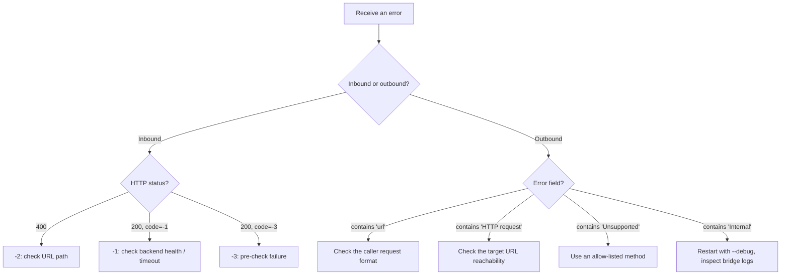

## 9.6 ID: `BR-ERR-006` — Status Queue Auxiliary Diagnostics

- **Evidence level**: 🟢
- **Trigger**: an inbound response is empty and `--debug` is enabled.
- **Behavior**: the bridge reads up to 3 LingoFuse internal log messages and forwards them to its own logger.

## 9.7 ID: `BR-ERR-007` — Forward-Only Mode Diagnostics

- **Evidence level**: 🟢
- **Contract**: in forward-only mode, inbound HTTP errors `-1`, `-2`, `-3` never appear.

---

# Chapter 10 — Deployment on Linux and Windows

> **In one sentence**: the bridge runs the same way everywhere; only the shell syntax for setting environment variables and the executable form differ.

## 10.1 ID: `BR-DEP-001` — Executable Forms

| Form | Linux | Windows |
|------|-------|---------|
| Python script | `python3 bridge.py` or `./bridge.py` | `python bridge.py` |
| Native executable | `./bridge` (if built) | `bridge.exe` |

## 10.2 ID: `BR-DEP-002` — Shell Syntax Differences

### Linux (bash / zsh)

```bash
LINGOFUSE_FORWARD_ONLY=1 \
LINGOFUSE_ENDPOINT=ipc:compute_grid \
./bridge --no-precheck
```

### Windows — Command Prompt (cmd.exe)

```bat
set LINGOFUSE_FORWARD_ONLY=1
set LINGOFUSE_ENDPOINT=ipc:compute_grid
bridge.exe --no-precheck
```

### Windows — PowerShell

```powershell
$env:LINGOFUSE_FORWARD_ONLY = "1"
$env:LINGOFUSE_ENDPOINT = "ipc:compute_grid"
.\bridge.exe --no-precheck
```

## 10.3 ID: `BR-DEP-003` — Three-Stage Startup (Reference Recipe)

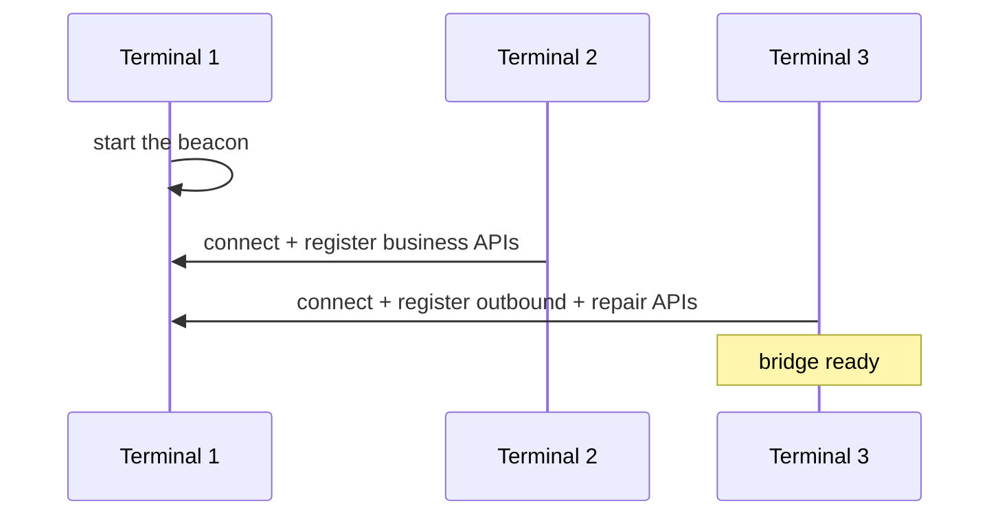

## 10.4 ID: `BR-DEP-004` — Production Deployment (Full Mode)

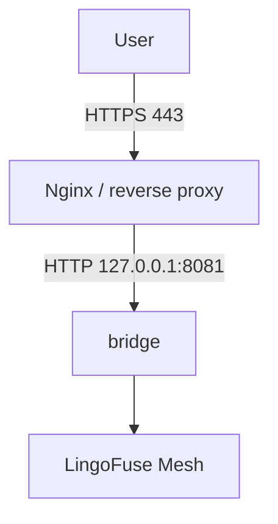

## 10.5 ID: `BR-DEP-005` — Forward-Only Deployment Recipe

### Linux

```bash
LINGOFUSE_FORWARD_ONLY=1 \
LINGOFUSE_ENDPOINT=ipc:compute_grid \
./bridge
```

### Windows (PowerShell)

```powershell
$env:LINGOFUSE_FORWARD_ONLY = "1"
$env:LINGOFUSE_ENDPOINT = "ipc:compute_grid"
.\bridge.exe
```

## 10.6 ID: `BR-DEP-006` — Containerized Deployment (Full Mode)

```yaml
services:
  bridge:
    image: lingofuse-bridge
    environment:
      LINGOFUSE_HOST: "0.0.0.0"
      LINGOFUSE_PORT: "8081"
      LINGOFUSE_FORWARD_ONLY: "0"
      LINGOFUSE_ENDPOINT: "ipc:compute_grid"
    ports:
      - "8081:8081"
```

## 10.7 ID: `BR-DEP-007` — Containerized Deployment (Forward-Only Mode)

```yaml
services:
  bridge-relay:
    image: lingofuse-bridge
    environment:
      LINGOFUSE_FORWARD_ONLY: "1"
      LINGOFUSE_ENDPOINT: "ipc:compute_grid"
    # NOTE: no ports section — this instance binds no TCP port.
```

## 10.8 ID: `BR-DEP-008` — Horizontal Scaling

- **Add instances**: start more bridge processes.
- **No configuration change**.
- **No session affinity**: the bridge is stateless.

## 10.9 ID: `BR-DEP-009` — Startup as a Service

### Linux (systemd unit)

```ini
[Unit]
Description=LingoFuse HTTP Bridge
After=network.target

[Service]
Type=simple
ExecStart=/opt/lingofuse/bridge --endpoint ipc:compute_grid --log-file /var/log/bridge.log
Restart=on-failure
RestartSec=3

[Install]
WantedBy=multi-user.target
```

### Windows (Service via NSSM)

```bat
nssm install LingoFuseBridge "C:\LingoFuse\bridge.exe" ^
    "--endpoint" "ipc:compute_grid" ^
    "--log-file" "C:\LingoFuse\logs\bridge.log"
nssm start LingoFuseBridge
```

## 10.10 ID: `BR-DEP-010` — Cleanup Order

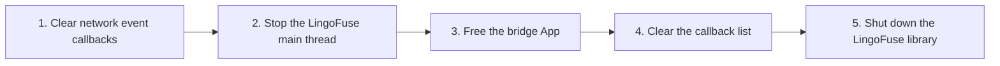

## 10.11 ID: `BR-DEP-011` — Failure Rollback

- **Evidence level**: 🟢
- **Contract**: any step failing releases the resources already created.

## 10.12 ID: `BR-DEP-012` — Cross-Platform Log Handling

- **Contract**: logs are written to stderr by default, and to `--log-file` when provided.

---

# Chapter 11 — Extension and Modification

## 11.1 ID: `BR-EXT-001` — Insertion Points

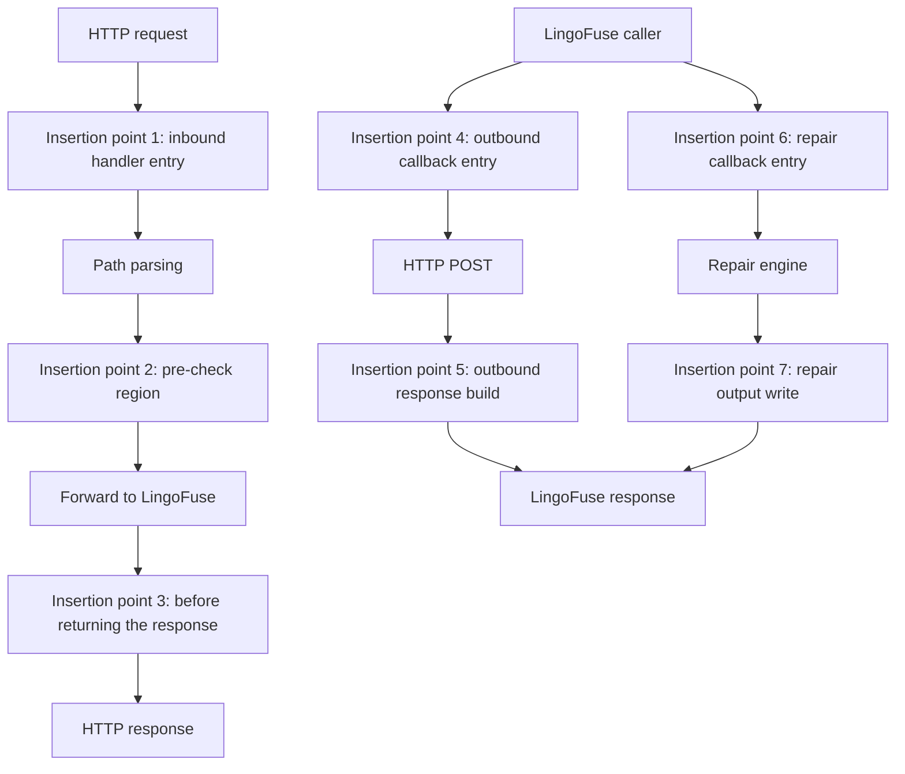

## 11.2 ID: `BR-EXT-002` — Common Extension Patterns

| Need | Insertion point | Implementation |
|------|:---------------:|----------------|
| API Key auth | 1 | Check the `X-API-Key` header |
| JWT auth | 1 | Validate the `Authorization` header |
| Rate limiting | 1 | A rate-limit middleware |
| Structured logging | 1 + 3 | Generate a `request_id` and log before and after |
| Metrics | 3 | A metrics collector |
| Response filtering | 3 | Rewrite the response bytes before returning |
| Outbound URL allow-list | 4 | Check the parsed `url` against a trusted list |
| Outbound header sanitization | 4 | Remove or rewrite specific headers |
| Repair logging | 6 | Log every repair request to an audit sink |
| Repair response post-processing | 7 | Rewrite the repaired text before writing it out |

## 11.3 ID: `BR-EXT-003` — Adding New Error Codes

- **Current range**: `-1`, `-2`, `-3`.
- **Extension rule**: start at `-4` and decrement; document the new code explicitly.

## 11.4 ID: `BR-EXT-004` — The Only Place to Change JSON Policy

- **Evidence level**: 🟢
- **Location**: the canonical serializer used by every direction.
- **Do not**:
  - Use a different JSON serializer anywhere in the bridge.
  - Use any HTTP library's `.json=` shortcut.
  - Manually concatenate JSON.

## 11.5 ID: `BR-EXT-005` — Adding a New Outbound HTTP Client

- **Evidence level**: 🟢
- **When swapping the underlying HTTP library**:
  - Keep the call non-blocking with respect to the LingoFuse worker thread.
  - Preserve the timeout clamp.
  - Preserve the exception-category handling.
  - Preserve the response-header lowercasing.
  - Preserve the "no `\uXXXX` on the wire" policy.

## 11.6 ID: `BR-EXT-006` — Changing the Callback API Names

- **Command line**: `--bridge-app` `--bridge-api` `--bridge-repair-api`.
- **Environment variable**: `LINGOFUSE_BRIDGE_APP` `LINGOFUSE_BRIDGE_API` `LINGOFUSE_BRIDGE_REPAIR_API`.

## 11.7 ID: `BR-EXT-007` — Changing Inbound Routing

- **Evidence level**: 🟢
- **Warning**: after modifying, update §3.1 of this document.

## 11.8 ID: `BR-EXT-008` — Adding a New Forward-Only Capability

- **Evidence level**: 🟢
- **Pattern**: register the new capability as an additional Call API alongside the outbound and repair APIs.

---

# Chapter 12 — Pitfalls

## 12.1 ID: `BR-PIT-001` — Using the Default Endpoint

- **Symptom**: `-3: API 'exp' not available for app 'pas'`.
- **Root cause**: the default `--endpoint` is `ipc:lingofuse_bridge`, which does not match the backend.
- **Fix**: explicitly set `--endpoint ipc:compute_grid`.

## 12.2 ID: `BR-PIT-002` — Broadcast Delay Mistaken for a Missing API

- **Symptom**: a business node just started, and the bridge called it immediately → `-3`.
- **Fix A**: `--no-precheck`.
- **Fix B**: wait 1–2 s before starting the bridge.

## 12.3 ID: `BR-PIT-003` — Single-Segment Path Without a Default App

- **Symptom**: `-2: No default app set (use --app)`.

## 12.4 ID: `BR-PIT-004` — Expecting JSON Schema Validation

- **Truth**: the bridge only guarantees *legal JSON bytes*; it does not guarantee *business-valid data*.

## 12.5 ID: `BR-PIT-005` — Binary Payload "Corruption"

- **Truth**: non-JSON payloads are forwarded **byte-for-byte unchanged**.

## 12.6 ID: `BR-PIT-006` — Timeout Too Short

- **Symptom**: `-1: Call timeout`.

## 12.7 ID: `BR-PIT-007` — `\uXXXX` Escapes in the Outbound Body

- **Symptom**: the external HTTP server receives `\u4f60\u597d` instead of `你好`.
- **Root cause**: using a library's `.json=` shortcut triggers `ensure_ascii=True`.

## 12.8 ID: `BR-PIT-008` — Outbound API Name Collision

- **Symptom**: a caller calls `post`, but routing goes to a business App instead.
- **Fix**: keep the default double-underscore name.

## 12.9 ID: `BR-PIT-009` — Calling a Blocking LingoFuse Function Inside a Callback

- **Symptom**: the entire LingoFuse mesh deadlocks.

## 12.10 ID: `BR-PIT-010` — Concurrent Modification of the Config Object

- **Fix**: **do not modify**. All configuration goes through the three layers at startup.

## 12.11 ID: `BR-PIT-011` — Process-Exit Hooks Are Not Deterministic

- **Fix**: the normal run loop's `finally` block already calls cleanup.

## 12.12 ID: `BR-PIT-012` — LingoFuse Startup Can Only Happen Once Per Process

- **Fix**: the bridge calls it only once per lifetime; no impact.

## 12.13 ID: `BR-PIT-013` — Confusing Full Mode and Forward-Only Mode

- **Fix**: read the startup banner. The `Operating mode:` line explicitly reports the mode.

## 12.14 ID: `BR-PIT-014` — Programmatic Pre-Set Overridden by Environment

- **Fix**: unset the environment variable, or remove the CLI flag.

## 12.15 ID: `BR-PIT-015` — Shell-Specific Syntax When Launching

- **Fix**: see §10.2 for the three syntaxes.

## 12.16 ID: `BR-PIT-016` — Port Already in Use

- **Fix**: change `--port`, or stop the other process, or switch to forward-only mode.

## 12.17 ID: `BR-PIT-017` — Using the Asynchronous Call Family on the Inbound Path

> **This is the most important pitfall in this document.** It caused intermittent empty HTTP responses that resisted diagnosis for several debugging sessions.

- **Symptom**: some inbound requests return `200 OK` with an **empty body**, while other similar requests work correctly. The failure pattern correlates with payload size, not with API name or URL path.
- **Root cause**:
  - The inbound handler used `LF_Async_Call` / `LF_UID_Async_Call` / `LF_P2PNAME_Async_Call` and passed the **raw result handle** out of the LingoFuse worker thread via a future.
  - LingoFuse's asynchronous family creates the result handle with `auto_recycle = False`. The framework releases this handle **immediately after the `OnResult` callback returns** (see `TLF_Async_Call_Bridge.Do_Th`).
  - By the time the Flask worker thread read from the handle, the framework had already released it.
  - Result: use-after-free (reading freed memory) plus double-free (the bridge also called `LF_FreeData`).
- **Why the symptom looks size-dependent**:
  - Small payloads (for example, an `int` return value of `7`, 2 bytes): the freed memory is usually not reused in the scheduling window, so the bridge reads stale-but-intact bytes.
  - Large payloads (for example, a JSON object of 17+ bytes): the freed memory is more likely to have been reused, so the bridge reads zeroes or garbage.
- **Fix**: use the **synchronous family** (`LF_Call` / `LF_UID_Call` / `LF_P2PNAME_Call`) on the inbound path.
  - The synchronous family returns a **caller-owned** handle.
  - The caller is responsible for `LF_SetPos(res_ptr, 0)` before reading and `LF_FreeData(res_ptr)` afterwards.
  - See §3.5 (`BR-IN-005`) for the current implementation.
- **Trade-off**: the synchronous family signals a timeout by returning a size-0 handle, which is indistinguishable from "the peer replied with an empty payload". For a generic HTTP passthrough this is acceptable: the timeout is a configurable value (`--timeout`), and an empty response is a legitimate `200 OK` with an empty body. The status queue (`_drain_status`) still surfaces framework-level diagnostics.
- **Verification**: after the fix, all `echo`-based integration tests and end-to-end tests pass. See Chapter 13 for the exact test matrix.
- **Related**: `BR-PM-001`, `BR-PM-002`, `BR-PIT-018`, `BR-PIT-019`, `BR-PIT-020`.

## 12.18 ID: `BR-PIT-018` — Retaining or Freeing an Asynchronous `Result_` Handle

- **Symptom**: intermittent crashes, empty results, or memory corruption that only manifests under concurrent load.
- **Root cause**: the asynchronous family's `Result_` handle belongs to the framework. Two mistakes are common:
  1. Retaining the raw pointer past the callback body (for example, storing it in a queue and reading it from another thread).
  2. Calling `LF_FreeData` on it, causing a double-free.
- **Correct use**:
  - Read from the handle **only inside the callback**.
  - Copy the bytes out of the handle **inside the callback**.
  - Never call `LF_FreeData` on a `Result_` handle.
  - Never hand the raw pointer to another thread.
- **The Python binding's own comment was misleading on this point** — see `BR-PIT-019`.
- **Related**: `BR-PIT-017`, `BR-PM-001`, `BR-PM-002`.

## 12.19 ID: `BR-PIT-019` — Trusting the "~1 Second" Comment

- **Symptom**: a developer reads the LingoFuse binding comment that says "released automatically ~1 second after this callback returns" and assumes there is a one-second safe window to use the handle.
- **Truth**: the handle is released **immediately** after the callback returns. The "~1 second" figure refers to the release of the `TLF_Async_Call_Bridge` **object**, not the `Result_` handle.
- **Source-of-truth** (`Z.Net.C4.LingoFuse.pas`, `TLF_Async_Call_Bridge.Do_Th`):

```pascal
result_param_ := TLF_Data.New_Result_From(Result_M64.Swap_To_New_Instance, False);
try
  if Assigned(OnResult) then
    OnResult(Data_, result_param_);   // ← the only safe window
except
end;
TLF_Data.Free_Data(result_param_);    // ← immediate release
DelayFreeObj(1.0, Self);              // ← 1 second later, the BRIDGE OBJECT is freed
```

- **Lesson**: **comments are second-hand information**. When behavior is suspect, read the source, not the comment.
- **Related**: `BR-PIT-017`, `BR-PIT-018`, `BR-PM-002`.

## 12.20 ID: `BR-PIT-020` — Misdiagnosing a Size-Dependent Failure as a Type-Dependent One

- **Symptom**: during debugging, the failure pattern looked like "`int`-returning APIs work, `dict`-returning APIs fail", which suggested a serialization bug or a type-handling bug.
- **Root cause of the misdiagnosis**: the actual correlation was with **payload size**, not with **Python type**:
  - Small payload → freed memory usually still intact → "works".
  - Large payload → freed memory usually reused → "fails".
- **Correct diagnostic method**:
  1. Classify failures by **payload size** before classifying by type.
  2. If a failure is intermittent and correlates with payload size, suspect **handle lifetime / memory reuse**, not serialization.
  3. Print `LF_GetSize(res_ptr)` and `LF_GetPos(res_ptr)` at the point of use, before any read or release.
- **Lesson**: **binary search requires the right classifier**. "Type" was the wrong axis; "size" (or, more fundamentally, "lifetime window") was the right one.
- **Related**: `BR-PIT-017`, `BR-PM-001`.

---

# Chapter 13 — Test Methodology

> **This chapter describes the test strategy, the fixture design, and the exact commands to reproduce the verification of every contract in this knowledge base. It is the reference for future maintainers who modify the bridge.**

## 13.1 ID: `BR-TEST-001` — Three-Layer Test Strategy

The bridge is verified at three layers:

```mermaid
flowchart TD
    L1["L1 — Unit tests<br/>(test_bridge_units.py)"] --> L2["L2 — Integration tests<br/>(test_bridge_integration.py)"]
    L2 --> L3["L3 — End-to-end tests<br/>(test_bridge_e2e.py)"]

    L1 --- L1D["Pure functions<br/>No network, no sockets"]
    L2 --- L2D["In-process LingoFuse mesh<br/>No subprocess, no sockets"]
    L3 --- L3D["Real bridge subprocess<br/>Real HTTP sockets"]

    style L1 fill:#D5F5E3,stroke:#1E8449,stroke-width:3px
    style L2 fill:#E8F4FF,stroke:#1E3A8A,stroke-width:3px
    style L3 fill:#FFF7E6,stroke:#B7791F,stroke-width:3px
```

| Layer | File | What it exercises | Environment |
|-------|------|-------------------|-------------|
| **L1** | `test_bridge_units.py` | Stateless functions: `normalize_json_bytes`, `_try_repair_json`, `_decode_text_with_fallback`, `_parse_inbound_path`, `_parse_outbound_request`, `_normalize_headers_dict`, `_json_error_response`, `BridgeConfig`, `_ENV_VAR_TABLE` | Pure Python, no network, no native calls |
| **L2** | `test_bridge_integration.py` | Router (`handle_call`), Flask request handling, the two Call-API callbacks (`_bridge_post_callback`, `_bridge_repair_callback`), config loaders | In-process LingoFuse mesh, no subprocess, no sockets |
| **L3** | `test_bridge_e2e.py` | Full inbound path: HTTP socket → Flask → URL router → LingoFuse IPC → backend App → response → HTTP socket | Real `bridge.py` subprocess, real TCP sockets |

## 13.2 ID: `BR-TEST-002` — Running the Tests

### 13.2.1 Prerequisites

- Python 3.10 or later.
- `pytest` and `requests` installed.
- The LingoFuse shared library (`LingoFuse64.dll` / `liblingofuse.so` / `liblingofuse.dylib`) reachable from the `PATH` or from the current working directory.
- The `lingofuse` package importable (usually via `pip install -e .` from the package root).

### 13.2.2 Running all three layers

```bash
cd <package-root>            # the directory containing the lingofuse/ package

# Layer 1 — unit
python -m pytest lingofuse/test_bridge_units.py -v

# Layer 2 — integration
python -m pytest lingofuse/test_bridge_integration.py -v

# Layer 3 — end-to-end
python -m pytest lingofuse/test_bridge_e2e.py -v

# All three at once
python -m pytest lingofuse/test_bridge_units.py \
                 lingofuse/test_bridge_integration.py \
                 lingofuse/test_bridge_e2e.py -v
```

### 13.2.3 Expected pass counts (v6.0)

| Layer | Test file | Passed |
|-------|-----------|--------|
| L1 | `test_bridge_units.py` | 84 |
| L2 | `test_bridge_integration.py` | 58 |
| L3 | `test_bridge_e2e.py` | 13 |
| **Total** | | **155** |

Any deviation indicates either a regression or an environment issue. See §13.6 for diagnosis.

### 13.2.4 Windows-specific notes

The commands are identical on Windows. PowerShell's `Tee-Object` can capture both screen and file:

```powershell
python -m pytest lingofuse/test_bridge_e2e.py -v 2>&1 | Tee-Object -FilePath e2e_run.log
```

## 13.3 ID: `BR-TEST-003` — Fixture Design (L2)

### 13.3.1 Why an in-process mesh

LingoFuse is a process-global singleton: one simulated main thread, one client pool, one service pool. The bridge's production `_setup_network` prepares only a **client**, expecting a separate process to provide the **service**. In a single-process integration test, that assumption fails: `LF_PrepareDone` would block waiting for a service that never appears.

The L2 fixture therefore prepares **both** the service and the client itself, then binds the bridge's own App to the client. The result is a fully functional in-process mesh on which the router and callbacks can be exercised without a subprocess.

```mermaid
flowchart TD
    subgraph Test["Test process"]
        A["BridgeNetworkTestBase.setUpClass"] --> B["LF_ResetPrepare"]
        B --> C["LF_PrepareService(ipc:bridge_test_*)"]
        C --> D["LF_PrepareClient(ipc:bridge_test_*, bridge_app)"]
        D --> E["LF_PrepareDone"]
        E --> F["Publish config to bridge_module.config"]
        F --> G["Store bridge_app handle"]
    end

    G --> H["Test methods run<br/>Flask test_client posts to bridge.app"]

    subgraph Backend["In-process backend App"]
        I["bridge_app registers 'echo'"]
    end

    H -->|"router dispatches via LF_Call"| I
```

### 13.3.2 Base class contract

`BridgeNetworkTestBase` in `test_bridge_integration.py`:

- **`setUpClass`**: prepares service + client, binds the bridge App, publishes config to `bridge_module.config`, stores the App handle.
- **`tearDownClass`**: resets bridge globals, frees the App, full LingoFuse reset.
- **`setUp`**: snapshots the config fields a test may mutate (`default_app`, `no_precheck`, `debug`, `normalize_json`).
- **`tearDown`**: restores the snapshotted config.

Each concrete test class sets `_CLASS_TAG` (for unique endpoint names) and `_REGISTERED_APIS` (the APIs to register on the backend App).

### 13.3.3 The echo callback contract

Inside a `register_call` callback, the incoming `input` and `output` are **already-wrapped `DataHandle` objects**, not raw pointers. Do not call `DataHandle._from_raw` on them again — that is only for **direct ctypes callbacks** such as `_bridge_repair_callback`.

```python
# ✓ Correct
def _echo(trigger, h_in, h_out):
    data = h_in.read_json_strict()
    h_out.write_json(data)

# ✗ Wrong — h_in is already a DataHandle
def _echo(trigger, h_in, h_out):
    h = DataHandle._from_raw(h_in, owned=False)   # WRONG
```

## 13.4 ID: `BR-TEST-004` — Fixture Design (L3)

### 13.4.1 Why a real subprocess

L3 must exercise the actual socket path, the actual `bridge.py` main loop, and the actual `_setup_network` logic. The parent process cannot both host the backend and exercise the bridge's production network setup, because LingoFuse is a process-global singleton.

The L3 fixture therefore:

1. Starts a **backend Server** in the test process.
2. Spawns `bridge.py` as a **subprocess**, connected to the same IPC endpoint.
3. Drives the subprocess with **real HTTP** requests via `requests`.

```mermaid
flowchart LR
    subgraph Parent["Parent test process"]
        BE["Backend Server<br/>(echo, add)"]
        HTTP["requests client"]
    end

    subgraph Child["bridge.py subprocess"]
        BR["Flask HTTP listener<br/>+ LingoFuse client"]
    end

    HTTP -->|"HTTP POST /app/api"| BR
    BR -->|"LF_Call over IPC"| BE
    BE -->|"response"| BR
    BR -->|"HTTP 200"| HTTP
```

### 13.4.2 Environment sanitization

The subprocess's `PYTHONPATH` is **prepended** with the package parent so that `import lingofuse` resolves to **this checkout** of the package, not a stale copy that might be reachable through the parent's environment.

```python
def _build_bridge_env() -> dict:
    env = os.environ.copy()
    existing = env.get("PYTHONPATH", "")
    if existing:
        env["PYTHONPATH"] = _PACKAGE_PARENT + os.pathsep + existing
    else:
        env["PYTHONPATH"] = _PACKAGE_PARENT
    return env
```

**Why this is not optional**: a stale `lingofuse` package earlier on the inherited `PYTHONPATH` would win the import race. The subprocess would fail at import time with a confusing `ImportError` naming the OTHER copy's file path. See §13.6.3 for the exact failure mode.

### 13.4.3 Subprocess lifecycle

| Phase | Action |
|-------|--------|
| **Start** | Launch `bridge.py` with `--endpoint <unique>`, `--bridge-app <unique>`, and either `--port <free>` (full mode) or `--forward-only` |
| **Wait (full mode)** | Poll `POST http://127.0.0.1:<port>/` until any HTTP response is received (a 400 is expected and means the listener is up) |
| **Wait (forward-only)** | Sleep 3 s, then confirm the subprocess is still alive |
| **Stop** | `terminate()` then `wait(timeout=5)`; if needed, `kill()` |
| **Diagnostics** | On any start-up failure, dump the subprocess's stderr (last 4000 bytes) |

### 13.4.4 Free-port allocation

The fixture asks the OS for a free port:

```python
def _find_free_port() -> int:
    s = socket.socket(socket.AF_INET, socket.SOCK_STREAM)
    try:
        s.bind(("127.0.0.1", 0))
        return s.getsockname()[1]
    finally:
        s.close()
```

## 13.5 ID: `BR-TEST-005` — Test Coverage Matrix

### 13.5.1 L1 (unit) coverage

| Test class | What it covers | ID |
|-----------|----------------|-----|
| `TestNormalizeJsonBytesStatuses` | Every status (canonical / recoded / repaired / passthrough) | `BR-JSON-003` |
| `TestNormalizeJsonBytesFraming` | UTF-8 BOM strip; UTF-16 BOM passthrough; trailing NUL strip | `BR-JSON-002` |
| `TestNormalizeJsonBytesIdempotence` | Idempotence of canonical / repaired / passthrough | `BR-JSON-006` |
| `TestTryRepairJson` | Layer 1 conservative repairs | `BR-JSON-004` |
| `TestDecodeTextWithFallback` | UTF-8 → GBK → Latin-1 chain | `BR-JSON-008` |
| `TestParseInboundPath` | All URL forms and reserved prefixes | `BR-IN-001` |
| `TestParseOutboundRequest` | Outbound request validation | `BR-OUT-002`, `BR-OUT-003` |
| `TestNormalizeHeadersDict` | Header lowercasing and stringification | `BR-OUT-007` |
| `TestJsonErrorResponse` | Error envelope (canonical UTF-8 JSON) | `BR-ERR-001` |
| `TestBridgeConfig` | Config defaults and constants | `BR-CFG-002` |
| `TestEnvVarTable` | Environment variable name mapping | `BR-CFG-002` |

### 13.5.2 L2 (integration) coverage

| Test class | What it covers | ID |
|-----------|----------------|-----|
| `TestOutboundPostCallback` | Direction B: request validation, timeout, exception handling, canonical body | `BR-OUT-002`, `BR-OUT-004`, `BR-OUT-005` |
| `TestRepairCallback` | Direction C: repair, passthrough, no-escape, BOM strip | `BR-REP-002`, `BR-REP-003`, `BR-REP-004` |
| `TestInboundAppNameRouting` | App-name routing, default app, 400 on missing app | `BR-IN-001`, `BR-IN-003` |
| `TestInboundUidRouting` | UID path parsing, pre-check failure | `BR-IN-001` |
| `TestInboundP2PNameRouting` | P2PName path parsing, pre-check failure | `BR-IN-001` |
| `TestInboundJsonNormalization` | Normalization before forward | `BR-JSON-002` |
| `TestForwardOnlyModeCallbacks` | Call APIs served in forward-only mode | `BR-MODE-003` |
| `TestConfigEnvironment` | Env loaders: strings, ints, bools, empty strings, malformed values | `BR-CFG-002`, `BR-CFG-003` |
| `TestConfigCommandLine` | CLI overrides, boolean flags, empty-string handling | `BR-CFG-005` |

### 13.5.3 L3 (end-to-end) coverage

| Test class | What it covers | ID |
|-----------|----------------|-----|
| `TestBridgeEndToEnd::test_app_route_roundtrip` | Full inbound path (JSON object) | `BR-IN-005` |
| `TestBridgeEndToEnd::test_app_route_positional_arguments` | JSON list → positional args | `BR-IN-005` |
| `TestBridgeEndToEnd::test_response_is_utf8_json` | No `\uXXXX` escapes on the wire | `BR-JSON-007` |
| `TestBridgeEndToEnd::test_trailing_comma_is_repaired_on_the_wire` | Repair at socket boundary | `BR-JSON-004` |
| `TestBridgeEndToEnd::test_utf8_bom_is_stripped_on_the_wire` | BOM strip at socket boundary | `BR-JSON-002` |
| `TestBridgeEndToEnd::test_binary_payload_does_not_crash_bridge` | Binary safety | `BR-JSON-001` |
| `TestBridgeEndToEnd::test_unknown_app_returns_documented_error_code` | Error envelope `-1` / `-3` | `BR-ERR-002` |
| `TestBridgeEndToEnd::test_malformed_uid_route_returns_400` | URL error `-2` | `BR-IN-003` |
| `TestBridgeEndToEnd::test_malformed_p2p_route_returns_400` | URL error `-2` | `BR-IN-003` |
| `TestBridgeEndToEnd::test_cors_headers_on_success` | CORS headers | `BR-IN-008` |
| `TestBridgeEndToEnd::test_cors_headers_on_error` | CORS headers on error responses | `BR-IN-008` |
| `TestBridgeForwardOnlyE2E::test_no_http_listener_is_opened` | Forward-only mode is genuine | `BR-MODE-003` |
| `TestBridgeForwardOnlyE2E::test_bridge_subprocess_stays_alive` | Forward-only is not "start and exit" | `BR-MODE-003` |

## 13.6 ID: `BR-TEST-006` — Diagnosing Test Failures

### 13.6.1 Layer 1 failures

L1 failures are almost always genuine logic regressions in the pure functions. Check the assertion message: it names the exact input and the expected status.

### 13.6.2 Layer 2 failures

Common L2 failure patterns:

| Symptom | Likely cause | Fix |
|---------|-------------|-----|
| `LF_PrepareDone` returns 0 | A previous test class did not fully reset LingoFuse | Verify `tearDownClass` calls `LF_Shutdown` |
| `UserDefine` type mismatch | The `BridgeNetworkTestBase` subclass registered wrong APIs | Check `_REGISTERED_APIS` |
| Response body empty | **The inbound path is using the async family** — see `BR-PIT-017` | Verify `handle_call` uses `LF_Call` / `LF_UID_Call` / `LF_P2PNAME_Call` |
| Config leaks between tests | A test mutated `bridge_module.config` and did not restore | Check `setUp` / `tearDown` in `BridgeNetworkTestBase` |

### 13.6.3 Layer 3 failures

**Subprocess exits early (`setUpClass` fails with `RuntimeError: bridge subprocess exited early`)**:

1. Read the subprocess stderr tail that the fixture prints.
2. Common causes:
   - **`ImportError: cannot import name 'LF_UID_Call' from 'lingofuse._lf_native'`**: the subprocess picked up a stale `lingofuse` package from the inherited `PYTHONPATH`. Verify `_build_bridge_env()` prepends `_PACKAGE_PARENT` to the front of `PYTHONPATH`.
   - **`ModuleNotFoundError: LingoFuse64.dll`**: the shared library is not reachable from the subprocess's `PATH` or working directory.
   - **`OSError: address already in use`**: a previous subprocess did not release its port. The fixture asks the OS for a free port, so this is rare, but it can happen if a prior test crashed without cleanup.

**HTTP listener does not become ready**:

1. The fixture polls `POST http://127.0.0.1:<port>/` for 30 seconds.
2. If the timeout is hit, check the subprocess stderr for a startup exception.
3. A common cause: the subprocess started successfully but the listening port is behind a firewall.

**Forward-only subprocess exits immediately**:

1. The fixture sleeps 3 s and then checks `bridge_proc.poll()`.
2. If the poll is non-null, check the stderr tail. The most common cause is a `_setup_network` failure (bad endpoint, LingoFuse not available).

### 13.6.4 Reproducing a specific failure

To reproduce a specific test in isolation, run it by its full path:

```bash
python -m pytest "lingofuse/test_bridge_e2e.py::TestBridgeEndToEnd::test_app_route_roundtrip" -v -s
```

The `-s` flag disables output capture, which is useful for observing the fixture's `print` statements (the stderr tail dump, the startup banner, etc.).

## 13.7 ID: `BR-TEST-007` — Adding New Tests

### 13.7.1 Adding an L1 test

Add a method to one of the existing L1 test classes, or create a new class. L1 tests must not touch the network or native calls.

### 13.7.2 Adding an L2 test

Subclass `BridgeNetworkTestBase`. Set `_CLASS_TAG` to a unique string and `_REGISTERED_APIS` to the APIs the test needs. Use the Flask test client:

```python
class TestMyNewRouter(BridgeNetworkTestBase):
    _CLASS_TAG = "MyNewRouter"
    _REGISTERED_APIS = ("my_api",)

    def test_my_new_contract(self):
        client = bridge_module.app.test_client()
        response = client.post(
            f"/{bridge_module.config.bridge_app_name}/my_api",
            data=b'{"input": "value"}',
            content_type="application/json",
        )
        self.assertEqual(response.status_code, 200)
        self.assertEqual(response.json, {"input": "value"})
```

### 13.7.3 Adding an L3 test

Add a method to `TestBridgeEndToEnd`. Use `self.fixture.url(path)` to build URLs and `requests.post(...)` to drive the subprocess:

```python
def test_my_new_wire_contract(self):
    app = self.fixture.backend_app_name
    resp = requests.post(
        self.fixture.url(f"{app}/echo"),
        data=b'{"k": "v"}',
        timeout=10,
    )
    self.assertEqual(resp.status_code, 200)
    self.assertEqual(resp.json(), {"k": "v"})
```

### 13.7.4 Adding a forward-only E2E test

Add a method to `TestBridgeForwardOnlyE2E`. Note that this class **cannot** drive the bridge's LingoFuse Call APIs, because the test process's LingoFuse singleton is already owned by the backend Server. Forward-only Call-API coverage lives in L2 (`TestForwardOnlyModeCallbacks`).

## 13.8 ID: `BR-TEST-008` — Regression Guard for the Async-Handle Bug

Since `BR-PIT-017` caused a multi-session debugging effort, a minimal regression guard should be kept:

- **`TestBridgeEndToEnd::test_app_route_roundtrip`** exercises a **JSON object** payload (17+ bytes) — the exact case that failed before the fix.
- **`TestBridgeEndToEnd::test_response_is_utf8_json`** exercises a **non-ASCII** payload — the case most likely to reveal byte-level corruption from a use-after-free.
- **`TestBridgeEndToEnd::test_trailing_comma_is_repaired_on_the_wire`** exercises the repair path end-to-end.

If any of these three tests fails intermittently, treat `BR-PIT-017` as the first hypothesis. The diagnostic procedure is in `BR-PM-001`.

## 13.9 ID: `BR-TEST-009` — Continuous Integration Recommendations

CI should run all three layers on every commit. Recommended matrix:

| OS | Python | L1 | L2 | L3 |
|----|:------:|:--:|:--:|:--:|
| Linux (x86_64) | 3.10, 3.11, 3.12 | ✅ | ✅ | ✅ |
| Windows (x86_64) | 3.10, 3.11, 3.12 | ✅ | ✅ | ✅ |

L3 requires the LingoFuse shared library to be available in the CI environment. If it is not, run L1 + L2 only and document the gap.

## 13.10 ID: `BR-TEST-010` — Manual Verification Checklist

Before merging a change to `bridge.py`, verify the following by hand:

- [ ] `python -m pytest lingofuse/test_bridge_units.py -v` → 84 passed.
- [ ] `python -m pytest lingofuse/test_bridge_integration.py -v` → 58 passed.
- [ ] `python -m pytest lingofuse/test_bridge_e2e.py -v` → 13 passed.
- [ ] Start the bridge in full mode with `--debug` and POST a JSON object to `/pas/exp`; confirm the response body is a valid JSON object.
- [ ] POST a payload with a trailing comma; confirm the response reflects the repaired form.
- [ ] POST a non-JSON payload; confirm the response is `application/octet-stream` (or an error envelope) and the bridge stays alive.
- [ ] Start the bridge with `--forward-only` and confirm no TCP port is opened.
- [ ] Confirm the startup banner reports the correct `Operating mode:`.

---

# Chapter 14 — Debugging Post-Mortem

> **This chapter records the debugging journey that produced `BR-PIT-017` through `BR-PIT-020`. It is preserved so that a future maintainer does not repeat the same misdiagnoses.**

## 14.1 ID: `BR-PM-001` — The Async-Handle Bug

### 14.1.1 Initial symptoms

| Test layer | Status |
|-----------|--------|
| L1 (unit) | All green |
| L2 (integration) | 3 failed (`TestInboundAppNameRouting`, `TestInboundJsonNormalization`) |
| L3 (end-to-end) | 13 errors at `setUpClass` (`bridge subprocess exited early`) |

The L2 failures showed a peculiar pattern:

| Backend API | Return type | Result |
|-------------|:-----------:|:------:|
| `add` | `int` | ✅ Pass |
| `echo` | `dict` | ❌ Fail (empty body) |

### 14.1.2 Initial (wrong) hypotheses

1. **"The problem is in the C layer"** — the bridge's C4 backend was suspected of not writing the result.
2. **"The problem is type-related"** — `int` worked, `dict` failed, so serialization was suspected.
3. **"The `LF_SetPos` reset is missing"** — this was true but not the root cause.

### 14.1.3 The actual root cause

The bridge's inbound `handle_call` used the **asynchronous call family** (`LF_Async_Call` / `LF_UID_Async_Call` / `LF_P2PNAME_Async_Call`) and handed the **raw result handle** out of the LingoFuse worker thread via a future. By the time the Flask worker thread read the handle, the framework had already released it.

The size-dependence is explained in `BR-PIT-017`:

- Small payloads: freed memory usually intact → "works".
- Large payloads: freed memory usually reused → "fails".

### 14.1.4 The fix

Replace the asynchronous family with the **synchronous family** on the inbound path. The synchronous family returns a **caller-owned** handle. The caller is responsible for:

1. `LF_SetPos(res_ptr, 0)` before reading.
2. `read_string_bytes(res_ptr)` to copy the bytes.
3. `LF_FreeData(res_ptr)` after reading (legal, since the caller owns it).

See §3.5 (`BR-IN-005`) for the current implementation.

### 14.1.5 Verification

After the fix:

| Layer | Before | After |
|-------|--------|-------|
| L1 | 84 passed | 84 passed |
| L2 | 3 failed | **58 passed** |
| L3 | 13 errors | **13 passed** |
| **Total** | 84 + 55 + 0 = 139 | **155 passed** |

## 14.2 ID: `BR-PM-002` — Misdiagnosis Lessons

### 14.2.1 Reading error messages all the way to the parentheses

The original `ImportError: cannot import name 'LF_UID_Call' from 'lingofuse._lf_native' (D:\LingoFuse-csharpAgent\src\lingofuse\_lf_native.py)` pointed at a **different** package directory. Reading the path in the parentheses is what finally revealed the PYTHONPATH issue that was causing the L3 `setUpClass` failures.

**Lesson**: when an import error names a file, the file path is the truth. A wrong path means a wrong package is being imported.

### 14.2.2 Binary search requires the right classifier

The initial binary search classified failures by **return type** (`int` vs `dict`). That classifier was wrong; the real classifier was **payload size**.

**Lesson**: before running a binary search, ask "what is the *true* axis of difference?" A type difference is often a proxy for a size difference, or a lifetime difference, or an allocation-timing difference.

### 14.2.3 Comments are second-hand information

The LingoFuse binding comment said "released automatically ~1 second after this callback returns." The source releases the handle **immediately**. The "1 second" figure referred to a different object.

**Lesson**: when behavior and comments disagree, read the source. This is `BR-PIT-019`.

### 14.2.4 Do not assume "same code path" means "same behavior"

`add` and `echo` both went through the same `handle_call` code path. They behaved differently because the **runtime memory state** differed, not because the code branched.

**Lesson**: identical code paths can produce different outcomes when the outcome depends on external state (in this case, allocator state).

## 14.3 ID: `BR-PM-003` — Diagnostic Procedure for Future Recurrences

If a future change produces intermittent empty HTTP bodies, run the following procedure:

```mermaid
flowchart TD
    A["Symptom: intermittent empty HTTP body"] --> B{"Is the failure correlated with payload size?"}
    B -- "Yes" --> C["Suspect handle lifetime / memory reuse"]
    B -- "No" --> D["Suspect a logic bug in the router"]

    C --> E["Add temporary diagnostic:"]
    E --> E1["Log LF_GetSize(res_ptr) before LF_SetPos"]
    E1 --> E2["Log LF_GetPos(res_ptr) before LF_SetPos"]
    E2 --> E3["Log the first 64 bytes after read"]

    E3 --> F{"Is size > 0 but the read is empty?"}
    F -- "Yes" --> G["Handle was released before the read — check the call family"]
    F -- "No, size == 0" --> H["Backend returned nothing — check the backend"]

    G --> I["Verify handle_call uses LF_Call / LF_UID_Call / LF_P2PNAME_Call"]
    I --> J{"Still using LF_Async_Call?"}
    J -- "Yes" --> K["Replace with the synchronous family"]
    J -- "No" --> L["Check for a double-free: is LF_FreeData being called twice?"]
```

The three diagnostic log lines to add temporarily (inside `handle_call`, before and after the read):

```python
logger.debug("res size=%d pos=%d", LF_GetSize(res_ptr), LF_GetPos(res_ptr))
LF_SetPos(res_ptr, 0)
result_bytes = read_string_bytes(res_ptr)
logger.debug("after read: pos=%d len=%d first64=%r",
             LF_GetPos(res_ptr), len(result_bytes), result_bytes[:64])
```

Interpretation:

| Observation | Conclusion |
|-------------|------------|
| `size > 0`, but `len(result_bytes) == 0` | The handle was released before the read. Check the call family (`BR-PIT-017`). |
| `size == 0` | The backend returned nothing. Check the backend or the pre-check. |
| `size > 0` and `len(result_bytes) > 0`, but the body is garbage | Memory corruption from a double-free. Check for a second `LF_FreeData` on the same handle (`BR-PIT-018`). |
| `size > 0` and the read succeeds but the process crashes later | A late callback from an abandoned async op is writing to a freed handle. Check for any remaining async-family usage. |

---

# Chapter 15 — Integration Guide

## 15.1 ID: `BR-INT-001` — HTTP Client Integration

The HTTP contract is language-neutral: send an HTTP POST to `http://<host>:<port>/<app>/<api>`, with the payload as the body.

### curl (Linux, Windows, macOS)

```bash
curl -X POST http://127.0.0.1:8081/pas/exp \
  -H "Content-Type: application/json" \
  -d '{"args": ["1+2*3"]}'
```

### PowerShell

```powershell
Invoke-RestMethod -Method POST `
  -Uri "http://127.0.0.1:8081/pas/exp" `
  -ContentType "application/json" `
  -Body '{"args": ["1+2*3"]}'
```

## 15.2 ID: `BR-INT-002` — LingoFuse Caller Integration (Outbound HTTP)

### Request JSON

```json
{
    "url":     "https://api.example.com/v1/echo",
    "method":  "POST",
    "headers": { "X-Request-Id": "abc-123" },
    "body":    { "message": "Hello, world 🌍" },
    "timeout": 10
}
```

### Response JSON

```json
{
    "status_code": 200,
    "headers":     { "content-type": "application/json" },
    "body":        { "echo": "Hello, world 🌍" }
}
```

## 15.3 ID: `BR-INT-003` — LingoFuse Caller Integration (JSON Repair)

### Input (a malformed JSON string)

```
{'name': 'Alice', 'age': 30,}
```

### Output (the repaired JSON string)

```
{"name": "Alice", "age": 30}
```

## 15.4 ID: `BR-INT-004` — Using the Bridge from Any Language

| Step | What the client does |
|------|----------------------|
| 1 | Create a DataHandle whose API name is `__lf_outbound_post__` (or `__lf_repair_json__`) |
| 2 | Write a UTF-8 NUL-terminated payload into the handle |
| 3 | Call the App `__lf_http_bridge__` **with the synchronous family** (`LF_Call` or the language equivalent) |
| 4 | Read a UTF-8 NUL-terminated payload from the response handle **inside the caller's own thread** |
| 5 | Free both handles |

## 15.5 ID: `BR-INT-005` — Interop with a Web Demo

A web demo page typically hard-codes the bridge URL:

```
http://127.0.0.1:8081/pas/exp
```

## 15.6 ID: `BR-INT-006` — Chaining Bridge Instances

**Scenario**: bridge A wants to send an HTTP POST via bridge B.

**Method**: A registers its outbound call to target bridge B's `__lf_outbound_post__` API.

## 15.7 ID: `BR-INT-007` — Integration Checklist

| Peer | Needs to know | Reference |
|------|---------------|-----------|
| HTTP client | URL format, error codes | §3.1, §9.2 |
| LingoFuse caller (outbound) | Outbound API name, request/response JSON format | §4.1, §4.2, §4.6 |
| LingoFuse caller (repair) | Repair API name, input/output contract, no-escape guarantee | §5.1, §5.2, §5.3, §5.4 |
| Backend service | No special requirements (a standard LingoFuse callback) | — |
| Browser | CORS is handled automatically | §3.8 |
| Reverse proxy | Listen on 127.0.0.1, proxy HTTP | §10.4 |
| Forward-only relay | No port, no HTTP | §7, §10.5, §10.7 |

---

# Chapter 16 — Upgrade Guide

## 16.1 ID: `BR-UP-001` — Version History

| Version | Core change |
|---------|-------------|
| v3.1 and earlier | Unidirectional HTTP → LingoFuse gateway |
| v4.0 | **Bidirectional**: added the outbound Call API |
| v5.0 | **Tri-directional**: added the JSON repair Call API and forward-only mode |
| **v6.0 (current)** | **Handle-ownership fix**: the inbound path uses the synchronous call family; the async-handle pitfall is documented; the test methodology chapter is added |

## 16.2 ID: `BR-UP-002` — Compatibility from v5.0 → v6.0

| Aspect | Compatible? | Notes |
|--------|:-----------:|-------|
| Command-line arguments | ✅ | All v5.0 arguments preserved |
| Environment variables | ✅ | All v5.0 variables preserved |
| Inbound routing | ✅ | URL format unchanged |
| Inbound error codes | ✅ | `-1` / `-2` / `-3` unchanged |
| Outbound API contract | ✅ | Request and response JSON shape unchanged |
| Repair API contract | ✅ | Input/output unchanged |
| Forward-only mode | ✅ | Unchanged |
| **Empty-body behavior on large payloads** | 🆕 | Now returns the correct body instead of an empty one |
| **Timeout vs. empty-payload distinction** | ⚠️ | The synchronous family cannot distinguish the two; both return `200 OK` with a size-0 handle. This was already true before v5.0 for the small-payload path. |

**Upgrade advice**:

- **No breaking changes** to the wire protocol or configuration.
- Directly replace the executable.
- The only behavioral change is the **fix**: large-payload responses now return the correct body.
- If your deployment depends on the specific error returned when the backend times out, review `BR-IN-007`. The synchronous family returns `200 OK` with an empty body for a timeout, not an error envelope. For the outbound and repair directions, timeouts still return their respective error envelopes.

## 16.3 ID: `BR-UP-003` — Upgrade Steps from v5.0

1. **Back up** the old executable.
2. **Replace** with the new one.
3. **Restart**: stop the old bridge, start the new one.
4. **Verify** with the manual checklist in §13.10.

## 16.4 ID: `BR-UP-004` — Future Compatibility Contract

- **Promises**:
  - Inbound URL format unchanged.
  - Inbound error codes `-1` / `-2` / `-3` semantics unchanged.
  - JSON normalization rules only extend, never narrow.
  - Existing config fields are not removed.
  - The default outbound API name is unchanged.
  - The default repair API name is unchanged.
  - The `forward_only` field defaults to `False` unless explicitly set.
- **Possible changes**:
  - New config fields (with defaults).
  - New error codes (decrementing from `-4`).
  - New normalization repair rules.
  - New outbound request fields (backward compatible).
  - New Call APIs on the bridge App.

## 16.5 ID: `BR-UP-005` — Upgrade Strategy for Custom Branches

If you have modified the bridge:

1. **Record**: note which insertion points you modified (see §11.1).
2. **Diff**: compare the new version with the old one, section by section.
3. **Replay**: reapply your modifications on top of the new version.
4. **Regress**: run the full verification checklist (§13.10).
5. **Submit**: if a change has general value, consider upstreaming it.

## 16.6 ID: `BR-UP-006` — Rollback Steps

1. Stop the current bridge.
2. Restore the backed-up executable.
3. Restart.
4. **Note**: if the new bridge has registered an App, stopping it will destroy the App with the LingoFuse library shutdown.

---

# Chapter 17 — Self-Review and Index

## 17.1 Contract Completeness Review

| Category | Covered | Chapter |
|----------|:-------:|---------|
| Inbound routing | ✅ | §3.1 |
| Inbound error codes | ✅ | §3.7 |
| Inbound JSON normalization | ✅ | Ch. 6 |
| Outbound API contract | ✅ | Ch. 4 |
| Outbound error handling | ✅ | §4.5, §9.3 |
| JSON repair API contract | ✅ | Ch. 5 |
| Operating modes | ✅ | Ch. 7 |
| Configuration model | ✅ | Ch. 8 |
| Configuration precedence | ✅ | §8.5 |
| Command-line help | ✅ | §8.4 |
| Environment variable table | ✅ | §8.2 |
| Linux deployment | ✅ | Ch. 10 |
| Windows deployment | ✅ | Ch. 10 |
| Executable forms | ✅ | §10.1 |
| Extension points | ✅ | Ch. 11 |
| Pitfalls | ✅ | Ch. 12 |
| Test methodology | ✅ | **Ch. 13** |
| Debugging post-mortem | ✅ | **Ch. 14** |
| Integration | ✅ | Ch. 15 |
| Upgrade | ✅ | Ch. 16 |

## 17.2 AI Reference Tests

After reading this document, an AI should be able to answer:

| Question | Source |
|----------|--------|
| How is `POST /a/b/c` routed? | §3.1 |
| Will the bridge modify a binary payload? | §6.1, §6.9 |
| How do I diagnose `-3`? | §9.5, §12.1, §12.2 |
| Does `--no-normalize-json` affect outbound? | §8.2 |
| Who wins: environment variable or command line? | §8.5 |
| What is the default outbound API name? | §4.1 |
| How do I write the outbound request JSON? | §4.2 |
| Will the outbound body contain `\uXXXX` escapes? | §4.4, §12.7 |
| On which thread does the outbound callback run? | §4.9, §12.9 |
| **Why does the inbound path use the synchronous call family?** | **§3.5, §12.17, §14.1** |
| **How do I avoid use-after-free on an async result handle?** | **§12.18** |
| **How do I run the three test layers?** | **§13.2** |
| **What does the L2 fixture do differently from the L3 fixture?** | **§13.3, §13.4** |
| **How do I add a new test?** | **§13.7** |
| How do I add authentication? | §11.2 |
| How do I deploy to production on Linux? | §10.4, §10.9 |
| How do I deploy to production on Windows? | §10.4, §10.9 |
| How do I run the bridge without opening a port? | §7, §10.5, §10.7 |
| How do I delegate JSON repair to the bridge from any language? | §5, §15.3, §15.4 |
| What is the difference between full mode and forward-only mode? | §7.1 |
| How do I run the bridge as a Windows service? | §10.9 |
| How do I run the bridge as a Linux systemd service? | §10.9 |

## 17.3 Differences from v5.0

| v5.0 statement | v6.0 reality |
|----------------|--------------|
| "The bridge is tri-directional" | Still tri-directional; **the inbound path now uses the synchronous family** |
| "`LF_Async_Call` is safe on the inbound path" | **No.** The async result handle is released immediately after the callback returns; use the synchronous family |
| "Two Call APIs are registered" | Still two — outbound and repair |
| Configuration table: 14 items | Configuration table: **14 items** (unchanged) |
| No test-methodology chapter | **New Chapter 13** |
| No debugging post-mortem | **New Chapter 14** |
| No regression guard recommendation | **New §13.8** |

## 17.4 Documentation Maintenance Contract

- This document describes the **current source**. When the source changes, at minimum update:
  - Ch. 3 (inbound path — especially the call family choice)
  - Ch. 4 (outbound contract)
  - Ch. 5 (repair contract)
  - Ch. 6 (JSON normalization)
  - Ch. 7 (operating modes)
  - Ch. 8 (configuration table)
  - Ch. 9 (error codes)
  - Ch. 10 (deployment)
  - Ch. 12 (pitfalls)
  - Ch. 13 (test methodology)
  - Ch. 14 (post-mortem)
  - §16.1 (version history)
- All diagrams use Mermaid, never ASCII art.
- Every contract must be traceable to the source.

## 17.5 Explicitly Out of Scope

| Excluded topic | Where to look |
|----------------|---------------|
| Internal implementation of the LingoFuse Python package | the package source |
| LingoFuse C4 mesh principles | `Z.LingoFuse.md` |
| Pascal callback patterns | `LingoFuse_Pascal_Complete_Guide.md` |
| Nginx configuration | Nginx official docs |
| systemd unit syntax | systemd official docs |
| Windows service wrapping | NSSM / WinSW docs |

---

# Appendix A — ID Overview

## A.1 Full ID Index

| ID | Title | Section |
|----|-------|---------|
| `BR-GEN-001` | The tri-directional bridge | §1.1 |
| `BR-GEN-002` | Thread-safety model | §1.4 |
| `BR-GEN-003` | Rollback safety | §10.11 |
| `BR-IN-001` | Routing rules | §3.1 |
| `BR-IN-002` | Request body handling | §3.2 |
| `BR-IN-003` | Path parsing error (`-2`) | §3.3 |
| `BR-IN-004` | Optional pre-check | §3.4 |
| `BR-IN-005` | Forwarding to LingoFuse (synchronous family) | §3.5 |
| `BR-IN-006` | Response content-type mapping | §3.6 |
| `BR-IN-007` | Inbound error codes | §3.7 |
| `BR-IN-008` | CORS support | §3.8 |
| `BR-IN-009` | Debug logging | §3.9 |
| `BR-IN-010` | Interaction with forward-only mode | §3.10 |
| `BR-OUT-001` | Namespace isolation | §4.1 |
| `BR-OUT-002` | Request JSON contract | §4.2 |
| `BR-OUT-003` | HTTP method allow-list | §4.3 |
| `BR-OUT-004` | Body serialization policy | §4.4 |
| `BR-OUT-005` | Exception isolation | §4.5 |
| `BR-OUT-006` | Response JSON contract | §4.6 |
| `BR-OUT-007` | Response header normalization | §4.7 |
| `BR-OUT-008` | Timeout protection | §4.8 |
| `BR-OUT-009` | Callback threading model | §4.9 |
| `BR-OUT-010` | Interaction with forward-only mode | §4.10 |
| `BR-REP-001` | Why a repair API | §5.1 |
| `BR-REP-002` | Input contract | §5.2 |
| `BR-REP-003` | Output contract | §5.3 |
| `BR-REP-004` | No-escape guarantee | §5.4 |
| `BR-REP-005` | Exception isolation | §5.5 |
| `BR-REP-006` | Repair layer alignment | §5.6 |
| `BR-REP-007` | Encoding fallback chain | §5.7 |
| `BR-REP-008` | Interaction with forward-only mode | §5.8 |
| `BR-JSON-001` | Core rule | §6.1 |
| `BR-JSON-002` | The seven normalization steps | §6.2 |
| `BR-JSON-003` | The four status codes | §6.3 |
| `BR-JSON-004` | Permitted repairs | §6.4 |
| `BR-JSON-005` | Status classification truth table | §6.5 |
| `BR-JSON-006` | Idempotence | §6.6 |
| `BR-JSON-007` | Single source of serialization policy | §6.7 |
| `BR-JSON-008` | Encoding fallback order | §6.8 |
| `BR-JSON-009` | Binary safety boundary | §6.9 |
| `BR-MODE-001` | Mode enumeration | §7.1 |
| `BR-MODE-002` | Why a forward-only mode | §7.2 |
| `BR-MODE-003` | Behavior in forward-only mode | §7.3 |
| `BR-MODE-004` | Main thread behavior comparison | §7.4 |
| `BR-MODE-005` | Mode transition | §7.5 |
| `BR-CFG-001` | Configuration loading model | §8.1 |
| `BR-CFG-002` | Complete configuration table | §8.2 |
| `BR-CFG-003` | Boolean environment variable format | §8.3 |
| `BR-CFG-004` | Command-line help | §8.4 |
| `BR-CFG-005` | Configuration precedence | §8.5 |
| `BR-CFG-006` | Configuration freeze contract | §8.6 |
| `BR-CFG-007` | `log_file`: unset vs. empty | §8.7 |
| `BR-CFG-008` | `default_app`: unset vs. empty | §8.8 |
| `BR-CFG-009` | `Overlap_Connection` implicit setting | §8.9 |
| `BR-CFG-010` | `Wait_Connection_ReadyOk` implicit setting | §8.10 |
| `BR-CFG-011` | Language of logs and comments | §8.11 |
| `BR-CFG-012` | Programmatic use via the global variable layer | §8.12 |
| `BR-ERR-001` | Error response format | §9.1 |
| `BR-ERR-002` | Inbound error code overview | §9.2 |
| `BR-ERR-003` | Outbound error format | §9.3 |
| `BR-ERR-004` | Error message index | §9.4 |
| `BR-ERR-005` | Diagnostic decision tree | §9.5 |
| `BR-ERR-006` | Status queue auxiliary diagnostics | §9.6 |
| `BR-ERR-007` | Forward-only mode diagnostics | §9.7 |
| `BR-DEP-001` | Executable forms | §10.1 |
| `BR-DEP-002` | Shell syntax differences | §10.2 |
| `BR-DEP-003` | Three-stage startup | §10.3 |
| `BR-DEP-004` | Production deployment (full mode) | §10.4 |
| `BR-DEP-005` | Forward-only deployment recipe | §10.5 |
| `BR-DEP-006` | Containerized deployment (full) | §10.6 |
| `BR-DEP-007` | Containerized deployment (forward-only) | §10.7 |
| `BR-DEP-008` | Horizontal scaling | §10.8 |
| `BR-DEP-009` | Startup as a service | §10.9 |
| `BR-DEP-010` | Cleanup order | §10.10 |
| `BR-DEP-011` | Failure rollback | §10.11 |
| `BR-DEP-012` | Cross-platform log handling | §10.12 |
| `BR-EXT-001` | Insertion points | §11.1 |
| `BR-EXT-002` | Common extension patterns | §11.2 |
| `BR-EXT-003` | Adding new error codes | §11.3 |
| `BR-EXT-004` | The only place to change JSON policy | §11.4 |
| `BR-EXT-005` | Adding a new outbound HTTP client | §11.5 |
| `BR-EXT-006` | Changing the callback API names | §11.6 |
| `BR-EXT-007` | Changing inbound routing | §11.7 |
| `BR-EXT-008` | Adding a new forward-only capability | §11.8 |
| `BR-PIT-001` | Using the default endpoint | §12.1 |
| `BR-PIT-002` | Broadcast delay mistaken for a missing API | §12.2 |
| `BR-PIT-003` | Single-segment path without a default app | §12.3 |
| `BR-PIT-004` | Expecting JSON Schema validation | §12.4 |
| `BR-PIT-005` | Binary payload "corruption" | §12.5 |
| `BR-PIT-006` | Timeout too short | §12.6 |
| `BR-PIT-007` | `\uXXXX` escapes in the outbound body | §12.7 |
| `BR-PIT-008` | Outbound API name collision | §12.8 |
| `BR-PIT-009` | Calling a blocking LingoFuse function inside a callback | §12.9 |
| `BR-PIT-010` | Concurrent modification of the config object | §12.10 |
| `BR-PIT-011` | Process-exit hooks are not deterministic | §12.11 |
| `BR-PIT-012` | LingoFuse startup can only happen once per process | §12.12 |
| `BR-PIT-013` | Confusing full mode and forward-only mode | §12.13 |
| `BR-PIT-014` | Programmatic pre-set overridden by environment | §12.14 |
| `BR-PIT-015` | Shell-specific syntax when launching | §12.15 |
| `BR-PIT-016` | Port already in use | §12.16 |
| **`BR-PIT-017`** | **Using the asynchronous call family on the inbound path** | **§12.17** |
| **`BR-PIT-018`** | **Retaining or freeing an asynchronous `Result_` handle** | **§12.18** |
| **`BR-PIT-019`** | **Trusting the "~1 second" comment** | **§12.19** |
| **`BR-PIT-020`** | **Misdiagnosing a size-dependent failure as a type-dependent one** | **§12.20** |
| **`BR-TEST-001`** | **Three-layer test strategy** | **§13.1** |
| **`BR-TEST-002`** | **Running the tests** | **§13.2** |
| **`BR-TEST-003`** | **Fixture design (L2)** | **§13.3** |
| **`BR-TEST-004`** | **Fixture design (L3)** | **§13.4** |
| **`BR-TEST-005`** | **Test coverage matrix** | **§13.5** |
| **`BR-TEST-006`** | **Diagnosing test failures** | **§13.6** |
| **`BR-TEST-007`** | **Adding new tests** | **§13.7** |
| **`BR-TEST-008`** | **Regression guard for the async-handle bug** | **§13.8** |
| **`BR-TEST-009`** | **Continuous integration recommendations** | **§13.9** |
| **`BR-TEST-010`** | **Manual verification checklist** | **§13.10** |
| **`BR-PM-001`** | **The async-handle bug** | **§14.1** |
| **`BR-PM-002`** | **Misdiagnosis lessons** | **§14.2** |
| **`BR-PM-003`** | **Diagnostic procedure for future recurrences** | **§14.3** |
| `BR-INT-001` | HTTP client integration | §15.1 |
| `BR-INT-002` | LingoFuse caller integration (outbound HTTP) | §15.2 |
| `BR-INT-003` | LingoFuse caller integration (JSON repair) | §15.3 |
| `BR-INT-004` | Using the bridge from any language | §15.4 |
| `BR-INT-005` | Interop with a web demo | §15.5 |
| `BR-INT-006` | Chaining bridge instances | §15.6 |
| `BR-INT-007` | Integration checklist | §15.7 |
| `BR-UP-001` | Version history | §16.1 |
| `BR-UP-002` | Compatibility from v5.0 → v6.0 | §16.2 |
| `BR-UP-003` | Upgrade steps from v5.0 | §16.3 |
| `BR-UP-004` | Future compatibility contract | §16.4 |
| `BR-UP-005` | Upgrade strategy for custom branches | §16.5 |
| `BR-UP-006` | Rollback steps | §16.6 |

## A.2 Cross-Knowledge-Base References

| This KB's ID | Related ID | Related document |
|--------------|------------|------------------|
| `BR-PIT-017` | `LF-ASYNC-001`, `LF-ASYNC-003`, `LF-ASYNC-006` | Pascal Guide (async handle ownership) |
| `BR-PIT-018` | `LF-ASYNC-002` | Pascal Guide (retaining async handle) |
| `BR-PIT-019` | `LF-ASYNC-004` | Pascal Guide (comment is not the source) |
| `BR-PIT-020` | `LF-ASYNC-005` | Pascal Guide (int vs dict is a false classifier) |
| `BR-OUT-005` | `LF-CB-002` | Pascal Guide (callbacks must not block) |
| `BR-OUT-009` | `LF-CB-004` | Pascal Guide (callback threads) |
| `BR-PIT-009` | `LF-CB-002` | Pascal Guide |
| `BR-PIT-012` | `LF-NET-003` | Pascal Guide |
| `BR-CFG-009` | `LF-NET-001` | Pascal Guide (`Overlap_Connection`) |
| `BR-JSON-007` | `LF-JSON-002` | Pascal Guide (UTF-8 end-to-end) |
| `BR-REP-006` | `LF-JSON-003` | Pascal Guide (unified repair preprocessor) |

---

# Appendix B — Configuration Cheat Sheet

## B.1 All Configuration Items (alphabetical)

| Field | Environment variable | Command-line flag | Default | Unit |
|-------|----------------------|-------------------|---------|------|
| `bridge_api_name` | `LINGOFUSE_BRIDGE_API` | `--bridge-api` | `__lf_outbound_post__` | — |
| `bridge_app_name` | `LINGOFUSE_BRIDGE_APP` | `--bridge-app` | `__lf_http_bridge__` | — |
| `bridge_repair_api_name` | `LINGOFUSE_BRIDGE_REPAIR_API` | `--bridge-repair-api` | `__lf_repair_json__` | — |
| `debug` | `LINGOFUSE_DEBUG` | `--debug` / `--no-debug` | `False` | — |
| `default_app` | `LINGOFUSE_APP` | `--app` | `None` | — |
| `endpoint` | `LINGOFUSE_ENDPOINT` | `--endpoint` | `ipc:lingofuse_bridge` | — |
| `forward_only` | `LINGOFUSE_FORWARD_ONLY` | `--forward-only` / `--no-forward-only` | `False` | — |
| `host` | `LINGOFUSE_HOST` | `--host` | `0.0.0.0` | — |
| `log_file` | `LINGOFUSE_LOG_FILE` | `--log-file` | `None` | — |
| `no_precheck` | `LINGOFUSE_NO_PRECHECK` | `--no-precheck` / `--precheck` | `False` | — |
| `normalize_json` | `LINGOFUSE_NORMALIZE_JSON` | `--normalize-json` / `--no-normalize-json` | `True` | — |
| `port` | `LINGOFUSE_PORT` | `--port` | `8081` | — |
| `threaded` | `LINGOFUSE_THREADED` | `--threaded` / `--no-threaded` | `True` | — |
| `timeout_ms` | `LINGOFUSE_TIMEOUT` | `--timeout` | `5000` | ms |

## B.2 Typical Startup Commands

### Linux (bash)

```bash
# 1. Development / debugging (full mode)
./bridge --endpoint ipc:compute_grid --no-precheck --debug

# 2. Production deployment (full mode)
./bridge --endpoint ipc:compute_grid --host 127.0.0.1 --log-file /var/log/bridge.log

# 3. Forward-only mode
./bridge --endpoint ipc:compute_grid --forward-only

# 4. Forward-only mode via environment variable
LINGOFUSE_FORWARD_ONLY=1 LINGOFUSE_ENDPOINT=ipc:compute_grid ./bridge
```

### Windows (Command Prompt)

```bat
:: 1. Development / debugging (full mode)
bridge.exe --endpoint ipc:compute_grid --no-precheck --debug

:: 2. Production deployment (full mode)
bridge.exe --endpoint ipc:compute_grid --host 127.0.0.1 --log-file C:\LingoFuse\logs\bridge.log

:: 3. Forward-only mode via environment variable
set LINGOFUSE_FORWARD_ONLY=1
set LINGOFUSE_ENDPOINT=ipc:compute_grid
bridge.exe
```

### Windows (PowerShell)

```powershell
# 1. Development / debugging (full mode)
.\bridge.exe --endpoint ipc:compute_grid --no-precheck --debug

# 2. Production deployment (full mode)
.\bridge.exe --endpoint ipc:compute_grid --host 127.0.0.1 --log-file C:\LingoFuse\logs\bridge.log

# 3. Forward-only mode via environment variable
$env:LINGOFUSE_FORWARD_ONLY = "1"
$env:LINGOFUSE_ENDPOINT = "ipc:compute_grid"
.\bridge.exe
```

## B.3 Batch Environment Configuration Example

### Linux

```bash
export LINGOFUSE_ENDPOINT=ipc:compute_grid
export LINGOFUSE_TIMEOUT=10000
export LINGOFUSE_NO_PRECHECK=1
export LINGOFUSE_DEBUG=1
export LINGOFUSE_FORWARD_ONLY=0
export LINGOFUSE_BRIDGE_APP=__my_bridge__
export LINGOFUSE_BRIDGE_API=__my_outbound_post__
export LINGOFUSE_BRIDGE_REPAIR_API=__my_repair_json__
./bridge
```

### Windows (PowerShell)

```powershell
$env:LINGOFUSE_ENDPOINT = "ipc:compute_grid"
$env:LINGOFUSE_TIMEOUT = "10000"
$env:LINGOFUSE_NO_PRECHECK = "1"
$env:LINGOFUSE_DEBUG = "1"
$env:LINGOFUSE_FORWARD_ONLY = "0"
$env:LINGOFUSE_BRIDGE_APP = "__my_bridge__"
$env:LINGOFUSE_BRIDGE_API = "__my_outbound_post__"
$env:LINGOFUSE_BRIDGE_REPAIR_API = "__my_repair_json__"
.\bridge.exe
```

## B.4 Global Variable Pre-Set

Because the config object is a plain module-level object, an embedding program may assign to any of its fields before the run starts. The environment and command-line layers can still override these values.

---

# Appendix C — Retrieval Rules for AI

## C.1 Retrieval Priority

When handling a bridge-related question, an AI should:

1. **Check this knowledge base first**: by ID (`BR-XXX-NNN`) or keyword.
2. **Configuration questions**: see Chapter 8 and Appendix B.
3. **Error questions**: see Chapter 9 and Chapter 12.
4. **Mode questions**: see Chapter 7.
5. **Repair questions**: see Chapter 5.
6. **Handle-ownership questions**: see §3.5, §12.17–§12.20, and Chapter 14.
7. **Test questions**: see Chapter 13.
8. **Deployment questions**: see Chapter 10 (Linux and Windows).
9. **Integration questions**: see Chapter 15.
10. **Upgrade questions**: see Chapter 16.
11. **Source modification**: see Chapter 11.
12. **Cross-KB**: see Appendix A.2.
13. **No answer**: state explicitly "insufficient material", recommend consulting the source.

## C.2 Metadata Required with Every Answer

When answering a bridge question, the AI should proactively include:

- **The ID it is based on** (e.g., `BR-PIT-017`).
- **The evidence level** (all entries in this KB are 🟢).
- **Whether the "pitfall list" was hit** (Chapter 12).

**Example answer**:

> According to **BR-PIT-017 (evidence level: 🟢)**, the inbound path must use the **synchronous** call family (`LF_Call` / `LF_UID_Call` / `LF_P2PNAME_Call`), not the asynchronous family.
>
> **Root cause**: the asynchronous family's `Result_` handle belongs to the framework and is released **immediately** after the `OnResult` callback returns. Reading it from a different thread (as the Flask worker does) is a use-after-free, and freeing it is a double-free.
>
> **Fix**: use the synchronous family. The synchronous family's handle is caller-owned; the caller reads with `LF_SetPos(res_ptr, 0)` + `read_string_bytes(res_ptr)` and releases with `LF_FreeData(res_ptr)`.
>
> **Related pitfall**: `BR-PIT-018` (retaining the async handle) and `BR-PIT-019` (trusting the "~1 second" comment).
>
> **Related post-mortem**: `BR-PM-001`.

## C.3 Forbidden Behaviors

An AI should not:

- ❌ Invent IDs or chapters that do not exist.
- ❌ Confuse v5.0 with v6.0 behavior.
- ❌ Claim the bridge's inbound path uses `LF_Async_Call`.
- ❌ Recommend any HTTP library's `.json=` shortcut.
- ❌ Recommend a bare JSON serializer anywhere in the bridge.
- ❌ Recommend calling a blocking LingoFuse function inside a callback.
- ❌ Ignore the requirement that `--endpoint` must match the backend.
- ❌ Claim the bridge opens an HTTP listener when `forward_only=True`.
- ❌ Give only a Linux command for a task that also needs a Windows command (or vice versa).
- ❌ Present the async-handle bug as "a C-layer problem" — it is a Python-side ownership-model mismatch.

## C.4 Structured Output Template

```
【ID】BR-XXX-NNN
【Evidence level】🟢
【Contract / Symptom】
【Root cause / Rationale】
【Fix / Correct approach】
【Verification】
【Related IDs】
```

## C.5 Tri-Directional Capability Answer Guidelines

When asked "what can the bridge do?", the AI should:

- Explicitly state **tri-directional**:
  - Inbound: HTTP → LingoFuse (`BR-IN-001`).
  - Outbound: LingoFuse → HTTP (`BR-OUT-001`).
  - Repair: LingoFuse → LingoFuse (`BR-REP-001`).
- Emphasize the **shared endpoint** (`BR-GEN-001`).
- Emphasize **consistent JSON normalization across all directions** (`BR-JSON-007`).
- Emphasize the **forward-only mode** (`BR-MODE-001`) as the dedicated relay deployment.
- Emphasize the **synchronous call family on the inbound path** (`BR-PIT-017`).

## C.6 Multi-Language Answer Guidelines

When asked "how do I use the bridge from <language>?", the AI should:

- State that the bridge is **language-neutral** (`BR-INT-004`).
- Provide the DataHandle-based pattern: create handle with API name → write a UTF-8 NUL-terminated payload → **call with the synchronous family** → read a UTF-8 NUL-terminated response **inside the caller's thread** → free both handles.
- Refer to §15.4 for the language-to-LingoFuse call mapping.
- For JSON payloads, remind the caller to use literal UTF-8 (no `\uXXXX` escapes on the wire).

## C.7 Cross-Platform Answer Guidelines

When asked a deployment or launch question, the AI should:

- Provide commands for **both Linux and Windows** whenever the task is cross-platform.
- Note that environment variable names and accepted values are **identical** across shells; only the syntax differs (see §10.2).
- Note that `bridge.py` and `bridge.exe` behave **identically** in every observable way (see §10.1).
- For service deployment, refer to §10.9.

## C.8 Forward-Only Mode Answer Guidelines

When asked "how do I run a bridge without opening a port?", the AI should:

- State that forward-only mode is the intended solution (`BR-MODE-001`).
- Give three ways to enable it (`BR-CFG-005`, `BR-CFG-012`):
  - Programmatic: a global-variable pre-set.
  - Environment: `LINGOFUSE_FORWARD_ONLY=1`.
  - Command line: `--forward-only`.
- Emphasize that the outbound POST proxy and the JSON repair service remain **fully functional** (`BR-OUT-010`, `BR-REP-008`).
- Provide the recipe from §10.5.

## C.9 Test Methodology Answer Guidelines

When asked "how do I verify the bridge?", the AI should:

- State the **three-layer strategy** (`BR-TEST-001`):
  - L1: unit tests, no network (`test_bridge_units.py`).
  - L2: in-process integration (`test_bridge_integration.py`).
  - L3: subprocess end-to-end (`test_bridge_e2e.py`).
- Provide the exact `pytest` commands from §13.2.
- Note the expected pass counts: 84 / 58 / 13 (total 155).
- For failures, refer to §13.6 (diagnosis) and Chapter 14 (post-mortem).

---

*Document version: v6.0 (tri-directional bridge with handle-ownership fix, forward-only mode, and test methodology)*
*This document supersedes Bridge_User_Guide.md v5.0*
*Last updated: 2026-10-12*
*Maintained by: the LingoFuse team*