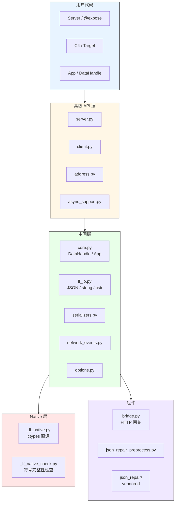
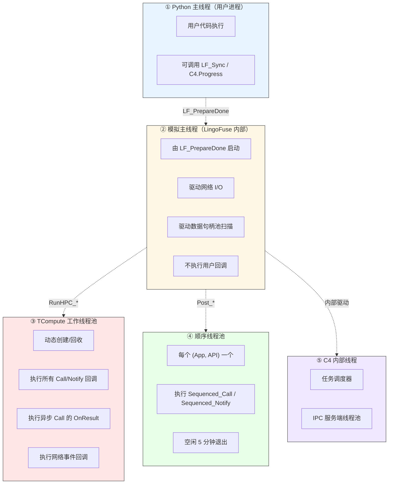
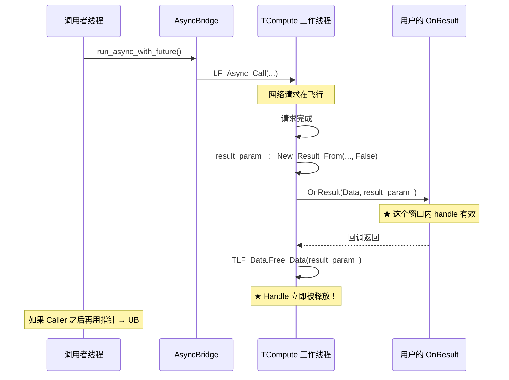
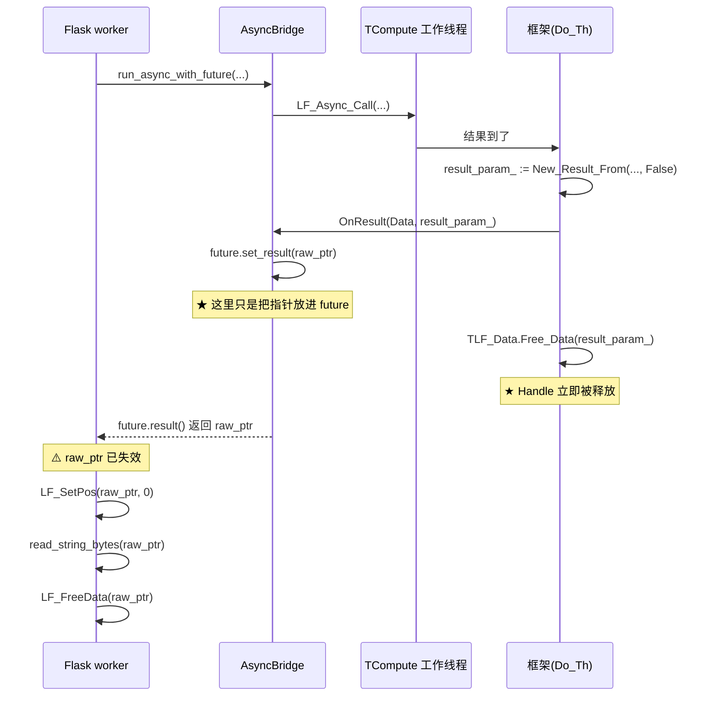

# LingoFuse Python 绑定知识库

> **文档定位**：这份 README 既是 LingoFuse Python 绑定的**使用指南**，也是一份**机制知识库**。读完它，你不仅能调用 LingoFuse，还能理解它的底层机制——**特别是线程模型、Handle 所有权模型、以及 P2P 身份侧数据这三块最容易踩坑的地方**。
>
> **核心承诺**：
> - 所有机制描述均来自对 Python 绑定源码与 Pascal 侧 `Z.LingoFuse_Export.pas` / `Z.Net.C4.LingoFuse.pas` 的逐行核对。
> - 所有"坑"都有具体案例和源码依据。
> - 不确定的地方在**第 13 章「诚实的不确定清单」**中明示。
>
> **面向读者**：Python 绑定使用者、跨语言集成者、未来接手 Bridge 的工程师。
>
> **文档版本**：v1.1（v3.2 勘误：`LF_Get_P2P_UID` 返回值由数组值改为指针 + 侧数据语义说明）
> **最后更新**：2026-10-12

---

## 目录

- [第 0 章 30 秒速览](#第-0-章-30-秒速览)
- [第 1 章 Python 绑定总览](#第-1-章-python-绑定总览)
- [第 2 章 三层调用栈](#第-2-章-三层调用栈)
- [第 3 章 数据句柄 DataHandle](#第-3-章-数据句柄-datahandle)
- [第 4 章 线程与回调模型（★核心）](#第-4-章-线程与回调模型核心)
- [第 5 章 Handle 所有权模型（★核心）](#第-5-章-handle-所有权模型核心)
- [第 6 章 三种寻址模式](#第-6-章-三种寻址模式)
- [第 7 章 数据帧、编码、JSON 策略](#第-7-章-数据帧编码json-策略)
- [第 8 章 模块清单](#第-8-章-模块清单)
- [第 9 章 HTTP Bridge](#第-9-章-http-bridge)
- [第 10 章 反例集（常见坑）](#第-10-章-反例集常见坑)
- [第 11 章 本次调试复盘（案例研究）](#第-11-章-本次调试复盘案例研究)
- [第 12 章 快速上手](#第-12-章-快速上手)
- [第 13 章 诚实的不确定清单](#第-13-章-诚实的不确定清单)
- [附录 A 标识符索引](#附录-a-标识符索引)

---

# 第 0 章 30 秒速览

## 0.1 一句话定位

> **LingoFuse Python 绑定是一套 ctypes 直连 LingoFuse C ABI 的完整封装。它提供从底层 native 绑定、RAII 封装、Server/Client 高级 API、到 HTTP Bridge 与 JSON 修复的完整链路。**
>
> **但它的线程模型、Handle 所有权模型、以及 P2P 身份侧数据模型与一般 Python 库不同，必须先理解这三块，否则会踩到内存安全的坑。**

## 0.2 四条"铁律"

| # | 规则 | 违反后果 | 参见 |
|:-:|------|----------|------|
| 1 | **`LF_Async_Call` 家族返回的 handle 归框架所有**，回调返回后**立即**被框架释放；禁止 `LF_FreeData`，禁止跨线程保留 | use-after-free + double-free，未定义行为 | PY-OWN-002 |
| 2 | **所有回调在 TCompute 工作线程执行**，不是主线程；禁止阻塞，禁止调用 `LF_Call` / `LF_Notify` / `LF_LocalCall` | 死锁 / 拖垮线程池 | PY-TH-002 |
| 3 | **`LF_PrepareDone` 每进程只成功返回 1 一次**；重启需先 `LF_Shutdown` + `LF_ResetPrepare` | 第二次返回 0，误以为失败 | PY-GEN-004 |
| 4 | **UID / P2PName 是"侧数据"（side data）**：由发送方在发送时自动写入载荷头部；接收方只能从触发事件的回调的 **Input** 参数上读取；不能在自建句柄或 Output 句柄上读取 | 拿到全零 UID / 空字符串而不自知 | PY-SIDE-001 |

## 0.3 本知识库覆盖范围

| 覆盖 | 不覆盖 |
|------|--------|
| Python 绑定的全部公开 API | Pascal 侧 C4 框架的内部实现 |
| 线程模型、Handle 所有权、寻址模式、P2P 身份侧数据 | LingoFuse 的序列化协议细节 |
| Bridge 的三方向契约 | 跨语言绑定的具体实现（C#/Java/…） |
| 本次调试的踩坑复盘 | 网络传输层的加密/压缩细节 |

---

# 第 1 章 Python 绑定总览

## 1.1 能力矩阵

| 维度 | 状态 | 关键模块 |
|------|:----:|----------|
| C ABI 底层绑定 | ✅ 完整 | `_lf_native.py` |
| RAII 封装 | ✅ 完整 | `core.py` |
| 服务端封装 | ✅ 完整 | `server.py` |
| 客户端封装 | ✅ 完整 | `client.py` |
| 三种寻址模式 | ✅ 完整 | `address.py` |
| 异步 Future / asyncio | ✅ 完整 | `async_support.py` |
| JSON 统一 I/O | ✅ 完整 | `lf_io.py` |
| JSON 修复预处理 | ✅ 完整 | `json_repair_preprocess.py` |
| 网络事件 | ✅ 完整 | `network_events.py` |
| HTTP Bridge | ✅ 完整 | `bridge.py` |
| 运行时选项 | ✅ 完整 | `options.py` |

## 1.2 架构总览



## 1.3 PY-GEN-001 — 每进程单例约束

**LingoFuse 在 Python 进程内是全局单例**：

- 一个模拟主线程（由第一次 `LF_PrepareDone` 启动）。
- 一个 client pool、一个 service pool。
- 一套运行时选项（`LF_SetOption` 全局生效）。

**推论**：

- 多个 `C4` 实例共享同一个全局连接（后创建的复用先创建的 endpoint）。
- 多个 `Server` 实例共享同一个主线程。
- **`C4.shutdown()` 会停掉所有实例共享的全局连接**。

---

# 第 2 章 三层调用栈

## 2.1 层划分

| 层 | 模块 | 职责 | 直接调 C ABI？ |
|:--:|------|------|:-------------:|
| **L3 高级** | `server.py` / `client.py` / `address.py` / `async_support.py` | 用户友好的 API | ❌ |
| **L2 中间** | `core.py` / `lf_io.py` / `serializers.py` / `network_events.py` / `options.py` | RAII 封装 + I/O 策略 | 通过 L1 |
| **L1 Native** | `_lf_native.py` | ctypes 函数绑定 | ✅ |

## 2.2 PY-GEN-002 — 依赖方向单向

```
L3  →  L2  →  L1
```

**禁止反向依赖**。具体禁止项：

- `_lf_native.py` **禁止**导入 `core.py` / `lf_io.py` / 任何 L2 模块。
- `lf_io.py` **禁止**导入 `core.py`（`lf_io` 要能独立工作于 raw handle）。
- L3 模块 **禁止**绕过 L2 直接拼 ctypes 调用（除了 `bridge.py` 需要 raw handle 的特殊场景）。

## 2.3 PY-GEN-003 — 字符串参数的统一处理

**所有传给 `LF_*` 函数的字符串参数必须经过 `lf_io.cstr()`**：

```python
from lingofuse.lf_io import cstr

# ✅ 正确
LF_Call(cstr("MyApp"), hnd, 5000)

# ❌ 错误：依赖 CPython 隐式的尾部 NUL，跨实现不安全
LF_Call(b"MyApp", hnd, 5000)
```

`cstr()` 做两件事：

1. `value.encode("utf-8")` — 统一 UTF-8 编码。
2. 追加一个 `\x00` 字节 — 显式满足 `c_char_p` 的 NUL 终止要求。

**为什么不能省**：CPython 的 `bytes` 对象内部确实有隐藏的尾部 NUL，但这个实现细节**不是契约**。PyPy、GraalPy、未来的 CPython 都可能不同。

## 2.4 PY-GEN-004 — `LF_PrepareDone` 的生命周期

```pascal
function LF_PrepareDone(): Integer;  // 1 = 成功，0 = 失败
```

**契约**：

| 场景 | 返回值 |
|------|:------:|
| 首次调用，所有准备好的 client 都就绪 | `1` |
| 首次调用，部分 client 未就绪（超时） | `1`（**注意仍返回 1**） |
| 已经调用过一次（未 shutdown） | `0` |
| `LF_Shutdown` 之后再次调用 | `1`（可以重启） |

**推论**：

- 测试里每次调用 `LF_PrepareDone()` 后，**必须在 finally 里 `LF_ExitMainThread()` + `LF_Shutdown()`**，否则下一个测试的 `LF_PrepareDone` 返回 0。
- "返回 1 但部分 client 未就绪"是**合法状态**，不是错误。要判断是否真的就绪，用 `check_api` / `check_app`。

---

# 第 3 章 数据句柄 DataHandle

## 3.1 PY-HND-001 — 两种句柄

Python 绑定暴露**两种数据句柄**，二者的**释放时机**截然不同：

| 类型 | 构造方式 | 空闲回收 | `LF_FreeData` 语义 |
|------|----------|:--------:|-------------------|
| **自动回收** | `DataHandle(api_name)` | 10 分钟空闲后由池扫描释放 | **标记**（下次扫描真正释放） |
| **永久** | `DataHandle.create_permanent(api_name)` | 永不回收 | **立即同步释放** |

**选择建议**：

```python
# ✅ 短生命周期 → 自动回收
with DataHandle("my_api") as hnd:
    hnd.write_json({"a": 1})
    LF_Call(...)

# ✅ 长生命周期 → 永久
GLOBAL_TEMPLATE = DataHandle.create_permanent("my_api")
# 用整个进程的生命周期
```

## 3.2 PY-HND-002 — 自动回收句柄的两条不可回收路径

自动回收句柄在以下两种情况下**不会被池扫描释放**：

1. **空闲时间 < 10 分钟**（默认 `DataHandle_Idle_Timeout = 600000` ms）。
2. **任何 accessor 调用**（`get_size` / `get_pos` / `read_*` / `write_*`）都会刷新时间戳。
3. **远程调用正在进行中**（内部 `calling___ > 0`）。

**推论**：只 `write` 不 `read` 的句柄在发送完成后如果不显式 `free()`，会等到 10 分钟才被回收。

## 3.3 PY-HND-003 — 自动回收 vs 永久句柄的 `LF_FreeData` 差异

```python
# 自动回收
h1 = DataHandle("a")
h1.free()          # 只是标记 deleted___ = True
                   # 真正的释放由主线程的池扫描完成（最多 5 秒后）

# 永久
h2 = DataHandle.create_permanent("b")
h2.free()          # 立即调用 TLF_Data.Free_Data___
                   # 立即释放 TMem64 和 PLF_Data
```

**为什么这个差异重要**：

- 自动回收句柄的 `free()` **不阻塞**，可以放心在热路径调用。
- 永久句柄的 `free()` **同步释放内存**，如果句柄很大，可能造成瞬时内存峰值。

## 3.4 PY-HND-004 — 位置与大小

**关键事实**：`LF_GetSize` / `LF_GetPos` 是**查询当前位置/总大小**，不是"有效数据长度"。

**写入后位置在末尾**：

```python
h = DataHandle("a")
h.write_json({"x": 1})   # 内部 write，position 推进到末尾
print(h.get_pos(), h.get_size())  # 8 8  ← 位置在末尾！
```

**读取前必须 `set_pos(0)`**（除非你知道自己在读尾巴）：

```python
h.set_pos(0)
data = h.read_json()
```

**封装层已经处理**：

- `DataHandle.read()` — 自动 `LF_SetPos(0)`。
- `DataHandle.read_json()` — 自动 `LF_SetPos(0)`。
- `DataHandle.read_string()` — **不重置**，从当前位置开始读（NUL 容错）。

**⚠️ PY-HND-004 的坑**：bridge.py 曾经在异步回调里拿到 raw handle 直接用 `lf_io.read_string_bytes`，**没有先 `LF_SetPos(0)`**，因此读到空数据。这个坑叠加了所有权 bug 一起出现，是 case 研究的重要一环。

## 3.5 PY-HND-005 — P2P 身份访问器（★ 侧数据）

`DataHandle` 暴露两个 **侧数据（side data）**访问器：

```python
inp.get_p2p_uid()   -> bytes  # 恰好 32 字节
inp.get_p2p_name()  -> str    # 发送方未设置时为空字符串
```

### 3.5.1 什么是"侧数据"

**这两个访问器读的不是句柄本身的业务数据**。它们读的是**发送方在发送请求时自动写入的 P2P 身份元数据**：

- **数据来源**：发送方构造请求时，由客户端 `TC40_LF_Client.Send_*` 系列方法内部调用 `TMemory_Param_Tool.Rebuild_UID_and_P2PName`，把 `FromUID`（32 字节）+ `FromP2PName`（UTF-8 字符串）**自动写入到请求载荷的前部**。
- 接收方拿到的 `Input` 句柄中 `Data_Param.FromUID` / `Data_Param.FromP2PName` 就是这两个值。
- **无需业务层手动传递**。

### 3.5.2 只能在"触发事件的回调 `Input` 参数"中使用

| 位置 | 是否有效 | 原因 |
|------|:--------:|------|
| `On_Call(Trigger, Input, Output)` 的 `Input` | ✅ | 从网络接收，携带发送方元数据 |
| `On_Notify(Trigger, Input)` 的 `Input` | ✅ | 同上 |
| `LF_LocalCall` / `LF_LocalNotify` 回调的 `Input` | ✅ | 本地调用也经过 `Rebuild_UID_and_P2PName` 注入 |
| `OnResult(Data, Result_)` 的 `Result_` | ❌ | 这是**输出句柄**，只有 `Data_Result`，无 `Data_Param` |
| 自己 `LF_CreateData` 创建的句柄 | ❌ | 没有"发送方"，`FromUID` 为 `Null_UID()`，`FromP2PName` 为空 |
| `LF_CreateData_Permanent` 创建的句柄 | ❌ | 同上 |

**对输出句柄或自建句柄调用时**：

- **返回 `Null_UID()`（全零）/ 空字符串**。
- **Pascal 侧打印警告**：`[warning] Get_P2P_UID(): P2P Info only backcall "input" parameter.`
- **不抛异常**。

### 3.5.3 `LF_Get_P2P_UID` 返回的是**指针**，不是值（★ 勘误）

C ABI 的签名（Pascal）：

```pascal
function LF_Get_P2P_UID(Hnd: TDataHnd___): PP2P_UID___;
```

即返回 **`PP2P_UID___` = `^TUID___`（指向 32 字节 UID 的指针）**，而不是 `TUID___`（32 字节值本身）。

**契约**：

| 项 | 说明 |
|----|------|
| **返回值** | 指向 32 字节 UID 的**指针** |
| **指针生命周期** | 由 C 侧 `New` 分配，`DelayFreeMem(5.0, ...)` 约 5 秒后自动释放 |
| **调用者职责** | **只读拷贝**，立即解引用；**不手动释放**；**不长期保存** |
| **Python 高层封装** | `DataHandle.get_p2p_uid()` 内部用 `ctypes.string_at(ptr, 32)` 立即拷贝成 `bytes`；调用者拿到的是**已脱钩的 Python bytes**，从不接触裸指针 |
| **`LF_Get_P2P_Name`** | 返回 `c_char_p`（NUL 终止 UTF-8 字符串指针），同样约 5 秒后自动释放；ctypes 在调用边界自动拷贝成 `bytes`，安全 |

**跨语言影响**：

- 之前（旧 ABI）：`uid = LF_Get_P2P_UID(input)` 直接拿到值。
- 现在（新 ABI）：`uid_ptr = LF_Get_P2P_UID(input); uid = ctypes.string_at(uid_ptr, 32)`（**解引用 + 立即拷贝**）。
- **不要手动释放**该指针（不是调用者所有）。
- **不要长期保存**该指针（约 5 秒后失效）。

### 3.5.4 正确用法

```python
def my_callback(trigger, inp, out):
    # ✅ 从 Input 读取发送方身份
    uid = inp.get_p2p_uid()       # bytes，32 字节
    name = inp.get_p2p_name()     # str

    # ✅ 使用
    # ... 校验、审计、会话管理等 ...

    # ❌ 不要：out.get_p2p_uid()     ← 输出句柄没有 P2P 身份
    # ❌ 不要：self_created.get_p2p_uid() ← 自建句柄没有 P2P 身份
```

### 3.5.5 覆盖范围速查

| 命令 | 接收侧是否有 P2P 身份？ |
|------|:----------------------:|
| `Notify` / `Sequenced_Notify` | ✅ |
| `Call` / `Sequenced_Call` | ✅ |
| `UID_Notify` / `UID_Call` / `UID_Sequenced_*` | ✅ |
| `P2PName_Notify` / `P2PName_Call` / `P2PName_Sequenced_*` | ✅ |
| **本地调用**（`LF_LocalCall` / `LF_LocalNotify`） | ✅ |
| `OnResult`（异步回调的 `Result_`） | ❌ |
| 自建输入句柄（`LF_CreateData`） | ❌ |

---

# 第 4 章 线程与回调模型（★核心）

## 4.1 PY-TH-001 — 五类线程全景



## 4.2 PY-TH-002 — 回调执行上下文矩阵

**这是最容易踩坑的表格**。请**记住**它：

| 回调类型 | 注册方式 | 执行线程 | 持锁 | 可调 `LF_Call`？ |
|---------|---------|---------|:----:|:---------------:|
| **Call 回调** | `App.register_call` | TCompute 工作线程 | ❌ | ❌ |
| **Notify 回调** | `App.register_notify` | TCompute 工作线程 | ❌ | ❌ |
| **异步 Call OnResult** | `LF_Async_Call(...)` | TCompute 工作线程 | ❌ | ❌ |
| **网络事件** | `set_network_event` | TCompute 工作线程 | ❌ | ❌ |
| **顺序 Call/Notify** | `Sequenced_*` 系列 | 专用顺序线程 | ❌ | ❌ |
| **`@expose(p2p=True)` 回调** | `register_p2p_*` | TCompute 工作线程 | ❌ | ❌ |

**关键事实**：

- **没有任何用户回调在主线程执行**。
- **没有任何用户回调可以安全调用同步 LingoFuse 函数**。
- **回调异常被吞掉**（logging 记录，但不传播到 C 栈）。

## 4.3 PY-TH-003 — 回调中禁止的操作

```python
# ❌ 所有这些都是死锁 / 崩溃源

def bad_callback(trigger, inp, out):
    # ❌ 禁止 1：调用同步 LingoFuse 函数
    result = LF_Call(cstr("Other"), inp, 5000)  # 死锁

    # ❌ 禁止 2：长时间阻塞
    time.sleep(60)  # 拖垮线程池

    # ❌ 禁止 3：操作 UI
    my_window.update()  # 非主线程，崩溃

    # ❌ 禁止 4：保留 handle 跨回调
    global saved_handle
    saved_handle = inp  # 回调返回后 inp 失效

    # ❌ 禁止 5：跨线程访问未加锁的共享状态
    shared_dict["key"] = value  # 需要 threading.Lock
```

**✅ 正确做法**：

```python
def good_callback(trigger, inp, out):
    # 只读 Input
    data = inp.read_json()

    # 只写 Output
    out.write_json({"result": process(data)})

    # 需要异步 → 提交到自己的线程池
    my_executor.submit(long_running_task, data)

    # 需要调用其他 LingoFuse API → 通过 future / thread
    # （但注意 handle 的生命周期！见 §5）
```

## 4.4 PY-TH-004 — 模拟主线程的启动时机

**模拟主线程由 `LF_PrepareDone()` 启动**：

```python
LF_ResetPrepare()
LF_PrepareService(...)   # 可选
LF_PrepareClient(...)
LF_PrepareDone()         # ← 这里启动模拟主线程
```

**在 `LF_PrepareDone` 之前**：

- `DoStatus` 的消息可能不入队（模拟主线程未启动）。
- `LF_GetStatus` / `LF_PostStatus` 的语义未定义。
- 自动回收的句柄池扫描不运行。

**在 `LF_ExitMainThread` 之后**：

- 模拟主线程停止。
- 句柄池扫描停止。
- `LF_FreeData` 变成 no-op。

## 4.5 PY-TH-005 — 顺序线程的保证与代价

**`Sequenced_Call` / `Sequenced_Notify` 的 FIFO 保证**：

- 每个 `(App, API)` 对一个专用顺序线程。
- 同一 key 的请求严格按发送顺序执行。
- 不同 key 之间无顺序保证，可并发。

**代价**：

- 每个 key 一个线程，key 数量多时线程数暴涨。
- 空闲 5 分钟后退出，但**退出前 1 秒是"僵尸窗口"**（`DelayFreeObj(1.0, self)`）。

**禁止**：

- 不要在顺序回调里再发同 key 的 `Sequenced_*` 请求（会自锁）。
- 不要在顺序回调里阻塞超过 5 分钟。

---

# 第 5 章 Handle 所有权模型（★核心）

> **这一章是本次调试踩坑的核心。请务必读完。**

## 5.1 PY-OWN-001 — 两大调用家族的 Handle 所有权完全不同

LingoFuse C ABI 有**两大调用家族**，它们的 handle 所有权**相反**：

| 家族 | 函数 | 返回 handle 的所有者 | 释放方式 |
|------|------|:-------------------:|---------|
| **同步族** | `LF_Call` / `LF_UID_Call` / `LF_P2PNAME_Call` | **调用者** | 调用者显式 `LF_FreeData` |
| **异步族** | `LF_Async_Call` / `LF_UID_Async_Call` / `LF_P2PNAME_Async_Call` | **框架** | 回调返回后**立即**由框架释放 |

**源码依据**：

**同步族**（`Z.LingoFuse_Export.pas`）：

```pascal
function LF_Call(appName: pansichar; Param: TDataHnd___; Timeout_: uint64): TDataHnd___;
begin
  ...
  // 从 future 取出结果
  Output := Cli.Wait_Execute_Call(...);
  ...
  // ← auto_recycle = True，调用者拥有
  Result := TLF_Data.New_Result_From(Output, True);
  ...
end;
```

**异步族**（`Z.Net.C4.LingoFuse.pas` 的 `TLF_Async_Call_Bridge.Do_Th`）：

```pascal
procedure TLF_Async_Call_Bridge.Do_Th;
var
  result_param_: PLF_Data;
begin
  // ← auto_recycle = False，框架拥有
  result_param_ := TLF_Data.New_Result_From(Result_M64.Swap_To_New_Instance, False);
  try
    if Assigned(OnResult) then
      OnResult(Data_, result_param_);  // ← 回调拿到指针
  except
  end;
  // ← 立即释放！
  TLF_Data.Free_Data(result_param_);
  DelayFreeObj(1.0, Self);
end;
```

**关键差异**：

- `New_Result_From(..., True)` → `auto_recycle = True` → 释放**延迟**到池扫描。
- `New_Result_From(..., False)` → `auto_recycle = False` → 释放**立即同步**。

## 5.2 PY-OWN-002 — 异步族 Handle 的"死亡时刻"

**时序图**：



**契约**：

- 回调返回后，handle 立即失效。
- 在回调外使用该 handle 是**未定义行为**（use-after-free）。
- 调用 `LF_FreeData` 是**双重释放**（double-free）。

## 5.3 PY-OWN-003 — 为什么这个差异会造成"不确定的失败"

**根本原因**：LingoFuse 的 `Free_Data` 是**池化回收**：

```pascal
procedure TLF_Data.Free_Data(hnd: PLF_Data);
begin
  ...
  if hnd^.auto_recycle___ then
      hnd^.deleted___ := True   // 标记，等池扫描
  else
      TLF_Data.Free_Data___(hnd);  // 立即释放
end;

class procedure TLF_Data.Free_Data___(hnd: PLF_Data);
begin
  hnd^.Data_Info := '';
  DisposeObjectAndNil(hnd^.Data_Param);
  DisposeObjectAndNil(hnd^.Data_Result);   // ← TMem64 被释放
  DisposeObjectAndNil(hnd^.calling___);
  LF_DataMemory.Free_PLF_Data(hnd);        // ← PLF_Data 回池
end;
```

**结果**：

- `TMem64` 被 `DisposeObjectAndNil` → 其内存**归还给分配器**。
- `PLF_Data` 被 `Free_PLF_Data` → 放入 `TLF_DataMemory` 池。

**UB 的表现取决于**：

- 分配器是否已经复用这块内存。
- 其它线程是否在同一时刻分配了新的 `TMem64`。
- 线程调度是否让调用者线程在 `Free_Data` 之后才运行。

**因此**：

- 小 payload（比如返回 int 7，2 字节）：通常还没被复用 → 读到旧值 → "看起来正常"。
- 大 payload（比如返回 dict，17 字节）：有更大概率已被复用 → 读到空/垃圾 → "返回值异常"。

**⚠️ 二分法 `int` vs `dict` 会误导诊断**。它不是"类型差异"，是"payload 大小影响内存复用时机"。

## 5.4 PY-OWN-004 — 正确的读取模式

### 模式 A：同步调用（推荐）

```python
# 用 LF_Call，handle 归调用者
res_ptr = LF_Call(cstr(app_name), hnd, timeout_ms)
try:
    LF_SetPos(res_ptr, 0)
    result_bytes = read_string_bytes(res_ptr)
finally:
    LF_FreeData(res_ptr)   # ← 合法，因为调用者拥有
```

### 模式 B：异步调用（必须在回调内完成所有事）

```python
def on_result(trigger, res_ptr):
    # ✓ 在这个回调内 handle 有效
    LF_SetPos(res_ptr, 0)
    data = read_string_bytes(res_ptr)

    # ✓ 把数据拷出来（bytes 是新的 Python 对象）
    my_queue.put(data)

    # ❌ 禁止把 res_ptr 传出去
    # ❌ 禁止 LF_FreeData(res_ptr)

LF_Async_Call(cstr(app_name), hnd, None, callback)
```

### 模式 C：现代 Future 接口（Python 绑定已封装好）

```python
# lingofuse/address.py 里的 Target.call_future 已正确处理
target = AppTarget("MyApp")
future = target.call_future("api", payload, timeout_ms=5000)
result = future.result()   # result 是 bytes/obj，不是裸指针
```

**关键**：`address.py` 的 `_deserialize_result` 在**回调内**读取，把 bytes 交给 future，不存在跨线程访问裸指针的问题。

## 5.5 PY-OWN-005 — 句柄所有权速查表

| 来源 | 所有者 | 释放者 | 能否跨线程 |
|------|:------:|:------:|:----------:|
| `DataHandle(api_name)` | 用户 | 用户 | ⚠️ 需外部锁 |
| `DataHandle.create_permanent(api_name)` | 用户 | 用户 | ⚠️ 需外部锁 |
| `LF_Call` 返回 | 用户 | 用户 | ✅ 可以 |
| `LF_Async_Call` 回调内 | 框架 | **框架** | ❌ 禁止 |
| `App.local_call` 返回 | 用户 | 用户 | ✅ 可以 |
| `Server.json_call` 返回 | 用户 | 用户 | ✅ 可以 |
| `Target.call_future().result()` | 用户 | 用户 | ✅ 可以 |

## 5.6 PY-OWN-006 — 侧数据所有权模型（★ 勘误补充）

**侧数据（side data）不是句柄的业务数据，也不参与 Handle 所有权模型**。它有三个严格约束：

| 约束 | 说明 |
|------|------|
| **来源** | 发送方在发送时自动写入，接收方不产生 |
| **读取位置** | 只能在触发事件的回调的 `Input` 参数上读取 |
| **返回值形态** | `LF_Get_P2P_UID` 返回**指针**（框架约 5 秒后自动释放）；`LF_Get_P2P_Name` 返回字符串指针（同样约 5 秒后释放） |

**Pascal 侧签名**：

```pascal
function LF_Get_P2P_UID(Hnd: TDataHnd___): PP2P_UID___;
function LF_Get_P2P_Name(Hnd: TDataHnd___): pansichar;
```

**契约对照**：

| 项 | `LF_Get_P2P_UID` | `LF_Get_P2P_Name` |
|----|:----------------:|:------------------:|
| 返回类型 | `PP2P_UID___`（指针） | `pansichar`（字符串指针） |
| 生命周期 | 约 5 秒（`DelayFreeMem`） | 约 5 秒（`DelayFreeMem`） |
| 调用者职责 | 只读拷贝，不手动释放 | 只读拷贝，不手动释放 |
| Python 封装 | `DataHandle.get_p2p_uid()` 立即 `ctypes.string_at(ptr, 32)` 拷贝成 `bytes` | `DataHandle.get_p2p_name()` 立即解码成 `str` |

**跨语言通用规则**：

- 在回调内拷贝为原生对象（Julia 的 `Vector{UInt8}` / Erlang 的 binary / R 的字符向量），**不要暴露裸指针**。
- **绝不把裸指针从回调传出去**。

---

# 第 6 章 三种寻址模式

## 6.1 PY-ADDR-001 — 三种模式对比

| 模式 | 路由键 | 本地优先？ | 负载均衡？ | 生命周期 |
|------|--------|:---------:|:---------:|---------|
| **App 名** | `str` | ✅ | ❌ | App 注册期间 |
| **UID** | 32 字节 | ✅ | ❌ | 每次 TunnelLink 重生成 |
| **P2PName** | `str` | ❌ | ✅（服务端） | 进程设置期间 |

**本地优先（Local-First）**：如果调用者进程本身有匹配的 App/UID，直接本地执行，不走网络。

**P2PName 故意不本地优先**：服务端拥有负载均衡状态，本地短路会破坏它。

## 6.2 PY-ADDR-002 — UID 的生命周期

**UID 在每次 TunnelLink 时重新生成**：

```python
# 连接建立 → UID 生成
# 断开 → UID 失效
# 重连 → UID 变化
```

**推论**：

- **缓存 UID 是危险的**。断线重连后，旧 UID 不再有效。
- 需要在重连后重新探测 UID。常用模式：

```python
# 服务端注册一个 whoami API
@app.expose("whoami")
def whoami(trigger, inp: DataHandle, out: DataHandle):
    # ✅ 从 Input handle 读发送者的 UID（侧数据）
    caller_uid = inp.get_p2p_uid()   # 32 字节 bytes
    caller_name = inp.get_p2p_name()
    out.write_json({
        "uid_hex": caller_uid.hex(),
        "p2p_name": caller_name,
    })

# 客户端调用后缓存
def refresh_uid(client):
    result = client.whoami()
    cached_uid = bytes.fromhex(result["uid_hex"])  # 32 字节
```

**注意**：`whoami` 模式是**唯一**能从应用层获得"自己的 UID"的方式。因为 UID 是发送方写入的侧数据，接收方只能从 `Input` 参数读，通过回环调用通知客户端。

## 6.3 PY-ADDR-003 — P2PName 路由的两种策略

**服务端在 P2PName 路由时使用两种策略**：

1. **Cycle_Anchor 负载均衡**：选 anchor 值最小的，选中后更新为新的全局值。
2. **FixedSequenced 粘性**：同一个目标保持 `Fixed_Sequenced_Time`（默认 20 秒）后切换。

**调整方式**：

```python
from lingofuse import set_option

# 修改粘性窗口为 60 秒
set_option("Fixed_Sequenced_Time", "60000")
```

## 6.4 PY-ADDR-004 — 三种模式的 API 对照

| 操作 | App 名 | UID | P2PName |
|------|:------:|:---:|:-------:|
| Call | `LF_Call` | `LF_UID_Call` | `LF_P2PNAME_Call` |
| Async Call | `LF_Async_Call` | `LF_UID_Async_Call` | `LF_P2PNAME_Async_Call` |
| Async Seq Call | `LF_Async_Sequenced_Call` | `LF_UID_Async_Sequenced_Call` | `LF_P2PNAME_Async_Sequenced_Call` |
| Notify | `LF_Notify` | `LF_UID_Notify` | `LF_P2PNAME_Notify` |
| Seq Notify | `LF_Sequenced_Notify` | `LF_UID_Sequenced_Notify` | `LF_P2PNAME_Sequenced_Notify` |
| Check | `LF_CheckApp` + `LF_CheckApi` | `LF_Check_UID_Api` | `LF_Check_P2PNAME_Api` |

**Python 高级封装**：

```python
client = C4("default_app", "ipc:endpoint")

# App 名
client.app("OtherApp").call("api", payload)

# UID
client.uid(uid_bytes).call("api", payload)

# P2PName
client.p2pname("group").notify("api", payload)
```

## 6.5 PY-ADDR-005 — UID 作为参数 vs UID 作为侧数据（★ 勘误）

`LF_UID_Call` / `LF_UID_Async_Call` / `LF_UID_Notify` 等函数接受一个 32 字节 UID 作为**第一个参数**。这个 UID 是**调用者传入的值**，与 `LF_Get_P2P_UID` 的**返回值**是两个不同角色的数据：

| 角色 | ctypes 表示 | 用途 |
|------|-------------|------|
| **参数**（LF_UID_Call 第一参数） | `TP2P_UID`（`c_ubyte * 32` 数组，按值传） | 告诉框架"路由到哪个 UID" |
| **返回值**（LF_Get_P2P_UID） | `PP2P_UID___`（指针） | 告诉回调"发送方是谁" |

**二者不可统一**：

- 参数角色是"调用者已经知道的值"，由 ctypes 用数组类型按值传递。
- 返回角色是"框架给出的指针"，由 ctypes 用 `c_void_p` 表示，Python 封装层立即拷贝。

**跨语言通用规则**：不要把 UID 参数误当成 UID 侧数据；也不要试图从 `LF_UID_Call` 的返回值里"读出" UID。二者的来源、生命周期、语义完全不同。

---

# 第 7 章 数据帧、编码、JSON 策略

## 7.1 PY-IO-001 — 三套 I/O 路径

Python 绑定有**三套 I/O 路径**，它们的帧格式不同，**不能混用**：

| 路径 | 用途 | NUL 终止？ | 典型调用 |
|------|------|:----------:|---------|
| **`lf_io`** | 工具链标准 JSON 帧 | ✅ | `write_json` / `read_json` |
| **`serializers`** | DataHandle.read/write 的 payload | ❌ | `DataHandle.write` / `read` |
| **`core.DataHandle.write_json`** | DataHandle 上的 JSON | ✅（委托 lf_io） | `hnd.write_json(...)` |

**关键区分**：

```python
# 路径 A：lf_io（有 NUL）
from lingofuse.lf_io import write_json, read_json
write_json(hnd.raw, {"a": 1})     # 写入 `{"a": 1}\x00`
data = read_json(hnd.raw)          # 读到第一个 \x00 停止

# 路径 B：serializers（无 NUL）
from lingofuse.serializers import default_serializer
hnd.write({"a": 1})                # 写入 `{"a": 1}` 无 NUL
data = hnd.read()                  # 读全部
```

**何时用哪条**：

- **服务端 ↔ 客户端跨进程通信** → 用 `lf_io`（有 NUL）。
- **DataHandle 内部序列化** → 用 `serializers`（无 NUL）。
- **不确定时** → 用 `hnd.write_json` / `read_json`（委托 `lf_io`）。

## 7.2 PY-IO-002 — JSON 序列化策略

**工具链统一的 JSON 序列化策略**：

```python
json.dumps(obj, ensure_ascii=False, default=str)
```

**三条保证**：

1. **`ensure_ascii=False`**：非 ASCII 字符保持字面量，**不转义为 `\uXXXX`**。
2. **`default=str`**：不可序列化对象降级为 `str()`，而不是抛 `TypeError`。
3. **统一入口**：`lf_io.dumps_json()` 是唯一来源。

**禁止**：

- ❌ `json.dumps(obj)` — 默认 `ensure_ascii=True`，会转义非 ASCII。
- ❌ `requests.post(json=obj)` — 内部也是 `ensure_ascii=True`。
- ❌ 手写 JSON 字符串拼接。

## 7.3 PY-IO-003 — JSON 修复预处理

**统一的三路策略**（`json_repair_preprocess.repair_json_text`）：

| 输入 | 输出 | 日志 |
|------|------|------|
| 有效 JSON | 原样返回 | 无 |
| 可修复的畸形 JSON | 修复后文本 | 1 条 WARNING |
| 不可修复 | 原样返回 | 1 条 ERROR（严格路径）/ 无（宽松路径） |

**启用/禁用**：

```bash
# 禁用修复（只验证不重写）
set LINGOFUSE_JSON_REPAIR=0
```

**读取路径的差异**：

- `lf_io.read_json` — 严格路径，不可修复报 ERROR，最终抛 `RuntimeError`。
- `lf_io.read_json_or_bytes` — 宽松路径，不可修复返回原始字节。
- `serializers.default_deserializer` — 严格路径，不可修复最终抛 `JSONDecodeError`。

## 7.4 PY-IO-004 — 编码回退链

**读入字节时的解码顺序**：

```
UTF-8 → GBK → Latin-1
```

**为什么是这三档**：

- **UTF-8**：现代标准。
- **GBK**：中文 Windows 默认编码。
- **Latin-1**：永不失败（任何字节序列都能解码），最终兜底。

**注意**：`TPascalString.Bytes`（`lf_io` 的底层）也是 UTF-8，与这套回退链独立。

---

# 第 8 章 模块清单

## 8.1 PY-MOD-001 — 模块速查

| 模块 | 一句话职责 |
|------|-----------|
| `_lf_native.py` | ctypes 直连 C ABI |
| `_lf_native_check.py` | 符号完整性检查器 |
| `core.py` | `DataHandle` + `App` RAII |
| `server.py` | `Server` + `@expose` |
| `client.py` | `C4` 动态客户端 |
| `address.py` | 三种寻址的 `Target` |
| `async_support.py` | `CallFuture` + `AsyncBridge` |
| `lf_io.py` | 统一 JSON / string / cstr |
| `serializers.py` | `DataHandle.read/write` 的序列化 |
| `network_events.py` | 网络事件回调 |
| `options.py` | 运行时选项的类型化封装 |
| `json_repair_preprocess.py` | JSON 修复统一入口 |
| `json_repair/` | vendored JSON 修复引擎 |
| `errors.py` | 异常层次 |
| `bridge.py` | HTTP 三方向网关 |

## 8.2 PY-MOD-002 — `core.py` 的关键方法

```python
class DataHandle:
    # 构造
    DataHandle(api_name, data=None, serializer=None, deserializer=None)
    DataHandle.create_permanent(api_name, ...)
    DataHandle._from_raw(hnd, owned=True, ...)

    # 生命周期
    free()
    __enter__ / __exit__
    __del__

    # 位置/大小
    get_pos() / set_pos(pos)
    get_size() / set_size(size)

    # 原子类型（小端）
    write_int8 / read_int8
    write_int16 / read_int16
    write_int32 / read_int32
    write_int64 / read_int64
    write_uint8 / read_uint8
    # ... 各类型

    # 字符串
    write_string(s)                # UTF-8 + NUL
    read_string()                  # NUL 容错
    write_string_null_terminated   # 别名
    read_string_null_terminated    # 别名

    # JSON（委托 lf_io）
    write_json(obj) -> int
    read_json(strict=False) -> Any
    read_json_strict() -> Any

    # 原始字节
    read_bytes() -> bytes
    peek_string_bytes() -> bytes   # 不推进位置
    read_all_bytes() -> bytes

    # 发送者身份（仅 Input，侧数据）
    get_p2p_uid() -> bytes          # 32 字节，内部立即拷贝指针
    get_p2p_name() -> str
```

```python
class App:
    App(name, description="")

    # 注册 API
    register_call(api_name, func, description="")
    register_notify(api_name, func, description="")
    unregister(api_name) -> bool

    # 本地执行
    local_call(param: DataHandle) -> DataHandle
    local_notify(param: DataHandle)

    # 顺序通知
    sequenced_notify(param: DataHandle)

    # 绑定
    bind() -> int   # 返回绑定的客户端数量

    # 生命周期
    free()
    __enter__ / __exit__
```

## 8.3 PY-MOD-003 — `server.py` 的关键方法

```python
class Server:
    Server(app_name, description="", debug=False)

    # 装饰器
    @server.expose(api_name, notify=False, description="", p2p=False)
    def my_api(...):
        ...

    # 启动
    server.start(addr, public_addr=None)
    server.start_multi(addresses, public_addrs=None)

    # 调用
    server.json_call(api_name, *args, timeout=5000) -> Any
    server.json_notify(api_name, *args)
    server.json_sequenced_notify(api_name, *args)

    # 停止
    server.stop(full_cleanup=False)
    server.full_cleanup()
```

## 8.4 PY-MOD-004 — `client.py` 的关键方法

```python
class C4:
    C4(app_name, endpoint, timeout=5000, serializer=None, deserializer=None)

    # 动态属性分发
    result = client.add(10, 20)   # 调用 add API

    # 三种寻址
    client.app("OtherApp").call("api", payload)
    client.uid(uid_bytes).call("api", payload)
    client.p2pname("group").notify("api", payload)

    # 现代 Future
    future = client.call_future("api", payload)
    result = await client.call_async("api", payload)

    # 生命周期
    C4.shutdown()          # 停网络循环，库仍加载
    C4.full_cleanup()      # 停网络循环 + 卸载库
```

## 8.5 PY-MOD-005 — `address.py` 的 `Target`

```python
class AppTarget:
    AppTarget(app_name, *, serializer=..., deserializer=..., default_timeout_ms=5000)

    # 旧式（阻塞 + 回调）
    call(api_name, payload=None, timeout_ms=None)
    async_call(api_name, payload=None, *, on_result, user_data=None) -> int
    sequenced_call(api_name, payload=None, timeout_ms=None)
    notify(api_name, payload=None)
    sequenced_notify(api_name, payload=None)

    # 新式（Future / asyncio）
    call_future(api_name, payload=None, timeout_ms=None) -> CallFuture
    call_async(api_name, payload=None, timeout_ms=None)   # async def
    sequenced_call_future(api_name, payload=None, timeout_ms=None)
    sequenced_call_async(api_name, payload=None, timeout_ms=None)

# UIDTarget / P2PNameTarget 有相同的接口
```

## 8.6 PY-MOD-006 — `async_support.py` 的 `AsyncBridge`

```python
# 单例
bridge = AsyncBridge.instance()

# 统计
bridge.stats() -> {
    "total": ...,
    "pending": ...,
    "fired": ...,
    "abandoned": ...,
    "not_queued": ...,
    "released_total": ...,
    "grace_seconds": ...,
    "period_seconds": ...,
}

# 关闭
AsyncBridge.shutdown_instance()
```

**`CallFuture`**：

```python
future = target.call_future("api", payload)
result = future.result(timeout=...)     # 阻塞
abandoned = future.abandoned            # 是否因超时被放弃
```

---

# 第 9 章 HTTP Bridge

## 9.1 PY-BRG-001 — 三方向定位

| 方向 | 调用方 | 通道 | 用途 |
|------|--------|------|------|
| A 入站 | HTTP 客户端 | HTTP POST → `LF_Call` | 将 HTTP 请求送入 LingoFuse |
| B 出站 | LingoFuse 调用方 | `LF_Call` → HTTP POST | 将 LingoFuse 请求转发到外部 HTTP |
| C 修复 | LingoFuse 调用方 | `LF_Call` → 修复引擎 | 委托修复畸形 JSON |

## 9.2 PY-BRG-002 — 命名空间隔离

**Bridge 自己的 App 名和 API 名使用双下划线**：

```
App:  __lf_http_bridge__
API:  __lf_outbound_post__      （出站）
API:  __lf_repair_json__         （修复）
```

**双下划线是结构性隔离**：HTTP URL 路径中不能出现未编码的双下划线，所以 Bridge 的 API 名**永不与业务 API 冲突**。

## 9.3 PY-BRG-003 — 入站路由

| URL | 寻址模式 |
|-----|---------|
| `/<app>/<api>` | App 名 |
| `/<api>` + `--app` | App 名（用默认 app） |
| `/uid/<hex64>/<api>` | UID |
| `/p2p/<group>/<api>` | P2PName |

**保留前缀**：`uid`、`p2p`。名为 `uid` 或 `p2p` 的 App **不能**通过 App 名路由访问。

## 9.4 PY-BRG-004 — 错误码

| 错误码 | HTTP | 触发 |
|:------:|:----:|------|
| `-1` | 200 | 远程调用失败（超时/空 handle/后端异常） |
| `-2` | **400** | 请求形态错误（URL 无法解析） |
| `-3` | 200 | 预检查失败（API 不可用） |

## 9.5 PY-BRG-005 — forward-only 模式

**`--forward-only` 禁用 HTTP 监听器**，只保留 LingoFuse Call API。

**用途**：

- 内部 relay（不需要对网络暴露）。
- 反代已存在，本实例专职 Call API。
- 容器环境限制端口绑定。

**验证**：

```bash
# 启动
LINGOFUSE_FORWARD_ONLY=1 \
LINGOFUSE_ENDPOINT=ipc:compute_grid \
./bridge

# 尝试连接会失败
curl http://127.0.0.1:8081/    # Connection refused
```

---

# 第 10 章 反例集（常见坑）

## 10.1 PY-PIT-001 — 在异步回调外使用 handle（★本次调试核心）

```python
# ❌ 错误：把 handle 传出去
def on_result(trigger, res_ptr):
    global saved_ptr
    saved_ptr = res_ptr  # 回调返回后无效

LF_Async_Call(cstr("app"), hnd, None, on_result)
# 之后用 saved_ptr 是 UB

# ✅ 正确：在回调内拷贝数据
def on_result(trigger, res_ptr):
    LF_SetPos(res_ptr, 0)
    data = read_string_bytes(res_ptr)   # bytes 是新的 Python 对象
    my_queue.put(data)
```

## 10.2 PY-PIT-002 — 在异步回调外释放 handle

```python
# ❌ 错误：双重释放
def on_result(trigger, res_ptr):
    my_queue.put(res_ptr)   # 把指针传出去

LF_Async_Call(cstr("app"), hnd, None, on_result)
# ...
res_ptr = my_queue.get()
LF_FreeData(res_ptr)   # 双重释放！框架已经释放过了
```

## 10.3 PY-PIT-003 — 在回调里调 LF_Call

```python
# ❌ 错误：死锁
def my_callback(trigger, inp, out):
    # 回调在 TCompute 工作线程
    # LF_Call 会等待响应，但响应需要另一个工作线程
    # 如果池耗尽 → 死锁
    result = LF_Call(cstr("Other"), inp, 5000)
```

## 10.4 PY-PIT-004 — 忘记在 finally 里 cleanup

```python
# ❌ 错误：LF_PrepareDone 后异常逃逸，未清理
LF_PrepareDone()
do_something_that_may_raise()   # 抛异常，主线程未退出
# 下一个测试的 LF_PrepareDone 返回 0

# ✅ 正确：finally 里保证清理
try:
    LF_PrepareDone()
    do_something_that_may_raise()
finally:
    LF_ExitMainThread()
    LF_Shutdown()
```

## 10.5 PY-PIT-005 — 用 `json.dumps` 而非 `lf_io.dumps_json`

```python
# ❌ 错误：会转义非 ASCII
body = json.dumps({"msg": "你好"}).encode()  # '{"msg": "\\u4f60\\u597d"}'

# ✅ 正确：保持字面量
from lingofuse.lf_io import dumps_json
body = dumps_json({"msg": "你好"}).encode()  # '{"msg": "你好"}'
```

## 10.6 PY-PIT-006 — `requests.post(json=...)` 的陷阱

```python
# ❌ 错误：requests 内部用 ensure_ascii=True
requests.post(url, json={"msg": "你好"})

# ✅ 正确：手动序列化
from lingofuse.lf_io import dumps_json
body = dumps_json({"msg": "你好"}).encode("utf-8")
requests.post(url, data=body,
              headers={"Content-Type": "application/json"})
```

## 10.7 PY-PIT-007 — 忘记 `LF_SetPos(0)`

```python
# ❌ 错误：读取位置在末尾，读到空
hnd.write_json({"a": 1})
data = read_json(hnd.raw)   # 可能读到空

# ✅ 正确：先重置位置
hnd.write_json({"a": 1})
hnd.set_pos(0)
data = read_json(hnd.raw)
```

**注意**：`DataHandle.read()` 和 `read_json()` 内部**自动重置**；但 `lf_io.read_json(hnd.raw)` 等**raw handle 路径不自动重置**。

## 10.8 PY-PIT-008 — 跨线程共享未加锁状态

```python
# ❌ 错误：多个回调线程同时写
shared_list = []

def callback(trigger, inp, out):
    shared_list.append(inp.read_json())   # 竞态

# ✅ 正确：加锁
import threading
lock = threading.Lock()
shared_list = []

def callback(trigger, inp, out):
    data = inp.read_json()
    with lock:
        shared_list.append(data)
```

## 10.9 PY-PIT-009 — 用 `Overlap_Connection` 前未设置

```python
# ❌ 错误：第二个 client 失败
LF_PrepareClient(cstr("ipc:a"), app1.raw)   # OK
LF_PrepareClient(cstr("ipc:a"), app2.raw)   # 返回 -1

# ✅ 正确：先设置 Overlap
from lingofuse import set_option
set_option("Overlap_Connection", "True")
LF_PrepareClient(cstr("ipc:a"), app1.raw)   # OK
LF_PrepareClient(cstr("ipc:a"), app2.raw)   # OK
```

## 10.10 PY-PIT-010 — `check_api` 假阴性

```python
# ❌ 错误：注册后立即检查，可能返回 False
app.register_call("api", func)
assert check_api("MyApp", "api")   # 可能 False！广播延迟 ~3 秒

# ✅ 正确：重试或直接调用
import time
for _ in range(10):
    if check_api("MyApp", "api"):
        break
    time.sleep(0.3)
else:
    raise RuntimeError("API 注册广播超时")
```

## 10.11 PY-PIT-011 — 在自建句柄或 Output 句柄上读侧数据（★ 勘误）

```python
# ❌ 错误 1：在自建句柄上读 UID
req = DataHandle("my_api")   # 自己创建的请求句柄
uid = req.get_p2p_uid()      # ❌ 返回 b"\x00" * 32；没有"发送方"

# ❌ 错误 2：在 Output 句柄上读 UID
def cb(trigger, inp, out):
    uid = out.get_p2p_uid()  # ❌ 输出句柄没有 Data_Param

# ❌ 错误 3：把 UID 当返回值从 LF_UID_Call 里读
res = LF_UID_Call(uid_bytes, hnd, 5000)
uid_from_res = res.get_p2p_uid()   # ❌ 返回值角色和参数角色不同

# ✅ 正确：只在触发事件的回调的 Input 参数上读
def cb(trigger, inp, out):
    uid = inp.get_p2p_uid()   # ✅ 32 字节
    name = inp.get_p2p_name() # ✅ str
```

**为什么这是跨语言的坑**：

- 直觉上，开发者可能以为"任何句柄都能读 UID / P2PName"。
- 实际上，这两个函数读的是**发送方元数据**（侧数据），只在"接收到的输入句柄"上存在。
- Pascal 侧会打印警告，但**不抛异常**；托管语言如果忽略日志，会静默拿到 `Null_UID()` / 空字符串。

## 10.12 PY-PIT-012 — 把 `LF_Get_P2P_UID` 的返回值当数组值使用（★ 勘误）

```python
# ❌ 旧代码：把返回值当数组值（在旧 ABI 下曾经正确）
# 新 ABI 下，LF_Get_P2P_UID 返回指针，不是值
from lingofuse._lf_native import LF_Get_P2P_UID
ptr = LF_Get_P2P_UID(input)     # 这是指针
# ❌ 直接当 bytes 用会得到"指针的字节序"，不是 UID 本身

# ✅ 正确（低层）：先解引用再拷贝
import ctypes
uid_ptr = LF_Get_P2P_UID(input)
if uid_ptr:
    uid_bytes = ctypes.string_at(uid_ptr, 32)   # 32 字节 bytes

# ✅ 推荐（高层）：直接用 DataHandle.get_p2p_uid()
uid_bytes = inp.get_p2p_uid()   # 封装层已处理指针
```

**教训**：**签名变更必须回查源码**。旧文档/旧注释/旧绑定层可能仍写"返回值"，实际是"返回指针"。

---

# 第 11 章 本次调试复盘（案例研究）

## 11.1 PY-CASE-001 — 问题描述

**现象**：

- `test_bridge_integration.py::TestInboundAppNameRouting` 3 个失败。
- `test_bridge_e2e.py` 13 个 error（`setUpClass` 失败）。
- 二分规律：
  - **`echo` API（返回 dict）失败**。
  - **`add` API（返回 int）成功**。

**初步误判**：

- 以为问题在 C 层（Pascal 侧）。
- 以为 `int` vs `dict` 是类型差异。
- 误以为"同一段 Python 代码路径 → 相同行为"。

## 11.2 PY-CASE-002 — 真正根因

**`bridge.py` 的 `handle_call` 用异步族 `LF_Async_Call` 发起请求，然后在 Flask worker 线程里访问框架已释放的 handle**。

**时序图**：



**为什么二分法误导**：

- 小 payload（`int 7`，2 字节）：内存复用概率低 → 读到旧值 → "看起来正常"。
- 大 payload（`{"msg": "hello"}`，17 字节）：内存复用概率高 → 读到空/垃圾 → "失败"。

**不是类型差异，是内存复用时机差异。**

## 11.3 PY-CASE-003 — 修复方案

**用同步族 `LF_Call` / `LF_UID_Call` / `LF_P2PNAME_Call` 替换异步族**。

**理由**：

1. Flask worker 本来就是同步阻塞的，异步没有收益。
2. 同步族所有权简单：调用者拥有，调用者释放。
3. 代价（丢失"超时 vs 空 payload"区分）可以接受：`--timeout` 可调，空 payload 是合法的 HTTP 200 空 body。

**修复代码**（bridge.py 的 `handle_call` 内）：

```python
# 用同步族
if mode == "uid":
    uid_arr = _to_tp2p_uid(key)
    res_ptr = LF_UID_Call(uid_arr, hnd_in, config.timeout_ms)
elif mode == "p2p":
    res_ptr = LF_P2PNAME_Call(cstr(key), hnd_in, config.timeout_ms)
else:
    res_ptr = LF_Call(cstr(key), hnd_in, config.timeout_ms)

# 同步族：调用者拥有 handle
try:
    LF_SetPos(res_ptr, 0)
    result_bytes = read_string_bytes(res_ptr)
finally:
    LF_FreeData(res_ptr)   # ← 合法
```

## 11.4 PY-CASE-004 — 修复结果

```
test_bridge_units.py        84 passed
test_bridge_integration.py  58 passed
test_bridge_e2e.py          13 passed
                            ─────────
                            155 passed
```

## 11.5 PY-CASE-005 — 教训总结

| # | 教训 |
|:-:|------|
| 1 | **同步族和异步族的 handle 所有权相反**；外观相同，语义相反。 |
| 2 | **"同一段代码路径" ≠ "同一行为"**：小 payload 和大 payload 的内存复用概率不同。 |
| 3 | **二分法要问对问题**：`int` vs `dict` 是伪分类；真正变量是"payload 大小 → 内存复用时机"。 |
| 4 | **注释会撒谎**：`_lf_native.py` 说"~1 秒后释放"，源码是"回调后立即释放"。源码胜。 |
| 5 | **未定义行为优先怀疑所有权**：偶发、与 payload 大小相关，多半是释放时机问题。 |
| 6 | **不要假设"问题在 C 层"**：先怀疑 Python 侧的所有权/线程模型。 |

## 11.6 PY-CASE-006 — 勘误：`_lf_native.py` 的注释

**原文**：

```python
#:     Result_ - a DataHandle owned by the framework. It is released
#:               automatically ~1 second after this callback returns.
```

**实际**（源码）：**回调返回后立即释放**。

**建议修正**：

```python
#:     Result_ - a DataHandle owned by the framework. It is released
#:               IMMEDIATELY after this callback returns.
#:               Do NOT retain the pointer beyond the callback body.
#:               Do NOT call LF_FreeData on it.
```

## 11.7 PY-CASE-007 — v3.2 勘误：`LF_Get_P2P_UID` 返回值类型

**问题**：`LF_Get_P2P_UID` 的返回值在新版 C ABI 下从"静态数组值 / 结构体（模拟按值返回）"变为**指针**（`PP2P_UID___`），Python 绑定层必须相应调整。

**症状**：

- 旧 Python 绑定按结构体读取返回值，在新 ABI 下会读到"指针的字节序"而非 UID 本身。
- 表现为 `get_p2p_uid()` 返回的 32 字节内容与期望不符，或全零。

**修正**：

- `_lf_native.py` 的 `LF_Get_P2P_UID` 的 `restype` 从 `TP2P_UID_Return`（结构体）改为 `ctypes.c_void_p`（指针）。
- `_lf_native_check.py` 的 `_check_uid_restype()` 从"检查是结构体且 size=32"改为"检查是 `c_void_p`"。
- `core.py` 的 `DataHandle.get_p2p_uid()` 从读结构体字段改为 `ctypes.string_at(ptr, 32)`。

**教训**：**ABI 变更必须回查源码 + 跨层检查**。低层签名变了，高层封装、检查器、文档都要同步。

---

# 第 12 章 快速上手

## 12.1 安装

```bash
pip install -e .
```

确保 `LingoFuse64.dll` / `liblingofuse.so` 在 `PATH` 或当前目录。

## 12.2 最小服务端

```python
from lingofuse import Server

server = Server("Calc", "Calculator")

@server.expose("add")
def add(a, b):
    return a + b

server.start("ipc:calc")
print("Serving on ipc:calc, press Ctrl+C to exit")
try:
    import time
    while True:
        time.sleep(1)
except KeyboardInterrupt:
    pass
finally:
    server.full_cleanup()
```

## 12.3 最小客户端

```python
from lingofuse import C4

client = C4("Calc", "ipc:calc")
try:
    print(client.add(10, 20))   # 30
finally:
    C4.full_cleanup()
```

## 12.4 HTTP Bridge

```bash
python lingofuse/bridge.py --endpoint ipc:calc --app Calc --port 8081
```

```bash
curl -X POST http://127.0.0.1:8081/Calc/add \
     -H "Content-Type: application/json" \
     -d '[10,20]'
# 返回 30
```

## 12.5 现代 async 客户端

```python
import asyncio
from lingofuse import AppTarget

async def main():
    target = AppTarget("Calc")
    result = await target.call_async("add", [10, 20], timeout_ms=3000)
    print(result)   # 30

asyncio.run(main())
```

## 12.6 whoami 模式（侧数据用法）

```python
# 服务端：注册 whoami，把发送方的 UID 回给调用方
from lingofuse import Server
from lingofuse.core import DataHandle

server = Server("Directory", "whoami probe")

@server.expose("whoami")
def whoami(trigger, inp: DataHandle, out: DataHandle):
    # ✅ 从 Input 参数读取发送方身份（侧数据）
    caller_uid = inp.get_p2p_uid()       # bytes, 32 字节
    caller_name = inp.get_p2p_name()     # str
    out.write_json({
        "uid_hex": caller_uid.hex(),
        "p2p_name": caller_name,
    })

server.start("ipc:directory")

# 客户端：调用 whoami 学习自己的 UID
from lingofuse import C4

client = C4("Directory", "ipc:directory")
info = client.whoami()
my_uid = bytes.fromhex(info["uid_hex"])   # 32 字节，可以用于 UIDTarget
print("My UID:", info["uid_hex"])
```

---

# 第 13 章 诚实的不确定清单

> 以下是**无法从当前源码/文档完全确定**的点。遇到这些场景时，请回查源码或询问人类。

1. **`DataHandle_Idle_Timeout` 为 0 时**：源码注释说"禁用回收"，但池扫描是否仍会检查其它条件（如 `deleted___`）不明确。
2. **模拟主线程退出后 `LF_FreeData` 是否 no-op**：源码显示"是"，但边界条件（模拟主线程正在退出 vs 已退出）未验证。
3. **`LF_PrepareDone` 返回 1 但部分 client 未就绪**：如何可靠判断就绪，未提供权威方法。本知识库建议用 `check_api` 重试。
4. **顺序线程池的 key 数量上限**：源码未明确。大量不同 `(App, API)` 对可能导致线程数暴涨。
5. **`AsyncBridge` 的默认 `grace_seconds=60`**：超时后是否真的保留 60 秒未实测；仅从源码读出。
6. **`LF_Async_Call` 的 `Result_` 释放后 `TMem64` 的内存复用时机**：取决于分配器实现，未深入。
7. **`LF_Get_P2P_UID` 指针返回约定的跨平台验证**：本次修正已把返回值从静态数组/结构体改为指针（`c_void_p`），Python 封装层立即拷贝。但**跨平台（Linux/macOS）的指针返回行为未实测**；仅在 Windows 上验证通过。
8. **`json_repair` vendored 引擎的修复范围**：本知识库描述的是"分层策略"，但引擎内部的具体修复规则未完全枚举。
9. **多进程场景下的 `LF_Shutdown` 幂等性**：单进程已知幂等；多进程（如子进程继承共享库）未验证。
10. **Windows 下 `os.add_dll_directory` 的句柄生命周期**：`_lf_native.py` 保留在模块级列表，但 Python 退出时的清理顺序未验证。
11. **`LF_Get_P2P_UID` 指针延迟释放的并发性**：源码显示 `New(Result)` 后写值，然后 `DelayFreeMem(5.0, Result)`。5 秒窗口内其它线程频繁调用是否会造成内存碎片未实测。推测：每次调用独立分配、独立延迟释放，互不影响。
12. **`LF_Get_P2P_UID` 在 `Hnd = nil` 时的精确行为**：源码显示 `New(Result)` + `Result^ := Null_UID()` + `DelayFreeMem(5.0, Result)`。推测：`Hnd = nil` 仍走 `New` + `DelayFreeMem` 路径，返回全零指针。

---

# 附录 A 标识符索引

## A.1 全部标识符

| ID | 标题 | 章节 |
|----|------|------|
| `PY-GEN-001` | 每进程单例约束 | §1.3 |
| `PY-GEN-002` | 依赖方向单向 | §2.2 |
| `PY-GEN-003` | 字符串参数统一处理 | §2.3 |
| `PY-GEN-004` | `LF_PrepareDone` 生命周期 | §2.4 |
| `PY-HND-001` | 两种句柄 | §3.1 |
| `PY-HND-002` | 自动回收句柄的不可回收路径 | §3.2 |
| `PY-HND-003` | 两种句柄的 `LF_FreeData` 差异 | §3.3 |
| `PY-HND-004` | 位置与大小 | §3.4 |
| `PY-HND-005` | P2P 身份访问器（侧数据） | §3.5 |
| `PY-TH-001` | 五类线程全景 | §4.1 |
| `PY-TH-002` | 回调执行上下文矩阵 | §4.2 |
| `PY-TH-003` | 回调中禁止的操作 | §4.3 |
| `PY-TH-004` | 模拟主线程的启动时机 | §4.4 |
| `PY-TH-005` | 顺序线程的保证与代价 | §4.5 |
| `PY-OWN-001` | 两大调用家族的所有权差异 | §5.1 |
| `PY-OWN-002` | 异步族 Handle 的死亡时刻 | §5.2 |
| `PY-OWN-003` | 为什么造成不确定失败 | §5.3 |
| `PY-OWN-004` | 正确的读取模式 | §5.4 |
| `PY-OWN-005` | 句柄所有权速查表 | §5.5 |
| `PY-OWN-006` | 侧数据所有权模型 | §5.6 |
| `PY-ADDR-001` | 三种模式对比 | §6.1 |
| `PY-ADDR-002` | UID 生命周期 | §6.2 |
| `PY-ADDR-003` | P2PName 路由策略 | §6.3 |
| `PY-ADDR-004` | 三种模式 API 对照 | §6.4 |
| `PY-ADDR-005` | UID 作为参数 vs 侧数据 | §6.5 |
| `PY-IO-001` | 三套 I/O 路径 | §7.1 |
| `PY-IO-002` | JSON 序列化策略 | §7.2 |
| `PY-IO-003` | JSON 修复预处理 | §7.3 |
| `PY-IO-004` | 编码回退链 | §7.4 |
| `PY-MOD-001` ~ `PY-MOD-006` | 模块清单 | §8 |
| `PY-BRG-001` ~ `PY-BRG-005` | Bridge | §9 |
| `PY-PIT-001` ~ `PY-PIT-012` | 反例集 | §10 |
| `PY-CASE-001` ~ `PY-CASE-007` | 案例研究 | §11 |
| `PY-SIDE-001` | 侧数据铁律（第 0 章） | §0.2 |

## A.2 与其它知识库的交叉引用

| 本库 ID | 相关 ID | 相关文档 |
|---------|---------|---------|
| `PY-OWN-001` | `LF-CB-004` | Pascal Guide（回调所有权） |
| `PY-TH-002` | `LF-CB-002` | Pascal Guide（回调禁止调 LF_Call） |
| `PY-IO-002` | `LF-JSON-002` | Pascal Guide（UTF-8 端到端） |
| `PY-BRG-001` | `BR-GEN-001` | Bridge KB（三方向） |
| `PY-CASE-002` | — | 本库原创（`bridge_debug_postmortem.md` 勘误） |
| `PY-HND-005` / `PY-SIDE-001` / `PY-ADDR-005` / `PY-OWN-006` | `LF-ROUTE-004` / `LF-ROUTE-002` / §2.9 / §4.6 | Pascal Guide（P2P 身份侧数据） |
| `PY-PIT-011` | `LF-ROUTE-004` / §2.9 | Pascal Guide（侧数据仅限 Input） |
| `PY-PIT-012` / `PY-CASE-007` | §2.9.3 / §4.6.1 / §4.7 | Pascal Guide（返回值由值改为指针） |

---

## 结语

**这份知识库的核心贡献**：

1. **明确了 LingoFuse Python 绑定的线程模型**：所有回调在 TCompute 工作线程执行，主线程不执行任何用户回调。
2. **明确了 Handle 所有权的双族模型**：同步族归调用者，异步族归框架，二者相反。
3. **明确了 P2P 身份侧数据模型**：UID / P2PName 由发送方写入，接收方只能从回调的 `Input` 参数读取；`LF_Get_P2P_UID` 返回**指针**而非值。
4. **固化了本次调试的根因与教训**：bridge.py 用异步族 + 跨线程访问，导致 use-after-free + double-free。
5. **提供了可操作的反例集**：12 个常见坑，全部有具体代码。
6. **诚实标注了不确定点**：12 条不确定清单，避免误导后续读者。

**给未来接手者的三条建议**：

- **调用任何 LingoFuse C ABI 函数前，先问四个问题**：
  1. 我在哪个线程？
  2. 这个函数返回的 handle 归谁？
  3. 我能不能在这个位置释放它？
  4. 如果是 `LF_Get_P2P_UID` / `LF_Get_P2P_Name`：这个句柄是 Input 吗？返回值是不是指针？

- **二分法要问对问题**：类型差异往往不是真因，内存布局/生命周期差异才是。

- **注释是二手信息**：遇到可疑行为，读源码，不读注释。

---

*文档版本：v1.1（v3.2 勘误：`LF_Get_P2P_UID` 返回值由数组值改为指针 + 侧数据语义说明）*
*基于 Python 绑定 155 个测试全部通过的代码状态*
*最后更新：2026-10-12*
