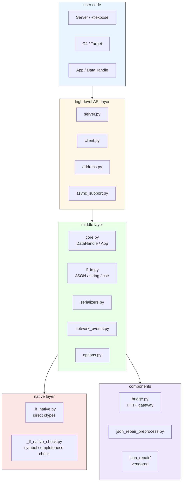
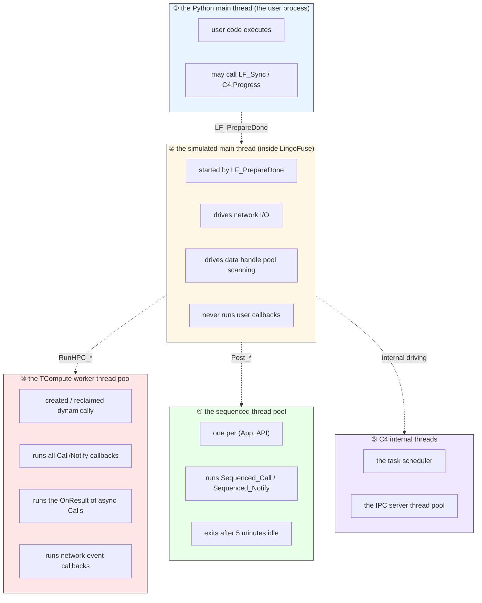
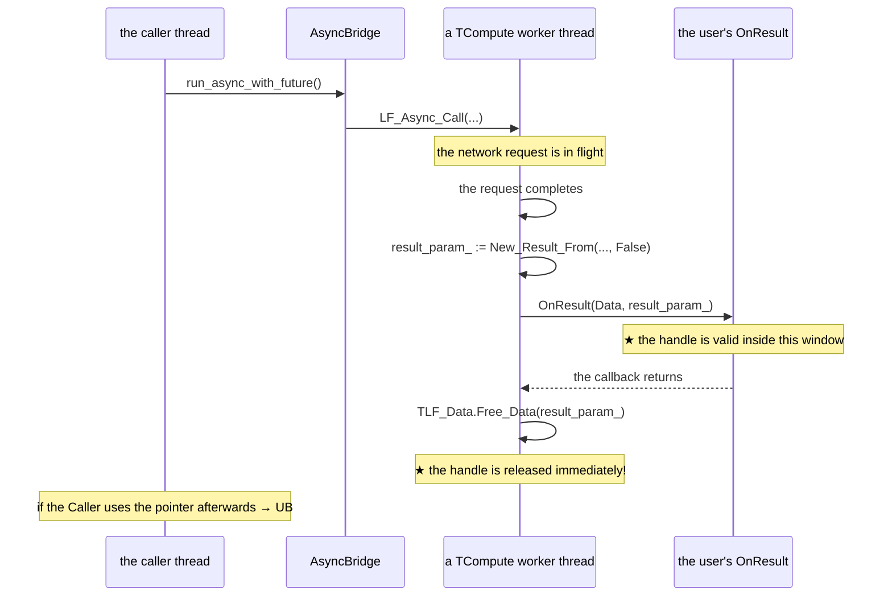
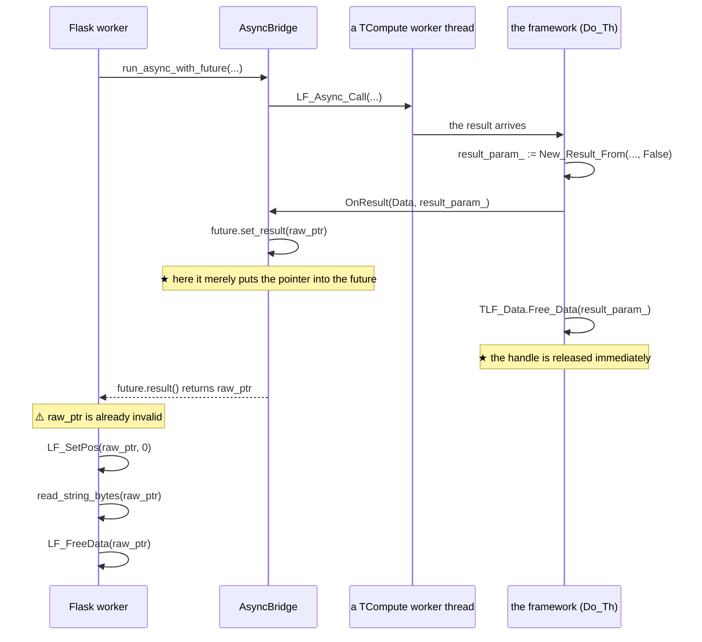

# The LingoFuse Python binding knowledge base

> Chinese version: [readme.md](readme.md)

> **What this document is**: this README is both a **user guide** to the LingoFuse Python binding and a **mechanism knowledge base**. Reading it lets you not only call LingoFuse but also understand its underlying mechanisms — **especially the three areas where people trip up most: the thread model, the handle ownership model, and the P2P identity side data**.
>
> **Core commitments**:
> - every mechanism description comes from a line-by-line check of the Python binding source against the Pascal-side `Z.LingoFuse_Export.pas` / `Z.Net.C4.LingoFuse.pas`.
> - every "pitfall" comes with a concrete case and a source-code basis.
> - anything uncertain is stated openly in **chapter 13, "The honest uncertainty list"**.
>
> **Readers**: users of the Python binding, cross-language integrators, and engineers who will take over the Bridge in the future.
>
> **Document version**: v1.1 (v3.2 correction: `LF_Get_P2P_UID` changed from returning an array value to returning a pointer, plus the side-data semantics)
> **Last updated**: 2026-10-12

---

## Contents

- [Chapter 0 — a 30-second overview](#chapter-0--a-30-second-overview)
- [Chapter 1 — an overview of the Python binding](#chapter-1--an-overview-of-the-python-binding)
- [Chapter 2 — the three-layer call stack](#chapter-2--the-three-layer-call-stack)
- [Chapter 3 — the DataHandle data handle](#chapter-3--the-datahandle-data-handle)
- [Chapter 4 — the thread and callback model (★ core)](#chapter-4--the-thread-and-callback-model--core)
- [Chapter 5 — the handle ownership model (★ core)](#chapter-5--the-handle-ownership-model--core)
- [Chapter 6 — the three addressing modes](#chapter-6--the-three-addressing-modes)
- [Chapter 7 — data frames, encoding, the JSON policy](#chapter-7--data-frames-encoding-the-json-policy)
- [Chapter 8 — the module list](#chapter-8--the-module-list)
- [Chapter 9 — the HTTP Bridge](#chapter-9--the-http-bridge)
- [Chapter 10 — the counter-example collection (common pitfalls)](#chapter-10--the-counter-example-collection-common-pitfalls)
- [Chapter 11 — the post-mortem of this debugging session (a case study)](#chapter-11--the-post-mortem-of-this-debugging-session-a-case-study)
- [Chapter 12 — quick start](#chapter-12--quick-start)
- [Chapter 13 — the honest uncertainty list](#chapter-13--the-honest-uncertainty-list)
- [Appendix A — the identifier index](#appendix-a--the-identifier-index)

---

# Chapter 0 — a 30-second overview

## 0.1 In one sentence

> **The LingoFuse Python binding is a complete ctypes wrapper that talks directly to the LingoFuse C ABI. It provides the full chain from low-level native binding through RAII wrappers and the high-level Server/Client APIs to the HTTP Bridge and JSON repair.**
>
> **But its thread model, handle ownership model and P2P identity side-data model differ from those of ordinary Python libraries, and you must understand these three before anything else, or you will hit memory-safety pitfalls.**

## 0.2 The four "iron laws"

| # | Rule | Consequence of breaking it | See |
|:-:|------|----------|------|
| 1 | **the handle returned by the `LF_Async_Call` family belongs to the framework** and is released by the framework **immediately** after the callback returns; never call `LF_FreeData` on it and never retain it across threads | use-after-free + double-free, undefined behaviour | PY-OWN-002 |
| 2 | **all callbacks run on TCompute worker threads**, never the main thread; never block, never call `LF_Call` / `LF_Notify` / `LF_LocalCall` | deadlock / thread-pool exhaustion | PY-TH-002 |
| 3 | **`LF_PrepareDone` returns 1 successfully only once per process**; to restart you must first `LF_Shutdown` + `LF_ResetPrepare` | a second call returns 0, mistaken for a failure | PY-GEN-004 |
| 4 | **UID / P2PName are "side data"**: the sender writes them into the payload header automatically at send time; the receiver can read them only on the **Input** parameter of the callback that fires the event, never on a self-created handle or an Output handle | you get an all-zero UID / an empty string without noticing | PY-SIDE-001 |

## 0.3 What this knowledge base covers

| Covered | Not covered |
|------|--------|
| every public API of the Python binding | the internals of the C4 framework on the Pascal side |
| the thread model, handle ownership, addressing modes, P2P identity side data | the details of LingoFuse's serialization protocol |
| the Bridge's three-direction contract | the concrete implementations of the other language bindings (C#/Java/…) |
| the post-mortem of this debugging session | encryption / compression details of the network transport |

---

# Chapter 1 — an overview of the Python binding

## 1.1 The capability matrix

| Dimension | Status | Key modules |
|------|:----:|----------|
| C ABI low-level binding | ✅ complete | `_lf_native.py` |
| RAII wrappers | ✅ complete | `core.py` |
| Server wrapper | ✅ complete | `server.py` |
| Client wrapper | ✅ complete | `client.py` |
| Three addressing modes | ✅ complete | `address.py` |
| Async Future / asyncio | ✅ complete | `async_support.py` |
| Unified JSON I/O | ✅ complete | `lf_io.py` |
| JSON repair preprocessing | ✅ complete | `json_repair_preprocess.py` |
| Network events | ✅ complete | `network_events.py` |
| HTTP Bridge | ✅ complete | `bridge.py` |
| Runtime options | ✅ complete | `options.py` |

## 1.2 The architecture overview



## 1.3 PY-GEN-001 — the one-instance-per-process constraint

**Within a Python process LingoFuse is a global singleton**:

- one simulated main thread (started by the first `LF_PrepareDone`).
- one client pool and one service pool.
- one set of runtime options (`LF_SetOption` applies globally).

**Consequences**:

- multiple `C4` instances share the same global connection (later ones reuse the endpoint created by the earlier one).
- multiple `Server` instances share the same main thread.
- **`C4.shutdown()` stops the global connection shared by all instances**.

---

# Chapter 2 — the three-layer call stack

## 2.1 The layer split

| Layer | Modules | Responsibility | Calls the C ABI directly? |
|:--:|------|------|:-------------:|
| **L3 high level** | `server.py` / `client.py` / `address.py` / `async_support.py` | user-friendly APIs | ❌ |
| **L2 middle** | `core.py` / `lf_io.py` / `serializers.py` / `network_events.py` / `options.py` | RAII wrappers + I/O policy | via L1 |
| **L1 native** | `_lf_native.py` | ctypes function bindings | ✅ |

## 2.2 PY-GEN-002 — the dependency direction is one-way

```
L3  →  L2  →  L1
```

**Reverse dependencies are forbidden**. Specifically forbidden:

- `_lf_native.py` **must not** import `core.py` / `lf_io.py` / any L2 module.
- `lf_io.py` **must not** import `core.py` (`lf_io` must be able to work independently on raw handles).
- L3 modules **must not** bypass L2 to assemble ctypes calls by hand (except `bridge.py`, where a raw handle is genuinely needed).

## 2.3 PY-GEN-003 — the uniform handling of string arguments

**Every string argument passed to an `LF_*` function must go through `lf_io.cstr()`**:

```python
from lingofuse.lf_io import cstr

# ✅ right
LF_Call(cstr("MyApp"), hnd, 5000)

# ❌ wrong: relies on CPython's implicit trailing NUL, unsafe across implementations
LF_Call(b"MyApp", hnd, 5000)
```

`cstr()` does two things:

1. `value.encode("utf-8")` — a uniform UTF-8 encoding.
2. append one `\x00` byte — satisfying `c_char_p`'s NUL-termination requirement explicitly.

**Why it cannot be skipped**: a CPython `bytes` object does internally have a hidden trailing NUL, but that implementation detail **is not a contract**. PyPy, GraalPy and future CPython versions may all differ.

## 2.4 PY-GEN-004 — the `LF_PrepareDone` lifecycle

```pascal
function LF_PrepareDone(): Integer;  // 1 = success, 0 = failure
```

**The contract**:

| Scenario | Return value |
|------|:------:|
| first call, all prepared clients ready | `1` |
| first call, some clients not ready (timeout) | `1` (**note: still 1**) |
| already called once (no shutdown) | `0` |
| called again after `LF_Shutdown` | `1` (a restart is possible) |

**Consequences**:

- in tests, after every call to `LF_PrepareDone()` you **must do `LF_ExitMainThread()` + `LF_Shutdown()` in a finally block**, otherwise the next test's `LF_PrepareDone` returns 0.
- "returned 1 but some clients are not ready" is a **legal state**, not an error. To find out whether something is really ready, use `check_api` / `check_app`.

---

# Chapter 3 — the DataHandle data handle

## 3.1 PY-HND-001 — the two kinds of handle

The Python binding exposes **two kinds of data handle**, with **completely different release timing**:

| Kind | How to construct | Idle reclaim | `LF_FreeData` semantics |
|------|----------|:--------:|-------------------|
| **auto-reclaim** | `DataHandle(api_name)` | released by the pool scan after 10 minutes idle | **marks** (the next scan really frees it) |
| **permanent** | `DataHandle.create_permanent(api_name)` | never reclaimed | **released synchronously, immediately** |

**How to choose**:

```python
# ✅ short-lived → auto-reclaim
with DataHandle("my_api") as hnd:
    hnd.write_json({"a": 1})
    LF_Call(...)

# ✅ long-lived → permanent
GLOBAL_TEMPLATE = DataHandle.create_permanent("my_api")
# used for the whole process lifetime
```

## 3.2 PY-HND-002 — the paths on which an auto-reclaim handle is not reclaimed

An auto-reclaim handle **is not released by the pool scan** in the following cases:

1. **idle time < 10 minutes** (the default `DataHandle_Idle_Timeout = 600000` ms).
2. **any accessor call** (`get_size` / `get_pos` / `read_*` / `write_*`) refreshes the timestamp.
3. **a remote call is in progress** (internally `calling___ > 0`).

**Consequence**: a handle that is only `write`n and never `read`, and is not explicitly `free()`d after sending, waits the full 10 minutes to be reclaimed.

## 3.3 PY-HND-003 — how `LF_FreeData` differs between auto-reclaim and permanent handles

```python
# auto-reclaim
h1 = DataHandle("a")
h1.free()          # only sets deleted___ = True
                   # the real release is done by the main thread's pool scan (at most 5 seconds later)

# permanent
h2 = DataHandle.create_permanent("b")
h2.free()          # calls TLF_Data.Free_Data___ immediately
                   # releases TMem64 and PLF_Data immediately
```

**Why this difference matters**:

- `free()` on an auto-reclaim handle **does not block**, so it is safe to call on a hot path.
- `free()` on a permanent handle **releases memory synchronously**, so a very large handle can cause a momentary memory spike.

## 3.4 PY-HND-004 — position and size

**The key fact**: `LF_GetSize` / `LF_GetPos` **query the current position / the total size**, not "the length of valid data".

**After a write the position is at the end**:

```python
h = DataHandle("a")
h.write_json({"x": 1})   # an internal write, with position advanced to the end
print(h.get_pos(), h.get_size())  # 8 8  ← the position is at the end!
```

**Before reading you must `set_pos(0)`** (unless you know you are reading the tail):

```python
h.set_pos(0)
data = h.read_json()
```

**The wrapper layer already handles this**:

- `DataHandle.read()` — resets with `LF_SetPos(0)` automatically.
- `DataHandle.read_json()` — resets with `LF_SetPos(0)` automatically.
- `DataHandle.read_string()` — **does not reset**, and reads from the current position (NUL tolerant).

**⚠️ The PY-HND-004 pitfall**: `bridge.py` once took a raw handle inside an async callback and used `lf_io.read_string_bytes` directly, **without `LF_SetPos(0)` first**, so it read empty data. That pitfall surfaced together with the ownership bug and is an important part of the case study.

## 3.5 PY-HND-005 — the P2P identity accessors (★ side data)

`DataHandle` exposes two **side-data** accessors:

```python
inp.get_p2p_uid()   -> bytes  # exactly 32 bytes
inp.get_p2p_name()  -> str    # an empty string when the sender did not set it
```

### 3.5.1 What "side data" means

**These two accessors do not read the handle's own business data**. They read **the P2P identity metadata the sender wrote automatically when sending the request**:

- **where the data comes from**: when the sender builds a request, the client's `TC40_LF_Client.Send_*` methods internally call `TMemory_Param_Tool.Rebuild_UID_and_P2PName`, which **automatically writes `FromUID` (32 bytes) + `FromP2PName` (a UTF-8 string) into the front of the request payload**.
- the `Input` handle the receiver gets has exactly these two values in `Data_Param.FromUID` / `Data_Param.FromP2PName`.
- **the business layer never has to pass them by hand**.

### 3.5.2 Valid only on "the `Input` parameter of the callback that fires the event"

| Location | Valid? | Why |
|------|:--------:|------|
| the `Input` of `On_Call(Trigger, Input, Output)` | ✅ | received from the network, carrying the sender's metadata |
| the `Input` of `On_Notify(Trigger, Input)` | ✅ | as above |
| the `Input` of an `LF_LocalCall` / `LF_LocalNotify` callback | ✅ | local calls also go through `Rebuild_UID_and_P2PName` injection |
| the `Result_` of `OnResult(Data, Result_)` | ❌ | this is an **output handle**, carrying only `Data_Result` and no `Data_Param` |
| a handle you created with `LF_CreateData` | ❌ | there is no "sender"; `FromUID` is `Null_UID()` and `FromP2PName` is empty |
| a handle created by `LF_CreateData_Permanent` | ❌ | as above |

**When called on an output handle or a self-created handle**:

- it **returns `Null_UID()` (all zeros) / an empty string**.
- **the Pascal side logs a warning**: `[warning] Get_P2P_UID(): P2P Info only backcall "input" parameter.`
- **no exception is thrown**.

### 3.5.3 `LF_Get_P2P_UID` returns a **pointer**, not a value (★ correction)

The C ABI signature (Pascal):

```pascal
function LF_Get_P2P_UID(Hnd: TDataHnd___): PP2P_UID___;
```

That is, it returns **`PP2P_UID___` = `^TUID___` (a pointer to a 32-byte UID)**, not a `TUID___` (the 32-byte value itself).

**The contract**:

| Item | Description |
|----|------|
| **return value** | a **pointer** to the 32-byte UID |
| **pointer lifetime** | allocated with `New` on the C side and released automatically about 5 seconds later by `DelayFreeMem(5.0, ...)` |
| **caller's obligation** | **read and copy**, dereference immediately; **do not release it manually**; **do not keep it long-term** |
| **the Python high-level wrapper** | `DataHandle.get_p2p_uid()` copies it immediately into a `bytes` with `ctypes.string_at(ptr, 32)`; the caller receives **a detached Python bytes object** and never touches a raw pointer |
| **`LF_Get_P2P_Name`** | returns a `c_char_p` (a NUL-terminated UTF-8 string pointer), likewise released automatically after about 5 seconds; ctypes copies it into `bytes` at the call boundary, so it is safe |

**Cross-language implications**:

- previously (old ABI): `uid = LF_Get_P2P_UID(input)` obtained the value directly.
- now (new ABI): `uid_ptr = LF_Get_P2P_UID(input); uid = ctypes.string_at(uid_ptr, 32)` (**dereference + copy immediately**).
- **do not release that pointer manually** (it is not owned by the caller).
- **do not keep that pointer long-term** (it becomes invalid after about 5 seconds).

### 3.5.4 Correct usage

```python
def my_callback(trigger, inp, out):
    # ✅ read the sender's identity from Input
    uid = inp.get_p2p_uid()       # bytes, 32 bytes
    name = inp.get_p2p_name()     # str

    # ✅ use it
    # ... validation, auditing, session management ...

    # ❌ don't: out.get_p2p_uid()     ← an output handle has no P2P identity
    # ❌ don't: self_created.get_p2p_uid() ← a self-created handle has no P2P identity
```

### 3.5.5 A coverage quick reference

| Command | Does the receiving side have a P2P identity? |
|------|:----------------------:|
| `Notify` / `Sequenced_Notify` | ✅ |
| `Call` / `Sequenced_Call` | ✅ |
| `UID_Notify` / `UID_Call` / `UID_Sequenced_*` | ✅ |
| `P2PName_Notify` / `P2PName_Call` / `P2PName_Sequenced_*` | ✅ |
| **local calls** (`LF_LocalCall` / `LF_LocalNotify`) | ✅ |
| `OnResult` (the `Result_` of an async callback) | ❌ |
| a self-created input handle (`LF_CreateData`) | ❌ |

---

# Chapter 4 — the thread and callback model (★ core)

## 4.1 PY-TH-001 — the full picture of the five thread kinds



## 4.2 PY-TH-002 — the callback execution-context matrix

**This is the table people trip over most**. **Memorise** it:

| Callback type | How it is registered | Executing thread | Holds a lock | May call `LF_Call`? |
|---------|---------|---------|:----:|:---------------:|
| **Call callback** | `App.register_call` | a TCompute worker thread | ❌ | ❌ |
| **Notify callback** | `App.register_notify` | a TCompute worker thread | ❌ | ❌ |
| **async Call OnResult** | `LF_Async_Call(...)` | a TCompute worker thread | ❌ | ❌ |
| **network events** | `set_network_event` | a TCompute worker thread | ❌ | ❌ |
| **sequenced Call/Notify** | the `Sequenced_*` family | a dedicated sequenced thread | ❌ | ❌ |
| **`@expose(p2p=True)` callbacks** | `register_p2p_*` | a TCompute worker thread | ❌ | ❌ |

**The critical facts**:

- **no user callback ever runs on the main thread**.
- **no user callback can safely call a synchronous LingoFuse function**.
- **callback exceptions are swallowed** (logged, but never propagated onto the C stack).

## 4.3 PY-TH-003 — operations forbidden inside callbacks

```python
# ❌ all of these are sources of deadlock / crashes

def bad_callback(trigger, inp, out):
    # ❌ forbidden 1: calling a synchronous LingoFuse function
    result = LF_Call(cstr("Other"), inp, 5000)  # deadlock

    # ❌ forbidden 2: blocking for a long time
    time.sleep(60)  # exhausts the thread pool

    # ❌ forbidden 3: touching the UI
    my_window.update()  # not the main thread, crash

    # ❌ forbidden 4: retaining a handle across callbacks
    global saved_handle
    saved_handle = inp  # inp becomes invalid once the callback returns

    # ❌ forbidden 5: accessing unlocked shared state across threads
    shared_dict["key"] = value  # needs a threading.Lock
```

**✅ The right approach**:

```python
def good_callback(trigger, inp, out):
    # read Input only
    data = inp.read_json()

    # write Output only
    out.write_json({"result": process(data)})

    # need asynchrony → submit to your own thread pool
    my_executor.submit(long_running_task, data)

    # need to call another LingoFuse API → via a future / thread
    # (but watch the handle's lifetime! see §5)
```

## 4.4 PY-TH-004 — when the simulated main thread starts

**The simulated main thread is started by `LF_PrepareDone()`**:

```python
LF_ResetPrepare()
LF_PrepareService(...)   # optional
LF_PrepareClient(...)
LF_PrepareDone()         # ← the simulated main thread starts here
```

**Before `LF_PrepareDone`**:

- `DoStatus` messages may not be enqueued (the simulated main thread has not started).
- the semantics of `LF_GetStatus` / `LF_PostStatus` are undefined.
- the auto-reclaim handle pool scan does not run.

**After `LF_ExitMainThread`**:

- the simulated main thread stops.
- the handle pool scan stops.
- `LF_FreeData` becomes a no-op.

## 4.5 PY-TH-005 — the guarantees and the cost of the sequenced threads

**The FIFO guarantee of `Sequenced_Call` / `Sequenced_Notify`**:

- one dedicated sequenced thread per `(App, API)` pair.
- requests with the same key execute strictly in send order.
- there is no ordering guarantee between different keys; they may run concurrently.

**The cost**:

- one thread per key, so the thread count explodes when there are many keys.
- it exits after 5 minutes idle, but **the 1 second before exiting is a "zombie window"** (`DelayFreeObj(1.0, self)`).

**Forbidden**:

- do not send another `Sequenced_*` request with the same key from inside a sequenced callback (it self-locks).
- do not block for more than 5 minutes inside a sequenced callback.

---

# Chapter 5 — the handle ownership model (★ core)

> **This chapter is the heart of the pitfalls hit in this debugging session. Please read it all.**

## 5.1 PY-OWN-001 — the two call families have completely opposite handle ownership

The LingoFuse C ABI has **two call families**, and their handle ownership is **inverted**:

| Family | Functions | Owner of the returned handle | How it is released |
|------|------|:-------------------:|---------|
| **synchronous family** | `LF_Call` / `LF_UID_Call` / `LF_P2PNAME_Call` | **the caller** | the caller calls `LF_FreeData` explicitly |
| **asynchronous family** | `LF_Async_Call` / `LF_UID_Async_Call` / `LF_P2PNAME_Async_Call` | **the framework** | the framework releases it **immediately** after the callback returns |

**The source basis**:

**The synchronous family** (`Z.LingoFuse_Export.pas`):

```pascal
function LF_Call(appName: pansichar; Param: TDataHnd___; Timeout_: uint64): TDataHnd___;
begin
  ...
  // take the result out of the future
  Output := Cli.Wait_Execute_Call(...);
  ...
  // ← auto_recycle = True, the caller owns it
  Result := TLF_Data.New_Result_From(Output, True);
  ...
end;
```

**The asynchronous family** (`TLF_Async_Call_Bridge.Do_Th` in `Z.Net.C4.LingoFuse.pas`):

```pascal
procedure TLF_Async_Call_Bridge.Do_Th;
var
  result_param_: PLF_Data;
begin
  // ← auto_recycle = False, the framework owns it
  result_param_ := TLF_Data.New_Result_From(Result_M64.Swap_To_New_Instance, False);
  try
    if Assigned(OnResult) then
      OnResult(Data_, result_param_);  // ← the callback receives the pointer
  except
  end;
  // ← released immediately!
  TLF_Data.Free_Data(result_param_);
  DelayFreeObj(1.0, Self);
end;
```

**The key difference**:

- `New_Result_From(..., True)` → `auto_recycle = True` → release is **deferred** to the pool scan.
- `New_Result_From(..., False)` → `auto_recycle = False` → release is **immediate and synchronous**.

## 5.2 PY-OWN-002 — the "moment of death" of an async-family handle

**The sequence diagram**:



**The contract**:

- once the callback returns, the handle is invalid immediately.
- using that handle outside the callback is **undefined behaviour** (use-after-free).
- calling `LF_FreeData` on it is a **double free**.

## 5.3 PY-OWN-003 — why this difference produces "non-deterministic failures"

**The root cause**: LingoFuse's `Free_Data` is a **pooled reclaim**:

```pascal
procedure TLF_Data.Free_Data(hnd: PLF_Data);
begin
  ...
  if hnd^.auto_recycle___ then
      hnd^.deleted___ := True   // mark it, wait for the pool scan
  else
      TLF_Data.Free_Data___(hnd);  // release immediately
end;

class procedure TLF_Data.Free_Data___(hnd: PLF_Data);
begin
  hnd^.Data_Info := '';
  DisposeObjectAndNil(hnd^.Data_Param);
  DisposeObjectAndNil(hnd^.Data_Result);   // ← TMem64 is released
  DisposeObjectAndNil(hnd^.calling___);
  LF_DataMemory.Free_PLF_Data(hnd);        // ← PLF_Data goes back to the pool
end;
```

**The result**:

- `TMem64` is destroyed by `DisposeObjectAndNil` → its memory **returns to the allocator**.
- `PLF_Data` goes through `Free_PLF_Data` → into the `TLF_DataMemory` pool.

**What UB looks like depends on**:

- whether the allocator has already reused that memory.
- whether another thread allocated a new `TMem64` at the same moment.
- whether thread scheduling lets the caller thread run only after `Free_Data`.

**Therefore**:

- a small payload (say an int 7, 2 bytes): usually not yet reused → the old value is read → "looks normal".
- a large payload (say a dict, 17 bytes): far more likely to have been reused → empty/garbage is read → "the return value is wrong".

**⚠️ Bisecting `int` vs `dict` misleads the diagnosis**. It is not a "type difference"; it is "payload size affects when memory is reused".

## 5.4 PY-OWN-004 — the correct read patterns

### Pattern A: a synchronous call (recommended)

```python
# use LF_Call; the handle belongs to the caller
res_ptr = LF_Call(cstr(app_name), hnd, timeout_ms)
try:
    LF_SetPos(res_ptr, 0)
    result_bytes = read_string_bytes(res_ptr)
finally:
    LF_FreeData(res_ptr)   # ← legal, because the caller owns it
```

### Pattern B: an async call (everything must be done inside the callback)

```python
def on_result(trigger, res_ptr):
    # ✓ the handle is valid inside this callback
    LF_SetPos(res_ptr, 0)
    data = read_string_bytes(res_ptr)

    # ✓ copy the data out (bytes is a new Python object)
    my_queue.put(data)

    # ❌ never pass res_ptr out
    # ❌ never LF_FreeData(res_ptr)

LF_Async_Call(cstr(app_name), hnd, None, callback)
```

### Pattern C: the modern Future interface (already wrapped by the Python binding)

```python
# Target.call_future in lingofuse/address.py already handles this correctly
target = AppTarget("MyApp")
future = target.call_future("api", payload, timeout_ms=5000)
result = future.result()   # result is bytes/obj, not a raw pointer
```

**The key**: `_deserialize_result` in `address.py` reads **inside the callback** and hands the bytes to the future, so no raw pointer ever crosses a thread boundary.

## 5.5 PY-OWN-005 — a handle ownership quick reference

| Source | Owner | Releaser | Safe across threads |
|------|:------:|:------:|:----------:|
| `DataHandle(api_name)` | the user | the user | ⚠️ needs an external lock |
| `DataHandle.create_permanent(api_name)` | the user | the user | ⚠️ needs an external lock |
| returned by `LF_Call` | the user | the user | ✅ yes |
| inside an `LF_Async_Call` callback | the framework | **the framework** | ❌ forbidden |
| returned by `App.local_call` | the user | the user | ✅ yes |
| returned by `Server.json_call` | the user | the user | ✅ yes |
| `Target.call_future().result()` | the user | the user | ✅ yes |

## 5.6 PY-OWN-006 — the side-data ownership model (★ a correction addendum)

**Side data is not the handle's business data and does not take part in the handle ownership model**. It has three strict constraints:

| Constraint | Description |
|------|------|
| **source** | written automatically by the sender at send time; never produced by the receiver |
| **where it can be read** | only on the `Input` parameter of the callback that fires the event |
| **return shape** | `LF_Get_P2P_UID` returns a **pointer** (released by the framework about 5 seconds later); `LF_Get_P2P_Name` returns a string pointer (likewise released after about 5 seconds) |

**The Pascal-side signatures**:

```pascal
function LF_Get_P2P_UID(Hnd: TDataHnd___): PP2P_UID___;
function LF_Get_P2P_Name(Hnd: TDataHnd___): pansichar;
```

**The contract comparison**:

| Item | `LF_Get_P2P_UID` | `LF_Get_P2P_Name` |
|----|:----------------:|:------------------:|
| return type | `PP2P_UID___` (a pointer) | `pansichar` (a string pointer) |
| lifetime | about 5 seconds (`DelayFreeMem`) | about 5 seconds (`DelayFreeMem`) |
| caller's obligation | copy it read-only, do not release manually | copy it read-only, do not release manually |
| Python wrapper | `DataHandle.get_p2p_uid()` copies it with `ctypes.string_at(ptr, 32)` into `bytes` immediately | `DataHandle.get_p2p_name()` decodes it into `str` immediately |

**The cross-language general rule**:

- inside the callback copy it into a native object (Julia's `Vector{UInt8}` / Erlang's binary / R's character vector); **never expose the raw pointer**.
- **never pass the raw pointer out of the callback**.

---

# Chapter 6 — the three addressing modes

## 6.1 PY-ADDR-001 — comparing the three modes

| Mode | Routing key | Local first? | Load balanced? | Lifetime |
|------|--------|:---------:|:---------:|---------|
| **App name** | `str` | ✅ | ❌ | while the App is registered |
| **UID** | 32 bytes | ✅ | ❌ | regenerated on every TunnelLink |
| **P2PName** | `str` | ❌ | ✅ (server side) | while the process has it set |

**Local-first**: if the caller's own process has a matching App/UID, the call executes locally without going over the network.

**P2PName deliberately is not local-first**: the server holds the load-balancing state, and short-circuiting locally would break it.

## 6.2 PY-ADDR-002 — the UID's lifetime

**The UID is regenerated on every TunnelLink**:

```python
# connection established → a UID is generated
# disconnected → the UID becomes invalid
# reconnected → the UID changes
```

**Consequences**:

- **caching a UID is dangerous**. After a disconnect and reconnect the old UID is no longer valid.
- you must rediscover the UID after reconnecting. The usual pattern:

```python
# the server registers a whoami API
@app.expose("whoami")
def whoami(trigger, inp: DataHandle, out: DataHandle):
    # ✅ read the sender's UID (side data) from the Input handle
    caller_uid = inp.get_p2p_uid()   # 32 bytes
    caller_name = inp.get_p2p_name()
    out.write_json({
        "uid_hex": caller_uid.hex(),
        "p2p_name": caller_name,
    })

# the client caches it after calling
def refresh_uid(client):
    result = client.whoami()
    cached_uid = bytes.fromhex(result["uid_hex"])  # 32 bytes
```

**Note**: the `whoami` pattern is the **only** way to obtain "your own UID" from the application layer. Because the UID is side data written by the sender, the receiver can only read it from the `Input` parameter, so it has to come back to the client through a loopback call.

## 6.3 PY-ADDR-003 — the two routing strategies for P2PName

**The server uses two strategies when routing by P2PName**:

1. **Cycle_Anchor load balancing**: pick the one with the smallest anchor value, then update it to a new global value.
2. **FixedSequenced stickiness**: the same target is kept for `Fixed_Sequenced_Time` (20 seconds by default) before switching.

**How to adjust**:

```python
from lingofuse import set_option

# change the stickiness window to 60 seconds
set_option("Fixed_Sequenced_Time", "60000")
```

## 6.4 PY-ADDR-004 — the API comparison for the three modes

| Operation | App name | UID | P2PName |
|------|:------:|:---:|:-------:|
| Call | `LF_Call` | `LF_UID_Call` | `LF_P2PNAME_Call` |
| Async Call | `LF_Async_Call` | `LF_UID_Async_Call` | `LF_P2PNAME_Async_Call` |
| Async Seq Call | `LF_Async_Sequenced_Call` | `LF_UID_Async_Sequenced_Call` | `LF_P2PNAME_Async_Sequenced_Call` |
| Notify | `LF_Notify` | `LF_UID_Notify` | `LF_P2PNAME_Notify` |
| Seq Notify | `LF_Sequenced_Notify` | `LF_UID_Sequenced_Notify` | `LF_P2PNAME_Sequenced_Notify` |
| Check | `LF_CheckApp` + `LF_CheckApi` | `LF_Check_UID_Api` | `LF_Check_P2PNAME_Api` |

**The Python high-level wrappers**:

```python
client = C4("default_app", "ipc:endpoint")

# App name
client.app("OtherApp").call("api", payload)

# UID
client.uid(uid_bytes).call("api", payload)

# P2PName
client.p2pname("group").notify("api", payload)
```

## 6.5 PY-ADDR-005 — UID as an argument vs UID as side data (★ correction)

`LF_UID_Call` / `LF_UID_Async_Call` / `LF_UID_Notify` and the like take a 32-byte UID as the **first argument**. That UID is **a value the caller supplies**, and it plays a completely different role from the **return value** of `LF_Get_P2P_UID`:

| Role | ctypes representation | Purpose |
|------|-------------|------|
| **argument** (the first parameter of LF_UID_Call) | `TP2P_UID` (a `c_ubyte * 32` array, passed by value) | tells the framework "route to which UID" |
| **return value** (LF_Get_P2P_UID) | `PP2P_UID___` (a pointer) | tells the callback "who the sender is" |

**The two cannot be unified**:

- the argument role is "a value the caller already knows", passed by value as an array type by ctypes.
- the return role is "a pointer the framework hands over", represented by ctypes as `c_void_p`, with the Python wrapper copying it immediately.

**The cross-language general rule**: never mistake a UID argument for UID side data, and never try to "read out" a UID from the return value of `LF_UID_Call`. Their origin, lifetime and semantics are entirely different.

---

# Chapter 7 — data frames, encoding, the JSON policy

## 7.1 PY-IO-001 — the three I/O paths

The Python binding has **three I/O paths** with different frame formats that **must not be mixed**:

| Path | Purpose | NUL terminated? | Typical call |
|------|------|:----------:|---------|
| **`lf_io`** | the toolchain-standard JSON frame | ✅ | `write_json` / `read_json` |
| **`serializers`** | the payload of `DataHandle.read/write` | ❌ | `DataHandle.write` / `read` |
| **`core.DataHandle.write_json`** | JSON on a DataHandle | ✅ (delegates to lf_io) | `hnd.write_json(...)` |

**The key distinction**:

```python
# path A: lf_io (with NUL)
from lingofuse.lf_io import write_json, read_json
write_json(hnd.raw, {"a": 1})     # writes `{"a": 1}\x00`
data = read_json(hnd.raw)          # stops at the first \x00

# path B: serializers (no NUL)
from lingofuse.serializers import default_serializer
hnd.write({"a": 1})                # writes `{"a": 1}` with no NUL
data = hnd.read()                  # reads everything
```

**When to use which**:

- **server ↔ client cross-process communication** → use `lf_io` (with NUL).
- **internal DataHandle serialization** → use `serializers` (no NUL).
- **when unsure** → use `hnd.write_json` / `read_json` (which delegate to `lf_io`).

## 7.2 PY-IO-002 — the JSON serialization policy

**The toolchain's unified JSON serialization policy**:

```python
json.dumps(obj, ensure_ascii=False, default=str)
```

**Three guarantees**:

1. **`ensure_ascii=False`**: non-ASCII characters stay literal and are **not escaped into `\uXXXX`**.
2. **`default=str`**: unserializable objects degrade to `str()` instead of raising `TypeError`.
3. **one entry point**: `lf_io.dumps_json()` is the only source.

**Forbidden**:

- ❌ `json.dumps(obj)` — `ensure_ascii=True` by default, which escapes non-ASCII.
- ❌ `requests.post(json=obj)` — internally also `ensure_ascii=True`.
- ❌ hand-assembling JSON strings.

## 7.3 PY-IO-003 — JSON repair preprocessing

**The unified three-way policy** (`json_repair_preprocess.repair_json_text`):

| Input | Output | Log |
|------|------|------|
| valid JSON | returned unchanged | none |
| repairable malformed JSON | the repaired text | one WARNING |
| unrepairable | returned unchanged | one ERROR (strict path) / none (lenient path) |

**Enabling / disabling**:

```bash
# disable repair (validate only, never rewrite)
set LINGOFUSE_JSON_REPAIR=0
```

**How the read paths differ**:

- `lf_io.read_json` — the strict path; unrepairable input logs an ERROR and finally raises `RuntimeError`.
- `lf_io.read_json_or_bytes` — the lenient path; unrepairable input returns the raw bytes.
- `serializers.default_deserializer` — the strict path; unrepairable input finally raises `JSONDecodeError`.

## 7.4 PY-IO-004 — the encoding fallback chain

**The decode order when reading bytes**:

```
UTF-8 → GBK → Latin-1
```

**Why these three**:

- **UTF-8**: the modern standard.
- **GBK**: the default encoding of Chinese Windows.
- **Latin-1**: never fails (any byte sequence decodes), the final fallback.

**Note**: `TPascalString.Bytes` (the substrate of `lf_io`) is also UTF-8 and is independent of this fallback chain.

---

# Chapter 8 — the module list

## 8.1 PY-MOD-001 — a module quick reference

| Module | Its job in one line |
|------|-----------|
| `_lf_native.py` | direct ctypes access to the C ABI |
| `_lf_native_check.py` | the symbol completeness checker |
| `core.py` | `DataHandle` + `App` RAII |
| `server.py` | `Server` + `@expose` |
| `client.py` | the dynamic `C4` client |
| `address.py` | the `Target` for the three addressing modes |
| `async_support.py` | `CallFuture` + `AsyncBridge` |
| `lf_io.py` | unified JSON / string / cstr |
| `serializers.py` | serialization for `DataHandle.read/write` |
| `network_events.py` | network event callbacks |
| `options.py` | the typed wrapper over runtime options |
| `json_repair_preprocess.py` | the single entry point for JSON repair |
| `json_repair/` | the vendored JSON repair engine |
| `errors.py` | the exception hierarchy |
| `bridge.py` | the three-direction HTTP gateway |

## 8.2 PY-MOD-002 — the key methods of `core.py`

```python
class DataHandle:
    # construction
    DataHandle(api_name, data=None, serializer=None, deserializer=None)
    DataHandle.create_permanent(api_name, ...)
    DataHandle._from_raw(hnd, owned=True, ...)

    # lifecycle
    free()
    __enter__ / __exit__
    __del__

    # position / size
    get_pos() / set_pos(pos)
    get_size() / set_size(size)

    # atomic types (little-endian)
    write_int8 / read_int8
    write_int16 / read_int16
    write_int32 / read_int32
    write_int64 / read_int64
    write_uint8 / read_uint8
    # ... every type

    # strings
    write_string(s)                # UTF-8 + NUL
    read_string()                  # NUL tolerant
    write_string_null_terminated   # alias
    read_string_null_terminated    # alias

    # JSON (delegates to lf_io)
    write_json(obj) -> int
    read_json(strict=False) -> Any
    read_json_strict() -> Any

    # raw bytes
    read_bytes() -> bytes
    peek_string_bytes() -> bytes   # does not advance the position
    read_all_bytes() -> bytes

    # sender identity (Input only, side data)
    get_p2p_uid() -> bytes          # 32 bytes, copies the pointer internally and immediately
    get_p2p_name() -> str
```

```python
class App:
    App(name, description="")

    # register APIs
    register_call(api_name, func, description="")
    register_notify(api_name, func, description="")
    unregister(api_name) -> bool

    # local execution
    local_call(param: DataHandle) -> DataHandle
    local_notify(param: DataHandle)

    # sequenced notification
    sequenced_notify(param: DataHandle)

    # binding
    bind() -> int   # returns the number of clients bound

    # lifecycle
    free()
    __enter__ / __exit__
```

## 8.3 PY-MOD-003 — the key methods of `server.py`

```python
class Server:
    Server(app_name, description="", debug=False)

    # the decorator
    @server.expose(api_name, notify=False, description="", p2p=False)
    def my_api(...):
        ...

    # starting
    server.start(addr, public_addr=None)
    server.start_multi(addresses, public_addrs=None)

    # calling
    server.json_call(api_name, *args, timeout=5000) -> Any
    server.json_notify(api_name, *args)
    server.json_sequenced_notify(api_name, *args)

    # stopping
    server.stop(full_cleanup=False)
    server.full_cleanup()
```

## 8.4 PY-MOD-004 — the key methods of `client.py`

```python
class C4:
    C4(app_name, endpoint, timeout=5000, serializer=None, deserializer=None)

    # dynamic attribute dispatch
    result = client.add(10, 20)   # calls the add API

    # the three addressing modes
    client.app("OtherApp").call("api", payload)
    client.uid(uid_bytes).call("api", payload)
    client.p2pname("group").notify("api", payload)

    # the modern Future
    future = client.call_future("api", payload)
    result = await client.call_async("api", payload)

    # lifecycle
    C4.shutdown()          # stop the network loop; the library stays loaded
    C4.full_cleanup()      # stop the network loop + unload the library
```

## 8.5 PY-MOD-005 — the `Target` of `address.py`

```python
class AppTarget:
    AppTarget(app_name, *, serializer=..., deserializer=..., default_timeout_ms=5000)

    # old style (blocking + callback)
    call(api_name, payload=None, timeout_ms=None)
    async_call(api_name, payload=None, *, on_result, user_data=None) -> int
    sequenced_call(api_name, payload=None, timeout_ms=None)
    notify(api_name, payload=None)
    sequenced_notify(api_name, payload=None)

    # new style (Future / asyncio)
    call_future(api_name, payload=None, timeout_ms=None) -> CallFuture
    call_async(api_name, payload=None, timeout_ms=None)   # async def
    sequenced_call_future(api_name, payload=None, timeout_ms=None)
    sequenced_call_async(api_name, payload=None, timeout_ms=None)

# UIDTarget / P2PNameTarget have the same interface
```

## 8.6 PY-MOD-006 — the `AsyncBridge` of `async_support.py`

```python
# the singleton
bridge = AsyncBridge.instance()

# statistics
bridge.stats() -> {
    "total": ...,
    "pending": ...,
    "fired": ...,
    "abandoned": ...,
    "not_queued": ...,
    "released_total": ...,
    "grace_seconds": ...,
    "period_seconds": ...,
}

# shutdown
AsyncBridge.shutdown_instance()
```

**`CallFuture`**:

```python
future = target.call_future("api", payload)
result = future.result(timeout=...)     # blocking
abandoned = future.abandoned            # whether it was abandoned because of a timeout
```

---

# Chapter 9 — the HTTP Bridge

## 9.1 PY-BRG-001 — what the three directions are

| Direction | Caller | Channel | Purpose |
|------|--------|------|------|
| A: inbound | an HTTP client | HTTP POST → `LF_Call` | feed an HTTP request into LingoFuse |
| B: outbound | a LingoFuse caller | `LF_Call` → HTTP POST | forward a LingoFuse request to an external HTTP endpoint |
| C: repair | a LingoFuse caller | `LF_Call` → the repair engine | delegate repair of malformed JSON |

## 9.2 PY-BRG-002 — the namespace isolation

**The Bridge's own App name and API names use double underscores**:

```
App:  __lf_http_bridge__
API:  __lf_outbound_post__      （outbound）
API:  __lf_repair_json__         （repair）
```

**The double underscores give structural isolation**: an unencoded double underscore cannot appear in an HTTP URL path, so the Bridge's API names **never collide with business APIs**.

## 9.3 PY-BRG-003 — inbound routing

| URL | Addressing mode |
|-----|---------|
| `/<app>/<api>` | App name |
| `/<api>` + `--app` | App name (using the default app) |
| `/uid/<hex64>/<api>` | UID |
| `/p2p/<group>/<api>` | P2PName |

**Reserved prefixes**: `uid`, `p2p`. An App named `uid` or `p2p` **cannot** be reached through App-name routing.

## 9.4 PY-BRG-004 — the error codes

| Error code | HTTP | Triggered by |
|:------:|:----:|------|
| `-1` | 200 | the remote call failed (timeout / empty handle / backend exception) |
| `-2` | **400** | a malformed request (the URL cannot be parsed) |
| `-3` | 200 | a precheck failed (the API is unavailable) |

## 9.5 PY-BRG-005 — forward-only mode

**`--forward-only` disables the HTTP listener** and keeps only the LingoFuse Call API.

**Uses**:

- an internal relay (nothing needs to be exposed to the network).
- a reverse proxy already exists, so this instance serves only as a Call API.
- a container environment restricts port binding.

**How to verify**:

```bash
# start it
LINGOFUSE_FORWARD_ONLY=1 \
LINGOFUSE_ENDPOINT=ipc:compute_grid \
./bridge

# an attempted connection fails
curl http://127.0.0.1:8081/    # Connection refused
```

---

# Chapter 10 — the counter-example collection (common pitfalls)

## 10.1 PY-PIT-001 — using a handle outside the async callback (★ the heart of this debugging session)

```python
# ❌ wrong: passing the handle out
def on_result(trigger, res_ptr):
    global saved_ptr
    saved_ptr = res_ptr  # invalid once the callback returns

LF_Async_Call(cstr("app"), hnd, None, on_result)
# using saved_ptr afterwards is UB

# ✅ right: copy the data inside the callback
def on_result(trigger, res_ptr):
    LF_SetPos(res_ptr, 0)
    data = read_string_bytes(res_ptr)   # bytes is a new Python object
    my_queue.put(data)
```

## 10.2 PY-PIT-002 — releasing a handle outside the async callback

```python
# ❌ wrong: a double free
def on_result(trigger, res_ptr):
    my_queue.put(res_ptr)   # pass the pointer out

LF_Async_Call(cstr("app"), hnd, None, on_result)
# ...
res_ptr = my_queue.get()
LF_FreeData(res_ptr)   # double free! the framework already released it
```

## 10.3 PY-PIT-003 — calling LF_Call inside a callback

```python
# ❌ wrong: deadlock
def my_callback(trigger, inp, out):
    # the callback is on a TCompute worker thread
    # LF_Call waits for a response, but the response needs another worker thread
    # if the pool is exhausted → deadlock
    result = LF_Call(cstr("Other"), inp, 5000)
```

## 10.4 PY-PIT-004 — forgetting to clean up in a finally block

```python
# ❌ wrong: an exception escapes after LF_PrepareDone without cleanup
LF_PrepareDone()
do_something_that_may_raise()   # raises, the main thread never exits
# the next test's LF_PrepareDone returns 0

# ✅ right: guarantee the cleanup in a finally block
try:
    LF_PrepareDone()
    do_something_that_may_raise()
finally:
    LF_ExitMainThread()
    LF_Shutdown()
```

## 10.5 PY-PIT-005 — using `json.dumps` instead of `lf_io.dumps_json`

```python
# ❌ wrong: escapes non-ASCII
body = json.dumps({"msg": "你好"}).encode()  # '{"msg": "\\u4f60\\u597d"}'

# ✅ right: keeps it literal
from lingofuse.lf_io import dumps_json
body = dumps_json({"msg": "你好"}).encode()  # '{"msg": "你好"}'
```

## 10.6 PY-PIT-006 — the `requests.post(json=...)` trap

```python
# ❌ wrong: requests uses ensure_ascii=True internally
requests.post(url, json={"msg": "你好"})

# ✅ right: serialize manually
from lingofuse.lf_io import dumps_json
body = dumps_json({"msg": "你好"}).encode("utf-8")
requests.post(url, data=body,
              headers={"Content-Type": "application/json"})
```

## 10.7 PY-PIT-007 — forgetting `LF_SetPos(0)`

```python
# ❌ wrong: the read position is at the end, so an empty read
hnd.write_json({"a": 1})
data = read_json(hnd.raw)   # may read empty

# ✅ right: reset the position first
hnd.write_json({"a": 1})
hnd.set_pos(0)
data = read_json(hnd.raw)
```

**Note**: `DataHandle.read()` and `read_json()` **reset automatically**; but raw-handle paths such as `lf_io.read_json(hnd.raw)` **do not**.

## 10.8 PY-PIT-008 — sharing unlocked state across threads

```python
# ❌ wrong: several callback threads writing concurrently
shared_list = []

def callback(trigger, inp, out):
    shared_list.append(inp.read_json())   # race

# ✅ right: take a lock
import threading
lock = threading.Lock()
shared_list = []

def callback(trigger, inp, out):
    data = inp.read_json()
    with lock:
        shared_list.append(data)
```

## 10.9 PY-PIT-009 — not setting `Overlap_Connection` beforehand

```python
# ❌ wrong: the second client fails
LF_PrepareClient(cstr("ipc:a"), app1.raw)   # OK
LF_PrepareClient(cstr("ipc:a"), app2.raw)   # returns -1

# ✅ right: set Overlap first
from lingofuse import set_option
set_option("Overlap_Connection", "True")
LF_PrepareClient(cstr("ipc:a"), app1.raw)   # OK
LF_PrepareClient(cstr("ipc:a"), app2.raw)   # OK
```

## 10.10 PY-PIT-010 — the `check_api` false negative

```python
# ❌ wrong: checking immediately after registration may return False
app.register_call("api", func)
assert check_api("MyApp", "api")   # may be False! the broadcast is delayed about 3 seconds

# ✅ right: retry, or just call it
import time
for _ in range(10):
    if check_api("MyApp", "api"):
        break
    time.sleep(0.3)
else:
    raise RuntimeError("the API registration broadcast timed out")
```

## 10.11 PY-PIT-011 — reading side data on a self-created or Output handle (★ correction)

```python
# ❌ wrong 1: reading a UID on a self-created handle
req = DataHandle("my_api")   # a request handle you created yourself
uid = req.get_p2p_uid()      # ❌ returns b"\x00" * 32; there is no "sender"

# ❌ wrong 2: reading a UID on an Output handle
def cb(trigger, inp, out):
    uid = out.get_p2p_uid()  # ❌ an output handle has no Data_Param

# ❌ wrong 3: treating a UID as a return value to read from LF_UID_Call
res = LF_UID_Call(uid_bytes, hnd, 5000)
uid_from_res = res.get_p2p_uid()   # ❌ the return role and the argument role differ

# ✅ right: read only from the Input parameter of the event-firing callback
def cb(trigger, inp, out):
    uid = inp.get_p2p_uid()   # ✅ 32 bytes
    name = inp.get_p2p_name() # ✅ str
```

**Why this is a cross-language pitfall**:

- intuitively, a developer may assume "any handle can read UID / P2PName".
- in reality these two functions read **the sender's metadata** (side data), which exists only on "a received input handle".
- the Pascal side logs a warning but **does not throw**; a managed language that ignores the log silently gets `Null_UID()` / an empty string.

## 10.12 PY-PIT-012 — treating the `LF_Get_P2P_UID` return value as an array value (★ correction)

```python
# ❌ old code: treating the return value as an array value (correct under the old ABI)
# under the new ABI, LF_Get_P2P_UID returns a pointer, not a value
from lingofuse._lf_native import LF_Get_P2P_UID
ptr = LF_Get_P2P_UID(input)     # this is a pointer
# ❌ using it directly as bytes gives you "the bytes of the pointer", not the UID itself

# ✅ right (low level): dereference, then copy
import ctypes
uid_ptr = LF_Get_P2P_UID(input)
if uid_ptr:
    uid_bytes = ctypes.string_at(uid_ptr, 32)   # 32 bytes

# ✅ recommended (high level): just use DataHandle.get_p2p_uid()
uid_bytes = inp.get_p2p_uid()   # the wrapper already handles the pointer
```

**The lesson**: **a signature change must be checked against the source**. Old docs, old comments and old binding layers may still say "returns a value" when it actually "returns a pointer".

---

# Chapter 11 — the post-mortem of this debugging session (a case study)

## 11.1 PY-CASE-001 — the problem

**The symptoms**:

- 3 failures in `test_bridge_integration.py::TestInboundAppNameRouting`.
- 13 errors in `test_bridge_e2e.py` (`setUpClass` failing).
- the bisection pattern:
  - **the `echo` API (returning a dict) failed**.
  - **the `add` API (returning an int) succeeded**.

**The initial misdiagnosis**:

- assuming the problem was in the C layer (the Pascal side).
- assuming `int` vs `dict` was a type difference.
- assuming "the same Python code path → the same behaviour".

## 11.2 PY-CASE-002 — the real root cause

**`handle_call` in `bridge.py` issued the request with the async family `LF_Async_Call`, then accessed, on a Flask worker thread, a handle the framework had already released**.

**The sequence diagram**:



**Why the bisection misled**:

- a small payload (`int 7`, 2 bytes): a low chance of memory reuse → the old value is read → "looks normal".
- a large payload (`{"msg": "hello"}`, 17 bytes): a high chance of memory reuse → empty/garbage is read → "fails".

**It is not a type difference; it is a difference in when memory gets reused.**

## 11.3 PY-CASE-003 — the fix

**Replace the async family with the synchronous family `LF_Call` / `LF_UID_Call` / `LF_P2PNAME_Call`.**

**The reasoning**:

1. Flask workers are blocking anyway, so asynchrony buys nothing.
2. synchronous-family ownership is simple: the caller owns it, the caller releases it.
3. the cost (losing the distinction between "timeout" and "empty payload") is acceptable: `--timeout` is configurable, and an empty payload is a legitimate HTTP 200 with an empty body.

**The fixed code** (inside `handle_call` in `bridge.py`):

```python
# use the synchronous family
if mode == "uid":
    uid_arr = _to_tp2p_uid(key)
    res_ptr = LF_UID_Call(uid_arr, hnd_in, config.timeout_ms)
elif mode == "p2p":
    res_ptr = LF_P2PNAME_Call(cstr(key), hnd_in, config.timeout_ms)
else:
    res_ptr = LF_Call(cstr(key), hnd_in, config.timeout_ms)

# synchronous family: the caller owns the handle
try:
    LF_SetPos(res_ptr, 0)
    result_bytes = read_string_bytes(res_ptr)
finally:
    LF_FreeData(res_ptr)   # ← legal
```

## 11.4 PY-CASE-004 — the result of the fix

```
test_bridge_units.py        84 passed
test_bridge_integration.py  58 passed
test_bridge_e2e.py          13 passed
                            ─────────
                            155 passed
```

## 11.5 PY-CASE-005 — the lessons

| # | Lesson |
|:-:|------|
| 1 | **the synchronous and asynchronous families have opposite handle ownership**; they look identical and mean the opposite. |
| 2 | **"the same code path" ≠ "the same behaviour"**: small and large payloads have different memory-reuse probabilities. |
| 3 | **bisection must ask the right question**: `int` vs `dict` is a false category; the real variable is "payload size → when memory gets reused". |
| 4 | **comments lie**: `_lf_native.py` says "released about 1 second later", while the source says "released immediately after the callback". The source wins. |
| 5 | **suspect ownership first when you see undefined behaviour**: sporadic and payload-size-dependent symptoms are usually a release-timing problem. |
| 6 | **do not assume "the problem is in the C layer"**: suspect the Python side's ownership / thread model first. |

## 11.6 PY-CASE-006 — a correction to the `_lf_native.py` comment

**The original text**:

```python
#:     Result_ - a DataHandle owned by the framework. It is released
#:               automatically ~1 second after this callback returns.
```

**The reality** (the source): **released immediately after the callback returns**.

**The suggested fix**:

```python
#:     Result_ - a DataHandle owned by the framework. It is released
#:               IMMEDIATELY after this callback returns.
#:               Do NOT retain the pointer beyond the callback body.
#:               Do NOT call LF_FreeData on it.
```

## 11.7 PY-CASE-007 — the v3.2 correction to the `LF_Get_P2P_UID` return type

**The problem**: under the new C ABI, the return value of `LF_Get_P2P_UID` changed from "a static array value / a struct (simulating a return by value)" to **a pointer** (`PP2P_UID___`), and the Python binding layer had to change accordingly.

**The symptoms**:

- the old Python binding read the return value as a struct, so under the new ABI it read "the bytes of the pointer" rather than the UID itself.
- this showed up as `get_p2p_uid()` returning 32 bytes that did not match expectations, or all zeros.

**The fix**:

- `_lf_native.py`: the `restype` of `LF_Get_P2P_UID` changed from `TP2P_UID_Return` (a struct) to `ctypes.c_void_p` (a pointer).
- `_lf_native_check.py`: `_check_uid_restype()` changed from "check it is a struct with size=32" to "check it is `c_void_p`".
- `core.py`: `DataHandle.get_p2p_uid()` changed from reading struct fields to `ctypes.string_at(ptr, 32)`.

**The lesson**: **an ABI change requires checking the source and checking every layer**. When a low-level signature changes, the high-level wrapper, the checker and the documentation must all follow.

---

# Chapter 12 — quick start

## 12.1 Installation

```bash
pip install -e .
```

Make sure `LingoFuse64.dll` / `liblingofuse.so` is on `PATH` or in the current directory.

## 12.2 A minimal server

```python
from lingofuse import Server

server = Server("Calc", "Calculator")

@server.expose("add")
def add(a, b):
    return a + b

server.start("ipc:calc")
print("Serving on ipc:calc, press Ctrl+C to exit")
try:
    import time
    while True:
        time.sleep(1)
except KeyboardInterrupt:
    pass
finally:
    server.full_cleanup()
```

## 12.3 A minimal client

```python
from lingofuse import C4

client = C4("Calc", "ipc:calc")
try:
    print(client.add(10, 20))   # 30
finally:
    C4.full_cleanup()
```

## 12.4 The HTTP Bridge

```bash
python lingofuse/bridge.py --endpoint ipc:calc --app Calc --port 8081
```

```bash
curl -X POST http://127.0.0.1:8081/Calc/add \
     -H "Content-Type: application/json" \
     -d '[10,20]'
# returns 30
```

## 12.5 A modern async client

```python
import asyncio
from lingofuse import AppTarget

async def main():
    target = AppTarget("Calc")
    result = await target.call_async("add", [10, 20], timeout_ms=3000)
    print(result)   # 30

asyncio.run(main())
```

## 12.6 The whoami pattern (how to use side data)

```python
# the server: register whoami and echo the sender's UID back to the caller
from lingofuse import Server
from lingofuse.core import DataHandle

server = Server("Directory", "whoami probe")

@server.expose("whoami")
def whoami(trigger, inp: DataHandle, out: DataHandle):
    # ✅ read the sender's identity (side data) from the Input parameter
    caller_uid = inp.get_p2p_uid()       # bytes, 32 bytes
    caller_name = inp.get_p2p_name()     # str
    out.write_json({
        "uid_hex": caller_uid.hex(),
        "p2p_name": caller_name,
    })

server.start("ipc:directory")

# the client: call whoami to learn its own UID
from lingofuse import C4

client = C4("Directory", "ipc:directory")
info = client.whoami()
my_uid = bytes.fromhex(info["uid_hex"])   # 32 bytes, usable with UIDTarget
print("My UID:", info["uid_hex"])
```

---

# Chapter 13 — the honest uncertainty list

> The following points **cannot be fully determined from the current source / documentation**. When you hit these scenarios, check the source or ask a human.

1. **When `DataHandle_Idle_Timeout` is 0**: the source comment says "reclaim disabled", but whether the pool scan still checks other conditions (such as `deleted___`) is unclear.
2. **Whether `LF_FreeData` is a no-op after the simulated main thread exits**: the source says "yes", but the boundary conditions (the simulated main thread exiting vs already exited) are unverified.
3. **`LF_PrepareDone` returning 1 with some clients not ready**: there is no authoritative method for reliably determining readiness. This knowledge base recommends retrying with `check_api`.
4. **The upper bound on the number of keys in the sequenced thread pool**: the source does not say. A large number of distinct `(App, API)` pairs may cause the thread count to explode.
5. **`AsyncBridge`'s default `grace_seconds=60`**: whether the 60 seconds are really retained after a timeout has not been measured; it is only read from the source.
6. **When the `TMem64` behind `LF_Async_Call`'s `Result_` gets reused after release**: it depends on the allocator's implementation; not investigated further.
7. **Cross-platform verification of the `LF_Get_P2P_UID` pointer-return convention**: this correction changed the return value from a static array/struct to a pointer (`c_void_p`), and the Python wrapper copies it immediately. But **the pointer-return behaviour on other platforms (Linux/macOS) has not been measured**; it is verified only on Windows.
8. **The repair scope of the vendored `json_repair` engine**: this knowledge base describes the "layered policy", but the engine's specific repair rules are not fully enumerated.
9. **`LF_Shutdown` idempotence in a multi-process scenario**: idempotence is known for a single process; multi-process cases (e.g. a child process inheriting the shared library) are unverified.
10. **The handle lifetime of `os.add_dll_directory` on Windows**: `_lf_native.py` keeps it in a module-level list, but the cleanup order at Python exit is unverified.
11. **Concurrency of the delayed pointer release in `LF_Get_P2P_UID`**: the source does `New(Result)`, writes the value, then `DelayFreeMem(5.0, Result)`. Whether frequent calls from other threads within the 5-second window cause memory fragmentation has not been measured. The guess: each call allocates independently and releases independently with a delay, so there is no interaction.
12. **The exact behaviour of `LF_Get_P2P_UID` when `Hnd = nil`**: the source does `New(Result)` + `Result^ := Null_UID()` + `DelayFreeMem(5.0, Result)`. The guess: `Hnd = nil` still goes down the `New` + `DelayFreeMem` path and returns an all-zero pointer.

---

# Appendix A — the identifier index

## A.1 All identifiers

| ID | Title | Section |
|----|------|------|
| `PY-GEN-001` | the one-instance-per-process constraint | §1.3 |
| `PY-GEN-002` | the one-way dependency direction | §2.2 |
| `PY-GEN-003` | uniform string argument handling | §2.3 |
| `PY-GEN-004` | the `LF_PrepareDone` lifecycle | §2.4 |
| `PY-HND-001` | the two kinds of handle | §3.1 |
| `PY-HND-002` | the paths on which an auto-reclaim handle is not reclaimed | §3.2 |
| `PY-HND-003` | how `LF_FreeData` differs between the two kinds | §3.3 |
| `PY-HND-004` | position and size | §3.4 |
| `PY-HND-005` | the P2P identity accessors (side data) | §3.5 |
| `PY-TH-001` | the full picture of the five thread kinds | §4.1 |
| `PY-TH-002` | the callback execution-context matrix | §4.2 |
| `PY-TH-003` | operations forbidden inside callbacks | §4.3 |
| `PY-TH-004` | when the simulated main thread starts | §4.4 |
| `PY-TH-005` | the guarantees and cost of the sequenced threads | §4.5 |
| `PY-OWN-001` | the ownership difference between the two call families | §5.1 |
| `PY-OWN-002` | the moment of death of an async-family handle | §5.2 |
| `PY-OWN-003` | why it produces non-deterministic failures | §5.3 |
| `PY-OWN-004` | the correct read patterns | §5.4 |
| `PY-OWN-005` | a handle ownership quick reference | §5.5 |
| `PY-OWN-006` | the side-data ownership model | §5.6 |
| `PY-ADDR-001` | comparing the three modes | §6.1 |
| `PY-ADDR-002` | the UID lifetime | §6.2 |
| `PY-ADDR-003` | the P2PName routing strategies | §6.3 |
| `PY-ADDR-004` | the API comparison for the three modes | §6.4 |
| `PY-ADDR-005` | UID as an argument vs as side data | §6.5 |
| `PY-IO-001` | the three I/O paths | §7.1 |
| `PY-IO-002` | the JSON serialization policy | §7.2 |
| `PY-IO-003` | JSON repair preprocessing | §7.3 |
| `PY-IO-004` | the encoding fallback chain | §7.4 |
| `PY-MOD-001` ~ `PY-MOD-006` | the module list | §8 |
| `PY-BRG-001` ~ `PY-BRG-005` | the Bridge | §9 |
| `PY-PIT-001` ~ `PY-PIT-012` | the counter-example collection | §10 |
| `PY-CASE-001` ~ `PY-CASE-007` | the case study | §11 |
| `PY-SIDE-001` | the side-data iron law (chapter 0) | §0.2 |

## A.2 Cross-references to the other knowledge bases

| ID in this base | Related ID | Related document |
|---------|---------|---------|
| `PY-OWN-001` | `LF-CB-004` | the Pascal Guide (callback ownership) |
| `PY-TH-002` | `LF-CB-002` | the Pascal Guide (callbacks must not call LF_Call) |
| `PY-IO-002` | `LF-JSON-002` | the Pascal Guide (UTF-8 end to end) |
| `PY-BRG-001` | `BR-GEN-001` | the Bridge KB (the three directions) |
| `PY-CASE-002` | — | original to this base (a correction to `bridge_debug_postmortem.md`) |
| `PY-HND-005` / `PY-SIDE-001` / `PY-ADDR-005` / `PY-OWN-006` | `LF-ROUTE-004` / `LF-ROUTE-002` / §2.9 / §4.6 | the Pascal Guide (P2P identity side data) |
| `PY-PIT-011` | `LF-ROUTE-004` / §2.9 | the Pascal Guide (side data is restricted to Input) |
| `PY-PIT-012` / `PY-CASE-007` | §2.9.3 / §4.6.1 / §4.7 | the Pascal Guide (the return value changed from a value to a pointer) |

---

## Closing remarks

**This knowledge base's core contributions**:

1. **it pins down the LingoFuse Python binding's thread model**: every callback runs on a TCompute worker thread; the main thread never runs a user callback.
2. **it pins down the two-family handle ownership model**: the synchronous family belongs to the caller, the asynchronous family to the framework — the opposite of each other.
3. **it pins down the P2P identity side-data model**: UID / P2PName are written by the sender, readable by the receiver only from the callback's `Input` parameter; `LF_Get_P2P_UID` returns **a pointer** rather than a value.
4. **it records the root cause and the lessons of this debugging session**: `bridge.py` used the async family plus cross-thread access, causing use-after-free + double-free.
5. **it provides an actionable counter-example collection**: 12 common pitfalls, each with concrete code.
6. **it honestly marks the uncertainties**: a 12-item uncertainty list, so later readers are not misled.

**Three pieces of advice for whoever takes over**:

- **before calling any LingoFuse C ABI function, ask four questions**:
  1. which thread am I on?
  2. who owns the handle this function returns?
  3. may I release it at this point?
  4. if it is `LF_Get_P2P_UID` / `LF_Get_P2P_Name`: is this handle an Input? is the return value a pointer?

- **bisection must ask the right question**: a type difference is usually not the real cause; a memory-layout / lifetime difference is.

- **comments are second-hand information**: when behaviour looks suspicious, read the source, not the comments.

---

*Document version: v1.1 (v3.2 correction: `LF_Get_P2P_UID` changed from returning an array value to returning a pointer, plus the side-data semantics)*
*Based on the code state in which all 155 Python binding tests pass*
*Last updated: 2026-10-12*

