# Z.LingoFuse.md —— 内部机制知识库（v3.2 面向难缠语言·含 Handle 所有权模型 + P2P 身份侧数据勘误）

> **定位**：面向 **Julia / Erlang / R 等对线程模型、回调语义、单线程运行时极度敏感的语言**。目标是让这些语言的集成者**无需翻阅 Pascal 源码**，就能精确掌握 LingoFuse 的**线程拓扑、事件流、回调执行上下文、Handle 所有权模型、P2P 身份侧数据语义、状态系统、日志系统、同步机制、阻塞规则与诊断手段**。
>
> **与 `LingoFuse_Pascal_Complete_Guide.md` 的关系**：
> - 那份是**使用知识库**（怎么调、注意什么、坑在哪）。
> - **这份是内部机制知识库**（为什么这样、底层怎么工作、跨语言时哪些细节会咬人）。
> - 两者**互补**，不重复。凡是那份已经讲清楚的，本份不再重复，只引用。
>
> **核心承诺**：
> - 所有线程、事件、回调执行上下文、Handle 所有权、P2P 身份侧数据均来自对 `Z.LingoFuse_Core.pas`、`Z.LingoFuse_Export.pas`、`Z.Net.C4.LingoFuse.pas`、`lingofuse_import.pas`、`lingofuse_helper.pas` 的逐行核对。
> - 所有"不确定"的地方在**第 13 章**明示。
> - **不用"应该"、"大概"、"通常"糊弄**。
>
> **v3.2 更新摘要**：
> - **新增 §2.9 P2P 身份侧数据语义（★ 勘误）**：`LF_Get_P2P_UID` / `LF_Get_P2P_Name` 的数据来源是**发送方写入机制**，**只能从触发事件的回调 `Input` 参数**读取；**不能读自建句柄，不能读输出句柄**。
> - **勘误 `LF_Get_P2P_UID` 返回值**：从静态数组 `TP2P_UID___` 改为**指针 `PP2P_UID___`**（`New(Result)` + `DelayFreeMem(5.0, Result)`）；调用者只读拷贝，不手动释放。
> - **更新 §2.2 / §2.4 / §2.5 / §2.6 / §8.1 / §8.2 / §8.3 相关示例与说明**。
> - **更新 §12 反例集**：新增 §12.13（在自建句柄上调用 P2P 身份函数）。
> - **更新附录 A.7**：新增 P2P 身份侧数据规则。
> - **更新 §13 不确定清单**：`LF_Get_P2P_UID` 指针延迟释放的并发性注明。
>
> **v3.1 更新摘要**：
> - **新增 §2.8 Handle 所有权模型**：同步族与异步族的相反所有权，及跨语言使用规则。
> - **新增 §7.5 Handle 生命周期**：三种 Handle 的生命周期状态机。
> - **新增 §12.10 ~ §12.12**：三个跨语言反例（异步 handle 外泄、所有权混用、注释误导）。
> - **更新 §13 不确定清单**：原"异步 handle 释放时机"从"不确定"转为"已确认"。
> - **新增附录 A.7**：Handle 所有权规则速记。
> - **勘误**：`_lf_native.py` 的"~1 秒后释放"注释，实际为"回调返回后立即释放"。
>
> **阅读建议**：
> - **Julia 集成者**：先读 §1.5、§2.4、§2.8、§2.9、§3.4、§8.1。
> - **Erlang 集成者**：先读 §1.6、§2.5、§2.8、§2.9、§3.5、§8.2。
> - **R 集成者**：先读 §1.7、§2.6、§2.8、§2.9、§3.6、§8.3。
> - **通用线程模型**：§1、§2、§3。
> - **Handle 所有权（必读）**：§2.8、§7.5、§12.10~12.12。
> - **P2P 身份侧数据（必读）**：§2.9、§12.13、附录 A.8。
> - **状态与日志**：§4、§5。
> - **同步机制**：§6、§7。

---

## 目录

- [第 0 章 快速定位：为什么需要这份文档](#第-0-章-快速定位为什么需要这份文档)
- [第 1 章 线程全景](#第-1-章-线程全景)
- [第 2 章 回调执行上下文（核心）](#第-2-章-回调执行上下文核心)
- [第 3 章 事件流全景](#第-3-章-事件流全景)
- [第 4 章 状态系统](#第-4-章-状态系统)
- [第 5 章 日志系统](#第-5-章-日志系统)
- [第 6 章 同步机制](#第-6-章-同步机制)
- [第 7 章 回调的生命周期](#第-7-章-回调的生命周期)
- [第 8 章 难缠语言集成指南](#第-8-章-难缠语言集成指南)
- [第 9 章 内部消息路由](#第-9-章-内部消息路由)
- [第 10 章 计时与顺序](#第-10-章-计时与顺序)
- [第 11 章 调试与诊断](#第-11-章-调试与诊断)
- [第 12 章 反例集（跨语言特有的坑）](#第-12-章-反例集跨语言特有的坑)
- [第 13 章 诚实的不确定清单](#第-13-章-诚实的不确定清单)

---

## 第 0 章 快速定位：为什么需要这份文档

### 0.1 三种语言的特殊性

| 语言 | 运行时模型 | 关键约束 | LingoFuse 需要满足什么 |
|------|-----------|---------|---------------------|
| **Julia** | 多任务（绿色线程）+ 多 OS 线程；任务可被抢占；GC 有线程亲和 | 从任意 OS 线程调 Julia 代码需要 `jl_adopt_thread` 或 `Base.@ccallable` 上下文；不能随意切线程执行 Julia 代码 | 必须明确**哪些线程会触发回调**、**回调里能做什么**、**Handle 何时失效**、**P2P 身份怎么拿到** |
| **Erlang** | BEAM VM；每个调度器线程是一个 OS 线程；NIF 阻塞会拖垮调度器；NIF 崩溃拖垮整个 VM | NIF 必须快速返回；回调不能直接调 Erlang 代码，必须用 `enif_send` / `enif_whereis_pid` | 必须明确**回调在哪个 OS 线程**、**回调里能阻塞多久**、**Handle 何时失效**、**P2P 身份怎么拿到** |
| **R** | 严格单线程、非重入；所有 R 代码必须在主 R 线程；GC 不是线程安全的 | 从非 R 线程调 R API 会直接崩溃 | 必须明确**如何编组回 R 主线程**、**回调期间持有哪些锁**、**Handle 何时失效**、**P2P 身份怎么拿到** |

### 0.2 这份文档回答的核心问题

1. **LingoFuse 内部到底有多少线程？**（第 1 章）
2. **每种回调在哪个线程执行？**（第 2 章）
3. **每种 Handle 归谁所有、何时失效？**（§2.8、§7.5）
4. **如何从回调里拿到"发送方身份"（UID / P2PName）？**（§2.9）
5. **事件（Connect / Disconnect / API 变动 / 数据更新）如何传播？**（第 3 章）
6. **状态与日志如何跨线程收集？**（第 4、5 章）
7. **同步回调如何编组到主线程？**（第 6 章）
8. **回调从注册到销毁经历了什么？**（第 7 章）
9. **Julia / Erlang / R 应该怎么集成？**（第 8 章）

### 0.3 一句话总结

**LingoFuse 内部有 4 类线程：模拟主线程、TCompute 工作线程池、顺序线程池、C4 内部线程；所有业务回调都在 TCompute 工作线程或顺序线程执行，绝不保证在主线程；同步回调通过 `TSoft_Synchronize_Tool` 编组到"主线程"，但需要外部驱动 `LF_Sync`。Handle 有两大所有权族：同步族归调用者，异步族归框架（回调返回后立即释放）。P2P 身份（UID / P2PName）是发送方在发送请求时自动写入的"侧数据"，接收方只能在触发事件的回调 `Input` 参数中通过 `LF_Get_P2P_UID` / `LF_Get_P2P_Name` 读取。**

---

## 第 1 章 线程全景

### 1.1 四类线程总览

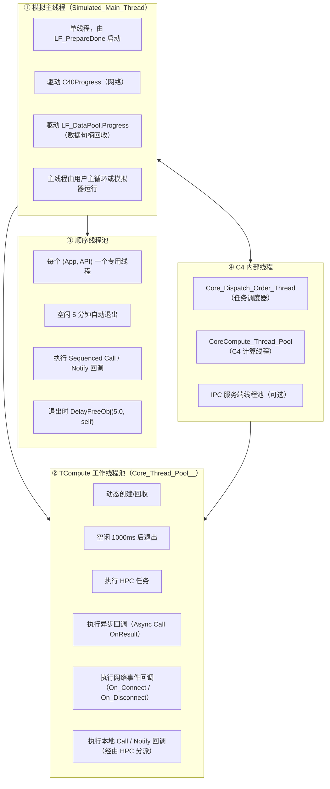

### 1.2 模拟主线程（`Simulated_Main_Thread`）

**身份**：由 `LF_PrepareDone` 创建的**唯一主线程**。**每进程只启动一次**。

**源码位置**：`Z.LingoFuse_Export.pas` 的 `Simulated_Main_Thread` 过程。

**主循环**：

```pascal
if Init_Succeeded then
  while Simulated_Main_Thread_Running do
    begin
      C40Progress(if_(LF_RunningCount.V > 0, 1, 10));  // ① 网络
      try
          LF_DataPool.Progress();                       // ② 数据池扫描
      except
      end;
    end;
```

**职责清单**：

| 职责 | 由谁驱动 | 备注 |
|------|---------|------|
| C4 网络收发 | `C40Progress` | 处理所有 C4 命令 |
| 定时器回调 | `C40Progress`（内部 `Timer_Event_Pool__.Progress`） | `TLF_App` 的 `DoTimer` 也走这里 |
| 数据句柄扫描 | `LF_DataPool.Progress` | 每 5 秒扫描一次 |
| 超时回收 | `LF_DataPool.Progress` | 10 分钟空闲回收 |
| 同步回调排空 | **不直接驱动** | 需外部 `LF_Sync`（见 §6.3） |
| 顺序线程池管理 | 不驱动 | 由 `TCompute` 独立运行 |

**关键事实**：
- **模拟主线程不直接调用任何业务回调**（业务回调在工作线程或顺序线程）。
- **模拟主线程不调用 `LF_Sync`**（这是不确定点，见第 13 章）。
- **模拟主线程退出前会清空所有数据句柄**（包括 `LF_CreateData_Permanent` 创建的）。

**对难缠语言的含义**：
- **Julia**：模拟主线程是一个独立 OS 线程，Julia 无法直接看到。回调不会在这里执行。
- **Erlang**：模拟主线程是 BEAM VM 外的一个 OS 线程（通过 NIF 启动）。NIF 调用 `LF_PrepareDone` 会**阻塞调用它的 BEAM 调度器线程**，直到初始化完成或超时。**应使用 dirty scheduler 或 `enif_send` 回调**。
- **R**：模拟主线程是 R 进程内的一个独立 OS 线程。R 的主线程（`main()` 所在线程）是 R 代码执行的地方。**两者不同**——需要把回调编组回 R 主线程（见 §8.3）。

### 1.3 TCompute 工作线程池

**身份**：C4 的核心线程池，处理所有 CPU 密集型或异步任务。

**源码位置**：`Z.Core.ComputeThread.inc`（`TCompute` 类）。

**创建策略**：
- 初始线程数：`if_(IsDebuging, 2, CpuCount * 2)`。
- 上限（`LimitMaxParallelThread` 开启时）：`8`。
- **动态创建**：任务到来时若无空闲线程则创建新线程。
- **空闲超时**：空闲 `Core_Thread_Life_Time_Tick__`（默认 1000ms）后退出。

**工作线程执行的任务**：

| 任务类型 | 触发者 | 回调执行上下文 |
|---------|--------|----------------|
| HPC 任务 | `RunHPC_*` | 工作线程 |
| 异步 Call `OnResult` | `TCompute.RunM_NP(Do_Th)` | 工作线程 |
| 网络事件 `On_Connect` / `On_Disconnect` | `TCompute.RunC(Do_LF_Network_Connect_Worker)` | 工作线程 |
| 本地 Call / Notify 回调 | `RunHPC_*` 内部 | 工作线程 |
| 服务端 Call / Notify 回调 | `RunHPC_*` 内部 | 工作线程 |

**关键事实**：
- **工作线程是操作系统线程**，不是绿色线程。
- **工作线程会被动态创建和回收**：不保证同一任务总在同一线程。
- **工作线程不持有 Julia / Erlang / R 的运行时状态**：不能直接调用这些语言的代码。

**对难缠语言的含义**：
- **Julia**：从工作线程直接调用 Julia 代码会破坏 Julia 的 GC 和任务调度。**必须编组回 Julia 主任务**。
- **Erlang**：从工作线程直接调用 NIF 会阻塞该工作线程；如果工作线程是 BEAM 调度器线程（不可能，因为 C4 工作线程是独立创建的），会拖垮调度器。**应使用 `enif_send`**。
- **R**：从工作线程直接调用 R API **会直接崩溃**（R 非线程安全）。**必须编组回 R 主线程**。

### 1.4 顺序线程池

**身份**：为每个 `(App, API)` 对提供 FIFO 保证的专用线程池。

**源码位置**：`Z.LingoFuse_Core.pas` 的 `TLF_Call_Sequence_Thread_Pool` 和 `TLF_Notify_Sequence_Thread_Pool`。

**结构**：

| 类 | 用途 |
|----|------|
| `TLF_Call_Sequence_Thread` | 处理 `Sequenced_Call` / `Async_Sequenced_Call` |
| `TLF_Notify_Sequence_Thread` | 处理 `Sequenced_Notify` |

**Key 格式**：`'AppName.ApiName'`（`Post_Call2` / `Post_Notify2` 内部拼接）。

**执行流程**：

```pascal
procedure TLF_Call_Sequence_Thread.Do_Run_Th;
var tmp: TCall_Queue_Tool; tk: TTimeTick;
begin
  tmp := TCall_Queue_Tool.Create;
  tk := GetTimeTick();
  while Activted do
  begin
    Critical.Lock;
    if Queue_Tool.Num > 0 then tmp.SwapInstance(Queue_Tool);
    Critical.UnLock;
    if tmp.Num > 0 then
    begin
      // 逐个执行队列中的任务
      repeat
        Result_M64 := tmp.First^.Data.APP.Engine.Execute_Call(tmp.First^.Data.Param_);
        if Assigned(tmp.First^.Data.OnResult) then
            tmp.First^.Data.OnResult(Result_M64);
        DisposeObjectAndNil(Result_M64);
        DisposeObjectAndNil(tmp.First^.Data.Param_);
        tmp.Next;
      until (tmp.Num <= 0) or (not Activted);
      tk := GetTimeTick();
    end
    else
    begin
      TCompute.Sleep(10);
      if GetTimeTick() - tk >= C_Tick_Minute * 5 then
          Activted := False;    // 空闲 5 分钟退出
    end;
  end;
  // 清理
  if (Internal_Queue_Data___ <> nil) and (Internal_Queue_Pool___ <> nil) then ...
  DelayFreeObj(5.0, self);   // 延迟释放给 TCompute 5 秒窗口
end;
```

**关键事实**：
- **顺序线程也是 TCompute 线程**（通过 `TCompute.RunM_NP(Do_Run_Th, ...)` 创建）。
- **每个 `(App, API)` 对拥有一个独立线程**。
- **空闲 5 分钟自动退出**。
- **退出时延迟 5 秒释放**（给 TCompute 写 `IsRunning` / `IsExit` 的窗口）。

**对难缠语言的含义**：
- **Julia**：顺序线程也是 OS 线程，同样不能直接调 Julia。
- **Erlang**：顺序线程在 BEAM 之外，同样应走 `enif_send`。
- **R**：顺序线程不是 R 主线程，必须编组。

### 1.5 线程与 Julia 的关系

**Julia 线程模型**：
- Julia 有 `Threads.nthreads()` 个 OS 线程（默认 1，用 `-t N` 或 `JULIA_NUM_THREADS` 设置）。
- 每个 OS 线程有一个本地任务队列；任务是绿色线程，会被调度到 OS 线程上执行。
- **Julia 的 GC 有线程亲和**：从任意线程调 Julia 代码需要 `jl_adopt_thread`（C API）或 `@ccallable` 上下文。

**LingoFuse 线程 vs Julia 线程**：

| LingoFuse 线程 | 是否 Julia 线程 | 能否直接调 Julia 代码 |
|---------------|:--------------:|:--------------------:|
| 模拟主线程 | ❌（Pascal 侧创建） | ❌ 需 `jl_adopt_thread` |
| TCompute 工作线程 | ❌ | ❌ 需 `jl_adopt_thread` |
| 顺序线程 | ❌ | ❌ 需 `jl_adopt_thread` |
| C4 内部线程 | ❌ | ❌ 需 `jl_adopt_thread` |
| Julia 自己的线程 | ✅ | ✅ |

**结论**：**LingoFuse 回调在非 Julia 线程执行**。Julia 集成者应：

1. 在 `On_Call` / `On_Notify` 回调中**只读取 Input**（二进制安全），**不直接执行 Julia 代码**。
2. 通过 **`Base.Threads.@spawn`** 或 **`@async`** 把结果编组回 Julia 任务。
3. 或用 **`jl_adopt_thread`**（C API）临时绑定当前 OS 线程到 Julia。

**详细集成指南见 §8.1**。

### 1.6 线程与 Erlang 的关系

**Erlang 线程模型**：
- BEAM VM 有 N 个调度器线程（默认 `N = CPU 核数`）。
- 每个调度器线程是一个 OS 线程。
- **NIF 在调用它的调度器线程上运行**。阻塞 NIF 会拖垮该调度器。
- **NIF 崩溃会拖垮整个 BEAM VM**。

**LingoFuse 线程 vs BEAM 调度器**：

| LingoFuse 线程 | 是否 BEAM 调度器 | 能否直接调 Erlang 代码 |
|---------------|:--------------:|:--------------------:|
| 模拟主线程 | ❌（Pascal 侧创建） | ❌ 需 `enif_send` |
| TCompute 工作线程 | ❌ | ❌ 需 `enif_send` |
| 顺序线程 | ❌ | ❌ 需 `enif_send` |
| C4 内部线程 | ❌ | ❌ 需 `enif_send` |
| BEAM 调度器线程 | ✅ | ✅ |

**结论**：**LingoFuse 回调在非 BEAM 线程执行**。Erlang 集成者应：

1. 在 `On_Call` / `On_Notify` 回调中**只读取 Input**，**不直接执行 Erlang 代码**。
2. 通过 **`enif_send`** 或 **`enif_whereis_pid`** 把消息发给目标进程。
3. 从 BEAM 侧发起 LingoFuse 调用时，**使用 dirty NIF 或 `enif_thread`**，不要阻塞调度器。

**详细集成指南见 §8.2**。

### 1.7 线程与 R 的关系

**R 线程模型**：
- **R 是严格单线程的**。
- **所有 R 代码必须在主 R 线程（`main()` 所在线程）执行**。
- **R API 不是线程安全的**。
- **R 的 GC 不是线程安全的**。

**LingoFuse 线程 vs R 主线程**：

| LingoFuse 线程 | 是否 R 主线程 | 能否直接调 R API |
|---------------|:------------:|:----------------:|
| 模拟主线程 | ❌（Pascal 侧创建） | ❌ 会崩溃 |
| TCompute 工作线程 | ❌ | ❌ 会崩溃 |
| 顺序线程 | ❌ | ❌ 会崩溃 |
| C4 内部线程 | ❌ | ❌ 会崩溃 |
| R 主线程 | ✅ | ✅ |

**结论**：**LingoFuse 回调在非 R 主线程执行**。R 集成者应：

1. 在 `On_Call` / `On_Notify` 回调中**只读取 Input**，**不直接调 R API**。
2. 通过**线程安全队列**把结果传给 R 主线程。
3. 在 R 主线程中**主动轮询队列**（通过 `later` 包 / `httpuv` 事件循环 / 自定义 C 扩展）。
4. 或用 **`R_ToplevelExec`** 配合锁。

**详细集成指南见 §8.3**。

### 1.8 线程生命周期时间线

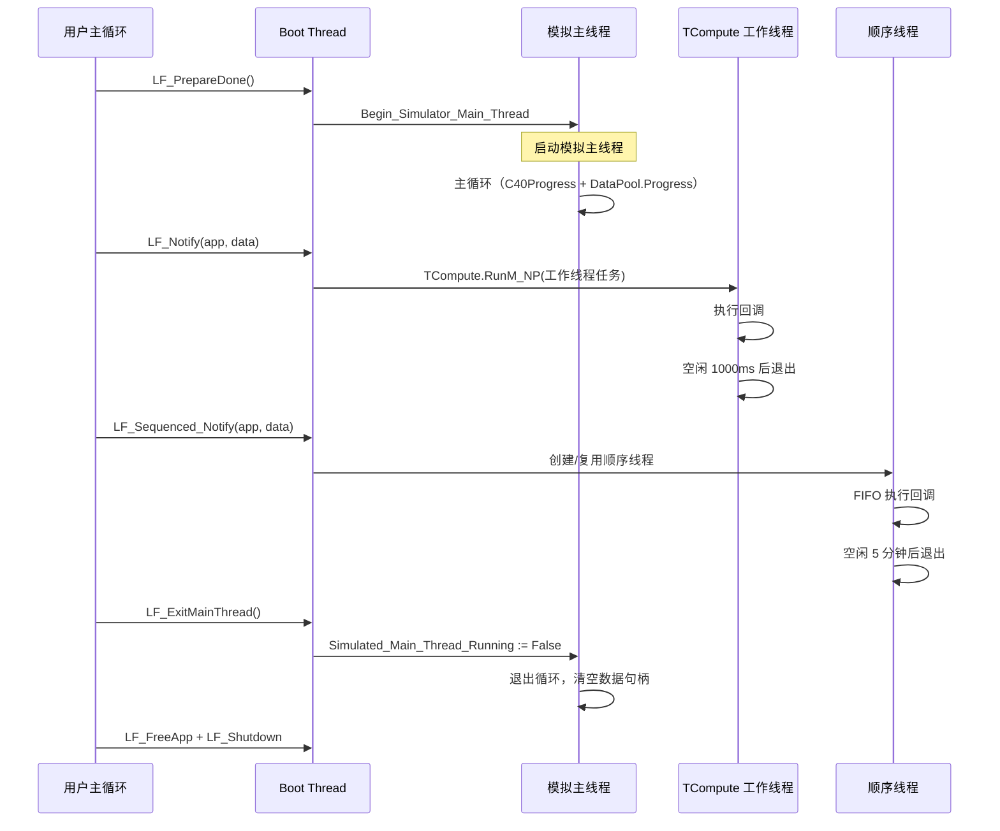

---

## 第 2 章 回调执行上下文（核心）

> **这是本知识库最核心的一章**。Julia / Erlang / R 集成者必须清楚**每种回调在哪个线程执行、持有/不持有哪些锁、能做什么不能做什么、P2P 身份从哪来**。

### 2.1 六类回调总览

| 回调类型 | 注册方式 | 执行线程 | 是否持锁 | 能调 LF_Call？ |
|---------|---------|---------|:--------:|:--------------:|
| **Call 回调** | `LF_RegisterCall*` | TCompute 工作线程 | 否 | ❌ |
| **Notify 回调** | `LF_RegisterNotify*` | TCompute 工作线程 | 否 | ❌ |
| **同步 Call 回调** | `LF_RegisterSyncCall_M/P` | **主线程**（需 `LF_Sync`） | 否 | ✅（在主线程上） |
| **异步 Call OnResult** | `LF_Async_Call*` 的 `OnResult` | TCompute 工作线程 | 否 | ❌ |
| **网络事件回调** | `LF_Set_Network_Event` | TCompute 工作线程 | 否 | ❌ |
| **顺序 Call/Notify 回调** | `LF_Sequenced_*` / `LF_Async_Sequenced_Call` | 专用顺序线程 | 否 | ❌ |

### 2.2 Call 回调的精确执行上下文

**执行链路**（以本地 Call 为例）：

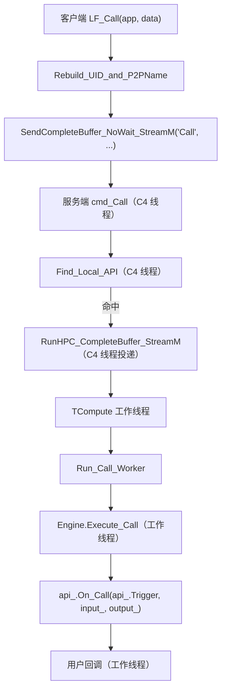

**关键事实**：

| 维度 | 值 |
|------|-----|
| **执行线程** | **TCompute 工作线程**（OS 线程） |
| **是否持有 LingoFuse 内部锁** | ❌ 否（`Execute_Call` 内部有 `LF_RunningCount` 计数，但那是原子操作） |
| **是否持有 C4 锁** | ❌ 否（HPC 分派前已释放） |
| **能否调用 `LF_Call`** | ❌ **禁止**（会自锁死，见 `LF-CB-002`） |
| **能否调用 `LF_LocalCall`** | ❌ **禁止** |
| **能否调用 `LF_Notify`** | ❌ **禁止** |
| **能否调用 `LF_Shutdown`** | ❌ **禁止** |
| **能否阻塞（Sleep / IO）** | ⚠️ 不建议（占用工作线程） |
| **能否直接操作 UI** | ❌ **禁止**（非主线程） |
| **能否从 `Input` 读取 P2P 身份** | ✅ 允许（`LF_Get_P2P_UID(Input)` 返回 `PP2P_UID___` 指针，框架约 5 秒后自动释放；`LF_Get_P2P_NameEx(Input)` 返回 string，安全。**仅限 `Input`**，见 §2.9） |
| **能否对 `Output` 写数据** | ✅ 允许 |
| **能否 Free `Input` / `Output`** | ❌ **禁止**（框架管理） |

**源码关键点**（`TLF_Engine.Execute_Call`）：

```pascal
function TLF_Engine.Execute_Call(Memory_Param: TMem64): TMem64;
begin
  LF_RunningCount.UnLock(LF_RunningCount.LockP^ + 1);   // 原子计数
  input_ := TLF_Data.New_Param_From(Memory_Param, False);
  output_ := TLF_Data.New_Result(False);
  Result := TMem64.Create;
  try
    api_ := LF_MethodPool.Get_Default_Value(input_.Data_Param.apiName, nil);
    if api_ = nil then begin DoStatus('no found api "%s"', [...]); exit; end;
    bak_input_ := input_^;      // 备份
    bak_output_ := output_^;
    case api_.Mode of
      LF_Call__:
        try
          if Assigned(api_.On_Call) then
          begin
            api_.On_Call(api_.Trigger, input_, output_);   // ← 用户回调
            input_^ := bak_input_;      // 恢复（防止用户改指针）
            output_^ := bak_output_;
          end;
        except
          DoStatus('execute call-mode api "%s" (stdcall) execpet!', [...]);
          input_^ := bak_input_;
          output_^ := bak_output_;
        end;
      ...
    end;
  finally
    Result.SwapInstance(output_.Data_Result);
    TLF_Data.Free_Data(input_);
    TLF_Data.Free_Data(output_);
    LF_RunningCount.UnLock(LF_RunningCount.LockP^ - 1);
  end;
end;
```

**关键观察**：
- **回调期间不持有任何 LingoFuse 锁**（`LF_MethodPool.Get_Default_Value` 内部有锁，但已释放）。
- **回调异常被吞掉**（`except` 分支打印日志，不传播）。
- **回调返回后框架恢复 `input_` / `output_` 的指针**（防止用户误改）。

### 2.3 Notify 回调的精确执行上下文

**执行链路**（以本地 Notify 为例）：

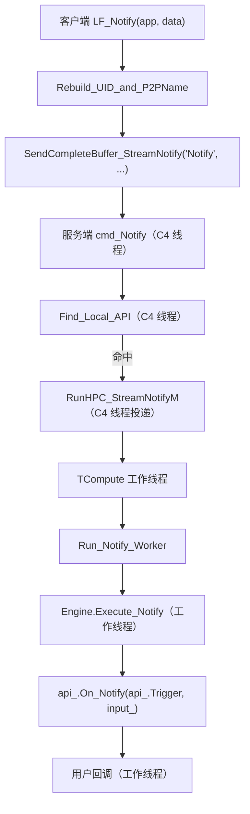

**关键事实**：

| 维度 | 值 |
|------|-----|
| **执行线程** | **TCompute 工作线程** |
| **是否持有 LingoFuse 内部锁** | ❌ 否 |
| **能否调用 `LF_Call` / `LF_Notify` / `LF_LocalCall`** | ❌ **禁止** |
| **回调签名** | `procedure(Trigger: Pointer; Input: TDataHnd)` **无 Output** |
| **回调异常** | 被吞掉（打印 `'execute notify-mode api "%s" execpet!'`） |
| **能否从 `Input` 读取 P2P 身份** | ✅ 允许（**仅限 `Input`**，见 §2.9） |

### 2.4 Call 回调与 Julia 的交互

**问题**：Julia 的 GC 和任务调度依赖线程亲和。从 TCompute 工作线程直接调 Julia 会破坏 GC。

**解决方案 A**：**`Base.@ccallable` + `jl_adopt_thread`**

```julia
# Julia 侧
function my_callback(trigger::Ptr{Cvoid}, input::Ptr{Cvoid}, output::Ptr{Cvoid})::Cvoid
    # 这个函数可能在任何线程被调用
    # 如果需要访问 Julia 堆，必须先 adopt
    # 实际上 Julia 会自动处理 @ccallable 的线程绑定
    # 但如果是长期运行的任务，推荐显式 adopt

    # P2P 身份只能从 input 侧读取（"侧数据"），不能在自建句柄或 output 上读取；
    # 底层 LF_Get_P2P_UID 返回的是指针，封装层应先解引用并拷贝成 Julia 侧的
    # NTuple{32,UInt8} 或 Vector{UInt8}，不要暴露裸指针给 GC。
    uid = get_p2p_uid_copy(input)     # 内部：uid_ptr = LF_Get_P2P_UID(input); uid = uid_ptr[]
    p2p = get_p2p_name_copy(input)    # 内部：指针 → String 拷贝

    # 只读 Input / 写 Output，不调 Julia 的 GC 敏感 API
    a = read_int32(input)
    b = read_int32(input)
    write_int32(output, a + b)
end

# 注册
@ccallable function ... end  # 或者用 C_NULL 传递
```

**解决方案 B**：**编组回主任务（推荐）**

```julia
const callback_queue = Channel{Tuple{Ptr{Cvoid}, Ptr{Cvoid}}}(1000)

function my_callback(trigger, input, output)::Cvoid
    # 只把指针入队，立即返回
    # 注意：Input / Output 在回调返回后失效！
    # 必须先把数据拷出来
    data = read_all_input(input)
    put!(callback_queue, (trigger, data, output))
    # 但是 output 需要写回...这里复杂
end

# 主任务循环
@async begin
    while true
        (trigger, data, output) = take!(callback_queue)
        # 在主任务中处理
        result = process(data)
        write_output(output, result)
    end
end
```

**⚠️ 关键陷阱**：**Input / Output 在回调返回后立即失效**。所以**不能简单地把指针入队**——必须**先拷贝数据**。而 Output 需要写回，所以**必须在回调内完成 Output 写入**。

**推荐模式**：

```julia
function my_callback(trigger, input, output)::Cvoid
    # ① 读取 Input（安全）
    data = read_input_bytes(input)   # 拷贝到 Julia 侧

    # ② 计算（在回调线程执行，避免阻塞太长时间）
    result = compute(data)

    # ③ 写 Output（安全，在回调返回前完成）
    write_output_bytes(output, result)

    # ④ 如果需要异步操作，通过 Channel 通知主任务
    if need_async then
        put!(async_queue, result)
    end
end
```

### 2.5 Call 回调与 Erlang 的交互

**问题**：NIF 在 BEAM 调度器线程上运行，不能直接从任意 OS 线程调 Erlang 代码。

**解决方案**：**`enif_send` + `enif_whereis_pid`**

```c
// C NIF 侧（或 Rust NIF 侧）
ERL_NIF_TERM my_callback(ErlNifEnv* env, int argc, const ERL_NIF_TERM argv[]) {
    // 这个 NIF 被 LingoFuse 从任意 OS 线程调用
    // 注意：env 可能是 NULL，因为我们不在 BEAM 调度器上

    // 从 Input 提取 UID / P2PName（用 LingoFuse API）
    // 仅在 input（"侧数据"）上有效；
    // LF_Get_P2P_UID 返回 PP2P_UID___ 指针（不是值），框架约 5 秒后自动释放；
    // 这里只读拷贝，不保存指针，不手动释放。
    PP2P_UID___ uid_ptr = LF_Get_P2P_UID(input);
    TP2P_UID uid;
    if (uid_ptr != NULL) {
        uid = *uid_ptr;               // 立即解引用拷贝
    } else {
        memset(&uid, 0, sizeof(uid));
    }
    const char* p2p_name = LF_Get_P2P_Name(input);   // 5 秒后失效，需立即拷贝

    // 构造消息
    ERL_NIF_TERM msg = enif_make_tuple2(env,
        enif_make_atom(env, "lf_callback"),
        enif_make_string(env, p2p_name, ERL_NIF_LATIN1));

    // 发送到注册的进程
    ErlNifPid pid;
    if (enif_whereis_pid(env, enif_make_atom(env, "my_lf_handler"), &pid)) {
        enif_send(NULL, &pid, NULL, msg);   // NULL env = 从非 BEAM 线程发送
    }

    return enif_make_atom(env, "ok");
}
```

**⚠️ 关键陷阱**：
- **`enif_send(NULL, ...)` 才能从非 BEAM 线程发送**。
- **不要从 LingoFuse 回调直接执行 Erlang 代码**（BEAM 会崩）。
- **NIF 必须快速返回**：LingoFuse 回调在 TCompute 工作线程执行，长时间阻塞会占用工作线程。
- **`LF_Get_P2P_UID` / `LF_Get_P2P_Name` 只能在 `input` 参数上调用**（见 §2.9）。

### 2.6 Call 回调与 R 的交互

**问题**：R 是严格单线程的。从 TCompute 工作线程直接调 R API 会崩溃。

**解决方案**：**线程安全队列 + R 主线程轮询**

```c
// C 侧（R 扩展）
static pthread_mutex_t queue_mutex = PTHREAD_MUTEX_INITIALIZER;
static void* callback_queue[1024];
static int queue_head = 0, queue_tail = 0;

// LingoFuse 回调（在 TCompute 工作线程执行）
void my_callback(void* trigger, void* input, void* output) {
    // ① 读取 Input（不调 R API）
    // 注意：P2P 身份只能在 input 上读取；
    // 底层返回指针，必须在回调内解引用并拷贝到堆内存，再交给队列。
    // ... 提取数据 ...

    // ② 入队（线程安全）
    pthread_mutex_lock(&queue_mutex);
    callback_queue[queue_tail] = data;
    queue_tail = (queue_tail + 1) % 1024;
    pthread_mutex_unlock(&queue_mutex);

    // ③ 写 Output（如果不需要 R 计算，直接写）
    // ...
}

// R 主线程轮询（通过 later 包或自定义事件循环）
SEXP poll_callbacks() {
    SEXP result = PROTECT(allocVector(VECSXP, 0));

    pthread_mutex_lock(&queue_mutex);
    while (queue_head != queue_tail) {
        void* data = callback_queue[queue_head];
        queue_head = (queue_head + 1) % 1024;
        pthread_mutex_unlock(&queue_mutex);

        // 在主线程执行 R 代码
        SEXP r_data = convert_to_R(data);
        SEXP r_result = call_r_function(r_data);
        // ... 处理结果 ...

        pthread_mutex_lock(&queue_mutex);
    }
    pthread_mutex_unlock(&queue_mutex);

    UNPROTECT(1);
    return result;
}
```

**⚠️ 关键陷阱**：
- **不能在回调内调用任何 R API**（包括 `Rf_allocVector`、`PROTECT`）。
- **不能在回调内使用 R 的 GC**。
- **必须用 pthread 锁保护共享队列**。
- **R 主线程必须主动轮询**（不能等回调）。
- **`LF_Get_P2P_UID` / `LF_Get_P2P_Name` 返回的指针在回调返回后失效；必须在回调内拷贝**。

**⚠️ 但 Output 写回是个问题**：如果 Output 需要 R 计算的结果，你需要在回调内**同步等待** R 主线程的处理结果。这会造成死锁（如果 R 主线程也在等 LingoFuse 回调）。

**推荐模式**：

```c
// 方案：回调内只读 Input，把同步计算结果通过 Output 写回
// 如果必须异步 R 计算，用两阶段：
//   阶段 1：回调内写 Output = "processing"，记录 task_id
//   阶段 2：R 主线程完成后，通过 LF_Call 回调通知

void my_callback(void* trigger, void* input, void* output) {
    // ① 读取 Input
    // ② 生成 task_id
    // ③ 把任务入队
    // ④ 立即写 Output = "accepted, task_id=..."
    // ⑤ R 主线程处理完后，通过 LF_Notify 通知原调用方
}
```

**详细 R 集成见 §8.3**。

### 2.7 回调异常处理

**所有回调整体被 `try...except` 包裹**：

| 回调类型 | 异常处理 | 日志 |
|---------|---------|------|
| Call 回调 | `try...except` 吞掉 | `'execute call-mode api "%s" (stdcall) execpet!'` |
| Notify 回调 | `try...except` 吞掉 | `'execute notify-mode api "%s" (stdcall) execpet!'` |
| 异步 Call `OnResult` | `try...except` 吞掉 | `'TLF_Async_Call_Bridge.Do_Th exception: %s: %s'` |
| 网络事件 | `try...except` 吞掉 | 无 |
| 顺序回调 | `try...except` 吞掉 | 无 |

**关键**：**回调异常不传播**。这意味着：
- Julia / Erlang / R **无法从异常中恢复**——异常被 Pascal 侧吞掉了。
- **必须显式检查回调的返回值或状态**（如果协议允许）。
- **建议**：在回调内把错误写入 Output（Call 模式）或通过日志上报。

### 2.8 Handle 所有权模型（★ 核心）

> **这是本知识库第二核心的一节**。所有跨语言集成者必须清楚：**同步族与异步族返回的 handle 所有权完全相反**。二者的函数签名、返回类型、外观都相同，但契约相反。

#### 2.8.1 两大调用家族的 Handle 所有权对比

LingoFuse C ABI 有**两大调用家族**：

| 家族 | 函数 | 返回 handle 的所有者 | 释放方式 |
|------|------|:-------------------:|---------|
| **同步族** | `LF_Call` / `LF_UID_Call` / `LF_P2PNAME_Call` | **调用者** | 调用者显式 `LF_FreeData` |
| **异步族** | `LF_Async_Call` / `LF_UID_Async_Call` / `LF_P2PNAME_Async_Call` | **框架** | 回调返回后**立即**由框架释放 |

**源码依据**：

**同步族**（`Z.LingoFuse_Export.pas`）：

```pascal
function LF_Call(appName: pansichar; Param: TDataHnd___; Timeout_: uint64): TDataHnd___;
begin
  ...
  Output := Cli.Wait_Execute_Call(...);
  ...
  // ← auto_recycle = True，调用者拥有
  Result := TLF_Data.New_Result_From(Output, True);
  ...
end;
```

**异步族**（`Z.Net.C4.LingoFuse.pas` 的 `TLF_Async_Call_Bridge.Do_Th`）：

```pascal
procedure TLF_Async_Call_Bridge.Do_Th;
var
  result_param_: PLF_Data;
begin
  // ← auto_recycle = False，框架拥有
  result_param_ := TLF_Data.New_Result_From(Result_M64.Swap_To_New_Instance, False);
  try
    if Assigned(OnResult) then
      OnResult(Data_, result_param_);  // ← 回调拿到指针
  except
  end;
  // ← 立即释放！不是"~1 秒后"，不是"延迟"，是立即。
  TLF_Data.Free_Data(result_param_);
  DelayFreeObj(1.0, Self);
end;
```

**关键差异**：

- `New_Result_From(..., True)` → `auto_recycle = True` → `LF_FreeData` 只是标记，**真正释放延迟到池扫描**。
- `New_Result_From(..., False)` → `auto_recycle = False` → `LF_FreeData` **立即同步释放**。

#### 2.8.2 异步族 Handle 的"死亡时刻"

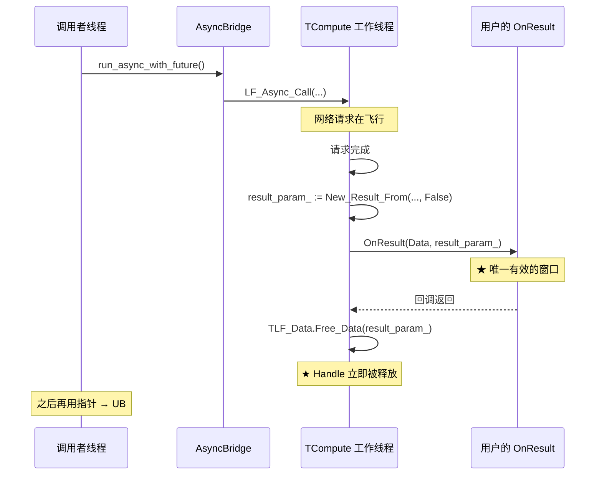

**契约**：

- 回调返回后，handle **立即失效**。
- 在回调外使用该 handle 是**未定义行为**（use-after-free）。
- 调用 `LF_FreeData` 是**双重释放**（double-free）。

#### 2.8.3 为什么违反契约会"偶尔正常、偶尔失败"

**根本原因**：`Free_Data` 是**池化回收**：

```pascal
class procedure TLF_Data.Free_Data___(hnd: PLF_Data);
begin
  hnd^.Data_Info := '';
  DisposeObjectAndNil(hnd^.Data_Param);
  DisposeObjectAndNil(hnd^.Data_Result);   // ← TMem64 被释放
  DisposeObjectAndNil(hnd^.calling___);
  LF_DataMemory.Free_PLF_Data(hnd);        // ← PLF_Data 回池
end;
```

**UB 的表现取决于**：

- 分配器是否已经复用这块内存。
- 其它线程是否在同一时刻分配了新的 `TMem64`。
- 线程调度是否让调用者线程在 `Free_Data` 之后才运行。

**因此**：

| Payload 特征 | 表现 | 原因 |
|-------------|------|------|
| **小 payload**（比如返回 `int 7`，2 字节） | 通常"看起来正常" | 分配器还没复用这块小内存 |
| **大 payload**（比如返回 dict，17+ 字节） | 通常"返回空/垃圾" | 有更大概率已被复用 |

**⚠️ 这是最容易误诊的场景**：用"`int` vs `dict`"这样的**类型二分法**会误导诊断。它不是"类型差异"，是"payload 大小影响内存复用时机"。**二分法要问对问题**。

#### 2.8.4 正确的使用模式

**模式 A：同步调用（推荐用于网关/代理场景）**

```pascal
res_ptr := LF_Call(app, hnd, timeout_ms);
try
  LF_SetPos(res_ptr, 0);            // 重置位置
  result_bytes := read_string_bytes(res_ptr);
finally
  LF_FreeData(res_ptr);             // ← 合法，调用者拥有
end;
```

**模式 B：异步调用（必须在回调内完成所有事）**

```pascal
procedure OnResult(Data, res_ptr: Pointer); cdecl;
begin
  // ✓ 在这个回调内 handle 有效
  LF_SetPos(res_ptr, 0);
  data := read_string_bytes(res_ptr);

  // ✓ 把数据拷贝出来（bytes 是新的对象）
  my_queue.push(data);

  // ❌ 禁止把 res_ptr 传出去
  // ❌ 禁止 LF_FreeData(res_ptr)
end;
```

**模式 C：使用高级封装的 Future 接口**

所有托管语言的绑定层都应提供"在回调内读取并拷出数据"的 Future 接口，避免让用户接触裸指针。参见各语言绑定的实现。

#### 2.8.5 Handle 所有权速查表

| 来源 | 所有者 | 释放者 | 能否跨线程 |
|------|:------:|:------:|:----------:|
| `LF_CreateData` | 用户 | 用户 | ⚠️ 需外部锁 |
| `LF_CreateData_Permanent` | 用户 | 用户 | ⚠️ 需外部锁 |
| `LF_Call` 返回 | 用户 | 用户 | ✅ 可以 |
| `LF_UID_Call` 返回 | 用户 | 用户 | ✅ 可以 |
| `LF_P2PNAME_Call` 返回 | 用户 | 用户 | ✅ 可以 |
| `LF_Async_Call` 回调内 | **框架** | **框架** | ❌ 禁止跨线程 |
| `LF_UID_Async_Call` 回调内 | **框架** | **框架** | ❌ 禁止跨线程 |
| `LF_P2PNAME_Async_Call` 回调内 | **框架** | **框架** | ❌ 禁止跨线程 |
| `LF_LocalCall` 返回 | 用户 | 用户 | ✅ 可以 |

#### 2.8.6 对难缠语言的含义

- **Julia**：`@cfunction` 回调内的 `output` 指针，如果有所有权问题（异步场景），**必须在回调内完成写回**，不能通过 `Channel` 把裸指针传给主任务。
- **Erlang**：NIF 回调接收的 handle 若来自异步族，**必须在 NIF 返回前完成所有操作**；用 `enif_send` 发送的是**数据拷贝**，不是指针。
- **R**：同上，Output 必须在回调内完成写入，否则会失效。
- **所有托管语言**：GC 语言不感知 C 侧的指针生命周期。**只有两种安全策略**：
  1. 在回调内**完全处理**（读 Input / 写 Output）。
  2. 在回调内**把数据拷贝出来**（bytes/array），然后再跨线程处理。

### 2.9 P2P 身份侧数据语义（★ v3.2 勘误）

> **这是本知识库第三核心的一节**。`LF_Get_P2P_UID` 和 `LF_Get_P2P_Name` **不是读句柄本身的业务数据**——它们是读取**发送方在发送请求时自动写入的 P2P 身份元数据**（"侧数据"）。这个元数据只在**接收侧**的**输入句柄**上存在。

#### 2.9.1 数据从哪来？——发送方写入机制

**核心事实**：**UID 和 P2PName 是发送方写入的，不是接收方查询出来的。**

**发送侧**（客户端）在构造请求时，由 `TC40_LF_Client.Send_*` 系列方法内部调用 `TMemory_Param_Tool.Rebuild_UID_and_P2PName`：

```pascal
procedure TC40_LF_Client.Send_Execute_Notify(app_Name__: TLF_String; Param: TMem64);
var
  tmp_param: TMem64;
begin
  // ← 把 FLast_UID 和 LF_P2P_name.V 写入请求载荷
  tmp_param := TMemory_Param_Tool.Rebuild_UID_and_P2PName(Param, FLast_UID, LF_P2P_name.V);
  try
    // ... 本地查找 / 远端转发 ...
  finally
    DisposeObject(tmp_param);
  end;
end;
```

**写入格式**（`TMemory_Param_Tool.EncryptToMem`）：

```
[apiName: string]
[FromUID: 32 bytes]         ← 发送方会话 UID
[FromP2PName: string]       ← 发送方 P2PName
[Param.Size: Int32]
[Param: bytes]              ← 业务参数
```

**接收侧**（服务端或对端）收到的 `Input` 句柄，其 `Data_Param.FromUID` / `Data_Param.FromP2PName` 就是发送方写入的这两个字段。

**接收侧**通过 `LF_Get_P2P_UID(Input)` / `LF_Get_P2P_Name(Input)` 读取——即读的是"发送方是谁"，而不是"这个句柄本身携带了什么业务数据"。

#### 2.9.2 只能在"触发事件的回调 `Input` 参数"中使用

**这**两个函数只在**"从网络或本地调用"接收到的输入句柄**上有效：

| 位置 | 是否有效 | 原因 |
|------|:--------:|------|
| `On_Call(Trigger, Input, Output)` 的 `Input` | ✅ | 从网络接收，携带发送方元数据 |
| `On_Notify(Trigger, Input)` 的 `Input` | ✅ | 同上 |
| `LF_LocalCall` / `LF_LocalNotify` 回调的 `Input` | ✅ | 本地调用也经过 `Rebuild_UID_and_P2PName` 注入 |
| `OnResult(Data, Result_)` 的 `Result_` | ❌ | 这是**输出句柄**，只有 `Data_Result`，无 `Data_Param` |
| 自己 `LF_CreateData` 创建的句柄 | ❌ | 没有"发送方"，`FromUID` 为 `Null_UID()`，`FromP2PName` 为空 |
| `LF_CreateData_Permanent` 创建的句柄 | ❌ | 同上 |

**对输出句柄或自建句柄调用时的行为**（源码 `TLF_Data.Get_P2P_UID`）：

```pascal
function TLF_Data.Get_P2P_UID: TUID___;
begin
  if Data_Param <> nil then
      Result := Data_Param.FromUID
  else
    begin
      DoStatus('[warning] Get_P2P_UID(): P2P Info only backcall "input" parameter.');
      Result := Null_UID();
    end;
end;
```

- **返回 `Null_UID()`**（全零）。
- **打印警告**：`[warning] Get_P2P_UID(): P2P Info only backcall "input" parameter.`
- **`LF_Get_P2P_Name` 同理**（返回空字符串 + 警告）。

#### 2.9.3 返回值类型（v3.2 勘误）

**`LF_Get_P2P_UID` 的返回值变更**（对应源码 `Z.LingoFuse_Export.pas`）：

| 版本 | 返回类型 | 调用者拿到什么 |
|------|---------|---------------|
| 旧版 | `TP2P_UID___`（32 字节静态数组**值**） | 值拷贝 |
| **新版（v3.2 起）** | **`PP2P_UID___`（指向 `TUID___` 的指针）** | **指针，约 5 秒后框架自动释放** |

**源码**：

```pascal
function LF_Get_P2P_UID(Hnd: TDataHnd___): PP2P_UID___;
begin
  New(Result);                                  // ← 分配指针
  if (Hnd <> nil) and (PLF_Data(Hnd)^.Data_Param <> nil) then
      Result^ := PLF_Data(Hnd)^.Get_P2P_UID()   // ← 从 Data_Param.FromUID 拷贝
  else Result^ := Null_UID();
  DelayFreeMem(5.0, Result);                    // ← 5 秒后自动释放
end;
```

**调用者契约**（Pascal 侧）：

```pascal
var
  UID: TP2P_UID___;
  UIDPtr: PP2P_UID___;
begin
  UIDPtr := LF_Get_P2P_UID(Input);    // 返回指针
  if UIDPtr <> nil then
      UID := UIDPtr^;                 // 立即解引用拷贝
  // 不要手动释放 UIDPtr；框架约 5 秒后自动释放
  // 不要长期保存 UIDPtr
end;
```

**`LF_Get_P2P_Name`**（保持不变）：

```pascal
function LF_Get_P2P_Name(Hnd: TDataHnd___): pansichar;
var
  tmp: TLF_String;
begin
  tmp := '';
  if (Hnd <> nil) and (PLF_Data(Hnd)^.Data_Param <> nil) then
      tmp := PLF_Data(Hnd)^.Get_P2P_Name();
  Result := tmp.BuildUTF8AnsiChar();        // ← 返回 UTF-8 指针
  Z.Notify.DelayFreeMem(5.0, Result);        // ← 5 秒后自动释放
end;
```

#### 2.9.4 正确用法（Pascal / C / 各语言）

**Pascal 侧**：

```pascal
procedure MyCallback(Trigger: Pointer; Input, Output: TDataHnd); cdecl;
var
  UID: TP2P_UID___;
  UIDPtr: PP2P_UID___;
  Name: string;
begin
  // ✅ 从 Input 读取 P2P 身份（"侧数据"）
  UIDPtr := LF_Get_P2P_UID(Input);
  if UIDPtr <> nil then
      UID := UIDPtr^;              // 立即拷贝
  Name := LF_Get_P2P_NameEx(Input); // 立即拷贝为 string

  // ✅ 使用
  // ...

  // ❌ 不要：LF_Get_P2P_UID(Output)     ← 输出句柄没有 P2P 身份
  // ❌ 不要：LF_Get_P2P_UID(MyOwnHandle) ← 自建句柄没有 P2P 身份
end;
```

**C 侧**：

```c
void __cdecl my_callback(void* trigger, void* input, void* output) {
    // ✅ 从 input 读取 P2P 身份
    PP2P_UID___ uid_ptr = LF_Get_P2P_UID(input);
    uint8_t uid[32];
    if (uid_ptr != NULL) {
        memcpy(uid, uid_ptr, 32);    // 立即拷贝
    } else {
        memset(uid, 0, 32);
    }
    const char* name_ptr = LF_Get_P2P_Name(input);
    char name_copy[256];
    if (name_ptr != NULL) {
        strncpy(name_copy, name_ptr, sizeof(name_copy) - 1);
        name_copy[sizeof(name_copy) - 1] = '\0';
    }

    // ❌ 不要：LF_Get_P2P_UID(output)     ← 输出句柄
    // ❌ 不要：LF_Get_P2P_UID(my_own)     ← 自建句柄
}
```

**Julia 侧**：

```julia
function my_callback(trigger, input, output)::Cvoid
    # ✅ 从 input 读取 P2P 身份
    uid_ptr = ccall(LF_Get_P2P_UID, Ptr{UInt8}, (Ptr{Cvoid},), input)
    uid = uid_ptr == C_NULL ? zeros(UInt8, 32) : copy(unsafe_wrap(Array, uid_ptr, 32))
    # 不要保存 uid_ptr；不要手动释放（框架 5 秒后自动释放）

    name_ptr = ccall(LF_Get_P2P_Name, Cstring, (Ptr{Cvoid},), input)
    name = name_ptr == C_NULL ? "" : unsafe_string(name_ptr)
    # 不要保存 name_ptr；不要手动释放
end
```

**Erlang NIF 侧**：

```c
static void __cdecl my_callback(void* trigger, void* input, void* output) {
    // ✅ 从 input 读取 P2P 身份
    PP2P_UID___ uid_ptr = LF_Get_P2P_UID(input);
    TP2P_UID uid;
    if (uid_ptr != NULL) {
        uid = *uid_ptr;              // 立即解引用拷贝
    } else {
        memset(&uid, 0, sizeof(uid));
    }
    const char* p2p_name = LF_Get_P2P_Name(input);   // 指针，5 秒后失效
    // ... 用 enif_send 把拷贝发走 ...
}
```

**R 侧**：

```c
void __cdecl my_callback(void* trigger, void* input, void* output) {
    // ✅ 从 input 读取 P2P 身份
    PP2P_UID___ uid_ptr = LF_Get_P2P_UID(input);
    uint8_t uid[32];
    if (uid_ptr != NULL) {
        memcpy(uid, uid_ptr, 32);    // 立即拷贝
    }
    const char* p2p_name = LF_Get_P2P_Name(input);
    char name_copy[256];
    if (p2p_name != NULL) {
        strncpy(name_copy, p2p_name, sizeof(name_copy) - 1);
        name_copy[sizeof(name_copy) - 1] = '\0';
    }
    // 入队；不要保存指针
}
```

#### 2.9.5 对难缠语言的含义

- **Julia**：`LF_Get_P2P_UID` 返回的指针不要跨 GC 边界；在回调内 `copy` 成 `Vector{UInt8}` 或 `NTuple{32,UInt8}` 后使用。
- **Erlang**：NIF 内 `LF_Get_P2P_UID` 返回的指针只在本 NIF 调用期间有效；`enif_send` 发送的是**拷贝后的数据**。
- **R**：回调内 `memcpy` 到堆内存后再交给 R 主线程；**不要**把指针入队。
- **所有托管语言**：**P2P 身份是"侧数据"**，**只在输入句柄上存在**，**只在回调内有效**，**必须立即拷贝**。

#### 2.9.6 覆盖范围速查

| 命令 | 接收侧是否有 P2P 身份？ | 备注 |
|------|:----------------------:|------|
| `Notify` / `Sequenced_Notify` | ✅ | 所有 Call / Notify 命令都注入 |
| `Call` / `Sequenced_Call` | ✅ | 同上 |
| `UID_Notify` / `UID_Call` / `UID_Sequenced_*` | ✅ | 同上 |
| `P2PName_Notify` / `P2PName_Call` / `P2PName_Sequenced_*` | ✅ | 同上 |
| **本地调用**（`LF_LocalCall` / `LF_LocalNotify`） | ✅ | 也经过 `Rebuild_UID_and_P2PName` 注入 |
| `OnResult`（异步回调的 `Result_`） | ❌ | 这是**输出句柄**，没有 `Data_Param` |
| 自建输入句柄（`LF_CreateData`） | ❌ | 没有"发送方" |

---

## 第 3 章 事件流全景

### 3.1 事件分类

| 事件 | 触发者 | 回调 | 执行线程 |
|------|--------|------|---------|
| **网络 Connect** | 服务端广播 API 信息 | `On_Connect` | TCompute 工作线程 |
| **网络 Disconnect** | 物理链路断开 | `On_Disconnect` | TCompute 工作线程 |
| **API 变更** | `Reg_Call` / `Reg_Notify` / `UnReg` | `TOn_LFUpdate`（订阅者） | 主线程（1 秒延迟后） |
| **UID 更新** | 客户端 `Update_UID` | 服务端内部 | C4 线程 |
| **App 信息更新** | 客户端 `Init_APP_Info` | 服务端内部 | C4 线程 |
| **服务 API 广播** | 服务端 `Broadcast_API_Info` | 客户端内部 | C4 线程 |
| **状态消息** | `DoStatus` 调用 | 状态钩子 | 调用者线程 |

### 3.2 网络 Connect 的精确触发链

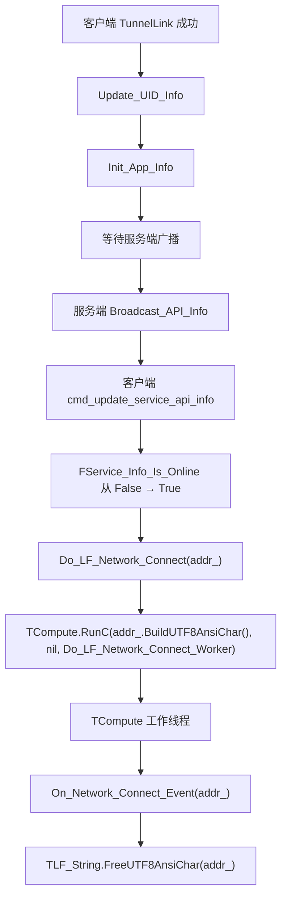

**关键事实**：

| 维度 | 值 |
|------|-----|
| **不是 TCP 建链** | 是"首次收到服务端 API 广播" |
| **执行线程** | TCompute 工作线程 |
| **`addr_` 生命周期** | **回调返回后立即释放** |
| **触发次数** | 每客户端每连接一次（重连会重新触发） |
| **异常处理** | `try...except` 吞掉 |

### 3.3 网络 Disconnect 的精确触发链

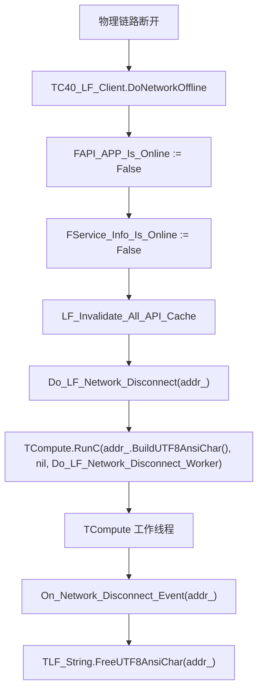

**关键事实**：
- **执行线程**：TCompute 工作线程。
- **`addr_` 回调返回后立即释放**。
- **`FAPI_APP_Is_Online` 和 `FService_Info_Is_Online` 在回调前已置 False**。

### 3.4 API 变更事件的精确触发链

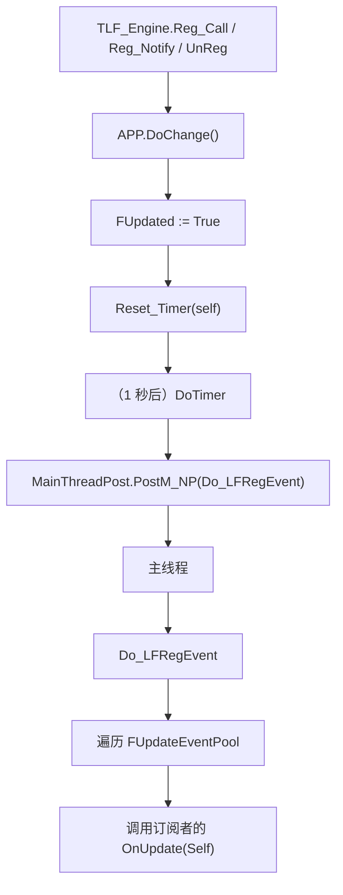

**关键事实**：

| 维度 | 值 |
|------|-----|
| **触发时机** | API 注册/注销后 1 秒 |
| **执行线程** | **主线程**（通过 `MainThreadPost` 投递） |
| **订阅方式** | `TLF_App.Subscribe_Update(Bind, OnUpdate)` |
| **典型订阅者** | `TC40_LF_Client`（通过 `Do_APP_Update` / `Do_LF_P2P_APP_Update`） |
| **异常处理** | `try...except` 吞掉 |

**对难缠语言的含义**：
- **Julia / Erlang / R 集成者不直接订阅这个事件**（除非用 Pascal 侧封装）。
- **这个事件驱动客户端的 `Init_App_Info`**，导致 `update_service_api_info` 广播。

### 3.5 UID 更新事件

**触发链**：

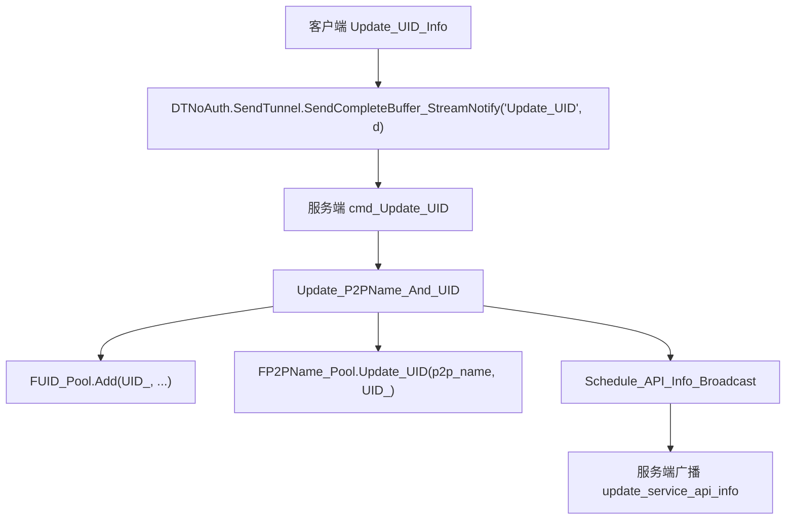

**关键事实**：
- **执行线程**：C4 线程（服务端 `cmd_Update_UID`）。
- **触发时机**：客户端首次 `TunnelLink` 成功后，或 P2PName 变化时。
- **副作用**：更新服务端的 `FUID_Pool` 和 `FP2PName_Pool`。

### 3.6 状态消息事件

**触发链**：

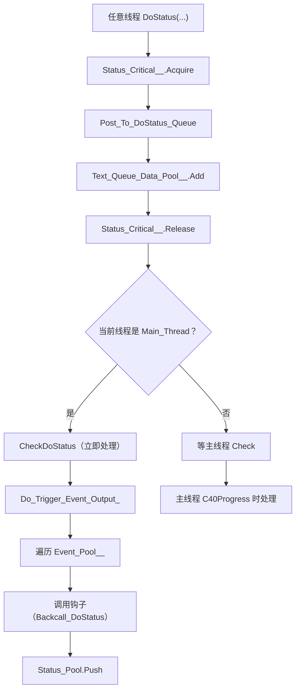

**关键事实**：
- **`DoStatus` 线程安全**（内部 `Status_Critical__` 保护）。
- **主线程立即处理**，工作线程只入队。
- **状态队列上限 1000**（`Backcall_DoStatus` 中 `while Status_Pool.Num > 1000 do Status_Pool.Next`）。

---

## 第 4 章 状态系统

### 4.1 状态系统的三层

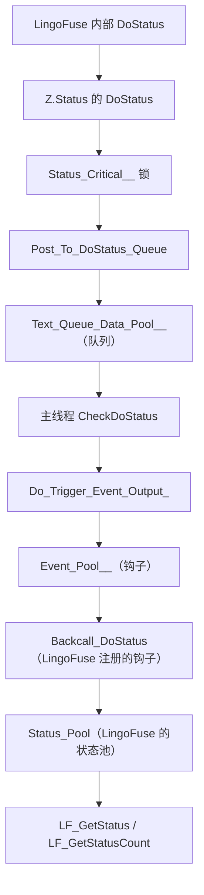

### 4.2 LingoFuse 的状态池

**源码位置**：`Z.LingoFuse_Export.pas`。

```pascal
type
  TStatus_Buffer = class(TOrderStruct<TBytes>)
  public
    procedure DoFree(var Data: TBytes); override;
  end;

var
  Status_Pool: TStatus_Buffer = nil;
  Status_Lock: TCritical = nil;
  Status_Return_Buffer: array [0 .. $FFFF] of Byte;   // 64KB 静态缓冲
```

**初始化**（`initialization` 段）：

```pascal
Status_Pool := TStatus_Buffer.Create;
Status_Lock := TCritical.Create('Status_Lock');
AddDoStatusHookC(Status_Pool, Backcall_DoStatus);
```

**`Backcall_DoStatus`**：

```pascal
procedure Backcall_DoStatus(Text_: SystemString; const ID: Integer);
begin
  Status_Lock.Lock;
  try
    while Status_Pool.Num > 1000 do
        Status_Pool.Next;                              // 丢弃最旧
    Status_Pool.Push(TPascalString(Text_).UTF8);       // 入队
  finally
      Status_Lock.UnLock;
  end;
end;
```

**关键事实**：

| 维度 | 值 |
|------|-----|
| **状态池上限** | 1000 条 |
| **溢出策略** | 丢弃最旧 |
| **执行线程** | 主线程（`Do_Trigger_Event_Output_` 在主线程调用） |
| **存储格式** | `TBytes`（UTF-8） |

### 4.3 `LF_GetStatusCount`

```pascal
function LF_GetStatusCount(): Integer;
begin
  Status_Lock.Lock;
  try
      Result := Status_Pool.Num;
  finally
      Status_Lock.UnLock;
  end;
end;
```

**契约**：
- **线程安全**。
- **返回当前队列长度**（0 到 1000）。

### 4.4 `LF_GetStatus`

```pascal
function LF_GetStatus(): pansichar;
var L: Integer;
begin
  Result := @Status_Return_Buffer;
  Status_Lock.Lock;
  Status_Return_Buffer[0] := 0;
  Status_Return_Buffer[1] := 0;
  try
    if Status_Pool.Num > 0 then
    begin
      L := length(Status_Pool.First^.Data);
      if L > 0 then
      begin
        CopyPtr(@Status_Pool.First^.Data[0], @Status_Return_Buffer, Min(L, SizeOf(Status_Return_Buffer) - 1));
        Status_Return_Buffer[Min(L, SizeOf(Status_Return_Buffer) - 1)] := 0;
      end;
      Status_Pool.Next;                                // 出队
    end;
  finally
      Status_Lock.UnLock;
  end;
end;
```

**契约**：
- **返回静态 64KB 缓冲的指针**。
- **下次调用会覆盖**。
- **出队**：每次调用取出一条并移除。
- **截断**：超过 64KB 的消息被截断。
- **线程安全**。

**对难缠语言的含义**：
- **Julia**：`LF_GetStatus` 返回的 `Ptr{UInt8}` 在下次调用后失效。**必须立即拷贝为 `String`**。
- **Erlang**：从 NIF 返回 `binary` 或 `string`（拷贝）。不要返回指针。
- **R**：立即用 `.Call("Rf_mkString", ...)` 拷贝。

### 4.5 `LF_PostStatus`

```pascal
procedure LF_PostStatus(status: pansichar);
var s: TLF_String;
begin
  if not Simulator_Main_Thread_Activted then
      DoStatus('LF_PostStatus: Main thread not running; message queued directly. message: %s', [DS(status).Text]);
  s := DS(status);
  Status_Lock.Lock;
  try
      Post_To_DoStatus_Queue(TCompute.CurrentThread, s.Text, 0);
  finally
      Status_Lock.UnLock;
  end;
  s := '';
end;
```

**契约**：
- **主线程未运行时**：打印警告，但**仍入队**（到 `Text_Queue_Data_Pool__`，最终会进入 `Status_Pool`）。
- **主线程运行时**：正常入队。
- **线程安全**。
- **注意**：入的是 `Text_Queue_Data_Pool__`（Z.Status 的队列），不是 `Status_Pool`（LingoFuse 的池）。要拿到 `LF_GetStatus` 可读的消息，需要经过主线程的 `CheckDoStatus` 处理。

### 4.6 状态系统的使用范式

**建议**：

```pascal
// 主循环中定期轮询
while Running do
begin
  while LF_GetStatusCount() > 0 do
    WriteLn(LF_GetStatus());     // 立即使用（下次调用会覆盖）
  Sleep(10);
end;
```

**⚠️ 陷阱**：
- `LF_GetStatus` 返回的指针**下次调用即失效**。
- **必须立即复制或使用**。

### 4.7 状态与日志的关系

| 系统 | 用途 | 入口 |
|------|------|------|
| **状态** | 用户可见的运行时消息 | `LF_GetStatus` / `LF_GetStatusCount` / `LF_PostStatus` |
| **日志** | 开发者调试信息 | `LF_Debug_Log`（内部） |
| **控制台** | 实时输出 | `DoStatus` 默认输出到控制台（`ConsoleOutput=True`） |

---

## 第 5 章 日志系统

### 5.1 LingoFuse 的调试日志

**源码位置**：`Z.LingoFuse_Export.pas`。

```pascal
function LF_Debug_Log_Enabled: Boolean;
begin
  Result := not C40_QuietMode;
end;

procedure LF_Debug_Log(const Msg: SystemString);
begin
  DoStatus('[LF-DEBUG] ' + Msg);
end;

procedure LF_Debug_Log(const Fmt: SystemString; const Args: array of const);
begin
  DoStatus('[LF-DEBUG] ' + PFormat(Fmt, Args));
end;
```

**关键事实**：
- **`LF_Debug_Log` 是内部函数**，不在 C ABI 导出。
- **启用条件**：`C40_QuietMode = False`（默认）。
- **输出到 `DoStatus`**，经过状态系统。
- **前缀 `[LF-DEBUG]`**。

**启用方式**：
```pascal
LF.Set_Opt_Quiet(False);   // 默认就是 False
```

**关闭方式**：
```pascal
LF.Set_Opt_Quiet(True);    // 关闭调试日志
```

### 5.2 日志点清单

**C4 层日志**（`Z.Net.C4.LingoFuse.pas`）：

| 位置 | 日志格式 |
|------|---------|
| `TC40_LF_Service.Create` | `LF_Debug_Log('TC40_LF_Service.Create: param="%s"', [Param_.Text])` |
| `TC40_LF_Service.Destroy` | `LF_Debug_Log('TC40_LF_Service.Destroy: begin/done')` |
| `TC40_LF_Service.DoLinkSuccess_Event` | `LF_Debug_Log('Service.DoLinkSuccess_Event: peer=%s', [...])` |
| `TC40_LF_Service.DoUserOut_Event` | `LF_Debug_Log('Service.DoUserOut_Event: app="%s" p2p="%s" peer=%s', [...])` |
| `TC40_LF_Service.cmd_Update_UID` | `LF_Debug_Log('SVC.cmd_Update_UID: ENTER/EXIT ...')` |
| `TC40_LF_Service.cmd_Init_APP_Info` | `LF_Debug_Log('SVC.cmd_Init_APP_Info: ENTER ...')` |
| `TC40_LF_Service.cmd_Notify` | `LF_Debug_Log('SVC.cmd_Notify: ENTER app="%s" api="%s" peer=%s', [...])` |
| `TC40_LF_Service.cmd_Call` | `LF_Debug_Log('SVC.cmd_Call: ENTER app="%s" api="%s"', [...])` |
| `TC40_LF_Service.Broadcast_API_Info` | `LF_Debug_Log('Service.Broadcast_API_Info: alive=%d/done')` |
| `TC40_LF_Client.Create` | `LF_Debug_Log('TC40_LF_Client.Create: tag=%d param="%s"', [...])` |
| `TC40_LF_Client.Destroy` | `LF_Debug_Log('TC40_LF_Client.Destroy: tag=%d begin/done timeout=%s', [...])` |
| `TC40_LF_Client.Do_DT_P2PVM_NoAuth_Custom_Client_TunnelLink` | `LF_Debug_Log('Client.TunnelLink: tag=%d uid regenerated', [Tag])` |
| `TC40_LF_Client.cmd_Notify` | `LF_Debug_Log('Client.cmd_Notify: ENTER size=%d', [DataSize])` |
| `TC40_LF_Client.cmd_Call` | `LF_Debug_Log('Client.cmd_Call: ENTER', [])` |
| `TC40_LF_Client.Wait_Execute_Call_Impl` | `LF_Debug_Log('Client.Wait_Execute_Call_Impl: ENTER app="%s" api="%s" timeout=%d', [...])` |
| `TC40_LF_Client.DoNetworkOffline` | `LF_Debug_Log('Client.DoNetworkOffline: tag=%d', [Tag])` |

**Export 层日志**（`Z.LingoFuse_Export.pas`）：

| 位置 | 日志格式 |
|------|---------|
| `LF_CreateData` | `LF_Debug_Log('LF_CreateData: api="%s" hnd=%p', [s.Text, Result])` |
| `LF_FreeData` | `LF_Debug_Log('LF_FreeData: hnd=%p', [Hnd])` |
| `LF_CreateApp` | `LF_Debug_Log('LF_CreateApp: name="%s" desc="%s" hnd=%p', [...])` |
| `LF_FreeApp` | `LF_Debug_Log('LF_FreeApp: hnd=%p name="%s"', [...])` |
| `LF_BindApp` | `LF_Debug_Log('LF_BindApp: hnd=%p name="%s"/done: bound=%d', [...])` |
| `LF_RegisterCall` | `LF_Debug_Log('LF_RegisterCall: hnd=%p name="%s"', [...])` |
| `LF_Call` | `LF_Debug_Log('LF_Call: app="%s" timeout=%d', [...])` |
| `LF_Async_Call` | `LF_Debug_Log('LF_Async_Call: app="%s"', [...])` |
| `LF_Notify` | `LF_Debug_Log('LF_Notify: app="%s"', [...])` |
| `LF_UID_Call` | `LF_Debug_Log('LF_UID_Call: timeout=%d', [Timeout_])` |
| `LF_P2PNAME_Call` | `LF_Debug_Log('LF_P2PNAME_Call: name="%s"', [...])` |
| `LF_PrepareService` | `LF_Debug_Log('LF_PrepareService: listen="%s" host="%s"', [...])` |
| `LF_PrepareClient` | `LF_Debug_Log('LF_PrepareClient: host="%s" hnd=%p', [...])` |
| `LF_PrepareDone` | `LF_Debug_Log('LF_PrepareDone: starting simulator main thread/result=%d', [...])` |
| `LF_SetOption` | `LF_Debug_Log('LF_SetOption: opt="%s" val="%s"', [...])` |
| `LF_Set_Network_Event` | 无日志 |
| `LF_Shutdown` | `LF_Debug_Log('LF_Shutdown: begin/done', [])` |

**Core 层日志**（`Z.LingoFuse_Core.pas`）：

| 位置 | 日志格式 |
|------|---------|
| `TLF_Data.New_Param` | `LF_Debug_Log('TLF_Data.New_Param: api="%s" auto=%s hnd=%p', [...])` |
| `TLF_Data.Free_Data` | `LF_Debug_Log('TLF_Data.Free_Data: hnd=%p auto=%s', [...])` |
| `TLF_Data.Free_Data___` | `LF_Debug_Log('TLF_Data.Free_Data___: hnd=%p info="%s"', [...])` |
| `TLF_DataPool.Progress` | `LF_Debug_Log('DataPool.Progress: live=%d timeout_freed=%d', [...])` |
| `TLF_Engine.Reg_Call` | `LF_Debug_Log('Engine.Reg_Call: app="%s" api="%s"', [...])` |
| `TLF_Engine.Execute_Call` | `LF_Debug_Log('Engine.Execute_Call: app="%s" api="%s" found=%s', [...])` |
| `TLF_Engine.Execute_Notify` | `LF_Debug_Log('Engine.Execute_Notify: app="%s" api="%s" found=%s', [...])` |
| `TLF_App.Create` | `LF_Debug_Log('TLF_App.Create: name="%s" owner_pool=%s', [...])` |
| `TLF_App.DoChange` | `LF_Debug_Log('TLF_App.DoChange: name="%s"', [...])` |
| `TLF_App.Do_LFRegEvent` | `LF_Debug_Log('App.Do_LFRegEvent: app="%s" notified=%d', [...])` |
| `TLF_Call_Sequence_Thread_Pool.Post_Call` | `LF_Debug_Log('SeqCallPool.Post_Call: key="%s"', [...])` |
| `TLF_Call_Sequence_Thread_Pool.Kill_App` | `LF_Debug_Log('SeqCallPool.Kill_App: app="%s"', [...])` |
| `TLF_Call_Sequence_Thread_Pool.Stop` | `LF_Debug_Log('SeqCallPool.Stop done', [])` |
| `TLF_Call_Sequence_Thread.Do_Run_Th` | `LF_Debug_Log('SeqCallThread start/exit: api="%s"', [...])` |
| `TLF_Notify_Sequence_Thread.Do_Run_Th` | `LF_Debug_Log('SeqNotifyThread start/exit: api="%s"', [...])` |

### 5.3 日志与状态的区别

| 维度 | 日志（`LF_Debug_Log`） | 状态（`LF_PostStatus`） |
|------|----------------------|----------------------|
| **用途** | 开发者调试 | 用户可见消息 |
| **开关** | `C40_QuietMode` | 无开关 |
| **前缀** | `[LF-DEBUG]` | 无（自定义） |
| **输出位置** | 状态系统（`DoStatus`） | 状态系统（`DoStatus`） |
| **入队** | Z.Status 队列 | Z.Status 队列 |
| **能读** | ✅（通过 `LF_GetStatus`） | ✅ |

**关键事实**：**日志和状态都走同一个状态系统**。`LF_Debug_Log` 只是加了 `[LF-DEBUG]` 前缀，并用 `C40_QuietMode` 控制开关。

### 5.4 状态输出到控制台

**`ConsoleOutput` 选项**：
- 默认 `True`。
- 主线程处理状态时，若 `ConsoleOutput=True` 且 `IsConsole`，输出到控制台。

**源码位置**：`Z.Status.pas` 的 `InternalDoStatus`。

**对难缠语言的含义**：
- **Julia**：控制台输出会直接出现在 Julia 进程的 stdout。
- **Erlang**：控制台输出会出现在 BEAM 的 stdout（可能被重定向到日志文件）。
- **R**：控制台输出会出现在 R 的 stdout。

---

## 第 6 章 同步机制

### 6.1 `TSoft_Synchronize_Tool` 的角色

**源码位置**：`lingofuse_import.pas`。

```pascal
TSoft_Synchronize_Tool = class
private
  SyncQueue__: TLF_List;
  Critical: TCritical;
public
  Soft_Synchronize_Main_Thread: TCore_Thread;
  constructor Create;
  destructor Destroy; override;
  function Check_Synchronize(): NativeInt;
  procedure Synchronize(OnSync: TOnSynchronize_P_NP);
end;
```

**作用**：把回调从工作线程编组到"主线程"。

### 6.2 `Synchronize` 的精确逻辑

```pascal
procedure TSoft_Synchronize_Tool.Synchronize(OnSync: TOnSynchronize_P_NP);
var tmp: PSynchronize_Data___;
begin
  if (Soft_Synchronize_Main_Thread = nil) or
     (TCore_Thread.CurrentThread = Soft_Synchronize_Main_Thread) then
  begin
    // ① 主线程未定义 或 当前就是主线程
    try
        Check_Synchronize();      // 先排空队列
        OnSync();                 // 直接执行
    except
    end;
  end
  else
  begin
    // ② 非主线程：入队并阻塞等待
    New(tmp);
    tmp^ := TPair2<TOnSynchronize_P_NP, Boolean>.Init(OnSync, True);
    Critical.Lock;
    try
        SyncQueue__.Add(tmp);
    finally
        Critical.UnLock;
    end;
    while tmp^.Second do
        TCore_Thread.Sleep(1);    // 忙等
    Dispose(tmp);
  end;
end;
```

**关键事实**：

| 条件 | 行为 |
|------|------|
| `Soft_Synchronize_Main_Thread = nil` | 直接执行（**在调用者线程**），并**惰性设置主线程**为当前线程 |
| 当前线程 = 主线程 | 排空队列 + 直接执行 |
| 当前线程 ≠ 主线程 | 入队 + 忙等（`Sleep(1)`） |

**⚠️ 关键陷阱**：
- **`Soft_Synchronize_Main_Thread = nil` 时**：`Check_Synchronize()` 内部会设置 `Soft_Synchronize_Main_Thread := TCore_Thread.CurrentThread`。所以**第一次调用 `Synchronize` 的线程会成为"主线程"**。
- **如果第一次调用来自工作线程**，工作线程会成为"主线程"，这是**错误的**。
- **正确的做法**：**必须先由真正的主线程调用一次 `LF_Sync`**，设置好 `Soft_Synchronize_Main_Thread`。

### 6.3 `Check_Synchronize` 的精确逻辑

```pascal
function TSoft_Synchronize_Tool.Check_Synchronize(): NativeInt;
var Temp_Queue: TLF_List; p, N: PLF_ListNode; sync_: PSynchronize_Data___;
begin
  Result := 0;
  if Soft_Synchronize_Main_Thread = nil then
      Soft_Synchronize_Main_Thread := TCore_Thread.CurrentThread;
  if Soft_Synchronize_Main_Thread <> TCore_Thread.CurrentThread then
      Exit;                       // 非主线程 → 直接返回

  Temp_Queue := TLF_List.Create(False);
  Critical.Lock;
  try
      SyncQueue__.MoveAllTo(Temp_Queue);    // O(1) 把整个队列移到临时队列
  finally
      Critical.UnLock;
  end;

  p := Temp_Queue.First;
  while p <> nil do
  begin
    N := p^.Next;
    sync_ := PSynchronize_Data___(p^.Data);
    try
      if Assigned(sync_^.Primary) then
          sync_^.Primary();                 // 执行回调
    except
    end;
    sync_^.Second := False;                 // 唤醒等待的调用者
    Inc(Result);
    p := N;
  end;
  Temp_Queue.Free;
end;
```

**关键事实**：
- **只有主线程调用才有效**（否则直接返回 0）。
- **`MoveAllTo` 是 O(1)**：把 `SyncQueue__` 的所有节点移到 `Temp_Queue`，避免长时间持锁。
- **回调在主线程执行**。
- **每个回调完成后唤醒等待者**（`sync_^.Second := False`）。

### 6.4 `LF_Sync` 的作用

```pascal
function LF_Sync(): integer;
begin
  Result := LF_SyncTool.Check_Synchronize();
end;
```

**作用**：从主线程调用，排空同步回调队列。

**返回值**：本次处理的任务数。

**对难缠语言的含义**：
- **Julia**：在 Julia 主任务中定期调用 `LF_Sync()`。
- **Erlang**：在 BEAM 主进程的循环中定期调用 `LF_Sync()`。
- **R**：在 R 主线程的事件循环中定期调用 `LF_Sync()`。

### 6.5 同步回调的使用

**注册**：

```pascal
App.RegisterSyncCall_M('slow_api', 'Slow API',
  procedure(Input, Output: TDataHnd)
  begin
    // 这段代码在主线程执行
    // 可以安全操作 UI
    Memo1.Lines.Add('Called');
    // 可以调用 LF_Call（因为已经在主线程）
    Res := LF.CallApp('Other', Input, 3000);
    Output.WriteInt32(Res.ReadInt32);
  end);
```

**驱动**：

```pascal
while Running do
begin
  LF.Sync;                              // 排空同步回调
  Z.Core.Check_Soft_Thread_Synchronize(10);   // 驱动 C4
  Sleep(10);
end;
```

### 6.6 同步机制的完整流程

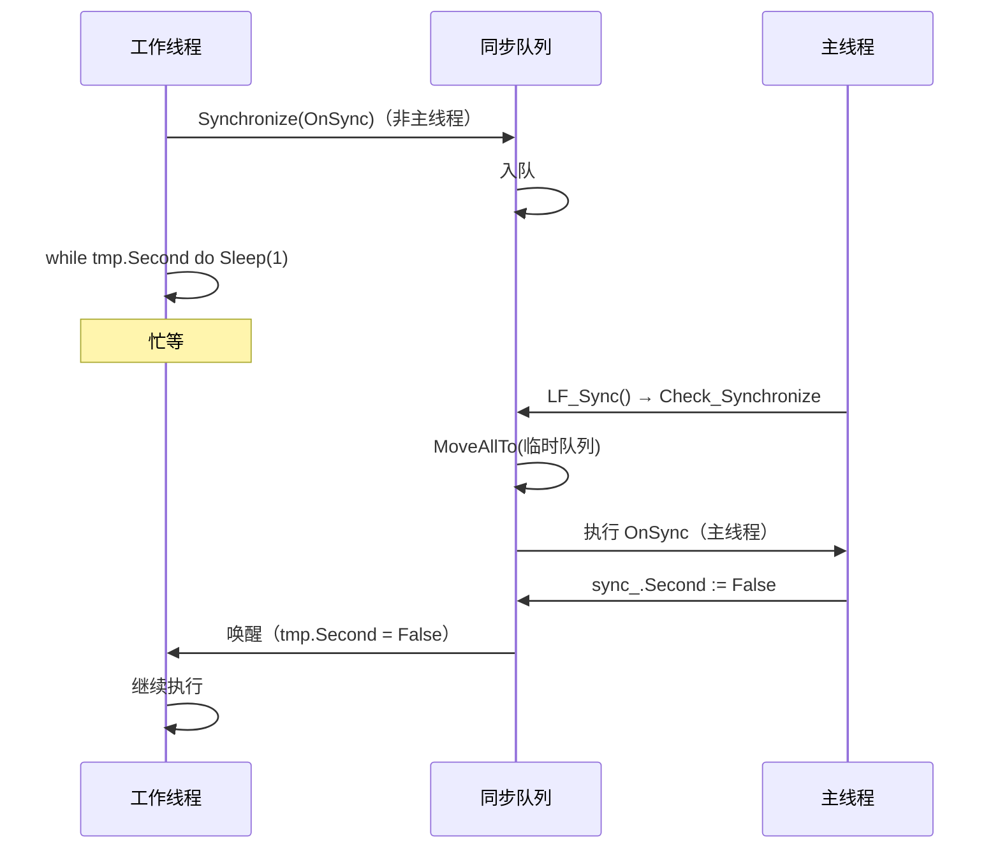

### 6.7 对难缠语言的含义

**Julia**：

```julia
# 主任务中定期驱动
@async begin
    while running[]
        LF_Sync()      # 处理同步回调
        sleep(0.01)
    end
end
```

**Erlang**：

```erlang
%% 在进程循环中定期驱动
loop() ->
    'LF_Sync'(),      %% 处理同步回调
    timer:sleep(10),
    loop().
```

**R**：

```r
# R 主线程循环
while (running) {
  .Call("LF_Sync")     # 处理同步回调
  later::run_now(0.01) # 或类似机制
}
```

**⚠️ 关键陷阱**：**如果主线程从不调用 `LF_Sync`，同步回调会永远不执行，工作线程会永久阻塞**。

---

## 第 7 章 回调的生命周期

### 7.1 回调从注册到销毁

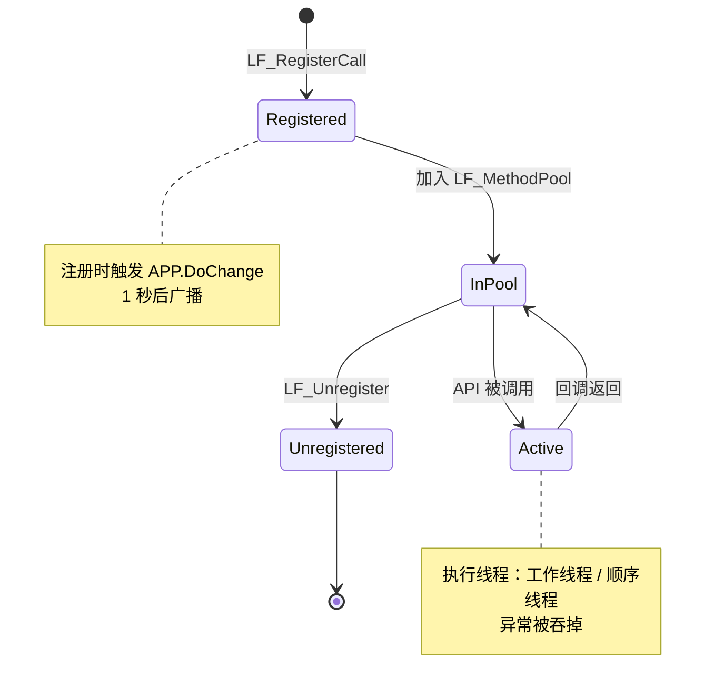

### 7.2 注册的生命周期

**注册时**：
1. 创建 `TLF_MethodInfo`。
2. 加入 `LF_MethodPool`（`TCritical_String_Big_Hash_Pair_Pool`）。
3. `APP.DoChange()` → `FUpdated := True` + `Reset_Timer`。
4. 1 秒后 `DoTimer` 触发 `Do_LFRegEvent`。
5. 主线程执行 `Do_LFRegEvent`，遍历 `FUpdateEventPool` 调用订阅者。

**注销时**：
1. `LF_MethodPool.Delete(MethodName)`。
2. `APP.DoChange()` → 同上。

### 7.3 回调指针的强引用

**问题**：LingoFuse 只保存函数指针，不管理托管对象的生命周期。

**托管语言必须**：
- **保持回调的强引用**。
- 否则 GC 回收后，函数指针变野。

**示例（C#）**：

```csharp
// ❌ 错误：局部变量被 GC
public void Register() {
    var cb = new LfCallEvent(AddCallback);
    LF_RegisterCall(app, "add", "Add", IntPtr.Zero, cb);
}

// ✅ 正确：静态字段保持强引用
private static readonly LfCallEvent _addCallback = AddCallback;
public void Register() {
    LF_RegisterCall(app, "add", "Add", IntPtr.Zero, _addCallback);
}
```

**示例（Python）**：

```python
# ❌ 错误：局部变量被 GC
def register():
    cb = LF_CALL_EVENT(AddCallback)
    lf.LF_RegisterCall(app, b"add", b"Add", None, cb)

# ✅ 正确：全局或类属性保持引用
ADD_CB = LF_CALL_EVENT(AddCallback)
def register():
    lf.LF_RegisterCall(app, b"add", b"Add", None, ADD_CB)
```

**示例（Julia）**：

```julia
# ❌ 错误：匿名函数被 GC
function register()
    cb = @cfunction(AddCallback, Cvoid, (Ptr{Cvoid}, Ptr{Cvoid}, Ptr{Cvoid}))
    LF_RegisterCall(app, "add", "Add", C_NULL, cb)
end

# ✅ 正确：全局 const 保持引用
const ADD_CB = @cfunction(AddCallback, Cvoid, (Ptr{Cvoid}, Ptr{Cvoid}, Ptr{Cvoid}))
function register()
    LF_RegisterCall(app, "add", "Add", C_NULL, ADD_CB)
end
```

**示例（Erlang）**：

```erlang
%% NIF 函数指针必须保活（使用 enif_keep_resource 或静态全局）
%% 具体见 §8.2
```

**示例（R）**：

```r
# R 通过 .Call 传递函数指针，没有 GC 问题
# 但需要保持 R 侧的 SEXP 引用
```

### 7.4 回调异常

**所有回调异常被吞掉**：

| 回调 | 异常处理 | 日志 |
|------|---------|------|
| Call | `try...except` | `'execute call-mode api "%s" (stdcall) execpet!'` |
| Notify | `try...except` | `'execute notify-mode api "%s" (stdcall) execpet!'` |
| 异步 Call OnResult | `try...except` | `'TLF_Async_Call_Bridge.Do_Th exception: %s: %s'` |
| 网络事件 | `try...except` | 无 |
| 顺序回调 | `try...except` | 无 |

**关键**：
- **异常不传播给调用方**。
- **异常信息只出现在日志**。
- **托管语言无法用异常控制流**。

### 7.5 Handle 的生命周期

#### 7.5.1 三种 Handle 生命周期

| Handle 类型 | 创建方式 | 生命周期终点 | 释放者 |
|------------|---------|-------------|--------|
| **调用者拥有的 Handle** | `LF_CreateData` / `LF_Call` 返回 | 显式 `LF_FreeData` | 调用者 |
| **框架拥有的异步 Handle** | 异步回调的 `Result_` 参数 | **回调返回瞬间** | 框架（立即） |
| **永久 Handle** | `LF_CreateData_Permanent` | 显式 `LF_FreeData` 或进程退出 | 调用者 |

#### 7.5.2 生命周期状态机

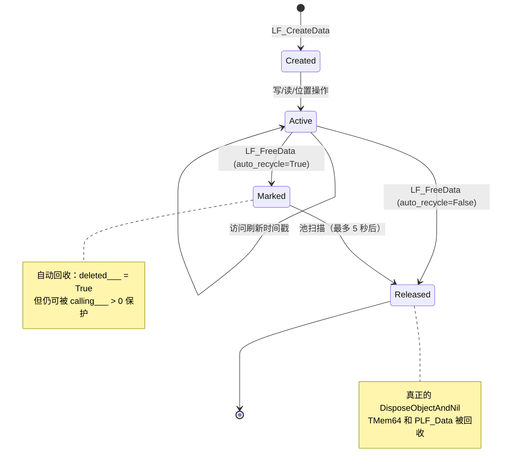

#### 7.5.3 异步 Handle 的完整生命周期

**完整时间线**：

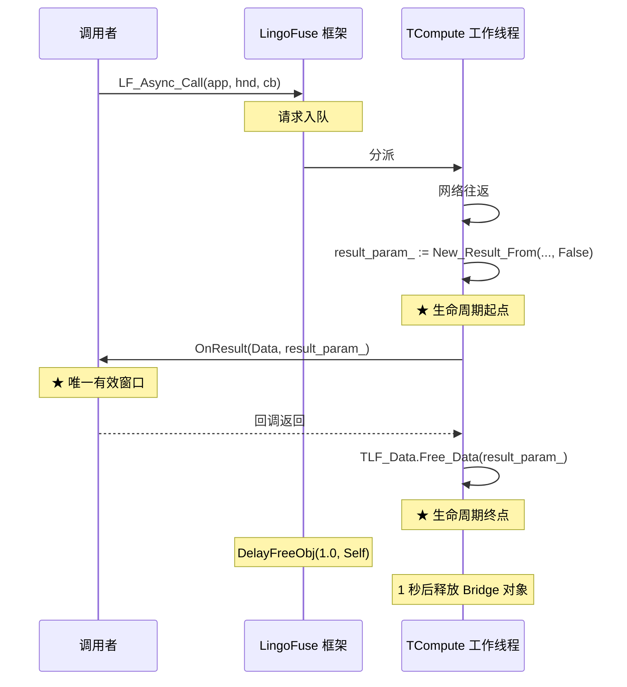

**关键点**：

- **`result_param_` 的生命周期 = 回调调用期间**。
- **回调返回 = handle 立即失效**。
- **`DelayFreeObj(1.0, Self)` 释放的是 Bridge 对象本身，不是 handle**。这是两件不同的事——`_lf_native.py` 里的注释"released automatically ~1 second after this callback returns"实际指的是 **Bridge 对象**，被误读为 handle。

#### 7.5.4 与自动回收机制的交互

**自动回收 handle 的三层保护**：

1. **空闲时间阈值**：`DataHandle_Idle_Timeout`（默认 10 分钟）。
2. **访问刷新**：任何 accessor 调用重置计时器。
3. **调用进行中**：`calling___ > 0` 时不被回收。

**但异步族 handle 不受这三层保护影响**，因为它 `auto_recycle = False`，创建时就不进池。

**推论**：

- 自动回收句柄的"活性窗口"是**分钟级**。
- 异步族句柄的"活性窗口"是**回调调用期间**（微秒-毫秒级）。
- 二者的数量级差异是本次踩坑的根本原因之一——开发者习惯性地按"分钟级"思维去理解"毫秒级"的生命周期。

---

## 第 8 章 难缠语言集成指南

### 8.1 Julia 集成

**Julia 的挑战**：
- 多任务（绿色线程）+ 多 OS 线程。
- 任务可被抢占。
- GC 有线程亲和。
- 从任意 OS 线程调 Julia 需要 `jl_adopt_thread`。

**推荐架构**：

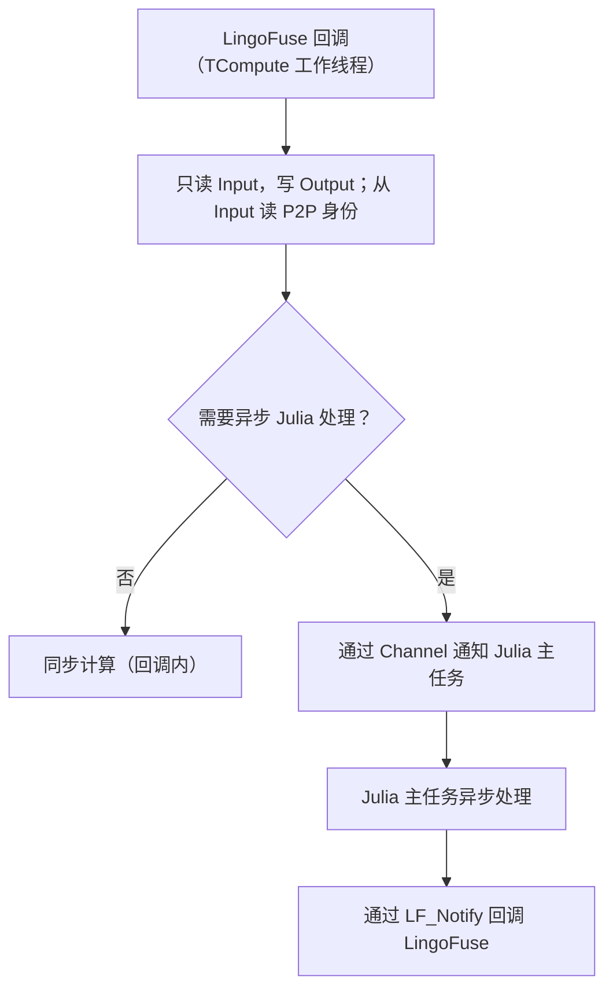

**关键规则**：

1. **回调内不直接调 Julia 代码**。
2. **回调内只读 Input、写 Output**。
3. **P2P 身份（UID / P2PName）只能从回调的 `Input` 参数读取**（见 §2.9），且必须立即拷贝（`LF_Get_P2P_UID` 返回指针）。
4. **需要异步处理时，用 `Channel` 通知 Julia 主任务**。
5. **Julia 主任务定期调用 `LF_Sync`**。
6. **所有 Julia 侧的回调必须保持强引用**（`const`）。

**完整示例**：

```julia
# 1. 加载 LingoFuse
const LINGOFUSE = "LingoFuse64.dll"
const lf = dlopen(LINGOFUSE)

# 2. 声明 C ABI 函数
const LF_CreateData = dlsym(lf, :LF_CreateData)
LF_CreateData(name::String) = ccall(LF_CreateData, Ptr{Cvoid}, (Cstring,), name)

const LF_RegisterCall = dlsym(lf, :LF_RegisterCall)
# ... 其它函数

# 3. 定义回调（保持强引用）
const callback_channel = Channel{Tuple{Ptr{Cvoid}, Vector{UInt8}}}(1000)

function my_callback(trigger::Ptr{Cvoid}, input::Ptr{Cvoid}, output::Ptr{Cvoid})::Cvoid
    # ① 读取 Input（安全）
    data = read_all_bytes(input)

    # ①b 从 Input 读取 P2P 身份（"侧数据"）—— 必须立即拷贝
    #     LF_Get_P2P_UID 返回指针（PP2P_UID___），框架约 5 秒后自动释放。
    uid_ptr = ccall(LF_Get_P2P_UID, Ptr{UInt8}, (Ptr{Cvoid},), input)
    uid = uid_ptr == C_NULL ? zeros(UInt8, 32) : copy(unsafe_wrap(Array, uid_ptr, 32))
    name_ptr = ccall(LF_Get_P2P_Name, Cstring, (Ptr{Cvoid},), input)
    p2p_name = name_ptr == C_NULL ? "" : unsafe_string(name_ptr)

    # ② 入队（通知 Julia 主任务）
    put!(callback_channel, (output, data))

    # ③ 立即返回（Output 由 Julia 主任务异步写回）
    # ⚠️ 但 Output 在回调返回后失效！所以必须在回调内写回。
    # 因此采用同步处理：
    result = process_in_callback(data)
    write_all_bytes(output, result)
end

const MY_CALLBACK = @cfunction(my_callback, Cvoid, (Ptr{Cvoid}, Ptr{Cvoid}, Ptr{Cvoid}))

# 4. 注册
function register_my_app()
    app = LF_CreateApp("MyApp", "Julia app")
    LF_RegisterCall(app, "my_api", "desc", C_NULL, MY_CALLBACK)
    return app
end

# 5. 主任务循环（定期驱动 LF_Sync）
const running = Ref(true)

function main_loop()
    while running[]
        LF_Sync()
        sleep(0.01)
    end
end

@async main_loop()
```

**⚠️ 关键陷阱**：
- **`@cfunction` 返回的函数指针必须保存在 `const` 中**，否则 GC 会回收。
- **`Input` / `Output` 在回调返回后立即失效**，必须同步处理。
- **`LF_Get_P2P_UID` 返回的是指针**，必须立即解引用拷贝；**不要保存裸指针**。
- **`LF_Get_P2P_UID` / `LF_Get_P2P_Name` 只能在 `Input` 参数上调用**，不能在自建句柄或 `Output` 上调用。
- **`LF_Sync` 必须由 Julia 主任务定期调用**。
- **如果使用 `Base.@ccallable`，Julia 会自动 adopt 线程**，但仍建议只读 Input / 写 Output。

### 8.2 Erlang 集成

**Erlang 的挑战**：
- BEAM VM 有 N 个调度器线程。
- NIF 阻塞会拖垮调度器。
- NIF 崩溃会拖垮整个 VM。
- 从任意 OS 线程调 Erlang 代码需要用 `enif_send`。

**推荐架构**：

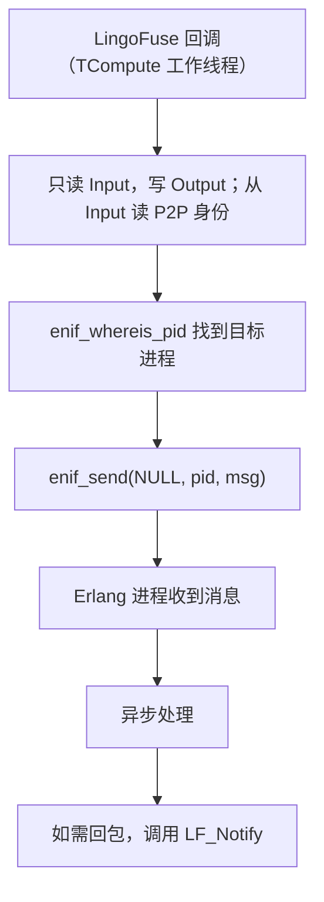

**关键规则**：

1. **NIF 必须快速返回**（LingoFuse 回调在工作线程，但 NIF 自己的限制也一样）。
2. **回调内不直接调 Erlang 代码**。
3. **P2P 身份（UID / P2PName）只能从回调的 `Input` 参数读取**（见 §2.9）；`LF_Get_P2P_UID` 返回指针，必须在 NIF 内解引用拷贝。
4. **用 `enif_send` 发消息给 Erlang 进程**。
5. **NIF 崩溃会拖垮 BEAM**，所以 NIF 内必须有 `try...catch`。
6. **使用 dirty NIF 处理耗时操作**（OTP 21+）。

**完整示例**：

```c
// C NIF 侧
#include <erl_nif.h>

static ErlNifResourceType* LF_APP_RESOURCE = NULL;

// 声明 LingoFuse C ABI
typedef void* TAppHnd;
typedef void* TDataHnd;
typedef void (*TLF_Call_Event)(void*, void*, void*);
typedef void* PP2P_UID___; // 实际为 PUID___，指向 TUID___
extern TAppHnd LF_CreateApp(const char*, const char*);
extern int LF_RegisterCall(TAppHnd, const char*, const char*, void*, TLF_Call_Event);
extern PP2P_UID___ LF_Get_P2P_UID(TDataHnd); // 返回指针，由框架约 5 秒后自动释放
extern const char* LF_Get_P2P_Name(TDataHnd);
// ...

// 回调：在工作线程执行
static void __cdecl my_callback(void* trigger, void* input, void* output) {
    // ① 读取 Input
    // ...
    // 从 Input 提取 UID / P2PName（用 LingoFuse API）
    // 仅在 input（"侧数据"）上有效；LF_Get_P2P_UID 返回 PP2P_UID___ 指针，
    // 框架约 5 秒后自动释放；只读拷贝，不保存指针，不手动释放。
    PP2P_UID___ uid_ptr = LF_Get_P2P_UID(input);
    TP2P_UID uid;
    if (uid_ptr != NULL) {
        uid = *uid_ptr;                    // 立即解引用拷贝
    } else {
        memset(&uid, 0, sizeof(uid));
    }
    const char* p2p_name_ptr = LF_Get_P2P_Name(input);  // 5 秒后失效
    char p2p_name[256];
    if (p2p_name_ptr != NULL) {
        strncpy(p2p_name, p2p_name_ptr, sizeof(p2p_name) - 1);
        p2p_name[sizeof(p2p_name) - 1] = '\0';
    } else {
        p2p_name[0] = '\0';
    }

    // ② 找到目标 Erlang 进程
    ErlNifPid pid;
    ErlNifEnv* env = enif_alloc_env();
    if (enif_whereis_pid(env, enif_make_atom(env, "my_lf_handler"), &pid)) {
        // ③ 构造消息
        ERL_NIF_TERM msg = enif_make_tuple2(env,
            enif_make_atom(env, "lf_callback"),
            enif_make_int(env, 42));

        // ④ 发送（从非 BEAM 线程）
        enif_send(NULL, &pid, NULL, msg);
    }
    enif_free_env(env);

    // ⑤ 写 Output
    // ...
}

// NIF 函数：注册回调
static ERL_NIF_TERM register_lf(ErlNifEnv* env, int argc, const ERL_NIF_TERM argv[]) {
    TAppHnd app = LF_CreateApp("MyApp", "Erlang app");
    LF_RegisterCall(app, "my_api", "desc", NULL, my_callback);
    return enif_make_atom(env, "ok");
}

// NIF 初始化
static int load(ErlNifEnv* env, void** priv_data, ERL_NIF_TERM load_info) {
    return 0;
}

static ErlNifFunc nif_funcs[] = {
    {"register_lf", 0, register_lf, ERL_NIF_DIRTY_JOB_IO_BOUND},
};

ERL_NIF_INIT(my_lf_nif, nif_funcs, load, NULL, NULL, NULL)
```

**⚠️ 关键陷阱**：
- **`enif_send(NULL, &pid, NULL, msg)` 才能从非 BEAM 线程发送**。
- **`enif_alloc_env` 分配的环境必须用 `enif_free_env` 释放**。
- **NIF 崩溃会拖垮 BEAM**，所以 NIF 内必须 `try...catch`。
- **`ERL_NIF_DIRTY_JOB_IO_BOUND`**：把 NIF 标记为 dirty，避免阻塞调度器。
- **`LF_Get_P2P_UID` 返回指针**：必须在 NIF 内解引用拷贝；不要长期保存。
- **`LF_Get_P2P_UID` / `LF_Get_P2P_Name` 只能在 `input` 参数上调用**。

### 8.3 R 集成

**R 的挑战**：
- 严格单线程、非重入。
- 所有 R 代码必须在主 R 线程执行。
- R API 不是线程安全的。
- R 的 GC 不是线程安全的。

**推荐架构**：

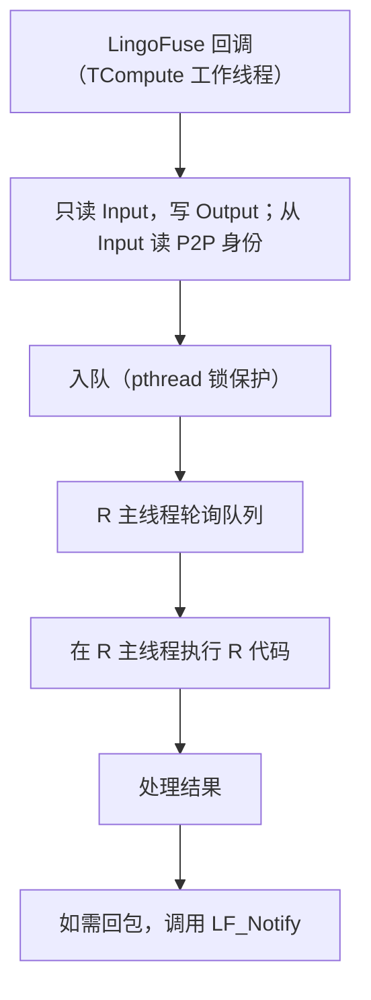

**关键规则**：

1. **回调内不调任何 R API**（包括 `Rf_allocVector`、`PROTECT`）。
2. **用 pthread 锁保护共享队列**。
3. **R 主线程主动轮询**（不能等回调）。
4. **Output 必须在回调内完成写入**（因为回调返回后失效）。
5. **P2P 身份只能从回调的 `Input` 参数读取**（见 §2.9）；`LF_Get_P2P_UID` 返回指针，必须在回调内拷贝。

**完整示例**：

```c
// C 侧（R 扩展）
#include <R.h>
#include <Rinternals.h>
#include <pthread.h>

// 线程安全队列
#define QUEUE_SIZE 1024
static void* callback_queue[QUEUE_SIZE];
static int queue_head = 0, queue_tail = 0;
static pthread_mutex_t queue_mutex = PTHREAD_MUTEX_INITIALIZER;

// LingoFuse 回调（在工作线程执行）
static void __cdecl my_callback(void* trigger, void* input, void* output) {
    // ① 读取 Input（不调 R API）
    // ... 提取数据到堆内存 ...

    // ①b 从 Input 读取 P2P 身份（"侧数据"）—— 必须立即拷贝
    //     LF_Get_P2P_UID 返回指针，框架约 5 秒后自动释放。
    PP2P_UID___ uid_ptr = LF_Get_P2P_UID(input);
    uint8_t uid[32];
    if (uid_ptr != NULL) {
        memcpy(uid, uid_ptr, 32);          // 立即拷贝
    } else {
        memset(uid, 0, 32);
    }
    const char* p2p_name_ptr = LF_Get_P2P_Name(input);
    char p2p_name[256];
    if (p2p_name_ptr != NULL) {
        strncpy(p2p_name, p2p_name_ptr, sizeof(p2p_name) - 1);
        p2p_name[sizeof(p2p_name) - 1] = '\0';
    } else {
        p2p_name[0] = '\0';
    }

    // ② 入队
    pthread_mutex_lock(&queue_mutex);
    callback_queue[queue_tail] = data;
    queue_tail = (queue_tail + 1) % QUEUE_SIZE;
    pthread_mutex_unlock(&queue_mutex);

    // ③ 写 Output（如果不需要 R 计算）
    // ... 直接写 ...
}

// R 主线程轮询函数
SEXP poll_callbacks() {
    SEXP result = PROTECT(allocVector(VECSXP, 0));

    pthread_mutex_lock(&queue_mutex);
    while (queue_head != queue_tail) {
        void* data = callback_queue[queue_head];
        queue_head = (queue_head + 1) % QUEUE_SIZE;
        pthread_mutex_unlock(&queue_mutex);

        // 在主线程执行 R 代码
        SEXP r_data = convert_to_R(data);
        SEXP r_result = call_r_function(r_data);
        // ... 处理结果 ...

        pthread_mutex_lock(&queue_mutex);
    }
    pthread_mutex_unlock(&queue_mutex);

    UNPROTECT(1);
    return result;
}

// R 注册
static const R_CallMethodDef CallEntries[] = {
    {"poll_callbacks", (DL_FUNC) &poll_callbacks, 0},
    {NULL, NULL, 0}
};

void R_init_my_lf_ext(DllInfo *dll) {
    R_registerRoutines(dll, NULL, CallEntries, NULL, NULL);
    R_useDynamicSymbols(dll, FALSE);
}
```

**⚠️ 关键陷阱**：
- **回调内不能调任何 R API**。
- **必须用 pthread 锁保护共享队列**。
- **R 主线程必须主动轮询**。
- **Output 必须在回调内完成**（否则会失效）。
- **如果 Output 需要 R 计算的结果，会死锁**（R 主线程也在等 LingoFuse）。
- **P2P 身份只能从 `input` 读取**：`LF_Get_P2P_UID` 返回指针，必须在回调内 `memcpy` 拷贝。

**推荐模式（避免死锁）**：

```c
// 回调内只返回 "accepted"，实际结果通过 LF_Notify 异步回传
static void __cdecl my_callback(void* trigger, void* input, void* output) {
    // ① 读取 Input
    // ② 生成 task_id
    // ③ 入队（通知 R 主线程）
    // ④ 立即写 Output = task_id
    // ⑤ R 主线程处理完后，通过 LF_Notify 通知原调用方
}
```

### 8.4 其他语言的简要说明

| 语言 | 关键点 |
|------|--------|
| **Java (FFM)** | 回调在任意线程执行；使用 `Arena` 管理内存；保持 `MemorySegment` 强引用 |
| **Rust** | `extern "C"`；panic 必须 `catch_unwind`；回调在任意线程 |
| **Go** | `purego` 或 `cgo`；回调在任意线程；保持回调引用 |
| **Swift** | `@convention(c)`；回调在任意线程 |
| **Zig** | `@cImport`；`extern "C"`；回调在任意线程 |
| **Ruby** | Fiddle 或 C 扩展；回调在任意线程；不能用 Ruby API |
| **Fortran** | `iso_c_binding`；回调在任意线程；不能用 Fortran 运行时 |
| **Julia** | `@cfunction` + `const`；回调在任意线程；用 `Channel` 编组 |
| **Erlang** | NIF + `enif_send`；回调在任意线程；用 dirty NIF |
| **R** | pthread 队列 + R 主线程轮询；回调在任意线程 |

---

## 第 9 章 内部消息路由

### 9.1 三套寻址的路由路径

**App 名路由**：

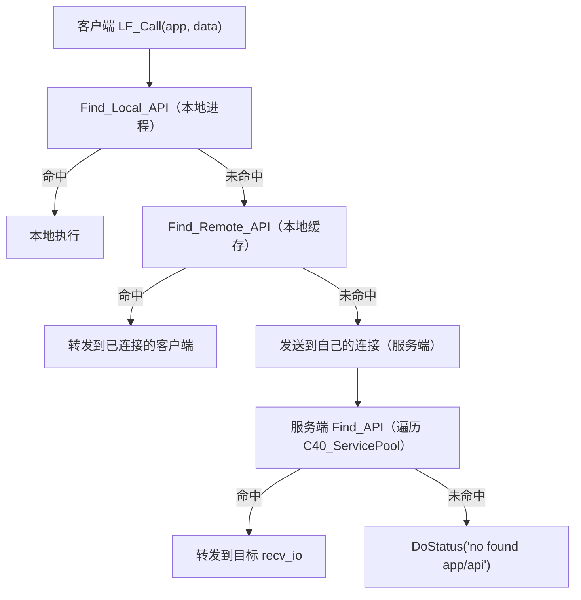

**UID 路由**：

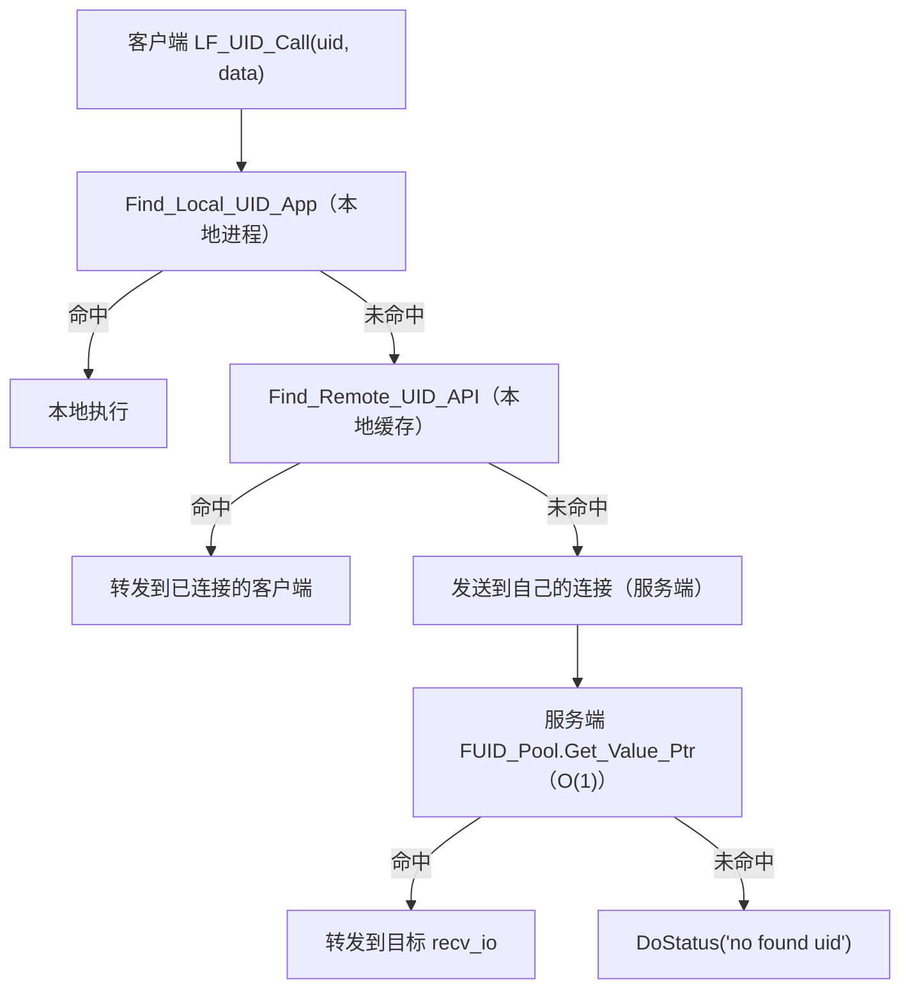

**P2PName 路由**：

```mermaid
flowchart TD
    A["客户端 LF_P2PNAME_Call(p2p_name, data)"] --> B["发送到自己的连接（服务端）"]
    B --> C["服务端 FP2PName_Pool.Get_Key_Value"]
    C --> D["Find_P2PName_LoadBalance（负载均衡）"]
    D --> E["按 Cycle_Anchor 选一个 UID"]
    E --> F["FUID_Pool.Get_Value_Ptr(UID)"]
    F --> G["转发到目标 recv_io"]
```

### 9.2 服务端命令分发

**服务端注册的 17 个命令**：

| 命令 | 注册类型 | 处理器 | 执行线程 |
|------|---------|--------|---------|
| `Update_UID` | CompleteBuffer_StreamNotify | `cmd_Update_UID` | C4 线程 |
| `Init_APP_Info` | CompleteBuffer_NoWait_Bridge_Stream | `cmd_Init_APP_Info` | C4 线程 |
| `No_App_Info` | ConsoleNotify | `cmd_No_App_Info` | C4 线程 |
| `Thread_State` | CompleteBuffer_StreamNotify | `cmd_Thread_State` | C4 线程 |
| `Notify` | CompleteBuffer_StreamNotify | `cmd_Notify` | C4 线程 + HPC 工作线程 |
| `Sequenced_Notify` | CompleteBuffer_StreamNotify | `cmd_Sequenced_Notify` | C4 线程 + 顺序线程 |
| `Call` | CompleteBuffer_NoWait_Bridge_Stream | `cmd_Call` | C4 线程 + HPC 工作线程 |
| `Sequenced_Call` | CompleteBuffer_NoWait_Bridge_Stream | `cmd_Sequenced_Call` | C4 线程 + 顺序线程 |
| `UID_Notify` | CompleteBuffer_StreamNotify | `cmd_UID_Notify` | C4 线程 + HPC 工作线程 |
| `UID_Sequenced_Notify` | CompleteBuffer_StreamNotify | `cmd_UID_Sequenced_Notify` | C4 线程 + 顺序线程 |
| `UID_Call` | CompleteBuffer_NoWait_Bridge_Stream | `cmd_UID_Call` | C4 线程 + HPC 工作线程 |
| `UID_Sequenced_Call` | CompleteBuffer_NoWait_Bridge_Stream | `cmd_UID_Sequenced_Call` | C4 线程 + 顺序线程 |
| `P2PName_Notify` | CompleteBuffer_StreamNotify | `cmd_P2PName_Notify` | C4 线程 + HPC 工作线程 |
| `P2PName_Sequenced_Notify` | CompleteBuffer_StreamNotify | `cmd_P2PName_Sequenced_Notify` | C4 线程 + 顺序线程 |
| `P2PName_Call` | CompleteBuffer_NoWait_Bridge_Stream | `cmd_P2PName_Call` | C4 线程 + HPC 工作线程 |
| `P2PName_Sequenced_Call` | CompleteBuffer_NoWait_Bridge_Stream | `cmd_P2PName_Sequenced_Call` | C4 线程 + 顺序线程 |
| `update_service_api_info` | CompleteBuffer | `cmd_update_service_api_info` | C4 线程 |

**关键事实**：
- **所有命令首先在 C4 线程执行**（C4 是单线程 Progress 驱动）。
- **本地命中的 Call/Notify 通过 HPC 分派到工作线程**。
- **序列化命令通过顺序线程执行**。
- **转发路径**：命令在 C4 线程转发到目标 recv_io，目标客户端在自己的 C4 线程处理。

### 9.3 C4 命令的三种处理路径

```mermaid
flowchart TD
    A["C4 命令到达"] --> B{"命令类型？"}
    B -- "Notify / Call（本地命中）" --> C["RunHPC_* → 工作线程"]
    B -- "Sequenced_Notify / Sequenced_Call（本地命中）" --> D["顺序线程池 → 顺序线程"]
    B -- "转发路径" --> E["SendCompleteBuffer_NoWait_StreamM 到目标客户端"]
    E --> F["目标客户端 C4 线程"]
    F --> G{"本地命中？"}
    G -- "是" --> C
    G -- "否" --> H["再转发或报错"]
```

### 9.4 广播机制

**服务端广播 `update_service_api_info`**：

```pascal
procedure TC40_LF_Service.Broadcast_API_Info;
begin
  // ① 收集所有在线 recv_io
  DTNoAuth.RecvTunnel.GetIO_Array(arry);
  for ID_ in arry do
  begin
    IO_ := DTNoAuth.RecvTunnel.PeerIO[ID_];
    tun := IO_.Define as TC40_LF_RecvTunnel;
    if tun.LinkOk then alive.Add(tun);
  end;

  // ② 构建 pool（App 信息）和 uid_tool（UID 信息）
  with alive.Repeat_ do
    repeat
      pool.Build_Info_Form(queue^.Data);
      uid_tool.Import_From(queue^.Data);
    until not Next;

  // ③ 编码为 TDFE
  sub := TDFE.Create;
  pool.SaveToStream(sub);
  envelope.WriteDFE(sub);
  sub := TDFE.Create;
  uid_tool.SaveToStream(sub);
  envelope.WriteDFE(sub);

  // ④ 广播
  envelope.FastEncodeTo(payload);
  with alive.Repeat_ do
    repeat
      queue^.Data.SendTunnel.Owner.SendCompleteBuffer('update_service_api_info', payload.NewClone, True);
    until not Next;
end;
```

**广播节流**：
- **≤10 连接**：500ms
- **≤100 连接**：1s
- **其他**：3s

---

## 第 10 章 计时与顺序

### 10.1 保证与不保证

| 操作 | 顺序保证 | 备注 |
|------|---------|------|
| **同一 `(App, API)` 的 `Sequenced_Notify`** | ✅ FIFO | 顺序线程池 |
| **同一 `(App, API)` 的 `Sequenced_Call`** | ✅ FIFO | 顺序线程池 |
| **同一 UID 的 `UID_Sequenced_Notify`** | ✅ FIFO | 顺序线程池 |
| **同一 UID 的 `UID_Sequenced_Call`** | ✅ FIFO | 顺序线程池 |
| **同一 P2PName 的 `P2PName_Sequenced_Notify`** | ⚠️ 部分 | 每个 (p2p_name, api) 对 FIFO，但可能分配到不同 UID |
| **`LF_Notify`** | ❌ 不保证 | 网络传输可能乱序 |
| **`LF_Call`** | ❌ 不保证 | 同上 |
| **`LF_Async_Call`** | ❌ 不保证 | 异步回调可能乱序 |
| **`LF_Async_Sequenced_Call`** | ✅ FIFO（同一 App+API） | 顺序线程池 |

### 10.2 `Fixed_Sequenced_Time` 的粘性机制

**默认**：20000 毫秒（20 秒）。

**作用**：P2PName 路由时，同一 UID 连续处理 20 秒后切换到其他 UID。

**源码**（`Find_P2PName_FixedSequenced`）：

```pascal
PtrList.Sort_By_Sequenced_Time(taskKey);
selected := PtrList.First^.Data;
if (GetTimeTick() - selected^.Fourth) > Fixed_Sequenced_Time then
    selected := PtrList.Last^.Data;      // 超过 20 秒换一个
selected^.Fourth := GetTimeTick();
```

### 10.3 Cycle_Anchor 负载均衡

**机制**：
- 全局原子计数器 `Cycle_Anchor_Seed`（`Int64`）。
- 每个 `(p2p_name, api)` 任务维护每个 UID 的 anchor 值。
- 选 anchor 最小的，选中后更新为新的全局值。

**效果**：轮询 + 负载均衡。

**源码**（`Find_P2PName_LoadBalance`）：

```pascal
PtrList.Sort_By_Cycle_Anchor(taskKey);
selected := PtrList.First^.Data;
P := FUID_Pool.Get_Value_Ptr___(selected^.Primary);
Result := P^.recv_io;
selected^.Third[taskKey] := Get_Cycle_Anchor();   // 更新 anchor
```

### 10.4 广播延迟

| 场景 | 延迟 |
|------|------|
| **API 变更到广播** | 1 秒（`Reset_Timer` 后 `DoTimer`） |
| **广播到客户端缓存更新** | C4 网络延迟（毫秒级） |
| **`LF_CheckApp` 缓存延迟** | 约 3 秒 |
| **`LF_CheckApi` 缓存延迟** | 约 3 秒 |

### 10.5 数据句柄回收延迟

| 操作 | 延迟 |
|------|------|
| **`LF_FreeData`（自动回收）** | 最多 5 秒（下次扫描） |
| **空闲回收** | 10 分钟 + 最多 5 秒 |
| **`LF_CreateData_Permanent` 释放** | 立即（同步） |

---

## 第 11 章 调试与诊断

### 11.1 关键调试点

| 调试点 | 方法 | 输出 |
|--------|------|------|
| **线程身份** | `TCompute.Set_Thread_Info` | 线程日志 |
| **状态消息** | `LF_GetStatusCount` + `LF_GetStatus` | 状态队列 |
| **调试日志** | `LF_Set_Opt_Quiet(False)` | `[LF-DEBUG]` 前缀 |
| **C4 状态** | `LF_Set_Opt_Debug('service')` | 服务信息 |
| **隧道状态** | `LF_Set_Opt_Debug('tunnel')` | 隧道信息 |
| **ZNet 实例** | `LF_Set_Opt_Debug('ZNet_Info')` | ZNet 状态 |
| **HPC 线程** | `LF_Set_Opt_Debug('HPC_Thread_Info')` | HPC 线程状态 |
| **数据句柄** | `LF_Set_Opt_Debug('Instance_Info')` | 实例信息 |

### 11.2 跨语言调试

**Julia**：

```julia
# 打印所有状态
while LF_GetStatusCount() > 0
    status = unsafe_string(LF_GetStatus())
    println("[LF] ", status)
end

# 打印线程 ID
println("Julia thread: ", Threads.threadid())
```

**Erlang**：

```erlang
%% 从 NIF 返回状态
poll_status() ->
    case 'LF_GetStatusCount'() of
        0 -> [];
        N ->
            Status = 'LF_GetStatus'(),
            [binary_to_list(Status) | poll_status()]
    end.
```

**R**：

```r
# 打印所有状态
poll_status <- function() {
    while (.Call("LF_GetStatusCount") > 0) {
        status <- .Call("LF_GetStatus")
        cat("[LF]", status, "\n")
    }
}
```

### 11.3 常见问题的诊断路径

| 问题 | 诊断路径 |
|------|---------|
| **回调未触发** | ① 检查 `LF_CheckApp` / `LF_CheckApi`；② 检查 `LF_PrepareDone` 返回值；③ 检查 `LF_GetStatus` |
| **回调崩溃** | ① 检查回调是否 `cdecl`；② 检查 `Trigger` 是否有效；③ 检查跨线程访问 |
| **死锁** | ① 检查回调中是否调 `LF_Call`；② 检查主循环是否调用 `LF_Sync`；③ 检查 R 场景的死锁 |
| **内存泄漏** | ① 检查 `LF_FreeData` 配对；② 检查 `LF_FreeApp` 配对；③ 检查 `LF_CreateData_Permanent` |
| **异步回调后数据异常** | ① 确认没在回调外使用 `Result_` handle；② 确认没对 `Result_` 调 `LF_FreeData`；③ 确认没把 handle 跨线程传出 |
| **P2P 身份为空** | ① 确认是在 `Input` 上调用（不是 `Output` / 自建句柄）；② 确认发送方设置了 `LF_P2P_name`；③ 确认 UID 已生成 |
| **连接失败** | ① 检查 `Overlap_Connection`；② 检查地址；③ 检查 `Wait_Connection_Timeout` |
| **路由失败** | ① 检查 UID 是否有效；② 检查 P2PName 是否设置；③ 检查 App 是否注册 |

---

## 第 12 章 反例集（跨语言特有的坑）

### 12.1 Julia：回调未保持强引用

```julia
# ❌ 错误：回调被 GC
function register()
    cb = @cfunction(my_callback, Cvoid, (Ptr{Cvoid}, Ptr{Cvoid}, Ptr{Cvoid}))
    LF_RegisterCall(app, "my_api", "desc", C_NULL, cb)
    # cb 出作用域后被 GC，回调变野指针
end

# ✅ 正确：全局 const
const MY_CB = @cfunction(my_callback, Cvoid, (Ptr{Cvoid}, Ptr{Cvoid}, Ptr{Cvoid}))
function register()
    LF_RegisterCall(app, "my_api", "desc", C_NULL, MY_CB)
end
```

### 12.2 Julia：回调中直接调 Julia 代码

```julia
# ❌ 错误：从工作线程调 Julia 代码
function my_callback(trigger, input, output)::Cvoid
    # 这个回调在工作线程执行
    result = compute(data)   # ❌ 可能破坏 GC
    write_output(output, result)
end

# ✅ 正确：只读 Input / 写 Output，或使用 @ccallable
function my_callback(trigger, input, output)::Cvoid
    data = read_bytes(input)     # 拷贝
    # 简单计算可以直接做（不涉及 GC 敏感操作）
    write_bytes(output, data)
end
```

### 12.3 Erlang：NIF 阻塞调度器

```c
// ❌ 错误：NIF 长时间阻塞
static ERL_NIF_TERM blocking_nif(ErlNifEnv* env, int argc, const ERL_NIF_TERM argv[]) {
    sleep(10);   // ❌ 阻塞调度器 10 秒
    return enif_make_atom(env, "ok");
}

// ✅ 正确：标记为 dirty NIF
static ErlNifFunc nif_funcs[] = {
    {"blocking_nif", 0, blocking_nif, ERL_NIF_DIRTY_JOB_IO_BOUND},
};
```

### 12.4 Erlang：NIF 崩溃拖垮 BEAM

```c
// ❌ 错误：NIF 中未捕获异常
static ERL_NIF_TERM crash_nif(ErlNifEnv* env, int argc, const ERL_NIF_TERM argv[]) {
    int* p = NULL;
    *p = 42;   // ❌ 段错误 → BEAM 崩溃
    return enif_make_atom(env, "ok");
}

// ✅ 正确：捕获所有异常
static ERL_NIF_TERM safe_nif(ErlNifEnv* env, int argc, const ERL_NIF_TERM argv[]) {
    // 所有操作在 try...catch 中（C 中需手动检查）
    return enif_make_atom(env, "ok");
}
```

### 12.5 R：回调中调 R API

```c
// ❌ 错误：在回调中调 R API
static void __cdecl my_callback(void* trigger, void* input, void* output) {
    SEXP data = allocVector(REALSXP, 10);   // ❌ R API 非线程安全
    // ...
}

// ✅ 正确：只读 Input / 写 Output
static void __cdecl my_callback(void* trigger, void* input, void* output) {
    // 只读 Input，写 Output
    // 需要 R 计算时，入队给 R 主线程
}
```

### 12.6 R：Output 等待 R 计算结果导致死锁

```c
// ❌ 错误：回调等待 R 主线程处理结果
static void __cdecl my_callback(void* trigger, void* input, void* output) {
    // 入队
    pthread_mutex_lock(&queue_mutex);
    // ...
    pthread_mutex_unlock(&queue_mutex);

    // ❌ 等待 R 主线程处理
    while (!result_ready) {
        usleep(1000);
    }
    // 但 R 主线程可能在等 LingoFuse，形成死锁
    write_output(output, result);
}

// ✅ 正确：回调内只返回 task_id，实际结果通过 LF_Notify 异步回传
static void __cdecl my_callback(void* trigger, void* input, void* output) {
    // 入队
    // 立即写 Output = task_id
    write_output(output, task_id);
}
```

### 12.7 所有语言：回调中调 `LF_Call`

```pascal
// ❌ 错误：回调中调 LF_Call
procedure MyCallback(Trigger: Pointer; Input, Output: TDataHnd); cdecl;
begin
  Res := LF_CallEx('Other', Input, 5000);   // ❌ 自锁死
end;

// ✅ 正确：异步提交到工作线程
procedure MyCallback(Trigger: Pointer; Input, Output: TDataHnd); cdecl;
begin
  TThread.CreateAnonymousThread(
    procedure
    var Res: TDataHnd;
    begin
      Res := LF_CallEx('Other', Input, 5000);
      // ...
    end
  ).Start;
end;
```

### 12.8 所有语言：主循环未调 `LF_Sync`

```pascal
// ❌ 错误：自定义主循环未调 LF_Sync
while Running do
begin
  Z.Core.Check_Soft_Thread_Synchronize(10);
  Sleep(10);
end;

// ✅ 正确：加 LF_Sync
while Running do
begin
  LF.Sync;                              // ✅ 处理同步回调
  Z.Core.Check_Soft_Thread_Synchronize(10);
  Sleep(10);
end;
```

### 12.9 所有语言：网络事件回调中保存 `addr_`

```pascal
// ❌ 错误：全局保存指针
var g_addr: PAnsiChar;
procedure OnConnect(addr: PAnsiChar); cdecl;
begin
  g_addr := addr;   // ❌ 回调返回后失效
end;

// ✅ 正确：立即复制
var g_addr: string;
procedure OnConnect(addr: PAnsiChar); cdecl;
begin
  g_addr := UTF8ToString(addr);   // ✅
end;
```

### 12.10 所有语言：在异步回调外使用 handle（★ v3.1 核心）

**问题**：把异步回调接收的 `Result_` handle 传出去，跨线程使用。

**错误示例（伪代码）**：

```python
# ❌ 错误：把异步 handle 传出去
saved_ptr = None

def on_result(trigger, res_ptr):
    global saved_ptr
    saved_ptr = res_ptr    # ❌ 回调返回后失效

LF_Async_Call(app, hnd, None, on_result)
# ... 稍后
data = read_from(saved_ptr)    # ❌ use-after-free
LF_FreeData(saved_ptr)          # ❌ double-free
```

**正确示例**：

```python
def on_result(trigger, res_ptr):
    # ✓ 在回调内拷贝数据
    data = read_all_bytes(res_ptr)   # bytes 是新的 Python 对象
    my_queue.put(data)
    # 不保留 res_ptr，不调用 LF_FreeData
```

**为什么这是跨语言的坑**：GC 语言不感知 C 侧的指针生命周期。**回调返回后，任何持有该指针的 Python/Julia/Erlang/R 对象都是悬空的**。

**根本原因**：见 §2.8 的 Handle 所有权模型。

**具体表现**：

| Payload 大小 | 表现 |
|-------------|------|
| 小（2 字节） | 通常"看起来正常"——分配器还没复用 |
| 大（17+ 字节） | 通常"返回空/垃圾"——已被复用 |

**⚠️ 用 `int` vs `dict` 二分法会误导诊断**。真正的变量是"payload 大小 → 内存复用时机"。

### 12.11 所有语言：同步族与异步族所有权混用

**问题**：把同步族的所有权规则套用到异步族，或反之。

**错误示例**：

```python
# ❌ 错误：用同步族的所有权规则处理异步 handle
def on_result(trigger, res_ptr):
    my_handle = wrap_handle(res_ptr)   # 包装成"调用者拥有"
    # ... 稍后 ...
    my_handle.free()                    # 调用 LF_FreeData → double-free
```

**正确原则**：

| 调用族 | Handle 所有者的正确假设 |
|--------|----------------------|
| 同步族 | **调用者**拥有，调用者释放 |
| 异步族 | **框架**拥有，回调内使用后不再管 |

**绝不能混用**。二者的函数签名相同、返回类型相同、外观相同——**唯一区别是所有权**。

### 12.12 所有语言：注释中的"~1 秒"误导

**问题**：`_lf_native.py` 的注释说异步回调结果"~1 秒后释放"，实际是**回调返回后立即释放**。

**原文**：

```python
#:     Result_ - a DataHandle owned by the framework. It is released
#:               automatically ~1 second after this callback returns.
```

**实际**（`Z.Net.C4.LingoFuse.pas` 的 `TLF_Async_Call_Bridge.Do_Th`）：

```pascal
result_param_ := TLF_Data.New_Result_From(Result_M64.Swap_To_New_Instance, False);
try
  if Assigned(OnResult) then
    OnResult(Data_, result_param_);
except
end;
TLF_Data.Free_Data(result_param_);   // ← 立即释放
DelayFreeObj(1.0, Self);              // ← 1 秒后释放的是 Bridge 对象
```

**关键区分**：

- **`result_param_`（Handle）**：回调返回后**立即**释放。
- **`Self`（Bridge 对象）**：回调返回后 **1 秒**延迟释放。

**建议**：所有语言的绑定层注释应改为：

```
Result_ is released IMMEDIATELY after this callback returns.
Do NOT retain the pointer beyond the callback body.
Do NOT call LF_FreeData on it.
```

**教训**：**注释是二手信息**。遇到可疑行为，读源码，不读注释。

### 12.13 所有语言：在自建句柄或输出句柄上调用 `LF_Get_P2P_UID` / `LF_Get_P2P_Name`（★ v3.2 新增）

**问题**：`LF_Get_P2P_UID` / `LF_Get_P2P_Name` 读的是**发送方写入的"侧数据"**，不是句柄本身的业务数据。它们只在**触发事件的回调 `Input` 参数**上有效。

**错误示例 1：在自建请求句柄上调用**

```pascal
// ❌ 错误：在自建句柄上调用
var
  Req: TDataHnd;
  UIDPtr: PP2P_UID___;
begin
  Req := LF_CreateData('my_api');   // ← 自己创建的请求句柄
  UIDPtr := LF_Get_P2P_UID(Req);    // ❌ 没有"发送方"；返回 Null_UID() + 警告
  // ...
end;
```

**错误示例 2：在 Output（输出句柄）上调用**

```pascal
// ❌ 错误：在 Output 上调用
procedure MyCallback(Trigger: Pointer; Input, Output: TDataHnd); cdecl;
var
  UIDPtr: PP2P_UID___;
begin
  UIDPtr := LF_Get_P2P_UID(Output);  // ❌ Output 是"结果句柄"，没有 Data_Param
  // 打印警告：[warning] Get_P2P_UID(): P2P Info only backcall "input" parameter.
end;
```

**错误示例 3：在异步回调的 `Result_` 上调用**

```pascal
// ❌ 错误：在异步回调的 Result_ 上调用
procedure OnResult(Data: Pointer; Result_: TDataHnd); cdecl;
var
  UIDPtr: PP2P_UID___;
begin
  UIDPtr := LF_Get_P2P_UID(Result_);  // ❌ Result_ 是异步结果句柄，没有 P2P 身份
end;
```

**正确示例**：

```pascal
// ✅ 正确：只在回调的 Input 参数上调用
procedure MyCallback(Trigger: Pointer; Input, Output: TDataHnd); cdecl;
var
  UIDPtr: PP2P_UID___;
  UID: TP2P_UID___;
  Name: string;
begin
  // 从 Input 读取发送方身份
  UIDPtr := LF_Get_P2P_UID(Input);
  if UIDPtr <> nil then
      UID := UIDPtr^;              // 立即解引用拷贝
  Name := LF_Get_P2P_NameEx(Input); // 立即拷贝

  // ... 使用 UID / Name ...
end;
```

**为什么这是跨语言的坑**：
- **直觉上**，开发者可能以为"任何句柄都能读 UID / P2PName"。
- **实际上**，这两个函数读的是**发送方元数据**，只在"接收到的输入句柄"上存在。
- **Pascal 侧会打印警告**，但**不抛异常**；托管语言如果忽略日志，会静默拿到 `Null_UID()` / 空字符串。

**规则**：
- **只在触发事件的回调 `Input` 参数上调用**。
- **不能在自建句柄上调用**（`LF_CreateData` / `LF_CreateData_Permanent`）。
- **不能在 `Output` / `Result_` 上调用**。

**相关坑**：`LF-ROUTE-004`（见 Pascal 指南）。

### 12.14 所有语言：把 `LF_Get_P2P_UID` 的返回值当成数组值使用（★ v3.2 新增）

**问题**：`LF_Get_P2P_UID` 的返回值从 `TP2P_UID___`（32 字节静态数组**值**）改为 `PP2P_UID___`（**指针**）。旧代码直接当值用会编译失败或运行时错乱。

**错误示例（Pascal）**：

```pascal
// ❌ 旧代码：把返回值当数组值用
var
  UID: TP2P_UID___;
begin
  UID := LF_Get_P2P_UID(Input);   // ❌ 类型不匹配（PP2P_UID___ 不是 TP2P_UID___）
end;
```

**错误示例（C）**：

```c
// ❌ 旧代码：把返回值当数组用
uint8_t uid[32];
memcpy(uid, LF_Get_P2P_UID(input), 32);   // ❌ 把指针当数组首地址
// 结果：uid 的内容是"指针的字节序"，不是 UID 本身
```

**正确示例（Pascal）**：

```pascal
// ✅ 新代码：先解引用再拷贝
var
  UID: TP2P_UID___;
  UIDPtr: PP2P_UID___;
begin
  UIDPtr := LF_Get_P2P_UID(Input);
  if UIDPtr <> nil then
      UID := UIDPtr^;               // 解引用
end;
```

**正确示例（C）**：

```c
// ✅ 新代码：先解引用
PP2P_UID___ uid_ptr = LF_Get_P2P_UID(input);
uint8_t uid[32];
if (uid_ptr != NULL) {
    memcpy(uid, uid_ptr, 32);         // 从 *uid_ptr 拷贝 32 字节
} else {
    memset(uid, 0, 32);
}
```

**正确示例（Julia）**：

```julia
# ✅ 新代码：unsafe_wrap 从指针构造数组
uid_ptr = ccall(LF_Get_P2P_UID, Ptr{UInt8}, (Ptr{Cvoid},), input)
uid = uid_ptr == C_NULL ? zeros(UInt8, 32) : copy(unsafe_wrap(Array, uid_ptr, 32))
```

**教训**：**签名变更必须回查源码**。旧文档/旧注释/旧绑定层可能仍写"返回值"，实际是"返回指针"。

**相关坑**：§2.9.3、附录 A.8。

---

## 第 13 章 诚实的不确定清单

> 以下是我从当前材料**无法完全确定**的点，需要回查源码或询问人类。

0. **【已确认，从不确定转为确定】** 异步回调的 `Result_` handle 释放时机
   - 曾误读 `_lf_native.py` 的注释"~1 秒后释放"为 handle 的释放时机。
   - **源码核实**（`Z.Net.C4.LingoFuse.pas` 的 `TLF_Async_Call_Bridge.Do_Th`）：
     - `result_param_ := TLF_Data.New_Result_From(..., False)` → **框架拥有**
     - `TLF_Data.Free_Data(result_param_)` → **回调返回后立即释放**
     - `DelayFreeObj(1.0, Self)` → 1 秒后释放的是 **Bridge 对象**，不是 handle
   - **结论**：**已确认**（本次调试的核心发现）。
   - **影响**：任何在异步回调外使用 `Result_` handle 的代码都是 UB。
   - **建议**：所有语言的绑定层注释必须更正为"立即释放"。

0.5 **【已确认，v3.2 新增】** `LF_Get_P2P_UID` 的返回值类型与"侧数据"语义
   - **源码核实**（`Z.LingoFuse_Export.pas` 的 `LF_Get_P2P_UID`）：
     - 返回类型是 **`PP2P_UID___`（指针）**，不是 `TP2P_UID___`（值）。
     - 内部 `New(Result)` + `DelayFreeMem(5.0, Result)`。
   - **数据来源**（`TLF_Data.Get_P2P_UID`）：从 `Data_Param.FromUID` 读取；`Data_Param` 是**发送方写入的输入句柄**才有的字段。
   - **触发机制**（`TC40_LF_Client.Send_*` → `TMemory_Param_Tool.Rebuild_UID_and_P2PName`）：发送方自动把 `FLast_UID` 和 `LF_P2P_name.V` 写入请求载荷。
   - **只能在回调 `Input` 参数上使用**：对自建句柄或输出句柄调用返回 `Null_UID()` + 警告。
   - **结论**：**已确认**（v3.2 勘误核心）。

1. **模拟主线程是否调用 `LF_Sync`**
   - 源码显示 `Simulated_Main_Thread` 只调用 `C40Progress` 和 `LF_DataPool.Progress`。
   - **不确定**：是否有其他机制驱动 `LF_SyncTool`。
   - **推测**：**没有**。用户必须从自己的主循环调用 `LF_Sync`。
   - **影响**：如果用户使用 `LF_PrepareDone` 但不调用 `LF_Sync`，同步回调可能永远不执行。

2. **`Soft_Synchronize_Main_Thread` 的惰性设置**
   - `Check_Synchronize` 在 `Soft_Synchronize_Main_Thread = nil` 时设置为当前线程。
   - **不确定**：第一次调用 `Synchronize` 的线程如果来自工作线程，会不会导致错误的主线程定义。
   - **推测**：**会**。用户应确保主线程先调用 `LF_Sync`。

3. **`TCompute` 线程池的具体线程数**
   - 初始化时 `if_(IsDebuging, 2, CpuCount * 2)`。
   - **不确定**：运行时是否会动态调整。
   - **推测**：动态创建，上限受 `LimitMaxParallelThread` 限制。

4. **顺序线程的 `DelayFreeObj(5.0, self)` 与 `Kill_App` 的竞态**
   - 源码显示线程退出后延迟 5 秒释放。
   - **不确定**：如果 `Kill_App` 在 5 秒内被调用，是否有竞态。
   - **推测**：可能有。见 `LF-MEM-004`。

5. **`LF_PostStatus` 在 `Simulator_Main_Thread_Activted = False` 时的精确行为**
   - 源码显示打印警告但**仍入队**。
   - **不确定**：入的是哪个队列（`Text_Queue_Data_Pool__` 还是 `Status_Pool`）。
   - **推测**：`Text_Queue_Data_Pool__`（Z.Status 的队列），需要主线程 `CheckDoStatus` 才能进入 `Status_Pool`。

6. **`LF_GetStatus` 返回指针的线程安全性**
   - 源码显示 `Status_Return_Buffer` 是全局静态缓冲。
   - **不确定**：多线程同时调用 `LF_GetStatus` 是否会冲突。
   - **推测**：可能冲突（缓冲被覆盖）。

7. **网络事件回调的具体执行线程 ID**
   - 源码显示通过 `TCompute.RunC` 分派。
   - **不确定**：是哪个工作线程。
   - **推测**：线程池中的任意一个。

8. **`LF_Set_Network_Event` 在 `LF_Shutdown` 期间的行为**
   - 源码显示 `LF_Shutdown` 清空回调。
   - **不确定**：清空后是否仍触发已注册的回调。
   - **推测**：不会。

9. **`Cycle_Anchor_Seed` 的溢出行为**
   - 是 `Int64`。
   - **不确定**：溢出时行为。
   - **推测**：理论无溢出。

10. **`Fixed_Sequenced_Time` 调整后的实际效果**
    - 默认 20 秒。
    - **不确定**：不同场景的最优值。
    - **建议**：测试后调整。

11. **`TLF_DataPool.Progress` 与正在使用的句柄的竞态**
    - `calling___ > 0` 时不会被回收。
    - **不确定**：回调内长时间持有时是否安全。
    - **推测**：安全。

12. **大端平台字节序**
    - 协议约定小端。
    - **不确定**：大端平台的实际行为。
    - **推测**：可能有 bug。

13. **`LF_CreateData_Permanent` 在 `LF_PrepareDone` 前创建的精确行为**
    - 注释说"可能是 no-op"。
    - **不确定**：是否真的 no-op。
    - **推测**：`LF_FreeData` 是 no-op，但创建是有效的。

14. **`TZ_JsonObject` 在多线程场景下的安全性**
    - `Z.Json.md` 说"否"。
    - **不确定**：具体哪些操作不安全。
    - **建议**：多线程访问加锁。

15. **`LF_Shutdown` 多次调用的幂等性**
    - 源码显示可以重复调用。
    - **不确定**：是否有副作用。
    - **推测**：幂等。

16. **Julia `@cfunction` 的线程亲和**
    - Julia 文档说 `@cfunction` 返回的函数指针可以在任意线程被调用。
    - **不确定**：是否需要 `jl_adopt_thread`。
    - **推测**：不需要，但建议只读 Input / 写 Output。

17. **Erlang NIF 的 dirty scheduler 配置**
    - `ERL_NIF_DIRTY_JOB_IO_BOUND` 标记为 dirty。
    - **不确定**：dirty scheduler 的数量和配置。
    - **建议**：参考 OTP 文档。

18. **R 主线程轮询的具体机制**
    - 需要 R 主线程主动轮询。
    - **不确定**：最佳轮询间隔。
    - **建议**：10ms 或根据业务调整。

19. **异步 handle 的精确释放顺序**
    - `TLF_Async_Call_Bridge.Do_Th` 中 `Free_Data(result_param_)` 后紧接 `DelayFreeObj(1.0, Self)`。
    - **不确定**：是否有回调返回后到 `Free_Data` 之间的窗口期，其它线程能否观察到该 handle。
    - **推测**：**没有**。`Free_Data` 就在回调返回后的下一行代码，其它线程无法介入。
    - **但**：如果回调**保存了 handle 指针**，即使窗口期为 0，指针也已经**指向已释放内存**。

20. **【v3.2 新增】`LF_Get_P2P_UID` 指针延迟释放的并发性**
    - 源码：`New(Result)` 分配指针，写值，然后 `DelayFreeMem(5.0, Result)`。
    - **不确定**：在 5 秒窗口内，其它线程频繁调用 `LF_Get_P2P_UID` 是否会因多次 `New`/`DelayFreeMem` 造成内存碎片或延迟释放队列拥塞。
    - **推测**：**不会**——每次调用独立分配、独立延迟释放，互不影响。
    - **但**：如果调用频率极高（每秒百万次），延迟释放队列可能有压力。建议在回调内**只调一次**，然后把值缓存。

21. **【v3.2 新增】`LF_Get_P2P_UID` 在 Hnd = nil 时的精确行为**
    - 源码：`New(Result)` + `Result^ := Null_UID()` + `DelayFreeMem(5.0, Result)`。
    - **不确定**：`Hnd = nil` 是否仍走 `New` / `DelayFreeMem` 路径。
    - **推测**：**会**——源码写的是 `if (Hnd <> nil) and ... else Result^ := Null_UID();`，所以 `Hnd = nil` 走 else 分支，仍然分配 + 延迟释放。

---

## 附录：核心规则速记（面向难缠语言）

### A.1 线程规则

1. **所有业务回调在 TCompute 工作线程或顺序线程执行**，**不在主线程**。
2. **同步回调需要主线程调用 `LF_Sync`** 才能执行。
3. **模拟主线程是独立 OS 线程**，与 Julia / Erlang / R 的主线程不同。
4. **工作线程是动态创建和回收的**，不保证同一任务总在同一线程。
5. **顺序线程每个 `(App, API)` 一个**，空闲 5 分钟退出。

### A.2 回调规则

1. **回调中禁止调 `LF_Call` / `LF_Notify` / `LF_LocalCall`**（自锁死）。
2. **回调中禁止调 `LF_Shutdown`**。
3. **回调中禁止长时间阻塞**（占用工作线程）。
4. **回调中禁止直接操作 UI**（非主线程）。
5. **回调异常被吞掉**，不传播。
6. **`Input` / `Output` 在回调返回后失效**。

### A.3 事件规则

1. **Connect 不是 TCP 建链**，是"首次收到服务端 API 广播"。
2. **Disconnect 是物理链路断开**。
3. **网络事件回调在 TCompute 工作线程执行**。
4. **`addr_` 在回调返回后立即失效**。

### A.4 状态与日志规则

1. **状态队列上限 1000**，超过丢弃最旧。
2. **`LF_GetStatus` 返回静态 64KB 缓冲**，下次调用即失效。
3. **`LF_PostStatus` 主线程未运行时仍入队**。
4. **日志通过 `C40_QuietMode` 控制**。

### A.5 Julia / Erlang / R 特定规则

| 语言 | 核心规则 |
|------|---------|
| **Julia** | 回调保持强引用；用 `Channel` 编组；主任务调 `LF_Sync`；P2P 身份从 Input 读、立即拷贝 |
| **Erlang** | 用 `enif_send(NULL, ...)`；dirty NIF；`try...catch`；P2P 身份从 Input 读、立即拷贝 |
| **R** | pthread 队列；R 主线程轮询；回调内不调 R API；P2P 身份从 Input 读、立即拷贝 |

### A.6 路由规则

1. **App 名路由本地优先**。
2. **UID 是万能路由标识**。
3. **P2PName 路由不做本地查找**。
4. **UID 重连后会变化**。

### A.7 Handle 所有权规则（★ v3.1 新增）

1. **同步族（`LF_Call` / `LF_UID_Call` / `LF_P2PNAME_Call`）返回的 handle 归调用者所有**。
2. **异步族（`LF_Async_Call` / `LF_UID_Async_Call` / `LF_P2PNAME_Async_Call`）的 `Result_` handle 归框架所有**。
3. **异步族 handle 在回调返回瞬间失效**；禁止跨线程保留；禁止 `LF_FreeData`。
4. **任何在回调外使用异步 handle 的代码都是 UB**，可能"偶尔正常、偶尔失败"，取决于 payload 大小和内存复用时机。
5. **二分法要问对问题**：类型差异（int vs dict）往往是伪分类；真变量是内存复用时机。
6. **注释是二手信息**：遇到可疑行为，读源码，不读注释。

### A.8 P2P 身份侧数据规则（★ v3.2 新增）

1. **`LF_Get_P2P_UID` / `LF_Get_P2P_Name` 读的是发送方写入的"侧数据"**，不是句柄本身的业务数据。
2. **数据来源**：发送方 `Send_*` 内部调用 `TMemory_Param_Tool.Rebuild_UID_and_P2PName`，把 `FLast_UID` 和 `LF_P2P_name.V` 写入请求载荷前部。
3. **只能在"触发事件的回调 `Input` 参数"上调用**；对自建句柄或输出句柄调用返回 `Null_UID()` / 空字符串 + 警告。
4. **`LF_Get_P2P_UID` 返回 `PP2P_UID___` 指针**（不是值）；框架约 5 秒后自动释放；调用者只读拷贝（`uid := uid_ptr^`），**不手动释放，不长期保存**。
5. **`LF_Get_P2P_Name` 返回 `PAnsiChar` 指针**；框架约 5 秒后自动释放；**必须立即复制**（推荐用 `LF_Get_P2P_NameEx`）。
6. **跨语言**：在回调内拷贝为原生对象（Julia 的 `Vector{UInt8}` / Erlang 的 binary / R 的字符向量），不要暴露裸指针。

---

**文档定位**：一份**面向难缠语言的内部机制知识库**。它不假装能替代源码，但能让你在 90% 的场景下正确集成，并在剩下 10% 的场景下知道该停下来查源码或问人。

**v3.2 核心承诺**：
- **线程模型完全展开**：4 类线程 + 每类线程的精确职责。
- **回调执行上下文完全展开**：6 类回调 + 执行线程 + 锁 + 禁止事项。
- **Handle 所有权模型完全展开**：同步族与异步族的相反所有权 + 正确使用模式 + 跨语言反例。
- **P2P 身份侧数据语义完全展开（v3.2 新增）**：数据来源、使用位置、返回值类型、跨语言实践。
- **事件流完全展开**：Connect / Disconnect / API 变更 / UID 更新 / 状态消息。
- **状态与日志完全展开**：三层状态系统 + 日志点清单。
- **同步机制完全展开**：`TSoft_Synchronize_Tool` 的精确逻辑。
- **难缠语言集成指南**：Julia / Erlang / R 的推荐架构。
- **诚实**：21 条不确定清单（v3.2 从 19 条扩展；其中 2 条已从"不确定"转为"已确认"）。

*文档版本：v3.2（面向难缠语言的内部机制版 + Handle 所有权模型 + P2P 身份侧数据勘误）*
*最后更新：2026-10-12*
*维护者：LingoFuse 团队*
