# Z.LingoFuse.md — Internal mechanism knowledge base (v4.0, rebuilt from source · including the handle ownership model + P2P identity side data)

> Chinese version: [Z.LingoFuse.md](Z.LingoFuse.md)

---

## Table of contents

- [Chapter 0 Quick orientation: why this document exists](#chapter-0-quick-orientation-why-this-document-exists)
- [Chapter 1 Thread panorama](#chapter-1-thread-panorama)
- [Chapter 2 Callback execution context (core)](#chapter-2-callback-execution-context-core)
- [Chapter 3 Event flow panorama](#chapter-3-event-flow-panorama)
- [Chapter 4 Status system](#chapter-4-status-system)
- [Chapter 5 Logging system](#chapter-5-logging-system)
- [Chapter 6 Synchronization mechanism](#chapter-6-synchronization-mechanism)
- [Chapter 7 Callback lifecycle](#chapter-7-callback-lifecycle)
- [Chapter 8 Integration guide for difficult languages](#chapter-8-integration-guide-for-difficult-languages)
- [Chapter 9 Internal message routing](#chapter-9-internal-message-routing)
- [Chapter 10 Timing and ordering](#chapter-10-timing-and-ordering)
- [Chapter 11 Debugging and diagnostics](#chapter-11-debugging-and-diagnostics)
- [Chapter 12 Counter-example collection (cross-language specific pitfalls)](#chapter-12-counter-example-collection-cross-language-specific-pitfalls)
- [Chapter 13 An honest uncertainty list](#chapter-13-an-honest-uncertainty-list)

---

## Chapter 0 Quick orientation: why this document exists

### 0.1 What makes the three languages special

| Language | Runtime model | Key constraint | What LingoFuse must provide |
|------|-----------|---------|---------------------|
| **Julia** | Multi-tasking (green threads) + multiple OS threads; tasks can be preempted; GC has thread affinity | Calling Julia code from an arbitrary OS thread requires a `jl_adopt_thread` or `Base.@ccallable` context; Julia code cannot simply be executed by switching threads | It must be explicit **which threads trigger callbacks**, **what can be done inside a callback**, **when a handle becomes invalid**, **how to obtain the P2P identity** |
| **Erlang** | BEAM VM; each scheduler thread is an OS thread; a blocking NIF drags the scheduler down; a crashing NIF takes down the whole VM | NIFs must return quickly; a callback cannot call Erlang code directly — it must use `enif_send` / `enif_whereis_pid` | It must be explicit **which OS thread the callback runs on**, **how long a callback may block**, **when a handle becomes invalid**, **how to obtain the P2P identity** |
| **R** | Strictly single-threaded, non-reentrant; all R code must run on the main R thread; GC is not thread-safe | Calling the R API from a non-R thread crashes immediately | It must be explicit **how to marshal back to the main R thread**, **which locks are held during a callback**, **when a handle becomes invalid**, **how to obtain the P2P identity** |

### 0.2 The core questions this document answers

1. **How many threads are there inside LingoFuse, exactly?** (Chapter 1)
2. **On which thread does each kind of callback execute?** (Chapter 2)
3. **Who owns each kind of handle, and when does it become invalid?** (§2.8, §7.5)
4. **How do you get the "sender identity" (UID / P2PName) from inside a callback?** (§2.9)
5. **How do events (Connect / Disconnect / API change / data update) propagate?** (Chapter 3)
6. **How are status and logs collected across threads?** (Chapters 4 and 5)
7. **How are synchronous callbacks marshalled to the main thread?** (Chapter 6)
8. **What happens to a callback between registration and destruction?** (Chapter 7)
9. **How should Julia / Erlang / R be integrated?** (Chapter 8)

### 0.3 One-sentence summary

**LingoFuse has four kinds of internal threads: the simulated main thread, the TCompute worker thread pool, the sequence thread pool, and C4 internal threads; all business callbacks execute on TCompute worker threads or sequence threads, and are never guaranteed to be on the main thread; synchronous callbacks are marshalled to the "main thread" through `TSoft_Synchronize_Tool`, but this requires an external driver calling `LF_Sync`. Handles fall into two ownership families: the synchronous family belongs to the caller, the asynchronous family belongs to the framework (released immediately after the callback returns). The P2P identity (UID / P2PName) is "side data" that the sender writes automatically when sending a request; the receiver can only read it from the callback's `Input` parameter via `LF_Get_P2P_UID` / `LF_Get_P2P_Name`.**

---

## Chapter 1 Thread panorama

### 1.1 Overview of the four kinds of threads

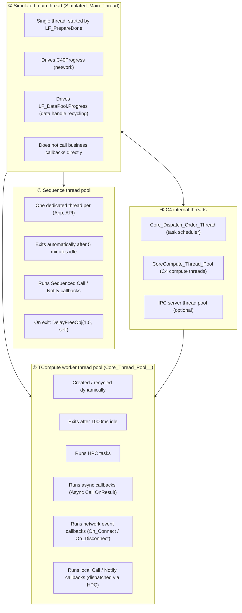

### 1.2 The simulated main thread (`Simulated_Main_Thread`)

**Identity**: the **single main thread** created by `LF_PrepareDone`. **Started only once per process.**

**Source location**: the `Simulated_Main_Thread` procedure in `Z.LingoFuse_Export.pas`.

**Main loop**:

```pascal
if Init_Succeeded then
  while Simulated_Main_Thread_Running do
    begin
      C40Progress(if_(LF_RunningCount.V > 0, 1, 10));  // ① network
      try
          LF_DataPool.Progress();                       // ② data pool scan
      except
      end;
    end;
```

**Responsibility list**:

| Responsibility | Driven by | Notes |
|------|---------|------|
| C4 network send / receive | `C40Progress` | Handles all C4 commands |
| Timer callbacks | `C40Progress` (internal `Timer_Event_Pool__.Progress`) | `TLF_App`'s `DoTimer` also goes through here |
| Data handle scan | `LF_DataPool.Progress` | Scans once every 5 seconds |
| Timeout recycling | `LF_DataPool.Progress` | Recycles after 10 minutes idle |
| Draining synchronous callbacks | **Not driven directly** | Requires an external `LF_Sync` (see §6.3) |
| Sequence thread pool management | Not driven | Runs independently inside `TCompute` |

**Key facts**:
- **The simulated main thread does not call any business callback directly** (business callbacks run on worker threads or sequence threads).
- **The simulated main thread does not call `LF_Sync`** (this is an uncertainty point, see Chapter 13).
- **Before exiting, the simulated main thread clears all data handles** (including those created by `LF_CreateData_Permanent`).

**What this means for difficult languages**:
- **Julia**: the simulated main thread is a separate OS thread that Julia cannot see directly. Callbacks never execute here.
- **Erlang**: the simulated main thread is an OS thread outside the BEAM VM (started through a NIF). A NIF calling `LF_PrepareDone` will **block the BEAM scheduler thread that invoked it** until initialisation completes or times out. **Use a dirty scheduler or an `enif_send` callback.**
- **R**: the simulated main thread is a separate OS thread inside the R process. R's main thread (the thread running `main()`) is where R code executes. **The two are different** — callbacks must be marshalled back to the main R thread (see §8.3).

### 1.3 The TCompute worker thread pool

**Identity**: C4's core thread pool, handling all CPU-intensive or asynchronous tasks.

**Source location**: `Z.Core.ComputeThread.inc` (the `TCompute` class).

**Creation policy**:
- Initial thread count: `if_(IsDebuging, 2, CpuCount * 2)`.
- Upper limit (when `LimitMaxParallelThread` is enabled): `8`.
- **Dynamic creation**: when a task arrives and no worker is idle, a new thread is created.
- **Idle timeout**: exits after `Core_Thread_Life_Time_Tick__` idle time (default 1000ms).

**Tasks executed by worker threads**:

| Task type | Triggered by | Callback execution context |
|---------|--------|----------------|
| HPC tasks | `RunHPC_*` | Worker thread |
| Async Call `OnResult` | `TCompute.RunM_NP(Do_Th)` | Worker thread |
| Network events `On_Connect` / `On_Disconnect` | `TCompute.RunC(Do_LF_Network_Connect_Worker)` | Worker thread |
| Local Call / Notify callbacks | Inside `RunHPC_*` | Worker thread |
| Server-side Call / Notify callbacks | Inside `RunHPC_*` | Worker thread |

**Key facts**:
- **Worker threads are operating-system threads**, not green threads.
- **Worker threads are created and recycled dynamically**: the same task is not guaranteed to land on the same thread.
- **Worker threads hold no Julia / Erlang / R runtime state**: they cannot call code in those languages directly.

**What this means for difficult languages**:
- **Julia**: calling Julia code directly from a worker thread corrupts Julia's GC and task scheduling. **It must be marshalled back to the Julia main task.**
- **Erlang**: calling a NIF directly from a worker thread blocks that worker; if the worker were a BEAM scheduler thread (impossible, since C4 worker threads are created independently), it would drag the scheduler down. **Use `enif_send`.**
- **R**: calling the R API directly from a worker thread **crashes immediately** (R is not thread-safe). **It must be marshalled back to the main R thread.**

### 1.4 The sequence thread pool

**Identity**: a dedicated thread pool providing FIFO guarantees for each `(App, API)` pair.

**Source location**: `TLF_Call_Sequence_Thread_Pool` and `TLF_Notify_Sequence_Thread_Pool` in `Z.LingoFuse_Core.pas`.

**Structure**:

| Class | Purpose |
|----|------|
| `TLF_Call_Sequence_Thread` | Handles `Sequenced_Call` / `Async_Sequenced_Call` |
| `TLF_Notify_Sequence_Thread` | Handles `Sequenced_Notify` |

**Key format**: `'AppName.ApiName'` (concatenated inside `Post_Call2` / `Post_Notify2`).

**Execution flow**:

```pascal
procedure TLF_Call_Sequence_Thread.Do_Run_Th;
var tmp: TCall_Queue_Tool; tk: TTimeTick;
begin
  tmp := TCall_Queue_Tool.Create;
  tk := GetTimeTick();
  while Activted do
  begin
    Critical.Lock;
    if Queue_Tool.Num > 0 then tmp.SwapInstance(Queue_Tool);
    Critical.UnLock;
    if tmp.Num > 0 then
    begin
      // execute the queued tasks one by one
      repeat
        Result_M64 := tmp.First^.Data.APP.Engine.Execute_Call(tmp.First^.Data.Param_);
        if Assigned(tmp.First^.Data.OnResult) then
            tmp.First^.Data.OnResult(Result_M64);
        DisposeObjectAndNil(Result_M64);
        DisposeObjectAndNil(tmp.First^.Data.Param_);
        tmp.Next;
      until (tmp.Num <= 0) or (not Activted);
      tk := GetTimeTick();
    end
    else
    begin
      TCompute.Sleep(10);
      if GetTimeTick() - tk >= C_Tick_Minute * 5 then
          Activted := False;    // exits after 5 minutes idle
    end;
  end;
  // cleanup
  if (Internal_Queue_Data___ <> nil) and (Internal_Queue_Pool___ <> nil) then
  begin
    Internal_Queue_Pool___.Lock;
    try Internal_Queue_Pool___.Remove(Internal_Queue_Data___);
    finally Internal_Queue_Pool___.UnLock; end;
  end;
  DelayFreeObj(1.0, self);   // ★ source says 1.0 second, not 5 seconds
end;
```

**Key facts**:
- **Sequence threads are also TCompute threads** (created through `TCompute.RunM_NP(Do_Run_Th, ...)`).
- **Each `(App, API)` pair owns one dedicated thread**.
- **Exits automatically after 5 minutes idle**.
- **Released 1 second after exit** (giving TCompute a window to write `IsRunning` / `IsExit`). **Note: the v3.2 document wrongly says 5 seconds; the source says 1 second.**

**What this means for difficult languages**:
- **Julia**: sequence threads are OS threads too, and equally cannot call Julia directly.
- **Erlang**: sequence threads live outside the BEAM and equally should use `enif_send`.
- **R**: sequence threads are not the main R thread and must be marshalled.

### 1.5 The relationship between threads and Julia

**Julia's thread model**:
- Julia has `Threads.nthreads()` OS threads (1 by default, set with `-t N` or `JULIA_NUM_THREADS`).
- Each OS thread has a local task queue; tasks are green threads scheduled onto OS threads.
- **Julia's GC has thread affinity**: calling Julia code from an arbitrary thread requires `jl_adopt_thread` (C API) or a `@ccallable` context.

**LingoFuse threads vs Julia threads**:

| LingoFuse thread | Is it a Julia thread? | Can it call Julia code directly? |
|---------------|:--------------:|:--------------------:|
| Simulated main thread | ❌ (created on the Pascal side) | ❌ requires `jl_adopt_thread` |
| TCompute worker thread | ❌ | ❌ requires `jl_adopt_thread` |
| Sequence thread | ❌ | ❌ requires `jl_adopt_thread` |
| C4 internal thread | ❌ | ❌ requires `jl_adopt_thread` |
| Julia's own threads | ✅ | ✅ |

**Conclusion**: **LingoFuse callbacks execute on non-Julia threads.** Julia integrators should:

1. Inside `On_Call` / `On_Notify` callbacks **only read Input** (binary-safe) and **not execute Julia code directly**.
2. Marshal results back to a Julia task through **`Base.Threads.@spawn`** or **`@async`**.
3. Or use **`jl_adopt_thread`** (C API) to temporarily bind the current OS thread to Julia.

**See §8.1 for the detailed integration guide**.

### 1.6 The relationship between threads and Erlang

**Erlang's thread model**:
- The BEAM VM has N scheduler threads (default `N = number of CPU cores`).
- Each scheduler thread is an OS thread.
- **A NIF runs on the scheduler thread that invoked it**. A blocking NIF drags that scheduler down.
- **A crashing NIF takes down the entire BEAM VM**.

**LingoFuse threads vs BEAM schedulers**:

| LingoFuse thread | Is it a BEAM scheduler? | Can it call Erlang code directly? |
|---------------|:--------------:|:--------------------:|
| Simulated main thread | ❌ (created on the Pascal side) | ❌ requires `enif_send` |
| TCompute worker thread | ❌ | ❌ requires `enif_send` |
| Sequence thread | ❌ | ❌ requires `enif_send` |
| C4 internal thread | ❌ | ❌ requires `enif_send` |
| BEAM scheduler thread | ✅ | ✅ |

**Conclusion**: **LingoFuse callbacks execute on non-BEAM threads.** Erlang integrators should:

1. Inside `On_Call` / `On_Notify` callbacks **only read Input** and **not execute Erlang code directly**.
2. Send messages to target processes through **`enif_send`** or **`enif_whereis_pid`**.
3. When initiating LingoFuse calls from the BEAM side, **use a dirty NIF or `enif_thread`** and do not block the scheduler.

**See §8.2 for the detailed integration guide**.

### 1.7 The relationship between threads and R

**R's thread model**:
- **R is strictly single-threaded**.
- **All R code must execute on the main R thread (the thread running `main()`)**.
- **The R API is not thread-safe**.
- **R's GC is not thread-safe**.

**LingoFuse threads vs the main R thread**:

| LingoFuse thread | Is it the main R thread? | Can it call the R API directly? |
|---------------|:------------:|:----------------:|
| Simulated main thread | ❌ (created on the Pascal side) | ❌ crashes |
| TCompute worker thread | ❌ | ❌ crashes |
| Sequence thread | ❌ | ❌ crashes |
| C4 internal thread | ❌ | ❌ crashes |
| Main R thread | ✅ | ✅ |

**Conclusion**: **LingoFuse callbacks execute on non-R-main threads.** R integrators should:

1. Inside `On_Call` / `On_Notify` callbacks **only read Input** and **not call the R API directly**.
2. Pass results to the main R thread through a **thread-safe queue**.
3. **Actively poll the queue** on the main R thread (through the `later` package / the `httpuv` event loop / a custom C extension).
4. Or use **`R_ToplevelExec`** together with a lock.

**See §8.3 for the detailed integration guide**.

### 1.8 Thread lifecycle timeline

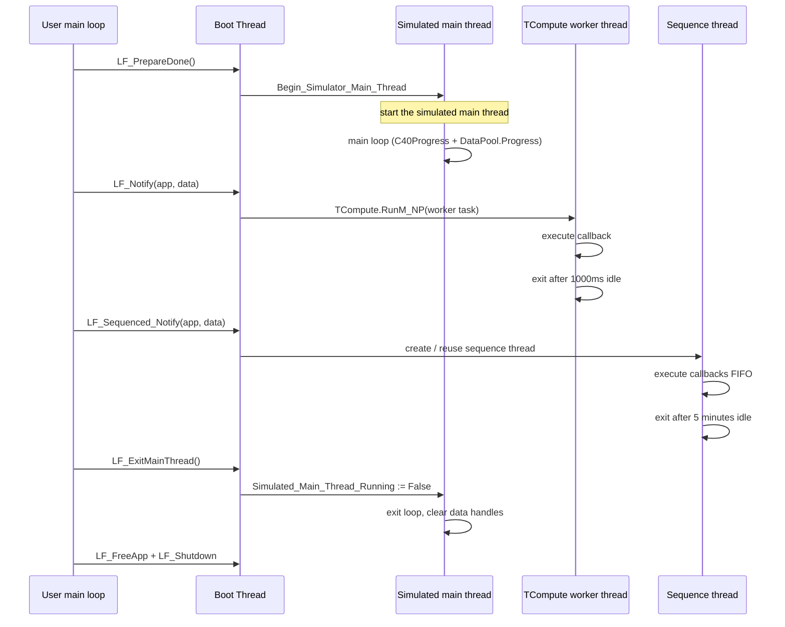

---

## Chapter 2 Callback execution context (core)

> **This is the most important chapter of this knowledge base**. Julia / Erlang / R integrators must know clearly **on which thread each kind of callback executes, which locks are held or not held, what can and cannot be done, and where the P2P identity comes from**.

### 2.1 Overview of the six kinds of callbacks

| Callback type | Registration | Executing thread | Holds locks? | Can it call LF_Call? |
|---------|---------|---------|:--------:|:--------------:|
| **Call callback** | `LF_RegisterCall*` | TCompute worker thread | No | ❌ |
| **Notify callback** | `LF_RegisterNotify*` | TCompute worker thread | No | ❌ |
| **Synchronous Call callback** | `LF_RegisterSyncCall_M/P` | **Main thread** (needs `LF_Sync`) | No | ✅ (on the main thread) |
| **Async Call OnResult** | the `OnResult` of `LF_Async_Call*` | TCompute worker thread | No | ❌ |
| **Network event callback** | `LF_Set_Network_Event` | TCompute worker thread | No | ❌ |
| **Sequenced Call/Notify callback** | `LF_Sequenced_*` / `LF_Async_Sequenced_Call` | Dedicated sequence thread | No | ❌ |

### 2.2 The exact execution context of a Call callback

**Execution chain** (taking a local Call as the example):

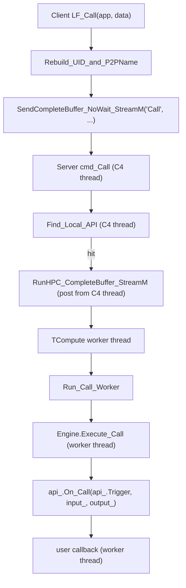

**Key facts**:

| Dimension | Value |
|------|-----|
| **Executing thread** | **TCompute worker thread** (OS thread) |
| **Holds a LingoFuse internal lock?** | ❌ No (`Execute_Call` maintains an `LF_RunningCount` counter internally, but that is an atomic operation) |
| **Holds a C4 lock?** | ❌ No (released before HPC dispatch) |
| **Can it call `LF_Call`?** | ❌ **Forbidden** (it self-deadlocks, see `LF-CB-002`) |
| **Can it call `LF_LocalCall`?** | ❌ **Forbidden** |
| **Can it call `LF_Notify`?** | ❌ **Forbidden** |
| **Can it call `LF_Shutdown`?** | ❌ **Forbidden** |
| **Can it block (Sleep / IO)?** | ⚠️ Not recommended (it occupies a worker thread) |
| **Can it touch the UI directly?** | ❌ **Forbidden** (not the main thread) |
| **Can it read the P2P identity from `Input`?** | ✅ Allowed (`LF_Get_P2P_UID(Input)` returns a `PP2P_UID___` pointer that the framework releases about 5 seconds later; `LF_Get_P2P_NameEx(Input)` returns a string and is safe. **`Input` only**, see §2.9) |
| **Can it write to `Output`?** | ✅ Allowed |
| **Can it Free `Input` / `Output`?** | ❌ **Forbidden** (managed by the framework) |

**Key source code** (`TLF_Engine.Execute_Call`):

```pascal
function TLF_Engine.Execute_Call(Memory_Param: TMem64): TMem64;
begin
  LF_RunningCount.UnLock(LF_RunningCount.LockP^ + 1);   // atomic counter
  input_ := TLF_Data.New_Param_From(Memory_Param, False);
  output_ := TLF_Data.New_Result(False);
  Result := TMem64.Create;
  try
    api_ := LF_MethodPool.Get_Default_Value(input_.Data_Param.apiName, nil);
    if api_ = nil then begin DoStatus('no found api "%s"', [...]); exit; end;
    bak_input_ := input_^;      // back up
    bak_output_ := output_^;
    case api_.Mode of
      LF_Call__:
        try
          if Assigned(api_.On_Call) then
          begin
            api_.On_Call(api_.Trigger, input_, output_);   // ← user callback
            input_^ := bak_input_;      // restore (in case the user changed pointers)
            output_^ := bak_output_;
          end;
        except
          DoStatus('execute call-mode api "%s" (stdcall) execpet!', [...]);
          input_^ := bak_input_;
          output_^ := bak_output_;
        end;
      ...
    end;
  finally
    Result.SwapInstance(output_.Data_Result);
    TLF_Data.Free_Data(input_);
    TLF_Data.Free_Data(output_);
    LF_RunningCount.UnLock(LF_RunningCount.LockP^ - 1);
  end;
end;
```

**Key observations**:
- **No LingoFuse lock is held during the callback** (`LF_MethodPool.Get_Default_Value` takes a lock internally, but it has already been released).
- **Callback exceptions are swallowed** (the `except` branch prints a log and does not propagate).
- **After the callback returns, the framework restores the `input_` / `output_` pointers** (so a mistake by the user cannot corrupt them).

### 2.3 The exact execution context of a Notify callback

**Execution chain** (taking a local Notify as the example):

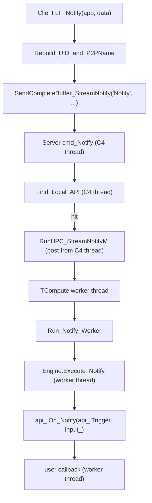

**Key facts**:

| Dimension | Value |
|------|-----|
| **Executing thread** | **TCompute worker thread** |
| **Holds a LingoFuse internal lock?** | ❌ No |
| **Can it call `LF_Call` / `LF_Notify` / `LF_LocalCall`?** | ❌ **Forbidden** |
| **Callback signature** | `procedure(Trigger: Pointer; Input: TDataHnd)` **no Output** |
| **Callback exceptions** | Swallowed (prints `'execute notify-mode api "%s" execpet!'`) |
| **Can it read the P2P identity from `Input`?** | ✅ Allowed (**`Input` only**, see §2.9) |

### 2.4 How a Call callback interacts with Julia

**Problem**: Julia's GC and task scheduling depend on thread affinity. Calling Julia directly from a TCompute worker thread corrupts the GC.

**Solution A**: **`Base.@ccallable` + `jl_adopt_thread`**

```julia
# Julia side
function my_callback(trigger::Ptr{Cvoid}, input::Ptr{Cvoid}, output::Ptr{Cvoid})::Cvoid
    # This function may be called on any thread
    # If you need to touch the Julia heap, you must adopt first
    # In practice Julia handles thread binding for @ccallable automatically
    # but for long-running work an explicit adopt is recommended

    # The P2P identity can only be read from the input side ("side data"); it cannot
    # be read from a self-built handle or from output;
    # the underlying LF_Get_P2P_UID returns a pointer, and the wrapper layer should
    # dereference and copy it into a Julia-side NTuple{32,UInt8} or Vector{UInt8}
    # immediately — never expose a raw pointer to the GC.
    uid = get_p2p_uid_copy(input)     # internally: uid_ptr = LF_Get_P2P_UID(input); uid = uid_ptr[]
    p2p = get_p2p_name_copy(input)    # internally: pointer → String copy

    # Read Input / write Output only; do not call GC-sensitive Julia APIs
    a = read_int32(input)
    b = read_int32(input)
    write_int32(output, a + b)
end

# registration
@ccallable function ... end  # or pass through C_NULL
```

**Solution B**: **Marshal back to the main task (recommended)**

```julia
const callback_queue = Channel{Tuple{Ptr{Cvoid}, Ptr{Cvoid}}}(1000)

function my_callback(trigger, input, output)::Cvoid
    # Only enqueue the pointers and return immediately
    # Note: Input / Output become invalid after the callback returns!
    # the data must be copied out first
    data = read_all_input(input)
    put!(callback_queue, (trigger, data, output))
    # but output still has to be written back... this gets complicated
end

# main task loop
@async begin
    while true
        (trigger, data, output) = take!(callback_queue)
        # process on the main task
        result = process(data)
        write_output(output, result)
    end
end
```

**⚠️ Key pitfall**: **Input / Output become invalid immediately after the callback returns**. So **you cannot simply enqueue the pointers** — the data **must be copied first**. And Output has to be written back, so **the Output write must be completed inside the callback**.

**Recommended pattern**:

```julia
function my_callback(trigger, input, output)::Cvoid
    # ① read Input (safe)
    data = read_input_bytes(input)   # copy onto the Julia side

    # ② compute (on the callback thread; avoid blocking for too long)
    result = compute(data)

    # ③ write Output (safe, completed before the callback returns)
    write_output_bytes(output, result)

    # ④ if async work is needed, notify the main task through a Channel
    if need_async then
        put!(async_queue, result)
    end
end
```

### 2.5 How a Call callback interacts with Erlang

**Problem**: a NIF runs on a BEAM scheduler thread and cannot call Erlang code from an arbitrary OS thread.

**Solution**: **`enif_send` + `enif_whereis_pid`**

```c
// C NIF side (or Rust NIF side)
ERL_NIF_TERM my_callback(ErlNifEnv* env, int argc, const ERL_NIF_TERM argv[]) {
    // This NIF is invoked by LingoFuse from an arbitrary OS thread
    // Note: env may be NULL, because we are not on a BEAM scheduler

    // Extract UID / P2PName from Input (using the LingoFuse API)
    // valid only on input ("side data");
    // LF_Get_P2P_UID returns a PP2P_UID___ pointer (not a value), released by the framework after about 5 seconds;
    // copy immediately, do not keep the pointer, do not free it manually.
    PP2P_UID___ uid_ptr = LF_Get_P2P_UID(input);
    TP2P_UID uid;
    if (uid_ptr != NULL) {
        uid = *uid_ptr;               // dereference and copy immediately
    } else {
        memset(&uid, 0, sizeof(uid));
    }
    const char* p2p_name = LF_Get_P2P_Name(input);   // invalid after 5 seconds, must copy immediately

    // build the message
    ERL_NIF_TERM msg = enif_make_tuple2(env,
        enif_make_atom(env, "lf_callback"),
        enif_make_string(env, p2p_name, ERL_NIF_LATIN1));

    // send to the registered process
    ErlNifPid pid;
    if (enif_whereis_pid(env, enif_make_atom(env, "my_lf_handler"), &pid)) {
        enif_send(NULL, &pid, NULL, msg);   // NULL env = send from a non-BEAM thread
    }

    return enif_make_atom(env, "ok");
}
```

**⚠️ Key pitfalls**:
- **Only `enif_send(NULL, ...)` can send from a non-BEAM thread**.
- **Never execute Erlang code directly from a LingoFuse callback** (the BEAM will crash).
- **A NIF must return quickly**: LingoFuse callbacks run on TCompute worker threads, and long blocking occupies a worker.
- **`LF_Get_P2P_UID` / `LF_Get_P2P_Name` may only be called on the `input` parameter** (see §2.9).

### 2.6 How a Call callback interacts with R

**Problem**: R is strictly single-threaded. Calling the R API directly from a TCompute worker thread crashes.

**Solution**: **thread-safe queue + polling from the main R thread**

```c
// C side (R extension)
static pthread_mutex_t queue_mutex = PTHREAD_MUTEX_INITIALIZER;
static void* callback_queue[1024];
static int queue_head = 0, queue_tail = 0;

// LingoFuse callback (executes on a TCompute worker thread)
void my_callback(void* trigger, void* input, void* output) {
    // ① read Input (no R API calls)
    // Note: the P2P identity may only be read on input;
    // the underlying call returns a pointer, which must be dereferenced and copied
    // to heap memory inside the callback before handing it to the queue.
    // ... extract data ...

    // ② enqueue (thread-safe)
    pthread_mutex_lock(&queue_mutex);
    callback_queue[queue_tail] = data;
    queue_tail = (queue_tail + 1) % 1024;
    pthread_mutex_unlock(&queue_mutex);

    // ③ write Output (if no R computation is needed, write directly)
    // ...
}

// polling from the main R thread (via the later package or a custom event loop)
SEXP poll_callbacks() {
    SEXP result = PROTECT(allocVector(VECSXP, 0));

    pthread_mutex_lock(&queue_mutex);
    while (queue_head != queue_tail) {
        void* data = callback_queue[queue_head];
        queue_head = (queue_head + 1) % 1024;
        pthread_mutex_unlock(&queue_mutex);

        // execute R code on the main thread
        SEXP r_data = convert_to_R(data);
        SEXP r_result = call_r_function(r_data);
        // ... handle the result ...

        pthread_mutex_lock(&queue_mutex);
    }
    pthread_mutex_unlock(&queue_mutex);

    UNPROTECT(1);
    return result;
}
```

**⚠️ Key pitfalls**:
- **No R API may be called inside the callback** (including `Rf_allocVector`, `PROTECT`).
- **R's GC must not be used inside the callback**.
- **The shared queue must be protected with a pthread lock**.
- **The main R thread must poll actively** (it cannot wait for the callback).
- **The pointers returned by `LF_Get_P2P_UID` / `LF_Get_P2P_Name` become invalid after the callback returns; they must be copied inside the callback**.

**⚠️ But writing Output back is a problem**: if Output needs the result of an R computation, you must **synchronously wait** inside the callback for the main R thread — which can deadlock (if the main R thread is also waiting on a LingoFuse callback).

**Recommended pattern**:

```c
// Approach: read Input inside the callback only, and write synchronous results to Output
// If asynchronous R computation is unavoidable, use two phases:
//   phase 1: inside the callback write Output = "processing" and record a task_id
//   phase 2: when the main R thread finishes, notify through an LF_Call callback

void my_callback(void* trigger, void* input, void* output) {
    // ① read Input
    // ② generate a task_id
    // ③ enqueue the task
    // ④ immediately write Output = "accepted, task_id=..."
    // ⑤ when the main R thread finishes, notify the original caller through LF_Notify
}
```

**See §8.3 for detailed R integration**.

### 2.7 Callback exception handling

**All callbacks are wrapped in `try...except` as a whole**:

| Callback type | Exception handling | Log |
|---------|---------|------|
| Call callback | `try...except` swallows | `'execute call-mode api "%s" (stdcall) execpet!'` |
| Notify callback | `try...except` swallows | `'execute notify-mode api "%s" (stdcall) execpet!'` |
| Async Call `OnResult` | `try...except` swallows | `'TLF_Async_Call_Bridge.Do_Th exception: %s: %s'` |
| Network events | `try...except` swallows | none |
| Sequenced callbacks | `try...except` swallows | none |

**Key point**: **callback exceptions do not propagate**. This means:
- Julia / Erlang / R **cannot recover from an exception** — the Pascal side swallowed it.
- **You must check the callback's return value or status explicitly** (if the protocol allows).
- **Recommendation**: write errors into Output inside the callback (Call mode), or report them through logs.

### 2.8 The handle ownership model (★ core)

> **This is the second most important section of this knowledge base**. Every cross-language integrator must understand: **the ownership of handles returned by the synchronous family and the asynchronous family are exactly opposite**. Both families have identical function signatures, return types and appearance — but opposite contracts.

#### 2.8.1 Handle ownership of the two call families

The LingoFuse C ABI has **two call families**:

| Family | Functions | Owner of the returned handle | How it is released |
|------|------|:-------------------:|---------|
| **Synchronous family** | `LF_Call` / `LF_UID_Call` / `LF_P2PNAME_Call` | **Caller** | The caller explicitly calls `LF_FreeData` |
| **Asynchronous family** | `LF_Async_Call` / `LF_UID_Async_Call` / `LF_P2PNAME_Async_Call` | **Framework** | Released by the framework **immediately** after the callback returns |

**Source evidence**:

**Synchronous family** (`Z.LingoFuse_Export.pas`):

```pascal
function LF_Call(appName: pansichar; Param: TDataHnd___; Timeout_: uint64): TDataHnd___;
begin
  ...
  Output := Cli.Wait_Execute_Call(...);
  ...
  // ← auto_recycle = True, the caller owns it
  Result := TLF_Data.New_Result_From(Output, True);
  ...
end;
```

**Asynchronous family** (`TLF_Async_Call_Bridge.Do_Th` in `Z.Net.C4.LingoFuse.pas`):

```pascal
procedure TLF_Async_Call_Bridge.Do_Th;
var
  result_param_: PLF_Data;
begin
  // ← auto_recycle = False, the framework owns it
  result_param_ := TLF_Data.New_Result_From(Result_M64.Swap_To_New_Instance, False);
  try
    if Assigned(OnResult) then
      OnResult(Data_, result_param_);  // ← the callback receives the pointer
  except
  end;
  // ← released immediately! Not "about 1 second later", not "delayed" — immediately.
  TLF_Data.Free_Data(result_param_);
  DelayFreeObj(1.0, Self);
end;
```

**Key difference**:

- `New_Result_From(..., True)` → `auto_recycle = True` → `LF_FreeData` is only a mark; **the real release is deferred to the pool scan**.
- `New_Result_From(..., False)` → `auto_recycle = False` → `LF_FreeData` **releases synchronously and immediately**.

#### 2.8.2 The "moment of death" of an async-family handle

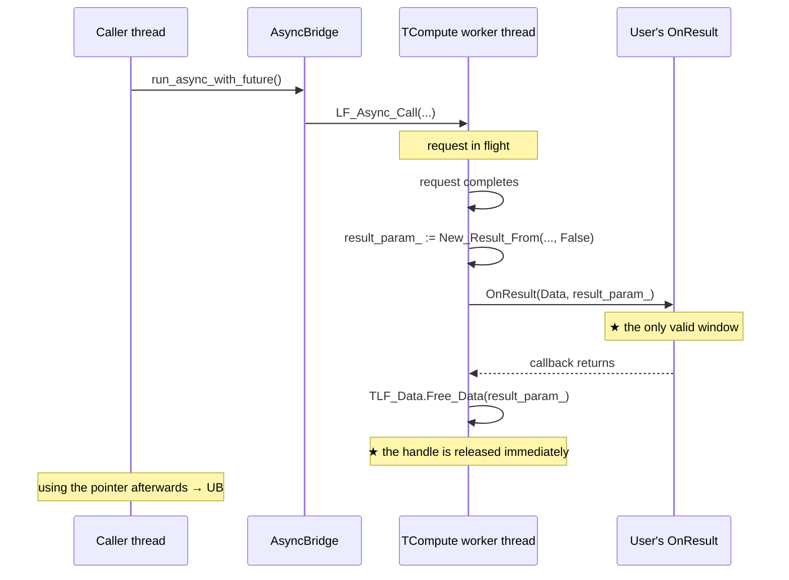

**Contract**:

- After the callback returns, the handle **becomes invalid immediately**.
- Using that handle outside the callback is **undefined behaviour** (use-after-free).
- Calling `LF_FreeData` on it is a **double free**.

#### 2.8.3 Why breaking the contract "sometimes works, sometimes fails"

**Root cause**: `Free_Data` is **pooled recycling**:

```pascal
class procedure TLF_Data.Free_Data___(hnd: PLF_Data);
begin
  hnd^.Data_Info := '';
  DisposeObjectAndNil(hnd^.Data_Param);
  DisposeObjectAndNil(hnd^.Data_Result);   // ← TMem64 is freed
  DisposeObjectAndNil(hnd^.calling___);
  LF_DataMemory.Free_PLF_Data(hnd);        // ← PLF_Data goes back to the pool
end;
```

**How UB manifests depends on**:

- whether the allocator has already reused this piece of memory;
- whether another thread allocated a new `TMem64` at the same moment;
- whether thread scheduling lets the caller thread run only after `Free_Data`.

**Therefore**:

| Payload characteristic | Symptom | Reason |
|-------------|------|------|
| **Small payload** (e.g. returns `int 7`, 2 bytes) | Usually "looks fine" | The allocator has not reused this small block yet |
| **Large payload** (e.g. returns a dict, 17+ bytes) | Usually "empty / garbage" | Much more likely to have been reused |

**⚠️ This is the most commonly misdiagnosed scenario**: a **type dichotomy** such as "`int` vs `dict`" misleads diagnosis. It is not a "type difference"; it is "payload size affects when memory gets reused". **The dichotomy asks the wrong question**.

#### 2.8.4 Correct usage patterns

**Pattern A: synchronous call (recommended for gateway / proxy scenarios)**

```pascal
res_ptr := LF_Call(app, hnd, timeout_ms);
try
  LF_SetPos(res_ptr, 0);            // reset position
  result_bytes := read_string_bytes(res_ptr);
finally
  LF_FreeData(res_ptr);             // ← legitimate, the caller owns it
end;
```

**Pattern B: asynchronous call (everything must be done inside the callback)**

```pascal
procedure OnResult(Data, res_ptr: Pointer); cdecl;
begin
  // ✓ the handle is valid inside this callback
  LF_SetPos(res_ptr, 0);
  data := read_string_bytes(res_ptr);

  // ✓ copy the data out (bytes is a new object)
  my_queue.push(data);

  // ❌ never pass res_ptr outside
  // ❌ never call LF_FreeData(res_ptr)
end;
```

**Pattern C: use a high-level Future wrapper**

Every managed-language binding layer should provide a Future interface that "reads and copies the data inside the callback", so users never touch raw pointers. See each language binding's implementation.

#### 2.8.5 Handle ownership cheat sheet

| Source | Owner | Releaser | Can it cross threads? |
|------|:------:|:------:|:----------:|
| `LF_CreateData` | User | User | ⚠️ needs an external lock |
| `LF_CreateData_Permanent` | User | User | ⚠️ needs an external lock |
| `LF_Call` return | User | User | ✅ yes |
| `LF_UID_Call` return | User | User | ✅ yes |
| `LF_P2PNAME_Call` return | User | User | ✅ yes |
| Inside the `LF_Async_Call` callback | **Framework** | **Framework** | ❌ must not cross threads |
| Inside the `LF_UID_Async_Call` callback | **Framework** | **Framework** | ❌ must not cross threads |
| Inside the `LF_P2PNAME_Async_Call` callback | **Framework** | **Framework** | ❌ must not cross threads |
| `LF_LocalCall` return | User | User | ✅ yes |

#### 2.8.6 What this means for difficult languages

- **Julia**: if the `output` pointer inside a `@cfunction` callback has ownership issues (async scenarios), **the write-back must be completed inside the callback**; the raw pointer cannot be passed to the main task through a `Channel`.
- **Erlang**: if the handle received by a NIF callback comes from the asynchronous family, **all operations must be completed before the NIF returns**; what `enif_send` sends is a **data copy**, not a pointer.
- **R**: same as above — Output must be written inside the callback, or it becomes invalid.
- **All managed languages**: GC languages do not observe the lifetime of C-side pointers. **There are only two safe strategies**:
  1. **Handle everything inside the callback** (read Input / write Output).
  2. **Copy the data out inside the callback** (bytes/array), then process it across threads.

### 2.9 P2P identity side-data semantics (★ core)

> **This is the third most important section of this knowledge base**. `LF_Get_P2P_UID` and `LF_Get_P2P_Name` **do not read the handle's own business data** — they read the **P2P identity metadata the sender writes automatically when sending the request** ("side data"). This metadata exists **only on the input handle of the receiving side**.

#### 2.9.1 Where does the data come from? — the sender-side write mechanism

**Core fact**: **UID and P2PName are written by the sender, not queried by the receiver.**

On the **sending side** (client), when a request is built, the `TC40_LF_Client.Send_*` methods internally call `TMemory_Param_Tool.Rebuild_UID_and_P2PName`:

```pascal
procedure TC40_LF_Client.Send_Execute_Notify(app_Name__: TLF_String; Param: TMem64);
var
  tmp_param: TMem64;
begin
  // ← write FLast_UID and LF_P2P_name.V into the request payload
  tmp_param := TMemory_Param_Tool.Rebuild_UID_and_P2PName(Param, FLast_UID, LF_P2P_name.V);
  try
    // ... local lookup / remote forwarding ...
  finally
    DisposeObject(tmp_param);
  end;
end;
```

**Wire format** (`TMemory_Param_Tool.EncryptToMem`):

```
[apiName: string]
[FromUID: 32 bytes]         ← sender session UID
[FromP2PName: string]       ← sender P2PName
[Param.Size: Int32]
[Param: bytes]              ← business parameters
```

The `Input` handle the **receiving side** (server or peer) receives has `Data_Param.FromUID` / `Data_Param.FromP2PName` set to these two fields written by the sender.

The receiving side reads them through `LF_Get_P2P_UID(Input)` / `LF_Get_P2P_Name(Input)` — that is, it reads "who the sender is", not "what business data this handle itself carries".

#### 2.9.2 Usable only on the "event-triggering callback's `Input` parameter"

**These two functions are valid only on the input handle received from a network or local call**:

| Position | Valid? | Reason |
|------|:--------:|------|
| `Input` of `On_Call(Trigger, Input, Output)` | ✅ | Received from the network, carries sender metadata |
| `Input` of `On_Notify(Trigger, Input)` | ✅ | Same as above |
| `Input` of `LF_LocalCall` / `LF_LocalNotify` callbacks | ✅ | Local calls also pass through `Rebuild_UID_and_P2PName` injection |
| `Result_` of `OnResult(Data, Result_)` | ❌ | This is an **output handle**, only `Data_Result`, no `Data_Param` |
| A handle you created with `LF_CreateData` | ❌ | There is no "sender"; `FromUID` is `Null_UID()` and `FromP2PName` is empty |
| A handle created by `LF_CreateData_Permanent` | ❌ | Same as above |

**Behaviour when called on an output handle or a self-built handle** (source `TLF_Data.Get_P2P_UID`):

```pascal
function TLF_Data.Get_P2P_UID(): TUID___;
begin
  if Data_Param <> nil then
      Result := Data_Param.FromUID
  else
    begin
      DoStatus('[warning] Get_P2P_UID(): P2P Info only backcall "input" parameter.');
      Result := Null_UID();
    end;
end;
```

- **Returns `Null_UID()`** (all zeros).
- **Prints a warning**: `[warning] Get_P2P_UID(): P2P Info only backcall "input" parameter.`
- **`LF_Get_P2P_Name` behaves the same** (empty string + warning).

#### 2.9.3 Return types (v4.0 erratum)

**The return value of `LF_Get_P2P_UID`** (from `Z.LingoFuse_Export.pas`):

```pascal
function LF_Get_P2P_UID(Hnd: TDataHnd___): PP2P_UID___;
begin
  New(Result);                                  // ← allocate a pointer
  if (Hnd <> nil) and (PLF_Data(Hnd)^.Data_Param <> nil) then
      Result^ := PLF_Data(Hnd)^.Get_P2P_UID()   // ← copy from Data_Param.FromUID
  else Result^ := Null_UID();
  DelayFreeMem(5.0, Result);                    // ← auto-released after 5 seconds
end;
```

**Return type**: **`PP2P_UID___` (a pointer to `TUID___`)**, not a value.

**Caller contract** (Pascal side):

```pascal
var
  UID: TP2P_UID___;
  UIDPtr: PP2P_UID___;
begin
  UIDPtr := LF_Get_P2P_UID(Input);    // returns a pointer
  if UIDPtr <> nil then
      UID := UIDPtr^;                 // dereference and copy immediately
  // do not free UIDPtr manually; the framework releases it after about 5 seconds
  // do not keep UIDPtr long-term
end;
```

**`LF_Get_P2P_Name`** (unchanged):

```pascal
function LF_Get_P2P_Name(Hnd: TDataHnd___): pansichar;
var
  tmp: TLF_String;
begin
  tmp := '';
  if (Hnd <> nil) and (PLF_Data(Hnd)^.Data_Param <> nil) then
      tmp := PLF_Data(Hnd)^.Get_P2P_Name();
  Result := tmp.BuildUTF8AnsiChar();        // ← returns a UTF-8 pointer
  Z.Notify.DelayFreeMem(5.0, Result);        // ← auto-released after 5 seconds
end;
```

#### 2.9.4 Correct usage (Pascal / C / various languages)

**Pascal side**:

```pascal
procedure MyCallback(Trigger: Pointer; Input, Output: TDataHnd); cdecl;
var
  UID: TP2P_UID___;
  UIDPtr: PP2P_UID___;
  Name: string;
begin
  // ✅ read the P2P identity from Input ("side data")
  UIDPtr := LF_Get_P2P_UID(Input);
  if UIDPtr <> nil then
      UID := UIDPtr^;              // copy immediately
  Name := LF_Get_P2P_NameEx(Input); // copy into a string immediately

  // ✅ use it
  // ...

  // ❌ don't: LF_Get_P2P_UID(Output)     ← the output handle has no P2P identity
  // ❌ don't: LF_Get_P2P_UID(MyOwnHandle) ← a self-built handle has no P2P identity
end;
```

**C side**:

```c
void __cdecl my_callback(void* trigger, void* input, void* output) {
    // ✅ read the P2P identity from input
    PP2P_UID___ uid_ptr = LF_Get_P2P_UID(input);
    uint8_t uid[32];
    if (uid_ptr != NULL) {
        memcpy(uid, uid_ptr, 32);    // copy immediately
    } else {
        memset(uid, 0, 32);
    }
    const char* name_ptr = LF_Get_P2P_Name(input);
    char name_copy[256];
    if (name_ptr != NULL) {
        strncpy(name_copy, name_ptr, sizeof(name_copy) - 1);
        name_copy[sizeof(name_copy) - 1] = '\0';
    }

    // ❌ don't: LF_Get_P2P_UID(output)     ← output handle
    // ❌ don't: LF_Get_P2P_UID(my_own)     ← self-built handle
}
```

**Julia side**:

```julia
function my_callback(trigger, input, output)::Cvoid
    # ✅ read the P2P identity from input
    uid_ptr = ccall(LF_Get_P2P_UID, Ptr{UInt8}, (Ptr{Cvoid},), input)
    uid = uid_ptr == C_NULL ? zeros(UInt8, 32) : copy(unsafe_wrap(Array, uid_ptr, 32))
    # do not keep uid_ptr; do not free it manually (the framework releases it after 5 seconds)

    name_ptr = ccall(LF_Get_P2P_Name, Cstring, (Ptr{Cvoid},), input)
    name = name_ptr == C_NULL ? "" : unsafe_string(name_ptr)
    # do not keep name_ptr; do not free it manually
end
```

**Erlang NIF side**:

```c
static void __cdecl my_callback(void* trigger, void* input, void* output) {
    // ✅ read the P2P identity from input
    PP2P_UID___ uid_ptr = LF_Get_P2P_UID(input);
    TP2P_UID uid;
    if (uid_ptr != NULL) {
        uid = *uid_ptr;              // dereference and copy immediately
    } else {
        memset(&uid, 0, sizeof(uid));
    }
    const char* p2p_name = LF_Get_P2P_Name(input);   // a pointer, invalid after 5 seconds
    // ... send the copy away with enif_send ...
}
```

**R side**:

```c
void __cdecl my_callback(void* trigger, void* input, void* output) {
    // ✅ read the P2P identity from input
    PP2P_UID___ uid_ptr = LF_Get_P2P_UID(input);
    uint8_t uid[32];
    if (uid_ptr != NULL) {
        memcpy(uid, uid_ptr, 32);    // copy immediately
    }
    const char* p2p_name = LF_Get_P2P_Name(input);
    char name_copy[256];
    if (p2p_name != NULL) {
        strncpy(name_copy, p2p_name, sizeof(name_copy) - 1);
        name_copy[sizeof(name_copy) - 1] = '\0';
    }
    // enqueue; do not keep pointers
}
```

#### 2.9.5 What this means for difficult languages

- **Julia**: the pointer returned by `LF_Get_P2P_UID` must not cross a GC boundary; `copy` it into a `Vector{UInt8}` or `NTuple{32,UInt8}` inside the callback before use.
- **Erlang**: inside a NIF, the pointer returned by `LF_Get_P2P_UID` is valid only during this NIF call; what `enif_send` sends is **copied data**.
- **R**: `memcpy` it to heap memory inside the callback before handing it to the main R thread; **do not** enqueue the pointer.
- **All managed languages**: **the P2P identity is "side data"**, **exists only on the input handle**, **is valid only inside the callback**, and **must be copied immediately**.

#### 2.9.6 Coverage cheat sheet

| Command | Does the receiving side have a P2P identity? | Notes |
|------|:----------------------:|------|
| `Notify` / `Sequenced_Notify` | ✅ | All Call / Notify commands are injected |
| `Call` / `Sequenced_Call` | ✅ | Same as above |
| `UID_Notify` / `UID_Call` / `UID_Sequenced_*` | ✅ | Same as above |
| `P2PName_Notify` / `P2PName_Call` / `P2PName_Sequenced_*` | ✅ | Same as above |
| **Local calls** (`LF_LocalCall` / `LF_LocalNotify`) | ✅ | Also pass through `Rebuild_UID_and_P2PName` injection |
| `OnResult` (the async callback's `Result_`) | ❌ | This is an **output handle**, no `Data_Param` |
| A self-built input handle (`LF_CreateData`) | ❌ | There is no "sender" |

---

## Chapter 3 Event flow panorama

### 3.1 Event classification

| Event | Triggered by | Callback | Executing thread |
|------|--------|------|---------|
| **Network Connect** | Server broadcasts API info | `On_Connect` | TCompute worker thread |
| **Network Disconnect** | Physical link dropped | `On_Disconnect` | TCompute worker thread |
| **API change** | `Reg_Call` / `Reg_Notify` / `UnReg` | `TOn_LFUpdate` (subscribers) | Main thread (after 1 second) |
| **UID update** | Client `Update_UID` | Server internal | C4 thread |
| **App info update** | Client `Init_APP_Info` | Server internal | C4 thread |
| **Service API broadcast** | Server `Broadcast_API_Info` | Client internal | C4 thread |
| **Status message** | A `DoStatus` call | Status hook | Caller thread |

### 3.2 The exact trigger chain of network Connect

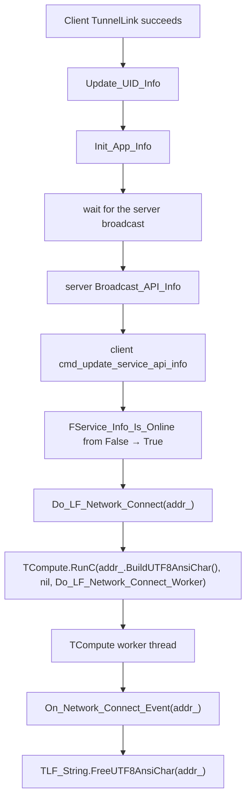

**Key facts**:

| Dimension | Value |
|------|-----|
| **Not a TCP handshake** | It is "the first time the server API broadcast is received" |
| **Executing thread** | TCompute worker thread |
| **`addr_` lifetime** | **Released immediately after the callback returns** |
| **Trigger count** | Once per client per connection (reconnecting triggers it again) |
| **Exception handling** | Swallowed by `try...except` |

### 3.3 The exact trigger chain of network Disconnect

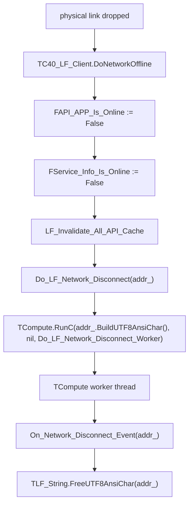

**Key facts**:
- **Executing thread**: TCompute worker thread.
- **`addr_` is released immediately after the callback returns**.
- **`FAPI_APP_Is_Online` and `FService_Info_Is_Online` are already False before the callback**.

### 3.4 The exact trigger chain of an API change event

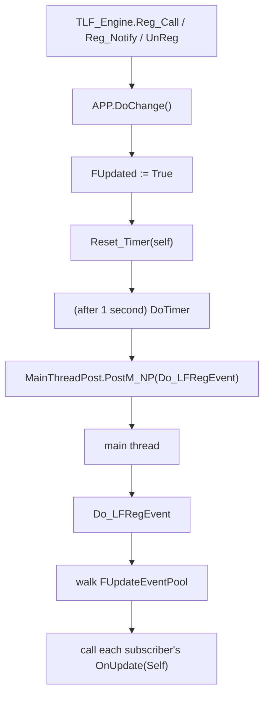

**Key facts**:

| Dimension | Value |
|------|-----|
| **Trigger timing** | 1 second after API registration / unregistration |
| **Executing thread** | **Main thread** (posted through `MainThreadPost`) |
| **How to subscribe** | `TLF_App.Subscribe_Update(Bind, OnUpdate)` |
| **Typical subscriber** | `TC40_LF_Client` (through `Do_APP_Update` / `Do_LF_P2P_APP_Update`) |
| **Exception handling** | Swallowed by `try...except` |

**What this means for difficult languages**:
- **Julia / Erlang / R integrators do not subscribe to this event directly** (unless through a Pascal-side wrapper).
- **This event drives the client's `Init_App_Info`**, which leads to the `update_service_api_info` broadcast.

### 3.5 UID update event

**Trigger chain**:

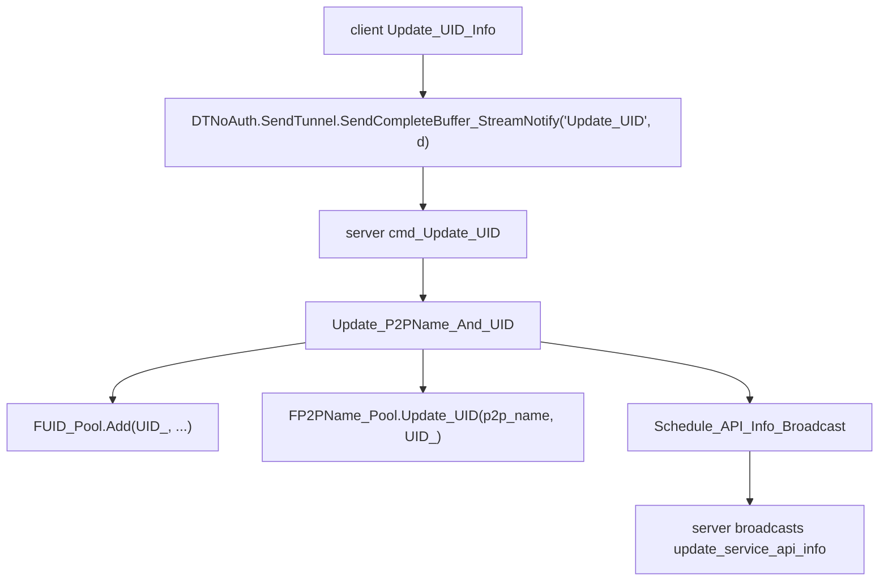

**Key facts**:
- **Executing thread**: C4 thread (server `cmd_Update_UID`).
- **Trigger timing**: after the client's first successful `TunnelLink`, or when P2PName changes.
- **Side effects**: updates the server's `FUID_Pool` and `FP2PName_Pool`.

### 3.6 Status message event

**Trigger chain**:

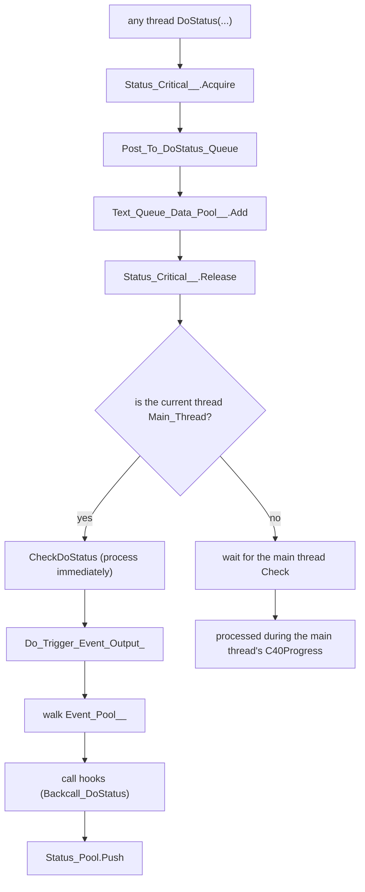

**Key facts**:
- **`DoStatus` is thread-safe** (protected internally by `Status_Critical__`).
- **The main thread processes immediately**; worker threads only enqueue.
- **The status queue is capped at 1000** (`while Status_Pool.Num > 1000 do Status_Pool.Next` inside `Backcall_DoStatus`).

---

## Chapter 4 Status system

### 4.1 The three layers of the status system

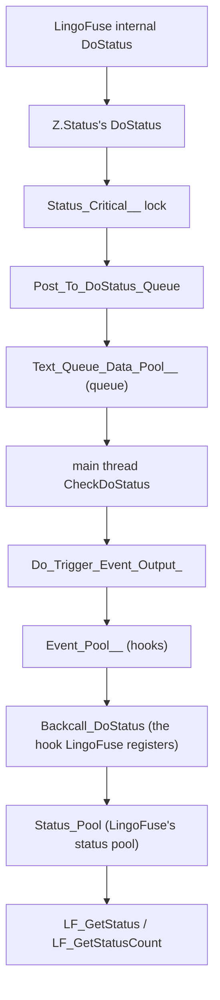

### 4.2 LingoFuse's status pool

**Source location**: `Z.LingoFuse_Export.pas`.

```pascal
type
  TStatus_Buffer = class(TOrderStruct<TBytes>)
  public
    procedure DoFree(var Data: TBytes); override;
  end;

var
  Status_Pool: TStatus_Buffer = nil;
  Status_Lock: TCritical = nil;
  Status_Return_Buffer: array [0 .. $FFFF] of Byte;   // 64KB static buffer
```

**Initialisation** (in the `initialization` section):

```pascal
Status_Pool := TStatus_Buffer.Create;
Status_Lock := TCritical.Create('Status_Lock');
AddDoStatusHookC(Status_Pool, Backcall_DoStatus);
```

**`Backcall_DoStatus`**:

```pascal
procedure Backcall_DoStatus(Text_: SystemString; const ID: Integer);
begin
  Status_Lock.Lock;
  try
    while Status_Pool.Num > 1000 do
        Status_Pool.Next;                              // drop the oldest
    Status_Pool.Push(TPascalString(Text_).UTF8);       // enqueue
  finally
      Status_Lock.UnLock;
  end;
end;
```

**Key facts**:

| Dimension | Value |
|------|-----|
| **Status pool cap** | 1000 entries |
| **Overflow policy** | Drop the oldest |
| **Executing thread** | Main thread (`Do_Trigger_Event_Output_` is called on the main thread) |
| **Storage format** | `TBytes` (UTF-8) |

### 4.3 `LF_GetStatusCount`

```pascal
function LF_GetStatusCount(): Integer;
begin
  Status_Lock.Lock;
  try
      Result := Status_Pool.Num;
  finally
      Status_Lock.UnLock;
  end;
end;
```

**Contract**:
- **Thread-safe**.
- **Returns the current queue length** (0 to 1000).

### 4.4 `LF_GetStatus`

```pascal
function LF_GetStatus(): pansichar;
var L: Integer;
begin
  Result := @Status_Return_Buffer;
  Status_Lock.Lock;
  Status_Return_Buffer[0] := 0;
  Status_Return_Buffer[1] := 0;
  try
    if Status_Pool.Num > 0 then
    begin
      L := length(Status_Pool.First^.Data);
      if L > 0 then
      begin
        CopyPtr(@Status_Pool.First^.Data[0], @Status_Return_Buffer, Min(L, SizeOf(Status_Return_Buffer) - 1));
        Status_Return_Buffer[Min(L, SizeOf(Status_Return_Buffer) - 1)] := 0;
      end;
      Status_Pool.Next;                                // dequeue
    end;
  finally
      Status_Lock.UnLock;
  end;
end;
```

**Contract**:
- **Returns a pointer to a static 64KB buffer**.
- **Overwritten by the next call**.
- **Dequeues**: each call takes one message out and removes it.
- **Truncation**: messages longer than 64KB are truncated.
- **Thread-safe**.

**What this means for difficult languages**:
- **Julia**: the `Ptr{UInt8}` returned by `LF_GetStatus` becomes invalid after the next call. **Copy it into a `String` immediately**.
- **Erlang**: return a `binary` or `string` from the NIF (a copy). Do not return a pointer.
- **R**: copy it immediately with `.Call("Rf_mkString", ...)`.

### 4.5 `LF_PostStatus`

```pascal
procedure LF_PostStatus(status: pansichar);
var s: TLF_String;
begin
  if not Simulator_Main_Thread_Activted then
      DoStatus('LF_PostStatus: Main thread not running; message queued directly. message: %s', [DS(status).Text]);
  s := DS(status);
  Status_Lock.Lock;
  try
      Post_To_DoStatus_Queue(TCompute.CurrentThread, s.Text, 0);
  finally
      Status_Lock.UnLock;
  end;
  s := '';
end;
```

**Contract**:
- **When the main thread is not running**: prints a warning, but **still enqueues** (into `Text_Queue_Data_Pool__`, which eventually reaches `Status_Pool`).
- **When the main thread is running**: enqueues normally.
- **Thread-safe**.
- **Note**: it enqueues into `Text_Queue_Data_Pool__` (Z.Status's queue), not `Status_Pool` (LingoFuse's pool). To get a message readable through `LF_GetStatus`, it must first go through the main thread's `CheckDoStatus`.

### 4.6 Usage pattern of the status system

**Recommendation**:

```pascal
// poll periodically in the main loop
while Running do
begin
  while LF_GetStatusCount() > 0 do
    WriteLn(LF_GetStatus());     // use immediately (the next call overwrites it)
  Sleep(10);
end;
```

**⚠️ Pitfall**:
- The pointer returned by `LF_GetStatus` **becomes invalid on the next call**.
- **It must be copied or used immediately**.

### 4.7 The relationship between status and logs

| System | Purpose | Entry point |
|------|------|------|
| **Status** | User-visible runtime messages | `LF_GetStatus` / `LF_GetStatusCount` / `LF_PostStatus` |
| **Logs** | Developer debugging information | `LF_Debug_Log` (internal) |
| **Console** | Real-time output | `DoStatus` outputs to the console by default (`ConsoleOutput=True`) |

---

## Chapter 5 Logging system

### 5.1 LingoFuse's debug log

**Source location**: `Z.LingoFuse_Export.pas`.

```pascal
function LF_Debug_Log_Enabled: Boolean;
begin
  Result := not C40_QuietMode;
end;

procedure LF_Debug_Log(const Msg: SystemString);
begin
  DoStatus('[LF-DEBUG] ' + Msg);
end;

procedure LF_Debug_Log(const Fmt: SystemString; const Args: array of const);
begin
  DoStatus('[LF-DEBUG] ' + PFormat(Fmt, Args));
end;
```

**Key facts**:
- **`LF_Debug_Log` is an internal function**, not exported in the C ABI.
- **Enabled when**: `C40_QuietMode = False` (the default).
- **Outputs through `DoStatus`**, i.e. through the status system.
- **Prefix `[LF-DEBUG]`**.

**How to enable**:
```pascal
LF.Set_Opt_Quiet(False);   // the default is already False
```

**How to disable**:
```pascal
LF.Set_Opt_Quiet(True);    // disable the debug log
```

### 5.2 Log site inventory

**C4 layer logs** (`Z.Net.C4.LingoFuse.pas`):

| Location | Log format |
|------|---------|
| `TC40_LF_Service.Create` | `LF_Debug_Log('TC40_LF_Service.Create: param="%s"', [Param_.Text])` |
| `TC40_LF_Service.Destroy` | `LF_Debug_Log('TC40_LF_Service.Destroy: begin/done')` |
| `TC40_LF_Service.DoLinkSuccess_Event` | `LF_Debug_Log('Service.DoLinkSuccess_Event: peer=%s', [...])` |
| `TC40_LF_Service.DoUserOut_Event` | `LF_Debug_Log('Service.DoUserOut_Event: app="%s" p2p="%s" peer=%s', [...])` |
| `TC40_LF_Service.cmd_Update_UID` | `LF_Debug_Log('SVC.cmd_Update_UID: ENTER/EXIT ...')` |
| `TC40_LF_Service.cmd_Init_APP_Info` | `LF_Debug_Log('SVC.cmd_Init_APP_Info: ENTER ...')` |
| `TC40_LF_Service.cmd_Notify` | `LF_Debug_Log('SVC.cmd_Notify: ENTER app="%s" api="%s" peer=%s', [...])` |
| `TC40_LF_Service.cmd_Call` | `LF_Debug_Log('SVC.cmd_Call: ENTER app="%s" api="%s"', [...])` |
| `TC40_LF_Service.Broadcast_API_Info` | `LF_Debug_Log('Service.Broadcast_API_Info: alive=%d/done')` |
| `TC40_LF_Client.Create` | `LF_Debug_Log('TC40_LF_Client.Create: tag=%d param="%s"', [...])` |
| `TC40_LF_Client.Destroy` | `LF_Debug_Log('TC40_LF_Client.Destroy: tag=%d begin/done timeout=%s', [...])` |
| `TC40_LF_Client.Do_DT_P2PVM_NoAuth_Custom_Client_TunnelLink` | `LF_Debug_Log('Client.TunnelLink: tag=%d uid regenerated', [Tag])` |
| `TC40_LF_Client.cmd_Notify` | `LF_Debug_Log('Client.cmd_Notify: ENTER size=%d', [DataSize])` |
| `TC40_LF_Client.cmd_Call` | `LF_Debug_Log('Client.cmd_Call: ENTER', [])` |
| `TC40_LF_Client.Wait_Execute_Call_Impl` | `LF_Debug_Log('Client.Wait_Execute_Call_Impl: ENTER app="%s" api="%s" timeout=%d', [...])` |
| `TC40_LF_Client.DoNetworkOffline` | `LF_Debug_Log('Client.DoNetworkOffline: tag=%d', [Tag])` |

**Export layer logs** (`Z.LingoFuse_Export.pas`):

| Location | Log format |
|------|---------|
| `LF_CreateData` | `LF_Debug_Log('LF_CreateData: api="%s" hnd=%p', [s.Text, Result])` |
| `LF_FreeData` | `LF_Debug_Log('LF_FreeData: hnd=%p', [Hnd])` |
| `LF_CreateApp` | `LF_Debug_Log('LF_CreateApp: name="%s" desc="%s" hnd=%p', [...])` |
| `LF_FreeApp` | `LF_Debug_Log('LF_FreeApp: hnd=%p name="%s"', [...])` |
| `LF_BindApp` | `LF_Debug_Log('LF_BindApp: hnd=%p name="%s"/done: bound=%d', [...])` |
| `LF_RegisterCall` | `LF_Debug_Log('LF_RegisterCall: hnd=%p name="%s"', [...])` |
| `LF_Call` | `LF_Debug_Log('LF_Call: app="%s" timeout=%d', [...])` |
| `LF_Async_Call` | `LF_Debug_Log('LF_Async_Call: app="%s"', [...])` |
| `LF_Notify` | `LF_Debug_Log('LF_Notify: app="%s"', [...])` |
| `LF_UID_Call` | `LF_Debug_Log('LF_UID_Call: timeout=%d', [Timeout_])` |
| `LF_P2PNAME_Call` | `LF_Debug_Log('LF_P2PNAME_Call: name="%s"', [...])` |
| `LF_PrepareService` | `LF_Debug_Log('LF_PrepareService: listen="%s" host="%s"', [...])` |
| `LF_PrepareClient` | `LF_Debug_Log('LF_PrepareClient: host="%s" hnd=%p', [...])` |
| `LF_PrepareDone` | `LF_Debug_Log('LF_PrepareDone: starting simulator main thread/result=%d', [...])` |
| `LF_SetOption` | `LF_Debug_Log('LF_SetOption: opt="%s" val="%s"', [...])` |
| `LF_Shutdown` | `LF_Debug_Log('LF_Shutdown: begin/done', [])` |

**Core layer logs** (`Z.LingoFuse_Core.pas`):

| Location | Log format |
|------|---------|
| `TLF_Data.New_Param` | `LF_Debug_Log('TLF_Data.New_Param: api="%s" auto=%s hnd=%p', [...])` |
| `TLF_Data.Free_Data` | `LF_Debug_Log('TLF_Data.Free_Data: hnd=%p auto=%s', [...])` |
| `TLF_Data.Free_Data___` | `LF_Debug_Log('TLF_Data.Free_Data___: hnd=%p info="%s"', [...])` |
| `TLF_DataPool.Progress` | `LF_Debug_Log('DataPool.Progress: live=%d timeout_freed=%d', [...])` |
| `TLF_Engine.Reg_Call` | `LF_Debug_Log('Engine.Reg_Call: app="%s" api="%s"', [...])` |
| `TLF_Engine.Execute_Call` | `LF_Debug_Log('Engine.Execute_Call: app="%s" api="%s" found=%s', [...])` |
| `TLF_Engine.Execute_Notify` | `LF_Debug_Log('Engine.Execute_Notify: app="%s" api="%s" found=%s', [...])` |
| `TLF_App.Create` | `LF_Debug_Log('TLF_App.Create: name="%s" owner_pool=%s', [...])` |
| `TLF_App.DoChange` | `LF_Debug_Log('TLF_App.DoChange: name="%s"', [...])` |
| `TLF_App.Do_LFRegEvent` | `LF_Debug_Log('App.Do_LFRegEvent: app="%s" notified=%d', [...])` |
| `TLF_Call_Sequence_Thread_Pool.Post_Call` | `LF_Debug_Log('SeqCallPool.Post_Call: key="%s"', [...])` |
| `TLF_Call_Sequence_Thread_Pool.Kill_App` | `LF_Debug_Log('SeqCallPool.Kill_App: app="%s"', [...])` |
| `TLF_Call_Sequence_Thread_Pool.Stop` | `LF_Debug_Log('SeqCallPool.Stop done', [])` |
| `TLF_Call_Sequence_Thread.Do_Run_Th` | `LF_Debug_Log('SeqCallThread start/exit: api="%s"', [...])` |
| `TLF_Notify_Sequence_Thread.Do_Run_Th` | `LF_Debug_Log('SeqNotifyThread start/exit: api="%s"', [...])` |

### 5.3 How logs differ from status

| Dimension | Logs (`LF_Debug_Log`) | Status (`LF_PostStatus`) |
|----------------------|----------------------|----------------------|
| **Purpose** | Developer debugging | User-visible messages |
| **Switch** | `C40_QuietMode` | None |
| **Prefix** | `[LF-DEBUG]` | None (custom) |
| **Output location** | The status system (`DoStatus`) | The status system (`DoStatus`) |
| **Queue** | The Z.Status queue | The Z.Status queue |
| **Readable** | ✅ (through `LF_GetStatus`) | ✅ |

**Key fact**: **logs and status both go through the same status system**. `LF_Debug_Log` merely adds the `[LF-DEBUG]` prefix and uses `C40_QuietMode` as its switch.

### 5.4 Console output of status

**The `ConsoleOutput` option**:
- Default `True`.
- When the main thread processes status, if `ConsoleOutput=True` and `IsConsole`, the text is written to the console.

**Source location**: `InternalDoStatus` in `Z.Status.pas`.

**What this means for difficult languages**:
- **Julia**: console output appears directly on the Julia process's stdout.
- **Erlang**: console output appears on the BEAM's stdout (which may be redirected to a log file).
- **R**: console output appears on R's stdout.

---

## Chapter 6 Synchronization mechanism

### 6.1 The role of `TSoft_Synchronize_Tool`

**Source location**: `lingofuse_import.pas`.

```pascal
TSoft_Synchronize_Tool = class
private
  SyncQueue__: TLF_List;
  Critical: TCritical;
public
  Soft_Synchronize_Main_Thread: TCore_Thread;
  constructor Create;
  destructor Destroy; override;
  function Check_Synchronize(): NativeInt;
  procedure Synchronize(OnSync: TOnSynchronize_P_NP);
end;
```

**Role**: marshals callbacks from worker threads to the "main thread".

### 6.2 The exact logic of `Synchronize`

```pascal
procedure TSoft_Synchronize_Tool.Synchronize(OnSync: TOnSynchronize_P_NP);
var tmp: PSynchronize_Data___;
begin
  if (Soft_Synchronize_Main_Thread = nil) or
     (TCore_Thread.CurrentThread = Soft_Synchronize_Main_Thread) then
  begin
    // ① main thread undefined, or we *are* the main thread
    try
        Check_Synchronize();      // drain the queue first
        OnSync();                 // execute directly
    except
    end;
  end
  else
  begin
    // ② not the main thread: enqueue and block
    New(tmp);
    tmp^ := TPair2<TOnSynchronize_P_NP, Boolean>.Init(OnSync, True);
    Critical.Lock;
    try
        SyncQueue__.Add(tmp);
    finally
        Critical.UnLock;
    end;
    while tmp^.Second do
        TCore_Thread.Sleep(1);    // busy wait
    Dispose(tmp);
  end;
end;
```

**Key facts**:

| Condition | Behaviour |
|------|------|
| `Soft_Synchronize_Main_Thread = nil` | Executes directly (**on the caller's thread**) and **lazily sets the main thread** to the current thread |
| Current thread = main thread | Drains the queue + executes directly |
| Current thread ≠ main thread | Enqueues + busy waits (`Sleep(1)`) |

**⚠️ Key pitfall**:
- **When `Soft_Synchronize_Main_Thread = nil`**: `Check_Synchronize()` internally sets `Soft_Synchronize_Main_Thread := TCore_Thread.CurrentThread`. So **the first thread to call `Synchronize` becomes the "main thread"**.
- **If that first call comes from a worker thread**, the worker thread becomes the "main thread" — which is **wrong**.
- **The correct approach**: **the real main thread must call `LF_Sync` once first**, so that `Soft_Synchronize_Main_Thread` is set properly.

### 6.3 The exact logic of `Check_Synchronize`

```pascal
function TSoft_Synchronize_Tool.Check_Synchronize(): NativeInt;
var Temp_Queue: TLF_List; p, N: PLF_ListNode; sync_: PSynchronize_Data___;
begin
  Result := 0;
  if Soft_Synchronize_Main_Thread = nil then
      Soft_Synchronize_Main_Thread := TCore_Thread.CurrentThread;
  if Soft_Synchronize_Main_Thread <> TCore_Thread.CurrentThread then
      Exit;                       // not the main thread → return immediately

  Temp_Queue := TLF_List.Create(False);
  Critical.Lock;
  try
      SyncQueue__.MoveAllTo(Temp_Queue);    // O(1): move the whole queue to a temporary queue
  finally
      Critical.UnLock;
  end;

  p := Temp_Queue.First;
  while p <> nil do
  begin
    N := p^.Next;
    sync_ := PSynchronize_Data___(p^.Data);
    try
      if Assigned(sync_^.Primary) then
          sync_^.Primary();                 // execute the callback
    except
    end;
    sync_^.Second := False;                 // wake up the waiting caller
    Inc(Result);
    p := N;
  end;
  Temp_Queue.Free;
end;
```

**Key facts**:
- **Only effective when called from the main thread** (otherwise it returns 0 immediately).
- **`MoveAllTo` is O(1)**: moves all nodes of `SyncQueue__` into `Temp_Queue`, avoiding a long lock hold.
- **Callbacks execute on the main thread**.
- **After each callback completes, the waiter is woken** (`sync_^.Second := False`).

### 6.4 The role of `LF_Sync`

```pascal
function LF_Sync(): integer;
begin
  Result := LF_SyncTool.Check_Synchronize();
end;
```

**Role**: called from the main thread, drains the synchronous callback queue.

**Return value**: the number of tasks processed in this pass.

**What this means for difficult languages**:
- **Julia**: call `LF_Sync()` periodically on the Julia main task.
- **Erlang**: call `LF_Sync()` periodically in the main BEAM process's loop.
- **R**: call `LF_Sync()` periodically in the main R thread's event loop.

### 6.5 The timeout formula of `LF_PrepareDone` (v4.0 fix)

Source:

```pascal
tk := GetTimeTick() + if_(Wait_Connection_Timeout < 500, uint64(5000), Wait_Connection_Timeout) + 1000;
while Init_In_Progress do
begin
  Boot_Thread_Sync_Tool.Check_Synchronize(10);
  if GetTimeTick() > tk then break;
end;
```

**Correct formula**: `(Wait_Connection_Timeout < 500 ? 5000 : Wait_Connection_Timeout) + 1000` milliseconds.

**The v3.2 document wrongly wrote** `max(Wait_Connection_Timeout, 5000) + 1000`. The two agree when `Wait_Connection_Timeout < 500` (both 6000), but differ when `Wait_Connection_Timeout >= 500` and `< 5000`. For example with `Wait_Connection_Timeout = 3000`:
- **Correct formula**: 3000 + 1000 = 4000 milliseconds
- **Wrong formula**: max(3000, 5000) + 1000 = 6000 milliseconds

**⚠️ Users must know this**: `Wait_Connection_Timeout` below 500 is treated as 5000; at or above 500 the actual value is used, plus 1000.

### 6.6 Using synchronous callbacks

**Registration**:

```pascal
App.RegisterSyncCall_M('slow_api', 'Slow API',
  procedure(Input, Output: TDataHnd)
  begin
    // this code runs on the main thread
    // it is safe to touch the UI here
    Memo1.Lines.Add('Called');
    // it is safe to call LF_Call here (we are already on the main thread)
    Res := LF.CallApp('Other', Input, 3000);
    Output.WriteInt32(Res.ReadInt32);
  end);
```

**Driving**:

```pascal
while Running do
begin
  LF.Sync;                              // drain synchronous callbacks
  Z.Core.Check_Soft_Thread_Synchronize(10);   // drive C4
  Sleep(10);
end;
```

### 6.7 The complete flow of the synchronization mechanism

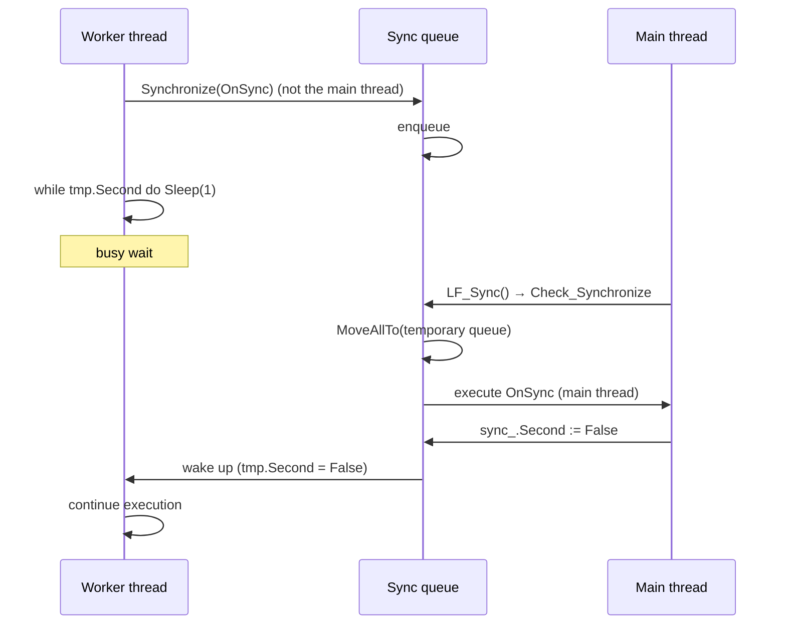

### 6.8 What this means for difficult languages

**Julia**:

```julia
# drive periodically from the main task
@async begin
    while running[]
        LF_Sync()      # process synchronous callbacks
        sleep(0.01)
    end
end
```

**Erlang**:

```erlang
%% drive periodically in the process loop
loop() ->
    'LF_Sync'(),      %% process synchronous callbacks
    timer:sleep(10),
    loop().
```

**R**:

```r
# main R thread loop
while (running) {
  .Call("LF_Sync")     # process synchronous callbacks
  later::run_now(0.01) # or a similar mechanism
}
```

**⚠️ Key pitfall**: **if the main thread never calls `LF_Sync`, synchronous callbacks never execute and worker threads block forever**.

---

## Chapter 7 Callback lifecycle

### 7.1 From registration to destruction

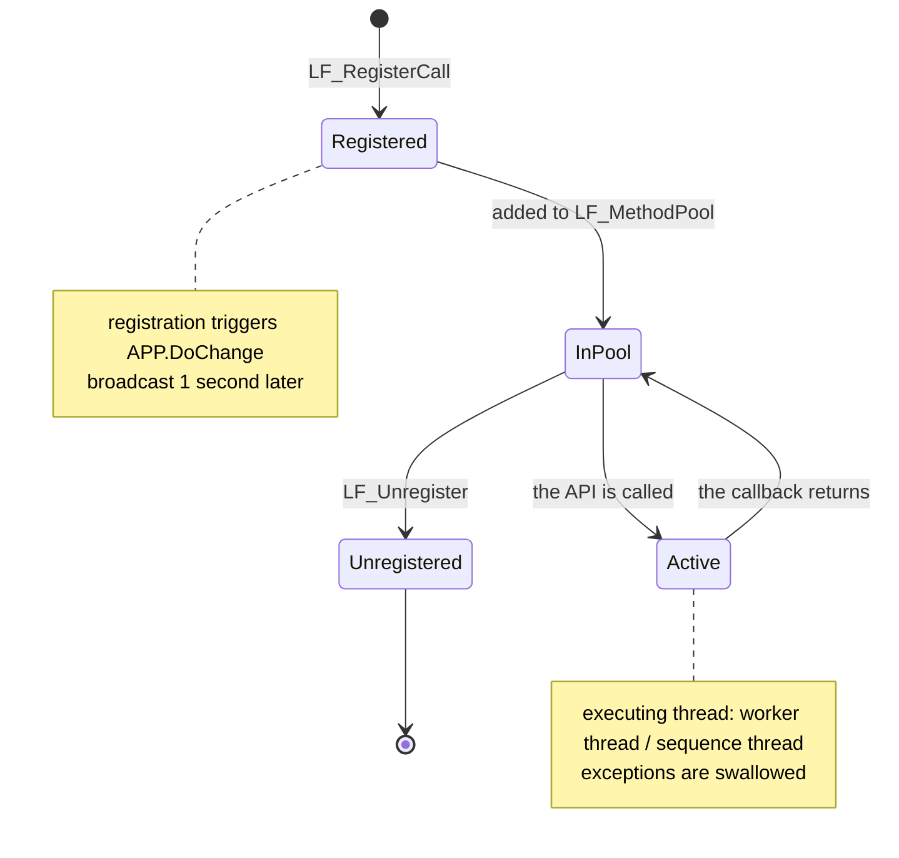

### 7.2 The registration lifecycle

**On registration**:
1. Create a `TLF_MethodInfo`.
2. Add it to `LF_MethodPool` (`TCritical_String_Big_Hash_Pair_Pool`).
3. `APP.DoChange()` → `FUpdated := True` + `Reset_Timer`.
4. 1 second later, `DoTimer` triggers `Do_LFRegEvent`.
5. The main thread executes `Do_LFRegEvent`, walks `FUpdateEventPool` and calls the subscribers.

**On unregistration**:
1. `LF_MethodPool.Delete(MethodName)`.
2. `APP.DoChange()` → same as above.

### 7.3 Strong references to callback pointers

**Problem**: LingoFuse stores only the function pointer; it does not manage the lifetime of managed objects.

**Managed languages must**:
- **Keep a strong reference to the callback**.
- Otherwise, once the GC collects it, the function pointer becomes dangling.

**Example (C#)**:

```csharp
// ❌ wrong: the local variable is garbage-collected
public void Register() {
    var cb = new LfCallEvent(AddCallback);
    LF_RegisterCall(app, "add", "Add", IntPtr.Zero, cb);
}

// ✅ correct: keep a strong reference in a static field
private static readonly LfCallEvent _addCallback = AddCallback;
public void Register() {
    LF_RegisterCall(app, "add", "Add", IntPtr.Zero, _addCallback);
}
```

**Example (Python)**:

```python
# ❌ wrong: the local variable is garbage-collected
def register():
    cb = LF_CALL_EVENT(AddCallback)
    lf.LF_RegisterCall(app, b"add", b"Add", None, cb)

# ✅ correct: keep the reference in a global or class attribute
ADD_CB = LF_CALL_EVENT(AddCallback)
def register():
    lf.LF_RegisterCall(app, b"add", b"Add", None, ADD_CB)
```

**Example (Julia)**:

```julia
# ❌ wrong: the anonymous function is garbage-collected
function register()
    cb = @cfunction(AddCallback, Cvoid, (Ptr{Cvoid}, Ptr{Cvoid}, Ptr{Cvoid}))
    LF_RegisterCall(app, "add", "Add", C_NULL, cb)
end

# ✅ correct: keep the reference in a global const
const ADD_CB = @cfunction(AddCallback, Cvoid, (Ptr{Cvoid}, Ptr{Cvoid}, Ptr{Cvoid}))
function register()
    LF_RegisterCall(app, "add", "Add", C_NULL, ADD_CB)
end
```

**Example (Erlang)**:

```erlang
%% the NIF function pointer must be kept alive (use enif_keep_resource or a static global)
%% see §8.2 for details
```

**Example (R)**:

```r
# R passes the function pointer through .Call, so there is no GC problem
# but the SEXP reference on the R side must be kept
```

### 7.4 Callback exceptions

**All callback exceptions are swallowed**:

| Callback | Exception handling | Log |
|------|---------|------|
| Call | `try...except` | `'execute call-mode api "%s" (stdcall) execpet!'` |
| Notify | `try...except` | `'execute notify-mode api "%s" (stdcall) execpet!'` |
| Async Call OnResult | `try...except` | `'TLF_Async_Call_Bridge.Do_Th exception: %s: %s'` |
| Network events | `try...except` | none |
| Sequenced callbacks | `try...except` | none |

**Key points**:
- **Exceptions are not propagated to the caller**.
- **Exception information only appears in logs**.
- **Managed languages cannot use exception-based control flow**.

### 7.5 Handle lifecycle

#### 7.5.1 The three handle lifetimes

| Handle type | Created by | End of lifetime | Released by |
|------------|---------|-------------|--------|
| **Caller-owned handle** | `LF_CreateData` / the return of `LF_Call` | Explicit `LF_FreeData` | Caller |
| **Framework-owned async handle** | The `Result_` parameter of an async callback | **The instant the callback returns** | Framework (immediately) |
| **Permanent handle** | `LF_CreateData_Permanent` | Explicit `LF_FreeData` or process exit | Caller |

#### 7.5.2 Lifetime state machine

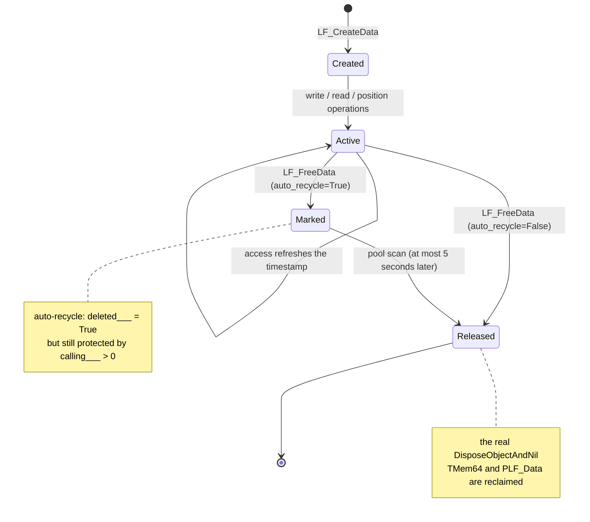

#### 7.5.3 The complete lifetime of an async handle

**Full timeline**:

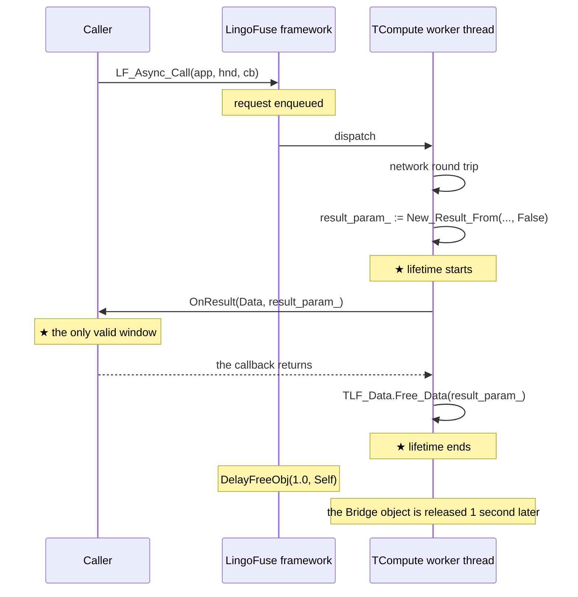

**Key points**:

- **The lifetime of `result_param_` = the duration of the callback invocation**.
- **The callback returning = the handle becomes invalid immediately**.
- **`DelayFreeObj(1.0, Self)` releases the Bridge object itself, not the handle**. These are two different things — the comment in `_lf_native.py` saying "released automatically ~1 second after this callback returns" actually refers to the **Bridge object** and was misread as the handle.

#### 7.5.4 Interaction with the auto-recycle mechanism

**Three layers of protection for auto-recycled handles**:

1. **Idle time threshold**: `DataHandle_Idle_Timeout` (10 minutes by default).
2. **Access refresh**: any accessor call resets the timer.
3. **Call in progress**: `calling___ > 0` prevents recycling.

**But async-family handles are not subject to these three protections**, because `auto_recycle = False` means they never enter the pool at creation.

**Corollary**:

- The "live window" of an auto-recycled handle is **on the order of minutes**.
- The "live window" of an async-family handle is **the duration of the callback** (microseconds to milliseconds).
- That order-of-magnitude difference is one of the root causes of this pitfall — developers habitually reason about a "millisecond lifetime" with "minute-level" instincts.

---

## Chapter 8 Integration guide for difficult languages

### 8.1 Julia integration

**Julia's challenges**:
- Multi-tasking (green threads) + multiple OS threads.
- Tasks can be preempted.
- GC has thread affinity.
- Calling Julia from an arbitrary OS thread requires `jl_adopt_thread`.

**Recommended architecture**:

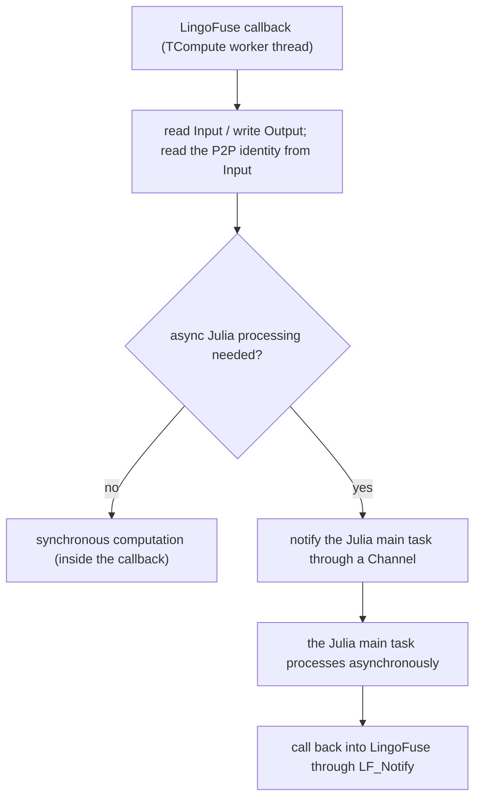

**Key rules**:

1. **Do not call Julia code directly inside the callback**.
2. **Inside the callback, only read Input and write Output**.
3. **The P2P identity (UID / P2PName) can only be read from the callback's `Input` parameter** (see §2.9), and must be copied immediately (`LF_Get_P2P_UID` returns a pointer).
4. **When async processing is needed, notify the Julia main task through a `Channel`**.
5. **The Julia main task calls `LF_Sync` periodically**.
6. **All Julia-side callbacks must be kept in strong references** (`const`).

**Complete example**:

```julia
# 1. load LingoFuse
const LINGOFUSE = "LingoFuse64.dll"
const lf = dlopen(LINGOFUSE)

# 2. declare the C ABI functions
const LF_CreateData = dlsym(lf, :LF_CreateData)
LF_CreateData(name::String) = ccall(LF_CreateData, Ptr{Cvoid}, (Cstring,), name)

const LF_RegisterCall = dlsym(lf, :LF_RegisterCall)
# ... other functions

# 3. define the callback (keep a strong reference)
const callback_channel = Channel{Tuple{Ptr{Cvoid}, Vector{UInt8}}}(1000)

function my_callback(trigger::Ptr{Cvoid}, input::Ptr{Cvoid}, output::Ptr{Cvoid})::Cvoid
    # ① read Input (safe)
    data = read_all_bytes(input)

    # ①b read the P2P identity ("side data") from Input — must copy immediately
    #     LF_Get_P2P_UID returns a pointer (PP2P_UID___), released by the framework after ~5 seconds.
    uid_ptr = ccall(LF_Get_P2P_UID, Ptr{UInt8}, (Ptr{Cvoid},), input)
    uid = uid_ptr == C_NULL ? zeros(UInt8, 32) : copy(unsafe_wrap(Array, uid_ptr, 32))
    name_ptr = ccall(LF_Get_P2P_Name, Cstring, (Ptr{Cvoid},), input)
    p2p_name = name_ptr == C_NULL ? "" : unsafe_string(name_ptr)

    # ② enqueue (notify the Julia main task)
    put!(callback_channel, (output, data))

    # ③ return immediately (Output written asynchronously by the Julia main task)
    # ⚠️ but Output becomes invalid after the callback returns! So it must be written inside the callback.
    # therefore we process synchronously:
    result = process_in_callback(data)
    write_all_bytes(output, result)
end

const MY_CALLBACK = @cfunction(my_callback, Cvoid, (Ptr{Cvoid}, Ptr{Cvoid}, Ptr{Cvoid}))

# 4. registration
function register_my_app()
    app = LF_CreateApp("MyApp", "Julia app")
    LF_RegisterCall(app, "my_api", "desc", C_NULL, MY_CALLBACK)
    return app
end

# 5. main task loop (drives LF_Sync periodically)
const running = Ref(true)

function main_loop()
    while running[]
        LF_Sync()
        sleep(0.01)
    end
end

@async main_loop()
```

**⚠️ Key pitfalls**:
- **The function pointer returned by `@cfunction` must be stored in a `const`**, or the GC will collect it.
- **`Input` / `Output` become invalid immediately after the callback returns**, so processing must be synchronous.
- **`LF_Get_P2P_UID` returns a pointer**, which must be dereferenced and copied immediately; **never store the raw pointer**.
- **`LF_Get_P2P_UID` / `LF_Get_P2P_Name` may only be called on the `Input` parameter**, never on a self-built handle or on `Output`.
- **`LF_Sync` must be called periodically by the Julia main task**.
- **If `Base.@ccallable` is used, Julia adopts the thread automatically**, but reading Input / writing Output only is still recommended.

### 8.2 Erlang integration

**Erlang's challenges**:
- The BEAM VM has N scheduler threads.
- A blocking NIF drags the scheduler down.
- A crashing NIF takes the whole VM down.
- Calling Erlang code from an arbitrary OS thread requires `enif_send`.

**Recommended architecture**:

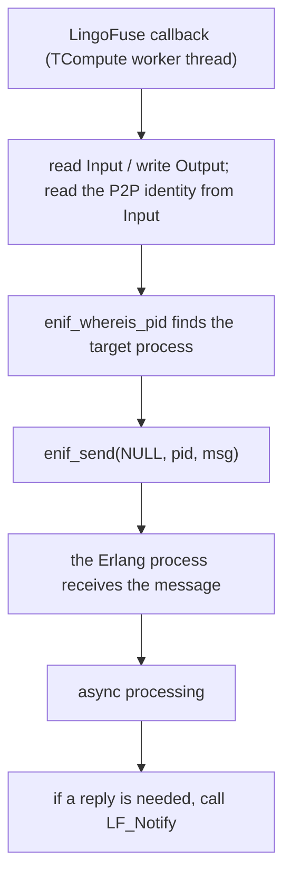

**Key rules**:

1. **NIFs must return quickly** (LingoFuse callbacks run on worker threads, but the NIF's own constraints apply just the same).
2. **Do not call Erlang code directly inside the callback**.
3. **The P2P identity (UID / P2PName) can only be read from the callback's `Input` parameter** (see §2.9); `LF_Get_P2P_UID` returns a pointer that must be dereferenced and copied inside the NIF.
4. **Send messages to Erlang processes with `enif_send`**.
5. **A crashing NIF takes the BEAM down**, so `try...catch` is mandatory inside NIFs.
6. **Use dirty NIFs for time-consuming work** (OTP 21+).

**Complete example**:

```c
// C NIF side
#include <erl_nif.h>

static ErlNifResourceType* LF_APP_RESOURCE = NULL;

// declare the LingoFuse C ABI
typedef void* TAppHnd;
typedef void* TDataHnd;
typedef void (*TLF_Call_Event)(void*, void*, void*);
typedef void* PP2P_UID___; // actually PUID___, pointing at TUID___
extern TAppHnd LF_CreateApp(const char*, const char*);
extern int LF_RegisterCall(TAppHnd, const char*, const char*, void*, TLF_Call_Event);
extern PP2P_UID___ LF_Get_P2P_UID(TDataHnd); // returns a pointer, released by the framework after ~5 seconds
extern const char* LF_Get_P2P_Name(TDataHnd);
// ...

// callback: executes on a worker thread
static void __cdecl my_callback(void* trigger, void* input, void* output) {
    // ① read Input
    // ...
    // extract UID / P2PName from Input (using the LingoFuse API)
    // valid only on input ("side data"); LF_Get_P2P_UID returns a PP2P_UID___ pointer,
    // released by the framework after ~5 seconds; copy only, keep no pointer, free nothing.
    PP2P_UID___ uid_ptr = LF_Get_P2P_UID(input);
    TP2P_UID uid;
    if (uid_ptr != NULL) {
        uid = *uid_ptr;                    // dereference and copy immediately
    } else {
        memset(&uid, 0, sizeof(uid));
    }
    const char* p2p_name_ptr = LF_Get_P2P_Name(input);  // invalid after 5 seconds
    char p2p_name[256];
    if (p2p_name_ptr != NULL) {
        strncpy(p2p_name, p2p_name_ptr, sizeof(p2p_name) - 1);
        p2p_name[sizeof(p2p_name) - 1] = '\0';
    } else {
        p2p_name[0] = '\0';
    }

    // ② find the target Erlang process
    ErlNifPid pid;
    ErlNifEnv* env = enif_alloc_env();
    if (enif_whereis_pid(env, enif_make_atom(env, "my_lf_handler"), &pid)) {
        // ③ build the message
        ERL_NIF_TERM msg = enif_make_tuple2(env,
            enif_make_atom(env, "lf_callback"),
            enif_make_int(env, 42));

        // ④ send it (from a non-BEAM thread)
        enif_send(NULL, &pid, NULL, msg);
    }
    enif_free_env(env);

    // ⑤ write Output
    // ...
}

// NIF function: register the callback
static ERL_NIF_TERM register_lf(ErlNifEnv* env, int argc, const ERL_NIF_TERM argv[]) {
    TAppHnd app = LF_CreateApp("MyApp", "Erlang app");
    LF_RegisterCall(app, "my_api", "desc", NULL, my_callback);
    return enif_make_atom(env, "ok");
}

// NIF initialisation
static int load(ErlNifEnv* env, void** priv_data, ERL_NIF_TERM load_info) {
    return 0;
}

static ErlNifFunc nif_funcs[] = {
    {"register_lf", 0, register_lf, ERL_NIF_DIRTY_JOB_IO_BOUND},
};

ERL_NIF_INIT(my_lf_nif, nif_funcs, load, NULL, NULL, NULL)
```

**⚠️ Key pitfalls**:
- **Only `enif_send(NULL, &pid, NULL, msg)` can send from a non-BEAM thread**.
- **The environment allocated by `enif_alloc_env` must be freed with `enif_free_env`**.
- **A crashing NIF takes the BEAM down**, so `try...catch` is mandatory inside the NIF.
- **`ERL_NIF_DIRTY_JOB_IO_BOUND`**: marks the NIF dirty so it does not block the scheduler.
- **`LF_Get_P2P_UID` returns a pointer**: dereference and copy it inside the NIF; never keep it long-term.
- **`LF_Get_P2P_UID` / `LF_Get_P2P_Name` may only be called on the `input` parameter**.

### 8.3 R integration

**R's challenges**:
- Strictly single-threaded, non-reentrant.
- All R code must run on the main R thread.
- The R API is not thread-safe.
- R's GC is not thread-safe.

**Recommended architecture**:

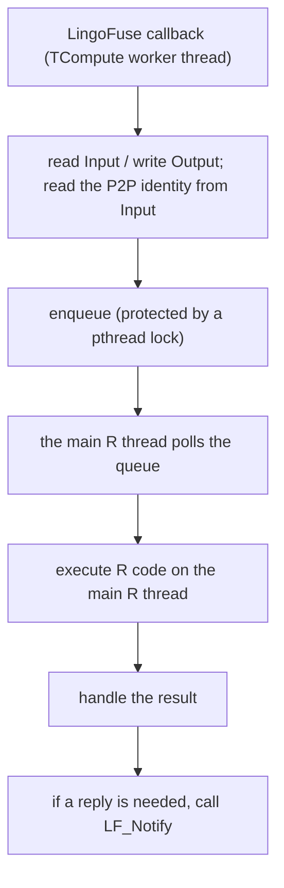

**Key rules**:

1. **Call no R API inside the callback** (including `Rf_allocVector`, `PROTECT`).
2. **Protect the shared queue with a pthread lock**.
3. **The main R thread polls actively** (it cannot wait for the callback).
4. **Output must be written inside the callback** (because it becomes invalid after the callback returns).
5. **The P2P identity can only be read from the callback's `Input` parameter** (see §2.9); `LF_Get_P2P_UID` returns a pointer that must be copied inside the callback.

**Complete example**:

```c
// C side (R extension)
#include <R.h>
#include <Rinternals.h>
#include <pthread.h>

// thread-safe queue
#define QUEUE_SIZE 1024
static void* callback_queue[QUEUE_SIZE];
static int queue_head = 0, queue_tail = 0;
static pthread_mutex_t queue_mutex = PTHREAD_MUTEX_INITIALIZER;

// LingoFuse callback (executes on a worker thread)
static void __cdecl my_callback(void* trigger, void* input, void* output) {
    // ① read Input (no R API calls)
    // ... extract data into heap memory ...

    // ①b read the P2P identity ("side data") from Input — must copy immediately
    //     LF_Get_P2P_UID returns a pointer, released by the framework after ~5 seconds.
    PP2P_UID___ uid_ptr = LF_Get_P2P_UID(input);
    uint8_t uid[32];
    if (uid_ptr != NULL) {
        memcpy(uid, uid_ptr, 32);          // copy immediately
    } else {
        memset(uid, 0, 32);
    }
    const char* p2p_name_ptr = LF_Get_P2P_Name(input);
    char p2p_name[256];
    if (p2p_name_ptr != NULL) {
        strncpy(p2p_name, p2p_name_ptr, sizeof(p2p_name) - 1);
        p2p_name[sizeof(p2p_name) - 1] = '\0';
    } else {
        p2p_name[0] = '\0';
    }

    // ② enqueue
    pthread_mutex_lock(&queue_mutex);
    callback_queue[queue_tail] = data;
    queue_tail = (queue_tail + 1) % QUEUE_SIZE;
    pthread_mutex_unlock(&queue_mutex);

    // ③ write Output (if no R computation is needed)
    // ... write directly ...
}

// polling function for the main R thread
SEXP poll_callbacks() {
    SEXP result = PROTECT(allocVector(VECSXP, 0));

    pthread_mutex_lock(&queue_mutex);
    while (queue_head != queue_tail) {
        void* data = callback_queue[queue_head];
        queue_head = (queue_head + 1) % QUEUE_SIZE;
        pthread_mutex_unlock(&queue_mutex);

        // execute R code on the main thread
        SEXP r_data = convert_to_R(data);
        SEXP r_result = call_r_function(r_data);
        // ... handle the result ...

        pthread_mutex_lock(&queue_mutex);
    }
    pthread_mutex_unlock(&queue_mutex);

    UNPROTECT(1);
    return result;
}

// R registration
static const R_CallMethodDef CallEntries[] = {
    {"poll_callbacks", (DL_FUNC) &poll_callbacks, 0},
    {NULL, NULL, 0}
};

void R_init_my_lf_ext(DllInfo *dll) {
    R_registerRoutines(dll, NULL, CallEntries, NULL, NULL);
    R_useDynamicSymbols(dll, FALSE);
}
```

**⚠️ Key pitfalls**:
- **No R API may be called inside the callback**.
- **The shared queue must be protected by a pthread lock**.
- **The main R thread must poll actively**.
- **Output must be completed inside the callback** (otherwise it becomes invalid).
- **If Output needs the result of an R computation, a deadlock occurs** (the main R thread is also waiting on LingoFuse).
- **The P2P identity can only be read from `input`**: `LF_Get_P2P_UID` returns a pointer that must be `memcpy`-copied inside the callback.

**Recommended pattern (avoiding deadlock)**:

```c
// the callback returns only "accepted"; the real result is sent back asynchronously through LF_Notify
static void __cdecl my_callback(void* trigger, void* input, void* output) {
    // ① read Input
    // ② generate a task_id
    // ③ enqueue (notify the main R thread)
    // ④ immediately write Output = task_id
    // ⑤ when the main R thread finishes, notify the original caller through LF_Notify
}
```

### 8.4 Brief notes on other languages

| Language | Key point |
|------|--------|
| **Java (FFM)** | Callbacks run on arbitrary threads; use `Arena` for memory management; keep a strong reference to `MemorySegment` |
| **Rust** | `extern "C"`; panics must be caught with `catch_unwind`; callbacks run on arbitrary threads |
| **Go** | `purego` or `cgo`; callbacks run on arbitrary threads; keep a reference to the callback |
| **Swift** | `@convention(c)`; callbacks run on arbitrary threads |
| **Zig** | `@cImport`; `extern "C"`; callbacks run on arbitrary threads |
| **Ruby** | Fiddle or a C extension; callbacks run on arbitrary threads; the Ruby API cannot be used |
| **Fortran** | `iso_c_binding`; callbacks run on arbitrary threads; the Fortran runtime cannot be used |
| **Julia** | `@cfunction` + `const`; callbacks run on arbitrary threads; marshal with a `Channel` |
| **Erlang** | NIF + `enif_send`; callbacks run on arbitrary threads; use dirty NIFs |
| **R** | pthread queue + polling from the main R thread; callbacks run on arbitrary threads |

---

## Chapter 9 Internal message routing

### 9.1 Routing paths of the three addressing modes

**App name routing**:

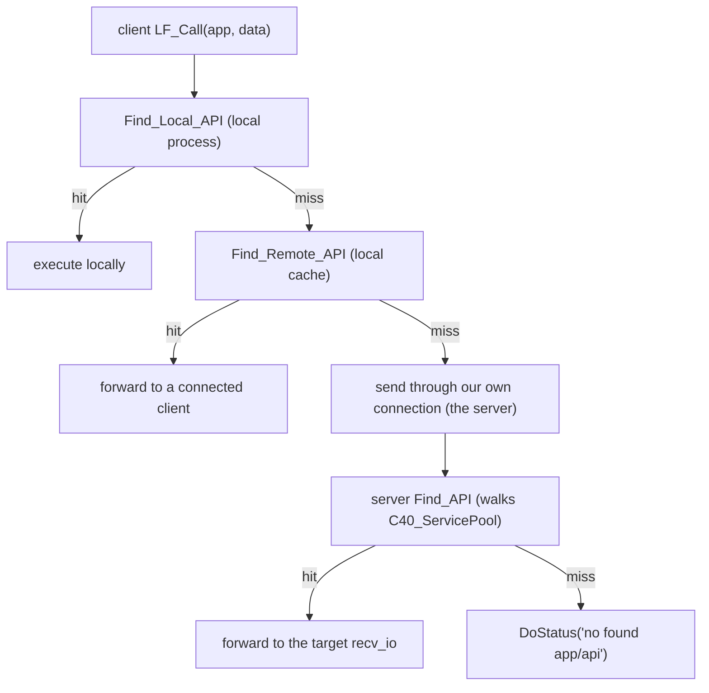

**UID routing**:

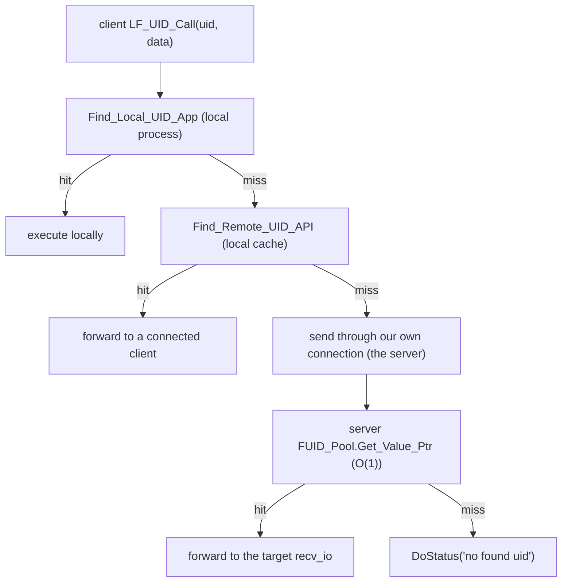

**P2PName routing**:

```mermaid
flowchart TD
    A["client LF_P2PNAME_Call(p2p_name, data)"] --> B["send through our own connection (the server)"]
    B --> C["server FP2PName_Pool.Get_Key_Value"]
    C --> D["Find_P2PName_LoadBalance (load balancing)"]
    D --> E["pick a UID according to Cycle_Anchor"]
    E --> F["FUID_Pool.Get_Value_Ptr(UID)"]
    F --> G["forward to the target recv_io"]
```

### 9.2 Server-side command dispatch (v4.0 fix)

**The 15 commands the server registers** (source `TC40_LF_Service.Create`):

| Command | Registration type | Handler | Executing thread |
|------|---------|--------|---------|
| `Update_UID` | CompleteBuffer_StreamNotify | `cmd_Update_UID` | C4 thread |
| `Init_APP_Info` | CompleteBuffer_NoWait_Bridge_Stream | `cmd_Init_APP_Info` | C4 thread |
| `No_App_Info` | ConsoleNotify | `cmd_No_App_Info` | C4 thread |
| `Notify` | CompleteBuffer_StreamNotify | `cmd_Notify` | C4 thread + HPC worker thread |
| `Sequenced_Notify` | CompleteBuffer_StreamNotify | `cmd_Sequenced_Notify` | C4 thread + sequence thread |
| `Call` | CompleteBuffer_NoWait_Bridge_Stream | `cmd_Call` | C4 thread + HPC worker thread |
| `Sequenced_Call` | CompleteBuffer_NoWait_Bridge_Stream | `cmd_Sequenced_Call` | C4 thread + sequence thread |
| `UID_Notify` | CompleteBuffer_StreamNotify | `cmd_UID_Notify` | C4 thread + HPC worker thread |
| `UID_Sequenced_Notify` | CompleteBuffer_StreamNotify | `cmd_UID_Sequenced_Notify` | C4 thread + sequence thread |
| `UID_Call` | CompleteBuffer_NoWait_Bridge_Stream | `cmd_UID_Call` | C4 thread + HPC worker thread |
| `UID_Sequenced_Call` | CompleteBuffer_NoWait_Bridge_Stream | `cmd_UID_Sequenced_Call` | C4 thread + sequence thread |
| `P2PName_Notify` | CompleteBuffer_StreamNotify | `cmd_P2PName_Notify` | C4 thread + HPC worker thread |
| `P2PName_Sequenced_Notify` | CompleteBuffer_StreamNotify | `cmd_P2PName_Sequenced_Notify` | C4 thread + sequence thread |
| `P2PName_Call` | CompleteBuffer_NoWait_Bridge_Stream | `cmd_P2PName_Call` | C4 thread + HPC worker thread |
| `P2PName_Sequenced_Call` | CompleteBuffer_NoWait_Bridge_Stream | `cmd_P2PName_Sequenced_Call` | C4 thread + sequence thread |

**The v3.2 document wrongly wrote 17 commands**, adding `Thread_State` and `update_service_api_info`. `update_service_api_info` is a **client**-registered command, and `Thread_State` does not exist in the source.

**The 13 commands the client registers** (source `TC40_LF_Client.Create`):

| Command | Registration type | Handler |
|------|---------|--------|
| `update_service_api_info` | CompleteBuffer | `cmd_update_service_api_info` |
| `Notify` | CompleteBuffer | `cmd_Notify` |
| `Sequenced_Notify` | CompleteBuffer | `cmd_Sequenced_Notify` |
| `Call` | CompleteBuffer_NoWait_Stream_Thread | `cmd_Call` |
| `Sequenced_Call` | CompleteBuffer_NoWait_Bridge_Stream | `cmd_Sequenced_Call` |
| `UID_Notify` | CompleteBuffer | `cmd_UID_Notify` |
| `UID_Sequenced_Notify` | CompleteBuffer | `cmd_UID_Sequenced_Notify` |
| `UID_Call` | CompleteBuffer_NoWait_Stream_Thread | `cmd_UID_Call` |
| `UID_Sequenced_Call` | CompleteBuffer_NoWait_Bridge_Stream | `cmd_UID_Sequenced_Call` |
| `P2PName_Notify` | CompleteBuffer | `cmd_P2PName_Notify` |
| `P2PName_Sequenced_Notify` | CompleteBuffer | `cmd_P2PName_Sequenced_Notify` |
| `P2PName_Call` | CompleteBuffer_NoWait_Stream_Thread | `cmd_P2PName_Call` |
| `P2PName_Sequenced_Call` | CompleteBuffer_NoWait_Bridge_Stream | `cmd_P2PName_Sequenced_Call` |

**Key facts**:
- **All commands first execute on the C4 thread** (C4 is driven single-threaded by Progress).
- **Locally hit Call/Notify are dispatched to worker threads through HPC**.
- **Sequenced commands execute on sequence threads**.
- **Forwarding path**: a command is forwarded on the C4 thread to the target recv_io; the target client processes it on its own C4 thread.

### 9.3 The three handling paths of a C4 command

```mermaid
flowchart TD
    A["a C4 command arrives"] --> B{"command type?"}
    B -- "Notify / Call (local hit)" --> C["RunHPC_* → worker thread"]
    B -- "Sequenced_Notify / Sequenced_Call (local hit)" --> D["sequence thread pool → sequence thread"]
    B -- "forwarding path" --> E["SendCompleteBuffer_NoWait_StreamM to the target client"]
    E --> F["target client's C4 thread"]
    F --> G{"local hit?"}
    G -- "yes" --> C
    G -- "no" --> H["forward again or report an error"]
```

### 9.4 Broadcast mechanism

**The server broadcasts `update_service_api_info`**:

```pascal
procedure TC40_LF_Service.Broadcast_API_Info;
begin
  // ① collect all online recv_io
  DTNoAuth.RecvTunnel.GetIO_Array(arry);
  for ID_ in arry do
  begin
    IO_ := DTNoAuth.RecvTunnel.PeerIO[ID_];
    tun := IO_.Define as TC40_LF_RecvTunnel;
    if tun.LinkOk then alive.Add(tun);
  end;

  // ② build pool (App info) and uid_tool (UID info)
  with alive.Repeat_ do
    repeat
      pool.Build_Info_Form(queue^.Data);
      uid_tool.Import_From(queue^.Data);
    until not Next;

  // ③ encode as TDFE
  sub := TDFE.Create;
  pool.SaveToStream(sub);
  envelope.WriteDFE(sub);
  sub := TDFE.Create;
  uid_tool.SaveToStream(sub);
  envelope.WriteDFE(sub);

  // ④ broadcast
  envelope.FastEncodeTo(payload);
  with alive.Repeat_ do
    repeat
      queue^.Data.SendTunnel.Owner.SendCompleteBuffer('update_service_api_info', payload.NewClone, True);
    until not Next;
end;
```

**Broadcast throttling**:
- **≤10 connections**: 500ms
- **≤100 connections**: 1s
- **otherwise**: 3s

---

## Chapter 10 Timing and ordering

### 10.1 What is and is not guaranteed

| Operation | Ordering guarantee | Notes |
|------|---------|------|
| **`Sequenced_Notify` for the same `(App, API)`** | ✅ FIFO | Sequence thread pool |
| **`Sequenced_Call` for the same `(App, API)`** | ✅ FIFO | Sequence thread pool |
| **`UID_Sequenced_Notify` for the same UID** | ✅ FIFO | Sequence thread pool |
| **`UID_Sequenced_Call` for the same UID** | ✅ FIFO | Sequence thread pool |
| **`P2PName_Sequenced_Notify` for the same P2PName** | ⚠️ partial | FIFO per (p2p_name, api) pair, but work may be assigned to different UIDs |
| **`LF_Notify`** | ❌ not guaranteed | Network transport may reorder |
| **`LF_Call`** | ❌ not guaranteed | Same as above |
| **`LF_Async_Call`** | ❌ not guaranteed | Async callbacks may reorder |
| **`LF_Async_Sequenced_Call`** | ✅ FIFO (same App+API) | Sequence thread pool |

### 10.2 The stickiness mechanism of `Fixed_Sequenced_Time`

**Default**: 20000 milliseconds (20 seconds).

**Effect**: with P2PName routing, the same UID keeps handling work for 20 seconds before switching to another UID.

**Source** (`Find_P2PName_FixedSequenced`):

```pascal
PtrList.Sort_By_Sequenced_Time(taskKey);
selected := PtrList.First^.Data;
if (GetTimeTick() - selected^.Fourth) > Fixed_Sequenced_Time then
    selected := PtrList.Last^.Data;      // switch after more than 20 seconds
selected^.Fourth := GetTimeTick();
```

### 10.3 Cycle_Anchor load balancing

**Mechanism**:
- A global atomic counter `Cycle_Anchor_Seed` (`Int64`).
- Each `(p2p_name, api)` task maintains an anchor value per UID.
- The smallest anchor is chosen, then updated to a new global value.

**Effect**: round-robin + load balancing.

**Source** (`Find_P2PName_LoadBalance`):

```pascal
PtrList.Sort_By_Cycle_Anchor(taskKey);
selected := PtrList.First^.Data;
P := FUID_Pool.Get_Value_Ptr___(selected^.Primary);
Result := P^.recv_io;
selected^.Third[taskKey] := Get_Cycle_Anchor();   // update the anchor
```

### 10.4 Broadcast delays

| Scenario | Delay |
|------|------|
| **API change to broadcast** | 1 second (`DoTimer` after `Reset_Timer`) |
| **Broadcast to client cache update** | C4 network latency (milliseconds) |
| **`LF_CheckApp` cache delay** | about 3 seconds |
| **`LF_CheckApi` cache delay** | about 3 seconds |

### 10.5 Data handle recycling delays

| Operation | Delay |
|------|------|
| **`LF_FreeData` (auto-recycle)** | Up to 5 seconds (next scan) |
| **Idle recycling** | 10 minutes + up to 5 seconds |
| **`LF_CreateData_Permanent` release** | Immediate (synchronous) |
| **Delayed release after a sequence thread exits** | **1 second** (v4.0 fix: v3.2 wrongly said 5 seconds) |

---

## Chapter 11 Debugging and diagnostics

### 11.1 Key debugging points

| Debugging point | Method | Output |
|--------|------|------|
| **Thread identity** | `TCompute.Set_Thread_Info` | Thread log |
| **Status messages** | `LF_GetStatusCount` + `LF_GetStatus` | Status queue |
| **Debug log** | `LF_Set_Opt_Quiet(False)` | `[LF-DEBUG]` prefix |
| **C4 status** | `LF_Set_Opt_Debug('service')` | Service information |
| **Tunnel status** | `LF_Set_Opt_Debug('tunnel')` | Tunnel information |
| **ZNet instance** | `LF_Set_Opt_Debug('ZNet_Info')` | ZNet status |
| **HPC threads** | `LF_Set_Opt_Debug('HPC_Thread_Info')` | HPC thread status |
| **Data handles** | `LF_Set_Opt_Debug('Instance_Info')` | Instance information |

### 11.2 Cross-language debugging

**Julia**:

```julia
# print all status messages
while LF_GetStatusCount() > 0
    status = unsafe_string(LF_GetStatus())
    println("[LF] ", status)
end

# print the thread id
println("Julia thread: ", Threads.threadid())
```

**Erlang**:

```erlang
%% return status from a NIF
poll_status() ->
    case 'LF_GetStatusCount'() of
        0 -> [];
        N ->
            Status = 'LF_GetStatus'(),
            [binary_to_list(Status) | poll_status()]
    end.
```

**R**:

```r
# print all status messages
poll_status <- function() {
    while (.Call("LF_GetStatusCount") > 0) {
        status <- .Call("LF_GetStatus")
        cat("[LF]", status, "\n")
    }
}
```

### 11.3 Diagnostic paths for common problems

| Problem | Diagnostic path |
|------|---------|
| **Callback never fires** | ① check `LF_CheckApp` / `LF_CheckApi`; ② check the `LF_PrepareDone` return value; ③ check `LF_GetStatus` |
| **Callback crashes** | ① check the callback is `cdecl`; ② check `Trigger` is valid; ③ check for cross-thread access |
| **Deadlock** | ① check whether the callback calls `LF_Call`; ② check whether the main loop calls `LF_Sync`; ③ check for R-scenario deadlock |
| **Memory leak** | ① check `LF_FreeData` pairing; ② check `LF_FreeApp` pairing; ③ check `LF_CreateData_Permanent` |
| **Data is corrupt after an async callback** | ① confirm the `Result_` handle is not used outside the callback; ② confirm `LF_FreeData` is not called on `Result_`; ③ confirm the handle is not passed across threads |
| **P2P identity is empty** | ① confirm it is called on `Input` (not `Output` / a self-built handle); ② confirm the sender set `LF_P2P_name`; ③ confirm the UID has been generated |
| **Connection fails** | ① check `Overlap_Connection`; ② check the address; ③ check `Wait_Connection_Timeout` |
| **Routing fails** | ① check the UID is valid; ② check P2PName is set; ③ check the App is registered |

---

## Chapter 12 Counter-example collection (cross-language specific pitfalls)

### 12.1 Julia: callback not kept in a strong reference

```julia
# ❌ wrong: the callback is garbage-collected
function register()
    cb = @cfunction(my_callback, Cvoid, (Ptr{Cvoid}, Ptr{Cvoid}, Ptr{Cvoid}))
    LF_RegisterCall(app, "my_api", "desc", C_NULL, cb)
    # after cb goes out of scope it is collected and the callback becomes a dangling pointer
end

# ✅ correct: a global const
const MY_CB = @cfunction(my_callback, Cvoid, (Ptr{Cvoid}, Ptr{Cvoid}, Ptr{Cvoid}))
function register()
    LF_RegisterCall(app, "my_api", "desc", C_NULL, MY_CB)
end
```

### 12.2 Julia: calling Julia code directly inside the callback

```julia
# ❌ wrong: calling Julia code from a worker thread
function my_callback(trigger, input, output)::Cvoid
    # this callback runs on a worker thread
    result = compute(data)   # ❌ may corrupt the GC
    write_output(output, result)
end

# ✅ correct: read Input / write Output only, or use @ccallable
function my_callback(trigger, input, output)::Cvoid
    data = read_bytes(input)     # copy
    # simple computation is fine directly (no GC-sensitive operations)
    write_bytes(output, data)
end
```

### 12.3 Erlang: a NIF blocking the scheduler

```c
// ❌ wrong: a NIF blocking for a long time
static ERL_NIF_TERM blocking_nif(ErlNifEnv* env, int argc, const ERL_NIF_TERM argv[]) {
    sleep(10);   // ❌ blocks the scheduler for 10 seconds
    return enif_make_atom(env, "ok");
}

// ✅ correct: mark it as a dirty NIF
static ErlNifFunc nif_funcs[] = {
    {"blocking_nif", 0, blocking_nif, ERL_NIF_DIRTY_JOB_IO_BOUND},
};
```

### 12.4 Erlang: a crashing NIF takes the BEAM down

```c
// ❌ wrong: an uncaught exception in a NIF
static ERL_NIF_TERM crash_nif(ErlNifEnv* env, int argc, const ERL_NIF_TERM argv[]) {
    int* p = NULL;
    *p = 42;   // ❌ segmentation fault → the BEAM crashes
    return enif_make_atom(env, "ok");
}

// ✅ correct: catch everything
static ERL_NIF_TERM safe_nif(ErlNifEnv* env, int argc, const ERL_NIF_TERM argv[]) {
    // all operations inside try...catch (in C you must check manually)
    return enif_make_atom(env, "ok");
}
```

### 12.5 R: calling the R API inside a callback

```c
// ❌ wrong: calling the R API inside a callback
static void __cdecl my_callback(void* trigger, void* input, void* output) {
    SEXP data = allocVector(REALSXP, 10);   // ❌ the R API is not thread-safe
    // ...
}

// ✅ correct: read Input / write Output only
static void __cdecl my_callback(void* trigger, void* input, void* output) {
    // read Input, write Output
    // when R computation is needed, enqueue it for the main R thread
}
```

### 12.6 R: Output waiting on an R result causes deadlock

```c
// ❌ wrong: the callback waits for the main R thread to produce the result
static void __cdecl my_callback(void* trigger, void* input, void* output) {
    // enqueue
    pthread_mutex_lock(&queue_mutex);
    // ...
    pthread_mutex_unlock(&queue_mutex);

    // ❌ wait for the main R thread
    while (!result_ready) {
        usleep(1000);
    }
    // but the main R thread may be waiting on LingoFuse → deadlock
    write_output(output, result);
}

// ✅ correct: the callback returns only a task_id; the real result is sent back asynchronously through LF_Notify
static void __cdecl my_callback(void* trigger, void* input, void* output) {
    // enqueue
    // immediately write Output = task_id
    write_output(output, task_id);
}
```

### 12.7 All languages: calling `LF_Call` inside a callback

```pascal
// ❌ wrong: calling LF_Call inside a callback
procedure MyCallback(Trigger: Pointer; Input, Output: TDataHnd); cdecl;
begin
  Res := LF_CallEx('Other', Input, 5000);   // ❌ self-deadlock
end;

// ✅ correct: submit asynchronously to a worker thread
procedure MyCallback(Trigger: Pointer; Input, Output: TDataHnd); cdecl;
begin
  TThread.CreateAnonymousThread(
    procedure
    var Res: TDataHnd;
    begin
      Res := LF_CallEx('Other', Input, 5000);
      // ...
    end
  ).Start;
end;
```

### 12.8 All languages: the main loop never calls `LF_Sync`

```pascal
// ❌ wrong: a custom main loop without LF_Sync
while Running do
begin
  Z.Core.Check_Soft_Thread_Synchronize(10);
  Sleep(10);
end;

// ✅ correct: add LF_Sync
while Running do
begin
  LF.Sync;                              // ✅ process synchronous callbacks
  Z.Core.Check_Soft_Thread_Synchronize(10);
  Sleep(10);
end;
```

### 12.9 All languages: storing `addr_` from a network event callback

```pascal
// ❌ wrong: storing the pointer globally
var g_addr: PAnsiChar;
procedure OnConnect(addr: PAnsiChar); cdecl;
begin
  g_addr := addr;   // ❌ invalid after the callback returns
end;

// ✅ correct: copy immediately
var g_addr: string;
procedure OnConnect(addr: PAnsiChar); cdecl;
begin
  g_addr := UTF8ToString(addr);   // ✅
end;
```

### 12.10 All languages: using a handle outside the async callback (★ core)

**Problem**: passing out the `Result_` handle received by an async callback and using it across threads.

**Wrong example (pseudo-code)**:

```python
# ❌ wrong: passing the async handle out
saved_ptr = None

def on_result(trigger, res_ptr):
    global saved_ptr
    saved_ptr = res_ptr    # ❌ invalid after the callback returns

LF_Async_Call(app, hnd, None, on_result)
# ... later
data = read_from(saved_ptr)    # ❌ use-after-free
LF_FreeData(saved_ptr)          # ❌ double free
```

**Correct example**:

```python
def on_result(trigger, res_ptr):
    # ✓ copy the data inside the callback
    data = read_all_bytes(res_ptr)   # bytes is a new Python object
    my_queue.put(data)
    # keep no res_ptr, call no LF_FreeData
```

**Why this is a cross-language pitfall**: GC languages do not observe C-side pointer lifetimes. **After the callback returns, any Python/Julia/Erlang/R object still holding that pointer is dangling**.

**Root cause**: see the handle ownership model in §2.8.

**How it manifests**:

| Payload size | Symptom |
|-------------|------|
| Small (2 bytes) | Usually "looks fine" — the allocator has not reused it |
| Large (17+ bytes) | Usually "empty / garbage" — it has already been reused |

**⚠️ An `int` vs `dict` dichotomy misleads diagnosis**. The real variable is "payload size → when memory gets reused".

### 12.11 All languages: mixing synchronous-family and async-family ownership

**Problem**: applying the synchronous family's ownership rules to the asynchronous family, or vice versa.

**Wrong example**:

```python
# ❌ wrong: handling an async handle with synchronous-family ownership rules
def on_result(trigger, res_ptr):
    my_handle = wrap_handle(res_ptr)   # wrapped as "caller owned"
    # ... later ...
    my_handle.free()                    # calls LF_FreeData → double free
```

**Correct principle**:

| Call family | Correct assumption about the handle owner |
|--------|----------------------|
| Synchronous family | The **caller** owns it, the caller releases it |
| Asynchronous family | The **framework** owns it; after using it inside the callback, forget it |

**The two must never be mixed**. Their function signatures are identical, their return types are identical, their appearance is identical — **the only difference is ownership**.

### 12.12 All languages: the misleading "~1 second" in comments

**Problem**: a comment in `_lf_native.py` says an async callback result is "released ~1 second later", while in reality it is **released immediately after the callback returns**.

**Original text**:

```python
#:     Result_ - a DataHandle owned by the framework. It is released
#:               automatically ~1 second after this callback returns.
```

**Reality** (`TLF_Async_Call_Bridge.Do_Th` in `Z.Net.C4.LingoFuse.pas`):

```pascal
result_param_ := TLF_Data.New_Result_From(Result_M64.Swap_To_New_Instance, False);
try
  if Assigned(OnResult) then
    OnResult(Data_, result_param_);
except
end;
TLF_Data.Free_Data(result_param_);   // ← released immediately
DelayFreeObj(1.0, Self);              // ← what is released 1 second later is the Bridge object
```

**Key distinction**:

- **`result_param_` (the handle)**: released **immediately** after the callback returns.
- **`Self` (the Bridge object)**: released **1 second** after the callback returns.

**Recommendation**: binding-layer comments in every language should read:

```
Result_ is released IMMEDIATELY after this callback returns.
Do NOT retain the pointer beyond the callback body.
Do NOT call LF_FreeData on it.
```

**Lesson**: **comments are second-hand information**. When behaviour looks suspicious, read the source, not the comments.

### 12.13 All languages: calling `LF_Get_P2P_UID` / `LF_Get_P2P_Name` on a self-built or output handle

**Problem**: `LF_Get_P2P_UID` / `LF_Get_P2P_Name` read the **"side data" the sender wrote**, not the handle's own business data. They are valid only on the **event-triggering callback's `Input` parameter**.

**Wrong example 1: calling on a self-built request handle**

```pascal
// ❌ wrong: calling on a self-built handle
var
  Req: TDataHnd;
  UIDPtr: PP2P_UID___;
begin
  Req := LF_CreateData('my_api');   // ← a request handle we created ourselves
  UIDPtr := LF_Get_P2P_UID(Req);    // ❌ there is no "sender"; returns Null_UID() + a warning
  // ...
end;
```

**Wrong example 2: calling on Output (the output handle)**

```pascal
// ❌ wrong: calling on Output
procedure MyCallback(Trigger: Pointer; Input, Output: TDataHnd); cdecl;
var
  UIDPtr: PP2P_UID___;
begin
  UIDPtr := LF_Get_P2P_UID(Output);  // ❌ Output is the "result handle", it has no Data_Param
  // prints: [warning] Get_P2P_UID(): P2P Info only backcall "input" parameter.
end;
```

**Wrong example 3: calling on the async callback's `Result_`**

```pascal
// ❌ wrong: calling on the async callback's Result_
procedure OnResult(Data: Pointer; Result_: TDataHnd); cdecl;
var
  UIDPtr: PP2P_UID___;
begin
  UIDPtr := LF_Get_P2P_UID(Result_);  // ❌ Result_ is an async result handle, it has no P2P identity
end;
```

**Correct example**:

```pascal
// ✅ correct: call only on the callback's Input parameter
procedure MyCallback(Trigger: Pointer; Input, Output: TDataHnd); cdecl;
var
  UIDPtr: PP2P_UID___;
  UID: TP2P_UID___;
  Name: string;
begin
  // read the sender identity from Input
  UIDPtr := LF_Get_P2P_UID(Input);
  if UIDPtr <> nil then
      UID := UIDPtr^;              // dereference and copy immediately
  Name := LF_Get_P2P_NameEx(Input); // copy immediately

  // ... use UID / Name ...
end;
```

**Why this is a cross-language pitfall**:
- **Intuitively**, developers may assume "any handle can read the UID / P2PName".
- **In reality**, these two functions read the **sender's metadata**, which exists only on "the received input handle".
- **The Pascal side prints a warning**, but **does not throw**; a managed language that ignores logs silently gets `Null_UID()` / an empty string.

**Rules**:
- **Call only on the event-triggering callback's `Input` parameter**.
- **Never call on a self-built handle** (`LF_CreateData` / `LF_CreateData_Permanent`).
- **Never call on `Output` / `Result_`**.

**Related pitfall**: `LF-ROUTE-004` (see the Pascal guide).

### 12.14 All languages: treating the return of `LF_Get_P2P_UID` as an array value

**Problem**: the return of `LF_Get_P2P_UID` changed from `TP2P_UID___` (a 32-byte static array **value**) to `PP2P_UID___` (a **pointer**). Old code that treated it as a value either fails to compile or produces garbage at runtime.

**Wrong example (Pascal)**:

```pascal
// ❌ old code: treating the return as an array value
var
  UID: TP2P_UID___;
begin
  UID := LF_Get_P2P_UID(Input);   // ❌ type mismatch (PP2P_UID___ is not TP2P_UID___)
end;
```

**Wrong example (C)**:

```c
// ❌ old code: treating the return as an array
uint8_t uid[32];
memcpy(uid, LF_Get_P2P_UID(input), 32);   // ❌ treating the pointer as the array's first address
// result: uid contains the pointer's byte order, not the UID itself
```

**Correct example (Pascal)**:

```pascal
// ✅ new code: dereference first, then copy
var
  UID: TP2P_UID___;
  UIDPtr: PP2P_UID___;
begin
  UIDPtr := LF_Get_P2P_UID(Input);
  if UIDPtr <> nil then
      UID := UIDPtr^;               // dereference
end;
```

**Correct example (C)**:

```c
// ✅ new code: dereference first
PP2P_UID___ uid_ptr = LF_Get_P2P_UID(input);
uint8_t uid[32];
if (uid_ptr != NULL) {
    memcpy(uid, uid_ptr, 32);         // copy 32 bytes from *uid_ptr
} else {
    memset(uid, 0, 32);
}
```

**Correct example (Julia)**:

```julia
# ✅ new code: build an array from the pointer with unsafe_wrap
uid_ptr = ccall(LF_Get_P2P_UID, Ptr{UInt8}, (Ptr{Cvoid},), input)
uid = uid_ptr == C_NULL ? zeros(UInt8, 32) : copy(unsafe_wrap(Array, uid_ptr, 32))
```

**Lesson**: **a signature change must be checked against the source**. Old docs, old comments and old binding layers may still say "returns a value" when it actually "returns a pointer".

**Related pitfalls**: §2.9.3, Appendix A.8.

---

## Chapter 13 An honest uncertainty list

> The following points **cannot be fully determined** from the current material and require re-checking the source or asking a human.

1. **Whether the simulated main thread calls `LF_Sync`**
   - The source shows `Simulated_Main_Thread` calling only `C40Progress` and `LF_DataPool.Progress`.
   - **Uncertain**: whether some other mechanism drives `LF_SyncTool`.
   - **Guess**: **no**. Users must call `LF_Sync` from their own main loop.
   - **Impact**: if a user calls `LF_PrepareDone` but never calls `LF_Sync`, synchronous callbacks may never execute.

2. **The lazy setting of `Soft_Synchronize_Main_Thread`**
   - `Check_Synchronize` sets it to the current thread when `Soft_Synchronize_Main_Thread = nil`.
   - **Uncertain**: whether a first `Synchronize` call coming from a worker thread produces a wrong main-thread definition.
   - **Guess**: **it does**. Users should make sure the main thread calls `LF_Sync` first.

3. **The exact thread count of the `TCompute` pool**
   - At initialisation: `if_(IsDebuging, 2, CpuCount * 2)`.
   - **Uncertain**: whether it is adjusted dynamically at runtime.
   - **Guess**: created dynamically, capped by `LimitMaxParallelThread`.

4. **The race between `DelayFreeObj(1.0, self)` on a sequence thread and `Kill_App`**
   - The source shows a 1-second delayed release after the thread exits.
   - **Uncertain**: whether there is a race if `Kill_App` is called within that 1 second.
   - **Guess**: possibly. See `LF-MEM-004`.

5. **The exact behaviour of `LF_PostStatus` when `Simulator_Main_Thread_Activted = False`**
   - The source shows a warning is printed but the message is **still enqueued**.
   - **Uncertain**: into which queue (`Text_Queue_Data_Pool__` or `Status_Pool`).
   - **Guess**: `Text_Queue_Data_Pool__` (Z.Status's queue); the main thread's `CheckDoStatus` is needed to reach `Status_Pool`.

6. **Thread safety of the pointer returned by `LF_GetStatus`**
   - The source shows `Status_Return_Buffer` is a global static buffer.
   - **Uncertain**: whether concurrent calls to `LF_GetStatus` from multiple threads conflict.
   - **Guess**: they possibly do (the buffer gets overwritten).

7. **The exact executing thread id of network event callbacks**
   - The source shows dispatch through `TCompute.RunC`.
   - **Uncertain**: which worker thread.
   - **Guess**: any thread in the pool.

8. **The behaviour of `LF_Set_Network_Event` during `LF_Shutdown`**
   - The source shows `LF_Shutdown` clears callbacks.
   - **Uncertain**: whether already-registered callbacks still fire after clearing.
   - **Guess**: they do not.

9. **Overflow behaviour of `Cycle_Anchor_Seed`**
   - It is an `Int64`.
   - **Uncertain**: behaviour on overflow.
   - **Guess**: no overflow in theory.

10. **The practical effect of adjusting `Fixed_Sequenced_Time`**
    - Default 20 seconds.
    - **Uncertain**: the optimal value for different scenarios.
    - **Recommendation**: tune after testing.

11. **The race between `TLF_DataPool.Progress` and handles in use**
    - Handles with `calling___ > 0` are not recycled.
    - **Uncertain**: whether holding a handle for a long time inside a callback is safe.
    - **Guess**: safe.

12. **Byte order on big-endian platforms**
    - The protocol specifies little-endian.
    - **Uncertain**: actual behaviour on big-endian platforms.
    - **Guess**: possibly buggy.

13. **The exact behaviour of `LF_CreateData_Permanent` before `LF_PrepareDone`**
    - A comment says "may be a no-op".
    - **Uncertain**: whether it really is a no-op.
    - **Guess**: `LF_FreeData` is a no-op, but creation is effective.

14. **Thread safety of `TZ_JsonObject` in multi-threaded scenarios**
    - `Z.Json.md` says "no".
    - **Uncertain**: which specific operations are unsafe.
    - **Recommendation**: lock around multi-threaded access.

15. **Idempotency of repeated `LF_Shutdown` calls**
    - The source shows it can be called repeatedly.
    - **Uncertain**: whether there are side effects.
    - **Guess**: idempotent.

16. **Thread affinity of Julia's `@cfunction`**
    - Julia's documentation says the function pointer returned by `@cfunction` may be called on any thread.
    - **Uncertain**: whether `jl_adopt_thread` is needed.
    - **Guess**: not needed, but reading Input / writing Output only is still recommended.

17. **Dirty scheduler configuration for Erlang NIFs**
    - `ERL_NIF_DIRTY_JOB_IO_BOUND` marks a NIF dirty.
    - **Uncertain**: the number and configuration of dirty schedulers.
    - **Recommendation**: consult the OTP documentation.

18. **The exact mechanism for polling on the main R thread**
    - The main R thread must poll actively.
    - **Uncertain**: the best polling interval.
    - **Recommendation**: 10ms, or tuned to the workload.

19. **The exact release order of async handles**
    - In `TLF_Async_Call_Bridge.Do_Th`, `Free_Data(result_param_)` is immediately followed by `DelayFreeObj(1.0, Self)`.
    - **Uncertain**: whether there is a window between the callback returning and `Free_Data` in which other threads could observe the handle.
    - **Guess**: **no**. `Free_Data` is the very next line after the callback returns, so other threads cannot intervene.
    - **But**: if the callback **stored the handle pointer**, even with a zero-length window the pointer already **points at freed memory**.

20. **Concurrency of the deferred release of `LF_Get_P2P_UID` pointers**
    - Source: `New(Result)` allocates a pointer, writes the value, then calls `DelayFreeMem(5.0, Result)`.
    - **Uncertain**: within that 5-second window, whether frequent `LF_Get_P2P_UID` calls from other threads cause memory fragmentation or a backlog in the deferred-release queue.
    - **Guess**: **no** — each call allocates and defers independently, with no interference.
    - **But**: at very high call rates (a million per second) the deferred-release queue may feel pressure. Calling **once** inside the callback and caching the value is recommended.

21. **The exact behaviour of `LF_Get_P2P_UID` when Hnd = nil**
    - Source: `New(Result)` + `Result^ := Null_UID()` + `DelayFreeMem(5.0, Result)`.
    - **Uncertain**: whether `Hnd = nil` still goes through `New` / `DelayFreeMem`.
    - **Guess**: **it does** — the source reads `if (Hnd <> nil) and ... else Result^ := Null_UID();`, so `Hnd = nil` takes the else branch and still allocates + defers the release.

22. **The effective delay of `LF_SetOption` options while `Simulator_Main_Thread_Activted = True`**
    - Source: `MainThreadPost.PostM_NP(DoRun)` posts to the main thread.
    - **Uncertain**: the actual delay.
    - **Guess**: one main-loop period (about 10ms).

23. **The immediate-execution semantics of `LF_PrepareService` / `LF_PrepareClient` while `Simulated_Main_Thread_Running = True`**
    - Source: in that branch, `SetLength(C40AppParam, 1)` + `Do_Post_Run_C40_Extract_CmdLine`.
    - **Uncertain**: whether it must wait for the `running` flag to become False before returning.
    - **Guess**: **it must** (`while running do TCompute.Sleep(10)`).

---

## Appendix: core rules quick reference (for difficult languages)

### A.1 Thread rules

1. **All business callbacks execute on TCompute worker threads or sequence threads**, **never on the main thread**.
2. **Synchronous callbacks require the main thread to call `LF_Sync`** before they execute.
3. **The simulated main thread is a separate OS thread**, distinct from the Julia / Erlang / R main thread.
4. **Worker threads are created and recycled dynamically**; the same task is not guaranteed to stay on the same thread.
5. **There is one sequence thread per `(App, API)`**, exiting after 5 minutes idle.

### A.2 Callback rules

1. **Calling `LF_Call` / `LF_Notify` / `LF_LocalCall` inside a callback is forbidden** (self-deadlock).
2. **Calling `LF_Shutdown` inside a callback is forbidden**.
3. **Long blocking inside a callback is forbidden** (it occupies a worker thread).
4. **Touching the UI directly inside a callback is forbidden** (not the main thread).
5. **Callback exceptions are swallowed and not propagated**.
6. **`Input` / `Output` become invalid after the callback returns**.

### A.3 Event rules

1. **Connect is not a TCP handshake**; it is "the first time the server API broadcast is received".
2. **Disconnect is a physical link drop**.
3. **Network event callbacks execute on TCompute worker threads**.
4. **`addr_` becomes invalid immediately after the callback returns**.

### A.4 Status and logging rules

1. **The status queue is capped at 1000**; beyond that the oldest are dropped.
2. **`LF_GetStatus` returns a static 64KB buffer**, invalidated by the next call.
3. **`LF_PostStatus` still enqueues when the main thread is not running**.
4. **Logs are controlled by `C40_QuietMode`**.

### A.5 Julia / Erlang / R specific rules

| Language | Core rules |
|------|---------|
| **Julia** | Keep strong references to callbacks; marshal with `Channel`; the main task calls `LF_Sync`; read the P2P identity from Input and copy it immediately |
| **Erlang** | Use `enif_send(NULL, ...)`; dirty NIFs; `try...catch`; read the P2P identity from Input and copy it immediately |
| **R** | pthread queue; polling from the main R thread; no R API inside the callback; read the P2P identity from Input and copy it immediately |

### A.6 Routing rules

1. **App name routing prefers local first**.
2. **UID is the universal routing identifier**.
3. **P2PName routing does no local lookup**.
4. **UID changes after reconnecting**.

### A.7 Handle ownership rules

1. **Handles returned by the synchronous family (`LF_Call` / `LF_UID_Call` / `LF_P2PNAME_Call`) belong to the caller**.
2. **The `Result_` handle of the asynchronous family (`LF_Async_Call` / `LF_UID_Async_Call` / `LF_P2PNAME_Async_Call`) belongs to the framework**.
3. **Async-family handles become invalid the instant the callback returns**; never retain them across threads; never call `LF_FreeData` on them.
4. **Any code that uses an async handle outside the callback is UB**, and may "sometimes work, sometimes fail" depending on payload size and when memory gets reused.
5. **Ask the dichotomy the right question**: a type difference (int vs dict) is often a pseudo-classification; the real variable is when memory gets reused.
6. **Comments are second-hand information**: when behaviour looks suspicious, read the source, not the comments.

### A.8 P2P identity side-data rules

1. **`LF_Get_P2P_UID` / `LF_Get_P2P_Name` read the "side data" written by the sender**, not the handle's own business data.
2. **Data source**: on the sending side, `Send_*` internally calls `TMemory_Param_Tool.Rebuild_UID_and_P2PName`, writing `FLast_UID` and `LF_P2P_name.V` into the front of the request payload.
3. **Call only on the "event-triggering callback's `Input` parameter"**; calling on a self-built handle or an output handle returns `Null_UID()` / an empty string plus a warning.
4. **`LF_Get_P2P_UID` returns a `PP2P_UID___` pointer** (not a value); the framework releases it after about 5 seconds; the caller only reads and copies (`uid := uid_ptr^`), and **never frees manually nor keeps it long-term**.
5. **`LF_Get_P2P_Name` returns a `PAnsiChar` pointer**; the framework releases it after about 5 seconds; **it must be copied immediately** (`LF_Get_P2P_NameEx` is recommended).
6. **Cross-language**: copy it into a native object inside the callback (Julia's `Vector{UInt8}` / Erlang's binary / R's character vector) and never expose the raw pointer.

---

**What v4.0 commits to**:
- **The thread model fully unfolded**: 4 kinds of threads + the exact responsibility of each.
- **Callback execution contexts fully unfolded**: 6 kinds of callbacks + executing thread + locks + prohibitions.
- **The handle ownership model fully unfolded**: the opposite ownership of the synchronous and asynchronous families + correct usage patterns + cross-language counter-examples.
- **P2P identity side-data semantics fully unfolded**: data source, usable positions, return types, cross-language practice.
- **Event flow fully unfolded**: Connect / Disconnect / API change / UID update / status messages.
- **Status and logging fully unfolded**: the three-layer status system + the log site inventory.
- **The synchronization mechanism fully unfolded**: the exact logic of `TSoft_Synchronize_Tool`.
- **Integration guides for difficult languages**: the recommended architectures for Julia / Erlang / R.
- **Honest**: 23 uncertainty entries.

**What v4.0 fixes relative to v3.2**:
1. **Delayed release time of sequence threads**: corrected from 5 seconds to 1 second (source `DelayFreeObj(1.0, self)`).
2. **The `LF_PrepareDone` timeout formula**: corrected from `max(Wait_Connection_Timeout, 5000) + 1000` to `(Wait_Connection_Timeout < 500 ? 5000 : Wait_Connection_Timeout) + 1000`.
3. **The server command count**: corrected from 17 to 15 (removing the non-existent `Thread_State` and the misclassified `update_service_api_info`).
4. **Additions**: the full option set of `LF_SetOption`, the exact cleanup order of `LF_Shutdown`, and details of `LF_FreeApp` / `LF_BindApp`.

*Document version: v4.0 (source-rebuilt edition · internal mechanisms for difficult languages + handle ownership model + P2P identity side-data corrections)*
*Last updated: 2026-10-27*
*Maintainer: the LingoFuse team*


