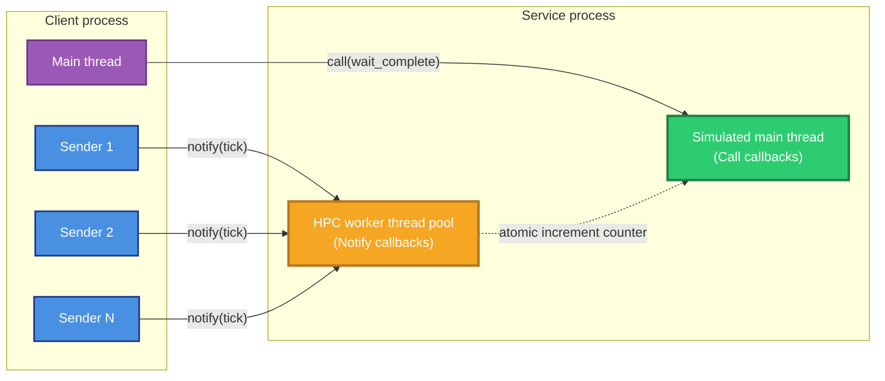
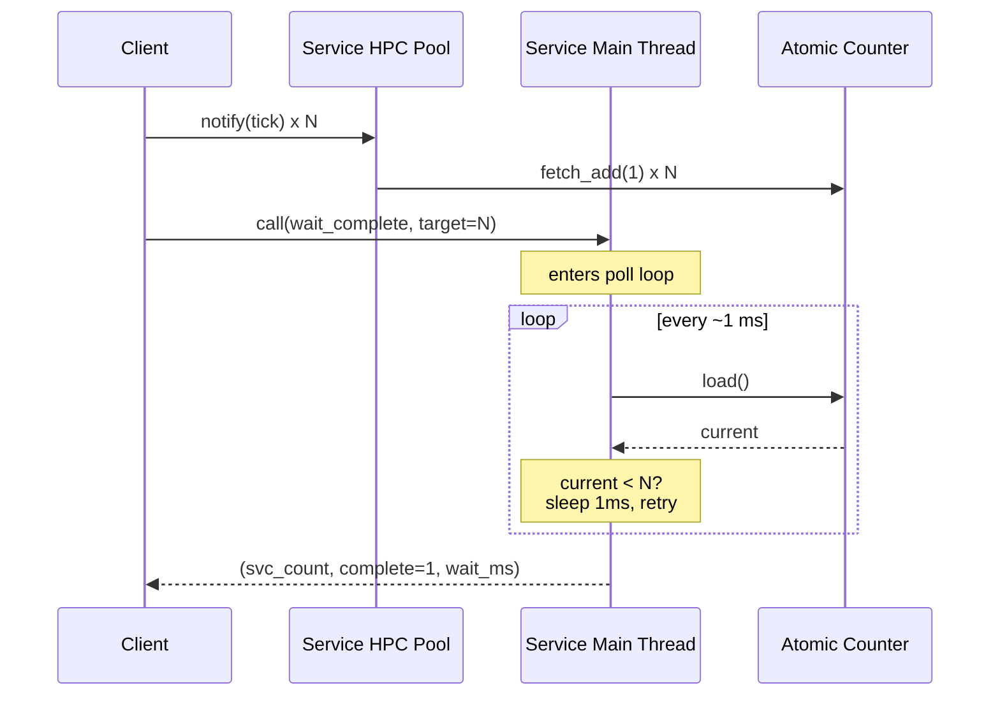
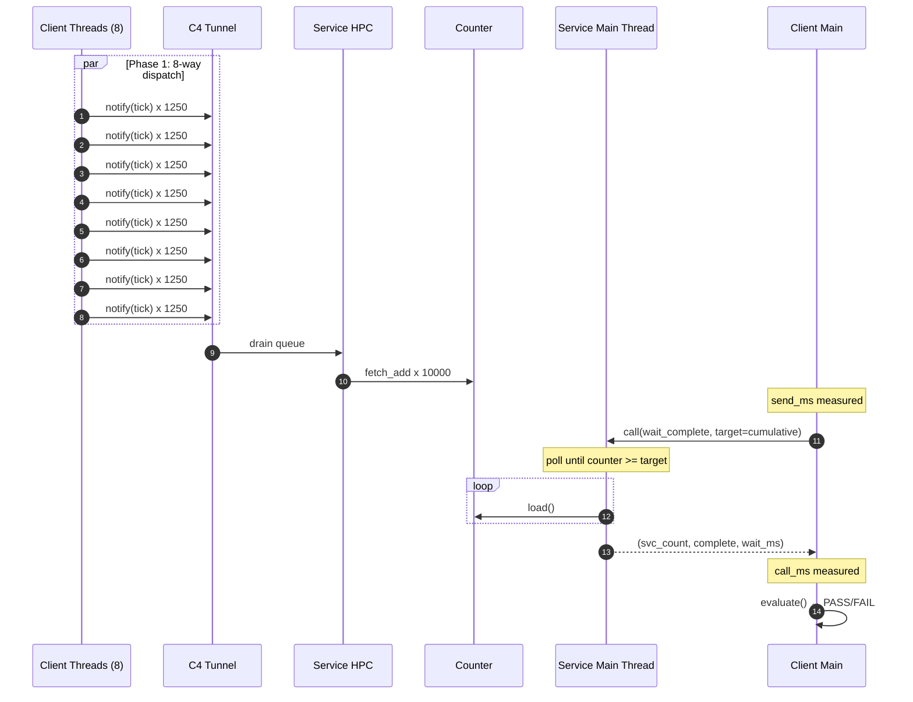

# LingoFuse Concurrent Notify Demo and CI Suite

> Chinese version: [LingoFuse_Concurrent_Notify_Demo.md](LingoFuse_Concurrent_Notify_Demo.md)

**File name**: `LingoFuse_Concurrent_Notify_Demo.md`

**Version**: v2.0 (CI-ification + measured baseline)

**Corresponding sources**: `Conc/ConcCommon.hpp` / `Conc/ConcService.cpp` / `Conc/ConcClient.cpp` / `Conc/CMakeLists.txt` / `Conc/run_conc_ci.ps1` / `Conc/run_conc_ci.sh`

**Main repository**: <https://github.com/PassByYou888/LingoFuse>

---

## Contents

1. [What this demo solves](#1-what-this-demo-solves)
2. [The concurrency model](#2-the-concurrency-model)
3. [The two run modes](#3-the-two-run-modes)
4. [One-command CI self-test](#4-one-command-ci-self-test)
5. [What the visible results mean](#5-what-the-visible-results-mean)
6. [Measured baseline (v2.0)](#6-measured-baseline-v20)
7. [Acceptance assertions](#7-acceptance-assertions)
8. [Why you can use it with confidence](#8-why-you-can-use-it-with-confidence)
9. [Troubleshooting](#9-troubleshooting)
10. [Appendix: API overview](#10-appendix-api-overview)

---

## Key updates in this version over v1.0

| # | Update |
|:-:|------|
| U1 | Added the one-command CI scripts `run_conc_ci.ps1` / `run_conc_ci.sh` |
| U2 | Added three CI threshold arguments: `--min-batches` / `--min-total-sent` / `--min-avg-rate` |
| U3 | Added the lifecycle arguments `--duration` / `--shutdown-after` |
| U4 | The client now emits a `summary` JSON line (machine-readable final result) |
| U5 | The server now emits a `service_summary` JSON line |
| U6 | Merged the **complete measured-data baseline** from one Windows x64 development machine |
| U7 | Documents that `Conc` and `Stress` are consistent in their CI integration shape |

---

## 1. What this demo solves

LingoFuse offers three call modes:

| Mode | Semantics | Response? | Ordering? |
|------|------|:--------:|:--------:|
| **Call** | request-response | ✅ | — |
| **Notify** | one-way notification | ❌ | ❌ |
| **Sequenced Notify** | one-way notification, FIFO per `(App, API)` pair | ❌ | ✅ |

Call mode has a natural acknowledgement: the client knows at any moment how far the server has processed. **Notify mode has no acknowledgement** — after sending, the client cannot know whether the server processed the message, how many it processed, or whether it succeeded.

When users evaluate whether LingoFuse suits Notify-dominated scenarios such as "high-frequency status reporting / event-stream broadcast / log collection", they ask:

- **Do the messages really arrive?**
- **Does the server really process them?**
- **Under high concurrency, is not a single one lost?**
- **If I want to obtain "the server's processing progress as of now" at some instant, is that possible?**

The `Conc` demo answers these four questions with a minimal amount of code:

```
Client: N threads sending notify concurrently + 1 call (completion barrier)
Server: one tick counter + one blocking wait call
```

Its core mechanism is a **completion barrier**: after a client sends a batch of notifies it issues a `wait_complete` Call carrying the number "how many I have sent in total"; on receiving that Call the server blocks on the simulated main thread polling its own tick counter until it reaches that number, then returns.

**Effect**: Notify is asynchronous, unordered and unacknowledged; but through one Call the client obtains the deterministic guarantee "as of that instant the server has processed N messages".

---

## 2. The concurrency model

### 2.1 Three independent execution paths

The demo can run N sender threads plus one blocking wait callback at the same time thanks to LingoFuse's underlying **three independent execution paths**:



| Path | What it carries | Where it runs |
|------|----------|----------|
| **A** | the `tick` Notify callback | the server's **HPC background worker thread pool** |
| **B** | the `wait_complete` Call callback | the server's **simulated main thread** |
| **C** | the client's notify calls | client threads (main thread + N senders) |

A and B execute on the server, C on the client. A and B **do not share a thread** — they are two kinds of message dispatched by the C4 engine to different thread pools.

**All cross-path communication goes through one `std::atomic<std::uint64_t>` counter**. No locks, no condition variables, no explicit synchronization primitives.

### 2.2 Why blocking the main thread does not deadlock

This is the demo's most important **safety argument**:

- the server's `wait_complete` callback **runs on the main thread**, and performs a polling wait loop there.
- the server's `tick` callback **runs on the HPC worker thread pool** — it is **independent** and does not depend on the main thread.
- therefore: with the main thread blocked in `wait_complete`, the HPC workers **are not prevented** from continuing to consume the inbound notify queue.
- the counter **keeps growing** during the wait, so the exit condition of `wait_complete` is bound to be met.



**In one sentence**: this is "trading main-thread blocking for deterministic observation of server processing progress", not "using main-thread blocking to stop server processing". That distinction decides whether a deadlock occurs.

> If the server processed `tick` on the main thread too, this demo would deadlock immediately. LingoFuse's Notify and Call naturally go through different thread pools, and that is the precondition for this pattern to work.

### 2.3 The complete timing of one batch

The complete timing of one batch (default `batch_size = 10000`, `send_threads = 8`):



**Three time windows**:

| Field | Meaning |
|------|------|
| **`send_ms`** | from "the 8 threads start dispatching" to "the last thread returns". This is the **client's local dispatch cost**, including DataHandle creation, payload packing and C4 tunnel enqueue |
| **`call_ms`** | from "wait_complete is sent" to "the response arrives". This is **one end-to-end Call round-trip**, including server-side waiting, C4 transport and the response coming back |
| **`wait_ms`** | the time the server **actually spent waiting inside the `wait_complete` callback**. When the counter has already reached the target this value is 0 |

---

## 3. The two run modes

### 3.1 Interactive mode (default)

Without `--ci` the client enters an **infinite batch loop** until Ctrl+C or Enter. This is for human observation.

```bash
# terminal 1
./ConcService

# terminal 2 — start after it prints "Online on ipc:conc"
./ConcClient --threads 8 --size 10000
```

### 3.2 CI mode (`--ci`)

The client runs a fixed number of batches (**set by `--batches N` or `--duration N`**), emits JSON Lines, exits automatically and returns exit code 0/1/2.

```bash
# fixed batch count
./ConcClient --ci --batches 20 --size 10000 --threads 8

# time box (run 30 seconds, unlimited batches)
./ConcClient --ci --duration 30 --size 10000 --threads 8
```

### 3.3 Complete command-line arguments

**Server `ConcService`**:

```
ConcService [options]

  --ci                    JSON Lines output; suppresses periodic reports
  --shutdown-after N      auto-close (seconds); 0 = unlimited
  --wait-timeout N        server-side wait budget, ms (default 30000)
  -h, --help              show help
```

**Client `ConcClient`**:

```
ConcClient [options]

  Run shape
    --ci                  JSON Lines output; auto-exit; 0/1/2 exit codes
    --batches N           batch count (0 = unlimited; default 10 under --ci)
    --duration N          time box (seconds); 0 = unlimited

  Load shape
    --size N              notifies per batch (default 10000)
    --threads N           concurrent sender threads (default 8)
    --pause N             pause between batches, ms (default 50)

  Timeouts
    --timeout N           client LF_Call timeout, ms (default 60000)
    --wait-timeout N      server-side wait budget, ms (default 30000)

  CI gate thresholds (optional; 0 = check disabled)
    --min-batches N       complete at least N batches
    --min-total-sent N    at least N notifies sent in total
    --min-avg-rate F      average rate at least F notify/s
```

### 3.4 Exit-code contract

| Exit code | Meaning |
|:------:|------|
| `0` | every batch PASSed and all CI thresholds are met |
| `1` | some batch FAILed or a threshold was not met |
| `2` | command-line argument error |

---

## 4. One-command CI self-test

### 4.1 Windows: `run_conc_ci.ps1`

```powershell
cd D:\CoreLibrary\LingoFuse\Binary
.\run_conc_ci.ps1
```

**What the script does automatically**:

1. locates the `Binary/` directory (searching 4 candidate paths for `ConcService.exe`)
2. estimates the server lifetime (client duration + 15 seconds of margin)
3. starts `ConcService` (with `--shutdown-after`)
4. waits for the server's `service_ready` event
5. runs `ConcClient` (blocking)
6. merges all JSON Lines into `conc_ci_report.jsonl`
7. prints a compact final summary
8. returns the client's exit code

### 4.2 Linux / macOS: `run_conc_ci.sh`

```bash
cd LingoFuse/Binary
./run_conc_ci.sh
```

Behaviour matches the PowerShell version.

### 4.3 Common invocations

```powershell
# default scenario (20 batches × 10000 messages × 8 threads)
.\run_conc_ci.ps1

# short run (verify the pipeline is connected)
.\run_conc_ci.ps1 -Batches 5 -Size 1000 -Threads 4

# time box (run 30 seconds)
.\run_conc_ci.ps1 -Duration 30 -Size 10000 -Threads 8

# with hard gates
.\run_conc_ci.ps1 -Batches 30 -Size 10000 -Threads 8 `
                  -MinBatches 30 -MinTotalSent 300000 -MinAvgRate 5000

# quiet mode (good for CI logs)
.\run_conc_ci.ps1 -Quiet
```

### 4.4 CI integration

```yaml
- name: LingoFuse concurrent notify test
  working-directory: LingoFuse/Binary
  shell: pwsh
  run: |
    .\run_conc_ci.ps1 -Batches 20 -Size 10000 -Threads 8 -Quiet

- name: Upload report
  if: always()
  uses: actions/upload-artifact@v4
  with:
    name: conc-report
    path: |
      LingoFuse/Binary/conc_ci_report.jsonl
      LingoFuse/Binary/conc_ci_client.jsonl
```

The exit code reflects the result directly. The pipeline needs no extra parsing.

---

## 5. What the visible results mean

### 5.1 Client: interactive mode

One line per batch:

```
[Batch 3] send_ms=1103  call_ms=812  sent=10000  target=30000  svc_count=30000  wait_ms=0  errors=0  p95_us=851  status=OK
```

| Field | Meaning | Expected value |
|------|------|--------|
| `send_ms` | dispatch time for this batch's 10000 notifies | steady at 1000–1200 ms |
| `call_ms` | end-to-end time of one `wait_complete` | 700–1100 ms |
| `sent` | notifies actually sent in this batch | equals `batch_size` |
| `target` | the **cumulative** target handed to the server | `batch_size × batch_index` |
| `svc_count` | the **cumulative** tick count returned by the server | `>= target` |
| `wait_ms` | time the server spent in the wait loop | usually 0 |
| `errors` | send exceptions in this batch | always 0 |
| `p95_us` | P95 of the local per-notify cost in this batch | around 850 μs |
| `status` | assertion result | `OK` / `FAIL` |

### 5.2 Client: CI mode

One JSON line per batch:

```json
{"event":"batch","index":3,"send_ms":1103,"call_ms":812,"sent":10000,"expected_sent":10000,"target":30000,"svc_count":30000,"wait_ms":0,"errors":0,"resp_ok":true,"lat_p50_us":648,"lat_p95_us":851,"lat_p99_us":984,"status":"PASS"}
```

**Key design point**: the JSON carries both `sent` and `target`, and their semantics **differ**:

- `sent` = `expected_sent` = `batch_size` — the count sent **in this batch**
- `target` = `svc_count` (expected) = `batch_size × batch_index` — the **cumulative** target

Understanding the difference between these two quantities is the key to reading the report.

### 5.3 Client: the CI summary event

After all batches finish the client emits one machine-readable `summary` line:

```json
{"event":"summary","role":"client","elapsed_sec":44.907,"batch_count":20,"batches_passed":20,"batches_failed":0,"batch_size":10000,"send_threads":8,"total_sent":200000,"total_errors":0,"avg_rate":4454,"lat_p50_us":666,"lat_p95_us":858,"lat_p99_us":990,"status":"PASS"}
```

This line is the core source from which the CI script picks up the final result.

### 5.4 Server side

**Periodic status report** (interactive mode, one line per second):

```
[Service] ticks=3005  rate=2730 ticks/s  wait_calls=0
```

**Each wait_complete event**:

```
[Service] wait_complete  expected=30000  current=30000  complete=YES  wait_ms=0  polls=0
```

`polls=0` means the counter **had already reached the target** before the server entered the wait loop. That shows **notify processing is faster than the client's Call arrival** — a healthy sign.

**In CI mode** the server emits JSON:

```json
{"event":"service_ready","endpoint":"ipc:conc","app":"ConcSvc","wait_timeout_ms":30000}
{"event":"wait_complete","expected":30000,"current":30000,"complete":true,"wait_ms":0,"polls":0}
{"event":"service_summary","uptime_sec":75,"ticks":200000,"wait_calls":20}
```

### 5.5 The three kinds of CI metrics

Taken together, the observable metrics the `Conc` demo provides fall into three kinds:

| Kind | Metrics | Use |
|------|------|------|
| **Correctness** | `sent == expected_sent`, `svc_count >= target`, `errors == 0`, `resp_ok == true` | per-batch PASS/FAIL, CI gates |
| **Throughput** | `avg_rate`, `send_ms`, `call_ms` | observe dispatch efficiency |
| **Latency** | `lat_p50_us` / `lat_p95_us` / `lat_p99_us` / `lat_max_us` | local per-notify call cost, the performance-regression baseline |

---

## 6. Measured baseline (v2.0)

The data below comes from one **Windows x64 development machine**, LingoFuse v3.10, Release build, IPC endpoint `ipc:conc`.

**Absolute numbers will differ on different hardware, but the relative relationships should hold**.

### 6.1 Scenario configuration

| Parameter | Value |
|------|----|
| Batch count | 20 |
| Notifies per batch | 10,000 |
| Concurrent sender threads | 8 |
| Pause between batches | 50 ms |
| Total sent | 200,000 messages |

### 6.2 Result summary

| Metric | Measured value |
|------|:------:|
| **Status** | **PASS** |
| Total elapsed | 44.91 s |
| Batches (passed/total) | **20 / 20** |
| Cumulative sent | 200,000 messages |
| Cumulative errors | **0** |
| Average rate | **4,454 notify/s** |

### 6.3 Latency distribution (local per-notify cost)

| Quantile | Value |
|------|:--:|
| min | 12 μs |
| **p50** | **666 μs** |
| **p95** | **858 μs** |
| **p99** | **990 μs** |
| max | 9,561 μs |
| mean | 669 μs |

**Observations**:

- **P50 almost equals the mean** (666 vs 669) — the distribution is fairly uniform with a very short tail
- **P95 < 900 μs** — 95% of notify calls finish enqueueing within 1 millisecond
- **max = 9.5 ms** — a very few notifies hit OS scheduling jitter, still within an acceptable range
- **min = 12 μs** — in the best case there is almost no cost at all

### 6.4 In-batch timings

| Metric | min | avg | max |
|------|:---:|:---:|:---:|
| `send_ms` (dispatch) | 1,063 | 1,124 | 1,177 |
| `call_ms` (barrier) | 695 | 853 | 1,133 |

**Observations**:

- **`send_ms` varies within ±5%** — 8 threads steadily dispatch 10000 notifies in about 1.1 seconds
- **`call_ms` varies more** (695–1133 ms) — because it is the end-to-end round-trip of a single Call, affected by server scheduling and C4 transport
- **`call_ms` is on average smaller than `send_ms`** — the server processes fast, so `wait_complete` usually returns outside the wait loop (`wait_ms = 0`)

### 6.5 Stability across 20 batches

| Batch | `send_ms` | `call_ms` | `svc_count` | `status` |
|:----:|:---------:|:---------:|:-----------:|:--------:|
| 1 | 1,112 | 868 | 10,000 | PASS |
| 5 | 1,116 | 832 | 50,000 | PASS |
| 10 | 1,135 | 926 | 100,000 | PASS |
| 15 | 1,090 | 841 | 150,000 | PASS |
| 20 | 1,105 | 780 | 200,000 | PASS |

**Observations**:

- **`send_ms` is stable throughout** — the spread across 20 batches is under 100 ms
- **`svc_count` exactly equals `target`** — every batch catches up precisely on the cumulative value, neither early nor late
- **no batch ever shows `wait_ms > 0`** — server processing is always faster than client Call arrival
- **20/20 all PASS** — 20 consecutive batches, 200,000 notifies, zero loss

### 6.6 The one-line conclusion

> **With 8 threads sending concurrently, a single process and single endpoint steadily reach 4,454 notify/s on the Notify path, with a per-message P95 latency of about 860 μs and 200,000 messages across 20 batches lost none.**
>
> **The completion barrier costs only 700–1100 ms each time, and in the vast majority of cases needs no waiting at all (`wait_ms = 0`).**
>
> **This proves the Notify + Call barrier pattern is reliable, quantifiable and production-usable under high concurrency.**

---

## 7. Acceptance assertions

### 7.1 The per-batch assertion chain

Each batch's assertion chain (the first failing branch wins and decides `fail_reason`):

| Order | Assertion | Failure marker | Meaning |
|:----:|------|----------|------|
| 1 | `resp_ok == true` | `CALL_TIMEOUT` | no `wait_complete` response received |
| 2 | `sent == expected_sent` | `SEND_INCOMPLETE` | this batch did not send every message |
| 3 | `errors == 0` | `SEND_ERRORS` | an exception occurred during sending |
| 4 | `svc_count >= target` | `COUNT_MISMATCH` | the server did not catch up to the cumulative target |

Where:

- assertion 1 covers **C4 link availability** and **main-thread liveness**
- assertion 2 covers **this batch's complete dispatch** (client-side correctness)
- assertion 3 covers **the DataHandle / Notify local call path**
- assertion 4 covers **server-side processing completeness and order independence** (notify is out of order, but the total must be conserved)

**There is no assertion `svc_count == target`**, only `>=`. Because ticks are **cumulative** — if some notify arrives late due to extreme scheduling it is counted into the next batch (which preserves conservation). Using `>=` is **the correct handling of out-of-order delivery**.

### 7.2 The CI verdict (overall)

After every batch finishes, `ci_verdict()` decides comprehensively:

| Order | Condition | Failure marker |
|:----:|------|----------|
| 1 | every batch PASSed | `BATCH_N_<reason>` |
| 2 | `batch_count >= min_batches` | `BATCHES_BELOW_MINIMUM` |
| 3 | `total_sent >= min_total_sent` | `TOTAL_SENT_BELOW_MINIMUM` |
| 4 | `avg_rate >= min_avg_rate` | `AVG_RATE_BELOW_MINIMUM` |

All three thresholds are **optional** — they only take effect when the user explicitly passes `--min-*`. By default only "every batch PASSed" is required.

---

## 8. Why you can use it with confidence

The core facts this demo conveys can be summarised in five points:

### 8.1 Notify is reliable, merely asynchronous

Many people mistake "Notify has no acknowledgement" for "Notify is unreliable". In fact LingoFuse's Notify **is reliable at the transport layer** — it uses the same C4 channel as Call, it simply does not wait for a response at the application layer.

In the measurement, 20 batches and 200,000 notifies lost none. That is not luck, it is design.

### 8.2 The completion barrier is a simple pattern

If you need "after sending a batch, know how far the server has processed", just:

```cpp
// sender side
for (...) { LF_Notify(app, data); }
LF_Call(app, wait_complete_with_target(total_sent));
```

```cpp
// server side
void wait_complete_cb(void*, input, output) {
    uint64_t target = read_target(input);
    while (counter < target) { sleep(1ms); }
    write_result(output, counter, counter >= target);
}
```

A dozen lines of code solve what usually needs a complex consensus protocol in a distributed system. The reason: `counter` is a **monotonic counter**, and the `wait_complete` Call has deterministic request-response semantics. Combined, they form a monotonic barrier.

### 8.3 Main-thread blocking is observable, and safe

`wait_complete` blocks on the server's main thread, and that is **deliberate**. What it buys:

- the client does not need to poll server state
- the client does not need complicated "what to do on timeout" error handling
- the client gets an **atomic** observation point

The cost is that the server's main thread cannot handle other Calls while waiting. But that cost is **quantifiable** — the `wait_ms` field is it. **In the measurement all 20 batches had `wait_ms = 0`**, because Notify processing is faster than a Call round-trip.

### 8.4 Global observability

The demo offers observability at three levels:

| Level | Observation point | Used for |
|------|--------|------|
| **Per message** | `lat_p50_us` / `lat_p95_us` / `lat_p99_us` | performance regression |
| **Per batch** | `send_ms` / `call_ms` / `wait_ms` | batch completeness |
| **Global** | `avg_rate` / `total_sent` / `batches_passed` | long-run stability |

All three levels are **machine-readable** and can feed a monitoring system directly.

### 8.5 Consistent with the other suites in the main repository

`Conc` is fully consistent with the repository's other test suites (`test_lingofuse`, `test_lingofuse_json`, `Cross`, `Stress`) in these respects:

- the same RAII wrapper (`LingoFuse.hpp`)
- the same I/O layer (`lf_io.hpp`)
- the same cleanup order (`LF-CLEAN-001`)
- the same exit-code contract (`0/1/2`)
- the same JSON Lines output format
- **the same shape of one-command CI script** (`run_*_ci.ps1` / `run_*_ci.sh`)

Whichever entry point users come in through, LingoFuse's observability and CI friendliness are consistent.

---

## 9. Troubleshooting

### 9.1 `wait_ms` occasionally 10–15 ms

**Symptom**: `[Service] wait_complete ... wait_ms=10 polls=1`.

**Cause**: `wait_complete` polls internally with `sleep_for(1ms)`, and on Windows the actual granularity of `sleep_for(1ms)` is usually 10–15 ms (depending on the system clock interrupt period). On Linux it is usually 1–2 ms.

**Does it affect the assertions?** No. `wait_ms` is only an **observation metric** and takes no part in the PASS/FAIL decision.

### 9.2 `status=FAIL reason=COUNT_MISMATCH`

**Symptom**: `svc_count < target`.

**Common causes**:

1. **the server's `--wait-timeout` is too small**: the default is 30 seconds. Increase `--wait-timeout`
2. **the client's `--timeout` is too small**: if `LF_Call` times out before the server finishes waiting, the client sees `CALL_TIMEOUT`
3. **the server's HPC thread pool is saturated**: check whether the server's `api_tick` does just one atomic increment

### 9.3 `status=FAIL reason=SEND_INCOMPLETE`

**Symptom**: `sent < expected_sent`.

**Cause**: a sender thread was interrupted early, or `LF_Notify` threw.

**Check**:

- did it receive `g_stop_flag`?
- is there any `SEND_ERRORS`?

### 9.4 `status=FAIL reason=CALL_TIMEOUT`

**Symptom**: the client received no response within `--timeout`.

**Cause**:

1. **the C4 link dropped**: check whether `LF_CheckMainThread()` returns 1
2. **the server crashed**: check `ConcService` output

### 9.5 `run_conc_ci.ps1` reports `Cannot find path`

**Cause**: the script was placed in a directory that does not contain `ConcService.exe`.

**Fix**: the script automatically searches 4 candidate directories for `ConcService.exe`. Put the script in a directory that contains the `.exe`.

### 9.6 Execution policy error

```powershell
# one-off bypass (affects only the current window)
Set-ExecutionPolicy -Scope Process -ExecutionPolicy Bypass

# or invoke directly
powershell -ExecutionPolicy Bypass -File .\run_conc_ci.ps1
```

### 9.7 The server's `ticks` stuck at 0

**Symptom**: `[Service] ticks=0 rate=0 ticks/s wait_calls=0` persists for tens of seconds.

**Cause**: the client has not started, or the client is not connected to the same IPC endpoint.

**Check**: is the client stuck at `[Client] Waiting for service 'ConcSvc'...`? If so, check whether the IPC queue `conc0` is held by an earlier process:

```powershell
Get-Process ConcService, ConcClient -ErrorAction SilentlyContinue |
    Stop-Process -Force
```

---

## 10. Appendix: API overview

### 10.1 The two APIs

| API | Mode | Input | Output | Carried semantics |
|-----|:----:|------|------|----------|
| `tick` | Notify | `uint64 seq` | — | atomic counter increment |
| `wait_complete` | Call | `uint64 target` | `uint64 count`<br/>`int32 complete`<br/>`uint64 wait_ms` | block until the counter reaches the target |

**`tick`'s payload is `seq` (a sequence number)**, purely for diagnostics. The demo itself does not depend on the continuity of `seq` — because Notify guarantees no order. It is just evidence that "I sent this one".

**`wait_complete`'s semantics are "a monotonic barrier as of the moment of the call"**:

```
Meaning of the return value (count, complete, wait_ms):
  count    - the server's tick count at this instant
  complete - 1 means count >= target; 0 means the wait timed out
  wait_ms  - milliseconds the server actually waited (0 means no wait was needed)
```

If `complete == 1` the client can be sure that: **from before this batch's first notify was sent until after `wait_complete` returned, the server processed `count` notifies in total, and `count >= target`**.

### 10.2 Key constants

| Constant | Value | Notes |
|------|:--:|------|
| `kEndpoint` | `"ipc:conc"` | endpoint name |
| `kServiceApp` | `"ConcSvc"` | server App name |
| `kTickApi` | `"tick"` | Notify API name |
| `kWaitApi` | `"wait_complete"` | Call API name |
| `kDefaultBatchSize` | 10000 | notifies per batch |
| `kDefaultSendThreads` | 8 | concurrent sender threads |
| `kDefaultBatchPauseMs` | 50 | pause between batches |
| `kDefaultCallTimeoutMs` | 60000 | client Call timeout |
| `kDefaultWaitTimeoutMs` | 30000 | server-side wait budget |

### 10.3 Files produced (CI mode)

| File | Content |
|------|------|
| `conc_ci_report.jsonl` | complete JSON Lines merged from Service + Client |
| `conc_ci_service.jsonl` | Service-side output on its own |
| `conc_ci_client.jsonl` | Client-side output on its own |

### 10.4 Related documents

| Document | Content |
|------|------|
| `LingoFuse_Cpp_Knowledge_Base.md` | the full C++ interface reference |
| `LingoFuse_Pascal_Complete_Guide.md` | the Pascal interface and internal mechanisms |
| `LingoFuse_Stress_Test_Guide.md` | the Stress test suite (throughput / scaling curves) |
| `LingoFuse_LLM_Pitfalls_For_AI.md` | the pitfall index for the LLM ecosystem |

---

## Closing

In about 150 lines of code, the `Conc` demo completely answers the question "can Notify-dominated LingoFuse scenarios serve as the foundation for production load".

**Measured baseline** (recorded by this document v2.0):

- 8 threads × 10000 messages/batch × 20 batches → **4,454 notify/s**
- local per-notify latency **P50 = 666 μs, P95 = 858 μs**
- 200,000 notifies in total, **zero loss**
- 20 / 20 batches pass, **the completion barrier costs only 700–1100 ms each time**

It proves:

- **Notify does not lose messages under high concurrency**: cumulative counts are conserved, none duplicated, none missing
- **the completion barrier is cheap**: one Call buys one deterministic progress observation point, at a cost of about 10 lines
- **main-thread blocking is safe**: because Notify and Call naturally use different thread pools — an inherent property of the LingoFuse engine, not a coincidence
- **observability can serve both humans and machines**: interactive mode for people, `--ci` mode for CI, sharing one set of assertions
- **the one-command CI script makes evaluation easy**: one command, one exit code, one report

If your project has scenarios such as "high-frequency event reporting", "log aggregation", "state synchronization" or "sensor data streams", the pattern shown by the `Conc` demo can be applied directly. It is not a toy but **a minimal reference implementation you can copy into production code**.

> **References**:
> - Main repository: <https://github.com/PassByYou888/LingoFuse>
> - C++ knowledge base: `LingoFuse_Cpp_Knowledge_Base.md`
> - Pascal complete guide: `LingoFuse_Pascal_Complete_Guide.md`
> - Stress test suite: `LingoFuse_Stress_Test_Guide.md`

---

*Document version: v2.0 (CI-ification + measured baseline)*
*Corresponding sources: `Conc/ConcCommon.hpp` / `Conc/ConcService.cpp` / `Conc/ConcClient.cpp` / `Conc/run_conc_ci.ps1` / `Conc/run_conc_ci.sh`*
*Measured environment: Windows x64 development machine, LingoFuse v3.10, Release build, IPC endpoint*
*All status output and comments are in English (a source contract); this document is the Chinese explanation.*
*Last updated: 2026-10-01*
