# LingoFuse C++ Interface Knowledge Base (v8.0, English Edition)

> **Purpose**: The self-contained, authoritative reference for the LingoFuse C++ interface. Any AI or human engineer can read this file alone and write correct, complete, production-grade LingoFuse C++ programs without reading the source.
>
> **Source coverage**: `LingoFuse.h`, `LingoFuse.c`, `lf_io.hpp`, `LingoFuse.hpp`, `lf_http_bridge_client.hpp`, cross-checked against the Pascal layer (`lingofuse_import.pas`, `lingofuse_helper.pas`, `Z.LingoFuse_Export.pas`, `Z.LingoFuse_Core.pas`, `Z.Net.C4.LingoFuse.pas`) and against `LingoFuse_Pascal_Complete_Guide.md` / `Z.LingoFuse.md`.
>
> **Evidence level**: 🟢 verified against source / 🟡 documentation inference / ⏳ unverified
>
> **Diagrams**: All diagrams use Mermaid.
>
> **Changelog**: v8.0 (2026-10-12) — Synchronised with the Pascal-side v3.2 ABI update and the new modern async call model:
>   - **`LF_Get_P2P_UID` return type changed**: from `TP2P_UID` (by-value struct) to `const TP2P_UID*` (pointer to a library-owned 32-byte buffer, released ~5 s after the call).
>   - **Side-data semantics documented**: `LF_Get_P2P_UID` / `LF_Get_P2P_Name` read the sender's injected identity from an INPUT handle. They are NOT properties of the handle itself. They are invalid on OUTPUT handles and on caller-created handles.
>   - **`DataHandle::getP2PUid()` / `DataHandle::getP2PName()`** added to the RAII wrapper. Both copy immediately; no raw pointer is ever exposed to C++ callers.
>   - **`lingofuse::AsyncResult`** class introduced: carries either a borrowed result handle or a failure message.
>   - **Modern async call model** added: `callAsync` / `callAsyncSequenced` / `callAsyncByUid` / `callAsyncByP2PName`, each with a DataHandle overload and a convenience-JSON overload. Built on a type-erased holder + a single `LF_CDECL` trampoline. Dispatch failures are routed through the callback with an error `AsyncResult` (single error path).
>   - **Test coverage**: the C ABI suite (`test_lingofuse_capi.c`, `test_lingofuse_uid.c`, `test_uid_probe.c`) and the C++ suite (`test_lingofuse.cpp`) have been updated to cover the new pointer-return type, the side-data zero-fill contract, and the eight new async tests.
>   - **Export count clarified**: the runtime exports **59** symbols, not 36/37. The earlier figure reflected an intermediate header-only view. The authoritative count is now derived from `LingoFuse.c`'s `RESOLVE` sequence.
>
> **Evidence level legend**: 🟢 verified against source / 🟡 documentation inference / ⏳ unverified

---

## Table of Contents

- [Chapter 0 — Quick Orientation](#chapter-0--quick-orientation)
  - [0.7 ABI Loading Contract (READ THIS FIRST)](#07-abi-loading-contract-read-this-first)
  - [0.8 UID Roles and Side-Data (READ THIS SECOND)](#08-uid-roles-and-side-data-read-this-second)
- [Chapter 1 — What LingoFuse Is](#chapter-1--what-lingofuse-is)
- [Chapter 2 — Build, Load, and Platform](#chapter-2--build-load-and-platform)
- [Chapter 3 — Runtime Mechanics](#chapter-3--runtime-mechanics)
- [Chapter 4 — The C ABI Layer](#chapter-4--the-c-abi-layer)
- [Chapter 5 — Unified I/O (`lf_io.hpp`)](#chapter-5--unified-io-lf_iohpp)
- [Chapter 6 — RAII Layer (`LingoFuse.hpp`)](#chapter-6--raii-layer-lingofusehpp)
- [Chapter 7 — Modern Async Call Model](#chapter-7--modern-async-call-model)
- [Chapter 8 — Callback Contract](#chapter-8--callback-contract)
- [Chapter 9 — Cross-Language Wire Format](#chapter-9--cross-language-wire-format)
- [Chapter 10 — Full Call Chain and Lifecycle](#chapter-10--full-call-chain-and-lifecycle)
- [Chapter 11 — Multi-Node, Multi-App, Load Balancing](#chapter-11--multi-node-multi-app-load-balancing)
- [Chapter 12 — Runtime Options](#chapter-12--runtime-options)
- [Chapter 13 — Error Handling and Recovery](#chapter-13--error-handling-and-recovery)
- [Chapter 14 — HTTP Bridge](#chapter-14--http-bridge)
- [Chapter 15 — Complete Application Patterns](#chapter-15--complete-application-patterns)
- [Chapter 16 — Cross-Language Comparison](#chapter-16--cross-language-comparison)
- [Chapter 17 — Integration with the Z Framework](#chapter-17--integration-with-the-z-framework)
- [Chapter 18 — Debugging and Troubleshooting](#chapter-18--debugging-and-troubleshooting)
- [Chapter 19 — Testing and Verification](#chapter-19--testing-and-verification)
- [Chapter 20 — Anti-Patterns and Pitfalls](#chapter-20--anti-patterns-and-pitfalls)
- [Chapter 21 — API Quick Reference](#chapter-21--api-quick-reference)
- [Chapter 22 — Honest Uncertainty List](#chapter-22--honest-uncertainty-list)
- [Chapter 23 — Generated-Code Pitfalls](#chapter-23--generated-code-pitfalls)
- [Appendix A — Glossary](#appendix-a--glossary)
- [Appendix B — Pascal LF-* Numbering Cross-Reference](#appendix-b--pascal-lf--numbering-cross-reference)
- [Appendix C — Version History](#appendix-c--version-history)

---

## Chapter 0 — Quick Orientation

### 0.1 One-Sentence Definition

> **LingoFuse is a cross-language, cross-process, cross-machine RPC framework. The C++ interface exposes its capabilities through five headers: C ABI, unified I/O, RAII wrapper, JSON library, and HTTP bridge client. As of v8.0 it also offers a modern, lambda-based async call model.**

### 0.2 File Layout and Dependency Direction

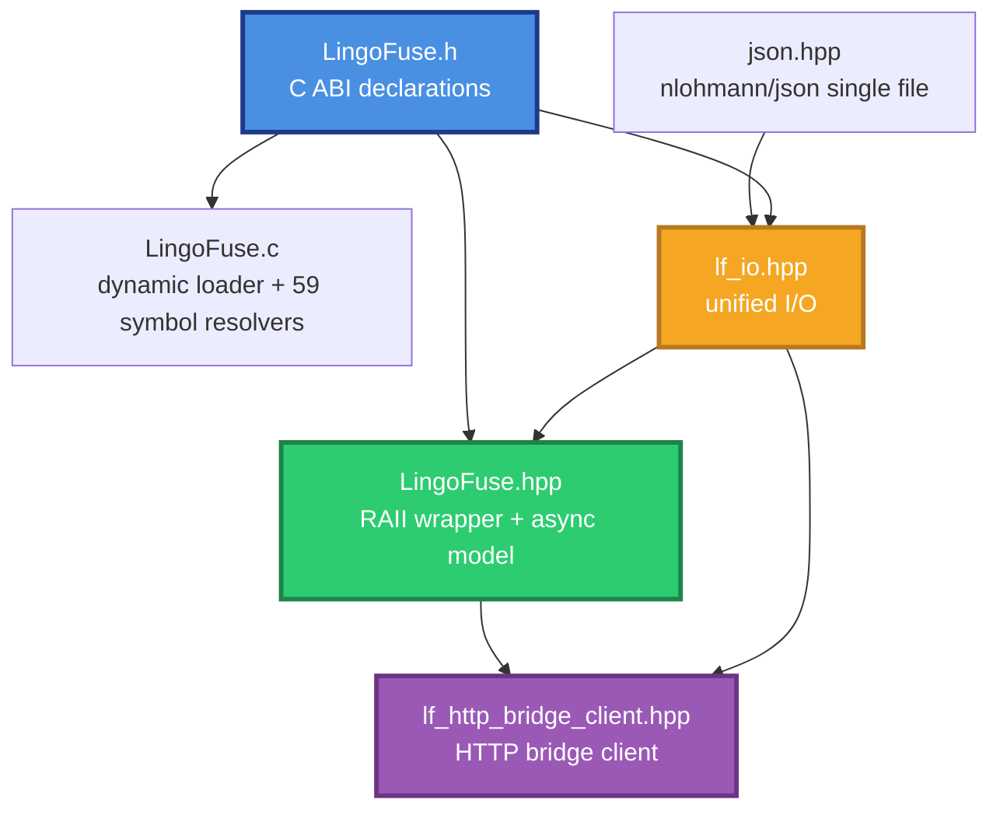

Dependency direction is strictly one-way: `LingoFuse.h → lf_io.hpp → LingoFuse.hpp → lf_http_bridge_client.hpp`.

### 0.3 Three Layers of Abstraction

| Layer | File | Purpose | Who uses it |
|---|---|---|---|
| C ABI | `LingoFuse.h` / `.c` | Dynamic loading, 59 exports, C helpers | C / C++ / any-FFI language |
| Unified I/O | `lf_io.hpp` | Only sanctioned entry for JSON/string/byte wire format | Callbacks, RAII layer |
| RAII + Async | `LingoFuse.hpp` | `DataHandle` / `App` / `LibraryLoader` / network events / async call model | Modern C++ applications |
| HTTP Bridge client | `lf_http_bridge_client.hpp` | Call `bridge.py` / `bridge.exe` over the LF mesh | Services needing HTTP/JSON repair |

### 0.4 Seven Iron Rules

| # | Rule | Violation Consequence |
|:-:|---|---|
| 1 | Callbacks MUST be `LF_CDECL` | Stack misalignment, random crashes |
| 2 | Never call `LF_Call` / `LF_Notify` / `LF_LocalCall` / `LF_PrepareDone` inside a callback | Deadlock |
| 3 | Route all JSON / string I/O through `lingofuse::io` | Frame drift, cross-language failures |
| 4 | Cleanup order: `clearNetworkEvent` → `exitMainThread` → `~App` / `FreeApp` → `shutdown` → `LF_FreeLibrary` | Dangling pointers, leaks |
| 5 | One client per physical address, unless `Overlap_Connection=True` | Silent dropped connections |
| **6** | **`LF_LoadLibrary()` MUST be called before ANY other `LF_*` call.** | **All other `LF_*` calls silently target null function pointers → crash or no-op** |
| **7** | **`LF_Get_P2P_UID` / `LF_Get_P2P_Name` read SIDE DATA and are valid only on the `input` handle of a callback.** | **Zero UID / empty name on any other handle** |

### 0.5 Key Defaults

| Item | Value |
|---|---:|
| C ABI export count | **59** |
| Default TCP port | 9898 |
| DataHandle idle reclamation | 10 minutes |
| Reclamation scan interval | 5 seconds |
| `LF_PrepareDone` init timeout | 30 seconds |
| `Wait_Connection_Timeout` default | 30000 ms |
| `Overlap_Connection` default | False |
| `Wait_Connection_ReadyOk` default | True |
| `Fixed_Sequenced_Time` default | 20000 ms |
| Bridge default App | `__lf_http_bridge__` |
| Bridge default POST API | `__lf_outbound_post__` |
| Bridge default repair API | `__lf_repair_json__` |
| Bridge default LF_Call timeout | 60000 ms |
| Bridge default HTTP timeout | 25.0 s |
| Bridge HTTP timeout cap | 300.0 s |
| `LF_Generate_AppName` pointer validity | ~5 seconds |
| `LF_Get_P2P_UID` pointer validity | ~5 seconds |
| `LF_Get_P2P_Name` pointer validity | ~5 seconds |
| `LF_GetOption` pointer validity | ~5 seconds |
| Sequenced Notify thread idle timeout | 5 minutes |
| Sequenced Notify thread delayed release | 5 seconds |
| Async call holder lifetime | Callback body only (trampoline destroys after return) |

### 0.6 Reading Paths

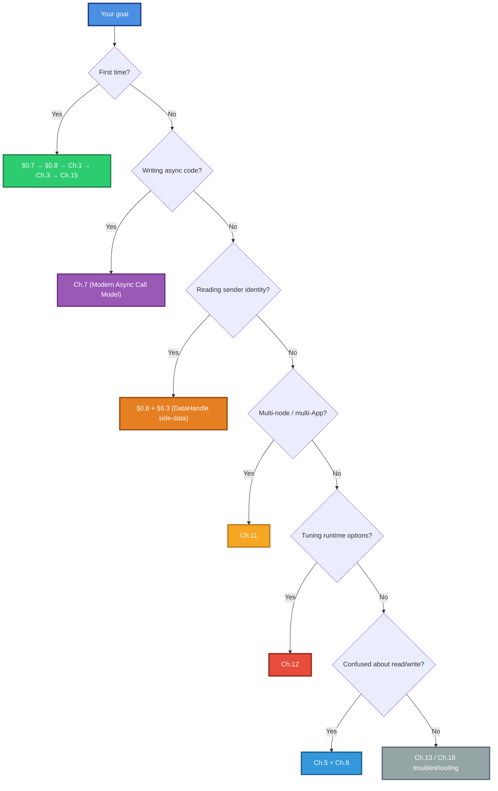

### 0.7 ABI Loading Contract (READ THIS FIRST)

> **This is the single most important operational rule when using the C ABI layer from C++.**
>
> **Empirical observation**: In production code, in AI-generated code, and in the `cpp_abi_cmake_generator_tool` output, the most common cause of "my service does nothing", "LF_CreateData returns garbage", and "callback never fires" is **forgetting to call `LF_LoadLibrary()` at program start**. The library and its headers cannot catch this at compile time, because every `LF_*` symbol compiles to a thin forwarding wrapper around a null function pointer.

#### 0.7.1 The Rule

The C ABI layer is **dynamically loaded**. `LingoFuse.h` declares 59 functions. `LingoFuse.c` implements them as **thin wrappers around a table of function pointers**. Those pointers are populated only when you explicitly call:

```c
int LF_LoadLibrary(void);   /* returns 1 on success, 0 on failure */
```

**Before that call, every `LF_*` pointer is null.** Invoking any other `LF_*` function without a prior successful `LF_LoadLibrary()` is undefined behaviour — typically a null-pointer dereference. In Debug builds it usually crashes immediately; in Release builds it may appear to "do nothing" because the compiler may have optimised the call site based on the assumption that a function pointer is never null, or the crash may land in an unrelated location.

#### 0.7.2 Mandatory Ordering

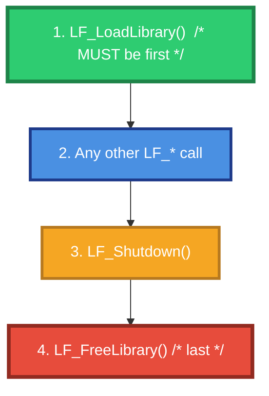

#### 0.7.3 Search Order Used by `LF_LoadLibrary`

`LF_LoadLibrary()` takes **no arguments**. The wrapper locates the runtime using this fixed search order:

1. The directory that contains the **current executable**.
2. The platform's **default loader search path** (PATH on Windows, LD_LIBRARY_PATH on Linux, DYLD_LIBRARY_PATH on macOS).

Expected runtime library names:

| Platform | Library |
|---|---|
| Windows 64-bit | `LingoFuse64.dll` |
| Windows 32-bit | `LingoFuse32.dll` |
| Linux / BSD | `liblingofuse.so` |
| macOS | `liblingofuse.dylib` |

There is **no environment-variable override** at the C ABI level. To relocate the runtime library, either place it next to the executable or add its directory to the platform loader search path.

#### 0.7.4 Minimal Correct Pattern

```cpp
#include "LingoFuse.hpp"

int main() {
    /* Step 1 — load the runtime BEFORE anything else. */
    if (LF_LoadLibrary() != 1) {
        std::fprintf(stderr, "[FATAL] LF_LoadLibrary failed\n");
        return 1;
    }

    /* Step 2 — now every LF_* call is safe. */
    lingofuse::resetPrepare();
    lingofuse::App app("MyApp", "demo");
    app.registerCall("ping", "ping", nullptr, my_cb);
    /* ... */

    lingofuse::prepareDone();

    /* Step 3 — shut down and unload. */
    lingofuse::shutdown();
    LF_FreeLibrary();
    return 0;
}
```

#### 0.7.5 RAII Shortcut (RECOMMENDED)

`lingofuse::LibraryLoader` handles both `LF_LoadLibrary()` and `LF_FreeLibrary()` via RAII. **Construct it as the very first object in `main()`** (or before any other LingoFuse code):

```cpp
int main() {
    lingofuse::LibraryLoader loader;   /* constructor calls LF_LoadLibrary */
    /* ... everything else ... */
    return 0;                          /* destructor calls LF_FreeLibrary */
}
```

If `LF_LoadLibrary` fails, the constructor throws `lingofuse::Error` with `code() == ErrorCode::LibraryLoadFailed`.

**Recommended for all C++ code.** It makes the load/unload contract impossible to forget and handles multi-module reference counting.

#### 0.7.6 Why This Rule Is Easy to Miss

- **Pascal has no equivalent**: Pascal links statically against `LingoFuse` and the runtime is always present. A Pascal developer moving to C++ does not realise a load call is required.
- **Python has no equivalent**: the Python wrapper loads the library during import, invisibly.
- **C# / Java / Node.js have no equivalent**: their FFI layers load the library automatically.
- **Generated test programs** (from `cpp_abi_cmake_generator_tool`) are a common failure point: a naive generator emits `LF_CreateApp`, `LF_PrepareService`, etc. without a leading `LF_LoadLibrary()`. The resulting program compiles cleanly and then dies at the first `LF_*` call. See Chapter 23.

**Do not assume the C++ compiler will warn you.** `LingoFuse.h` declares the `LF_*` functions with the `LF_CDECL` calling convention; from the compiler's perspective they are ordinary external functions. There is no attribute that can express "must be preceded by a load call".

#### 0.7.7 Diagnostic Checklist

If a program using the C ABI appears to do nothing or crashes without a clear message:

1. **Verify that `LF_LoadLibrary()` (or `lingofuse::LibraryLoader`) is called before every other `LF_*` call.**
2. Verify that `LF_LoadLibrary()` returned 1 (or that the `LibraryLoader` constructor did not throw).
3. Verify the runtime library file is present in the search path (`LingoFuse64.dll` on the exe's directory, or on `PATH`).
4. Enable Debug logging via `setOption("Quiet", "False")` and `setOption("ConsoleOutput", "True")`.

### 0.8 UID Roles and Side-Data (READ THIS SECOND)

> **Two facts about UIDs that trip up almost every new integrator.**

#### 0.8.1 The UID Type Plays TWO Roles

The Pascal-side type `TP2P_UID___` is `array[0..31] of Byte`. On the C ABI, the SAME Pascal type plays TWO different roles, and each role requires a DIFFERENT C-level representation:

| Role | Where it appears | C type | Passing convention |
|---|---|---|---|
| **ARGUMENT** | `LF_UID_Call`, `LF_UID_Notify`, `LF_UID_Async_*`, `LF_Check_UID`, `LF_Check_UID_Api`, `LF_WriteUid`, `LF_ReadUid` | `TP2P_UID` (the struct) | by value |
| **RETURN** | `LF_Get_P2P_UID` | `const TP2P_UID*` (pointer) | pointer in RAX |

**Never unify them.** A common historical bug was declaring `typedef uint8_t TP2P_UID[32]` and using it for both positions. That breaks the argument-position ABI: FPC passes a 32-byte Pascal array by value on the stack, and ctypes/C must match that convention exactly.

**Concretely**:

- In argument position, you write `TP2P_UID uid; ... LF_UID_Call(uid, ...)`.
- In return position (only `LF_Get_P2P_UID`), you receive a `const TP2P_UID*` and must dereference it: `const TP2P_UID* p = LF_Get_P2P_UID(h); if (p) { TP2P_UID uid = *p; ... }`.

#### 0.8.2 UID and P2PName Are SIDE DATA

`LF_Get_P2P_UID` and `LF_Get_P2P_Name` do NOT read a property of the handle. They read the "side data" that the SENDER'S transport layer writes into every request payload BEFORE transmission:

```
sender: TC40_LF_Client.Send_*
           └── TMemory_Param_Tool.Rebuild_UID_and_P2PName
               └── writes  [FromUID: 32 bytes]
                           [FromP2PName: UTF-8 string]
                           into the payload header
```

The receiver side therefore sees these two fields inside the `Data_Param` of the INPUT handle it receives from the framework. Consequences:

| Handle | Is identity available? |
|---|:---:|
| `input` argument of a registered Call / Notify callback | ✅ |
| `input` handle of a local call (`LF_LocalCall` / `LF_LocalNotify`) | ✅ |
| `output` argument of a Call callback | ❌ (zero UID / empty name) |
| handle the caller created with `LF_CreateData` / `LF_CreateData_Permanent` | ❌ (zero UID / empty name) |

The library does NOT throw on the invalid cases; it logs a warning and returns a zero-filled UID / empty string.

#### 0.8.3 Reading Identity in C++

The C++ RAII wrapper hides the transient pointer entirely:

```cpp
lingofuse::DataHandle inp = ...;   // the `inp` argument of a callback
std::array<std::uint8_t, 32> uid = inp.getP2PUid();  // fresh copy
std::string name = inp.getP2PName();                  // fresh copy

// uid and name are safe to retain past the callback body.
```

Both accessors are valid only on input handles. On any other handle they return zero-filled / empty values, matching the C-level contract.

---

## Chapter 1 — What LingoFuse Is

> Read this chapter to make all later chapters precise. Skipping it leads to vague semantics.

### 1.1 Five Fundamental Abstractions

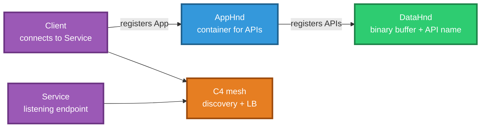

| Abstraction | Underlying type | Lifetime | Owner |
|---|---|---|---|
| **DataHnd** | `TLF_Data` record | 10 min idle → reclaimed (auto kind only) | Global handle pool |
| **AppHnd** | `TLF_App` object | Until `LF_Shutdown` | Global app pool |
| **Service** | C4 physical service | Until `LF_Shutdown` | Internal |
| **Client** | C4 physical client | Until `LF_Shutdown` | Internal |
| **MESH** | C4 service mesh | Process-wide singleton | Internal |

Users see `DataHnd` and `AppHnd`. Service/Client/MESH are internal; you touch them only through `prepareService` / `prepareClient` / `prepareDone`.

### 1.2 Service vs. Client

- **Service**: listening endpoint; maintains the registry (who exposes what API); broadcasts API info. It is a **beacon**, not a business endpoint.
- **Client**: connects to a Service; exposes its own App and APIs, or is a pure consumer.
- **A process may be both Service and Client** (self-connected; local calls avoid the network).

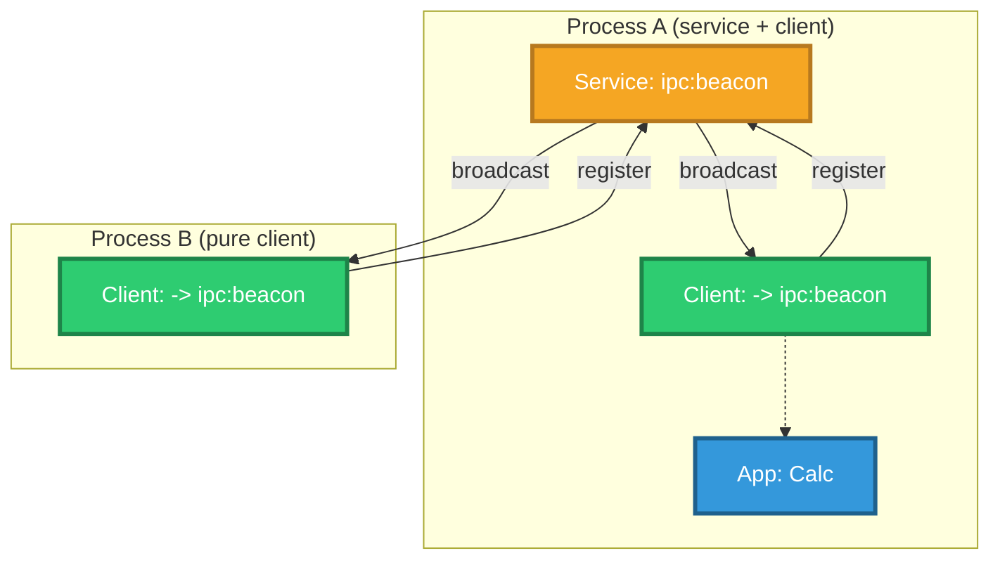

| Role | `prepareService` | `prepareClient` | Bind App |
|---|---|---|---|
| Pure beacon | ✅ | ✅ (self) | ❌ |
| Compute node | ❌ | ✅ (to beacon) | ✅ |
| Pure consumer | ❌ | ✅ | ❌ |
| Standalone | ✅ | ✅ | ✅ |

### 1.3 The C4 Mesh

C4 is LingoFuse's underlying service mesh. It provides:

1. **Discovery**: clients publish App/API info to a Service on connect.
2. **Broadcast**: Service distributes the registry to all clients.
3. **Routing**: `LF_Call` looks up the local cache and picks a target client.
4. **Load balancing**: with multiple clients offering the same App, pick by `Cycle_Time_Anchor` (least recently used).
5. **Local-first**: if the target App exists in-process, execute locally without a network hop.

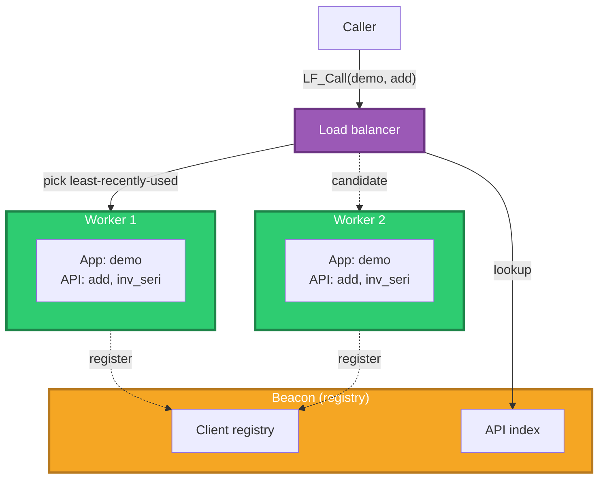

### 1.4 Service Discovery Sequence

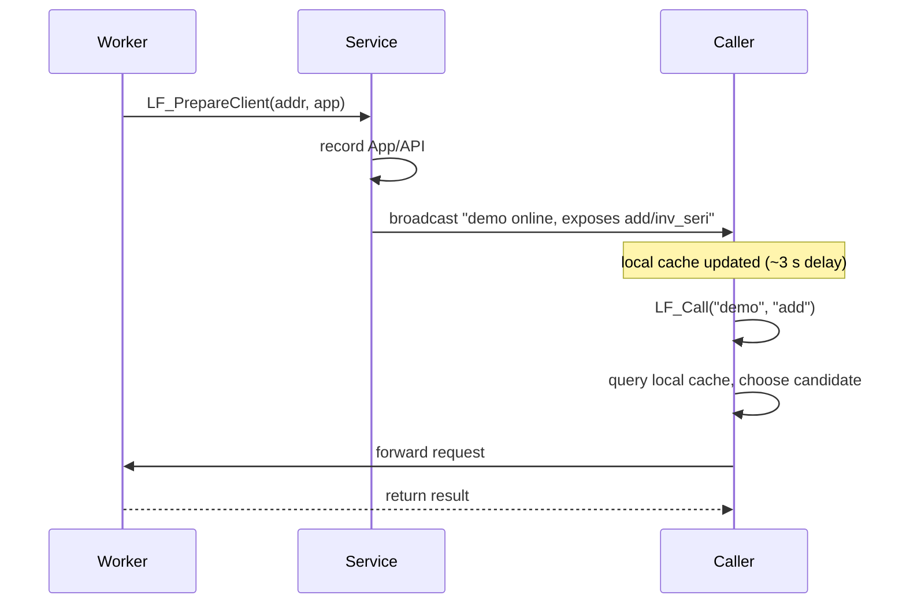

**Three core conclusions**:

- **`checkApi` has ~3 s delay** — it reads the locally cached broadcast.
- **Multiple workers are automatically load balanced** — selection by `Cycle_Time_Anchor`.
- **`LF_Call` can invoke a local App** — C4 checks the local instance first.

### 1.5 Local-First Routing

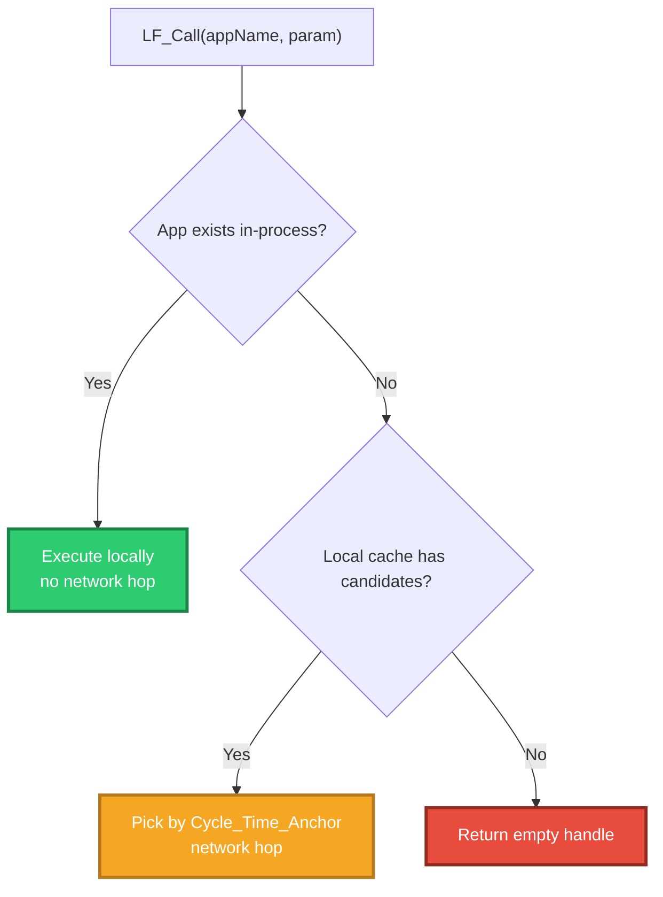

**Implication**: even when you call `LF_Call("demo", ...)` intending a remote target, if the same App name is registered locally, the local instance wins.

### 1.6 DataHandle Memory Model

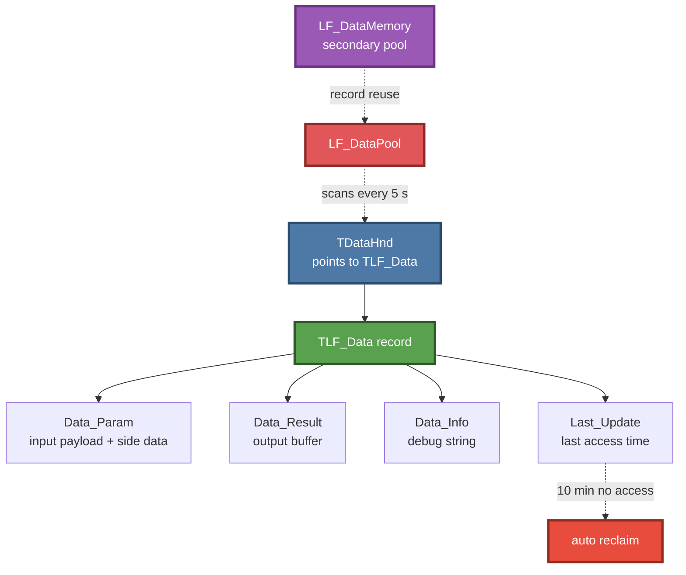

| Property | Note |
|---|---|
| **`Data_Param` and `Data_Result` are mutually exclusive** | Input handle has Param only; output handle has Result only |
| **Side data lives in `Data_Param`** | `FromUID` + `FromP2PName`, injected by the sender |
| **Auto reclamation (auto-recycled handles)** | Scans every 5 s; releases handles idle for 10 min |
| **Keep-alive** | Any `LF_*` access refreshes `LastUpdate` |
| **calling counter** | While a remote call is in flight, the input handle's `calling___` counter is > 0 and it is protected from reclamation |
| **Do not rely on auto-reclamation** | Under heavy load, handle growth can outpace reclamation → OOM |
| **Secondary memory pool** | `LF_DataMemory` caches freed `TLF_Data` records to reduce `New`/`Dispose` churn |
| **Two kinds of handles** | Auto-recycled (`LF_CreateData`) vs permanent (`LF_CreateData_Permanent`) |

### 1.7 Three Invocation Modes

| Mode | Semantics | Ordering | Return value | Underlying |
|---|---|---|---|---|
| **Call** | Request-response, synchronous | — | ✅ | Blocks until response or timeout |
| **Notify** | One-way notification | ❌ | ❌ | Best-effort |
| **Sequenced Notify** | One-way with FIFO | ✅ (same (app,api)) | ❌ | Per-pair dedicated thread |

### 1.8 Async Invocation Family (new in v8.0)

Every invocation family has an **asynchronous** twin that returns immediately and delivers the result to a callback:

| Sync | Async |
|---|---|
| `LF_Call` | `LF_Async_Call` |
| (sequenced variant) | `LF_Async_Sequenced_Call` |
| `LF_UID_Call` | `LF_UID_Async_Call` |
| `LF_UID_Sequenced_Call` | `LF_UID_Async_Sequenced_Call` |
| `LF_P2PNAME_Call` | `LF_P2PNAME_Async_Call` |
| `LF_P2PNAME_Sequenced_Call` | `LF_P2PNAME_Async_Sequenced_Call` |

The C++ wrapper exposes these through `callAsync` / `callAsyncSequenced` / `callAsyncByUid` / `callAsyncByP2PName`. See Chapter 7.

### 1.9 Relationship with the Z Framework

LingoFuse is not standalone. It builds on the Z framework:

| LingoFuse Layer | Z Framework Unit |
|---|---|
| Core RPC engine | `Z.Core` (`TAtomInt`, `TCritical`, `TCompute`) |
| Hash pools | `Z.HashList.Templet` |
| Memory streams | `Z.MemoryStream` (`TMem64`) |
| Timers | `Z.Notify` (`Subscribe_Timer_M`) |
| Status | `Z.Status` (`DoStatus`) |
| C4 distribution | `Z.Net.C4`, `Z.Net.DoubleTunnelIO.NoAuth`, `Z.Net.PhysicsIO` |
| JSON | `Z.Json` |

The C++ layer is a thin wrapper over the Pascal core. Understanding this explains why certain behaviours exist (5-second pointer validity, 10-minute reclamation, 5-second sequenced-thread delayed release, etc.).

---

## Chapter 2 — Build, Load, and Platform

### 2.1 Directory Structure

```
LingoFuse/cpp/
├── CMakeLists.txt
├── json.hpp
├── LingoFuse.h
├── LingoFuse.c
├── LingoFuse.hpp
├── lf_io.hpp
├── lf_http_bridge_client.hpp
├── CrossDemo/
├── Conc/
├── Stress/
└── test/
```

### 2.2 CMake Targets

| Target | Type | Purpose |
|---|---|---|
| `lingofuse_headers` | INTERFACE | Public headers |
| `lingofuse_c_wrapper` | STATIC | Compiles `LingoFuse.c`; links platform dynamic-loader library |
| `test_lingofuse` | EXECUTABLE | C++ RAII / network / async test suite |
| `test_lingofuse_json` | EXECUTABLE | `lf_io.hpp` tests |
| `test_lingofuse_capi` | EXECUTABLE | Pure C ABI offline test suite |
| `test_lingofuse_uid` | EXECUTABLE | UID identity-injection ABI verification |
| `test_uid_probe` | EXECUTABLE (Windows) | `LF_Get_P2P_UID` calling-convention probe |
| `CrossService` / `CrossNode` / `CrossCall` | EXECUTABLE | Demo programs |
| `ConcService` / `ConcClient` | EXECUTABLE | Concurrent-notify demo |
| `StressService` / `StressClient` / `StressMonitor` | EXECUTABLE | Stress test suite |

### 2.3 Build Commands

```bash
cd LingoFuse/cpp
mkdir build && cd build
cmake .. -DCMAKE_BUILD_TYPE=Release
cmake --build . --config Release
# Output goes to LingoFuse/Binary/
```

### 2.4 Platform and Dynamic Library Names

| Platform | Library name |
|---|---|
| Windows 64-bit | `LingoFuse64.dll` |
| Windows 32-bit | `LingoFuse32.dll` |
| Linux / BSD | `liblingofuse.so` |
| macOS | `liblingofuse.dylib` |

On Windows, `LF_LoadLibrary` chooses 64/32-bit at runtime via `sizeof(void*)`, avoiding cross-compilation macro errors.

### 2.5 `LF_LoadLibrary` / `LF_FreeLibrary`

```c
int  LF_LoadLibrary(void);
void LF_FreeLibrary(void);
```

**`LF_LoadLibrary` resolution order**:

1. If `g_loaded == 1`, return 1.
2. Determine the executable directory.
3. Try loading from the executable directory first.
4. Fall back to the system search path.
5. Resolve all 59 exports; any failure → `FreeLibrary` + return 0.
6. All succeed → `g_loaded = 1`, return 1.

**`LF_FreeLibrary`**: unloads the dynamic library and clears all static function pointers. Safe to call multiple times.

**Thread safety**: `LF_LoadLibrary` / `LF_FreeLibrary` are **not** thread-safe with each other; call them from a single thread. Other `LF_*` functions are thread-safe.

**Contract**: see §0.7 — `LF_LoadLibrary` MUST be the first `LF_*` call in the process.

### 2.6 `LF_CDECL`

```c
#if defined(_WIN32)
#  if defined(__GNUC__) || defined(__clang__)
#    define LF_CDECL __attribute__((cdecl))
#  else
#    define LF_CDECL __cdecl
#  endif
#else
#  define LF_CDECL
#endif
```

All callbacks must use `LF_CDECL`. The default calling convention (Delphi/FPC `register`/`fastcall`) misaligns the stack.

### 2.7 Compatibility

- C++17 or later
- Delphi XE 10.4+ / Free Pascal 3.2.2+
- MSVC, GCC, Clang, MinGW
- Windows / Linux / macOS / BSD

### 2.8 Distribution Contract

The C++ layer never links against the runtime shared library at build time. `LingoFuse.c` is a **dynamic loader** and the runtime is discovered **at process start**, by the first `LF_LoadLibrary()` call. This has three deployment implications:

| Deployment step | Action |
|---|---|
| **Build** | Only `LingoFuse.c` is compiled and archived; no `.lib` / `.so` / `.dylib` is referenced. |
| **Ship** | Ship the runtime DLL/so/dylib **alongside** your executable, or install it to a directory that is on the loader search path. |
| **Launch** | The program MUST call `LF_LoadLibrary()` at startup. A missing runtime library produces a clean `[FATAL] LF_LoadLibrary failed` message, not a link-time error. |

---

## Chapter 3 — Runtime Mechanics

### 3.1 Simulated Main Thread

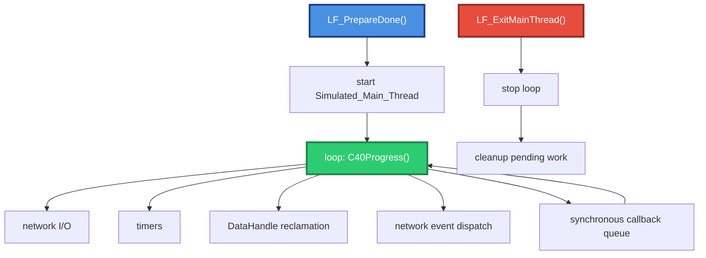

**`LF_PrepareDone` returns 1 exactly once per process**:

- First call starts the simulated main thread.
- Second call detects an already-running thread → returns 0 (**not a failure**).
- Re-initialisation requires a prior `LF_Shutdown`.

**Simulated main thread responsibilities**: drives C4 network I/O, processes timers, runs DataHandle reclamation (every 5 s), dispatches network event callbacks, processes the synchronous callback queue.

**`LF_ExitMainThread` also flushes the handle pool**: it triggers a final `Free_All_Hnd` pass that releases every outstanding data handle — including permanent ones. After this call, any data handle in the process is invalid.

### 3.2 Why Callbacks Cannot Call `LF_Call`

- Callbacks run on C4 worker threads.
- Workers hold internal locks (used for callback dispatch).
- `LF_Call` needs the simulated main thread to dispatch the response, and the main thread is waiting on the same internal lock.
- **Self-deadlock**.

**This is also why the async model routes dispatch failures through the callback** rather than requiring the caller to keep a return code: the callback is the single, unified completion signal.

### 3.3 DataHandle Auto-Reclamation

- `TLF_DataPool.Progress` scans every 5 s.
- Auto-recycled handles idle for **10 minutes** are reclaimed.
- Any `LF_*` access refreshes `Last_Update`.
- While a remote call is in flight, the input handle's `calling___` counter is > 0, protecting it from reclamation regardless of idle time.
- Permanent handles are not added to the pool and are never reclaimed.
- **Do not rely on auto-reclamation**; production code should explicitly `LF_FreeData`.

### 3.4 Status Queue

- Capacity 1000; oldest dropped on overflow.
- Depends on the simulated main thread; before `LF_PrepareDone` queries are ineffective.
- `LF_GetStatus` returns a static buffer that is invalidated by the next call — **copy immediately**.

### 3.5 Lifecycle of the Three Synchronous Modes

#### 3.5.1 Call (synchronous request-response)

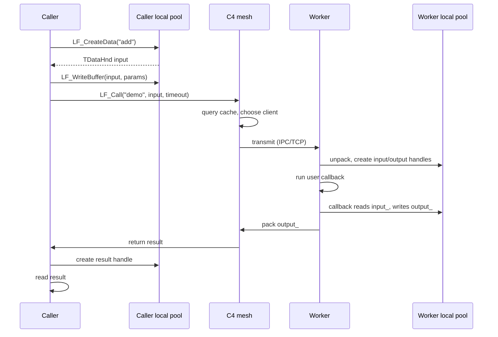

**Timeout behaviour**: `LF_Call` timeout returns a **size = 0 handle, not NULL**.

#### 3.5.2 Server-Side Behaviour After Timeout

| Question | Answer |
|---|---|
| Does the server callback continue after client timeout? | ✅ **Yes, runs to completion** (cannot be cancelled) |
| Is the result cached? | ❌ **No** — discarded |
| Does a client retry cause a second execution? | ✅ **Yes** (no idempotency guarantee) |
| How to prevent duplicate execution? | Application-level **idempotency key** (e.g., request ID) |

**Production advice**:

```cpp
// ❌ Dangerous: no idempotency key; retry re-executes
auto resp = lingofuse::tryCall("Payment", param, 1000);
if (!resp) {
    resp = lingofuse::tryCall("Payment", param, 5000);  // may double-charge
}

// ✅ Safe: request carries an idempotency key
param.writeJson({
    {"request_id", generate_uuid()},
    {"amount", 100},
    {"from", "A"},
    {"to", "B"}
});
auto resp = lingofuse::tryCall("Payment", param, 10000);
```

The server callback deduplicates by `request_id`.

#### 3.5.3 Notify (one-way)

- **No ordering guarantee**.
- **No delivery guarantee** (best-effort).
- **No return value**.
- Implemented over `SendCompleteBuffer` with an explicit NULL flush after large payloads.

#### 3.5.4 Sequenced Notify (FIFO one-way)

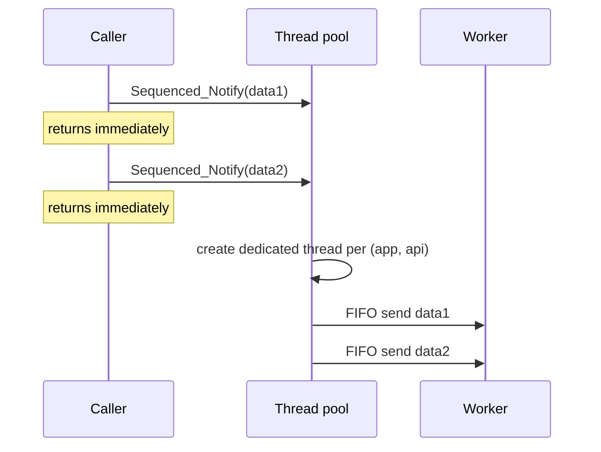

| Property | Note |
|---|---|
| **One thread per (app, api) pair** | No ordering guarantee between pairs |
| **Idle thread terminates after 5 min** | Next call recreates it (startup latency) |
| **Delayed release (5 s)** | After termination, the thread object is released via `DelayFreeObj(5.0, self)`, preventing use-after-free in the surrounding TCompute machinery |
| **Automatic chunking** | Underlying chunked transfer; no manual chunking needed |
| **Fallback threshold** | `Fixed_Sequenced_Time` (default 20 s), after which routing falls back to the newest client |

### 3.6 Async Callback Thread Pool

Async callbacks (`LF_AsyncCallOnResult`) run on the same TCompute worker pool as sync Call / Notify callbacks. Inside an async callback:

- The `result` handle is owned by the framework.
- The framework releases it IMMEDIATELY after the callback returns.
- The callback MUST NOT call `LF_FreeData` on it.
- The callback MUST NOT retain the handle past its own return.
- The callback MUST NOT block.
- The callback MUST NOT call any synchronous LingoFuse function.

The C++ wrapper's `AsyncResult` encapsulates all of this: it wraps the borrowed handle as `owned = false` and destroys it at the end of the callback body.

### 3.7 Network Event Trigger Chain

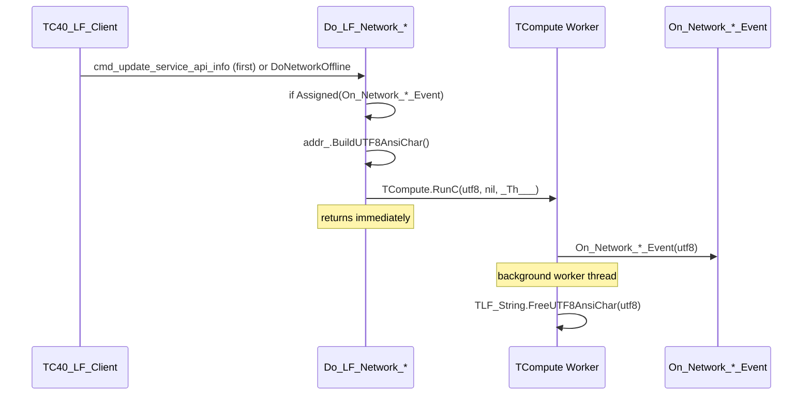

| Item | Connect | Disconnect |
|---|---|---|
| **Trigger point** | First `cmd_update_service_api_info` received | `DoNetworkOffline` (physical link loss) |
| **Semantics** | **Not TCP handshake** — "service is available" | Physical link down |
| **Fire count** | Once per connection lifecycle | Once per physical loss |
| **After reconnect** | **Fires again** | **Not again** |
| **Thread** | Background TCompute worker | Background TCompute worker |
| **`addr_` lifetime** | Freed immediately after callback returns | Same |
| **Exceptions** | Swallowed by `try...except` | Same |

---

## Chapter 4 — The C ABI Layer

### 4.1 Handle Types

```c
typedef void* TDataHnd;   // data handle: binary buffer + API name
typedef void* TAppHnd;    // app handle: container for APIs
```

**Do not dereference.** Operate only through `LF_*` functions. The two handle kinds are not interchangeable.

### 4.2 Callback Types

```c
typedef void (LF_CDECL* LF_CallFunc)(void* trigger, void* input, void* output);
typedef void (LF_CDECL* LF_NotifyFunc)(void* trigger, void* input);
typedef void (LF_CDECL* LF_NetworkEventFunc)(const char* addr);
typedef void (LF_CDECL* LF_AsyncCallOnResult)(void* data, void* result);
```

| Type | Mode | Parameters | Thread | Result handle owner |
|---|---|---|---|---|
| `LF_CallFunc` | Call | `trigger`, read-only `input`, writable `output` | background worker | — |
| `LF_NotifyFunc` | Notify | `trigger`, read-only `input` | background worker | — |
| `LF_NetworkEventFunc` | Network event | `addr` (valid only during the callback) | background worker | — |
| `LF_AsyncCallOnResult` | Async Call | `data` (opaque), `result` (framework-owned) | background worker | **framework** |

### 4.3 The 59 Exported Functions

#### 4.3.1 Data Handles (12)

```c
TDataHnd        LF_CreateData(const char* method_name);
TDataHnd        LF_CreateData_Permanent(const char* method_name);
void            LF_FreeData(TDataHnd hnd);
void*           LF_GetBuffer(TDataHnd hnd);
int64_t         LF_WriteBuffer(TDataHnd hnd, const void* buff, int64_t size);
int64_t         LF_ReadBuffer(TDataHnd hnd, void* buff, int64_t size);
int64_t         LF_GetPos(TDataHnd hnd);
void            LF_SetPos(TDataHnd hnd, int64_t pos);
int64_t         LF_GetSize(TDataHnd hnd);
void            LF_SetSize(TDataHnd hnd, int64_t size);
const TP2P_UID* LF_Get_P2P_UID(TDataHnd hnd);
const char*     LF_Get_P2P_Name(TDataHnd hnd);
```

| Function | Contract |
|---|---|
| `LF_CreateData` | Auto-recycled input handle. 10 min idle → reclaimed. UTF-8 + NUL `method_name`. |
| `LF_CreateData_Permanent` | Permanent handle. Never auto-reclaimed. `LF_FreeData` releases it synchronously. |
| `LF_FreeData` | Release. `NULL` is ignored. Auto kind: mark for scan; permanent kind: immediate. |
| `LF_GetBuffer` | Internal buffer pointer. May be invalidated by `WriteBuffer` / `SetSize`. |
| `LF_WriteBuffer` | Write at cursor, auto-grow, advance cursor. |
| `LF_ReadBuffer` | Read at cursor, advance cursor. |
| `LF_GetPos` / `LF_SetPos` | Cursor. `SetPos` beyond size implicitly grows. |
| `LF_GetSize` / `LF_SetSize` | Total size. New space uninitialised. |
| **`LF_Get_P2P_UID`** | **RETURN-role pointer** (`const TP2P_UID*`). Reads the sender's injected UID from an INPUT handle. Released by the library ~5 s after the call. |
| **`LF_Get_P2P_Name`** | Returns a UTF-8, NUL-terminated string pointer. Reads the sender's injected P2P name from an INPUT handle. Released by the library ~5 s after the call. |

**Side-data contract for the two identity accessors:**

- **Valid only on INPUT handles**: the `input` argument of a Call / Notify callback, or the input of a local call.
- **Invalid on OUTPUT handles and on caller-created handles**: returns a pointer to a zero-filled UID / empty string, and logs a warning on the C side.
- The library NEVER raises an exception for the invalid case.

#### 4.3.2 Application Handles (5)

```c
TAppHnd     LF_CreateApp(const char* app_name, const char* desc);
void        LF_FreeApp(TAppHnd app_hnd);
const char* LF_Generate_AppName(void);
const char* LF_Get_AppName(TAppHnd app_hnd);
int         LF_BindApp(TAppHnd app_hnd);
```

| Function | Contract |
|---|---|
| `LF_CreateApp` | `app_name` required; `desc` may be `NULL`. |
| `LF_FreeApp` | Stage one of two-stage destruction. Unbind + stop threads + remove timers. Object stays in global pool until `LF_Shutdown`. |
| `LF_Generate_AppName` | Must be called after `LF_PrepareDone` returned 1. Pointer valid for ~5 s. |
| `LF_Get_AppName` | Same 5-second rule. |
| `LF_BindApp` | Bind to all clients with `Cli.app == NULL`. Returns count bound. |

#### 4.3.3 API Registration (3)

```c
int LF_RegisterCall(TAppHnd, const char*, const char*, void*, LF_CallFunc);
int LF_RegisterNotify(TAppHnd, const char*, const char*, void*, LF_NotifyFunc);
int LF_Unregister(TAppHnd, const char*);
```

Fails on duplicate API name (returns 0). Local effect immediate; broadcast ~3 s.

#### 4.3.4 Process-Wide P2P Registration (3)

```c
int LF_Register_P2P_Call   (const char*, const char*, void*, LF_CallFunc);
int LF_Register_P2P_Notify (const char*, const char*, void*, LF_NotifyFunc);
int LF_Unregister_P2P      (const char*);
```

P2P APIs are reachable via UID or P2PName addressing, NOT via App-name addressing. They live on the process-wide `LF_P2P_APP` and survive until `LF_Shutdown`.

#### 4.3.5 Local Execution (2)

```c
TDataHnd LF_LocalCall(TAppHnd app_hnd, TDataHnd param);
void     LF_LocalNotify(TAppHnd app_hnd, TDataHnd param);
```

Bypass the network; run in-process. `param` is not freed.

#### 4.3.6 Network Preparation (5)

```c
void LF_ResetPrepare(void);
int  LF_PrepareService(const char* listening_addr, const char* physics_addr);
int  LF_PrepareClient(const char* physics_addr, TAppHnd app_hnd);
int  LF_PrepareDone(void);
void LF_ExitMainThread(void);
```

`LF_PrepareDone` returns 1 only once per process. `LF_ExitMainThread` also flushes the data handle pool, **including permanent handles**.

#### 4.3.7 Remote Invocation by App Name (5)

```c
TDataHnd LF_Call(const char* app_name, TDataHnd param, uint64_t timeout_ms);
int      LF_Async_Call(const char* app_name, TDataHnd param, void* data,
                       LF_AsyncCallOnResult on_result);
int      LF_Async_Sequenced_Call(const char* app_name, TDataHnd param,
                                 void* data, LF_AsyncCallOnResult on_result);
void     LF_Notify(const char* app_name, TDataHnd param);
void     LF_Sequenced_Notify(const char* app_name, TDataHnd param);
```

`LF_Call` on timeout / failure returns a **size-0 handle, not NULL**. `LF_Async_*` returns 1 if the request was queued, 0 otherwise.

#### 4.3.8 Remote Invocation by UID (5)

```c
TDataHnd LF_UID_Call(TP2P_UID uid, TDataHnd param, uint64_t timeout_ms);
int      LF_UID_Async_Call(TP2P_UID uid, TDataHnd param, void* data,
                           LF_AsyncCallOnResult on_result);
int      LF_UID_Async_Sequenced_Call(TP2P_UID uid, TDataHnd param,
                                     void* data, LF_AsyncCallOnResult on_result);
void     LF_UID_Notify(TP2P_UID uid, TDataHnd param);
void     LF_UID_Sequenced_Notify(TP2P_UID uid, TDataHnd param);
```

The `uid` argument is the **ARGUMENT-role** `TP2P_UID` (struct by value).

#### 4.3.9 Remote Invocation by P2PName (5)

```c
TDataHnd LF_P2PNAME_Call(const char* p2p_name, TDataHnd param, uint64_t timeout_ms);
int      LF_P2PNAME_Async_Call(const char* p2p_name, TDataHnd param, void* data,
                               LF_AsyncCallOnResult on_result);
int      LF_P2PNAME_Async_Sequenced_Call(const char* p2p_name, TDataHnd param,
                                         void* data, LF_AsyncCallOnResult on_result);
void     LF_P2PNAME_Notify(const char* p2p_name, TDataHnd param);
void     LF_P2PNAME_Sequenced_Notify(const char* p2p_name, TDataHnd param);
```

P2PName routing is **NOT local-first**: the call is always forwarded to the server for dispatch.

#### 4.3.10 Queries (7)

```c
int LF_CheckMainThread(void);
int LF_CheckApp(const char* app_name);
int LF_CheckApi(const char* app_name, const char* api_name);
int LF_Check_UID(TP2P_UID uid);
int LF_Check_UID_Api(TP2P_UID uid, const char* api_name);
int LF_Check_P2PNAME(const char* p2p_name);
int LF_Check_P2PNAME_Api(const char* p2p_name, const char* api_name);
```

All backed by a locally cached broadcast view with ~3 s propagation delay.

#### 4.3.11 Options and Diagnostics (7)

```c
void        LF_SetOption(const char* option, const char* value);
const char* LF_GetOption(const char* option);
int         LF_GetStatusCount(void);
const char* LF_GetStatus(void);
void        LF_PostStatus(const char* status);
void        LF_Set_Network_Event(LF_NetworkEventFunc on_connect,
                                 LF_NetworkEventFunc on_disconnect);
void        LF_Shutdown(void);
```

`LF_GetOption` returns a transient pointer released ~5 s after the call.

### 4.4 C Wrapper Helpers (not exported from the DLL)

```c
void*   LF_GetBufferOffset(TDataHnd hnd, int64_t offset);

int LF_WriteInt8(TDataHnd, int8_t);
int LF_WriteUInt8(TDataHnd, uint8_t);
int LF_WriteInt16(TDataHnd, int16_t);
int LF_WriteUInt16(TDataHnd, uint16_t);
int LF_WriteInt32(TDataHnd, int32_t);
int LF_WriteUInt32(TDataHnd, uint32_t);
int LF_WriteInt64(TDataHnd, int64_t);
int LF_WriteUInt64(TDataHnd, uint64_t);
int LF_WriteSingle(TDataHnd, float);
int LF_WriteDouble(TDataHnd, double);
int LF_WriteString(TDataHnd, const char* value);
int LF_WriteStringBytes(TDataHnd, const void* data, int64_t length);
int LF_WriteUid(TDataHnd, TP2P_UID uid);

int LF_ReadInt8(TDataHnd, int8_t* out);
int LF_ReadUInt8(TDataHnd, uint8_t* out);
int LF_ReadInt16(TDataHnd, int16_t* out);
int LF_ReadUInt16(TDataHnd, uint16_t* out);
int LF_ReadInt32(TDataHnd, int32_t* out);
int LF_ReadUInt32(TDataHnd, uint32_t* out);
int LF_ReadInt64(TDataHnd, int64_t* out);
int LF_ReadUInt64(TDataHnd, uint64_t* out);
int LF_ReadSingle(TDataHnd, float* out);
int LF_ReadDouble(TDataHnd, double* out);
int LF_ReadString(TDataHnd, char* buf, size_t buf_size);
int64_t LF_ReadStringBytes(TDataHnd, void* buf, int64_t buf_size);
int LF_ReadUid(TDataHnd, TP2P_UID* out);
```

**Little-endian**: all integer helpers use little-endian.

**`LF_WriteString`**: always appends a `#0`. `NULL` returns 0 without writing.

**`LF_WriteStringBytes`**: writes `length` bytes then appends a `#0`. Embedded `#0` bytes are preserved.

**`LF_ReadString` tri-state**:

| Case | Behaviour |
|---|---|
| `#0` found | Copies bytes before the `#0`; cursor → `#0 + 1`. |
| No `#0` | Copies all remaining bytes; cursor → `size + 1`. Underlying library grows the buffer by one byte. |
| Cursor ≥ size | Returns 0; `buf` set empty; cursor unchanged. |
| `buf` too small | Returns 0; cursor unchanged. |

**`LF_ReadStringBytes`**: same tri-state with `-1` as the failure return.

**`LF_WriteUid` / `LF_ReadUid`**: fixed 32-byte operations. No terminator consumed or appended. The `uid` parameter / `out` pointer uses the ARGUMENT-role `TP2P_UID` struct.

### 4.5 Thread Safety

- All exported functions are thread-safe.
- Writes on the same `TDataHnd` must be serialised by the caller; reads are safe.
- Different `TDataHnd` instances are independent.
- `LF_LoadLibrary` / `LF_FreeLibrary` are **not** thread-safe with each other.
- `LF_LoadLibrary` must be called before any other `LF_*` function (see §0.7).

---

## Chapter 5 — Unified I/O (`lf_io.hpp`)

### 5.1 Role

`lingofuse::io` is the **only** payload-touching layer in the C++ toolchain that calls `LF_WriteBuffer` / `LF_ReadBuffer`. All string and JSON I/O must go through it.

**Why**: manually calling `LF_WriteBuffer` easily misses the `#0` frame, mis-orders bytes, or corrupts UTF-8. `lf_io` centralises all of these.

### 5.2 Error Type

```cpp
class LfIoError : public std::runtime_error;
```

### 5.3 JSON Serialisation Policy

```cpp
inline std::string dumps_json(const nlohmann::json& obj) {
    return obj.dump(
        -1,
        ' ',
        false,
        nlohmann::json::error_handler_t::replace
    );
}
```

| Argument | Effect |
|---|---|
| `-1` | Compact, no indentation, no newlines |
| `false` | `ensure_ascii=false`; non-ASCII stays literal UTF-8 |
| `replace` | Invalid UTF-8 replaced with U+FFFD, no exception |

`loads_json` parses strictly and throws `LfIoError` on failure.

### 5.4 Write Functions

```cpp
void write_string(TDataHnd hnd, std::string_view value);
void write_string_bytes(TDataHnd hnd, const void* data, std::size_t len);
void write_string_bytes(TDataHnd hnd, const std::vector<std::uint8_t>& data);
void write_json(TDataHnd hnd, const nlohmann::json& obj);
```

- `write_string`: writes UTF-8 bytes + `#0`. An empty string writes one `#0`.
- `write_string_bytes`: writes raw bytes + `#0`. Embedded `#0` bytes are preserved.
- `write_json`: `dumps_json` then `write_string`.

### 5.5 Read Functions

```cpp
std::string read_string(TDataHnd hnd);
std::vector<std::uint8_t> read_string_bytes(TDataHnd hnd);
std::vector<std::uint8_t> peek_string_bytes(TDataHnd hnd);
std::vector<std::uint8_t> read_all_bytes(TDataHnd hnd);
nlohmann::json read_json(TDataHnd hnd);
JsonOrBytes read_json_or_bytes(TDataHnd hnd);
```

**Tri-state read semantics**:

| Scenario | `read_string` / `read_string_bytes` / `read_json` |
|---|---|
| `#0` found | Return content before `#0`; cursor → `#0 + 1` |
| No `#0` | Return all remaining; cursor → `size + 1` |
| Cursor ≥ size | Return empty; cursor unchanged |

- `peek_string_bytes`: reads without advancing the cursor.
- `read_all_bytes`: no NUL handling; reads all remaining; cursor → end.
- `read_json`: empty payload → null JSON; invalid JSON throws `LfIoError`.
- `read_json_or_bytes`: empty → `monostate`; valid JSON → `json`; otherwise raw bytes.

### 5.6 `JsonOrBytes`

```cpp
using JsonOrBytes = std::variant<
    std::monostate,
    nlohmann::json,
    std::vector<std::uint8_t>
>;
```

### 5.7 `cstr`

```cpp
inline std::string cstr(std::string_view value);
```

Returns a NUL-terminated `std::string` for LF_* c_char_p parameters.

### 5.8 Thread Safety

All helpers are stateless. Concurrent writes on the same `TDataHnd` still require external serialisation.

---

## Chapter 6 — RAII Layer (`LingoFuse.hpp`)

### 6.1 `Error` / `ErrorCode`

```cpp
enum class ErrorCode {
    Generic = 0,
    LibraryLoadFailed,
    NullHandle,
    InvalidArgument,
    WriteFailed,
    ReadFailed,
    CallFailed,
    RegistrationFailed,
    NotConnected,
    Timeout,
};

class Error : public std::runtime_error {
public:
    Error(ErrorCode c, const std::string& what);
    ErrorCode code() const noexcept;
};
```

### 6.2 `LibraryLoader`

- Reference-counted RAII.
- `LF_LoadLibrary` called once; `LF_FreeLibrary` on the last destruction.
- Internally `weak_ptr` + `shared_ptr` with sentinel pointer `reinterpret_cast<void*>(1)` (never dereferenced).
- Throws `Error(LibraryLoadFailed)` on construction failure.

**Deployment reminder**: `LibraryLoader` performs both `LF_LoadLibrary` and `LF_FreeLibrary`; see §0.7 for the ordering contract. **Recommended for all C++ code** — the constructor should be the first statement in `main()`.

### 6.3 `DataHandle`

```cpp
class DataHandle {
public:
    explicit DataHandle(const std::string& api_name);            // auto-recycled
    static DataHandle createPermanent(const std::string& api_name);  // permanent
    explicit DataHandle(TDataHnd h, bool owned) noexcept;
    ~DataHandle();

    DataHandle(DataHandle&&) noexcept;
    DataHandle& operator=(DataHandle&&) noexcept;
    DataHandle(const DataHandle&) = delete;
    DataHandle& operator=(const DataHandle&) = delete;

    TDataHnd get() const noexcept;
    explicit operator bool() const noexcept;
    TDataHnd release() noexcept;
    void reset() noexcept;

    template <typename T> void write(T value);
    template <typename T> bool read(T& out);

    void writeRaw(const void* data, std::size_t len);
    std::size_t readRaw(void* data, std::size_t len);

    void write(const std::string& s);
    void write(const std::vector<std::uint8_t>& v);
    void writeJson(const nlohmann::json& obj);
    std::string readString();
    bool read(std::string& out);
    std::vector<std::uint8_t> readBytes();
    nlohmann::json readJson();

    std::array<std::uint8_t, 32> getP2PUid() const;
    std::string                  getP2PName() const;

    void seek(std::int64_t pos);
    std::int64_t tell() const;
    std::int64_t size() const;
    const std::uint8_t* data() const;
};
```

**Two construction paths**:

| Path | Underlying C call | Lifetime | Use case |
|---|---|---|---|
| `DataHandle(const std::string&)` | `LF_CreateData` | Auto-recycled; 10 min idle → pool releases | Default; most use cases |
| `DataHandle::createPermanent(const std::string&)` | `LF_CreateData_Permanent` | Never auto-reclaimed; `LF_FreeData` releases immediately | Cached templates, long-lived buffers, global registries |

**Template constraint**: `write<T>` / `read<T>` accept only `std::is_arithmetic` non-`bool`. The `bool` wire format is undefined.

**Delegation**:

| Method | Delegates to |
|---|---|
| `write(std::string)` | `io::write_string` |
| `write(vector<uint8_t>)` | `io::write_string_bytes` |
| `writeJson` | `io::write_json` |
| `readString` | `io::read_string` |
| `read(std::string&)` | First checks `start < total`, then `io::read_string` |
| `readBytes` | `io::read_string_bytes` |
| `readJson` | `io::read_json`; on failure returns null JSON |

**Side-data accessors (v8.0)**:

| Method | Contract |
|---|---|
| `getP2PUid()` | Returns `std::array<uint8_t, 32>`, immediately copied from `LF_Get_P2P_UID`'s transient pointer. Valid only on INPUT handles; zero-filled otherwise. |
| `getP2PName()` | Returns a `std::string`, immediately copied from `LF_Get_P2P_Name`'s transient buffer. Valid only on INPUT handles; empty otherwise. |

Both accessors **never expose the raw pointer** and are safe to call from any thread.

**Errors**:

- `write` family throws `Error(WriteFailed)` on failure.
- `readJson` does not throw; failure returns null JSON.
- `readString` returns empty on failure.

### 6.4 `App`

```cpp
class App {
public:
    explicit App(const std::string& name, const std::string& desc = "");
    ~App();

    App(App&&) noexcept;
    App& operator=(App&&) noexcept;
    App(const App&) = delete;
    App& operator=(const App&) = delete;

    TAppHnd get() const noexcept;
    explicit operator bool() const noexcept;
    const std::string& name() const noexcept;

    bool registerCall(const std::string& api_name,
                      const std::string& desc,
                      void* trigger,
                      LF_CallFunc on_call);
    bool registerNotify(const std::string& api_name,
                        const std::string& desc,
                        void* trigger,
                        LF_NotifyFunc on_notify);
    bool unregister(const std::string& api_name);

    DataHandle localCall(const DataHandle& param) const;
    void localNotify(const DataHandle& param) const;

    int bind();
};
```

- Destructor calls `LF_FreeApp`; the object is unbound but not destroyed.
- `bind()` returns the bound count; 0 means no idle client or main thread not running.

### 6.5 `AsyncResult` (v8.0)

```cpp
class AsyncResult {
public:
    explicit AsyncResult(TDataHnd raw_handle) noexcept;  // success
    explicit AsyncResult(std::string error_msg) noexcept; // failure

    AsyncResult(AsyncResult&&) noexcept = default;
    AsyncResult& operator=(AsyncResult&&) noexcept = default;
    AsyncResult(const AsyncResult&) = delete;
    AsyncResult& operator=(const AsyncResult&) = delete;

    bool ok() const noexcept;
    explicit operator bool() const noexcept;

    DataHandle&       handle()       noexcept;
    const DataHandle& handle() const noexcept;

    const std::string& error() const noexcept;

private:
    DataHandle  handle_;   // borrowed (owned = false)
    bool        ok_;
    std::string error_;
};
```

**Ownership**: the `handle_` DataHandle is **borrowed** (`owned = false`). The framework releases the underlying buffer the instant the callback returns. Any data the caller wants to keep MUST be copied out inside the callback body.

**Lifetime caveat**: the declaration order in `LingoFuse.hpp` places `AsyncResult` **after** `DataHandle`, because `AsyncResult` stores a `DataHandle` by value. This is not a stylistic preference; it is required by the C++ parser.

### 6.6 `NetworkEventListener`

```cpp
class NetworkEventListener {
public:
    virtual ~NetworkEventListener() = default;
    virtual void onConnect(const std::string& addr) {}
    virtual void onDisconnect(const std::string& addr) {}
};
```

Installed via `setNetworkEvent(std::shared_ptr<NetworkEventListener>)`; the framework keeps the `shared_ptr` alive.

### 6.7 Global Synchronous Functions

```cpp
void resetPrepare();
int  prepareService(const std::string& listening_addr,
                    const std::string& physics_addr);
int  prepareClient(const std::string& physics_addr, TAppHnd app = nullptr);
int  prepareDone();
void exitMainThread();

DataHandle call(const std::string& app_name,
                const DataHandle& param,
                std::uint64_t timeout_ms);
std::optional<DataHandle> tryCall(const std::string& app_name,
                                  const DataHandle& param,
                                  std::uint64_t timeout_ms);
void notify(const std::string& app_name, const DataHandle& param);
void sequencedNotify(const std::string& app_name, const DataHandle& param);

void setOption(const std::string& option, const std::string& value);
bool checkMainThread();
bool checkApp(const std::string& app_name);
bool checkApi(const std::string& app_name, const std::string& api_name);

int statusCount();
std::string popStatus();
void postStatus(const std::string& msg);

std::string generateAppName();
std::string getAppName(TAppHnd app);

void shutdown();
```

### 6.8 Global Async Functions (v8.0)

See Chapter 7.

### 6.9 `call` vs `tryCall`

| Scenario | `call` | `tryCall` |
|---|---|---|
| Normal return | `DataHandle` (size > 0) | `optional<DataHandle>` engaged |
| Timeout | `DataHandle` (size == 0) | `nullopt` |
| Target missing | `DataHandle` (size == 0) | `nullopt` |
| Use case | Need to distinguish timeout vs empty result | Only need yes/no |

**Recommendation**: almost always use `tryCall`.

### 6.10 Error Mapping

| Call path | Exception |
|---|---|
| `DataHandle::writeJson` | `Error(WriteFailed)` |
| `DataHandle::write(string)` | `Error(WriteFailed)` |
| `DataHandle::write<T>` | `Error(NullHandle/WriteFailed)` |
| `DataHandle::readJson` | No throw; returns null JSON |
| `io::write_json(TDataHnd, ...)` | `io::LfIoError` |
| `io::read_json(TDataHnd)` | `io::LfIoError` |
| `lingofuse::call` | No throw; returns size=0 |
| `LibraryLoader` construct failure | `Error(LibraryLoadFailed)` |
| **`callAsync*` (any overload)** | **Never throws out of the callback; delivers `AsyncResult` with `ok()==false`** |

---

## Chapter 7 — Modern Async Call Model

> **This chapter is the v8.0 addition.** It documents the lambda-based async call model that hides the C ABI's `void* data` + function-pointer machinery behind a single, ergonomic API.

### 7.1 The Problem

The C ABI's async family is minimal by design:

```c
int LF_Async_Call(const char* app_name,
                  TDataHnd param,
                  void* data,                          // ← opaque, caller-owned
                  LF_AsyncCallOnResult on_result);     // ← C function pointer
```

To carry a C++ lambda across this boundary you must:

1. Allocate a heap holder for the lambda.
2. Pass `holder` as `void* data`.
3. Provide a static `LF_CDECL` trampoline as `on_result`.
4. Reconstruct the holder inside the trampoline.
5. Destroy the holder after the user lambda returns.

Doing this by hand at every call site is error-prone. The C++ wrapper packages all of it behind four functions.

### 7.2 The Four Entry Points

| Function | Underlying C ABI | Addressing |
|---|---|---|
| `lingofuse::callAsync` | `LF_Async_Call` | App name |
| `lingofuse::callAsyncSequenced` | `LF_Async_Sequenced_Call` | App name, FIFO |
| `lingofuse::callAsyncByUid` | `LF_UID_Async_Call` | UID |
| `lingofuse::callAsyncByP2PName` | `LF_P2PNAME_Async_Call` | P2PName |

Each has two overloads:

**A. DataHandle form**

```cpp
template <typename F>
void callAsync(const std::string& app_name,
               const DataHandle& param,
               F&& on_complete);
```

**B. Convenience JSON form**

```cpp
template <typename F>
void callAsync(const std::string& app_name,
               const std::string& api_name,
               const nlohmann::json& payload,
               F&& on_complete);
```

Both overloads return `void` and take the callback as the last argument, in the spirit of `std::sort` / `std::for_each`.

### 7.3 The Canonical Usage

```cpp
lingofuse::callAsync("CalcSvc", "add",
    {{"a", 5}, {"b", 7}},
    [](lingofuse::AsyncResult r) {
        if (!r.ok()) {
            std::cerr << "call failed: " << r.error() << '\n';
            return;
        }
        std::cout << r.handle().readJson().dump() << '\n';
    });
```

Notice three things:

1. **The call and the callback are one expression.** No intermediate `std::function`, no manual trampoline, no holder allocation at the call site.
2. **There is one error path**: `if (!r.ok())`. Dispatch failures and remote failures flow through the same branch.
3. **The result is read from a borrowed handle.** `.readJson()` / `.readString()` / `.readBytes()` return fresh objects; the caller never touches a raw pointer.

### 7.4 Design Decision: Dispatch Failure Fires the Callback

When `LF_Async_Call` returns 0 (no connection, no queue slot, etc.), the framework will never invoke the callback. Two designs are possible:

| Design | Caller code |
|---|---|
| **A. Return the code** | `int ret = callAsync(...); if (ret != 1) { ... }` plus `if (!r.ok()) { ... }` inside the callback |
| **B. Synchronously invoke the callback with an error** | `callAsync(...); if (!r.ok()) { ... }` — single error path |

**The C++ wrapper chooses B.** This is the same choice the Python binding's `run_async_with_future` makes. It has two consequences:

1. **The callback must be safe to run on ANY thread, including the caller's own thread.** This is a strict superset of the worker-thread restriction ("do not block / do not call LF_* / do not touch UI"), so any callback that follows the rule is already correct.
2. **The caller MUST NOT assume the callback runs after `callAsync` returns.** In the dispatch-failure case, the callback fires before `callAsync` returns.

### 7.5 The Holder + Trampoline Machinery

```mermaid
flowchart LR
    U["User lambda<br/>(C++ closure)"] -->|"new AsyncCallHolder<F>"| H["holder on heap"]
    H -->|"void* data"| LF["LF_Async_Call"]
    LF -->|"returns 1, keeps void*"| H
    Note over H: holder ownership<br/>passes to framework
    LF -.->|"later, on a worker"| T["async_call_trampoline"]
    T -->|"unique_ptr takes over"| H2["holder"]
    H2 -->|"invoke_result(h)"| U2["user lambda"]
    U2 -.->|"return"| D["unique_ptr destroys holder"]

    style H fill:#F5A623,stroke:#B7791F,stroke-width:3px,color:#FFFFFF
    style T fill:#9B59B6,stroke:#6C3483,stroke-width:3px,color:#FFFFFF
    style D fill:#E74C3C,stroke:#922B21,stroke-width:3px,color:#FFFFFF
```

**Type-erased base:**

```cpp
namespace detail {
    class AsyncCallHolderBase {
    public:
        virtual ~AsyncCallHolderBase() = default;
        virtual void invoke_result(TDataHnd h) noexcept = 0;
        virtual void invoke_error(std::string msg) noexcept = 0;
    };

    template <typename F>
    class AsyncCallHolder final : public AsyncCallHolderBase {
    public:
        explicit AsyncCallHolder(F&& f) noexcept(...) : cb_(std::move(f)) {}
        void invoke_result(TDataHnd h) noexcept override {
            try { cb_(AsyncResult(h)); } catch (...) {}
        }
        void invoke_error(std::string msg) noexcept override {
            try { cb_(AsyncResult(std::move(msg))); } catch (...) {}
        }
    private:
        F cb_;
    };
}
```

**Single trampoline:**

```cpp
namespace detail {
    inline void LF_CDECL async_call_trampoline(void* data, void* result) {
        std::unique_ptr<AsyncCallHolderBase> owner(
            static_cast<AsyncCallHolderBase*>(data));
        if (owner) {
            owner->invoke_result(static_cast<TDataHnd>(result));
        }
    }
}
```

Every async entry point uses this one `LF_CDECL` trampoline. There is exactly one function-pointer constant in the whole async subsystem.

**Shared submission helper:**

```cpp
namespace detail {
    template <typename IssueFn, typename F>
    void submit_async_call(IssueFn&& issue, F&& on_complete) {
        using DecayedF = std::decay_t<F>;
        auto* holder = new AsyncCallHolder<DecayedF>(std::forward<F>(on_complete));

        int ret = 0;
        try { ret = issue(static_cast<void*>(holder)); }
        catch (...) { ret = 0; }

        if (ret != 1) {
            std::unique_ptr<AsyncCallHolderBase> owner(holder);
            owner->invoke_error("async call was not dispatched "
                                "(LF_Async_Call returned 0 or threw)");
        }
    }
}
```

### 7.6 Lifetime Invariants

| Object | Created by | Owned by | Destroyed by |
|---|---|---|---|
| `AsyncCallHolder<F>` | `callAsync*` (heap) | Framework (on successful dispatch) | `async_call_trampoline` (after user callback returns) |
| `AsyncCallHolder<F>` | `callAsync*` (heap) | Caller (on dispatch failure) | `submit_async_call` itself (via `unique_ptr`) |
| `DataHandle` (caller-provided) | User | User | User (immediately after `callAsync*` returns) |
| `DataHandle` (JSON convenience) | `callAsync*` (stack `unique_ptr`) | `callAsync*` | End of `callAsync*` body |
| `DataHandle` (borrowed, in `AsyncResult`) | Framework | Framework | Framework, immediately after callback returns |

**No leaks, no double frees, no dangling pointers** — provided the callback does not retain the borrowed handle.

### 7.7 Callback Contract (restated for async)

Inside an `on_complete` callback:

| Do | Do not |
|---|--------|
| Read or copy the result (`readJson` / `readString` / `readBytes` / `read<T>`) | Block (sleep, network I/O, lock waits) |
| Post to your own thread-safe queue | Call `LF_Call` / `LF_Notify` / `LF_LocalCall` / `LF_PrepareDone` / `LF_Shutdown` |
| Call another `callAsync*` (fire-and-forget chain) | Touch UI components |
| Log / increment atomics | Retain `r.handle()` past the callback body |
|  | Call `LF_FreeData` on `r.handle()` |

### 7.8 Composing Async Calls (Chain Pattern)

Because the callback is a plain function object, you can build a chain:

```cpp
lingofuse::callAsync("AuthSvc", "login", {{"user", "alice"}},
    [](lingofuse::AsyncResult r) {
        if (!r.ok()) return;
        // Copy the token out — we will use it after this callback returns.
        std::string token = r.handle().readJson().at("token").get<std::string>();

        // Fire-and-forget chain: issue the next call from the callback.
        lingofuse::callAsync("DataSvc", "fetch", {{"token", token}},
            [](lingofuse::AsyncResult r2) {
                if (!r2.ok()) return;
                auto j = r2.handle().readJson();
                my_main_thread_queue.post([j]() {
                    ui_label.setText(j.dump());
                });
            });
    });
```

Each step copies whatever it needs (`token`, `j`) before returning; nothing is retained past the callback body.

### 7.9 What the Model Does NOT Do

| Not provided | Why |
|---|---|
| Timeouts | The C ABI async family has no timeout parameter. Applications that need a hard timeout must impose one at a higher layer (tracking outstanding requests and abandoning them after a configured interval). |
| Cancellation | Same: no cancellation handle in the ABI. |
| Future / Promise chaining (`.then()`) | The model intentionally keeps the callback shape. Users who want a Future-like API can wrap the callback in their own Promise. |
| asyncio-style `co_await` | Requires C++20. The model is C++17-compatible. |
| Automatic main-thread marshalling | Depends on the application's own event loop. The wrapper provides the data, not the scheduler. |

### 7.10 Relationship to the Python `async_support` Module

The Python binding's `lingofuse.async_support` module implements the same three hazards (premature release on timeout, leak on dispatch failure, double-release races) with an explicit state machine. The C++ model is structurally simpler:

| Concern | Python | C++ |
|---|---|---|
| Callback holder | `AsyncOp` object in a bridge registry | Heap-allocated `AsyncCallHolder<F>` |
| Lifetime on dispatch failure | State `NOT_QUEUED`, released by bridge | Destroyed by `submit_async_call` |
| Lifetime on success | State `FIRED`, released by bridge | Destroyed by `async_call_trampoline` |
| Timeout | Python-side deadline, grace period | Not provided |
| State machine | 4 states × explicit lock | Two branches (success / dispatch-failure) |

The C++ wrapper does not need a state machine because there is no timeout: the holder's lifetime is determined by whether the C ABI accepted the request. That determination is made by the synchronous return value of `LF_Async_Call`.

---

## Chapter 8 — Callback Contract

### 8.1 Input / Output Direction Constraint

**This is the most easily overlooked and most easily broken contract**:

| Parameter | Direction | Allowed | Forbidden |
|---|---|---|---|
| `input` | **read-only** | `readJson` / `readString` / `readBytes` / `readAllBytes` / `read<T>` / `getP2PUid` / `getP2PName` | `write*` / seek to a write position |
| `output` | **write-only** | `writeJson` / `writeString` / `writeBytes` / `write<T>` | `read*` / `getP2PUid` / `getP2PName` |
| `trigger` | read-only | Cast and use | Modify |
| `result` (async) | **read-only, framework-owned** | `readJson` / `readString` / `readBytes` / `read<T>` | `LF_FreeData` / retain past return / write |

**Writing to `input` or reading from `output` is undefined behaviour.** The C ABI does not prevent it, but it corrupts the buffer state.

**Calling `getP2PUid` / `getP2PName` on `output` is a well-defined no-op** (returns zero-filled / empty) but is not useful.

### 8.2 `output` Construction Semantics

**Writing to `output` means "return a result"**. After `LF_WriteBuffer` into `output`, the framework marshals the `output` bytes back to the caller.

**Empty `output`**: if the callback writes nothing, the caller receives a size=0 handle.

### 8.3 Typical Uses of `trigger`

`trigger` is the user pointer passed at registration, returned unchanged at callback time. Typical uses:

**Use case A — context object**:

```cpp
struct CallContext {
    std::string prefix;
    std::atomic<int> count;
};

static void LF_CDECL ctx_cb(void* trigger, void* in, void* out) {
    auto* ctx = static_cast<CallContext*>(trigger);
    ctx->count.fetch_add(1);

    auto req = lingofuse::io::read_json(static_cast<TDataHnd>(in));
    lingofuse::io::write_json(static_cast<TDataHnd>(out),
                              {{"prefix", ctx->prefix},
                               {"echo", req}});
}

int main() {
    lingofuse::LibraryLoader loader;
    CallContext ctx{"[calc] ", 0};
    lingofuse::App app("Calc", "demo");
    app.registerCall("echo", "echo with prefix", &ctx, ctx_cb);
    // ...
}
```

**Use case B — `this` pointer**:

```cpp
class MyService {
public:
    void handle(void* in, void* out) { /* use this->... */ }
};

static void LF_CDECL method_cb(void* trigger, void* in, void* out) {
    auto* self = static_cast<MyService*>(trigger);
    self->handle(in, out);
}
```

**Use case C — `nullptr`**:

```cpp
app.registerCall("api", "desc", nullptr, simple_cb);
```

### 8.4 Chunked Read/Write Pattern

**Chunked input read**:

```cpp
static void LF_CDECL chunked_read_cb(void*, void* in, void* out) {
    TDataHnd h = static_cast<TDataHnd>(in);
    const int64_t total = LF_GetSize(h);

    std::vector<uint8_t> buf;
    buf.reserve(static_cast<size_t>(total));
    while (LF_GetPos(h) < total) {
        uint8_t chunk[4096];
        int64_t got = LF_ReadBuffer(h, chunk, sizeof(chunk));
        if (got <= 0) break;
        buf.insert(buf.end(), chunk, chunk + got);
    }
}
```

**Chunked output write**:

```cpp
static void LF_CDECL chunked_write_cb(void*, void* in, void* out) {
    TDataHnd h = static_cast<TDataHnd>(out);
    for (int i = 0; i < 1000; ++i) {
        std::string line = "line " + std::to_string(i) + "\n";
        LF_WriteBuffer(h, line.data(), line.size());
    }
}
```

### 8.5 No "Synchronous Callbacks" in C++

**Pascal has `LF_RegisterSyncCall_M`** (callbacks marshalled to the main thread).

**The C++ layer has no equivalent.** Callbacks registered with `LF_RegisterCall` **always** run on background worker threads.

**If main-thread execution is required**:

```cpp
static void LF_CDECL worker_cb(void*, void* in, void* out) {
    auto data = lingofuse::io::read_json(static_cast<TDataHnd>(in));

    // Marshal to the main thread via the application's own scheduler.
    post_to_main_thread([data]() {
        // Now on the main thread; UI access is allowed here.
    });

    // Return immediately.
}
```

### 8.6 Calling a Callback from a Callback

**Allowed**: callback A can call another **local** callback via `LF_LocalCall` or `LF_LocalNotify` (not `LF_Call`).

**Allowed (new)**: callback A can issue another **async** call via `lingofuse::callAsync*`. The async call returns immediately and delivers its result to a fresh callback on a (possibly different) worker thread. This is the "fire-and-forget chain" pattern from §7.8.

**Forbidden**: calling `LF_Call` / `LF_Notify` / `LF_Sequenced_Notify` inside a callback (deadlock).

### 8.7 Exception Isolation in Callbacks

**C++ exceptions must not cross the C stack.** Callbacks must try/catch internally:

```cpp
static void LF_CDECL safe_cb(void*, void* in, void* out) {
    try {
        auto j = lingofuse::io::read_json(static_cast<TDataHnd>(in));
        // ... business logic ...
        lingofuse::io::write_json(static_cast<TDataHnd>(out), result);
    }
    catch (const std::exception& e) {
        std::cerr << "Callback error: " << e.what() << "\n";
        try {
            lingofuse::io::write_json(
                static_cast<TDataHnd>(out),
                {{"error", std::string(e.what())}});
        }
        catch (...) { }
    }
    catch (...) {
        std::cerr << "Callback error: unknown\n";
    }
}
```

**The async model already does this for you.** The `AsyncCallHolder<F>::invoke_result` / `invoke_error` methods wrap the user lambda in try/catch and swallow any exception. Users do not need to write a try/catch inside their async callback; they just have to make sure any state they mutate is exception-safe.

### 8.8 Callback Registration Thread Safety

- `registerCall` / `registerNotify` **should be called before `prepareClient`**.
- If called after `prepareClient`, a re-broadcast of `Init_App_Info` is needed (the framework does this automatically).
- Runtime `unregister` is safe, but propagation delay is ~3 s.

---

## Chapter 9 — Cross-Language Wire Format

### 9.1 The NUL Contract

| Function | Appends `#0`? |
|---|---|
| `LF_WriteString` / `write_string` / `write_json` | ✅ |
| `LF_WriteStringBytes` / `write_string_bytes` | ✅ |
| `LF_WriteBuffer` / `writeRaw` | ❌ |
| `LF_ReadString` / `read_string` / `read_json` | Stops at `#0`; if no `#0` reads all remaining |
| `LF_ReadStringBytes` / `read_string_bytes` | Same |
| `LF_ReadBuffer` / `readRaw` | No `#0` detection |

### 9.2 Tri-State Read

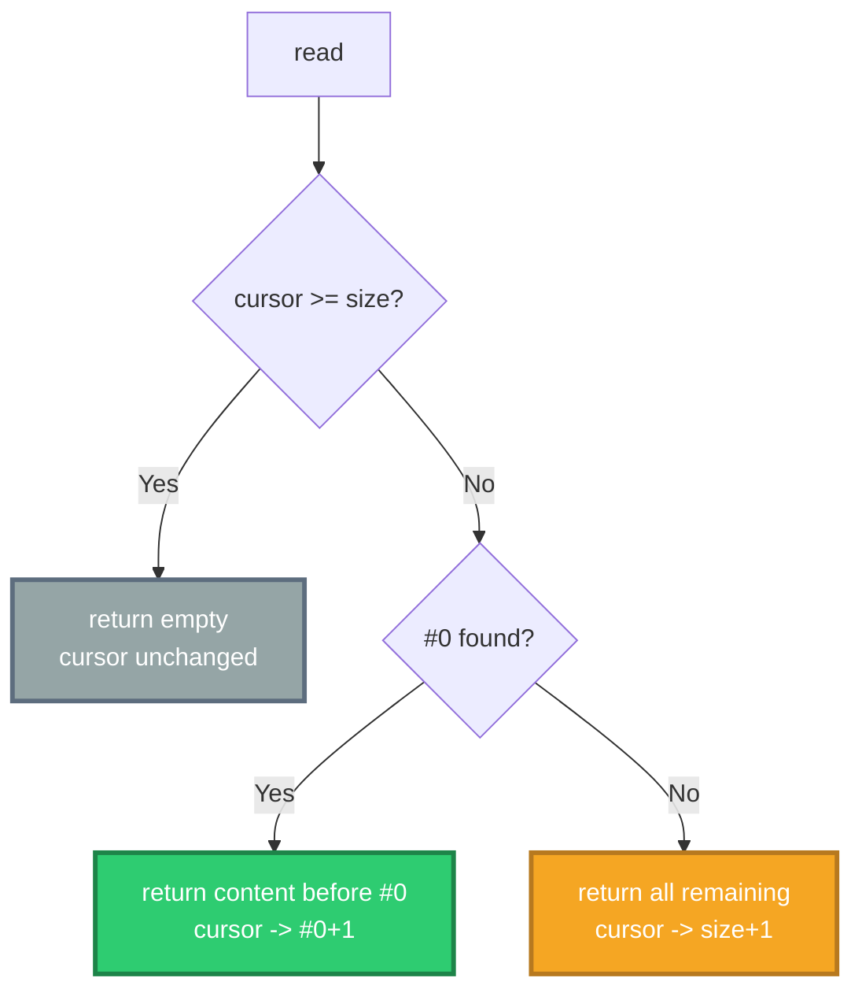

The meaning of `size+1`: the underlying library implicitly grows the buffer by one byte to accommodate the new position — identical to Pascal's `LF_SetPos(Hnd, e + 1)`.

### 9.3 UTF-8 Mandatory

All string parameters must be UTF-8 + NUL. The C++ side passes bytes through `std::string` without transcoding.

### 9.4 Little-Endian

All integer helpers use little-endian. Most platforms today are little-endian; big-endian requires explicit conversion.

### 9.5 JSON Not Escaped

`dumps_json` uses `ensure_ascii=false`; CJK and emoji stay literal UTF-8. The bridge repair engine applies the same rule.

### 9.6 Three-Way Symmetry Table

| Producer | `{"a":1}` bytes |
|---|---|
| Pascal `LF_WriteString` | `7B 22 61 22 3A 31 7D 00` |
| Python `lf_io.write_json` | same |
| C++ `io::write_json` | same |

### 9.7 Byte-Level Example

**`{"name":"张三","age":30}`**:

```
7B 22 6E 61 6D 65 22 3A 22 E5 BC A0 E4 B8 89 22 2C 22 61 67 65 22 3A 33 30 7D 00
```

**Breakdown**:

- `7B` = `{`
- `22 6E 61 6D 65 22` = `"name"`
- `E5 BC A0 E4 B8 89` = `张三` (three UTF-8 bytes + three UTF-8 bytes)
- `7D` = `}`
- `00` = NUL

### 9.8 Wire Format with HTTP Bridge

The bridge follows the same NUL contract:

- Pascal → Bridge: `LF_WriteString` appends `#0`.
- Bridge → HTTP: strips `#0` before forwarding.
- HTTP → Bridge: HTTP body has no `#0`.
- Bridge → Pascal: reads all remaining, or appends `#0`.

---

## Chapter 10 — Full Call Chain and Lifecycle

### 10.1 Complete Client-to-Server Path

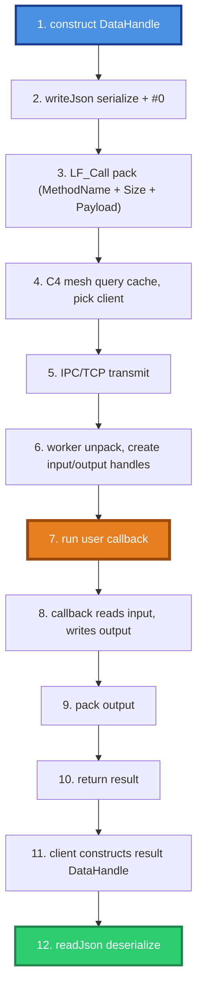

### 10.2 Handle Lifecycle Sequence (Synchronous)

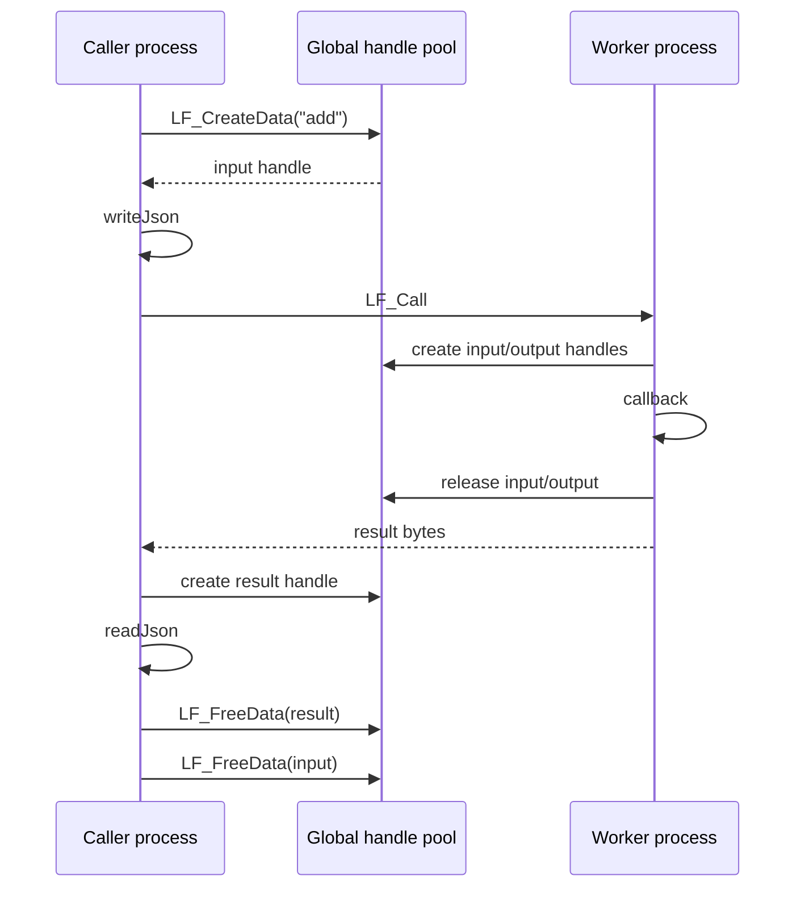

### 10.3 Async Call Lifecycle (v8.0)

```mermaid
sequenceDiagram
    participant Caller as Caller thread
    participant Holder as AsyncCallHolder on heap
    participant LF as LF_Async_Call
    participant Worker as TCompute worker
    participant User as User lambda

    Caller->>Holder: new AsyncCallHolder<F>(lambda)
    Caller->>LF: LF_Async_Call(app, param, holder, trampoline)
    LF-->>Caller: returns 1 (queued) or 0 (rejected)
    alt dispatched (ret == 1)
        Note over Caller: ownership passed to framework
        Caller-->>Caller: callAsync returns void
        LF->>Worker: (later) execute remote call
        Worker->>Holder: trampoline(data=holder, result=raw)
        Note over Holder: unique_ptr takes over
        Holder->>User: invoke_result(h)
        User-->>Holder: return
        Holder->>Holder: destroy
    else rejected (ret == 0)
        Note over Caller: framework never fires; caller-side invoke
        Caller->>Holder: invoke_error("not dispatched")
        Holder->>User: cb_(AsyncResult("not dispatched"))
        User-->>Holder: return
        Holder->>Holder: destroy (via unique_ptr in submit_async_call)
    end
```

**Note**: in the dispatch-failure branch the callback runs **synchronously on the caller thread**, before `callAsync` returns.

### 10.4 Post-Timeout Behaviour on Both Sides

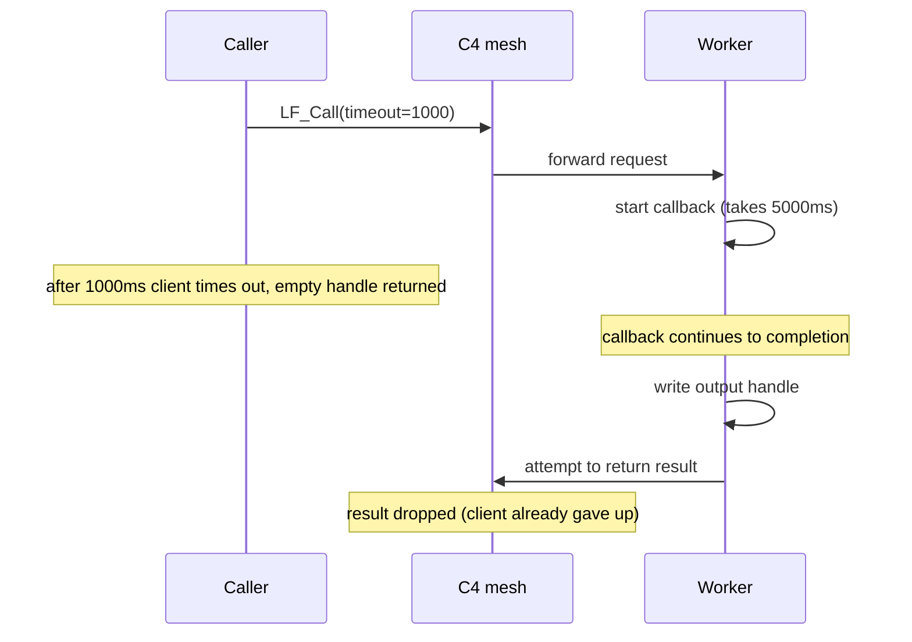

### 10.5 Load-Balancing Path

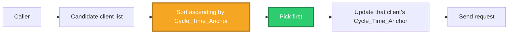

**Effect**: requests automatically spread across the least-recently-used workers.

### 10.6 Network Event Listener

```mermaid
sequenceDiagram
    participant User as User
    participant LF as LF kernel
    participant W as background worker

    User->>LF: LF_Set_Network_Event(on_connect, on_disconnect)
    Note over LF: stores callbacks
    LF->>LF: client connects -> first broadcast received
    LF->>W: TCompute.RunC(utf8_addr)
    W->>User: on_connect(addr)
    Note over User: must copy addr immediately
    W->>W: free utf8_addr
```

### 10.7 Sequenced Notify Thread Lifecycle

```mermaid
stateDiagram-v2
    [*] --> Absent: not used
    Absent --> Creating: first Sequenced_Notify
    Creating --> Active: thread started
    Active --> Active: FIFO processing
    Active --> Idle: 5 min with no notification
    Idle --> Destroyed: auto-terminate
    Destroyed --> Absent
    Active --> Destroyed: LF_Shutdown

    note right of Idle
        Next notification recreates the thread
        with a small startup latency
    end note
    note right of Destroyed
        Released via DelayFreeObj(5.0, self)
        to avoid TCompute UAF
    end note
```

---

## Chapter 11 — Multi-Node, Multi-App, Load Balancing

### 11.1 Scenario Classification

```mermaid
flowchart TD
    S["Your program"] --> Q1{"How many Services?"}
    Q1 -- 1 --> Q2{"How many Apps?"}
    Q2 -- 1 --> A["Single client + single App"]
    Q2 -- "N > 1" --> B["Single client + multiple Apps<br/>(§11.2)"]
    Q1 -- "N > 1" --> Q3{"Apps per Service?"}
    Q3 -- 1 --> C["Multiple clients + one App each<br/>(§11.3)"]
    Q3 -- "N > 1" --> D["Multiple clients + multiple Apps each<br/>(§11.4)"]

    style S fill:#4A90E2,stroke:#1E3A8A,stroke-width:3px,color:#FFFFFF
    style A fill:#D5F5E3,stroke:#1E8449,stroke-width:3px,color:#0E4D2A
    style B fill:#F5A623,stroke:#B7791F,stroke-width:3px,color:#FFFFFF
    style C fill:#F5A623,stroke:#B7791F,stroke-width:3px,color:#FFFFFF
    style D fill:#E67E22,stroke:#9C4A0C,stroke-width:3px,color:#FFFFFF
```

### 11.2 Single Client + Multiple Apps (`Overlap_Connection=True`)

**Goal**: same process, one Service, two independent Apps exposed.

```cpp
#include "LingoFuse.hpp"

static void LF_CDECL app_a_cb(void*, void* in, void* out) {
    lingofuse::io::write_json(static_cast<TDataHnd>(out), {{"app", "A"}});
}

static void LF_CDECL app_b_cb(void*, void* in, void* out) {
    lingofuse::io::write_json(static_cast<TDataHnd>(out), {{"app", "B"}});
}

int main() {
    lingofuse::LibraryLoader loader;

    lingofuse::App app_a("ServiceA", "App A");
    lingofuse::App app_b("ServiceB", "App B");
    app_a.registerCall("ping", "ping A", nullptr, app_a_cb);
    app_b.registerCall("ping", "ping B", nullptr, app_b_cb);

    lingofuse::setOption("Overlap_Connection", "True");
    lingofuse::setOption("Wait_Ready", "False");

    lingofuse::resetPrepare();
    lingofuse::prepareService("ipc:multi", "ipc:multi");

    int tag_a = lingofuse::prepareClient("ipc:multi", app_a.get());
    int tag_b = lingofuse::prepareClient("ipc:multi", app_b.get());
    /* Expected: tag_a = 1, tag_b = 2 (two distinct tags) */

    if (lingofuse::prepareDone() != 1) return 1;

    std::cin.get();
    lingofuse::exitMainThread();
    lingofuse::shutdown();
    return 0;
}
```

### 11.3 Multiple Clients + One App Each

```cpp
lingofuse::LibraryLoader loader;

lingofuse::App app_x("ClientX", "for service 1");
lingofuse::App app_y("ClientY", "for service 2");

lingofuse::setOption("Wait_Ready", "False");
lingofuse::resetPrepare();

/* Different addresses -> no Overlap_Connection needed */
int t1 = lingofuse::prepareClient("ipc:service_1", app_x.get());
int t2 = lingofuse::prepareClient("ipc:service_2", app_y.get());

lingofuse::prepareDone();
```

### 11.4 Multiple Clients + Multiple Apps Each

```cpp
lingofuse::LibraryLoader loader;

lingofuse::App a1("A1"), a2("A2"), b1("B1"), b2("B2");

lingofuse::setOption("Overlap_Connection", "True");
lingofuse::setOption("Wait_Ready", "False");
lingofuse::resetPrepare();

lingofuse::prepareService("ipc:svc_1", "ipc:svc_1");
lingofuse::prepareService("ipc:svc_2", "ipc:svc_2");

lingofuse::prepareClient("ipc:svc_1", a1.get());
lingofuse::prepareClient("ipc:svc_1", a2.get());
lingofuse::prepareClient("ipc:svc_2", b1.get());
lingofuse::prepareClient("ipc:svc_2", b2.get());

lingofuse::prepareDone();
```

### 11.5 Late Binding with `LF_BindApp`

```cpp
lingofuse::LibraryLoader loader;

lingofuse::App app("LateBind", "bind after prepare");

lingofuse::resetPrepare();
lingofuse::prepareService("ipc:s1", "ipc:s1");
lingofuse::prepareService("ipc:s2", "ipc:s2");

/* Prepare clients without binding an App */
lingofuse::prepareClient("ipc:s1", nullptr);
lingofuse::prepareClient("ipc:s2", nullptr);

lingofuse::prepareDone();

/* Bind later */
int bound = app.bind();
/* Expected: bound = 2 */
```

**Conditions for `bind()` returning 0**:

| Condition | Note |
|---|---|
| Main thread not running | `prepareDone` not called or failed |
| All clients occupied | Each client hosts at most one App |
| App invalidated | `App` object already freed |

### 11.6 `LF_BindApp` vs `prepareClient(addr, app)`

| Dimension | `prepareClient(addr, app)` | `App::bind()` |
|---|---|---|
| **Bind time** | Preparation phase | After the framework is running |
| **Binding target** | Specified address | All idle clients |
| **Typical use** | Service startup | Dynamic App injection |
| **Overlap required?** | Yes for same-address repeats | No |

### 11.7 Load-Balancing Observation

**Worker process × N**:

```cpp
lingofuse::App app("demo", "worker");
app.registerCall("add", "...", nullptr, add_cb);
lingofuse::setOption("Wait_Ready", "False");
lingofuse::resetPrepare();
lingofuse::prepareClient("ipc:beacon", app.get());
lingofuse::prepareDone();
```

**Caller side**:

```cpp
for (int i = 0; i < 100; ++i) {
    lingofuse::DataHandle p("add");
    p.writeJson({{"a", i}, {"b", i}});
    auto resp = lingofuse::tryCall("demo", p, 1000);
}
```

**Observation**: N workers each handle roughly `100 / N` requests.

### 11.8 `generateAppName` Dynamic Client Sequence

```
1. resetPrepare
2. prepareClient(endpoint, nil)
3. prepareDone returns 1
4. generateAppName
5. Create App
6. Register callbacks
7. bind or prepareClient again
```

**Why after `prepareDone`**: `generateAppName` includes C4 tunnel address and RemoteID, which do not exist before `prepareDone`.

---

## Chapter 12 — Runtime Options

### 12.1 All Options

| Option | Aliases | Type | Default | Description |
|---|---|---|---|---|
| `password` | `passwd` | string | empty | C4 P2PVM auth token |
| `Quiet` | — | bool | False | Quiet mode; suppress most logs |
| `ShowThreadID` | `ShowThread` / `Show_Thread` | bool | False | Show thread IDs in logs |
| `ConsoleOutput` | `Console_Output` | bool | True on console, False on GUI | Console output |
| `Overlap_Connection` | `Overlap_Client` / `OverlapConnection` / `OverlapClient` / `OverlapConnect` | bool | False | Allow multiple clients on the same address |
| `Wait_Connection_ReadyOk` | `Wait_API_Prepare_Done` / `API_Prepare_Done_Wait` / `WaitConnect` / `Wait_Ready` / `WaitReady` | bool | True | `prepareDone` waits for all clients ready |
| `Wait_Connection_Timeout` | `Wait_TimeOut` / `API_Prepare_Done_TimeOut` / `WaitTimeOut` | int ms | 30000 | Timeout for the above wait |
| `IPC_Serv_ThreadCount` | `IPC_ThreadCount` / `IPC_Server_ThreadCount` | int | platform default | IPC service thread count |
| `IPC_Serv_MaxQueueLength` | `IPC_MaxQueueLength` / `IPC_Server_MaxQueueLength` | int | platform default | IPC message queue length |
| `IPC_Serv_MaxMsgSize` | `IPC_MaxMsgSize` / `IPC_Server_MaxMsgSize` | int bytes | platform default | Max bytes per IPC message |
| `Fixed_Sequenced_Time` | `Fixed_Sequenced_Life` | int ms | 20000 | Sequenced Notify fallback threshold |
| `DataHandle_Idle_Timeout` | `Data_Idle_Timeout` / `Idle_Timeout` | int ms | 600000 | Auto-recycled handle idle threshold |
| `DataHandle_Pool_Scan_Interval` | `Data_Scan_Interval` / `DataHandle_Scan_Interval` | int ms | 5000 | Reclaim scan rate-limit |
| `LF_P2P_name` | `P2P_name` / `LF_P2P` / `P2P` | string | empty | This process's P2P group name |
| `No_Reponse_Cmd_NULL_Flush_Threshold` | — | int | 5000 | Null-flush threshold for one-way Notify |
| `debug` | `debug_cmd` / `debug_command` / `debugcommand` | string | — | Execute a C4 console debug command |

### 12.2 Value Format

| Type | Accepted values |
|---|---|
| bool | `"True"` / `"False"` / `"1"` / `"0"` / `"Yes"` / `"No"` (case-insensitive) |
| int | Decimal string |
| string | Verbatim |

**⚠️ Common mistake**: `"true"` (all-lowercase) is not reliably recognised in some builds. **Use `"True"` / `"False"`.**

### 12.3 `Wait_Ready` in Detail

```mermaid
flowchart TD
    A["prepareDone()"] --> B{"Wait_Ready?"}
    B -- "True (default)" --> C["block until all clients ready<br/>(or timeout)"]
    B -- "False" --> D["return immediately"]
    C --> E["guarantee: after prepareDone returns 1<br/>all clients are online"]
    D --> F["you must retry yourself<br/>target may not be ready"]

    style C fill:#2ECC71,stroke:#1E8449,stroke-width:3px,color:#FFFFFF
    style D fill:#F5A623,stroke:#B7791F,stroke-width:3px,color:#FFFFFF
```

| Scenario | Suggested value |
|---|---|
| Single-machine development | `"True"` (default) |
| Elastic cluster (services start late) | `"False"` |
| Fast-startup priority | `"False"` |
| Strong startup consistency | `"True"` |

**Client retry pattern with `"False"`**:

```cpp
lingofuse::setOption("Wait_Ready", "False");
// ... prepareDone ...

for (int attempt = 0; attempt < 30; ++attempt) {
    if (lingofuse::checkApi("TargetApp", "target_api")) break;
    std::this_thread::sleep_for(std::chrono::milliseconds(200));
}
auto resp = lingofuse::tryCall("TargetApp", param, 3000);
```

### 12.4 `Overlap_Connection`

| Value | Behaviour |
|---|---|
| `"False"` (default) | Second `prepareClient` on the same address returns -1; the App is silently ignored |
| `"True"` | Each `prepareClient` creates a new tunnel bound to the passed App |

**Set `"True"`** when exposing multiple Apps to the same address in the same process.

### 12.5 `Wait_Connection_Timeout`

```cpp
lingofuse::setOption("Wait_Connection_Timeout", "60000");
```

Even after a timeout, `prepareDone` still returns 1, but some clients may not be ready. **Pair with retry logic.**

### 12.6 `Fixed_Sequenced_Time`

Sequenced Notify's even distribution always picks the "oldest" client, which starves some clients. `Fixed_Sequenced_Time` sets a fallback threshold: if the chosen client is older than the threshold, **fall back to the newest client**.

```cpp
lingofuse::setOption("Fixed_Sequenced_Time", "5000");
```

### 12.7 Scope and Persistence

| Property | Value |
|---|---|
| **Scope** | Process-global |
| **Effective time** | Immediate (for subsequent operations) |
| **Persistent?** | ❌ Lost after `shutdown()` |
| **Unknown options** | **Silently ignored** (no error, no warning) |
| **Case sensitivity** | Option names are case-insensitive |

**The unknown-option trap**:

```cpp
lingofuse::setOption("WaitReady", "True");     // ✅ alias, works
lingofuse::setOption("Wait_Ready ", "True");   // ❌ trailing space, silently ignored
lingofuse::setOption("wait_ready", "True");    // ✅ case-insensitive, works
```

### 12.8 Common Configuration Recipes

| Scenario | Commands |
|---|---|
| **Single-machine development** | keep defaults |
| **Elastic cluster (unordered start)** | `Wait_Ready=False` |
| **Multiple Apps per address** | `Overlap_Connection=True` |
| **WAN slow startup** | `Wait_Connection_Timeout=60000` |
| **Disable logs** | `Quiet=True` + `ConsoleOutput=False` |
| **Debug thread issues** | `ShowThreadID=True` |
| **High-frequency Sequenced Notify** | `Fixed_Sequenced_Time=5000` |
| **Disable auto-reclaim (debug)** | `DataHandle_Idle_Timeout=0` |

---

## Chapter 13 — Error Handling and Recovery

### 13.1 Exception Hierarchy

| Exception | Source | Payload |
|---|---|---|
| `lingofuse::io::LfIoError` | `lf_io.hpp` | `what()` |
| `lingofuse::Error` | `LingoFuse.hpp` | `what()` + `code()` |

### 13.2 `ErrorCode` Trigger Scenarios and Recovery

| `ErrorCode` | Trigger | Recovery |
|---|---|---|
| `Generic` | `LF_CreateData` / `LF_CreateData_Permanent` / `LF_CreateApp` returns NULL | OOM or invalid argument |
| `LibraryLoadFailed` | `LibraryLoader` constructor | Check DLL placement (exe dir or PATH); see §0.7 |
| `NullHandle` | Operation on a freed `DataHandle` / `App` | Check lifetime |
| `InvalidArgument` | `writeRaw(nullptr, n>0)` | Check arguments |
| `WriteFailed` | `write` / `writeJson` / `writeRaw` failure | Usually invalid handle |
| `ReadFailed` | `read` family failure | Usually invalid handle |
| `CallFailed` | `App::localCall` returns NULL / bridge error | Rare; check API registration |
| `RegistrationFailed` | `registerCall` / `registerNotify` failure | Check for duplicate API name |
| `NotConnected` | Remote call before `prepareDone` | Call `prepareDone` first |
| `Timeout` | **Never thrown automatically** (use `tryCall` → `nullopt`) | Check the timeout parameter |

### 13.3 Unified Exception Handling Strategy

```cpp
try {
    lingofuse::DataHandle p("api");
    p.writeJson(payload);

    auto resp = lingofuse::tryCall("app", p, 3000);
    if (!resp) {
        // timeout or target missing
    }
}
catch (const lingofuse::Error& e) {
    switch (e.code()) {
        case lingofuse::ErrorCode::Timeout:      /* ... */ break;
        case lingofuse::ErrorCode::WriteFailed:  /* ... */ break;
        default:
            std::cerr << "Error " << static_cast<int>(e.code())
                      << ": " << e.what() << "\n";
    }
}
catch (const lingofuse::io::LfIoError& e) {
    std::cerr << "I/O error: " << e.what() << "\n";
}
catch (const std::exception& e) {
    std::cerr << "Other: " << e.what() << "\n";
}
```

### 13.4 Async Error Handling (v8.0)

Async callbacks never throw out of the callback. Errors are delivered as `AsyncResult`:

```cpp
lingofuse::callAsync("App", param,
    [](lingofuse::AsyncResult r) {
        if (!r.ok()) {
            // r.error() carries a human-readable message.
            // Common strings (NOT part of a public contract):
            //   "async call was not dispatched (...)"
            //   (other messages come from the transport layer)
            std::cerr << "async failed: " << r.error() << "\n";
            return;
        }
        // Success path.
        auto j = r.handle().readJson();
        // ...
    });
```

### 13.5 Retry Pattern (Synchronous)

```cpp
std::optional<lingofuse::DataHandle> call_with_retry(
    const std::string& app,
    const std::string& api,
    const lingofuse::DataHandle& param,
    int max_retries = 3,
    int base_delay_ms = 200)
{
    for (int i = 0; i < max_retries; ++i) {
        if (lingofuse::checkApi(app, api)) {
            auto resp = lingofuse::tryCall(app, param, 5000);
            if (resp) return resp;
        }
        std::this_thread::sleep_for(
            std::chrono::milliseconds(base_delay_ms * (i + 1)));
    }
    return std::nullopt;
}
```

### 13.6 Retry Pattern (Asynchronous)

The async model has no timeout, so "retry" is driven by the `AsyncResult`:

```cpp
void call_with_retry_async(const std::string& app,
                           const lingofuse::DataHandle& param,
                           int retries_left,
                           std::function<void(lingofuse::AsyncResult)> done)
{
    // The lambda captures retries_left by value and done by value.
    // No raw handle is captured.
    lingofuse::callAsync(app, param,
        [app, param_copy = lingofuse::DataHandle(param.get(), false),
         retries_left, done](lingofuse::AsyncResult r) mutable {
            if (r.ok() || retries_left <= 0) {
                done(std::move(r));
                return;
            }
            call_with_retry_async(app, param_copy, retries_left - 1, done);
        });
}
```

**Note**: the pattern above is illustrative. Capturing a borrowed `DataHandle` by `param_copy = DataHandle(param.get(), false)` is valid only if the original `param` outlives the entire chain. For safety, copy the payload bytes instead.

### 13.7 Idempotency Key Pattern

```cpp
nlohmann::json make_idempotent_request(
    const std::string& operation,
    const nlohmann::json& params)
{
    return {
        {"request_id", generate_uuid()},
        {"operation", operation},
        {"params", params}
    };
}

// Server side
static void LF_CDECL payment_cb(void*, void* in, void* out) {
    auto req = lingofuse::io::read_json(static_cast<TDataHnd>(in));
    const std::string request_id = req.at("request_id").get<std::string>();

    if (idempotency_cache.contains(request_id)) {
        lingofuse::io::write_json(static_cast<TDataHnd>(out),
                                  idempotency_cache[request_id]);
        return;
    }

    auto result = do_payment(req);
    idempotency_cache[request_id] = result;
    lingofuse::io::write_json(static_cast<TDataHnd>(out), result);
}
```

### 13.8 Network Partition and Reconnection

- Clients reconnect automatically after a link drop.
- Apps re-register automatically after reconnect.
- A reconnect **re-triggers** the Connect event (Disconnect does not re-fire).
- During reconnection, `tryCall` returns `nullopt`.
- **Recommendation**: heartbeat + retry loop.

### 13.9 Cross-Language Comparison Table

| Scenario | C++ | Python | Pascal |
|---|---|---|---|
| I/O failure | `LfIoError` / `Error` | `LingoFuseError` | silently swallowed |
| Remote call failure | `tryCall` → `nullopt` | `TimeoutError` | size=0 handle |
| Async failure | `AsyncResult::ok() == false` | Future exception | size=0 handle |
| Registration failure | returns `false` | `RegistrationError` | returns 0 |
| Library load failure | `Error(LibraryLoadFailed)` | `LingoFuseError` | DLL load failure |
| Callback exception | **must try/catch (sync) / auto-isolated (async)** | auto-isolated | library `try/except` |

**C++ specificity**: exceptions must not cross the C stack. Sync callbacks must try/catch themselves; async callbacks are auto-isolated by `AsyncCallHolder`.

---

## Chapter 14 — HTTP Bridge

### 14.1 What the Bridge Is

The LingoFuse HTTP Bridge is a **standalone process** (`bridge.py` / `bridge.exe`) that registers itself as an App on the LingoFuse mesh.

**Three directions**:

```mermaid
flowchart LR
    subgraph A["Direction A: inbound HTTP -> LF"]
        H1["HTTP client"] -->|"POST /app/api"| B1["Bridge"]
        B1 -->|"LF_Call"| S1["LF service"]
    end
    subgraph B["Direction B: outbound LF -> HTTP"]
        S2["LF service"] -->|"LF_Call"| B2["Bridge"]
        B2 -->|"HTTP request"| H2["Remote HTTP"]
    end
    subgraph C["Direction C: JSON repair"]
        S3["LF service"] -->|"LF_Call"| B3["Bridge"]
        B3 -->|"repair engine"| R3["Repaired JSON"]
    end

    style B1 fill:#9B59B6,stroke:#6C3483,stroke-width:3px,color:#FFFFFF
    style B2 fill:#9B59B6,stroke:#6C3483,stroke-width:3px,color:#FFFFFF
    style B3 fill:#9B59B6,stroke:#6C3483,stroke-width:3px,color:#FFFFFF
```

**The C++ client covers only directions B and C** (`lf_http_bridge_client.hpp`). Direction A is handled by HTTP clients calling the bridge directly.

### 14.2 Bridge and the Code-Generation System

**`lf_http_bridge_client.hpp` exists to serve code generation.**

**LingoFuse-Tools** (https://github.com/PassByYou888/LingoFuse-Tools) provides three generators:

| Generator | Output |
|---|---|
| `code_decl_to_abi` | Binary ABI binding |
| `code_decl_to_json_abi` | HTTP/JSON binding (via the bridge) |
| `code_decl_to_mcp` | MCP tool provider binding |

Each generator emits Pascal / Python / C++ / JavaScript.

### 14.3 Constants

```cpp
inline constexpr const char* kBDefaultAppName = "__lf_http_bridge__";
inline constexpr const char* kBDefaultPostApiName = "__lf_outbound_post__";
inline constexpr const char* kBDefaultRepairApiName = "__lf_repair_json__";
inline constexpr std::uint64_t kBDefaultCallTimeoutMs = 60000;
inline constexpr double kBDefaultHttpTimeoutSec = 25.0;
inline constexpr double kBMaxHttpTimeoutSec = 300.0;
```

### 14.4 Bridge Configuration

| Argument | Environment variable | Default | C++ constant |
|---|---|---|---|
| `--bridge-app` | `LINGOFUSE_BRIDGE_APP` | `__lf_http_bridge__` | `kBDefaultAppName` |
| `--bridge-api` | `LINGOFUSE_BRIDGE_API` | `__lf_outbound_post__` | `kBDefaultPostApiName` |
| `--bridge-repair-api` | `LINGOFUSE_BRIDGE_REPAIR_API` | `__lf_repair_json__` | `kBDefaultRepairApiName` |

### 14.5 Outbound HTTP Request/Response Contract

**Request JSON** (sent to `__lf_outbound_post__`):

```json
{
    "url":     "http://example.com/api",
    "method":  "POST",
    "headers": { "X-Foo": "Bar" },
    "body":    { "any": "json" },
    "timeout": 25
}
```

**Response JSON** (returned by the bridge):

```json
{
    "status_code": 200,
    "headers":     { "content-type": "application/json" },
    "body":        { } | "raw string if not JSON"
}
```

**Bridge-level error**:

```json
{ "error": "description" }
```

### 14.6 JSON Repair Contract

**Request**: UTF-8 JSON text (possibly malformed, possibly BOM-prefixed, possibly NUL-terminated).

**Response**: UTF-8 NUL-terminated text, which may be:

- Repaired JSON (input malformed but repairable).
- Original text (input was valid JSON).
- Original text (input malformed and unrepairable).
- Original bytes (bridge could not decode to text).

**The response is a plain string, not a JSON envelope.** Read it with `LF_ReadString`.

**No-escaping guarantee**: the bridge uses `ensure_ascii=False`; the returned text contains no `\uXXXX` escapes.

### 14.7 `httpCall`

```cpp
nlohmann::json httpCall(
    std::string_view url,
    std::string_view method,
    const nlohmann::json& request_body,
    double http_timeout_sec = 0.0,
    const char* app_name = nullptr,
    const char* api_name = nullptr,
    std::uint64_t call_timeout_ms = 0
);
```

- Empty `url` → throws `Error(InvalidArgument)`.
- Empty `method` → defaults to `"POST"`.
- Null/discarded `request_body` → no body.
- `timeout` is rounded and written into the request JSON.
- Calls `LF_Call`; empty response → throws `Error(CallFailed)`.
- Parses the envelope; failure → throws `Error(ReadFailed)`.
- If the envelope has `"error"` → throws `Error(CallFailed)`.
- Returns the full envelope.

### 14.8 `httpPost` / `httpPostBody`

```cpp
nlohmann::json httpPost(
    std::string_view url,
    const nlohmann::json& request_body,
    const char* app_name = nullptr,
    const char* api_name = nullptr
);

nlohmann::json httpPostBody(
    std::string_view url,
    const nlohmann::json& request_body,
    const char* app_name = nullptr,
    const char* api_name = nullptr
);
```

- `httpPost` = `httpCall(url, "POST", ...)`.
- `httpPostBody` returns the `body` field of the envelope. Missing body or null → null JSON.

### 14.9 `repairJson`

```cpp
std::string repairJson(
    std::string_view input_json,
    const char* app_name = nullptr,
    const char* api_name = nullptr,
    std::uint64_t call_timeout_ms = 0
);
```

- Writes the input using `io::write_string`.
- After `LF_Call`, empty response → throws `Error(CallFailed)`.
- String read failure → throws `Error(ReadFailed)`.
- Does not compare input vs. output; empty repair result is a valid success.
- Guarantees no `\uXXXX` escapes.

### 14.10 Non-Throwing Variants

```cpp
std::optional<nlohmann::json> tryHttpCall(...) noexcept;
std::optional<nlohmann::json> tryHttpPost(...) noexcept;
std::optional<nlohmann::json> tryHttpPostBody(...) noexcept;
std::optional<std::string>    tryRepairJson(...) noexcept;
```

All catch every exception and return `nullopt` on failure.

### 14.11 `waitForBridge`

```cpp
bool waitForBridge(
    const char* app_name = nullptr,
    std::uint64_t timeout_ms = 10000,
    std::uint64_t poll_interval_ms = 200
);
```

Polls `checkApp` until the bridge becomes visible or the timeout expires. Used with `Wait_Ready=False` deployments.

### 14.12 Contract and Pitfalls

| Pitfall | Note |
|---|---|
| App/API name mismatch | Must match the bridge's startup parameters. |
| LF_Call timeout shorter than HTTP timeout | Client times out first. Rule: `call_timeout >= (http_timeout + 5) * 1000`. |
| Treating empty repair result as failure | Empty string is a valid repair result. |
| Assuming repair always modifies | Already-valid JSON is returned as-is. |
| Assuming outbound always returns JSON body | The remote may return HTML/image; `body` may be a string. |
| Treating the envelope as the remote response | The remote response is inside `body`. |
| Hand-crafting an invalid JSON body | Use `nlohmann::json` to construct. |
| Expecting repair to fail on non-JSON | Unrepairable input returns success with the original text. |

### 14.13 Cross-Language Bridge API Comparison

| Feature | Pascal | Python | C++ |
|---|---|---|---|
| Full HTTP call | `LFHttpCall` | `http_call` | `httpCall` |
| POST envelope | `LFHttpPost` | `http_post` | `httpPost` |
| POST body only | `LFHttpPostBody` | `http_post_body` | `httpPostBody` |
| JSON repair | `LFHttpRepairJson` | `repair_json` | `repairJson` |
| Non-throwing variants | — | — | `try*` |
| Wait for bridge | — | — | `waitForBridge` |

---

## Chapter 15 — Complete Application Patterns

### 15.1 Standalone Server + Client

**Server (`server.cpp`)**:

```cpp
#include "LingoFuse.hpp"
#include <iostream>

static void LF_CDECL add_cb(void*, void* in, void* out) {
    using namespace lingofuse::io;
    try {
        auto req = read_json(static_cast<TDataHnd>(in));
        int a = req.value("a", 0);
        int b = req.value("b", 0);
        write_json(static_cast<TDataHnd>(out), {{"result", a + b}});
    } catch (const std::exception& e) {
        write_json(static_cast<TDataHnd>(out),
                   {{"error", std::string(e.what())}});
    }
}

int main() {
    try {
        lingofuse::LibraryLoader loader;

        lingofuse::App app("Calc", "JSON calc");
        app.registerCall("add", "add two ints", nullptr, add_cb);

        lingofuse::setOption("Wait_Ready", "False");
        lingofuse::resetPrepare();
        lingofuse::prepareService("ipc:calc", "ipc:calc");
        lingofuse::prepareClient("ipc:calc", app.get());

        if (lingofuse::prepareDone() != 1) return 1;

        std::cout << "Ready. Press Enter...\n";
        std::cin.get();

        lingofuse::exitMainThread();
        lingofuse::shutdown();
    } catch (const std::exception& e) {
        std::cerr << "Error: " << e.what() << '\n';
        return 1;
    }
    return 0;
}
```

**Client (`client.cpp`)**:

```cpp
#include "LingoFuse.hpp"
#include <iostream>

int main() {
    try {
        lingofuse::LibraryLoader loader;

        lingofuse::resetPrepare();
        if (lingofuse::prepareClient("ipc:calc", nullptr) < 0) return 1;
        if (lingofuse::prepareDone() != 1) return 1;

        for (int i = 0; i < 15; ++i) {
            if (lingofuse::checkApi("Calc", "add")) break;
            std::this_thread::sleep_for(std::chrono::milliseconds(200));
        }

        lingofuse::DataHandle param("add");
        param.writeJson({{"a", 5}, {"b", 7}});

        auto resp = lingofuse::tryCall("Calc", param, 3000);
        if (!resp) {
            std::cerr << "call failed\n";
            return 1;
        }

        resp->seek(0);
        auto j = resp->readJson();
        std::cout << "5 + 7 = " << j.at("result").get<int>() << '\n';

        lingofuse::exitMainThread();
        lingofuse::shutdown();
    } catch (const std::exception& e) {
        std::cerr << "Error: " << e.what() << '\n';
        return 1;
    }
    return 0;
}
```

### 15.2 Distributed Compute Grid

**Beacon (`beacon.cpp`)**:

```cpp
#include "LingoFuse.hpp"

int main() {
    lingofuse::LibraryLoader loader;
    lingofuse::setOption("Wait_Ready", "False");
    lingofuse::resetPrepare();
    lingofuse::prepareService("ipc:compute_grid", "ipc:compute_grid");
    if (lingofuse::prepareDone() != 1) return 1;
    std::cin.get();
    lingofuse::exitMainThread();
    lingofuse::shutdown();
    return 0;
}
```

**Node (`node.cpp`, run N copies)**:

```cpp
#include "LingoFuse.hpp"
#include <cmath>

static void LF_CDECL exp_cb(void*, void* in, void* out) {
    auto req = lingofuse::io::read_json(static_cast<TDataHnd>(in));
    double base = req.value("base", 0.0);
    double exponent = req.value("exponent", 0.0);
    double result = std::pow(base, exponent);
    lingofuse::io::write_json(static_cast<TDataHnd>(out),
                              {{"result", result}});
}

int main() {
    lingofuse::LibraryLoader loader;
    lingofuse::App app("compute_node", "compute worker");
    app.registerCall("exp", "exponent", nullptr, exp_cb);

    lingofuse::setOption("Wait_Ready", "False");
    lingofuse::resetPrepare();
    lingofuse::prepareClient("ipc:compute_grid", app.get());
    if (lingofuse::prepareDone() != 1) return 1;
    std::cin.get();
    lingofuse::exitMainThread();
    lingofuse::shutdown();
    return 0;
}
```

**Caller (`call.cpp`)**:

```cpp
#include "LingoFuse.hpp"
#include <iostream>

int main() {
    lingofuse::LibraryLoader loader;
    lingofuse::resetPrepare();
    lingofuse::prepareClient("ipc:compute_grid", nullptr);
    if (lingofuse::prepareDone() != 1) return 1;

    for (int i = 0; i < 15; ++i) {
        if (lingofuse::checkApi("compute_node", "exp")) break;
        std::this_thread::sleep_for(std::chrono::milliseconds(200));
    }

    lingofuse::DataHandle p("exp");
    p.writeJson({{"base", 2.0}, {"exponent", 10.0}});
    auto resp = lingofuse::tryCall("compute_node", p, 3000);
    if (resp) {
        resp->seek(0);
        auto j = resp->readJson();
        std::cout << "2^10 = " << j.at("result").get<double>() << "\n";
    }

    lingofuse::exitMainThread();
    lingofuse::shutdown();
    return 0;
}
```

### 15.3 Modern Async Fan-Out (v8.0)

**Scenario**: send N independent async calls and process each result as it arrives.

```cpp
#include "LingoFuse.hpp"
#include <atomic>
#include <iostream>
#include <mutex>
#include <vector>

struct ResultAggregator {
    std::mutex m;
    std::vector<nlohmann::json> results;
    std::atomic<int> pending{0};
    std::condition_variable cv;

    void submit(int n) { pending.store(n); }

    void on_result(nlohmann::json j) {
        {
            std::lock_guard<std::mutex> lk(m);
            results.push_back(std::move(j));
        }
        if (--pending == 0) cv.notify_all();
    }

    bool wait(int timeout_ms) {
        std::unique_lock<std::mutex> lk(m);
        return cv.wait_for(lk, std::chrono::milliseconds(timeout_ms),
            [this] { return pending.load() == 0; });
    }
};

int main() {
    lingofuse::LibraryLoader loader;
    lingofuse::resetPrepare();
    lingofuse::prepareClient("ipc:compute_grid", nullptr);
    lingofuse::prepareDone();

    constexpr int kFanOut = 16;
    ResultAggregator agg;
    agg.submit(kFanOut);

    for (int i = 0; i < kFanOut; ++i) {
        lingofuse::callAsync("compute_node", "exp",
            {{"base", 2.0}, {"exponent", static_cast<double>(i)}},
            [&agg](lingofuse::AsyncResult r) {
                if (r.ok()) {
                    // Copy the result out of the borrowed handle.
                    agg.on_result(r.handle().readJson());
                } else {
                    agg.on_result(nlohmann::json{{"error", r.error()}});
                }
            });
    }

    agg.wait(10000);

    // All results are now in agg.results.
    for (const auto& j : agg.results) {
        std::cout << j.dump() << "\n";
    }

    lingofuse::exitMainThread();
    lingofuse::shutdown();
    return 0;
}
```

**Key points**:

- The aggregator captures by reference; its lifetime MUST outlive every callback. Using a stack object with a `wait()` that blocks until all callbacks complete is the safe pattern.
- Each callback copies the JSON out of the borrowed handle before returning.
- No raw handle or pointer crosses the callback boundary.

### 15.4 Cross-Language Mixed Deployment

Pascal server + C++ client:

- Pascal: `LF_CreateApp('CrossApp', ...)` + `LF_RegisterCall`.
- C++: `lingofuse::tryCall("CrossApp", ...)`.
- Both sides agree on API names and parameter format (JSON recommended).

**Key**: both sides must agree on the wire format (NUL + UTF-8 + JSON).

### 15.5 Large-Payload Sequenced Transfer

**Sender**:

```cpp
lingofuse::DataHandle p("chunk");
for (int i = 0; i < 1000; ++i) {
    p.reset();
    p = lingofuse::DataHandle("chunk");
    p.writeJson({
        {"index", i},
        {"total", 1000},
        {"data", std::string(10240, 'x')}
    });
    lingofuse::sequencedNotify("receiver", p);
}
```

**Receiver**:

```cpp
static void LF_CDECL chunk_cb(void*, void* in, void*) {
    auto j = lingofuse::io::read_json(static_cast<TDataHnd>(in));
    int index = j.at("index").get<int>();
    /* Arrives in order (FIFO per (app, api)) */
}
```

### 15.6 Stress Test

```cpp
std::atomic<int> success{0};
std::atomic<int> failure{0};

std::vector<std::thread> threads;
for (int t = 0; t < 50; ++t) {
    threads.emplace_back([&]() {
        for (int i = 0; i < 20; ++i) {
            lingofuse::DataHandle p("add");
            p.writeJson({{"a", i}, {"b", i}});
            auto resp = lingofuse::tryCall("Calc", p, 3000);
            if (resp) success.fetch_add(1);
            else failure.fetch_add(1);
        }
    });
}
for (auto& t : threads) t.join();

std::cout << "success: " << success << " failure: " << failure << "\n";
```

### 15.7 Network Event Listener

```cpp
#include "LingoFuse.hpp"
#include <memory>
#include <iostream>

struct RouterListener : lingofuse::NetworkEventListener {
    void onConnect(const std::string& addr) override {
        if (addr == "ipc:service_a") {
            std::cout << "[A] online\n";
        } else if (addr == "ipc:service_b") {
            std::cout << "[B] online\n";
        } else {
            std::cout << "[?] unknown: " << addr << "\n";
        }
    }
    void onDisconnect(const std::string& addr) override {
        std::cout << "[-] " << addr << "\n";
    }
};

int main() {
    lingofuse::LibraryLoader loader;
    auto listener = std::make_shared<RouterListener>();
    lingofuse::setNetworkEvent(listener);

    lingofuse::resetPrepare();
    lingofuse::prepareClient("ipc:service_a", nullptr);
    lingofuse::prepareClient("ipc:service_b", nullptr);
    lingofuse::prepareDone();

    std::cin.get();

    lingofuse::clearNetworkEvent();
    lingofuse::exitMainThread();
    lingofuse::shutdown();
    return 0;
}
```

### 15.8 HTTP Bridge Usage

```cpp
#include "LingoFuse.hpp"
#include "lf_http_bridge_client.hpp"
#include <iostream>

int main() {
    try {
        lingofuse::LibraryLoader loader;
        lingofuse::resetPrepare();
        lingofuse::prepareClient("ipc:compute_grid", nullptr);
        if (lingofuse::prepareDone() != 1) return 1;

        if (!lingofuse::bridge::waitForBridge(nullptr, 5000)) {
            std::cerr << "Bridge not visible\n";
            return 1;
        }

        auto envelope = lingofuse::bridge::httpPost(
            "https://api.example.com/v1/echo",
            {{"message", "Hello 🌍"}}
        );
        std::cout << "status: "
                  << envelope.at("status_code").get<int>() << "\n";

        auto body = lingofuse::bridge::httpPostBody(
            "https://api.example.com/v1/echo",
            {{"message", "again"}}
        );
        std::cout << "body: " << body.dump() << "\n";

        std::string repaired = lingofuse::bridge::repairJson(
            "{'name': 'Alice', 'age': 30,}"
        );
        std::cout << "repaired: " << repaired << "\n";

        lingofuse::exitMainThread();
        lingofuse::shutdown();
    } catch (const std::exception& e) {
        std::cerr << "Error: " << e.what() << "\n";
        return 1;
    }
    return 0;
}
```

### 15.9 Permanent Handle for Cached Templates

```cpp
#include "LingoFuse.hpp"

int main() {
    lingofuse::LibraryLoader loader;

    // A permanent handle: not added to the idle pool, never auto-reclaimed.
    // Released synchronously by the DataHandle destructor.
    lingofuse::DataHandle cached_template =
        lingofuse::DataHandle::createPermanent("myapi");

    // Populate once at startup.
    cached_template.writeJson({
        {"type", "json_schema"},
        {"schema", nlohmann::json::object()}
    });

    // Throughout the process lifetime, reuse cached_template freely.
    // No idle-timeout concern. No need to call reset() or refresh it.
    // ...

    // LF_Shutdown() releases it, if it is still alive.
    lingofuse::shutdown();
    return 0;
}
```

### 15.10 Reading Sender Identity in a Callback

```cpp
static void LF_CDECL whoami_cb(void*, void* in, void* out) {
    lingofuse::DataHandle inp(static_cast<TDataHnd>(in), false);
    lingofuse::DataHandle out_h(static_cast<TDataHnd>(out), false);

    // Read the sender's identity. Valid only here, on the input handle.
    std::array<std::uint8_t, 32> uid = inp.getP2PUid();
    std::string p2p_name = inp.getP2PName();

    // Build a hex string for the UID.
    std::string hex;
    hex.reserve(64);
    static const char* digits = "0123456789abcdef";
    for (auto b : uid) {
        hex.push_back(digits[(b >> 4) & 0x0F]);
        hex.push_back(digits[b & 0x0F]);
    }

    out_h.writeJson({
        {"uid_hex", hex},
        {"p2p_name", p2p_name}
    });
}

int main() {
    lingofuse::LibraryLoader loader;
    lingofuse::App app("WhoamiSvc", "identity echo");
    // Register on the process-wide P2P namespace so it is reachable
    // via UID and P2PName, not just via the App name.
    app.registerCall("whoami", "echo caller identity", nullptr, whoami_cb);
    // ...
}
```

**Contract**: `getP2PUid()` / `getP2PName()` are valid only inside the callback body. On any other handle they return zero-filled / empty values.

---

## Chapter 16 — Cross-Language Comparison

### 16.1 Three-Way API Comparison

| Feature | Pascal | Python | C++ |
|---|---|---|---|
| Load library | automatic (static link) | automatic (import) | **`LibraryLoader` / `LF_LoadLibrary`** |
| Create auto-recycled data handle | `LF_CreateDataEx` | `DataHandle('api')` | `DataHandle dh("api")` |
| Create permanent data handle | `LF_CreateData_PermanentEx` | — | `DataHandle::createPermanent("api")` |
| Write JSON | `LF_WriteString` | `dh.write_json(obj)` | `dh.writeJson(obj)` |
| Read JSON | `LF_ReadString` | `dh.read_json()` | `dh.readJson()` |
| Read sender UID | `LF_Get_P2P_UID` (pointer) | `dh.get_p2p_uid()` (bytes) | `dh.getP2PUid()` (std::array) |
| Read sender name | `LF_Get_P2P_Name` (pointer) | `dh.get_p2p_name()` (str) | `dh.getP2PName()` (std::string) |
| Create App | `LF_CreateAppEx` | `App('name')` | `App app("name")` |
| Register Call | `LF_RegisterCall_M` | `@app.expose('api')` | `app.registerCall(...)` |
| Register Call (sync) | `LF_RegisterSyncCall_M` | — | **no equivalent** |
| Register Notify | `LF_RegisterNotify_M` | `@app.expose('api', notify=True)` | `app.registerNotify(...)` |
| Local call | `LF_LocalCall` | `app.local_call(...)` | `app.localCall(...)` |
| Remote call | `LF_Call` | `call(...)` | `lingofuse::call(...)` |
| Async call | anonymous method | `Target.call_future` | `lingofuse::callAsync` |
| Generate unique name | `LF_Generate_AppNameEx` | `generate_app_name()` | `generateAppName()` |
| Bind App | `LF_BindApp` | `app.bind()` | `app.bind()` |
| Network prepare | `LF_PrepareService/Client/Done` | `prepare_*` | `prepare*` |
| Shutdown | `LF_Shutdown` | `shutdown()` | `shutdown()` |
| Network events | `LF_Set_Network_Event` | none | `setNetworkEvent` |
| HTTP Bridge | `LFHttpCall` etc. | `http_call` etc. | `bridge::httpCall` etc. |
| **Unload library** | automatic | automatic | **`LF_FreeLibrary` (or `~LibraryLoader`)** |

### 16.2 Exception Semantics Difference

| Scenario | C++ | Python | Pascal |
|---|---|---|---|
| I/O failure | throws `LfIoError` / `Error` | throws `LingoFuseError` | silently swallowed |
| Remote call timeout | `tryCall` → `nullopt` | throws `TimeoutError` | returns size=0 handle |
| Registration failure | returns `false` | throws `RegistrationError` | returns 0 |
| Async dispatch failure | `AsyncResult::ok() == false` | Future exception | size=0 handle |
| Callback exception (sync) | **must try/catch** | auto-isolated + logged | library `try/except` |
| Callback exception (async) | **auto-isolated by `AsyncCallHolder`** | auto-isolated + logged | library `try/except` |

**C++ specificity**: sync callbacks must try/catch internally. Async callbacks are already wrapped.

### 16.3 Callback Style Difference

| Style | Pascal | Python | C++ |
|---|---|---|---|
| C function | `LF_RegisterCall` | — | `registerCall` |
| Object method | `LF_RegisterCall_M` | — | **no equivalent** |
| Anonymous / nested | `LF_RegisterCall_P` | `@app.expose` | **no equivalent** |
| Sync to main thread | `LF_RegisterSyncCall_M` | — | **no equivalent** |
| **Async call with lambda** | anonymous method + `LF_Async_Call` | `Target.call_future` + `await` | **`lingofuse::callAsync`** |

**C++ only has C-function-style callbacks (sync) and lambda-style callbacks (async)**. For `this` semantics in sync callbacks, pass `this` via `trigger`.

### 16.4 Migration Guide (Pascal → C++)

| Pascal code | C++ equivalent |
|---|---|
| `App := TLF_App.Create` | `lingofuse::App app("name")` |
| `App.Engine.Reg_Call('api', ...)` | `app.registerCall("api", ...)` |
| `App.FakeFree` | `~App` calls `LF_FreeApp` |
| `LF_Data.Free_Data(hnd)` | `DataHandle` destructor frees |
| `LF_CreateData_Permanent` | `DataHandle::createPermanent` |
| `LF_WriteString(hnd, s)` | `dh.write(s)` or `io::write_string` |
| `App.Engine.Execute_Call(param)` | `app.localCall(param)` |
| `LF_Async_Call(app, param, data, @cb)` | `lingofuse::callAsync(app, param, cb)` |
| `SysPost.PostExecuteC_NP(delay, proc)` | `std::thread` + `sleep_for` |
| `DelayFreeObject(delay, obj)` | `std::shared_ptr` + timer |

**Key differences**:

- Pascal has `TDFE` data containers; C++ uses `nlohmann::json`.
- Pascal has `Data1..5` fields; C++ passes context via `trigger`.
- Pascal has `Auto_Free_Pool`; C++ uses RAII.
- Pascal anonymous methods are compiled closures; C++ uses `std::function` + explicit holder.

---

## Chapter 17 — Integration with the Z Framework

### 17.1 Underlying Dependencies

| LingoFuse C++ Layer | Pascal Unit |
|---|---|
| Core RPC | `Z.LingoFuse_Core` |
| C ABI exports | `Z.LingoFuse_Export` |
| C4 distribution | `Z.Net.C4.LingoFuse` |
| Process identity | `Z.LingoFuse_System_ProcessID.inc` |
| Data streams | `Z.MemoryStream` (`TMem64`) |
| Timers | `Z.Notify` |
| Status | `Z.Status` |
| JSON | `Z.Json` |
| Hashing | `Z.HashList.Templet` |
| Concurrency | `Z.Core` (`TCompute`, `TCritical`, `TAtomInt`) |

### 17.2 Why Understanding Z Helps

| C++ behaviour | Underlying Z mechanism |
|---|---|
| DataHandle 10-min reclamation | `TLF_DataPool.Progress` scans every 5 s |
| Permanent handles survive | Not added to `LF_DataPool` |
| Secondary memory pool | `TLF_DataMemory` reuses `TLF_Data` records |
| `prepareDone` 30 s timeout | `Simulated_Main_Thread` init loop |
| Network events on background threads | `TCompute.RunC` |
| Async callbacks on worker threads | `TCompute.RunM_NP` |
| Sequenced Notify 5-min termination | `TLF_Notify_Sequence_Thread` idle timeout |
| Sequenced Notify 5-s delayed release | `DelayFreeObj(5.0, self)` |
| `generateAppName` 5-second expiry | `Z.Notify.DelayFreeMem(5.0, Result)` |
| `LF_Get_P2P_UID` 5-second expiry | `DelayFreeMem(5.0, Result)` (pointer) |
| Bridge JSON repair | `Z.Json` repair engine |

### 17.3 Sender-Side Identity Injection

The side data that `LF_Get_P2P_UID` / `LF_Get_P2P_Name` read is written on the sender side by `TMemory_Param_Tool.Rebuild_UID_and_P2PName`, which is invoked by every `TC40_LF_Client.Send_*` method. The two fields are:

- `FromUID` (32 bytes) — the sender's `FLast_UID`.
- `FromP2PName` (UTF-8) — the sender's `LF_P2P_name.V`.

Because the injection happens on the client send path, even local-first routing carries the identity. This is why local calls (`LF_LocalCall` / `LF_LocalNotify`) also deliver a non-empty UID / name to the receiver's callback.

### 17.4 Bridge and Z.Json

The bridge's repair engine uses `Z.Json`'s normalisation. Repair strategy:

1. Strict JSON validation.
2. On failure, conservative repair.
3. Re-validate output.
4. Return repaired text or the original.

### 17.5 Relationship with LingoFuse-Tools

`lf_http_bridge_client.hpp` is the **runtime half** of the HTTP/JSON binding. The generator produces the API-specific half:

```
code_decl_to_json_abi
    ↓
Generates:
  - server skeleton (Pascal / C)
  - client C++ header (#include "lf_http_bridge_client.hpp")
  - client Python/JS equivalents
  - README describing the wire format
```

The same generator family also produces ABI-level bindings (`code_decl_to_abi`) and MCP tool providers (`code_decl_to_mcp`).

---

## Chapter 18 — Debugging and Troubleshooting

### 18.1 Status Queue

```cpp
while (lingofuse::statusCount() > 0) {
    std::string msg = lingofuse::popStatus();
    std::cout << "[LF] " << msg << "\n";
}

lingofuse::postStatus("Custom marker: entering critical section");
```

**Prerequisite**: `prepareDone` must have been called (simulated main thread running).

### 18.2 Enabling Debug Logs

```cpp
lingofuse::setOption("ConsoleOutput", "True");
lingofuse::setOption("ShowThreadID", "True");
lingofuse::setOption("Quiet", "False");
```

### 18.3 Health Checks

```cpp
bool mt_ok = lingofuse::checkMainThread();

for (int i = 0; i < 15; ++i) {
    if (lingofuse::checkApp("MyApp")) break;
    std::this_thread::sleep_for(std::chrono::milliseconds(200));
}

bool api_ok = lingofuse::checkApi("MyApp", "my_api");
```

### 18.4 Raw Byte Inspection

```cpp
auto raw = lingofuse::io::peek_string_bytes(hnd.get());
std::cout << "Raw bytes (" << raw.size() << "): ";
for (auto b : raw) {
    std::printf("%02X ", b);
}
std::cout << "\n";

std::string s(raw.begin(), raw.end());
std::cout << "As string: " << s << "\n";
```

### 18.5 Async-Specific Diagnostics

Because async callbacks run on worker threads, a debug session that only prints from the caller thread sees almost nothing. To observe async activity:

1. **Log inside the callback**:
   ```cpp
   lingofuse::callAsync("App", param,
       [](lingofuse::AsyncResult r) {
           std::cout << "[async cb] ok=" << r.ok()
                     << " err=" << r.error()
                     << " thread=" << std::this_thread::get_id()
                     << "\n";
           // ...
       });
   ```

2. **Enable `ShowThreadID`** to see which worker thread ran the callback.

3. **Watch the status queue** for `[LF-DEBUG]` traces from `LF_Async_Call` / `TLF_Async_Call_Bridge.Do_Th`.

4. **Use `test_async_call_dispatch_failure` as a template** if you suspect the callback is not being invoked. That test explicitly prepares a framework with no client and verifies that the wrapper synchronously fires the callback with an error result.

### 18.6 Troubleshooting Decision Tree

```mermaid
flowchart TD
    Start["An issue appears"] --> Q1{"Crash?"}
    Q1 -- Yes --> Q0{"LF_LoadLibrary called first?"}
    Q0 -- No --> A0["Add LibraryLoader / LF_LoadLibrary (§0.7)"]
    Q0 -- Yes --> Q2{"Crash inside a callback?"}
    Q2 -- Yes --> A1["Check: LF_CDECL, UI access, blocking calls"]
    Q2 -- No --> A2["Check: cleanup order, dangling handles"]
    Q1 -- No --> Q3{"Async callback never fires?"}
    Q3 -- Yes --> A3["Verify callAsync* is reached; check dispatch-failure path"]
    Q3 -- No --> Q4{"Call timed out?"}
    Q4 -- Yes --> A4["Increase timeout, checkApi, look at server logs"]
    Q4 -- No --> Q5{"Empty result?"}
    Q5 -- Yes --> A5["checkApi retry, check status queue"]
    Q5 -- No --> Q6{"JSON parse failure?"}
    Q6 -- Yes --> A6["Inspect raw bytes: read_string_bytes"]
    Q6 -- No --> A7["Enable debug logs, read status queue"]

    style A0 fill:#E74C3C,stroke:#922B21,stroke-width:3px,color:#FFFFFF
    style A1 fill:#E74C3C,stroke:#922B21,stroke-width:3px,color:#FFFFFF
    style A2 fill:#E74C3C,stroke:#922B21,stroke-width:3px,color:#FFFFFF
    style A3 fill:#9B59B6,stroke:#6C3483,stroke-width:3px,color:#FFFFFF
    style A4 fill:#E67E22,stroke:#9C4A0C,stroke-width:3px,color:#FFFFFF
    style A5 fill:#F5A623,stroke:#B7791F,stroke-width:3px,color:#FFFFFF
    style A6 fill:#3498DB,stroke:#1F618D,stroke-width:3px,color:#FFFFFF
    style A7 fill:#95A5A6,stroke:#5D6D7E,stroke-width:3px,color:#FFFFFF
```

### 18.7 Common Error Messages

| Message | Meaning | Handling |
|---|---|---|
| `LingoFuse: Failed to load LingoFuse64.dll` | DLL not found | Place next to exe or on PATH |
| `LingoFuse: Failed to resolve symbol LF_xxx` | Missing symbol | DLL version mismatch |
| `LingoFuse: xxx called before LF_LoadLibrary` | Called before load | Call `LF_LoadLibrary` first (§0.7) |
| `no found api "X"` | API not registered | Check registration |
| `repeat connection` | Duplicate address | Enable `Overlap_Connection` |
| `All clients are already occupied` | No idle client | `bind` failed; needs a new client |
| `hint: Data handle pool "N" handles ... 10 minutes` | Handle reclamation | Normal behaviour |
| `invoked as Call` warning | Mode mismatch | Use the right invocation mode |
| `application mismatch` | Same key, different App | Use a distinct key |
| `Callback type mismatch` | Callback missing `cdecl` | Add `LF_CDECL` |
| `Sequenced notify ... idle timeout, auto-terminating` | Sequenced thread idle | Normal behaviour |
| `[warning] Get_P2P_UID(): P2P Info only backcall "input" parameter.` | Identity read on a non-input handle | Read identity from the callback's input argument only |
| `async call was not dispatched (LF_Async_Call returned 0 or threw)` | `AsyncResult::error()` from a dispatch failure | Check connectivity / `checkApi` / `prepareDone` |

### 18.8 Thread Debugging

```cpp
lingofuse::setOption("ShowThreadID", "True");

static void LF_CDECL debug_cb(void*, void* in, void*) {
    std::cout << "Callback on thread: "
              << std::this_thread::get_id() << "\n";
}
```

---

## Chapter 19 — Testing and Verification

### 19.1 The C++ Test Suites

| Suite | Source | Tests | Purpose |
|---|---|:---:|---|
| `test_lingofuse` | `test/test_lingofuse.cpp` | 50 | RAII / network / async |
| `test_lingofuse_json` | `test/test_lingofuse_json.cpp` | 40 | `lf_io.hpp` / wire format |
| `test_lingofuse_capi` | `test/test_lingofuse_capi.c` | ~30 | Pure C ABI (offline) |
| `test_lingofuse_uid` | `test/test_lingofuse_uid.c` | 7 | UID identity-injection end-to-end |
| `test_uid_probe` | `test/test_uid_probe.c` | diagnostic | `LF_Get_P2P_UID` ABI probe (Windows only) |

**Total**: ~127 assertions plus two diagnostic tools.

### 19.2 Test Plan for `test_lingofuse` (50 tests)

**DataHandle (14)**:

1. basic types
2. unicode
3. fault-tolerant read
4. too-small buffer
5. position and size
6. move semantics
7. string termination
8. empty string
9. GetBufferOffset
10. large buffer (128 KiB)
11. embedded NUL preserved
12. writeRaw does not append NUL
13. multi-field sequential I/O
14. zero-length operations

**App (8)**:

15. register / local call / unregister
16. duplicate registration rejected
17. unregister then re-register
18. case-insensitive API matching
19. callback isolation
20. free lifecycle
21. getAppName
22. localNotify

**Network basics (6)**:

23. single address
24. multi address
25. generateAppName
26. App::bind
27. check functions
28. deployment mode

**Network options (4)**:

29. Overlap_Connection
30. prepareDone only once
31. dynamic client
32. unknown option ignored

**Network calls (4)**:

33. call timeout empty handle
34. notify + sequenced
35. nonexistent app / API
36. long string round-trip

**Network events (1)**:

37. install / clear

**Status queue (1)**:

38. count / post / pop

**Concurrency (2)**:

39. concurrent local calls
40. concurrent DataHandles

**Stress (2)**:

41. 1000 sequential local calls
42. rapid App create/destroy

**Async calls (8, new in v8.0)**:

43. basic async call
44. JSON convenience form
45. dispatch failure → synchronous error callback
46. sequenced async call
47. `callAsyncByUid` smoke
48. `callAsyncByP2PName` smoke
49. callback exception isolation
50. data copied out of callback is safe afterwards

### 19.3 The `SyncBox<T>` Test Helper

Every async test needs to synchronise a worker-thread callback with the test thread. The C++ suite uses a small template:

```cpp
template <typename T>
class SyncBox {
public:
    void set(T value);                // callback success
    void set_error(std::string msg);  // callback failure
    bool wait(int timeout_ms);        // bounded wait
    bool ok() const;
    const T& value() const;
    const std::string& error() const;
};
```

Two design properties:

- The box has a **bounded wait**, so a hung worker cannot hang the whole suite.
- The box **treats dispatch-failure like any other completion**: when the callback runs synchronously on the caller's thread, `done_` is already true when `wait()` is called, and `wait()` returns immediately.

### 19.4 Running the Tests

**Interactive mode**:

```bash
./test_lingofuse
./test_lingofuse_json
./test_lingofuse_capi
./test_lingofuse_uid
```

**CI mode**:

```bash
./test_lingofuse --ci
./test_lingofuse_json --ci
```

CI mode emits one JSON line per test plus a summary line.

**One-shot harness**:

```powershell
# Windows
..\Test\run_test_ci.ps1

# Linux / macOS
../Test/run_test_ci.sh
```

### 19.5 Test Coverage Matrix (C++ suite)

| Category | Tests | Key contracts verified |
|---|:---:|---|
| DataHandle | 14 | Buffer I/O, NUL framing, move, raw bytes |
| App | 8 | Registration, local call, lifetime |
| Network basics | 6 | Endpoints, bind, check, deployment |
| Network options | 4 | Overlap, prepareDone once, dynamic client |
| Network calls | 4 | Call / Notify / Sequenced_Notify, timeout |
| Network events | 1 | Install / clear |
| Status queue | 1 | Count / post / pop |
| Concurrency | 2 | Thread safety of local calls and handles |
| Stress | 2 | Throughput and pool pressure |
| **Async calls** | **8** | **Callback delivery, dispatch failure, exception isolation, data copying** |

### 19.6 Verifying the Async Model

Three tests specifically target the async contract:

- **`test_async_call_dispatch_failure`**: prepares a framework with **no client at all**, issues `callAsync`, and asserts that the callback runs synchronously with `ok() == false` and a non-empty `error()`. This verifies the "single error path" design.
- **`test_async_callback_exception_isolation`**: the callback throws `std::runtime_error` after setting a flag. The test then asserts that the process continues running. If the exception had crossed the C stack, the process would have terminated.
- **`test_async_callback_data_copied_out`**: the callback copies the response into a caller-owned `SyncBox<std::string>` before returning. The test asserts that the copied value is still correct after a 500 ms delay, proving that no dangling pointer was handed to the caller.

### 19.7 Wire Format Verification

```cpp
TEST(LingoFuseTest, WireFormat) {
    lingofuse::LibraryLoader loader;
    lingofuse::DataHandle dh("test");

    dh.writeJson({{"a", 1}});

    auto raw = lingofuse::io::peek_string_bytes(dh.get());

    // Expected: 7B 22 61 22 3A 31 7D 00
    ASSERT_EQ(raw.size(), 8);
    ASSERT_EQ(raw[0], 0x7B);
    ASSERT_EQ(raw[7], 0x00);
}
```

### 19.8 Loading Contract Test

```cpp
TEST(LingoFuseTest, LoadLibraryContract) {
    ASSERT_EQ(LF_LoadLibrary(), 1);

    lingofuse::DataHandle dh("test");
    dh.writeJson({{"ok", true}});
    ASSERT_GT(dh.size(), 0);

    LF_FreeLibrary();

    /* Second load is a no-op and still returns 1 */
    ASSERT_EQ(LF_LoadLibrary(), 1);
    LF_FreeLibrary();
}

TEST(LingoFuseTest, LoaderRaiiContract) {
    {
        lingofuse::LibraryLoader a;
        lingofuse::LibraryLoader b;   /* inner load: no-op */
        lingofuse::DataHandle dh("x");
        dh.writeJson({{"v", 42}});
    }
    {
        lingofuse::LibraryLoader c;   /* library still usable */
        lingofuse::DataHandle dh("x");
        dh.writeJson({{"v", 43}});
    }
}
```

### 19.9 UID Identity Test (`test_lingofuse_uid`)

The UID identity test brings up a local mesh with a `whoami` API, calls it twice from the same session, and asserts:

1. Both calls return a **non-NULL pointer** from `LF_Get_P2P_UID`.
2. Both calls return the **same** 32-byte UID (garbage from an ABI mismatch would not be identical twice).
3. The UID is **non-zero** (identity injection actually happened).
4. The P2P name is echoed verbatim.
5. The callback-side snapshot agrees with the wire round-trip.

Because this test exercises the full sender-injection path, it is the canonical end-to-end verification of §0.8.

### 19.10 `test_uid_probe` (Windows only)

A read-only diagnostic that:

1. Dumps the first 64 bytes of `LF_Get_P2P_UID`'s machine code.
2. Heuristically analyses the prologue for an SRet pattern.
3. Performs a **safe call** of `LF_Get_P2P_UID(NULL)` under `__try/__except`, which the library documents as returning a pointer to a zero-filled UID.
4. Reports one of three verdicts: `POINTER-RETURN ABI CONFIRMED`, `ABI MISMATCH`, `INCONCLUSIVE`.

The safe call is the authoritative check; the prologue analysis is a hint.

---

## Chapter 20 — Anti-Patterns and Pitfalls

| ID | Pitfall | Symptom | Fix |
|---|---|---|---|
| LF-APP-001 | Callback missing `LF_CDECL` | Crash / argument corruption | Add `LF_CDECL` |
| LF-APP-002 | Expecting `LF_FreeApp` to release immediately | Memory never shrinks | `shutdown()` |
| LF-APP-003 | `generateAppName` before `prepareDone` | Name not unique | Call after |
| LF-APP-004 | Storing `LF_Generate_AppName` pointer | Dangling after 5 s | Use `generateAppName()` in C++ |
| LF-NET-001 | Second `prepareClient` on same address | Returns -1 | `Overlap_Connection=True` |
| LF-NET-003 | Expecting second `prepareDone` to return 1 | Returns 0 | 0 is not a failure |
| LF-NET-004 | Calling immediately after `Wait_Ready=False` | Empty result | Retry + `checkApi` |
| LF-NET-005 | UI access in network event callback | Random crash | Marshal via `std::thread` |
| LF-NET-006 | Storing the network event `addr` | Dangling | Copy to `std::string` immediately |
| LF-CB-002 | `LF_Call` inside a callback | Deadlock | Offload to another thread / use `callAsync` |
| LF-CB-003 | Blocking inside a callback | Thread pool starvation | Keep callbacks lightweight |
| LF-DATA-001 | Forgetting `FreeData` | Memory growth | Use `DataHandle` RAII |
| LF-DATA-004 | Reading a payload without `#0` | Reads all remaining (correct) | No action needed |
| LF-DATA-005 | Expecting `writeRaw` to append `#0` | Boundary error | `write` appends; `writeRaw` does not |
| LF-DATA-008 | Using `createPermanent` for one-shot handles | Pool safety net lost | Use `DataHandle(name)` instead |
| LF-CHK-001 | `checkApi` false immediately | 3-second broadcast delay | Retry 3× with 200 ms |
| LF-CALL-001 | Checking `LF_Call` for NULL | NULL check fails | Check `size == 0` |
| LF-XLANG-002 | CJK through `string` relay | Garbled | Write UTF-8 bytes directly |
| LF-CLEAN-001 | Wrong cleanup order | Crash | Follow §0.4 |
| C++-NEW-001 | Misusing `write` for `writeRaw` | Cross-language boundary not readable | Use `write` / `writeJson` |
| C++-NEW-002 | `setOption` with `"true"` | Option silently ignored | Use `"True"` |
| C++-NEW-003 | `read_json` + `write_json` relay | Key reordering | Use `read_string_bytes` + `write_string_bytes` |
| C++-NEW-004 | `LF_Call` retry without idempotency | Duplicate business execution | Send an idempotency key |
| C++-NEW-005 | Writing to `input` | Undefined behaviour | `input` is read-only |
| C++-NEW-006 | Reading from `output` | Undefined behaviour | `output` is write-only |
| C++-NEW-007 | Letting an exception cross a callback | Crash | Sync callbacks: try/catch. Async: auto-isolated. |
| C++-NEW-008 | Sharing a `DataHandle` across threads for writes | Data race | Per-thread handles |
| **C++-NEW-009** | **Calling any `LF_*` before `LF_LoadLibrary`** | **Null-pointer deref; silent no-op or crash** | **§0.7 / Chapter 23** |
| **C++-NEW-010** | **Reading `LF_Get_P2P_UID` as a by-value struct** | **Compile error or garbage** | **It returns `const TP2P_UID*`. Dereference once, copy, do not retain.** |
| **C++-NEW-011** | **Calling `LF_Get_P2P_UID` / `LF_Get_P2P_Name` on an output handle or a self-created handle** | **Zero UID / empty name silently** | **Read identity from the callback's `input` argument only** |
| **C++-NEW-012** | **Retaining the `AsyncResult::handle()` past the callback body** | **Use-after-free** | **Copy the data out inside the callback** |
| **C++-NEW-013** | **Calling `LF_FreeData` on `AsyncResult::handle()`** | **Double-free** | **The framework owns it; never free** |
| **C++-NEW-014** | **Blocking inside an async callback** | **Worker pool starvation** | **Post to your own queue; return promptly** |
| **C++-NEW-015** | **Assuming the async callback always runs after `callAsync` returns** | **Logic bug on dispatch failure** | **The callback may run synchronously on the caller thread** |
| Bridge-001 | `call_timeout` < HTTP timeout | Empty response | `call_timeout >= (http+5)*1000` |
| Bridge-002 | Treating empty repair as failure | Misjudged | Empty string is a valid success |
| Bridge-003 | Treating envelope as the remote response | Parse error | Remote response is in `body` |
| Bridge-004 | App/API name mismatch | Empty response | Match bridge config |
| Bridge-005 | Assuming repair always modifies | Misjudged | Valid JSON returns as-is |

---

## Chapter 21 — API Quick Reference

### 21.1 C ABI Exports (59)

**Data handle (12)**: `LF_CreateData`, `LF_CreateData_Permanent`, `LF_FreeData`, `LF_GetBuffer`, `LF_WriteBuffer`, `LF_ReadBuffer`, `LF_GetPos`, `LF_SetPos`, `LF_GetSize`, `LF_SetSize`, `LF_Get_P2P_UID`, `LF_Get_P2P_Name`

**App handle (5)**: `LF_CreateApp`, `LF_FreeApp`, `LF_Generate_AppName`, `LF_Get_AppName`, `LF_BindApp`

**Registration, app-bound (3)**: `LF_RegisterCall`, `LF_RegisterNotify`, `LF_Unregister`

**Registration, process-wide P2P (3)**: `LF_Register_P2P_Call`, `LF_Register_P2P_Notify`, `LF_Unregister_P2P`

**Local execution (2)**: `LF_LocalCall`, `LF_LocalNotify`

**Network preparation (5)**: `LF_PrepareService`, `LF_PrepareClient`, `LF_ResetPrepare`, `LF_PrepareDone`, `LF_ExitMainThread`

**Remote invocation, app-name (5)**: `LF_Call`, `LF_Async_Call`, `LF_Async_Sequenced_Call`, `LF_Notify`, `LF_Sequenced_Notify`

**Remote invocation, UID (5)**: `LF_UID_Call`, `LF_UID_Async_Call`, `LF_UID_Async_Sequenced_Call`, `LF_UID_Notify`, `LF_UID_Sequenced_Notify`

**Remote invocation, P2PName (5)**: `LF_P2PNAME_Call`, `LF_P2PNAME_Async_Call`, `LF_P2PNAME_Async_Sequenced_Call`, `LF_P2PNAME_Notify`, `LF_P2PNAME_Sequenced_Notify`

**Queries (7)**: `LF_CheckMainThread`, `LF_CheckApp`, `LF_CheckApi`, `LF_Check_UID`, `LF_Check_UID_Api`, `LF_Check_P2PNAME`, `LF_Check_P2PNAME_Api`

**Options (2)**: `LF_SetOption`, `LF_GetOption`

**Status (3)**: `LF_GetStatusCount`, `LF_GetStatus`, `LF_PostStatus`

**Network events (1)**: `LF_Set_Network_Event`

**Shutdown (1)**: `LF_Shutdown`

**Loader (C wrapper, not exported from the DLL)**: `LF_LoadLibrary`, `LF_FreeLibrary`

### 21.2 C Wrapper Helpers

`LF_GetBufferOffset`, `LF_Write{Int8,UInt8,Int16,UInt16,Int32,UInt32,Int64,UInt64,Single,Double,String,StringBytes,Uid}`, `LF_Read{Int8,UInt8,Int16,UInt16,Int32,UInt32,Int64,UInt64,Single,Double,String,StringBytes,Uid}`

### 21.3 UID Roles

| Role | C type | Where |
|---|---|---|
| ARGUMENT | `TP2P_UID` (struct by value) | `LF_UID_*`, `LF_Check_UID*`, `LF_WriteUid`, `LF_ReadUid` |
| RETURN | `const TP2P_UID*` (pointer) | `LF_Get_P2P_UID` only |

### 21.4 Side-Data Accessors (C++)

| Method | Return | Valid on |
|---|---|---|
| `DataHandle::getP2PUid()` | `std::array<uint8_t, 32>` | Input handles |
| `DataHandle::getP2PName()` | `std::string` | Input handles |

### 21.5 `lingofuse::io`

| Function | Return |
|---|---|
| `dumps_json(const json&)` | `std::string` |
| `loads_json(string_view)` | `json` |
| `loads_json(const vector<uint8_t>&)` | `json` |
| `write_string(TDataHnd, string_view)` | `void` |
| `write_string_bytes(TDataHnd, const void*, size_t)` | `void` |
| `write_string_bytes(TDataHnd, const vector<uint8_t>&)` | `void` |
| `write_json(TDataHnd, const json&)` | `void` |
| `read_string(TDataHnd)` | `std::string` |
| `read_string_bytes(TDataHnd)` | `vector<uint8_t>` |
| `peek_string_bytes(TDataHnd)` | `vector<uint8_t>` |
| `read_all_bytes(TDataHnd)` | `vector<uint8_t>` |
| `read_json(TDataHnd)` | `json` |
| `read_json_or_bytes(TDataHnd)` | `JsonOrBytes` |
| `cstr(string_view)` | `std::string` |

### 21.6 `lingofuse` (RAII)

| Symbol | Description |
|---|---|
| `LibraryLoader` | RAII library loader; ref-counted; calls `LF_LoadLibrary` / `LF_FreeLibrary` |
| `DataHandle` | RAII data handle (auto-recycled constructor + `createPermanent` factory + side-data accessors) |
| `App` | RAII app handle |
| `AsyncResult` | Async outcome (success handle or error message) |
| `NetworkEventListener` | Base class for network events |
| `Error` / `ErrorCode` | Unified exception |
| `resetPrepare` / `prepareService` / `prepareClient` / `prepareDone` / `exitMainThread` | Network preparation |
| `call` / `tryCall` / `notify` / `sequencedNotify` | Synchronous remote invocation |
| `callAsync` / `callAsyncSequenced` / `callAsyncByUid` / `callAsyncByP2PName` | Asynchronous remote invocation |
| `setOption` / `checkMainThread` / `checkApp` / `checkApi` | Options and diagnostics |
| `statusCount` / `popStatus` / `postStatus` | Status queue |
| `generateAppName` / `getAppName` | App name |
| `shutdown` | Full shutdown |
| `setNetworkEvent` / `clearNetworkEvent` | Network events |

### 21.7 `lingofuse::bridge`

| Symbol | Description |
|---|---|
| `kBDefaultAppName` | `__lf_http_bridge__` |
| `kBDefaultPostApiName` | `__lf_outbound_post__` |
| `kBDefaultRepairApiName` | `__lf_repair_json__` |
| `kBDefaultCallTimeoutMs` | 60000 |
| `kBDefaultHttpTimeoutSec` | 25.0 |
| `kBMaxHttpTimeoutSec` | 300.0 |
| `httpCall` | Full HTTP call |
| `httpPost` | POST, full envelope |
| `httpPostBody` | POST, body only |
| `repairJson` | JSON repair |
| `tryHttpCall` / `tryHttpPost` / `tryHttpPostBody` / `tryRepairJson` | Non-throwing variants |
| `waitForBridge` | Wait for bridge visibility |

### 21.8 `ErrorCode`

| Value | Trigger |
|---|---|
| `Generic` | Uncategorised |
| `LibraryLoadFailed` | `LF_LoadLibrary` failure |
| `NullHandle` | Null handle |
| `InvalidArgument` | Invalid argument |
| `WriteFailed` | Write failure |
| `ReadFailed` | Read failure |
| `CallFailed` | Remote call failure |
| `RegistrationFailed` | API registration failure |
| `NotConnected` | Framework not initialised |
| `Timeout` | Remote call timeout |

### 21.9 `call` vs `tryCall`

| Scenario | `call` | `tryCall` |
|---|---|---|
| Normal return | `DataHandle` (size > 0) | `optional<DataHandle>` engaged |
| Timeout | `DataHandle` (size == 0) | `nullopt` |
| Target missing | `DataHandle` (size == 0) | `nullopt` |

**Recommendation**: almost always use `tryCall`.

### 21.10 Async API Surface

```cpp
template <typename F> void callAsync            (app_name, param,        F&&);
template <typename F> void callAsync            (app_name, api_name,     payload, F&&);
template <typename F> void callAsyncSequenced   (app_name, param,        F&&);
template <typename F> void callAsyncSequenced   (app_name, api_name,     payload, F&&);
template <typename F> void callAsyncByUid       (uid,      param,        F&&);
template <typename F> void callAsyncByUid       (uid,      api_name,     payload, F&&);
template <typename F> void callAsyncByP2PName   (group,    param,        F&&);
template <typename F> void callAsyncByP2PName   (group,    api_name,     payload, F&&);
```

Callback signature: `void(lingofuse::AsyncResult)`.

---

## Chapter 22 — Honest Uncertainty List

| # | Uncertainty | Status |
|---|---|---|
| 1 | Exact `json.hpp` version | 🟡 |
| 2 | `LibraryLoader` behaviour in multi-DLL scenarios | ⏳ |
| 3 | Very large payload (>100 MB) performance | ⏳ |
| 4 | `dumps_json` behaviour on cyclic JSON | ⏳ |
| 5 | Exact `LF_CDECL` expansion on MinGW 64-bit | ⏳ |
| 6 | Complete conditions for `App::bind()` returning 0 | 🟡 |
| 7 | Sequenced Notify thread restart latency after 5-min idle | ⏳ |
| 8 | Broadcast delay distribution in WAN environments | ⏳ |
| 9 | Whether `setOption` `"true"` (lowercase) is recognised in every build | 🟡 |
| 10 | Precise cancellation point of a server callback after client timeout | ⏳ |
| 11 | Bridge repair engine behaviour on very large JSON | ⏳ |
| 12 | `waitForBridge` behaviour after bridge reconnection | ⏳ |
| 13 | `LF_Call` byte order on cross-big-endian platforms | ⏳ |
| 14 | Exact auto-reconnect delay under network partitions | ⏳ |
| 15 | Bridge HTTP client library (dependency) | 🟡 |
| 16 | Behaviour of `LF_LoadLibrary` when the runtime library has already been loaded by another module | 🟡 |
| 17 | Interaction between `createPermanent` handles and `LF_ExitMainThread` beyond the documented flush | ⏳ |
| 18 | Precise idle-timeout refresh granularity for auto-recycled handles in high-frequency accessor patterns | 🟡 |
| **19** | **Concurrency of `LF_Get_P2P_UID` pointer under high-frequency calls** (documented as safe; not stress-tested) | 🟡 |
| **20** | **Behaviour of `AsyncResult::handle()` if the callback is invoked from a thread the caller did not expect** (contract says worker thread or caller thread only; not exhaustively verified) | 🟡 |
| **21** | **Async holder leak when a dispatched request never fires its callback** (documented as not observed in practice; no timeout mechanism in ABI) | ⏳ |

---

## Chapter 23 — Generated-Code Pitfalls

### 23.1 Context

The `cpp_abi_cmake_generator_tool` (part of LingoFuse-Tools) generates three artefacts from a `TPascal_Func_Model`:

1. `CMakeLists.txt` — build script.
2. `<unit>_abi_service_main.cpp` — a service-side test program.
3. `<unit>_abi_call_main.cpp` — a client-side test program.

Both test programs are designed to run **without any external configuration** when the runtime library is placed next to the executable.

### 23.2 The Observed Problem

**Symptom**: The generated C++ code compiles and links cleanly. When executed, it prints its banner and then, within a few milliseconds, appears to do nothing — or crashes with a null function pointer. There is no diagnostic. The program exits (or hangs) without any `[FATAL]` message from the runtime.

**Root cause**: A naive ABI generator produced a `main()` function that started with:

```cpp
LF_ResetPrepare();
LF_PrepareService("ipc:unit_abi", "ipc:unit_abi");
TAppHnd app = unit_abi::CreateAndRegisterABIApp();
LF_PrepareClient("ipc:unit_abi", app);
if (LF_PrepareDone() != 1) { /* ... */ }
```

**There is no `LF_LoadLibrary()` anywhere in the file.** All the `LF_*` symbols are **function pointers in the C wrapper**, and those pointers are **null** until `LF_LoadLibrary()` runs. Every `LF_*` call after the first is therefore a null-pointer dereference.

### 23.3 The Correct Precedence

Every generated service or client test program must open with the runtime loading prelude:

```cpp
#include "<unit>_abi_service.hpp"    // or _call.hpp
#include "LingoFuse.hpp"

#include <cstdio>
#include <cstdlib>

int main() {
    std::printf("=== <unit> ABI service test ===\n");

    /* ---------------------------------------------------------------------
     * Step 1 — load the LingoFuse runtime.
     *
     * LF_LoadLibrary() takes no arguments. The wrapper resolves the
     * runtime shared library using a fixed search order:
     *    1. the directory containing the current executable,
     *    2. the platform's default loader search path.
     *
     * This call MUST be the first LF_* operation in the process.
     * --------------------------------------------------------------------- */
    if (LF_LoadLibrary() != 1) {
        std::fprintf(stderr,
            "[FATAL] LF_LoadLibrary failed.\n"
            "        Could not load the LingoFuse runtime library.\n"
            "        Place it next to this executable, or on the OS\n"
            "        loader search path:\n"
            "          Windows : LingoFuse64.dll\n"
            "          Linux   : liblingofuse.so\n"
            "          macOS   : liblingofuse.dylib\n");
        return 1;
    }
    std::printf("[OK] LingoFuse runtime loaded.\n");

    /* ---------------------------------------------------------------------
     * Step 2 — now every other LF_* call is safe.
     * --------------------------------------------------------------------- */
    LF_ResetPrepare();
    LF_PrepareService("ipc:<unit>_abi", "ipc:<unit>_abi");

    TAppHnd app = <unit>_abi::CreateAndRegisterABIApp();
    if (app == nullptr) {
        std::fprintf(stderr, "[FATAL] CreateAndRegisterABIApp failed\n");
        LF_Shutdown();
        LF_FreeLibrary();
        return 1;
    }

    if (LF_PrepareClient("ipc:<unit>_abi", app) == -1) {
        std::fprintf(stderr, "[FATAL] LF_PrepareClient failed\n");
        LF_FreeApp(app);
        LF_Shutdown();
        LF_FreeLibrary();
        return 1;
    }

    if (LF_PrepareDone() != 1) {
        std::fprintf(stderr, "[FATAL] LF_PrepareDone failed\n");
        LF_ExitMainThread();
        LF_FreeApp(app);
        LF_Shutdown();
        LF_FreeLibrary();
        return 1;
    }

    std::printf("[OK] Press Enter to shut down.\n");
    std::getchar();

    /* ---------------------------------------------------------------------
     * Step 3 — shutdown and unload.
     * --------------------------------------------------------------------- */
    LF_ExitMainThread();
    LF_FreeApp(app);
    LF_Shutdown();
    LF_FreeLibrary();
    return 0;
}
```

### 23.4 Generator Contract for Downstream Tools

Any tool generating C++ ABI test programs must enforce the following, in order:

| Order | Requirement |
|:-:|---|
| 1 | `LF_LoadLibrary()` must be the **very first** `LF_*` call in `main()`. |
| 2 | `LF_FreeLibrary()` must be called on **every** exit path, including all error branches. |
| 3 | Between load and free, the program may call any other `LF_*` function. |
| 4 | The generated file must **not** rely on RAII (the test programs are not allowed to construct `lingofuse::LibraryLoader`) — this keeps the generated code purely ABI-level. |
| 5 | If the generated program uses `LF_Get_P2P_UID`, it must be declared as returning `const TP2P_UID*`, and callers must dereference once and copy. |
| 6 | If the generated program uses `LF_Async_*`, it must be prepared to handle the callback firing **synchronously** in the dispatch-failure case. |

### 23.5 Anti-Pattern Table

| ID | Anti-pattern | Symptom | Fix |
|---|---|---|---|
| GEN-ABI-001 | Calling any `LF_*` before `LF_LoadLibrary` | Null pointer deref; silent exit | Add the loading prelude |
| GEN-ABI-002 | Calling `LF_LoadLibrary` **after** `LF_ResetPrepare` | Same as GEN-ABI-001 | Move load to first |
| GEN-ABI-003 | Forgetting `LF_FreeLibrary` on an error path | Small resource leak | Add to every exit path |
| GEN-ABI-004 | Passing an argument to `LF_LoadLibrary` | Compile error | `LF_LoadLibrary` takes no arguments |
| GEN-ABI-005 | Setting an environment variable expecting it to be honoured | No effect | Place the runtime next to the exe, or on the loader path |
| GEN-ABI-006 | Assuming `LF_LoadLibrary` throws on failure | No exception mechanism at the C ABI level | Check the return value |
| **GEN-ABI-007** | **Declaring `LF_Get_P2P_UID` as returning `TP2P_UID`** | **Compile error or garbage** | **Return type is `const TP2P_UID*`** |
| **GEN-ABI-008** | **Reading `LF_Get_P2P_UID`'s pointer and retaining it past the callback body** | **Use-after-free after ~5 s** | **Copy the 32 bytes immediately** |
| **GEN-ABI-009** | **Assuming `LF_Async_*` callbacks always run on a worker thread** | **Race / deadlock on dispatch-failure path** | **Callback may run on the caller's thread** |

### 23.6 Deployment Reminder

The runtime library must be discoverable by the OS loader. Because `LF_LoadLibrary` does not consult `LINGOFUSE_LIBRARY` (or any other environment variable), the two supported placement strategies are:

**Strategy A — next to the executable**:

```
build/
├── my_service_test           (or .exe on Windows)
├── my_call_test              (or .exe on Windows)
├── LingoFuse64.dll           (Windows)  /  liblingofuse.so (Linux)  /  liblingofuse.dylib (macOS)
└── ...
```

**Strategy B — on the loader search path**:

- Windows: append the runtime directory to `PATH`.
- Linux: append to `LD_LIBRARY_PATH`.
- macOS: append to `DYLD_LIBRARY_PATH`, or install to `/usr/local/lib`.

If neither is done, `LF_LoadLibrary()` returns 0 and the generated program prints the diagnostic and exits with status 1.

### 23.7 Test-Harness Verification

The generated CMake script should be exercised with these three cases:

| Test case | Expected result |
|---|---|
| Runtime library **next to the exe** | `[OK] LingoFuse runtime loaded.` and normal service operation |
| Runtime library **not present** | `[FATAL] LF_LoadLibrary failed.` and exit code 1 |
| Runtime library on `PATH` / `LD_LIBRARY_PATH` only | `[OK] LingoFuse runtime loaded.` |

If any case produces an exit code 0 without the corresponding `[OK]`/`[FATAL]` line, the loading prelude is missing or in the wrong position.

---

## Appendix A — Glossary

| Term | Definition |
|---|---|
| **DataHnd** | Data handle: binary buffer + API name |
| **Auto-recycled handle** | Data handle created by `LF_CreateData`; added to the global pool; reclaimed after 10 min idle |
| **Permanent handle** | Data handle created by `LF_CreateData_Permanent`; not added to the pool; never auto-reclaimed |
| **AppHnd** | App handle: a set of registered APIs |
| **Service** | Listening endpoint; maintains registry; broadcasts API info |
| **Client** | Connects to a Service; exposes App/API |
| **Beacon** | Registry centre; no business APIs |
| **C4 mesh** | LingoFuse service mesh: discovery + routing + load balancing |
| **Simulated_Main_Thread** | User-space main loop started by `LF_PrepareDone` |
| **NUL frame** | Strings terminated with `0x00` |
| **Fault-tolerant read** | Read until `#0` or end; does not fail on missing `#0` |
| **Cycle_Time_Anchor** | Last time a client was chosen; used for load balancing |
| **Fixed_Sequenced_Time** | Sequenced Notify fallback threshold |
| **Idempotency key** | Application-level request deduplication identifier |
| **Bridge** | HTTP bridge; standalone process providing HTTP/JSON services |
| **LingoFuse-Tools** | Code-generation system producing cross-language bindings |
| **ABI loading contract** | `LF_LoadLibrary()` before any other `LF_*` call; `LF_FreeLibrary()` after `LF_Shutdown` |
| **Secondary memory pool** | `LF_DataMemory`, caches `TLF_Data` records to reduce `New`/`Dispose` churn |
| **calling counter** | `TLF_Data.calling___`, protects an input handle from reclamation while a call is in flight |
| **ARGUMENT-role UID** | A `TP2P_UID` struct passed by value, used for `LF_UID_*` / `LF_Check_UID*` / `LF_WriteUid` / `LF_ReadUid` |
| **RETURN-role UID** | A `const TP2P_UID*` pointer, returned only by `LF_Get_P2P_UID` |
| **Side data** | Sender-injected metadata (`FromUID` + `FromP2PName`) written into every inbound payload header |
| **Async holder** | `detail::AsyncCallHolder<F>`, a heap object that carries a C++ lambda across the C ABI |
| **Trampoline** | `detail::async_call_trampoline`, the single `LF_CDECL` function-pointer constant used by every async entry point |
| **Dispatch failure** | `LF_Async_Call` returns 0; the wrapper fires the callback synchronously with an error `AsyncResult` |
| **AsyncResult** | The C++ value delivered to every async callback; carries either a borrowed result handle or an error message |

## Appendix B — Pascal LF-* Numbering Cross-Reference

| C++ scenario | Pascal ID | Chapter |
|---|---|---|
| Callback `cdecl` | LF-APP-001 | §0.4 / Ch.20 |
| `LF_FreeApp` two-stage | LF-APP-002 | §3.7 / §6.4 |
| `generateAppName` timing | LF-APP-003 | §11.8 |
| 5-second pointer expiry | LF-APP-004 | §4.3.2 |
| Address uniqueness | LF-NET-001 | §11.2 |
| `prepareDone` single-shot | LF-NET-003 | §3.1 |
| Deployment mode | LF-NET-004 | §12.3 |
| Network event threads | LF-NET-005 | §3.7 / §8.6 |
| Network event `addr` lifetime | LF-NET-006 | §3.7 |
| No blocking in callbacks | LF-CB-002 | §3.2 / §8.6 |
| Callback thread safety | LF-CB-003 | §3.6 |
| Explicit handle release | LF-DATA-001 | §3.3 |
| NUL fault-tolerant read | LF-DATA-004 | §4.4 / §5.5 |
| `write` appends NUL | LF-DATA-005 | §4.4 / §5.4 |
| Permanent handle | LF-DATA-008 | §6.3 / §15.9 |
| `checkApi` delay | LF-CHK-001 | §1.4 |
| `LF_Call` timeout is not NULL | LF-CALL-001 | §3.5.1 |
| UTF-8 pass-through | LF-XLANG-002 | §9.3 |
| Cleanup order | LF-CLEAN-001 | §0.4 |
| **Runtime loading contract** | **GEN-ABI-001** | **§0.7 / Ch.23** |
| **Async handle ownership** | **LF-ASYNC-001** | **Ch.7** |
| **Async result pointer lifetime** | **LF-ASYNC-002** | **Ch.7** |
| **Async comment is not the source** | **LF-ASYNC-004** | **Ch.7** |
| **Async `int` vs `dict` is a false classifier** | **LF-ASYNC-005** | **Ch.7** |
| **P2P UID pointer return** | **LF-MECH-P2P-UID** | **§0.8 / §6.3** |
| **P2P side-data semantics** | **LF-ROUTE-004** | **§0.8 / §6.3** |

## Appendix C — Version History

| Version | Date | Changes |
|---|---|---|
| v1.0 | 2026-09 | Initial |
| v2.0 | 2026-09 | Network events, JSON pitfalls merged |
| v3.0 | 2026-09-19 | Multi-node, options table, exception system, read/write guide |
| v5.0 | 2026-09-25 | Complete knowledge-system rebuild: concepts, callback contract, call chain, bridge, cross-language comparison, Z framework integration, testing |
| v6.0 | 2026-09-25 | English rebuild. Added §0.7 "ABI Loading Contract" and Chapter 22 "Generated-Code Pitfalls". |
| v7.0 | 2026-10-01 | Synchronised with the Pascal-side API changes: export count 36 → 37 (`LF_CreateData_Permanent`); data-handle idle reclamation 5 → 10 minutes; new RAII factory `DataHandle::createPermanent()`; promoted `LF_LoadLibrary` requirement to iron rule #6; strengthened Chapter 22 with observed production failures; added `LF-DATA-008` pitfall; updated cross-language comparison, Z framework table, and quick reference. |
| **v8.0** | **2026-10-12** | **Synchronised with Pascal-side v3.2 ABI update and introduced the modern async call model**: |
|  |  | - **Export count corrected to 59** (derived from `LingoFuse.c`'s `RESOLVE` sequence). |
|  |  | - **`LF_Get_P2P_UID` return type changed** from `TP2P_UID` (by value) to `const TP2P_UID*` (pointer to a library-owned 32-byte buffer, released ~5 s after the call). |
|  |  | - **Side-data semantics documented**: `LF_Get_P2P_UID` / `LF_Get_P2P_Name` read the sender's injected identity from an INPUT handle. Invalid on OUTPUT handles and on caller-created handles (zero-fill / empty string). |
|  |  | - **`DataHandle::getP2PUid()` / `DataHandle::getP2PName()`** added to the RAII wrapper; both copy immediately. |
|  |  | - **`lingofuse::AsyncResult`** class introduced. |
|  |  | - **Modern async call model** added: `callAsync` / `callAsyncSequenced` / `callAsyncByUid` / `callAsyncByP2PName`, each with a DataHandle and a convenience-JSON overload. |
|  |  | - **Dispatch-failure contract**: the callback is invoked synchronously with an error `AsyncResult` so that there is a single error path. |
|  |  | - **New Chapter 7 "Modern Async Call Model"**; old Chapters 7–21 renumbered to 8–22; Chapter 22 "Generated-Code Pitfalls" moved to Chapter 23. |
|  |  | - **New §0.8 "UID Roles and Side-Data"**. |
|  |  | - **Anti-patterns table extended** with `C++-NEW-010` through `C++-NEW-015`. |
|  |  | - **Honest uncertainty list extended** with three new entries. |
|  |  | - **Test plan updated**: `test_lingofuse` now covers 50 tests, including 8 async tests. |
|  |  | - **The `AsyncResult` declaration order bug** (which required `AsyncResult` to be placed after `DataHandle` in the header) is documented in §6.5. |

---

**Document version**: v8.0 (English rebuild, synchronised with Pascal v3.2 and the C++ v8.0 async call model)
**Coverage**: `LingoFuse.h`, `LingoFuse.c`, `lf_io.hpp`, `LingoFuse.hpp`, `lf_http_bridge_client.hpp`; cross-checked with `LingoFuse_Pascal_Complete_Guide.md` and `Z.LingoFuse.md` v3.2.
**Promise**: This file is the only self-contained reference needed for the LingoFuse C++ interface. Any AI reading this file alone can write correct, complete, production-grade LingoFuse C++ programs.
**Maintenance rule**: Any C++ interface change must update this file in the same commit.