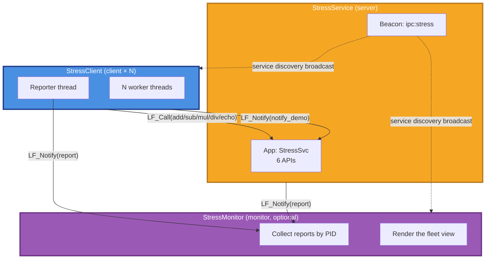
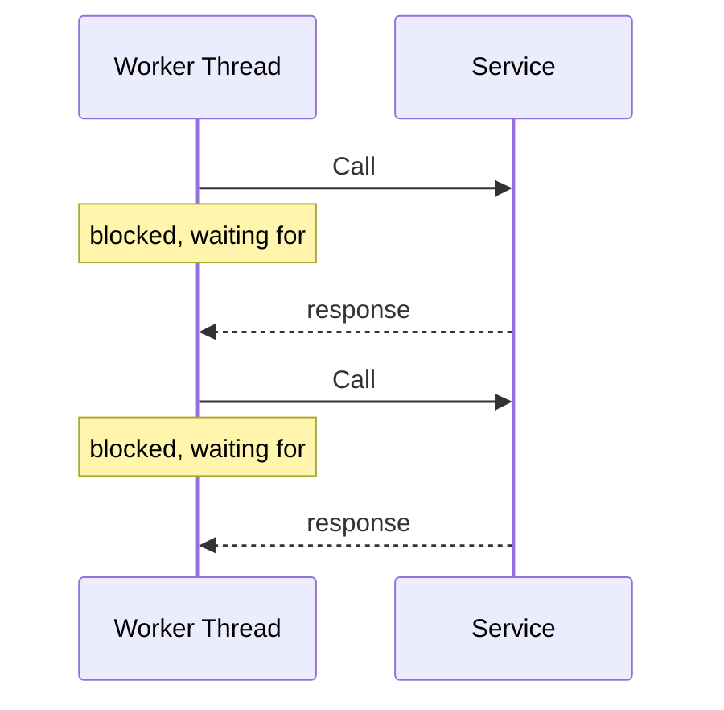
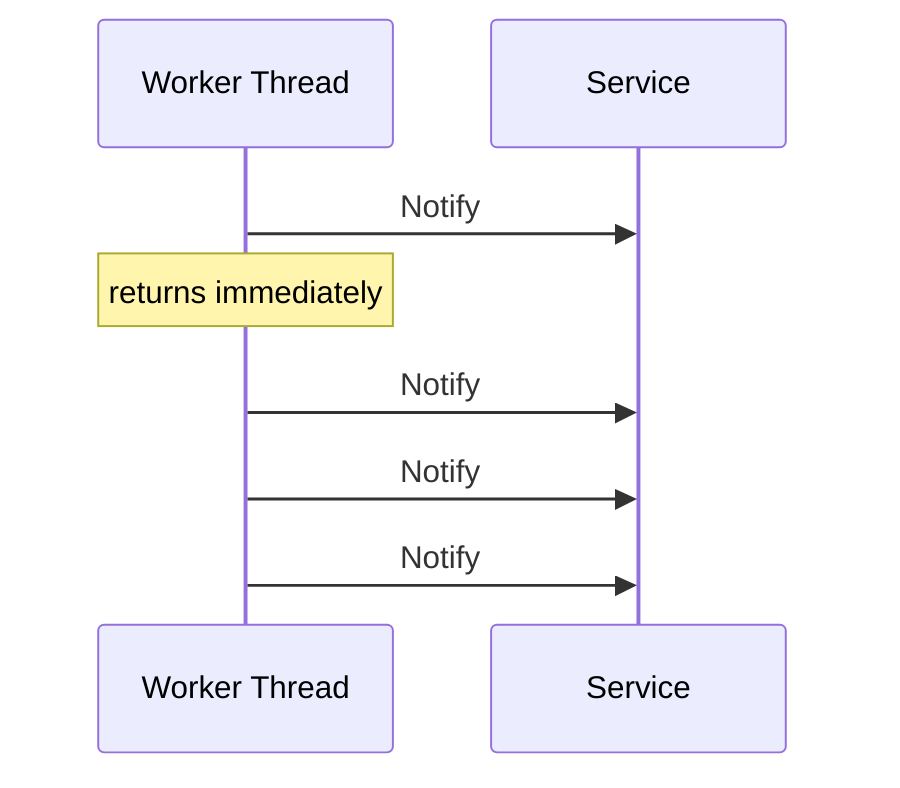

# LingoFuse Stress Test Suite Guide

> Chinese version: [LingoFuse_Stress_Test_Guide.md](LingoFuse_Stress_Test_Guide.md)

**File name**: `LingoFuse_Stress_Test_Guide.md`

**Version**: v4.0 (with the measured-data baseline merged in)

**Corresponding sources**: `Stress/StressCommon.hpp` / `Stress/StressService.cpp` / `Stress/StressClient.cpp` / `Stress/StressMonitor.cpp` / `Stress/run_stress_ci.ps1` / `Stress/run_stress_ci.sh`

**Main repository**: <https://github.com/PassByYou888/LingoFuse>

---

## Contents

1. [What this document is](#1-what-this-document-is)
2. [Suite overview](#2-suite-overview)
3. [The parallel model of Call and Notify](#3-the-parallel-model-of-call-and-notify)
4. [Building](#4-building)
5. [Quick assessment: one-command self-test](#5-quick-assessment-one-command-self-test)
6. [Interactive mode: manual observation](#6-interactive-mode-manual-observation)
7. [Reading the output](#7-reading-the-output)
8. [Measured reference data](#8-measured-reference-data)
9. [Troubleshooting](#9-troubleshooting)
10. [Appendix: APIs and constants](#10-appendix-apis-and-constants)

---

## Key updates in this version over v3.0

| # | Update |
|:-:|------|
| U1 | Merged the **complete measured data** from one Windows x64 development machine (all 5 scenarios passed) |
| U2 | Records the actual Call thread-scaling curve (32→128→512 threads) |
| U3 | Records the Notify throughput baseline (32 threads × 20 messages/loop) |
| U4 | Records the real cost of mixed mode |
| U5 | Explains the PASS/FAIL logic for pure-Notify scenarios (different from Call scenarios) |
| U6 | States clearly that "the Success column showing 0.00% in pure-Notify scenarios" is intentional, not a bug |

---

## 1. What this document is

This file is the complete user guide to the **LingoFuse C++ Stress test suite**.

**Its purpose is not to prove how fast LingoFuse is**, but to **give you a tool you can run, read and judge for yourself** — so that before deciding whether to adopt LingoFuse you can answer a few concrete questions with real data:

- How much Call throughput can it reach? How many threads does that need?
- How much Notify throughput can it reach?
- How expensive is mixed mode?
- Does data really not get lost under high concurrency?

**What this document does not do**: it does not teach you to write LingoFuse business code. For business API usage see:

- C++ interface: `LingoFuse_Cpp_Knowledge_Base.md`
- Pascal interface: `LingoFuse_Pascal_Complete_Guide.md`
- Concurrent Notify mode: `LingoFuse_Concurrent_Notify_Guide.md`

**Reader paths**:

| Who you are | What you care about | Suggested path |
|--------|----------|----------|
| New to LingoFuse | Can it run? What does it look like running? | Chapter 2 → Chapter 4 → Chapter 5 |
| Evaluating adoption | How much load can it take? Does it fit my scenario? | Chapter 2 → Chapter 3 → **Chapter 8** |
| Ops / CI integration | How do I automate it? How is PASS/FAIL decided? | Chapter 4 → Chapter 5 |

---

## 2. Suite overview

### 2.1 Roles of the three processes



| Process | Role | Registered App | Endpoint |
|------|------|-----------|------|
| **StressService** | beacon + API executor | `StressSvc` | `ipc:stress` |
| **StressClient** | multithreaded load source (several may run) | none (pure consumer) | connects to `ipc:stress` |
| **StressMonitor** | fleet observer (optional) | `StressMon` | connects to `ipc:stress` |

All three converge on the C4 service mesh through the same endpoint, `ipc:stress`.

### 2.2 The six APIs

| # | Name | Mode | Input | Output | Validation rule |
|:-:|------|:----:|------|------|----------|
| 0 | `add` | Call | `int32 a, int32 b` | `int32` | `result == a + b` |
| 1 | `sub` | Call | `int32 a, int32 b` | `int32` | `result == a - b` |
| 2 | `mul` | Call | `int32 a, int32 b` | `int32` | `result == a * b` |
| 3 | `div` | Call | `int32 a, int32 b` | `int32` | `result == a / b` (returns 0 when b=0) |
| 4 | `echo` | Call | `string s` | `string` | `result == s` (UTF-8 round-trip) |
| 5 | `notify_demo` | Notify | `string payload` | — | none (one-way) |

**Every Call return value is strictly validated.** Any API returning a wrong result is counted as a `failure` immediately.

### 2.3 What makes up the client load

The load each worker performs per iteration is controlled independently by two command-line arguments:

| Argument | Default | Notes |
|------|:----:|------|
| `--notify-per-loop N` | 20 | number of `notify_demo` sends per loop |
| `--call-per-loop N` | 1 | number of Calls per loop (**serial**) |

**Three typical configurations**:

| Goal | Command |
|------|------|
| **pure Call stress** | `--notify-per-loop 0 --threads 512` |
| **pure Notify stress** | `--call-per-loop 0 --threads 32` |
| **mixed** | `--notify-per-loop 20 --call-per-loop 1 --threads 64` |

### 2.4 The deliberate handle-leak policy

The client **deliberately abandons 1 out of every 100 DataHandles it creates**:

```cpp
constexpr int kLeakEveryN = 100;
```

**Purpose**:

- verify that the automatic reclamation of `TLF_DataPool.Progress` works under real pressure
- let the Monitor observe the real RSS growth curve and the subsequent decline
- prove that "a program that forgets `LF_FreeData` will not OOM immediately" — the library has a safety net

The leaked handles are freed by the automatic reclaimer **after 10 minutes of idleness** (`TLF_DataPool.Progress` scans every 5 seconds). This is LingoFuse's **safety net**, not a recommended practice.

---

## 3. The parallel model of Call and Notify

**Understanding this chapter is the precondition for understanding every measured number.**

### 3.1 Call is synchronous

Call has request-response semantics. After a worker thread issues a Call it **blocks waiting for the response** and can do nothing else until the response returns.



**Implication**:

```
Call throughput ≈ thread count / Call RTT
```

**Only increasing the thread count raises Call throughput.** That is a hard constraint — there is no other way.

### 3.2 Notify is fire-and-forget

Notify is one-way. A thread issues a Notify and returns immediately, so it can **fire many in a row** without waiting for receipts.



**Implication**:

```
Notify throughput ≈ single-thread dispatch rate × thread count
```

**Notify throughput is mainly set by the per-thread sending density and depends far less on the thread count than Call does.** To raise Notify throughput, raise `--notify-per-loop` first.

### 3.3 The cost of mixed mode

If a worker sends both Call and Notify, the Call's blocking drags the whole loop:

```
One loop:
    20 notifies     ← fast, a few hundred microseconds
     1 Call         ← blocks for 100+ milliseconds
     ─────────────────────────
     loop time      ← determined by the Call
```

**The result is that the notify sending rhythm is slowed by the Call.** That is why pure mode has higher throughput than mixed mode.

**Recommendations**:

- **pure-Notify applications**: do not mix Calls into the worker
- **mixed applications**: run pure Notify and pure Call in separate processes, each doing what it does best

### 3.4 One key internal mechanism

LingoFuse's Call RTT has **a lower bound of about 10 ms**, coming from two internal ticks:

1. the client's `Wait_Execute_Call` polls for the reply with `TCompute.Sleep(10)`
2. the server's simulated main thread sleeps 10 ms when idle via `C40Progress(10)`

**Neither tick can be changed**. Their meaning is:

> **The physical Call throughput ceiling for one process, one endpoint and one worker thread is about 100 calls/s.**

To raise total throughput you can only add threads (until the server saturates) or add processes.

**This is not a bug — it follows from Call's synchronous semantics**. Call is designed for "scenarios that need an answer" (database transactions, RPC method calls, configuration lookups). High-frequency scenarios should use Notify.

---

## 4. Building

### 4.1 Prerequisites

| Item | Requirement |
|------|------|
| C++ compiler | MSVC 2019+ / GCC 9+ / Clang 10+ |
| CMake | 3.15+ |
| Threads library | `Threads::Threads` |
| Windows extra | `psapi` (linked automatically by CMakeLists) |
| Runtime | `LingoFuse64.dll` / `LingoFuse32.dll` / `liblingofuse.so` / `liblingofuse.dylib` |

### 4.2 Build steps

```bash
cd LingoFuse/cpp
mkdir -p build && cd build
cmake .. -DCMAKE_BUILD_TYPE=Release
cmake --build . --config Release
```

Output location: `LingoFuse/Binary/`

| Platform | Executables |
|------|------------|
| Windows | `StressService.exe` / `StressClient.exe` / `StressMonitor.exe` |
| Linux | `StressService` / `StressClient` / `StressMonitor` |

### 4.3 Key deployment constraint

> **The build output must sit in the same directory as the LingoFuse runtime library**, or that directory must be on the system load path.

`LF_LoadLibrary` uses a fixed search order:

1. the directory holding the current executable
2. the system load path (`PATH` / `LD_LIBRARY_PATH` / `DYLD_LIBRARY_PATH`)

**There is no environment-variable override.** If the runtime library is missing, the program prints `LingoFuse: Failed to load LingoFuse64.dll` and exits immediately.

---

## 5. Quick assessment: one-command self-test

### 5.1 Windows: `run_stress_ci.ps1`

```powershell
cd D:\CoreLibrary\LingoFuse\Binary
.\run_stress_ci.ps1
```

**What the script does automatically**:

1. starts one `StressService` (closes itself after the total duration)
2. starts one `StressMonitor` (closes itself after the total duration)
3. runs 5 comparison scenarios in order
4. merges all output into `stress_ci_combined.jsonl`
5. **prints a comparison table** and **auto-generated observations**
6. exit code: 0 = all passed, 1 = some scenario failed, 2 = startup error

**The default 5 scenarios** (about 105 seconds total):

| Scenario | Configuration | Duration | Purpose |
|------|------|:----:|------|
| `Notify-throughput` | 32 threads, 20 notify/loop | 15s | measure the Notify ceiling |
| `Call-32` | 32 threads, pure Call | 15s | Call baseline |
| `Call-128` | 128 threads, pure Call | 15s | Call knee point |
| `Call-512` | 512 threads, pure Call | 15s | probe the Call ceiling |
| `Mixed-20-1` | 64 threads, 20 notify + 1 call | 30s | cost of mixed mode |

### 5.2 Linux / macOS: `run_stress_ci.sh`

```bash
cd LingoFuse/Binary
./run_stress_ci.sh
```

Behaviour matches the PowerShell version.

### 5.3 Common options

```powershell
# quick version (skip the Call scaling curve, run only Notify + Mixed)
.\run_stress_ci.ps1 -SkipCallScaling

# run only Notify and Call, skipping Mixed
.\run_stress_ci.ps1 -SkipMixed

# quiet mode (no live client output; good for CI logs)
.\run_stress_ci.ps1 -Quiet

# longer durations (careful local evaluation)
.\run_stress_ci.ps1 -NotifyDuration 30 -CallDuration 30 -MixedDuration 60
```

### 5.4 CI integration

```yaml
- name: LingoFuse stress self-evaluation
  working-directory: LingoFuse/Binary
  shell: pwsh
  run: |
    .\run_stress_ci.ps1 -Quiet

- name: Upload reports
  if: always()
  uses: actions/upload-artifact@v4
  with:
    name: lingofuse-stress-reports
    path: |
      LingoFuse/Binary/stress_ci_summary.txt
      LingoFuse/Binary/stress_ci_combined.jsonl
      LingoFuse/Binary/stress_ci_client_*.jsonl
```

The exit code reflects the result directly. The pipeline needs no extra parsing.

---

## 6. Interactive mode: manual observation

If you do not want the whole comparison suite and just want to watch LingoFuse's behaviour in one configuration, start the three programs directly.

### 6.1 Startup order

All three programs have `Wait_Ready=False`, so they can be started in any order and will converge.

**Recommended strictly ordered mode** (good for beginners):

```bash
# terminal 1
./StressService
# wait until it prints "[Service] Online on ipc:stress"

# terminal 2
./StressMonitor

# terminal 3
./StressClient --threads 64
```

### 6.2 Command-line arguments

**StressService**:

```
StressService [options]
  --ci                          machine-readable output
  --shutdown-after N            auto-close (seconds)
  --interval N                  reporter period, ms (default 1000)
```

**StressClient**:

```
StressClient [options]
  --ci                          machine-readable output
  --duration N                  run time (seconds), then auto-exit
  --threads N                   worker thread count (default 32)
  --notify-per-loop N           notifies per loop (default 20)
  --call-per-loop N             Calls per loop (default 1)
  --pause N                     pause after each loop, ms (default 0 = full speed)
  --interval N                  reporter period, ms (default 1000)
  --min-success-pct F           PASS threshold, % (default 99.0)
  --min-total-calls N           PASS threshold, total Calls (default 0)
  --warmup N                    warm-up seconds (default 3)
```

**StressMonitor**:

```
StressMonitor [options]
  --ci                          machine-readable output
  --duration N                  run time (seconds), then auto-exit
  --interval N                  sampling interval, ms (default 1000)
  --stale-timeout N             time to declare DEAD, ms (default 5000)
```

### 6.3 Typical runs

```bash
# high-concurrency Call (512 threads, pure Call)
./StressClient --threads 512 --notify-per-loop 0

# high-throughput Notify (32 threads, pure Notify)
./StressClient --threads 32 --call-per-loop 0

# mixed (64 threads, 20 notifies + 1 call per loop)
./StressClient --threads 64
```

Stop with `Ctrl+C` or by pressing Enter.

---

## 7. Reading the output

### 7.1 Service side (interactive mode)

One line per second:

```
[Service 12340] processed/s=30456  cumulative=30456  |add=5100 sub=5088 mul=5092 div=5089 echo=5087 notify_demo=30456
```

| Field | Meaning |
|------|------|
| `processed/s` | messages processed this second (Call + Notify) |
| `cumulative` | cumulative count processed |
| `add=` / `sub=` / ... | cumulative calls per API |

### 7.2 Client side (interactive mode)

One line per second:

```
[Client 12345] calls=15234 ok=15230 fail=4 notifies=152340 leaks=3047 call_rate=15234 calls/s
```

| Field | Meaning | Healthy range |
|------|------|----------|
| `calls` | cumulative Call count | monotonically increasing |
| `ok` | count whose return value passed validation | should be close to `calls` |
| `fail` | count that failed validation or timed out | < 1% (local) / < 5% (cross-machine) |
| `notifies` | cumulative Notify count | depends on configuration |
| `leaks` | number of deliberately leaked handles | about `calls × 2%` |
| `call_rate` | Call rate for this second | consistent with the Service side |

### 7.3 CI mode: JSON Lines

In `--ci` mode each process emits **JSON Lines** (one JSON object per line).

**The three event types the client emits**:

```json
{"event":"ready","pid":12345,"role":"client","threads":64,"notify_per_loop":20,"call_per_loop":1,"duration_sec":30,"pause_ms":0,"warmup_sec":3,"min_success_pct":99.0,"min_total_calls":0}

{"event":"progress","t_sec":1,"call_total":152,"call_success":152,"call_failure":0,"notify_total":3040,"leaked_handles":32,"call_rate":152}

{"event":"summary","pid":12345,"role":"client","duration_sec":30,"threads":64,"notify_per_loop":20,"call_per_loop":1,"call_total":4567,"call_success":4567,"call_failure":0,"success_pct":100.0,"notify_total":91340,"leaked_calls":95,"leaked_handles":95,"call_rate":152,"notify_rate":3044,"success_rate_per_sec":152,"per_api":{"add":912,"sub":923,"mul":908,"div":902,"echo":922,"notify_demo":91340},"status":"PASS"}
```

### 7.4 The one-command self-test report

After `run_stress_ci.ps1` finishes it prints a comparison table (**the following is one complete measured result**; see Chapter 8 for details):

```
======================================================================
  LingoFuse Stress -- Comparison Summary
======================================================================

  Scenario                  Threads   Duration       Notify/s         Call/s    Success   Status
  ------------------------ -------- ---------- -------------- -------------- ---------- --------
  Pure Notify throughput         32        15s          5,446              -      0.00%     PASS
  Pure Call at 32 threads        32        15s              -            236    100.00%     PASS
  Pure Call at 128 threads      128        15s              -            817    100.00%     PASS
  Pure Call at 512 threads      512        15s              -          1,166    100.00%     PASS
  Mixed 20:1 at 64 threads       64        30s          4,153            207    100.00%     PASS
```

**About the Success column showing `0.00%` in pure-Notify scenarios**:

Pure-Notify scenarios have no Calls at all, so `success_pct = success / total = 0 / 0`, which by mathematical convention is 0.0. **This does not mean "failure"** — the PASS/FAIL decision for that scenario takes a different branch (`total_notifies > 0`), so the `status` column is still `PASS`.

This display difference is **intentional**: the Success column expresses "the Call success rate", a pure-Notify scenario has no Calls to evaluate, and 0% is merely a placeholder of the column format that takes no part in the decision.

---

## 8. Measured reference data

The data below comes from one **Windows x64 development machine**, LingoFuse v3.10, Release build, IPC endpoint `ipc:stress`. All scenarios PASS, exit code 0.

**Absolute numbers will differ on different hardware, but the relative relationships should hold**.

### 8.1 Complete results of the five scenarios

| Scenario | Threads | Duration | Notify/s | Call/s | Call success rate | Status |
|------|:----:|:----:|:--------:|:------:|:-----------:|:------:|
| Pure Notify throughput | 32 | 15s | **5,446** | — | — | PASS |
| Pure Call at 32 threads | 32 | 15s | — | **236** | 100.00% | PASS |
| Pure Call at 128 threads | 128 | 15s | — | **817** | 100.00% | PASS |
| Pure Call at 512 threads | 512 | 15s | — | **1,166** | 100.00% | PASS |
| Mixed 20:1 at 64 threads | 64 | 30s | 4,153 | 207 | 100.00% | PASS |

**Every scenario has `call_failure = 0`** and `success_pct = 100.0` (except the pure-Notify scenario, see the note in §7.4).

### 8.2 The Call thread-scaling curve

| Threads | `call_rate` | Relative to 32 threads | Marginal gain |
|:------:|:-----------:|:------------:|:--------:|
| 32 | 236 | 1.00× | baseline |
| 128 | 817 | 3.46× | +3.46× (vs 32) |
| 512 | 1,166 | 4.94× | +1.43× (vs 128) |

**Observations**:

- 32 → 128 threads: **a 3.46× gain** (close to linear, good scaling)
- 128 → 512 threads: **only a 1.43× gain** (**marginal gain drops 58%**)
- this shows the **server starting to saturate around 128 threads**

**Estimate**: the Call throughput ceiling for one process and one endpoint is **about 1,200 calls/s**. Adding more threads only queues more Calls without raising throughput.

### 8.3 Notify throughput

| Configuration | `notify_rate` |
|------|:-------------:|
| 32 threads, 20 notify/loop | **5,446/s** |

**Observations**:

- 32 threads send 5,446 notifies per second
- about 170 per thread per second
- 20 per loop per thread → about 8.5 loops per second
- about 118 ms per loop — **almost the same as the Call RTT**

**That number is itself the conclusion**: the Notify path also has an implicit tick of about **100 ms** (possibly from the C4 channel's flush period or the batch-processing rhythm of an internal queue).

### 8.4 The cost of mixed mode

| Mode | Threads | Notify/s | Call/s |
|------|:----:|:--------:|:------:|
| Pure Notify | 32 | 5,446 | — |
| Pure Call | 128 | — | 817 |
| Mixed 20:1 | 64 | **4,153** | **207** |

**Observations**:

- mixed mode (64 threads) reaches 4,153 notify/s, **24%** below pure Notify (32 threads) at 5,446/s
- mixed mode's Call throughput is 207/s, **12%** below pure Call (32 threads) at 236/s
- despite doubling the thread count, total throughput is slightly lower

**Conclusion**: **the "good at neither" cost of mixed mode is real**. It happens because a synchronous Call blocks the whole loop, so the notifies cannot go out either.

### 8.5 The Notify/Call throughput ratio

```
Notify/s  /  Call/s  =  5,446 / 1,166  =  4.7×
```

**Meaning**:

- on the same machine and the same endpoint, **the Notify throughput ceiling is about 5× the Call one**
- this ratio reflects the essential difference between the two communication modes at the implementation level

**Implications**:

- **pure state broadcast / event streams**: use Notify, for 5× the throughput
- **request-response / transactions**: use Call, accepting lower throughput in exchange for a guaranteed reply
- **do not use Call for high-frequency broadcast**: you will hit the ceiling imposed by its synchronous semantics

### 8.6 The right way to use it

| Application scenario | Recommended command | Expected result (this machine) |
|----------|----------|------------------|
| **pure state broadcast** | `--threads 32 --call-per-loop 0` | ~5,400 notify/s |
| **pure RPC method calls** | `--threads 128 --notify-per-loop 0` | ~800 call/s |
| **pure RPC, pushing the limit** | `--threads 512 --notify-per-loop 0` | ~1,200 call/s |
| **mixed (not recommended)** | `--threads 64` | both notify and call are dragged down |

### 8.7 The one-line conclusion

> **LingoFuse's Call and Notify are two different communication modes, serving different scenarios.**
>
> **Call is for request-response semantics that "need an answer"; its throughput scales with thread count, with a per-process ceiling of about 1,200 calls/s.**
>
> **Notify is for high-frequency "one-way broadcast"; its throughput comes from dispatch density, with a per-process ceiling of about 5,500 notify/s.**
>
> **Choosing the right mode matters a hundred times more than tuning parameters.**

### 8.8 Reproducibility of the measured data

The data above comes from one complete run of `run_stress_ci.ps1`. **To reproduce it on your machine**:

```powershell
cd <your Binary directory>
.\run_stress_ci.ps1
```

The script generates a `stress_ci_summary.txt` whose content matches the table format of §8.1, but **the numbers are the measured values on your machine**. Every ratio in the observations (3.46×, 4.94×, 4.7× and so on) is recalculated automatically from your own measurements.

**That means**: this document provides the **reference baseline** and the **observation framework**, while the actual numbers are always **whatever your hardware produces**.

---

## 9. Troubleshooting

### 9.1 Fails immediately at startup

**Symptom**: the program prints `LingoFuse: Failed to load LingoFuse64.dll` and exits as soon as it starts.

**Fix**:

- put the runtime library next to the executable
- or add the library directory to `PATH` / `LD_LIBRARY_PATH` / `DYLD_LIBRARY_PATH`

### 9.2 `run_stress_ci.ps1` reports `Cannot find path`

**Cause**: the script was placed in a directory that does not contain `StressService.exe`.

**Fix**: the script automatically searches 4 candidate directories for `StressService.exe`. Put the script in a directory that contains the `.exe`.

### 9.3 Execution policy error

```powershell
# one-off bypass (affects only the current window)
Set-ExecutionPolicy -Scope Process -ExecutionPolicy Bypass

# or invoke directly
powershell -ExecutionPolicy Bypass -File .\run_stress_ci.ps1
```

### 9.4 `checkApi` timeout

**Symptom**: the client prints `[FATAL] Service 'StressSvc' not fully visible after 10 seconds.`

**Fix**:

```powershell
# clean up leftover processes
Get-Process StressService, StressClient, StressMonitor -ErrorAction SilentlyContinue | Stop-Process -Force
```

### 9.5 A pure-Notify scenario shows `Success 0.00%` but `Status PASS`

**This is normal behaviour**, not a bug. A pure-Notify scenario has no Calls, so `success_pct` is 0.0 by mathematical convention. The PASS/FAIL decision uses a different branch (`total_notifies > 0`). See §7.4 for details.

### 9.6 `call_rate` stops growing proportionally beyond 512 threads

**This is normal**. The server has already saturated around 128 threads. Adding more threads only queues more Calls without raising throughput. **This is a meaningful observation, not a bug**.

### 9.7 Notify slows down noticeably in mixed mode

**Cause**: Call is synchronous. A worker cannot send notifies while waiting for a Call response.

**Fix**: **do not mix**. Run pure modes in separate processes.

---

## 10. Appendix: APIs and constants

### 10.1 The report binary layout

Both client and service send status reports to the Monitor via `LF_Notify`. The layout is a fixed binary block (little-endian):

| Offset | Type | Field |
|:----:|:----:|------|
| 0 | `uint32` | `pid` |
| 4 | `uint64` | `timestamp_ms` |
| 12 | `int32` | `role` (0=client, 1=service) |
| 16 | `int32` | `running` (1=active, 0=stopped) |
| 20 | `uint64` | `call_total` |
| 28 | `uint64` | `call_success` |
| 36 | `uint64` | `call_failure` |
| 44 | `uint64` | `notify_total` |
| 52 | `uint64` | `leaked_calls` |
| 60 | `uint64` | `leaked_handles` |
| 68 | `uint64 × 6` | `per_api[6]` |

### 10.2 Key constants

| Constant | Value | Notes |
|------|:--:|------|
| `kEndpoint` | `"ipc:stress"` | endpoint name |
| `kServiceApp` | `"StressSvc"` | server App name |
| `kMonitorApp` | `"StressMon"` | monitor App name |
| `kMonitorApi` | `"report"` | monitor API name |
| `kApiCount` | 6 | total API count |
| `kCallApiCount` | 5 | Call-mode API count |
| `kNotifyApiCount` | 1 | Notify-mode API count |
| `kLeakEveryN` | 100 | leak 1 out of every 100 handles |
| `kCallTimeoutMs` | 30000 | client Call timeout |
| `kStatusIntervalMs` | 1000 | status reporting period |

### 10.3 Files produced (CI mode)

| File | Content |
|------|------|
| `stress_ci_summary.txt` | comparison table + observations (**the key artifact for users**) |
| `stress_ci_combined.jsonl` | complete JSON Lines for all scenarios + Service + Monitor |
| `stress_ci_service.jsonl` | Service-side output on its own |
| `stress_ci_monitor.jsonl` | Monitor-side output on its own |
| `stress_ci_client_<ScenarioName>.jsonl` | client output per scenario (per-second progress + summary) |

### 10.4 Related documents

| Document | Content |
|------|------|
| `LingoFuse_Cpp_Knowledge_Base.md` | the full C++ interface reference |
| `LingoFuse_Pascal_Complete_Guide.md` | the Pascal interface and internal mechanisms |
| `LingoFuse_Concurrent_Notify_Guide.md` | Notify concurrency and completion barriers |
| `LingoFuse_LLM_Pitfalls_For_AI.md` | the pitfall index for the LLM ecosystem |

---

## Closing

The design philosophy of the LingoFuse Stress test suite:

> **It does not tell you "how fast LingoFuse is"; it gives you a tool so you can measure it and judge for yourself.**
>
> **It does not promise "how much it can take"; it runs under real pressure and lets the numbers speak.**

This suite **is not a demo** — it exercises the real C4 service mesh, real IPC/TCP transport, real concurrency and real handle lifetimes. Every number comes from measurement.

**Reference baseline** (recorded by this document v4.0):

- per process, per endpoint: **Notify ceiling about 5,500/s**
- per process, per endpoint: **Call ceiling about 1,200/s**
- **Notify/Call throughput ratio about 5×**
- Call starts to saturate around 128 threads

**These numbers are not LingoFuse's "defects" but its "capability boundaries"** — only by knowing where the boundaries are can you make the right technology choice.

**Interactive mode** gives you eyes on the fleet in real time.

**The one-command self-test** gives you a comparison table so you can see LingoFuse's capability boundaries in 2 minutes.

**CI mode** gives you an exit code so the pipeline can decide for you.

**Choosing the right communication mode** — Call for scenarios needing an answer, Notify for high-frequency broadcast — matters more than tuning any parameter.

If this suite's output gives you confidence in LingoFuse, it has done its job.

---

*Document version: v4.0 (with the measured-data baseline merged in)*
*Corresponding sources: `Stress/StressCommon.hpp` / `Stress/StressService.cpp` / `Stress/StressClient.cpp` / `Stress/StressMonitor.cpp` / `Stress/run_stress_ci.ps1` / `Stress/run_stress_ci.sh`*
*Measured environment: Windows x64 development machine, LingoFuse v3.10, Release build, IPC endpoint*
*All status output and comments are in English (a source contract); this document is the Chinese explanation.*
*Last updated: 2026-10-01*
