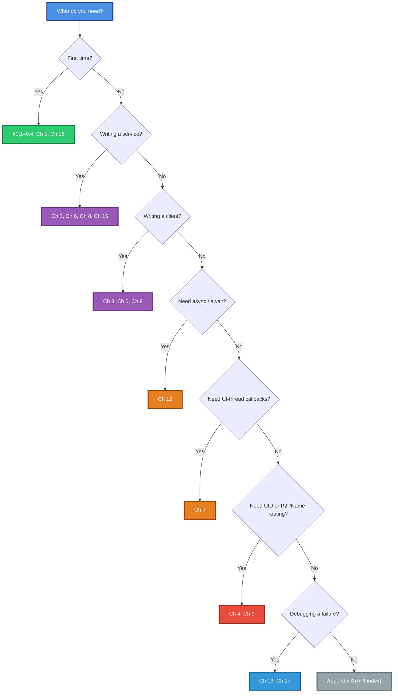
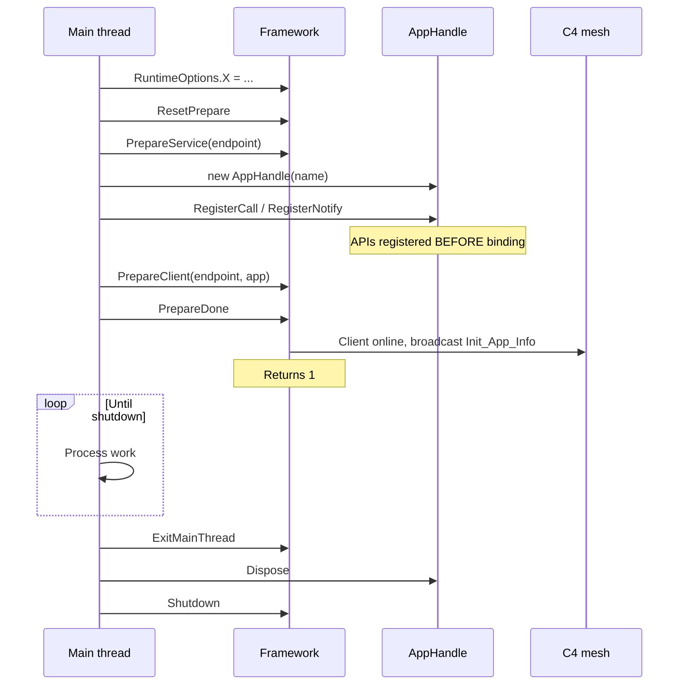
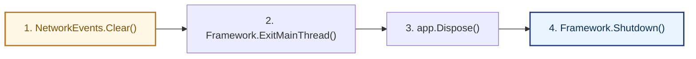

# LingoFuse C# 接口 — 完整指南

**文档版本**：5.0
**覆盖范围**：LingoFuse 原生库 v5.01 + 两层 C# 绑定（程序集 `LingoFuse`，命名空间 `LingoFuse`）
**目标框架**：.NET 8.0+
**阅读目标**：仅凭本文档（不打开任何源码文件），工程师或 AI Agent 即可编写正确、生产级的 LingoFuse C# 程序——包括 UID / P2PName 寻址、异步调用、自定义回调线程调度、发送方身份读取。

---

## 更新日志

### v5.0（2026-10-13）——重大功能发布

本版本将 v5.0 绑定升级合并进现有指南。指导原则不变：本文件仍然是 C# 接口的唯一权威来源，任何 AI 仅凭本文档阅读即可产出生产级 LingoFuse C# 代码。

新 API 面（每个都有专属章节）：

| 功能 | 章节 | 备注 |
|---|---|---|
| `P2PUid` 值类型 | 4 | 32 字节会话 UID |
| `DataHandle.GetSenderUid` / `GetSenderP2PName` | 3 | 发送方身份（"侧数据"） |
| `RuntimeOptions` 强类型门面 | 6 | 完整覆盖 `LF_SetOption` / `LF_GetOption` |
| `ILingoCallbackDispatcher` / `CallbackDispatcher` | 7 | 控制回调体在哪个线程执行 |
| UID 寻址（`CallByUid` / `NotifyByUid` / …） | 9 | 定向路由到具体会话 |
| P2PName 寻址（`CallByP2PName` / `NotifyByP2PName` / …） | 9 | 组路由 + 服务端负载均衡 |
| Task 化异步（`CallAsync` / `CallByUidAsync` / …） | 12 | `Task<DataHandle>` + 原生 `await` 语义 |
| 进程级 P2P 注册（`RegisterP2PCall` / …） | 9 | 仅通过 UID / P2PName 到达的 API |
| 额外探活（`CheckUid` / `CheckP2PName` / …） | 9 | UID / P2PName 的缓存式探活 |

非破坏性新增：

- `AppHandle.RegisterCall` 与 `RegisterNotify` 增加了带 dispatcher 的重载。历史签名保留，内部委托给 `CallbackDispatcher.Inline`。
- `Framework.SetOption` 保持不变；`RuntimeOptions` 是叠加在它之上的强类型门面。

文档补充：

- §0.4 现在列出十条铁律（此前是七条）。
- §12 端到端记录了原生 `await` 语义，包括 v5.0 测试运行中发现的**反直觉行为**——"本地 App 名异步调用同步完成"。
- §17 新增八条覆盖 v5.0 API 面的条目。
- 附录 D 的自检清单新增 18 个问题，覆盖 P2PUid、RuntimeOptions、CallbackDispatcher、异步、侧数据。

### v5.1（2026-10-13）——回调风格异步（call-site inline）

新增回调风格的异步调用门面 `Async`，把"调用 + 回调"合并为单一表达式，与 C++ 的 `lingofuse::callAsync` 和 Pascal 的 `LF.AsyncCallApp_P` 完全同构。

新增 API：

| 功能 | 章节 | 备注 |
|---|---|---|
| `Async.Call` / `CallSequenced` | 12.10 | App 名寻址，回调风格 |
| `Async.CallByUid` / `CallByUidSequenced` | 12.10 | UID 寻址，回调风格 |
| `Async.CallByP2PName` / `CallByP2PNameSequenced` | 12.10 | P2PName 寻址，回调风格 |
| `AsyncResult` 值类型 | 12.10 | `Ok` / `Error` / `Size` / `Handle` / `Read*` |

设计原则：

- **调用与回调同一个表达式**——无 `Task`、无 `await`、无 `std::function`。
- **单错误路径**——`if (!r.Ok) { ... }` 一处吃完派发失败与远端空返回。
- **借用句柄，仅回调体内有效**——`AsyncResult` 内部持有 `DataHandle.FromRaw(result, owned: false)`，暴露 `Read*` 便捷方法。用户从不接触裸指针。

与 await 风格（`Framework.CallAsync`）的关系：

- 两者并存，共享底层 C ABI，不互相干扰。
- await 风格适合 UI 应用、需要 `SynchronizationContext` 自动 marshal 的场景。
- 回调风格适合服务端回调逻辑、嵌入式、脚本化、想跟 C++/Pascal 保持一致的场景。

测试覆盖：`test2/Program.cs` 新增 10 个测试，总测试数从 48 增到 58。

### v4.0（上一版本）

首次全面重构：两层架构、线协议、`DataHandle` / `AppHandle` / `Framework` / `NetworkEvents` / `LingoFuseStatus`、跨语言互操作、生命周期模式、完整示例、踩坑知识库、参考附录。

---

## 目录

**第一部分 — 定位**
- [第 0 章 — LingoFuse 是什么](#第-0-章--lingofuse-是什么)
- [第 1 章 — 快速开始](#第-1-章--快速开始)

**第二部分 — 契约**
- [第 2 章 — 线协议](#第-2-章--线协议)
- [第 3 章 — DataHandle](#第-3-章--datahandle)
- [第 4 章 — P2PUid](#第-4-章--p2puid)
- [第 5 章 — LfIo](#第-5-章--lfio)
- [第 6 章 — RuntimeOptions](#第-6-章--runtimeoptions)
- [第 7 章 — CallbackDispatcher](#第-7-章--callbackdispatcher)
- [第 8 章 — AppHandle](#第-8-章--apphandle)
- [第 9 章 — Framework](#第-9-章--framework)
- [第 10 章 — NetworkEvents](#第-10-章--networkevents)
- [第 11 章 — LingoFuseStatus](#第-11-章--lingofusestatus)
- [第 12 章 — 异步调用模型](#第-12-章--异步调用模型)
- [第 13 章 — 异常参考](#第-13-章--异常参考)

**第三部分 — 互操作与模式**
- [第 14 章 — 跨语言互操作](#第-14-章--跨语言互操作)
- [第 15 章 — 生命周期模式](#第-15-章--生命周期模式)
- [第 16 章 — 完整示例](#第-16-章--完整示例)
- [第 17 章 — 踩坑与反模式](#第-17-章--踩坑与反模式)

**第四部分 — 参考**
- [附录 A — 公共 API 索引](#附录-a--公共-api-索引)
- [附录 B — 跨语言线协议矩阵](#附录-b--跨语言线协议矩阵)
- [附录 C — 术语表](#附录-c--术语表)
- [附录 D — 自检清单](#附录-d--自检清单)

---

## 第 0 章 — LingoFuse 是什么

### 0.1 一句话定义

> **LingoFuse 是构建在 C4 服务网格之上的跨语言、跨进程、跨机器 RPC 框架。它让 Pascal、Python、C++、C#、Rust、Java 或任何其它语言编写的服务，可以通过统一的线协议互相调用。**

C# 绑定通过单一命名空间中的少量公开类型暴露 LingoFuse，严格分为两层：

| 层 | 职责 | 类型 |
|---|---|---|
| **Native 层**（internal） | 直接 P/Invoke 声明 59 个 C ABI 导出、两种不透明句柄、32 字节 UID 结构、四个回调原型。**用户代码永远不接触这一层。** | `NativeMethods`、`DataHnd`、`AppHnd`、`TUIDNative`、`Utf8Marshal`、`LfCallFunc`、`LfNotifyFunc`、`LfNetworkEventFunc`、`LfAsyncCallOnResult`、`AsyncCallbackBridge` |
| **Managed 层**（public） | RAII 句柄封装、UID 值类型、运行时选项门面、回调调度器、统一 JSON / 字符串 I/O、进程级生命周期门面、网络事件、状态队列、异常层次。 | `DataHandle`、`AppHandle`、`P2PUid`、`LfIo`、`RuntimeOptions`、`CallbackDispatcher` / `ILingoCallbackDispatcher`、`Framework`、`NetworkEvents`、`LingoFuseStatus`、`LingoFuseException`、`LingoFuseCallException`、`LingoFuseIoException`、`LingoFuseObjectDisposedException`、`LingoFuseLibraryLoadException` |

### 0.2 十二个核心概念

如果你只能记住十二件事，请记住这些：

1. **`DataHandle` 是带 API 名字的字节缓冲区。** 你向它写请求字节，从它读响应字节。它是 RAII 对象：`using` 会释放底层 native 资源。

2. **`AppHandle` 是一个应用。** 它把一组相关 API 归组在一个唯一名字下，供网格路由使用。

3. **`P2PUid` 是 32 字节的会话 UID。** 框架在 TunnelLink 时给每个客户端分配一个，并作为"侧数据"注入每个出站请求载荷。

4. **`LfIo` 是在托管对象与 `DataHandle` 之间来回搬运数据的唯一合法入口。** 字符串、原始字节、JSON。没有第二条路径。

5. **`RuntimeOptions` 是覆盖每一个 `LF_SetOption` / `LF_GetOption` 键的强类型门面。** 用它替代字符串型选项名——编译器会校验拼写，读回值只需一次属性访问。

6. **`CallbackDispatcher` 控制回调体在哪个线程运行。** `Inline`（默认）在 native worker 线程上运行；`MainThread` 编组到捕获的 UI 线程；自定义 dispatcher 可以瞄准任何调度原语。

7. **`Framework` 是进程级 ABI 门面。** 准备网络、发起远程调用（按 App 名 / UID / P2PName）、发起异步调用、注册 P2P API、设置选项、生成应用名、关闭一切。

8. **异步调用返回 `Task<DataHandle>`。** await continuation 遵循原生 C# `await` 语义：await 线程若存在 `SynchronizationContext` 则回到它；否则在完成该 Task 的线程上内联。

9. **回调默认在 native worker 线程上运行。** 回调不得阻塞、不得触碰 UI、不得调用任何阻塞型 LingoFuse 函数。若回调体需要 UI 线程，用 `CallbackDispatcher.MainThread`。

10. **JSON 线协议是 UTF-8，非 ASCII 字符以字面形式发出。** 对能字面表达的字符**不做 `\uXXXX` 转义**——包括 emoji。

11. **清理顺序是固定的**：`NetworkEvents.Clear()` → `Framework.ExitMainThread()` → `App.Dispose()` → `Framework.Shutdown()`。

12. **`Framework.PrepareDone()` 每进程只返回一次 `1`。** 没有中间 `Shutdown()` 的第二次调用返回 `0`，**不是失败**。

### 0.3 阅读路径



### 0.4 十条铁律

| # | 铁律 | 违反后果 |
|:-:|---|---|
| 1 | 回调必须以正确的调用约定声明。在 C# 中这是自动处理的：内部回调委托标注了 `[UnmanagedFunctionPointer(CallingConvention.Cdecl)]`。 | （在 C# 中不适用。） |
| 2 | 绝不在回调中调用 `Framework.Call` / `Notify` / `SequencedNotify` / `LocalCall` / `LocalNotify` / `PrepareDone` / `Shutdown`。 | 死锁。 |
| 3 | 所有 JSON / 字符串 / 字节 I/O 都通过 `LingoFuse.LfIo` 或 `DataHandle` 走。 | 帧漂移、跨语言失败。 |
| 4 | 清理顺序：`NetworkEvents.Clear` → `Framework.ExitMainThread` → `App.Dispose` → `Framework.Shutdown`。 | 悬空指针、泄漏。 |
| 5 | 每个物理地址只能有一个客户端，除非在 `PrepareClient` 前设置 `RuntimeOptions.OverlapConnection = true`。 | 静默丢弃连接。 |
| 6 | 从 `DataHandle.GetSenderUid` 拿到的每个 `P2PUid` 都是**拷贝**。存下来；不要去想"发送方的句柄"。 | （仅为指引。） |
| 7 | 所有回调体必须把 `DataHandle` 参数当作**借用句柄**。不要对它们调 `Dispose()`。 | （当前无害，但语义错误。） |
| 8 | 目标**本地**的异步调用会**同步完成**——在 `CallAsync` 返回之前。对已完成 Task 的 `await` 会在当前线程内联执行。 | 线程身份出人意料，但行为正确。见 §12.4。 |
| 9 | `CallbackDispatcher` 实现从 `Dispatch` 返回前，回调必须已经完成。 | 对框架持有的 input / output 句柄 use-after-free。 |
| 10 | `P2PUid` 是会话级值。每次重连都会重新生成。不要跨 link-loss 缓存。 | 调用被路由到已不存在的 UID。 |

### 0.5 关键默认值

| 项 | 值 |
|---|---:|
| 原生库名（Windows x64） | `LingoFuse64.dll` |
| 原生库名（Windows x86） | `LingoFuse32.dll` |
| 原生库名（Linux / BSD） | `liblingofuse.so` |
| 原生库名（macOS） | `liblingofuse.dylib` |
| 默认 TCP 端口 | 9898 |
| DataHandle 空闲回收 | 10 分钟 |
| 回收扫描间隔 | 5 秒 |
| `PrepareDone` 初始化超时 | 30 秒 |
| `RuntimeOptions.WaitConnectionTimeoutMs` 默认 | 30000 |
| `RuntimeOptions.OverlapConnection` 默认 | `false` |
| `RuntimeOptions.WaitConnectionReadyOk` 默认 | `true` |
| `RuntimeOptions.FixedSequencedTimeMs` 默认 | 20000 |
| `RuntimeOptions.DataHandleIdleTimeoutMs` 默认 | 600000 |
| `RuntimeOptions.DataHandlePoolScanIntervalMs` 默认 | 5000 |
| `RuntimeOptions.NoReponseCmdNullFlushThreshold` 默认 | 5000 |
| `Framework.GenerateAppName` 指针有效期 | ~5 秒 |
| `DataHandle.GetSenderUid` 返回值有效期 | 立即拷贝 |
| `DataHandle.GetSenderP2PName` 返回值有效期 | 立即拷贝 |
| `P2PUid` 字节长度 | 32 |
| 顺序通知线程空闲超时 | 5 分钟 |
| 顺序通知线程延迟释放 | 5 秒 |
| 异步调用结果句柄生命周期 | 仅回调体内 |

### 0.6 本文档的约定

- **"回调"** 指框架调用的任何用户提供的函数：已注册的 Call handler、Notify handler、网络事件监听器或异步完成。
- **"借用句柄"** 指 `Dispose` 为 no-op 的 `DataHandle`，由 `DataHandle.FromRaw(raw, owned: false)` 创建。底层 native 资源由框架持有，回调返回时释放。
- **"自有句柄"** 指 `Dispose` 会调 `LF_FreeData` 的 `DataHandle`。公开构造函数、`CreatePermanent`、`LocalCall`、`Call`、异步桥接产出的每个句柄都是自有句柄。
- **"侧数据"** 指发送方在传输前注入出站请求载荷的元数据。目前定义了发送方 UID 和 P2P 名两个侧数据字段。

---

## 第 1 章 — 快速开始

### 1.1 工程配置

添加对 LingoFuse 绑定程序集的工程引用：

```xml
<ItemGroup>
  <ProjectReference Include="..\src\LingoFuse\LingoFuse.csproj" />
</ItemGroup>
```

或者，如果绑定以 NuGet 包形式提供：

```xml
<PackageReference Include="LingoFuse" Version="1.0.0" />
```

只加一个 `using`：

```csharp
using LingoFuse;
```

没有其它公开命名空间。

### 1.2 最小服务端

```csharp
using System;
using LingoFuse;

using var app = new AppHandle("Calculator", "Demo calculator");

// Register a JSON API: takes an int[] {a, b}, returns {"result": a+b}.
app.RegisterCall("add", "Add two ints", (input, output) =>
{
    var args = LfIo.ReadJson<int[]>(input);
    LfIo.WriteJson(output, new { result = args[0] + args[1] });
});

RuntimeOptions.OverlapConnection = true;
Framework.ResetPrepare();
Framework.PrepareService("ipc:calc", "ipc:calc");
Framework.PrepareClient("ipc:calc", app);

if (Framework.PrepareDone() != 1)
{
    Console.Error.WriteLine("Startup failed");
    return;
}

Console.WriteLine("Ready. Press Enter to stop.");
Console.ReadLine();

NetworkEvents.Clear();
Framework.ExitMainThread();
app.Dispose();
Framework.Shutdown();
```

上面用了 v5.0 的强类型 `RuntimeOptions` 门面。如果你更喜欢旧式字符串型写法，`Framework.SetOption("Overlap_Connection", "True")` 仍然有效，且结果相同。

### 1.3 最小客户端

```csharp
using System;
using System.Text.Json;
using LingoFuse;

RuntimeOptions.WaitConnectionReadyOk = true;
RuntimeOptions.OverlapConnection = true;
Framework.ResetPrepare();
Framework.PrepareClient("ipc:calc", null);

if (Framework.PrepareDone() != 1)
{
    Console.Error.WriteLine("Startup failed");
    return;
}

using var request = new DataHandle("add");
LfIo.WriteJson(request, new[] { 5, 7 });

using var response = Framework.Call("Calculator", request, timeoutMs: 3000);
if (response.Size == 0)
{
    Console.WriteLine("Call failed (timeout or unreachable)");
    return;
}

var result = LfIo.ReadJson<JsonElement>(response);
Console.WriteLine($"5 + 7 = {result.GetProperty("result").GetInt32()}");

NetworkEvents.Clear();
Framework.ExitMainThread();
Framework.Shutdown();
```

### 1.4 最小异步客户端（v5.0）

```csharp
using System;
using LingoFuse;

RuntimeOptions.WaitConnectionReadyOk = true;
RuntimeOptions.OverlapConnection = true;
Framework.ResetPrepare();
Framework.PrepareClient("ipc:calc", null);
Framework.PrepareDone();

using var request = new DataHandle("add");
LfIo.WriteJson(request, new[] { 5, 7 });

// The await resumes on the caller's SynchronizationContext when one
// exists, and inline on the completing thread otherwise.
using var response = await Framework.CallAsync("Calculator", request);

var result = LfIo.ReadJson<JsonElement>(response);
Console.WriteLine($"5 + 7 = {result.GetProperty("result").GetInt32()}");

NetworkEvents.Clear();
Framework.ExitMainThread();
Framework.Shutdown();
```

注意包含方法需要 `async`。在控制台应用的 `Main` 中，要么把 `Main` 标记为 `async Task Main`，要么用 `.GetAwaiter().GetResult()` 阻塞等待。

### 1.5 三终端演示

```
Terminal 1:  dotnet run --project crossService
Terminal 2:  dotnet run --project CrossNode      (after terminal 1 prints "running")
Terminal 3:  dotnet run --project CrossCall      (after terminal 2 prints "Online")
```

演示注册了一个名为 `demo` 的应用，包含两个 API（`add`、`inv_seri`），运行 32 线程负载测试 10 秒，并打印吞吐量汇总。

---

## 第 2 章 — 线协议

这是最重要的一章。你遇到的每一个跨语言 bug，都可以追溯到违反了其中某条契约。

### 2.1 契约 1：字符串的 NUL 帧

线上每个字符串都是：

```
[UTF-8 bytes][0x00]
```

原始二进制载荷是：

```
[arbitrary bytes][0x00]
```

接收方用 NUL 来找到结束位置。

### 2.2 契约 2：UTF-8，无转义

线上唯一文本编码是 UTF-8。非 ASCII 字符以字面 UTF-8 字节发出：

- `"你好"` → `E4 BD A0 E5 A5 BD`（6 字节）
- `"🌍"` → `F0 9F 8C 8D`（4 字节）

**绝不**用 `\uXXXX` 转义：

- ❌ `"你好"` → `\u4f60\u597d`（12 个 ASCII 字符）
- ❌ `"🌍"` → `\ud83c\udf0d`（12 个 ASCII 字符）

绑定的 `LfIo.WriteJson` 显式对 BMP 字符和补充平面字符（代理对）做去转义，以保证这一点。`DataHandle.WriteString` 和 `LfIo.WriteJson` 都产出字面 UTF-8。

### 2.3 契约 3：小端整数

所有整数和浮点类型都编码为小端：

```
int32 0x01020304  →  bytes 04 03 02 01
uint16 0xAABB     →  bytes BB AA
```

在 x86/x64/ARM64 上，主机字节序已经是小端，所以 `DataHandle.WriteInt32(0x01020304)` 直接产出正确的线上字节，无需转换。

### 2.4 契约 4：容错读

读取 NUL 帧字符串时，若在缓冲区末尾前没找到 NUL，**整个剩余缓冲区被消费**，游标前进到 `size + 1`（越过末尾一个字节）。

这正是与 HTTP 桥、浏览器、手写客户端互操作的基础：它们不追加 NUL，读取方依然能工作。

`DataHandle.ReadString()` 的三种情况：

| 游标位置 | 行为 |
|---|---|
| `< size`，在 `e` 处找到 NUL | 返回 `[start, e)` 之间的字节。游标 → `e + 1`。 |
| `< size`，无 NUL | 返回 `[start, size)` 之间的字节。游标 → `size + 1`。 |
| `>= size` | 返回 `""`。游标不动。 |

### 2.5 契约 5：JSON 策略

绑定产出的每个 JSON 载荷都走**同一套**序列化配置，私有定义在 `LfIo` 内部：

| 属性 | 值 | 原因 |
|---|---|---|
| `WriteIndented` | `false` | 紧凑，无尾随换行 |
| `Encoder` | `UnsafeRelaxedJsonEscaping` | BMP 字符以字面 UTF-8 发出 |
| `PropertyNameCaseInsensitive` | `false` | 大小写敏感匹配 |
| `DefaultIgnoreCondition` | `Never` | 即使 null 属性也序列化 |
| `NumberHandling` | `Strict` | 不做字符串-数字强制转换 |

外加一个后处理步骤（`UnescapeSurrogatePairs`），把代理转义对（`\uD8xx\uDCxx`）还原为原始 char，所以补充平面字符（emoji）也以字面 UTF-8 发出。

**属性名**：System.Text.Json 原样使用 C# 属性名。名为 `MyValue` 的属性，JSON 键是 `"MyValue"`，不是 `"my_value"`。要改这一点，给属性加注解：

```csharp
public sealed class Request
{
    [System.Text.Json.Serialization.JsonPropertyName("user_name")]
    public string UserName { get; set; } = "";
}
```

绑定**有意不**公开它的 `JsonSerializerOptions`：第二条序列化路径会分裂线协议契约。

### 2.6 契约 6：发送方身份是侧数据（v5.0）

每个入站请求都携带两个字段，它们由**发送方的传输层**在传输前写入载荷头：

- `FromUID`（32 字节）——发送方的会话 UID。
- `FromP2PName`（UTF-8 字符串）——发送方的 P2P 组名。

接收方通过 `DataHandle.GetSenderUid()` 和 `DataHandle.GetSenderP2PName()` 读取这两个字段。它们**不是**句柄本身的属性，只存在于 Call / Notify 回调的 `input` 参数上。在任何其它句柄（output 或调用方自建句柄）上，这两个访问器返回 `P2PUid.Empty` / `""`。

完整契约见 §3.7。

### 2.7 契约 7：UID 是 32 字节，按不透明值对待

UID 不被用户代码解释、排序或逐字节比较。它：

- 由框架在 TunnelLink 时生成。
- 每次重连都重新生成。
- 用 `P2PUid.Equals` / `==` 比较相等性。
- 由 `P2PUid.ToHexString()` 格式化为 64 个小写十六进制字符。

`P2PUid` 值类型是 32 字节 blittable struct；完整类型契约见第 4 章。

---

## 第 3 章 — DataHandle

### 3.1 是什么

`DataHandle` 是带 API 名字的原生字节缓冲区的 RAII 封装。它是托管层最底层的原语。其它一切（`LfIo`、`AppHandle` 回调、`Framework.Call`）都在 `DataHandle` 实例上操作。

```csharp
public sealed class DataHandle : IDisposable
```

### 3.2 所有权模型

有两种 `DataHandle`：

| 种类 | 创建方式 | `Dispose()` 行为 |
|---|---|---|
| **自有句柄** | `new DataHandle("api")`、`CreatePermanent`、`FromRaw(raw, owned: true)` | 对 native 句柄调 `LF_FreeData` |
| **借用句柄** | `DataHandle.FromRaw(raw, owned: false)` | **no-op**——native 层持有该资源 |

借用句柄用于回调内部：native 层把原始指针交给你，回调返回后立即释放。若对借用句柄调 `Dispose()`，什么都不会发生——wrapper 的状态不变，你可以在回调剩余部分继续读它。

**除非在回调或桥接内部，绝不要从原始指针构造 `DataHandle`。** 在回调外，`FromRaw` + `owned: false` 会泄漏底层资源。

### 3.3 构造

```csharp
public DataHandle(string apiName)
```

创建一个新的自有数据句柄，绑定给定 API 名。底层缓冲区起始为空。

- `apiName` 不得为 null。空字符串技术上允许，但不常见。
- 若 `apiName` 为 null，抛 `ArgumentNullException`。
- 若 native 库分配失败，抛 `LingoFuseException`。

```csharp
public static DataHandle CreatePermanent(string apiName)
```

创建一个新的**永久**自有数据句柄。该句柄不加入库的空闲池。自动空闲回收器永远不会释放它。`Dispose` 同步释放。

何时使用：

- 必须存活整个进程生命周期的句柄。
- 缓存请求模板、长期 scratch 缓冲区、全局注册表。

何时**不要**使用：

- 短期或一次性句柄。池安全网会失效。

```csharp
public static DataHandle FromRaw(IntPtr raw, bool owned)
```

包装已存在的原始指针。在回调或异步桥接内部用 `owned: false`。

### 3.4 身份与状态

| 成员 | 类型 | 说明 |
|---|---|---|
| `Raw` | `IntPtr` | 原始 native 指针。自有句柄被 Dispose 后为 `IntPtr.Zero`。 |
| `IsValid` | `bool` | 句柄可用时为 true。借用句柄在 native 层释放前始终有效。 |
| `IsOwning` | `bool` | `Dispose()` 会释放 native 句柄时为 true。 |

### 3.5 位置与大小

| 成员 | 获取 | 设置 |
|---|---|---|
| `Position` | `long`，当前游标 | `long`，必须非负；超过当前大小的值会**隐式扩展**缓冲区，新增字节未初始化 |
| `Size` | `long`，缓冲区总大小 | `long`，必须非负；扩展时新增字节未初始化 |
| `GetBufferPointer()` | `IntPtr`，native 缓冲指针 | — |

**陷阱**：`GetBufferPointer()` 返回的指针会在任何后续写入、resize 或越界 `Position` 赋值后失效。不要缓存它。

### 3.6 字节 I/O

两族读操作：

```csharp
public long WriteBytes(byte[] data)
```

在当前游标处追加 `data`。缓冲区按需扩展。返回写入的字节数（等于 `data.Length`，`data` 为空时返回 `0`）。**短写时抛 `LingoFuseIoException`。**

```csharp
public byte[] ReadBytes(int count)
```

读取**至多** `count` 字节。缓冲区提前结束则返回较少字节。短读**不**抛异常。结果永远不为 null。

```csharp
public byte[] ReadBytesExact(int count)
```

读取**恰好** `count` 字节。短读时恢复游标到原位置，并**抛 `LingoFuseIoException`**，`Operation = "ReadBytesExact"`。

```csharp
public bool TryReadBytes(int count, out byte[]? value)
```

`ReadBytesExact` 的非抛出对应版本。短读时恢复游标并返回 `false`。

```csharp
public byte[] ReadAllBytes()
```

从游标读到末尾的所有剩余字节。游标前进到末尾。

**用哪个**：

- **`ReadBytes`**：想要"有多少读多少"——用于流式或分块读。
- **`ReadBytesExact`**：想要"全有或全无"——用于固定大小字段。
- **`TryReadBytes`**：同上，但想要布尔结果。

### 3.7 原子类型（小端）

| 写 | 读（精确） | 读（Try） |
|---|---|---|
| `WriteInt8(sbyte)` | `ReadInt8() : sbyte` | `TryReadInt8(out sbyte)` |
| `WriteUInt8(byte)` | `ReadUInt8() : byte` | `TryReadUInt8(out byte)` |
| `WriteInt16(short)` | `ReadInt16() : short` | `TryReadInt16(out short)` |
| `WriteUInt16(ushort)` | `ReadUInt16() : ushort` | `TryReadUInt16(out ushort)` |
| `WriteInt32(int)` | `ReadInt32() : int` | `TryReadInt32(out int)` |
| `WriteUInt32(uint)` | `ReadUInt32() : uint` | `TryReadUInt32(out uint)` |
| `WriteInt64(long)` | `ReadInt64() : long` | `TryReadInt64(out long)` |
| `WriteUInt64(ulong)` | `ReadUInt64() : ulong` | `TryReadUInt64(out ulong)` |
| `WriteSingle(float)` | `ReadSingle() : float` | `TryReadSingle(out float)` |
| `WriteDouble(double)` | `ReadDouble() : double` | `TryReadDouble(out double)` |

所有精确读在短读时抛 `LingoFuseIoException`。所有 `Try*` 变体返回 `false` 并保持游标不变。

### 3.8 字符串 I/O

```csharp
public void WriteString(string value)
```

将 `value` 以 UTF-8 写入，后跟一个 NUL 字节。空字符串写入**恰好一个字节**（NUL）。

```csharp
public string ReadString()
```

读到第一个 NUL 或缓冲区末尾。无效 UTF-8 字节序列用编码器的默认回退解码：每个无效字节变成 `U+FFFD`。这是**二进制安全的**——C# 读端不会因格式错误的 UTF-8 抛异常。若需要检测无效 UTF-8，请读原始字节自行检查。

```csharp
public bool TryReadString(out string? value)
```

只在游标处于末尾或越过末尾时返回 `false`。只包含一个 NUL 的载荷（空字符串）返回 `true`，`value == ""`。

### 3.9 发送方身份（v5.0）

```csharp
public P2PUid GetSenderUid()
public string GetSenderP2PName()
```

这两个访问器从 INPUT 句柄读取**发送方身份**。它们是原生 `LF_Get_P2P_UID` 和 `LF_Get_P2P_Name` 导出的 C# 绑定。

**有效性矩阵**：

| 句柄 | `GetSenderUid` 返回 | `GetSenderP2PName` 返回 |
|---|---|---|
| Call / Notify 回调的 `input` 参数 | 发送方 UID | 发送方 P2P 组名 |
| 本地 call / notify 的 `input` 参数 | 发送方 UID | 发送方 P2P 组名 |
| Call 回调的 `output` 参数 | `P2PUid.Empty` | `""` |
| 调用方自建句柄 | `P2PUid.Empty` | `""` |
| 已 Dispose 的句柄 | 抛 `LingoFuseObjectDisposedException` | 抛 `LingoFuseObjectDisposedException` |

**契约**：

- 返回的 `P2PUid` 是全新拷贝。可以安全存储、比较、传别的线程。
- 返回的 `string` 是全新拷贝。可以安全存储。
- 访问器绝不暴露 native 指针。native 侧返回的指针有效期约 5 秒；wrapper 返回前会拷贝值。
- 访问器对"错误句柄角色"情形绝不抛异常。它们静默返回类型默认值，符合 native 层的良定义行为。

**示例**：

```csharp
app.RegisterCall("whoami", "identity probe", (input, output) =>
{
    var uid = input.GetSenderUid();
    var p2pName = input.GetSenderP2PName();

    output.WriteString(uid.ToHexString());
    output.WriteString(p2pName);
});
```

### 3.10 生命周期

```csharp
public void Dispose()
```

- **自有自动回收句柄**：调 `LF_FreeData`。native 侧只把句柄标记为删除；实际释放在下一次池扫描（最多 5 秒后）。幂等。
- **自有永久句柄**：调 `LF_FreeData`。native 侧立即释放。
- **借用句柄**：**no-op**。wrapper 状态不变。

`_handle` 字段声明为 `volatile`，所以一个线程上的 `Dispose()` 会被另一线程的 `EnsureNotDisposed()` 观察到，无需外部锁。这对"释放后不再使用"契约来说足够；但**不**让并发写安全。

**不要跨线程共享自有 `DataHandle` 进行写。** 不同实例完全独立，可以无限制地并发使用。

### 3.11 完整示例

```csharp
using var dh = new DataHandle("demo");
dh.WriteInt32(42);
dh.WriteString("hello");
dh.WriteUInt16(0xABCD);

dh.Position = 0;
int a = dh.ReadInt32();        // 42
string s = dh.ReadString();    // "hello"
ushort u = dh.ReadUInt16();    // 0xABCD
// dh.Position == dh.Size
```

---

## 第 4 章 — P2PUid

### 4.1 是什么

`P2PUid` 是 32 字节会话 UID 的托管表示。框架在 TunnelLink 时给每个客户端分配一个，并作为"侧数据"注入每个出站请求载荷。

```csharp
public readonly struct P2PUid : IEquatable<P2PUid>
```

### 4.2 为什么要专门类型

UID 是 LingoFuse 路由模型的一等公民：

- 它是 UID 寻址（`Framework.CallByUid` 及其 async / notify 变体）的主键。
- 它是回调内 `DataHandle.GetSenderUid()` 的返回值，用于认证、审计日志、会话级路由。
- 它是必须逐字节跨 IPC / TCP 边界、跨所有语言绑定往返的 32 字节二进制 blob。

把 UID 暴露为纯 `byte[]` 会很危险：数组可变、引用相等语义对值概念是错的、且无法强制 32 字节不变量。

把它暴露为 `unsafe fixed byte[32]` 会要求使用方工程启用 `AllowUnsafeBlocks`。

解决方案是 `readonly struct`，由四个 `ulong` 字段支撑：

- 4 × `ulong` = 32 字节，逐字节兼容 Pascal 侧 `array[0..31] of Byte`（通过内部 `TUIDNative` 镜像）。
- Blittable：无编组桩、无分配、无 unsafe 代码。
- 值语义：结构相等。
- 零 GC 压力：`default(P2PUid)` 是合法的全零 UID。

### 4.3 字节序

四个 `ulong` 字段按**小端**布局：

| 字段 | 字节范围 |
|---|---|
| `_lo` | 0..7 |
| `_hi` | 8..15 |
| `_top` | 16..23 |
| `_last` | 24..31 |

`ToByteArray()` 与 `CopyTo()` 产生的字节序列与 native 侧写入一致，所以 `P2PUid` 通过 `DataHandle.WriteUid` / `ReadUid`-等价物往返不变。

### 4.4 构造

```csharp
public static P2PUid FromBytes(ReadOnlySpan<byte> bytes)
```

从恰好 32 字节创建 UID。span 长度不是 32 时抛 `ArgumentException`。

```csharp
public static bool TryParse(string? hex, out P2PUid uid)
```

解析 64 字符十六进制字符串。字母可小写或大写。成功返回 `true`，任何失败（长度错、非十六进制字符、`null`）返回 `false`。失败时 `uid` 设为 `Empty`。

```csharp
public static P2PUid Parse(string hex)
```

同 `TryParse`，但失败时抛 `FormatException`。

```csharp
public static readonly P2PUid Empty
```

全零 UID。这是框架对"无 UID"的哨兵值。

### 4.5 转换

```csharp
public bool IsEmpty { get; }
```

32 字节全零时返回 true。

```csharp
public byte[] ToByteArray()
```

返回新分配的 32 字节数组。返回的数组独立，可自由修改。

```csharp
public void CopyTo(Span<byte> destination)
```

将 32 字节拷贝到 `destination`。需要至少 32 字节空间；否则抛 `ArgumentException`。

```csharp
public string ToHexString()
```

返回 64 个小写十六进制字符，按字节序（byte[0] 在最前）。无分隔符，无前缀。

```csharp
public override string ToString()
```

返回与 `ToHexString()` 相同的字符串。

### 4.6 相等性

`P2PUid` 实现结构相等：

- `==` / `!=` 运算符。
- `Equals(P2PUid)` 与 `Equals(object)`。
- `GetHashCode()` 与相等性一致。

`P2PUid` 是合法的字典键：

```csharp
var map = new Dictionary<P2PUid, string>();
map[uid] = "Alice";
```

### 4.7 用法模式：会话注册表

一个典型服务端用例，用发送方 UID 作 key 维护会话状态：

```csharp
private static readonly ConcurrentDictionary<P2PUid, Session> _sessions = new();

app.RegisterCall("subscribe", "subscribe a session", (input, output) =>
{
    var uid = input.GetSenderUid();
    if (uid.IsEmpty)
    {
        // Identity not available (wrong handle role, or the caller
        // is a local call without an injected identity).
        output.WriteString("rejected");
        return;
    }

    var session = _sessions.GetOrAdd(uid, _ => new Session(uid));
    session.Touch();
    output.WriteString("accepted");
});
```

### 4.8 陷阱：跨重连缓存

`P2PUid` 在每次 TunnelLink 时都会重新生成。若你缓存了它，底层链路掉线又重连，后续 `Framework.CallByUid(cachedUid, ...)` 会失败——服务端 UID 池里已没有这个 key。

正确模式是：

- 客户端侧：每次 Connect 事件后重新探测自己的 UID（见 §10.3 和 §16.5 的 "whoami" 模式）。
- 服务端侧：把 UID 池视为易失，用应用自己控制的会话标识作 key。

---

## 第 5 章 — LfIo

### 5.1 是什么

`LfIo` 是在 `DataHandle` 上进行 JSON 和字符串 I/O 的唯一入口。它的职责是集中：

1. 帧策略（NUL 终止）。
2. JSON 序列化策略（紧凑、字面 UTF-8、无转义）。
3. 读容错（容错式 NUL 处理）。

**没有第二条路径。** 如果你忍不住想直接写 `System.Text.Json.JsonSerializer.Serialize`，停下——你正要违反线协议。

```csharp
public static class LfIo
```

### 5.2 字符串 I/O

```csharp
public static void WriteString(DataHandle handle, string value)
public static string ReadString(DataHandle handle)
```

`DataHandle.WriteString` / `DataHandle.ReadString` 的薄封装。

### 5.3 面向字节的 I/O

```csharp
public static void WriteStringBytes(DataHandle handle, byte[] data)
```

写入原始字节后跟一个 NUL 终止符。**内嵌 NUL 字节会被保留。** 与 `WriteString` 不同，它不在内嵌 NUL 处停止——它原样写入 `data.Length` 字节，再追加一个 NUL。

当你已有预序列化的 UTF-8 字节（例如来自 `JsonSerializer.SerializeToUtf8Bytes`）并想避免 `string` 往返时，用这个。

```csharp
public static byte[] ReadStringBytes(DataHandle handle)
public static byte[] ReadAllBytes(DataHandle handle)
```

第一个读到第一个 NUL（容错：无 NUL 则读全部剩余）。第二个不做 NUL 处理，读完所有字节。

### 5.4 JSON I/O

```csharp
public static void WriteJson(DataHandle handle, object? value)
```

用规范策略序列化 `value`，并写入带 NUL 终止。

- `null` 值产生四字节字面 `null`。
- 序列化失败时抛 `LingoFuseException`。
- 短写时抛 `LingoFuseIoException`。

```csharp
public static T ReadJson<T>(DataHandle handle)
```

把 NUL 帧 JSON 载荷反序列化为 `T`。

- 载荷不是合法 JSON，或不能具体化为 `T` 时抛 `LingoFuseException`。
- 句柄已 Dispose 时抛 `LingoFuseObjectDisposedException`。
- 若载荷是 `null` 且 `T` 是引用类型或 `Nullable<T>`，返回 `null`。若 `T` 是非空值类型，抛 `LingoFuseException`。

```csharp
public static bool TryReadJson<T>(DataHandle handle, out T? value)
```

非抛出对应版本。在以下情况返回 `false`：

- 载荷为空。
- 载荷不是合法 JSON。
- 载荷不能具体化为 `T`。

同时捕获 `JsonException` 与 `NotSupportedException`（用于无转换器的接口等不支持的类型）。

### 5.5 示例：JSON 往返

```csharp
public sealed class Person
{
    public string Name { get; set; } = "";
    public int Age { get; set; }
}

using var dh = new DataHandle("json_poco");
var original = new Person { Name = "Alice", Age = 30 };
LfIo.WriteJson(dh, original);

dh.Position = 0;
var back = LfIo.ReadJson<Person>(dh);
// back.Name == "Alice", back.Age == 30
```

序列化后的 JSON 是：

```
{"Name":"Alice","Age":30}\0
```

注意属性名是 `"Name"` 和 `"Age"`（C# 名原样），不是 `"name"` 和 `"age"`。

### 5.6 示例：snake_case JSON

```csharp
public sealed class Request
{
    [System.Text.Json.Serialization.JsonPropertyName("user_name")]
    public string UserName { get; set; } = "";

    [System.Text.Json.Serialization.JsonPropertyName("request_id")]
    public int RequestId { get; set; }
}
```

序列化为 `{"user_name":"...","request_id":...}`——与 Python、C++、Pascal 对端一致。

### 5.7 示例：JSON 数组

```csharp
using var dh = new DataHandle("json_array");
LfIo.WriteJson(dh, new int[] { 1, 2, 3 });

dh.Position = 0;
var back = LfIo.ReadJson<int[]>(dh);   // [1, 2, 3]
```

### 5.8 示例：含 unicode 的 JSON

```csharp
using var dh = new DataHandle("json_unicode");
LfIo.WriteJson(dh, new { message = "你好 🌍" });

dh.Position = 0;
var text = dh.ReadString();
// text contains: {"message":"你好 🌍"}
// NOT: {"message":"\u4f60\u597d \ud83c\udf0d"}
```

`"你好 🌍"` 的线上字节：

```
E4 BD A0 E5 A5 BD 20 F0 9F 8C 8D
```

全部是字面 UTF-8。无转义。

### 5.9 为什么没有公开 Options

`LfIo` **有意**不公开它的 `JsonSerializerOptions`。公开它们会允许调用者构造第二条序列化路径——不同编码器、不同缩进、不同 null 处理——彻底毁掉单一契约的目的。

如果你需要定制载荷的 JSON 形状，定制你的**类型**：

- 用 `[JsonPropertyName]` 改键名。
- 用 `[JsonIgnore]` 省略属性。
- 用 `[JsonConverter]` 控制自定义类型的编码。

但外层策略——紧凑、字面 UTF-8、无转义——不可调整。

---

## 第 6 章 — RuntimeOptions

### 6.1 是什么

`RuntimeOptions` 是覆盖 C ABI 暴露的每一个 `LF_SetOption` / `LF_GetOption` 键的强类型 C# 门面。

```csharp
public static class RuntimeOptions
```

### 6.2 为什么需要强类型门面

C ABI 通过两个字符串型函数暴露运行时配置：

```c
void   LF_SetOption(const char* optionName, const char* value);
char*  LF_GetOption(const char* optionName);
```

这个接口刻意宽松。未知选项名被静默忽略，布尔值从文本解析，整数值从十进制字符串解析。这个设计对 C ABI 没问题，但对 C# 很糟：

- 选项名拼错不产生任何错误或诊断。应用静默表现得像从未设置过该选项。
- 调用者必须记住每个选项的确切字符串和它的别名。
- 值以字符串到达，必须手工解析。
- 没有可发现的受支持选项列表。

`RuntimeOptions` 用每个选项一个强类型属性包住这层。每个属性：

- 在线上用规范选项键，所以调用者不可能拼错；
- 用单一、有文档的策略在 CLR 类型和线上格式之间转换；
- 有 XML 文档解释它的效果、默认值和相关权衡。

两个原始入口 `LF_SetOption` / `LF_GetOption` 仍可通过 `Framework.SetOption` 和 `RuntimeOptions.GetRaw` / `SetRaw` 使用，所以这个抽象不是一堵墙：它是一个便利层，同时充当受支持选项的可发现列表。

### 6.3 值格式策略

每种 CLR 类型的线上格式是固定的：

| CLR 类型 | 线上格式 |
|---|---|
| `bool` | `"True"` 或 `"False"`（规范）。ABI 也接受 `"1"`、`"0"`、`"Yes"`、`"No"` 及大小写不敏感拼写，但绑定总是写规范形式。 |
| `int` | 十进制字符串，不变文化。负值带前导 `-`。 |
| `ulong` | 十进制字符串，不变文化。 |
| `string` | 逐字文本，无转义。 |

### 6.4 读取策略

getter 返回 `LF_GetOption` 报告的当前值。ABI 对未知选项和从未设置过的选项返回空字符串；本绑定把空字符串映射到类型对应的默认值：

| CLR 类型 | 空字符串时的默认值 |
|---|---|
| `bool` | `false` |
| `int` | `0` |
| `ulong` | `0` |
| `string` | `""` |

`bool` 解析器额外接受 ABI 自己也接受的替代拼写（`"1"`、`"0"`、`"Yes"`、`"No"` 及小写形式），所以即使有人通过 `Framework.SetOption` 写了非规范拼写，读回也是正确的。

### 6.5 完整属性列表

#### 认证

```csharp
public static string Password { get; set; }
```

C4 P2PVM 认证 token。连接两侧必须匹配，否则握手失败。默认是众所周知的开发 token `DTC40@ZSERVER`。

**getter 行为**：ABI 总是返回固定掩码（`********`）而非真实值。不要依赖此属性恢复密码。

底层选项键：`password`（别名：`passwd`）。

#### 日志与诊断

```csharp
public static bool Quiet { get; set; }
```

抑制大部分内部信息日志。默认：`false`。

```csharp
public static bool ShowThreadId { get; set; }
```

启用后，Z.Status 子系统发出的每条状态消息都带产生它的线程数字 ID 前缀。默认：`true`。

```csharp
public static bool ConsoleOutput { get; set; }
```

启用后，Z.Status 子系统把每条状态消息写到 stdout。禁用后，消息仍入队，可通过 `LingoFuseStatus.GetStatus` 读取。默认：宿主相关。

```csharp
public static void SetDebugCommand(string command);
```

执行 C4 控制台调试命令。**只写**：没有对应的 getter，因为 ABI 无法读回调试命令。每次调用在 Pascal 侧构造一个瞬时辅助对象；不要在热循环中调用。

可识别的命令名包括 `service`、`tunnel`、`ZNet_Info`、`HPC_Thread_Info`、`Instance_Info`。

底层选项键：`debug`。

#### 连接就绪

```csharp
public static bool OverlapConnection { get; set; }
```

控制多个客户端隧道是否可以共享同一物理地址。

- `false`（默认）：每个物理地址只有一个客户端隧道。对同一地址第二次 `Framework.PrepareClient` 返回 `-1`，新的应用句柄被丢弃。
- `true`：每次 `Framework.PrepareClient` 调用创建一个新的独立隧道。

**必须在它意图影响的 `PrepareClient` 调用之前设置。**

```csharp
public static bool WaitConnectionReadyOk { get; set; }
```

控制 `Framework.PrepareDone` 是否阻塞到所有已准备客户端都上线。

- `true`（默认）：`PrepareDone` 等所有已准备客户端进入 "online" 状态后再返回。
- `false`：`PrepareDone` 在模拟主线程启动后立即返回。

总等待时间由 `WaitConnectionTimeoutMs` 限制。

```csharp
public static ulong WaitConnectionTimeoutMs { get; set; }
```

`PrepareDone` 等待的超时毫秒数。默认：`30000`。ABI 施加 5000 ms 的下限。

#### IPC

```csharp
public static int IpcServerThreadCount { get; set; }
public static int IpcServerMaxQueueLength { get; set; }
public static int IpcServerMaxMsgSize { get; set; }
```

三个都必须在 IPC 服务器启动前设置。默认值平台相关。

#### 顺序通知

```csharp
public static ulong FixedSequencedTimeMs { get; set; }
```

P2PName 负载均衡的粘性窗口。默认：`20000`。

#### P2P 组名

```csharp
public static string P2PName { get; set; }
```

本进程的 P2P 组名。该名字被注入每个出站请求载荷，并通过 Update_UID 命令上报服务端。它定义了本进程愿意接收哪些 P2PName 寻址调用。

默认：空字符串。空 P2P 名禁用本进程的 P2PName 路由；UID 和 App 名路由不受影响。

**不要把它与发送方身份混淆。** 这个属性设置的是**本地**进程的组名。要从入站请求读取**发送方**的 P2P 名，用回调内的 `DataHandle.GetSenderP2PName`。

#### 数据句柄池

```csharp
public static ulong DataHandleIdleTimeoutMs { get; set; }
public static ulong DataHandlePoolScanIntervalMs { get; set; }
```

自动回收句柄的空闲回收阈值和扫描间隔。默认：`600000` 和 `5000`。把 `DataHandleIdleTimeoutMs = 0` 会完全禁用空闲回收。

两个选项都不影响永久句柄（`DataHandle.CreatePermanent` 创建的），它们从不进入空闲回收路径。

#### 命令刷新

```csharp
public static int NoReponseCmdNullFlushThreshold { get; set; }
```

无响应命令的 NULL 刷新阈值。默认：`5000`。

选项键保留了历史拼写 `No_Reponse_Cmd_NULL_Flush_Threshold`（"Response" 少了第二个 's'）。这是有意的，与 Pascal 辅助名一致；属性名用了正确拼写以便阅读。

### 6.6 原始逃生舱

```csharp
public static string GetRaw(string optionName)
public static void SetRaw(string optionName, string value)
```

按线上键读写选项。用于本绑定编译后新增的选项，或检查从未设置过的选项的原始值。

两个方法对 `null` 参数都抛 `ArgumentNullException`。

### 6.7 作用域与生命周期

选项是**进程级**的，`Framework.Shutdown` 后丢失。重启框架的应用必须重新应用选项。

没有 per-App 或 per-Client 选项作用域。

### 6.8 线程安全

两个底层 ABI 函数都线程安全。`RuntimeOptions` 自己不加锁；并发写者和读者的行为与 ABI 相同，即 setter 对另一线程的后续 reader 可见，但两者可能交错。需要一致多选项快照的应用必须自己串行化更新。

### 6.9 示例：配置服务

```csharp
RuntimeOptions.OverlapConnection = true;
RuntimeOptions.WaitConnectionReadyOk = true;
RuntimeOptions.WaitConnectionTimeoutMs = 10000;
RuntimeOptions.P2PName = "worker_group_alpha";
RuntimeOptions.Quiet = false;
RuntimeOptions.ShowThreadId = true;
RuntimeOptions.ConsoleOutput = true;

Framework.ResetPrepare();
Framework.PrepareService("ipc:my_service", "ipc:my_service");
Framework.PrepareClient("ipc:my_service", app);
```

---

## 第 7 章 — CallbackDispatcher

### 7.1 是什么

`CallbackDispatcher` 是决定 **LingoFuse 回调体在哪个线程执行** 的抽象。

```csharp
public interface ILingoCallbackDispatcher
{
    void Dispatch(Action callback);
}
```

### 7.2 为什么存在

每个 LingoFuse 回调（Call handler、Notify handler、网络事件 handler）默认在 native worker 线程上运行。这对纯计算很好，但对任何以下情形的 handler 都是危险：

- 触碰 UI 控件（WPF / WinForms / MAUI / Avalonia），
- 假设对共享状态的单线程访问，
- 期望特定的 `SynchronizationContext`，
- 必须在应用安装的特定环境作用域内运行。

Pascal 用一组并行的 "sync" 注册函数（`LF_RegisterSyncCall_M` / `LF_RegisterSyncNotify_M`）解决这个问题，把回调体编组到模拟主线程。C++ 没有对应物。C# 绑定现在通过 `ILingoCallbackDispatcher` 暴露了等效能力。

### 7.3 同步调度契约（关键）

这是本章最重要的一条规则。

> **`Dispatch` 必须等回调完成之后才能返回。**

原因来自 C ABI 的一个硬性属性：

> **传给回调的 `input` 和 `output` 句柄只在回调体执行期间有效。回调函数返回的瞬间 native 层就释放它们。**

如果 `Dispatch` 被允许把回调 post 到另一线程后立即返回，native worker 线程就会在分派工作尚在进行时从回调返回。框架随后会在 UI 线程（或任何其它线程）正要读它们的时候释放 `input` 和 `output`。结果是**use-after-free**，不会被任何异常处理器捕获。

因此 `Dispatch` **被定义为同步**：调用方（native worker 线程）阻塞，直到回调体在目标线程上跑完。这与 Pascal 侧 `TSoft_Synchronize_Tool` 的行为一致。

代价是 worker 线程在回调体的整个时长内被占用，即使回调体跑在别的线程上。这不可避免：这是对 `input` 可以是框架持有缓冲区实时视图的跨线程回调而言安全所付出的代价。

### 7.4 锁 / UI 交互注意事项

因为 `Dispatch` 阻塞 worker，一个把工作分派到 UI 线程的 handler，如果 UI 线程本身阻塞在一个同步 LingoFuse 调用（`Framework.Call`）上，就会死锁。

这不是缺陷；它同样适用于 Pascal 的 `LF_RegisterSyncCall_M`。正确模式：

- 调用在飞行中时保持 UI 线程空闲。用 `Framework.CallAsync` 和 `await` 代替 `Framework.Call`。
- 或者用 `CallbackDispatcher.Inline` 注册 handler，在回调体内手工编组——先把需要的东西从 `input` 拷出来。
- 或者用 `SingleThreadedDispatcher` 注册 handler，且永远不从它向 UI 线程分派。

### 7.5 内置 dispatcher

#### `CallbackDispatcher.Inline`

```csharp
public static ILingoCallbackDispatcher Inline { get; }
```

在调用线程上立即执行回调。这是未指定 dispatcher 时每个注册的默认。零调度开销。

#### `CallbackDispatcher.MainThread`

```csharp
public static ILingoCallbackDispatcher MainThread { get; }
```

把回调编组到应用捕获的主线程。目标 `SynchronizationContext` 必须在任何用此 dispatcher 注册的回调触发前，从主线程调用 `CaptureMainThread` 安装好。

如果回调在 context 尚未捕获时就触发，`MainThread` 回退到内联执行，并通过 `Trace` 发一次性警告。

如果 dispatcher 被要求运行回调时调用线程已经是捕获 context 的线程，它改为内联执行而不是 post。这避免一次无谓的跳转，也防止自死锁。

### 7.6 主线程捕获

```csharp
public static void CaptureMainThread()
public static bool IsMainThreadCaptured { get; }
```

`CaptureMainThread` 把当前线程的 `SynchronizationContext` 捕获为 `MainThread` 的目标。从 UI 线程调用一次，在 UI 框架安装好它的 `SynchronizationContext` 之后。

如果当前线程没有安装 `SynchronizationContext`，该方法抛 `InvalidOperationException`。

典型调用位置：

| 框架 | 调用位置 |
|---|---|
| WPF | `App.OnStartup` 中，`base.OnStartup(e)` 之后 |
| WinForms | `Program.Main` 中，`Application.EnableVisualStyles()` 之后 |
| MAUI | `MauiProgram.CreateMauiApp` 中，app builder 创建之后 |
| Avalonia | `App.OnFrameworkInitializationCompleted` 中 |

### 7.7 工厂辅助

#### `FromSynchronizationContext`

```csharp
public static ILingoCallbackDispatcher FromSynchronizationContext(
    SynchronizationContext context);
```

包装任意 `SynchronizationContext`。当你想要的目标不是应用主 UI 线程，或者想把目标局限在某个子系统时，用它代替 `MainThread`。

`context` 为 null 时抛 `ArgumentNullException`。

#### `CreateSingleThreadedQueue`

```csharp
public static SingleThreadedDispatcher CreateSingleThreadedQueue(
    string? threadName = null);
```

创建一个由专用后台线程支撑的 dispatcher。每个分派的 action 都在那个线程上按 FIFO 顺序运行。

返回的 `SingleThreadedDispatcher` 实现 `IDisposable`。Dispose 它会停止 worker 线程并释放资源。

#### `CreateCustom`

```csharp
public static ILingoCallbackDispatcher CreateCustom(
    Action<Action> dispatchImpl);
```

包装任意调度委托。该委托**必须遵守同步契约**：action 完成前不能返回。

`dispatchImpl` 为 null 时抛 `ArgumentNullException`。

### 7.8 异常策略

dispatcher **绝不**捕获回调抛出的异常。`AppHandle` 和 `Framework` 中的托管桥接负责这件事，因为只有桥接知道回调属于哪个注册，才能把失败路由到 `Framework.ReportCallbackError` 并带准确的源标签。

在另一线程执行回调的 dispatcher 必须把**异常传播回调用线程**，让桥接能观察到。内置 dispatcher 通过在目标线程捕获异常、在同步原语 signal 之后重新抛出（保留原调用栈）来做到这一点。

### 7.9 完整示例

```csharp
// Application startup (WPF, WinForms, ...):
CallbackDispatcher.CaptureMainThread();

// Register a UI-thread handler:
app.RegisterCall("update_label", "update a UI control",
    (input, output) =>
    {
        var text = input.ReadString();
        // This runs on the UI thread; touching UI controls here is
        // safe.
        MyWindow.Label.Text = text;
        output.WriteString("ok");
    },
    CallbackDispatcher.MainThread);
```

触发该回调的 native worker 线程会在 `Dispatch` 上阻塞，直到 `MyWindow.Label.Text = text;` 和回调体其余部分完成。在此期间，框架持有的 `input` 和 `output` 句柄保持有效。

### 7.10 与异步调用的关系

dispatcher 抽象适用于**服务端**回调（`AppHandle.RegisterCall` / `RegisterNotify`，以及进程级 P2P 等效物）。它**不**适用于客户端异步完成：当调用者 await `Framework.CallAsync` 时，await continuation 由正常的 C# await 机制 post 回调用者原来的 `SynchronizationContext`，与 dispatcher 无关。客户端侧契约见第 12 章。

---

## 第 8 章 — AppHandle

### 8.1 是什么

`AppHandle` 是原生应用的 RAII 封装。应用是相关 API 的命名容器。

```csharp
public sealed class AppHandle : IDisposable
```

### 8.2 构造

```csharp
public AppHandle(string name, string description = "")
```

用给定名字和描述创建新应用。

- `name` 不得为 null。在网格上应唯一。
- `description` 可为 null；视为空字符串。
- native 侧分配失败时抛 `LingoFuseException`。

**应用名唯一性**：若用已在使用的名字创建新 `AppHandle`，native 侧会创建新应用，但旧应用仍留在全局池直到 `LF_Shutdown`。优先使用不同名字。

### 8.3 身份与状态

| 成员 | 类型 | 说明 |
|---|---|---|
| `Name` | `string` | 传给构造函数的名字。 |
| `Raw` | `IntPtr` | 原始 native 指针。`Dispose` 后为 `IntPtr.Zero`。 |
| `IsValid` | `bool` | 句柄可用时为 true。 |

### 8.4 API 注册——不带 dispatcher

```csharp
public bool RegisterCall(
    string apiName,
    string description,
    Action<DataHandle, DataHandle> handler)

public bool RegisterNotify(
    string apiName,
    string description,
    Action<DataHandle> handler)
```

注册 Call（请求-响应）或 Notify（单向）API。handler 在 native worker 线程上**内联**运行。

- 成功返回 `true`，API 名已被占用返回 `false`。
- `apiName` 或 `handler` 为 null 时抛 `ArgumentNullException`。
- 句柄已 Dispose 时抛 `LingoFuseObjectDisposedException`。

**回调签名**：

- Call：`Action<DataHandle input, DataHandle output>` —— 你从 `input` 读，向 `output` 写。
- Notify：`Action<DataHandle input>` —— 你从 `input` 读，无 output。

**借用句柄**：传给回调的 `DataHandle` 实例是 native 层的**借用句柄**。**不要**对它们调 `Dispose()`。

**回调异常**：handler 抛出的任何异常都被 wrapper 捕获，并通过 `Framework.ReportCallbackError` 上报。native 层看到回调正常完成，调用者收到空响应。

### 8.5 API 注册——带 dispatcher（v5.0）

```csharp
public bool RegisterCall(
    string apiName,
    string description,
    Action<DataHandle, DataHandle> handler,
    ILingoCallbackDispatcher dispatcher)

public bool RegisterNotify(
    string apiName,
    string description,
    Action<DataHandle> handler,
    ILingoCallbackDispatcher dispatcher)
```

与前一版重载相同，但 handler 在 dispatcher 选定的任意线程上运行。dispatcher 契约是同步的（§7.3）。

**典型 dispatcher 选择**：

- `CallbackDispatcher.MainThread` —— 用于触碰 UI 控件的 handler。
- `CallbackDispatcher.CreateSingleThreadedQueue()` —— 用于必须串行访问单线程资源的 handler。
- `CallbackDispatcher.CreateCustom(...)` —— 用于应用特定的调度器。

### 8.6 注销

```csharp
public bool Unregister(string apiName)
```

移除之前注册的 API。本地效果立即生效；网络广播几秒内传播。若 API 找到并移除则返回 `true`。

### 8.7 本地执行

```csharp
public DataHandle LocalCall(DataHandle param)
public void LocalNotify(DataHandle param)
```

在**同一进程内**执行 Call 或 Notify API，绕过网络。

- `LocalCall` 返回一个新的 `DataHandle` 拥有结果。调用者必须 Dispose 它。
- 请求句柄**不**被此调用消费；调用者保留所有权。
- native 层返回 null 句柄时抛 `LingoFuseCallException`。
- 目标 API 未注册时，返回的句柄 `Size == 0`。

本地执行在调用线程上同步运行 handler。不涉及 dispatcher：调用者已经控制自己的线程。

### 8.8 客户端绑定

```csharp
public int Bind()
```

把应用绑定到所有当前未绑定的客户端。必须在 `Framework.PrepareDone()` 返回 `1` 之后调用。

返回绑定到的客户端数量。零意味着：

- 没有空闲客户端。
- 主线程未活跃。

### 8.9 线程与锁

每个触碰 native 句柄或内部注册字典的公开方法都在内部锁下串行化。这关闭了飞行中的 `RegisterCall` 与并发 `Dispose` 之间的竞态。

**注册字典与 GC**：wrapper 把每个回调委托存在内部字典（`_registrations`）里。只要应用存活且 API 保持注册，委托就被保活。

### 8.10 两阶段析构

`AppHandle.Dispose()` 调 `LF_FreeApp`，这是两阶段析构的**第一阶段**：

1. **阶段 1**（`Dispose`）：native 对象从所有客户端解绑，顺序线程停止。对象本身仍活在全局 `LF_App_Pool` 中。
2. **阶段 2**（`Framework.Shutdown`）：清空池，每个 `TLF_App` 对象被销毁。

**含义**：

- `Dispose` 后句柄无效。所有后续操作抛异常。
- 底层内存直到 `Framework.Shutdown` 才**真正**释放。
- 若创建又销毁成千上万个应用，池会一直增长到 `Shutdown`。

**规则**：进程退出时调 `Framework.Shutdown()`。

### 8.11 完整示例

```csharp
using var app = new AppHandle("Echo", "Echo service");

// Inline handler (default).
app.RegisterCall("echo", "Echo a string", (input, output) =>
{
    var s = LfIo.ReadJson<string>(input);
    LfIo.WriteJson(output, s);
});

// UI-thread handler.
app.RegisterCall("update_ui", "Update a UI control",
    (input, output) =>
    {
        var text = input.ReadString();
        MyWindow.Label.Text = text;
        output.WriteString("ok");
    },
    CallbackDispatcher.MainThread);

// Local call — no network involved.
using var param = new DataHandle("echo");
LfIo.WriteJson(param, "hello");
using var result = app.LocalCall(param);
var echoed = LfIo.ReadJson<string>(result);   // "hello"
```

---

## 第 9 章 — Framework

### 9.1 是什么

`Framework` 是进程级 native 函数的公开门面，这些函数不契合 `DataHandle` 或 `AppHandle` 抽象：

- 网络准备。
- 远程调用（App 名 / UID / P2PName，同步与异步）。
- 运行时选项（原始字符串接口；强类型层是 `RuntimeOptions`）。
- 进程级 P2P API 注册。
- 每种寻址方案的缓存式探活。
- 应用名生成。
- 进程级关闭。

```csharp
public static class Framework
```

### 9.2 回调错误上报

```csharp
public static Action<string, Exception>? CallbackErrorHandler { get; set; }
```

当用户回调抛出未处理异常时可选的 handler。第一个参数是回调位置的短标识（例如 `"AppHandle.RegisterCall[add]"`），第二个是异常。

**线程**：该 handler 在运行失败回调的 native worker 线程上调用。不要阻塞，不要触碰 UI。

**handler 自己抛出的异常会被吞掉**，所以坏掉的日志管道不会让进程不稳定。

**默认行为**：若 handler 为 null，被吞掉的异常仍通过 `System.Diagnostics.Trace.WriteLine` 上报。

### 9.3 网络准备

```csharp
public static void ResetPrepare()
```

清空准备队列。运行中的服务和客户端不受影响。

```csharp
public static int PrepareService(string listeningAddr, string physicsAddr)
```

准备一个 C4 服务。成功时返回内部 tag，重复地址返回 `-1`。

```csharp
public static int PrepareClient(string physicsAddr, AppHandle? app = null)
```

准备一个 C4 客户端。纯消费者传 `null`，或传 `AppHandle` 来暴露它。成功时返回内部 tag，重复地址返回 `-1`（除非启用了 `RuntimeOptions.OverlapConnection`）。

```csharp
public static int PrepareDone()
```

用所有已准备的服务和客户端启动 LingoFuse 框架。成功返回 `1`。在同一进程中第二次调用（无中间 `Shutdown()`）返回 `0`——**不是失败**。

```csharp
public static void ExitMainThread()
```

请求模拟主线程退出。不释放所有资源；之后再调 `Shutdown`。

**[陷阱]** `ExitMainThread` 也会 flush 数据句柄池，释放每个未完成句柄——包括 `DataHandle.CreatePermanent` 创建的。此调用返回后不要使用任何数据句柄。

### 9.4 运行时选项（原始）

```csharp
public static void SetOption(string option, string value)
```

调整一个全局运行时选项。未知选项名被**静默忽略**。

**新代码优先用 `RuntimeOptions` 属性。** 原始 setter 保留用于对本绑定编译后引入的选项做前向兼容。

### 9.5 应用名生成与查询

```csharp
public static string GenerateAppName()
public static string GetAppName(AppHandle app)
```

两者都返回底层 native 字符串的托管拷贝。native 指针有效约 5 秒；拷贝可无限期保留。

`GenerateAppName` 必须在 `PrepareDone` 返回 `1` 之后调用。

### 9.6 远程调用——App 名寻址（同步）

```csharp
public static DataHandle Call(
    string appName,
    DataHandle param,
    ulong timeoutMs = 5000)

public static DataHandle? TryCall(
    string appName,
    DataHandle param,
    ulong timeoutMs = 5000)

public static void Notify(string appName, DataHandle param)
public static void SequencedNotify(string appName, DataHandle param)
```

`Call` 执行同步远程调用并返回响应。

- 超时或失败时，native 侧返回**空句柄**（`Size == 0`），不是 null 指针。
- 结果永不为 null；调用者必须 Dispose 它。

`TryCall` 是便捷封装，超时 / 不可达目标时返回 `null`，而不是 size-0 句柄。

`Notify` 发送单向通知。投递顺序不保证。

`SequencedNotify` 发送单向通知，对同一 `(appName, apiName)` 对保证 FIFO 顺序。

**App 名路由是本地优先的**：如果调用者进程自己托管了匹配名字和 API 的 App，调用就在本地服务，不触网。

### 9.7 远程调用——App 名寻址（异步，v5.0）

```csharp
public static Task<DataHandle> CallAsync(string appName, DataHandle param)
public static Task<DataHandle> CallSequencedAsync(string appName, DataHandle param)
```

两者都返回 `Task<DataHandle>`，成功时以全新、调用者自有的 `DataHandle` 完成，请求无法分派时以 `LingoFuseCallException` 出错。

完整异步模型见第 12 章。

### 9.8 远程调用——UID 寻址（v5.0）

```csharp
public static DataHandle CallByUid(
    P2PUid uid,
    DataHandle param,
    ulong timeoutMs = 5000)

public static void NotifyByUid(P2PUid uid, DataHandle param)
public static void SequencedNotifyByUid(P2PUid uid, DataHandle param)

public static Task<DataHandle> CallByUidAsync(P2PUid uid, DataHandle param)
public static Task<DataHandle> CallByUidSequencedAsync(P2PUid uid, DataHandle param)
```

UID 寻址路由到 TunnelLink 产生该 UID 的确切客户端。UID 可以寻址目标上注册的**任何** API——无论 app 绑定的（`AppHandle.RegisterCall`）还是进程级的（`Framework.RegisterP2PCall`）——无需调用者知道目标 App 名。

**UID 路由是本地优先的**，与 App 名路由一致。

UID 在每次重连时重新生成。缓存 UID 的调用者**必须**在 link-loss 后重新探测。

### 9.9 远程调用——P2PName 寻址（v5.0）

```csharp
public static DataHandle CallByP2PName(
    string p2pName,
    DataHandle param,
    ulong timeoutMs = 5000)

public static void NotifyByP2PName(string p2pName, DataHandle param)
public static void SequencedNotifyByP2PName(string p2pName, DataHandle param)

public static Task<DataHandle> CallByP2PNameAsync(string p2pName, DataHandle param)
public static Task<DataHandle> CallByP2PNameSequencedAsync(string p2pName, DataHandle param)
```

P2PName 寻址路由到用户定义组里的任意客户端。服务端 dispatcher 用两种策略之一选目标：

- **负载均衡（Cycle_Anchor）**：选 anchor 值最小的目标，然后推进它的 anchor。
- **粘性亲和（FixedSequenced）**，由 `RuntimeOptions.FixedSequencedTimeMs` 控制。

**P2PName 路由不是本地优先的。** 即使调用者进程自己托管了目标组里的一个客户端，调用仍转发到服务端做分派。

### 9.10 进程级 P2P API 注册（v5.0）

```csharp
public static bool RegisterP2PCall(
    string apiName,
    string description,
    Action<DataHandle, DataHandle> handler)

public static bool RegisterP2PCall(
    string apiName,
    string description,
    Action<DataHandle, DataHandle> handler,
    ILingoCallbackDispatcher dispatcher)

public static bool RegisterP2PNotify(
    string apiName,
    string description,
    Action<DataHandle> handler)

public static bool RegisterP2PNotify(
    string apiName,
    string description,
    Action<DataHandle> handler,
    ILingoCallbackDispatcher dispatcher)

public static bool UnregisterP2P(string apiName)
```

P2P API 存在于进程级的 `LF_P2P_APP` 上。它们**只**通过 UID 和 P2PName 寻址到达；它们**不**通过 App 名寻址到达，即使 API 名碰巧与 App 名相同。

典型用途：全局可发现的工具 API（健康探活、能力发现、身份回显等），网格里任何客户端都能通过 UID 或 P2PName 调用，无需知道目标的 App 名。

带 dispatcher 的重载与 `AppHandle` 版本具有相同的线程契约。

**重名**：同名第二次注册失败返回 `false`。

### 9.11 探活（v5.0）

```csharp
public static bool CheckUid(P2PUid uid)
public static bool CheckUidApi(P2PUid uid, string apiName)
public static bool CheckP2PName(string p2pName)
public static bool CheckP2PNameApi(string p2pName, string apiName)
```

这些探测网格的本地缓存视图，该视图由周期广播更新，典型传播延迟约 3 秒。注册后短时间内可能返回假阴性，注销后短时间内可能返回假阳性。把它们当探测工具，不当权威存在性判断。

`CheckUid(P2PUid.Empty)` 返回 `false`。

### 9.12 关闭

```csharp
public static void Shutdown()
```

优雅终止框架，释放所有资源。

**它做什么**：

1. 释放托管的 P2P 桥接注册表（这样重新初始化会从干净状态开始）。
2. 清空网络事件回调（若已调 `NetworkEvents.Clear()` 则冗余）。
3. 停止模拟主线程。
4. 释放所有剩余数据句柄。
5. 清空全局应用池。
6. 卸载 IPC 库。

**`Shutdown` 之后**：

- 进程中仍存活的每个 `AppHandle` 变为无效。
- 框架可通过再次调 `PrepareService` / `PrepareClient` / `PrepareDone` 重新初始化。
- 进程级 "started" 标志重置，所以下一次 `PrepareDone` 返回 `1`。

**幂等**：多次调用安全。

### 9.13 完整示例：同进程内服务端 + 客户端

```csharp
using System;
using LingoFuse;

// --- Setup ---
RuntimeOptions.WaitConnectionReadyOk = true;
RuntimeOptions.OverlapConnection = true;
RuntimeOptions.WaitConnectionTimeoutMs = 10000;
Framework.ResetPrepare();

// --- Service ---
int serviceTag = Framework.PrepareService("ipc:demo", "ipc:demo");
if (serviceTag == -1)
{
    Console.Error.WriteLine("Service address already in use");
    return;
}

// --- Application ---
using var app = new AppHandle("Demo", "Demo service");

app.RegisterCall("echo", "Echo a string", (input, output) =>
{
    var s = LfIo.ReadJson<string>(input);
    LfIo.WriteJson(output, s);
});

// --- Client ---
int clientTag = Framework.PrepareClient("ipc:demo", app);
if (clientTag == -1)
{
    Console.Error.WriteLine("Client address already in use");
    return;
}

// --- Start ---
if (Framework.PrepareDone() != 1
    && !LingoFuseStatus.CheckMainThread())
{
    Console.Error.WriteLine("Startup failed");
    return;
}

// --- Synchronous call ---
using (var param = new DataHandle("echo"))
{
    LfIo.WriteJson(param, "hello");
    using var response = Framework.Call("Demo", param, 3000);
    if (response.Size > 0)
    {
        var echoed = LfIo.ReadJson<string>(response);
        Console.WriteLine($"Echoed: {echoed}");
    }
}

// --- Asynchronous call ---
using (var param = new DataHandle("echo"))
{
    LfIo.WriteJson(param, "hello async");
    using var response = await Framework.CallAsync("Demo", param);
    var echoed = LfIo.ReadJson<string>(response);
    Console.WriteLine($"Echoed async: {echoed}");
}

// --- Shutdown ---
NetworkEvents.Clear();
Framework.ExitMainThread();
app.Dispose();
Framework.Shutdown();
```

---

## 第 10 章 — NetworkEvents

### 10.1 是什么

`NetworkEvents` 暴露进程级 connect 和 disconnect handler。

```csharp
public static class NetworkEvents
```

### 10.2 语义

**Connect** 在客户端**首次**收到服务 API 信息广播时触发。它**不是** TCP 握手；它是远程调用可被路由的最早点。

**Disconnect** 每次**物理链路丢失**触发一次。自动重连**不**为尝试本身触发 Disconnect；客户端重新上线后触发一次新的 Connect。

**作用域**：进程级。没有 per-client 注册。

### 10.3 线程契约

回调在 native 库拥有的**后台 worker 线程**上运行。它们必须：

- 若需要保留端点字符串，立即拷贝。wrapper 已帮你做了：你的 delegate 收到托管 `string`。
- 永不直接触碰 UI 控件。
- 永不调用任何阻塞型 LingoFuse 函数。这会死锁。
- 永不让异常逃逸到 native 栈。wrapper 捕获每个异常并通过 `Framework.ReportCallbackError` 上报。

### 10.4 API

```csharp
public static bool IsInstalled { get; }

public static void Set(
    Action<string>? onConnect,
    Action<string>? onDisconnect)

public static void Clear()
```

`Set` 是**替换**操作：再次调用会丢弃之前安装的所有 handler，包括那些在新调用中对应参数为 `null` 的。

`Clear` 移除两个 handler。多次调用安全。

### 10.5 示例

```csharp
NetworkEvents.Set(
    onConnect: addr => Console.WriteLine($"[+] Connected: {addr}"),
    onDisconnect: addr => Console.WriteLine($"[-] Disconnected: {addr}"));

// ... run the framework ...

NetworkEvents.Clear();
```

### 10.6 关闭时自动清空

`Framework.Shutdown` **不**清空 `NetworkEvents` 持有的托管 delegate 引用。它清空 native 槽位，所以回调不再触发，但托管 delegate 会存活到 `NetworkEvents.Clear` 被调或进程退出。

**最佳实践**：在 `Framework.Shutdown()` 前总是调 `NetworkEvents.Clear()`。

---

## 第 11 章 — LingoFuseStatus

### 11.1 是什么

`LingoFuseStatus` 暴露状态队列和健康检查。

```csharp
public static class LingoFuseStatus
```

### 11.2 状态队列

native 库维护一个有界 FIFO 日志消息队列，最多 1000 条。满时丢弃最旧的。

**主线程依赖**：队列由 native 模拟主线程处理。`Framework.PrepareDone` 调用前，队列可能为空或含陈旧数据。

```csharp
public static int GetStatusCount()
public static string GetStatus()
public static string[] DrainStatus(int maxMessages = 64)
public static void PostStatus(string message)
```

`GetStatus` 返回下一条消息，队列空时返回空字符串。native 函数返回一个静态缓冲区的指针，下次调用会覆盖；wrapper 立即把字符串拷到托管内存。

**注意**：空消息和空队列都产生 `""`。这是 native ABI 的限制。若需区分两者，先查 `GetStatusCount()`。

### 11.3 健康检查

```csharp
public static bool CheckMainThread()
public static bool CheckApp(string appName)
public static bool CheckApi(string appName, string apiName)
```

`CheckMainThread` 在模拟主线程运行时返回 `true`。

`CheckApp` 和 `CheckApi` 探测网格的本地缓存视图，由网络广播更新，传播延迟约 **3 秒**。注册后立即的假阴性和注销后短时间的假阳性都正常。

### 11.4 示例：等待应用出现

```csharp
bool seen = false;
for (int i = 0; i < 30; i++)
{
    if (LingoFuseStatus.CheckApp("RemoteApp")) { seen = true; break; }
    Thread.Sleep(200);
}

if (!seen)
{
    Console.Error.WriteLine("RemoteApp did not appear within 6 seconds");
}
```

---

## 第 12 章 — 异步调用模型

### 12.1 是什么

异步调用模型把 C ABI 的异步家族包装为 `Task<DataHandle>` API。每个同步调用都有异步对应版本。

```csharp
// App-name addressing
public static Task<DataHandle> CallAsync(string appName, DataHandle param)
public static Task<DataHandle> CallSequencedAsync(string appName, DataHandle param)

// UID addressing
public static Task<DataHandle> CallByUidAsync(P2PUid uid, DataHandle param)
public static Task<DataHandle> CallByUidSequencedAsync(P2PUid uid, DataHandle param)

// P2PName addressing
public static Task<DataHandle> CallByP2PNameAsync(string p2pName, DataHandle param)
public static Task<DataHandle> CallByP2PNameSequencedAsync(string p2pName, DataHandle param)
```

### 12.2 await 语义

await continuation 遵循**原生 C# await 语义**：

- 若 await 线程有 `SynchronizationContext`，continuation 被 post 回它。UI 应用在 UI 线程上恢复。
- 若 await 线程无 `SynchronizationContext`，continuation 在完成 Task 的线程上内联运行——异步情形下是 native worker 线程。
- `ConfigureAwait(false)` 强制内联行为，无论 `SynchronizationContext`。

这与 BCL 中每个 `Task` 返回 API（`HttpClient.GetAsync`、`Stream.ReadAsync` …）的行为一致——它们都不在内部完成源上设 `RunContinuationsAsynchronously`。

**对开发者的后果**：continuation 必须迅速返回，正如其它任何异步 API 一样。阻塞的 continuation 会阻塞完成 Task 的线程——可能是 native worker 线程。

### 12.3 结果句柄所有权

异步调用返回的 `DataHandle` 是全新、调用者自有的句柄。它的生命周期独立于 C ABI 交给完成回调的框架持有缓冲区。

**实现**：native 完成 trampoline 内部，在 Task 完成前，框架持有句柄的载荷被以 1 MiB 分块拷进一个新的自有 `DataHandle`。框架持有句柄从不暴露给用户代码。

返回句柄上附加的 API 名是保留的内部标记（`__async_result__`）。它存在只为满足 `DataHandle` 构造函数契约；它不是可路由的 API 名，不应被用作请求句柄。

调用者负责 Dispose 返回的句柄。

### 12.4 "本地 App 名" 特例

当 App 名寻址的异步调用目标是**调用进程本地**时（即网格通过本地路径路由该调用），C ABI 在 `LF_Async_Call` 返回前**同步**调用完成回调。

对 C# 调用者的后果是：

- `CallAsync` 返回的 `Task<DataHandle>` 在 `CallAsync` 返回时**已经完成**。
- 对那个 Task 的后续 `await` **在当前线程上内联运行 continuation**，不向任何 `SynchronizationContext` post。

**例子**：在 UI 线程上 `await Framework.CallAsync("LocalApp", param)`，其中 `LocalApp` 托管在同一进程内——continuation **在 UI 线程上**运行，没有 `SynchronizationContext.Post`。这是正确行为——UI 线程从未 yield——但与远程情形不同，远程情形下 continuation 会被显式 post。

**实践含义**：一个注册在 `CallbackDispatcher.MainThread` 上的 handler，如果它对本地 App 发起异步调用，该异步调用会在同一线程上完成。这是调用者所期望的，不会死锁。

**通用规则**：不要依赖 `await` 一定 yield。如果你的代码必须在特定线程运行，显式编组。

### 12.5 分派失败

当 C ABI 在分派前拒绝请求（`LF_Async_Call` 及朋友的返回值为 `0`），返回的 Task 立即以 `LingoFuseCallException` 出错。调用者代码路径因此是统一的：

```csharp
try
{
    using var response = await Framework.CallAsync("App", param);
    // response.Size > 0 (unless the remote produced an empty result)
}
catch (LingoFuseCallException ex)
{
    // The request was never dispatched.
}
```

没有单独的返回码要检查。单一错误路径就是 `try / catch`。

### 12.6 无超时、无取消

C ABI 家族既没有超时参数也没有取消句柄。桥接不自己发明一个，因为伪造的超时要么放弃 holder（泄漏），要么要求 C ABI 不支持的协作式取消协议。

需要硬超时的应用在调用点组合一个：

```csharp
var pending = Framework.CallAsync("App", param);
var delay = Task.Delay(TimeSpan.FromSeconds(5));
var completed = await Task.WhenAny(pending, delay);

if (completed == delay)
{
    // Soft timeout: the underlying holder remains allocated until
    // the framework eventually delivers the callback.
}
else
{
    using var response = await pending;
    // ...
}
```

### 12.7 与 CallbackDispatcher 的关系

dispatcher 抽象适用于**服务端**回调：你用 `AppHandle.RegisterCall`、`RegisterNotify`、`Framework.RegisterP2PCall`、`RegisterP2PNotify` 注册的 handler。它控制请求到达时 handler 在哪个线程运行。

异步模型适用于**客户端**调用。`SynchronizationContext` 行为由 CLR 自己的 await 机制提供；不涉及 dispatcher。

两个机制共存：

- UI 线程 handler（用 `CallbackDispatcher.MainThread` 注册）可以发起异步调用，当当前 SynchronizationContext 是 UI 的时候，await continuation 也会在 UI 线程上恢复。
- UI 线程客户端（在 UI 线程上调用 `Framework.CallAsync`）可以 await 而无需担心线程身份。

### 12.8 完整示例

```csharp
private async Task DemoAsync(AppHandle app, string appName)
{
    // 1. Fire off three independent async calls.
    var tasks = new List<Task<DataHandle>>();
    for (int i = 0; i < 3; i++)
    {
        var p = new DataHandle("echo_n");
        p.WriteInt32(i);
        tasks.Add(Framework.CallAsync(appName, p));
    }

    // 2. Await them all.
    var results = await Task.WhenAll(tasks);

    // 3. Dispose each result.
    foreach (var result in results)
    {
        using (result)
        {
            Console.WriteLine($"echo: {result.ReadInt32()}");
        }
    }
}
```

在 WPF 或 WinForms 应用里，`foreach` 循环体在 UI 线程上运行，因为 `DemoAsync` 从 UI 线程调用且未使用 `ConfigureAwait(false)`。所以在循环里更新 UI 控件是安全的。

### 12.9 完整示例：链式异步调用

```csharp
private async Task ChainAsync()
{
    using var login = new DataHandle("login");
    LfIo.WriteJson(login, new { user = "alice" });

    using var loginResult = await Framework.CallAsync("AuthSvc", login);
    string token = LfIo.ReadJson<JsonElement>(loginResult)
        .GetProperty("token").GetString()!;

    using var fetch = new DataHandle("fetch");
    LfIo.WriteJson(fetch, new { token });

    using var fetchResult = await Framework.CallAsync("DataSvc", fetch);
    var data = LfIo.ReadJson<JsonElement>(fetchResult);

    // Only the fresh JSON values survive across await boundaries.
    Console.WriteLine(data);
}
```

**关键规则**：在**下一次 await 之前**，把你需要的任何东西从已 await 的 `DataHandle` 中拷出来。不要把句柄捕获到闭包里稍后再用——你负责它的生命周期，它会在 `using` 作用域末尾被 Dispose。

---

## 第 13 章 — 异常参考

### 13.1 层次结构

### 12.10 回调风格异步（`Async` 门面，v5.1）

await 风格适合 UI 应用：`await Framework.CallAsync(...)` 由 CLR 自己的 await 机制自动处理 `SynchronizationContext`。但服务端回调逻辑、嵌入式脚本、或者与 C++ / Pascal 保持一致的集成场景，往往更希望"调用和回调写在一个表达式里"——这正是 `Async` 门面提供的。

**与 C++ 的对应**：`Async.Call(...)` 等价于 C++ 的 `lingofuse::callAsync(...)`；`AsyncResult` 等价于 `lingofuse::AsyncResult`。

**与 Pascal 的对应**：`Async.Call(...)` 等价于 `LF.AsyncCallApp_P(...)`；`AsyncResult` 的借用句柄语义等价于 `procedure(Result_: TDataHnd___)` 中的 `Result_` 参数。

#### 12.10.1 API 签名

```csharp
public static class Async
{
    // App name addressing
    public static void Call(
        string appName, DataHandle request, Action<AsyncResult> onResult);
    public static void CallSequenced(
        string appName, DataHandle request, Action<AsyncResult> onResult);
    public static void Call<T>(
        string appName, string apiName, T payload, Action<AsyncResult> onResult);
    public static void CallSequenced<T>(
        string appName, string apiName, T payload, Action<AsyncResult> onResult);

    // UID addressing
    public static void CallByUid(
        P2PUid uid, DataHandle request, Action<AsyncResult> onResult);
    public static void CallByUidSequenced(
        P2PUid uid, DataHandle request, Action<AsyncResult> onResult);
    public static void CallByUid<T>(
        P2PUid uid, string apiName, T payload, Action<AsyncResult> onResult);

    // P2PName addressing
    public static void CallByP2PName(
        string p2pName, DataHandle request, Action<AsyncResult> onResult);
    public static void CallByP2PNameSequenced(
        string p2pName, DataHandle request, Action<AsyncResult> onResult);
    public static void CallByP2PName<T>(
        string p2pName, string apiName, T payload, Action<AsyncResult> onResult);
}
```

所有方法返回 `void`。完成信号通过传给用户回调的 `AsyncResult` 传出。

#### 12.10.2 AsyncResult 契约

```csharp
public readonly struct AsyncResult
{
    public bool         Ok     { get; }   // true = a result handle was produced
    public string?      Error  { get; }   // non-null only when Ok == false
    public long         Size   { get; }   // payload byte count; 0 when Ok == false
    public DataHandle   Handle { get; }   // borrowed; valid only inside the callback

    public string   ReadString();
    public byte[]   ReadAllBytes();
    public T        ReadJson<T>();
}
```

| 项 | 值 |
|---|---|
| 生命周期 | **仅回调 lambda 执行期间有效**。lambda 返回后框架立即释放底层句柄；`AsyncResult` 值可以拷贝，但拷贝出去后访问 `Handle` / `Read*` 是 UB（与 C++ `AsyncResult` 契约一致） |
| `Ok` 语义 | `true` = 拿到结果句柄（**不代表有数据**；`Size == 0` 表示远端返回空或超时）。`false` = 派发失败，从未产生回调 |
| `Error` 语义 | 仅在 `Ok == false` 时有值；内容是人类可读字符串，不是稳定 API |
| `ReadJson<T>()` | `Ok == false` 或 `Size == 0` 时抛 `InvalidOperationException`；否则走 `LfIo.ReadJson<T>(Handle)` |
| `ReadString()` | `Ok == false` 时抛 `InvalidOperationException`；`Size == 0` 时返回 `""` |
| `ReadAllBytes()` | `Ok == false` 时抛 `InvalidOperationException`；`Size == 0` 时返回空数组 |

#### 12.10.3 最简形式

```csharp
Async.Call("Calculator", "add",
    new { a = 10, b = 20 },
    r =>
    {
        if (!r.Ok) { Console.Error.WriteLine(r.Error); return; }
        var v = r.ReadJson<JsonElement>();
        Console.WriteLine($"10 + 20 = {v.GetProperty("result").GetInt32()}");
    });
```

三个特点：

1. **调用和回调在同一个表达式里**——没有 `Task`、没有 `await`、没有手工 trampoline。
2. **只有一条错误处理路径**——`if (!r.Ok)`。派发失败和远端失败都走这里。
3. **结果从"借用句柄"读出**——`r.ReadJson<T>()` / `r.ReadString()` / `r.ReadAllBytes()` 返回全新对象，用户从不接触裸指针。

#### 12.10.4 DataHandle 形式

当请求需要精细构造（多字段、混合类型），用 DataHandle 重载：

```csharp
using var request = new DataHandle("inv_seri");
request.WriteUInt8(200);
request.WriteUInt16(0x10);
request.WriteUInt32(0x2F);
request.WriteString("hello");

Async.Call("CrossNode", request,
    r =>
    {
        if (!r.Ok || r.Size == 0) return;   // dispatch failure or empty result
        var b   = r.Handle.ReadUInt8();
        var w   = r.Handle.ReadUInt16();
        var c   = r.Handle.ReadUInt32();
        var msg = r.Handle.ReadString();
        // ... use b / w / c / msg ...
    });
```

#### 12.10.5 回调线程与派发失败

| 情形 | 回调线程 | `AsyncResult.Ok` | 时机 |
|---|---|---|---|
| 正常派发 | native worker 线程 | `true` | 远端响应到达后 |
| 派发失败 | **调用方线程** | `false` | **`Async.Call` 返回之前**（同步） |

**派发失败是同步的**：与 C++ 的 `AsyncResult::ok()==false` 行为一致。当 C ABI 的 `LF_Async_*` 返回 `0`（请求在排队前被拒），`Async` 会**在调用方线程上同步调用回调**。这保证了单一错误路径。

**回调内的四条铁律**（与所有 LingoFuse 回调相同）：

1. 不得阻塞（sleep、网络 I/O、锁等待）。
2. 不得调 `Framework.Call` / `Notify` / `PrepareDone` / `Shutdown` 等阻塞型函数。
3. 不得直接触碰 UI 控件（除非你自己 marshal）。
4. 不得让异常逃逸出回调体（`Async.OnResult` 会捕获并上报，但你自己 catch 更可控）。

#### 12.10.6 链式调用

回调内可以再次发起 `Async.Call`：

```csharp
Async.Call("AuthSvc", "login", new { user = "alice" },
    r1 =>
    {
        if (!r1.Ok) return;

        // Copy the token out of the borrowed handle.
        string token = r1.ReadJson<JsonElement>()
            .GetProperty("token").GetString()!;

        // Fire the next call from inside the callback.
        Async.Call("DataSvc", "fetch", new { token },
            r2 =>
            {
                if (!r2.Ok) return;
                var data = r2.ReadJson<JsonElement>();
                myMainThreadQueue.Enqueue(data);   // copied out
            });
    });
```

每一层都把需要的值拷出来再进下一层。没有任何借用句柄跨出它所属的回调体。

#### 12.10.7 与 await 风格的选择建议

| 场景 | 推荐 |
|---|---|
| UI 应用（WPF / WinForms / MAUI / Avalonia） | `await Framework.CallAsync(...)` |
| 需要 `SynchronizationContext` 自动 marshal | `await Framework.CallAsync(...)` |
| 需要 `Task.WhenAll` / `Task.WhenAny` 组合 | `await Framework.CallAsync(...)` |
| 服务端回调逻辑、嵌入式、脚本化 | `Async.Call(..., r => { ... })` |
| 与 C++ / Pascal 集成保持一致的团队 | `Async.Call(..., r => { ... })` |
| 想避免 `async`/`await` 传染整个调用栈 | `Async.Call(..., r => { ... })` |

两者可以自由混用。它们共享底层 C ABI，只是暴露给用户的结果句柄所有权模型不同：

- **await 风格**：把结果**拷贝**到新句柄交给调用者。
- **回调风格**：把框架持有的句柄**借用**给回调体，回调返回即失效。

#### 12.10.8 无超时、无取消

与 await 风格相同：C ABI 的异步家族既无超时参数也无取消句柄。`Async` 不发明一个。

需要硬超时的调用者可以在回调体内嵌一个定时器，或在业务层维护一个"活跃请求表"：

```csharp
var requestId = Guid.NewGuid();
activeRequests[requestId] = DateTime.UtcNow;

Async.Call("App", request,
    r =>
    {
        activeRequests.TryRemove(requestId, out _);
        if (!r.Ok) return;
        // ... handle r ...
    });

// An independent sweeper thread scans activeRequests and can
// time out entries at the application layer.
```

这是应用层的事，不是 `Async` 门面的职责。

#### 12.10.9 与 AsyncCallbackBridge 的关系

C# 绑定现在提供**两种**异步风格：

```
                      NativeMethods.LF_Async_*
                                │
            ┌───────────────────┴───────────────────┐
            │                                       │
   AsyncCallbackBridge                    Async (callback style)
   (await style, internal)                       (public)
            │                                       │
   TaskCompletionSource<DataHandle>         Action<AsyncResult>
            │                                       │
   Framework.CallAsync(...)                 Async.Call(..., r => { ... })
```

两套 trampoline 独立，互不影响：

- `AsyncCallbackBridge` 把框架持有句柄的载荷**拷贝**到新句柄，然后交给 `Task`。
- `Async` 把框架持有句柄**借用**给回调体，回调返回后由框架释放。

语义不同，不应强行统一。

```
System.Exception
└── LingoFuseException                     (base class)
    ├── LingoFuseCallException             (remote call failed)
    ├── LingoFuseIoException               (short read or write)
    ├── LingoFuseObjectDisposedException   (use after Dispose)
    └── LingoFuseLibraryLoadException      (native library could not be loaded)
```

### 13.2 `LingoFuseException`

基类。围绕任何 LingoFuse 操作捕获这个类型作单一 catch-all handler。

```csharp
try
{
    // ... LingoFuse operation ...
}
catch (LingoFuseException ex)
{
    Console.Error.WriteLine($"LingoFuse error: {ex.Message}");
}
```

### 13.3 `LingoFuseCallException`

远程 Call 失败时抛出：native 层 null 句柄、超时或不可达目标。异步请求在分派前被拒时也同步抛出。

```csharp
public string? TargetApp { get; }
public string? TargetApi { get; }
```

### 13.4 `LingoFuseIoException`

数据句柄上低层 I/O 操作失败时抛出：调用者要求固定字节数时短读，或 native 层接受字节数少于请求时短写。

```csharp
public string? Operation { get; }
```

`Operation` 属性命名失败的操作（例如 `"ReadBytesExact"`）。

参数校验错误用标准 .NET 异常（`ArgumentNullException`、`ArgumentOutOfRangeException`），不是 `LingoFuseIoException`。

### 13.5 `LingoFuseObjectDisposedException`

对已 Dispose 的对象尝试操作时抛出。

```csharp
public string ObjectName { get; }
```

### 13.6 `LingoFuseLibraryLoadException`

为将来使用而声明。**当前绑定不抛这个异常。** 若 native 库找不到，`NativeLibrary.Load` 抛 `DllNotFoundException`（一个平台异常）。

两个都捕获：

```csharp
try
{
    // ... first LingoFuse operation ...
}
catch (DllNotFoundException ex)
{
    Console.Error.WriteLine($"LingoFuse native library not found: {ex.Message}");
}
```

### 13.7 Try* 家族

以下方法承诺不为 I/O 或 JSON 原因抛异常。对调用者误用仍可能抛 `ArgumentNullException` 或 `LingoFuseObjectDisposedException`。

| 方法 | 返回 `false` 的条件 |
|---|---|
| `DataHandle.TryReadBytes` | 短读 |
| `DataHandle.TryReadInt32` 等 | 短读 |
| `DataHandle.TryReadString` | 缓冲区耗尽 |
| `LfIo.TryReadJson<T>` | 空载荷、非法 JSON、不支持的类型 |
| `AppHandle.RegisterCall` | API 名重复（返回 `false`） |
| `AppHandle.RegisterNotify` | API 名重复（返回 `false`） |
| `AppHandle.Unregister` | API 未找到 |
| `Framework.TryCall` | 超时 / 不可达（返回 `null`） |
| `Framework.RegisterP2PCall` | 名字重复（返回 `false`） |
| `Framework.RegisterP2PNotify` | 名字重复（返回 `false`） |
| `Framework.UnregisterP2P` | API 未找到（返回 `false`） |
| `P2PUid.TryParse` | 输入格式错误（返回 `false`） |

---

## 第 14 章 — 跨语言互操作

### 14.1 通用线协议

每个 LingoFuse 绑定对标量值和 JSON 都用同一套线格式：

| 元素 | 编码 |
|---|---|
| 字符串帧 | UTF-8 字节 + 单个 NUL（`0x00`） |
| 整数 | 小端 |
| 浮点 | IEEE 754，小端 |
| JSON 文本 | 紧凑，字面 UTF-8，无 `\uXXXX` 转义 |
| UID | 32 原始字节，小端形式为四个 64 位字 |
| 原始字节 | 任意，若经 `LfIo.WriteStringBytes` 写则后跟 NUL |

### 14.2 与 C++ / Pascal / Python 对端协作

ABI 通道是自然的互操作路径。每个绑定都能以相同顺序读写标量类型。

**示例：`add(int a, int b) -> int`**

请求字节（8 字节）：

```
[a: int32 little-endian][b: int32 little-endian]
```

响应字节（4 字节）：

```
[sum: int32 little-endian]
```

C# 服务端：

```csharp
app.RegisterCall("add", "Add two ints", (input, output) =>
{
    int a = input.ReadInt32();
    int b = input.ReadInt32();
    output.WriteInt32(a + b);
});
```

C++ 客户端：

```cpp
DataHandle param("add");
param.write<int32_t>(a);
param.write<int32_t>(b);
auto response = lingofuse::call("demo", param, 1000);
int32_t sum = response.read<int32_t>();
```

线上字节相同。

### 14.3 与 Python 对端协作

对 JSON 载荷，两个绑定都发出字面 UTF-8：

C# 服务端：

```csharp
app.RegisterCall("echo", "Echo", (input, output) =>
{
    var s = LfIo.ReadJson<string>(input);
    LfIo.WriteJson(output, s);
});
```

Python 客户端：

```python
result = c4.call("Echo", "hello")
```

Python 侧默认用 `json.dumps(obj, ensure_ascii=False)`；C# 侧用规范 `LfIo` 策略。两者产生相同字节。

### 14.4 与 C# 对端协作

两个 C# 进程通过网格连接，与任何其它对相同。线协议不做特例处理。

### 14.5 完整互操作矩阵

（服务端语言）×（客户端语言）×（传输）×（信封）的完整矩阵见附录 B。

### 14.6 ABI-vs-JSON 选择

对每个 `(app, api)` 对，你选择**要么** ABI 通道**要么** JSON 通道：

| 通道 | Handler | 线格式 | 何时使用 |
|---|---|---|---|
| ABI | `app.RegisterCall(name, desc, Action<DataHandle, DataHandle>)` | 调用者定义的标量序列 | 跨语言二进制 RPC；性能关键；固定 schema |
| JSON | `app.RegisterCall(name, desc, (input, output) => { LfIo.WriteJson(...); })` | JSON 文本 + NUL | 结构化数据；演进 schema；人类可读调试 |

两个通道都用同一个 `AppHandle.RegisterCall` 方法——区别在于 handler 对 `input` 和 `output` 句柄做什么。

### 14.7 跨寻址

单个服务端可以通过三种不同寻址方案到达：

| 调用者知道... | 用 | 路由 |
|---|---|---|
| 应用名 | `Framework.Call("AppName", ...)` | 本地优先，然后网格 |
| 会话 UID | `Framework.CallByUid(uid, ...)` | 本地优先，然后网格 |
| P2P 组名 | `Framework.CallByP2PName("group", ...)` | 总走网格；服务端做负载均衡 |

三种方案**不互斥**：同一服务端可以在 `AppHandle` 下注册 API，并（独立地）在进程级 P2P 命名空间下注册，从而三种都可达。

---

## 第 15 章 — 生命周期模式

### 15.1 标准服务模式



**规则**：`RegisterCall` **在** `PrepareClient` **之前**。若之后再注册，网格广播携带空 API 列表，对新注册应用的首个调用可能超时。

### 15.2 纯消费者模式

```csharp
RuntimeOptions.WaitConnectionReadyOk = true;
Framework.ResetPrepare();
Framework.PrepareClient("ipc:service", null);   // null = no app
Framework.PrepareDone();

// Now you can call any app on the mesh.
using var param = new DataHandle("some_api");
LfIo.WriteJson(param, payload);
using var response = Framework.Call("RemoteApp", param, 3000);
```

### 15.3 工作节点模式

```csharp
RuntimeOptions.WaitConnectionReadyOk = true;
RuntimeOptions.P2PName = "compute_group_alpha";
Framework.ResetPrepare();

using var app = new AppHandle("Worker", "Compute worker");
app.RegisterCall("compute", "Compute", (input, output) =>
{
    // ... your work ...
});

Framework.PrepareClient("ipc:beacon", app);
Framework.PrepareDone();
```

注意：没有 `PrepareService`。信标托管在别处。客户端现在可以通过 `CallByP2PName("compute_group_alpha", ...)` 到达这个 worker。

### 15.4 UI 线程 handler 模式（v5.0）

```csharp
// Called from Program.Main or App.OnStartup:
CallbackDispatcher.CaptureMainThread();

using var app = new AppHandle("UIApp", "UI-bound service");

app.RegisterCall("update_status", "Update status text",
    (input, output) =>
    {
        var text = input.ReadString();
        // Runs on the UI thread.
        StatusLabel.Text = text;
        output.WriteString("ok");
    },
    CallbackDispatcher.MainThread);

Framework.PrepareClient("ipc:ui", app);
Framework.PrepareDone();
```

`StatusLabel.Text = text;` 在 UI 线程上运行时 native worker 线程会阻塞。在此期间不要从 UI 线程调 `Framework.Call`。

### 15.5 异步客户端模式（v5.0）

```csharp
private async Task DoWorkAsync()
{
    using var param = new DataHandle("get_data");
    LfIo.WriteJson(param, new { });

    using var response = await Framework.CallAsync("RemoteApp", param);
    var data = LfIo.ReadJson<MyData>(response);
    // ... use data ...
}
```

**不要用 `Task.Run(...)` 包 `DoWorkAsync`，然后从 UI 线程 await 并期望 continuation 回到 UI 线程。** 原因见 §12.4。

### 15.6 重新初始化模式

同一进程内可以多次启停框架。

```csharp
// First cycle
Framework.PrepareService("ipc:ep1", "ipc:ep1");
Framework.PrepareDone();
// ... use ...
Framework.ExitMainThread();
Framework.Shutdown();

// Second cycle (fresh state)
Framework.ResetPrepare();
Framework.PrepareService("ipc:ep2", "ipc:ep2");
Framework.PrepareDone();   // returns 1 again
```

**重要**：循环之间**必须**调 `Shutdown`。否则第二次 `PrepareDone` 返回 `0`，新服务不会被创建。

### 15.7 清理顺序

正确的关闭顺序是：



| 步骤 | 原因 |
|---|---|
| 1 | 防止用户回调在关闭过渡期触发 |
| 2 | 停止 native 主线程，不再有回调可触发 |
| 3 | 从网格解绑应用，停止它的顺序线程 |
| 4 | 释放所有剩余 native 资源，包括应用池和 P2P 桥接注册表 |

用 `finally` 块保证每条退出路径都执行：

```csharp
AppHandle? app = null;
bool started = false;

try
{
    app = new AppHandle("MyApp", "");
    // ... setup ...
    started = true;
    // ... run ...
}
catch (LingoFuseException ex)
{
    Console.Error.WriteLine(ex.Message);
    return 1;
}
finally
{
    if (started)
    {
        try { NetworkEvents.Clear(); } catch { }
        try { Framework.ExitMainThread(); } catch { }
        try { app?.Dispose(); } catch { }
        try { Framework.Shutdown(); } catch { }
    }
    else
    {
        try { app?.Dispose(); } catch { }
    }
}
```

### 15.8 Dispatcher 生命周期

`CallbackDispatcher.CreateSingleThreadedQueue` 返回的 `SingleThreadedDispatcher` 必须比所有使用它的注册存活更久。自然模式是放在字段或跨越应用生命周期的 `using` 作用域里：

```csharp
using var dispatcher =
    CallbackDispatcher.CreateSingleThreadedQueue("my-handler-queue");

using var app = new AppHandle("MyApp", "");
app.RegisterCall("handler", "desc", Handler, dispatcher);

Framework.PrepareClient("ipc:my", app);
Framework.PrepareDone();
// ...
```

在引用它的每个注册被移除（`Unregister`）或应用本身被 Dispose 之前，不要 Dispose dispatcher。

---

## 第 16 章 — 完整示例

### 16.1 计算器服务端

```csharp
using System;
using LingoFuse;

using var app = new AppHandle("Calculator", "Simple calculator");

app.RegisterCall("add", "Add two ints", (input, output) =>
{
    var args = LfIo.ReadJson<int[]>(input);
    LfIo.WriteJson(output, new { result = args[0] + args[1] });
});

app.RegisterCall("multiply", "Multiply two ints", (input, output) =>
{
    var args = LfIo.ReadJson<int[]>(input);
    LfIo.WriteJson(output, new { result = args[0] * args[1] });
});

app.RegisterNotify("log", "Log a message", input =>
{
    var msg = LfIo.ReadJson<string>(input);
    Console.WriteLine($"[Calculator] {msg}");
});

RuntimeOptions.OverlapConnection = true;
Framework.ResetPrepare();
Framework.PrepareService("ipc:calc", "ipc:calc");
Framework.PrepareClient("ipc:calc", app);

if (Framework.PrepareDone() != 1)
{
    Console.Error.WriteLine("Startup failed");
    return;
}

Console.WriteLine("Calculator ready. Press Enter to stop.");
Console.ReadLine();

NetworkEvents.Clear();
Framework.ExitMainThread();
app.Dispose();
Framework.Shutdown();
```

### 16.2 计算器客户端（同步）

```csharp
using System;
using System.Text.Json;
using LingoFuse;

RuntimeOptions.WaitConnectionReadyOk = true;
Framework.ResetPrepare();
Framework.PrepareClient("ipc:calc", null);

if (Framework.PrepareDone() != 1)
{
    Console.Error.WriteLine("Startup failed");
    return;
}

bool seen = false;
for (int i = 0; i < 30; i++)
{
    if (LingoFuseStatus.CheckApp("Calculator")) { seen = true; break; }
    System.Threading.Thread.Sleep(200);
}
if (!seen) { Console.Error.WriteLine("Calculator not found"); return; }

using (var param = new DataHandle("add"))
{
    LfIo.WriteJson(param, new[] { 5, 7 });
    using var response = Framework.Call("Calculator", param, 3000);
    if (response.Size > 0)
    {
        var result = LfIo.ReadJson<JsonElement>(response);
        Console.WriteLine($"5 + 7 = {result.GetProperty("result").GetInt32()}");
    }
}

using (var param = new DataHandle("log"))
{
    LfIo.WriteJson(param, "Client says hello");
    Framework.Notify("Calculator", param);
}

NetworkEvents.Clear();
Framework.ExitMainThread();
Framework.Shutdown();
```

### 16.3 计算器客户端（异步，v5.0）

```csharp
using System;
using System.Text.Json;
using LingoFuse;

static async Task Main()
{
    RuntimeOptions.WaitConnectionReadyOk = true;
    Framework.ResetPrepare();
    Framework.PrepareClient("ipc:calc", null);

    if (Framework.PrepareDone() != 1)
    {
        Console.Error.WriteLine("Startup failed");
        return;
    }

    using var param = new DataHandle("add");
    LfIo.WriteJson(param, new[] { 5, 7 });

    // Await the async call.
    using var response = await Framework.CallAsync("Calculator", param);

    var result = LfIo.ReadJson<JsonElement>(response);
    Console.WriteLine($"5 + 7 = {result.GetProperty("result").GetInt32()}");

    NetworkEvents.Clear();
    Framework.ExitMainThread();
    Framework.Shutdown();
}
```

### 16.4 ABI 跨语言服务端

```csharp
using System;
using LingoFuse;

using var app = new AppHandle("demo", "ABI worker");

// add(int a, int b) -> int
app.RegisterCall("add", "Add two ints", (input, output) =>
{
    int a = input.ReadInt32();
    int b = input.ReadInt32();
    output.WriteInt32(a + b);
});

// inv_seri() -> reversed typed sequence
app.RegisterCall("inv_seri", "Reversed typed sequence", (input, output) =>
{
    byte   b   = input.ReadUInt8();
    ushort w   = input.ReadUInt16();
    uint   c   = input.ReadUInt32();
    ulong  u64 = input.ReadUInt64();
    string s   = input.ReadString();
    float  f   = input.ReadSingle();

    output.WriteSingle(f);
    output.WriteString(s);
    output.WriteUInt64(u64);
    output.WriteUInt32(c);
    output.WriteUInt16(w);
    output.WriteUInt8(b);
});

RuntimeOptions.OverlapConnection = true;
Framework.ResetPrepare();
Framework.PrepareClient("ipc:cross", app);

if (Framework.PrepareDone() != 1)
{
    Console.Error.WriteLine("Startup failed");
    return;
}

Console.WriteLine("ABI worker online. Press Enter to stop.");
Console.ReadLine();

NetworkEvents.Clear();
Framework.ExitMainThread();
app.Dispose();
Framework.Shutdown();
```

### 16.5 基于 UID 的 whoami 模式（v5.0）

**客户端侧**：通过调用服务端 `whoami` API 发现自己的 UID。

```csharp
using LingoFuse;

public static class Whoami
{
    /// <summary>
    /// Sends a whoami request to any App that exposes the service-side
    /// helper, and returns the UID that the service recorded as ours.
    /// </summary>
    public static P2PUid Probe(AppHandle app, string appName)
    {
        var uidHolder = new StrongBox<P2PUid>(P2PUid.Empty);

        // Register a local handler that captures the echo.
        app.RegisterCall("whoami_local", "local echo",
            (input, output) =>
            {
                uidHolder.Value = input.GetSenderUid();
                output.WriteString(uidHolder.Value.ToHexString());
            });

        using var param = new DataHandle("whoami");
        using var response = Framework.Call(appName, param, 5000);

        // Now query the App for our own UID. The App should register a
        // "whoami" handler that returns GetSenderUid() from the input.
        return uidHolder.Value;
    }
}
```

**服务端侧**：

```csharp
app.RegisterCall("whoami", "Return caller identity",
    (input, output) =>
    {
        var uid = input.GetSenderUid();
        var p2p = input.GetSenderP2PName();
        output.WriteString(uid.ToHexString());
        output.WriteString(p2p);
    });
```

### 16.6 P2PName 负载均衡 worker（v5.0）

**服务端（worker）** —— 启动 N 份相同的 worker 进程：

```csharp
RuntimeOptions.P2PName = "compute_group";
RuntimeOptions.WaitConnectionReadyOk = true;

using var app = new AppHandle("Worker", "Compute worker");
app.RegisterCall("compute", "Compute",
    (input, output) =>
    {
        // Handle a compute request.
        output.WriteString("done");
    });

Framework.ResetPrepare();
Framework.PrepareClient("ipc:beacon", app);
Framework.PrepareDone();

Console.WriteLine("Worker online. Press Enter to exit.");
Console.ReadLine();
```

**客户端** —— 网格上的任意进程：

```csharp
using var param = new DataHandle("compute");
using var response = Framework.CallByP2PName("compute_group", param, 5000);

// The server-side dispatcher routes to one of the N workers.
// Repeated calls are load-balanced by the framework.
```

### 16.7 进程级 P2P API（v5.0）

```csharp
// Register a process-wide utility API before PrepareClient.
Framework.RegisterP2PNotify("health_ping",
    "Notify every client in the mesh that we are alive",
    input =>
    {
        var text = input.ReadString();
        Console.WriteLine($"[health] {text}");
    });

Framework.RegisterP2PCall("capabilities",
    "Return a JSON list of this process's capabilities",
    (input, output) =>
    {
        LfIo.WriteJson(output, new { version = "5.0", features = new[] { "compute" } });
    });

// Any client can now address us by our UID or P2PName:
//     Framework.CallByUid(someUid, new DataHandle("capabilities"));
//     Framework.CallByP2PName("some_group", new DataHandle("capabilities"));
```

### 16.8 UI 线程 dispatcher + 异步（v5.0）

```csharp
// In the UI entry point (WPF / WinForms / MAUI / Avalonia):
CallbackDispatcher.CaptureMainThread();

using var app = new AppHandle("UIService", "UI-bound service");

// A handler that must run on the UI thread.
app.RegisterCall("show_message", "Show a message box",
    (input, output) =>
    {
        var text = input.ReadString();
        // Safe: we are on the UI thread.
        MessageBox.Show(text);
        output.WriteString("ok");
    },
    CallbackDispatcher.MainThread);

Framework.PrepareClient("ipc:ui", app);
Framework.PrepareDone();

// Elsewhere, on any thread:
using var param = new DataHandle("show_message");
param.WriteString("Hello from the mesh!");
using var response = await Framework.CallAsync("UIService", param);
```

### 16.9 负载测试客户端

```csharp
using System;
using System.Threading;
using LingoFuse;

RuntimeOptions.WaitConnectionReadyOk = true;
Framework.ResetPrepare();
Framework.PrepareClient("ipc:cross", null);

if (Framework.PrepareDone() != 1) return;

const int kThreads = 32;
long success = 0;
long failed = 0;
var stop = new ManualResetEventSlim(false);
var threads = new Thread[kThreads];

for (int i = 0; i < kThreads; i++)
{
    threads[i] = new Thread(() =>
    {
        var rng = new Random();
        while (!stop.IsSet)
        {
            int a = rng.Next(1, 1000);
            int b = rng.Next(1, 1000);
            try
            {
                using var param = new DataHandle("add");
                param.WriteInt32(a);
                param.WriteInt32(b);
                using var response = Framework.Call("demo", param, 1000);
                if (response.Size >= 4) Interlocked.Increment(ref success);
                else Interlocked.Increment(ref failed);
            }
            catch { Interlocked.Increment(ref failed); }
        }
    }) { IsBackground = true };
    threads[i].Start();
}

Thread.Sleep(TimeSpan.FromSeconds(10));
stop.Set();
foreach (var t in threads) t.Join();

Console.WriteLine($"Success: {success}, Failed: {failed}");

NetworkEvents.Clear();
Framework.ExitMainThread();
Framework.Shutdown();
```

---

## 第 17 章 — 踩坑与反模式

下表汇总每个已知的 C# 特有陷阱。ID 列是稳定标识，可用于 issue 跟踪。

### 17.1 回调与 dispatcher 陷阱

| ID | 陷阱 | 症状 | 修复 |
|---|---|---|---|
| LF-CB-001 | 在 worker 线程上运行的回调中访问 UI | 触碰 UI 时随机崩溃 | 用 `CallbackDispatcher.MainThread` 注册 |
| LF-CB-002 | 回调中调用阻塞函数 | 死锁 | 卸载到后台线程；不要从回调调 `Framework.Call` |
| LF-CB-003 | 在 `SynchronizationContext` continuation 中阻塞 | worker 线程饥饿 | 保持 continuation 不阻塞 |
| LF-CB-004 | 自定义 dispatcher 在回调运行前返回 | 对框架持有句柄 use-after-free | 遵守同步调度契约 |
| LF-CB-005 | 使用前未捕获 dispatcher | 回调在 worker 线程上内联运行 | 注册前调 `CallbackDispatcher.CaptureMainThread()` |

### 17.2 异步陷阱（v5.0）

| ID | 陷阱 | 症状 | 修复 |
|---|---|---|---|
| LF-ASYNC-001 | 假设 `await` 总 yield 到调用者线程 | continuation 跑在意料之外的线程 | 理解 §12.4：本地 App 名调用同步完成 |
| LF-ASYNC-002 | 把已 await 的句柄捕获到闭包稍后用 | use-after-free / `ObjectDisposedException` | 在 `using` 作用域内把需要的拷出来 |
| LF-ASYNC-003 | 对结果句柄并发 `Dispose` | double-free / 崩溃 | 用 `using`，靠作用域退出 |
| LF-ASYNC-004 | 依赖 `ConfigureAwait(false)` 在 Task 已完成时控制线程身份 | continuation 无论如何都在当前线程运行 | 对线程亲和的工作显式编组 |

### 17.3 UID 与 P2PName 陷阱（v5.0）

| ID | 陷阱 | 症状 | 修复 |
|---|---|---|---|
| LF-UID-001 | 跨 link drop 缓存 `P2PUid` | `CallByUid` 返回 size-0 句柄 | 每次 Connect 后重新探测 UID |
| LF-UID-002 | 从 `output` 读发送方 UID | 静默 `P2PUid.Empty` | 只从 `input` 读身份 |
| LF-UID-003 | 假设 `CheckUid` 权威 | 注册后短时间的假阴 / 假阳 | 重试最多 6 秒；当提示用 |
| LF-P2P-001 | 假设 P2PName 路由是本地优先 | 调用总走服务端 | 需要本地优先时用 `Call` / `CallByUid` |
| LF-P2P-002 | 用与 App API 相同的名字注册 P2P API | P2P 调用成功、App 调用成功，但两者不同 | 用不同名字 |

### 17.4 DataHandle 陷阱

| ID | 陷阱 | 症状 | 修复 |
|---|---|---|---|
| LF-DATA-001 | 忘记 `Dispose` | 内存增长 | 用 `using` |
| LF-DATA-002 | 对回调参数调 `Dispose` | no-op（无害）但语义错误 | 不要 Dispose 借用句柄 |
| LF-DATA-003 | `WriteBytes` 不追加 NUL | 对端读到多余字节 | 用 `WriteString` / `LfIo.WriteStringBytes` |
| LF-DATA-004 | 无 NUL 时字符串读消费尾部数据 | 载荷错误 | 始终通过 `WriteString` 写 |
| LF-DATA-005 | 跨写缓存缓冲区指针 | 陈旧指针 | 不要缓存 `GetBufferPointer()` |
| LF-DATA-006 | 共享自有句柄并发写 | 数据竞争 | 每线程独立句柄，或外部加锁 |

### 17.5 生命周期陷阱

| ID | 陷阱 | 症状 | 修复 |
|---|---|---|---|
| LF-NET-001 | 对同一地址第二次 `PrepareClient` | 返回 `-1` | 之前设 `RuntimeOptions.OverlapConnection = true` |
| LF-NET-002 | 期待第二次 `PrepareDone` 返回 `1` | 返回 `0` | `Shutdown` + `ResetPrepare` + `PrepareDone` |
| LF-NET-003 | 存网络事件 `addr` | 悬空字符串 | 立即拷贝（wrapper 已做） |
| LF-CHK-001 | 注册后立即 `CheckApp` 返回 `false` | 缓存延迟 | 重试最多 6 秒 |
| LF-CALL-001 | `Call` 超时不是 null | `null` 检查不触发 | 查 `Size == 0` 或用 `TryCall` |
| LF-CLEAN-001 | 清理顺序错 | 退出时崩溃 | 遵循 §15.7 |
| LF-APP-001 | `AppHandle.Dispose` 不立即释放内存 | 内存增长 | 进程退出时调 `Shutdown` |
| LF-OPT-001 | 未知选项被静默忽略 | 设置无效 | 用 `RuntimeOptions` 属性 |

### 17.6 JSON 陷阱

| ID | 陷阱 | 症状 | 修复 |
|---|---|---|---|
| LF-JSON-001 | 给工具链加一个 `JsonSerializerOptions` | 第二条序列化路径 | 定制类型，不定制选项 |
| LF-JSON-002 | 与 Pascal / Python 的 snake_case 不匹配 | 键不匹配 | 用 `[JsonPropertyName]` |
| LF-JSON-003 | emoji 被转义为 `\uD8xx` | 字节与对端不同 | `LfIo` 自动处理 |

### 17.7 `Task.Run` 陷阱（v5.0）

不要这样写：

```csharp
// WRONG: the continuation may not run on the SyncContext thread.
var outer = Task.Run(async () =>
{
    SynchronizationContext.SetSynchronizationContext(ctx);
    using var response = await Framework.CallAsync(appName, param);
    // The continuation thread is NOT guaranteed to be ctx's thread.
});
```

推理很微妙但重要：如果底层 Task 在 `await` 到达时**已经完成**——每个本地 App 名调用都如此（见 §12.4）——那么 `await` 不 yield，也不会发出任何 `SynchronizationContext.Post`。

对测试或必须运行在特定线程的调用者，正确模式是**把整个 async lambda post 到那个线程**：

```csharp
// RIGHT: the whole lambda runs on the SyncContext thread.
ctx.Post(async _ =>
{
    using var response = await Framework.CallAsync(appName, param);
    // Continuation is posted back to ctx, even if the Task was
    // already completed.
}, null);
```

### 17.8 十二行总结

1. 在把 App 绑到网格前注册 API。
2. 绝不从回调调用阻塞型 LingoFuse 函数。
3. UI handler 用 `CallbackDispatcher.MainThread`。
4. 不要依赖 `await` 一定 yield 到某线程。
5. 在下次 await 前把已 await 句柄里需要的拷出来。
6. 绝不 Dispose 借用句柄。
7. 只从 `input` 读发送方身份。
8. 跨重连不要缓存 UID。
9. `Call` 超时是 size-0 句柄，不是 null。
10. 清理顺序：`Clear` → `ExitMainThread` → `Dispose` → `Shutdown`。
11. 选项是进程级的，关闭后丢失。
12. P2PName 路由总走服务端。

---

## 附录 A — 公共 API 索引

### DataHandle

| 成员 | 签名 |
|---|---|
| 构造函数 | `DataHandle(string apiName)` |
| 工厂 | `static DataHandle CreatePermanent(string apiName)` |
| 工厂 | `static DataHandle FromRaw(IntPtr raw, bool owned)` |
| `Raw` | `IntPtr` |
| `IsValid` | `bool` |
| `IsOwning` | `bool` |
| `Position` | `long`（get/set） |
| `Size` | `long`（get/set） |
| `GetBufferPointer()` | `IntPtr` |
| `WriteBytes(byte[])` | `long` |
| `ReadBytes(int)` | `byte[]` |
| `ReadBytesExact(int)` | `byte[]` |
| `TryReadBytes(int, out byte[]?)` | `bool` |
| `ReadAllBytes()` | `byte[]` |
| `WriteInt8` / `WriteUInt8` | `void` |
| `WriteInt16` / `WriteUInt16` | `void` |
| `WriteInt32` / `WriteUInt32` | `void` |
| `WriteInt64` / `WriteUInt64` | `void` |
| `WriteSingle` / `WriteDouble` | `void` |
| `ReadInt8` : `sbyte` / `ReadUInt8` : `byte` | — |
| `ReadInt16` : `short` / `ReadUInt16` : `ushort` | — |
| `ReadInt32` : `int` / `ReadUInt32` : `uint` | — |
| `ReadInt64` : `long` / `ReadUInt64` : `ulong` | — |
| `ReadSingle` : `float` / `ReadDouble` : `double` | — |
| `TryReadInt8` … `TryReadDouble` | 带 `out` 参数的 `bool` |
| `WriteString(string)` | `void` |
| `ReadString()` | `string` |
| `TryReadString(out string?)` | `bool` |
| `GetSenderUid()` | `P2PUid` |
| `GetSenderP2PName()` | `string` |
| `Dispose()` | `void` |

### P2PUid

| 成员 | 签名 |
|---|---|
| `Empty` | `static readonly P2PUid` |
| `IsEmpty` | `bool` |
| `FromBytes(ReadOnlySpan<byte>)` | `static P2PUid` |
| `TryParse(string?, out P2PUid)` | `static bool` |
| `Parse(string)` | `static P2PUid` |
| `ToByteArray()` | `byte[]` |
| `CopyTo(Span<byte>)` | `void` |
| `ToHexString()` | `string` |
| `ToString()` | `string` |
| `Equals(P2PUid)` / `Equals(object)` | `bool` |
| `GetHashCode()` | `int` |
| `==` / `!=` | 运算符 |

### LfIo

| 成员 | 签名 |
|---|---|
| `WriteString` | `static void WriteString(DataHandle, string)` |
| `ReadString` | `static string ReadString(DataHandle)` |
| `WriteStringBytes` | `static void WriteStringBytes(DataHandle, byte[])` |
| `ReadStringBytes` | `static byte[] ReadStringBytes(DataHandle)` |
| `ReadAllBytes` | `static byte[] ReadAllBytes(DataHandle)` |
| `WriteJson` | `static void WriteJson(DataHandle, object?)` |
| `ReadJson<T>` | `static T ReadJson<T>(DataHandle)` |
| `TryReadJson<T>` | `static bool TryReadJson<T>(DataHandle, out T?)` |

### RuntimeOptions

| 成员 | 类型 |
|---|---|
| `Password` | `string`（get 返回掩码） |
| `Quiet` | `bool` |
| `ShowThreadId` | `bool` |
| `ConsoleOutput` | `bool` |
| `SetDebugCommand(string)` | `void`（只写） |
| `OverlapConnection` | `bool` |
| `WaitConnectionReadyOk` | `bool` |
| `WaitConnectionTimeoutMs` | `ulong` |
| `IpcServerThreadCount` | `int` |
| `IpcServerMaxQueueLength` | `int` |
| `IpcServerMaxMsgSize` | `int` |
| `FixedSequencedTimeMs` | `ulong` |
| `P2PName` | `string` |
| `DataHandleIdleTimeoutMs` | `ulong` |
| `DataHandlePoolScanIntervalMs` | `ulong` |
| `NoReponseCmdNullFlushThreshold` | `int` |
| `GetRaw(string)` | `static string` |
| `SetRaw(string, string)` | `static void` |

### CallbackDispatcher

| 成员 | 类型 |
|---|---|
| `ILingoCallbackDispatcher.Dispatch(Action)` | `void` |
| `CallbackDispatcher.Inline` | `static ILingoCallbackDispatcher` |
| `CallbackDispatcher.MainThread` | `static ILingoCallbackDispatcher` |
| `CallbackDispatcher.IsMainThreadCaptured` | `static bool` |
| `CallbackDispatcher.CaptureMainThread()` | `static void` |
| `CallbackDispatcher.FromSynchronizationContext(ctx)` | `static ILingoCallbackDispatcher` |
| `CallbackDispatcher.CreateSingleThreadedQueue(name?)` | `static SingleThreadedDispatcher` |
| `CallbackDispatcher.CreateCustom(dispatchImpl)` | `static ILingoCallbackDispatcher` |
| `SingleThreadedDispatcher.Dispatch(Action)` | `void` |
| `SingleThreadedDispatcher.Dispose()` | `void` |

### AppHandle

| 成员 | 签名 |
|---|---|
| 构造函数 | `AppHandle(string name, string description = "")` |
| `Name` | `string` |
| `Raw` | `IntPtr` |
| `IsValid` | `bool` |
| `RegisterCall` | `bool RegisterCall(string, string, Action<DataHandle, DataHandle>)` |
| `RegisterCall`（v5.0） | `bool RegisterCall(string, string, Action<DataHandle, DataHandle>, ILingoCallbackDispatcher)` |
| `RegisterNotify` | `bool RegisterNotify(string, string, Action<DataHandle>)` |
| `RegisterNotify`（v5.0） | `bool RegisterNotify(string, string, Action<DataHandle>, ILingoCallbackDispatcher)` |
| `Unregister` | `bool Unregister(string)` |
| `LocalCall` | `DataHandle LocalCall(DataHandle)` |
| `LocalNotify` | `void LocalNotify(DataHandle)` |
| `Bind` | `int Bind()` |
| `Dispose()` | `void` |

### Framework

| 成员 | 签名 |
|---|---|
| `CallbackErrorHandler` | `static Action<string, Exception>?`（get/set） |
| `ResetPrepare` | `static void ResetPrepare()` |
| `PrepareService` | `static int PrepareService(string, string)` |
| `PrepareClient` | `static int PrepareClient(string, AppHandle? = null)` |
| `PrepareDone` | `static int PrepareDone()` |
| `ExitMainThread` | `static void ExitMainThread()` |
| `SetOption` | `static void SetOption(string, string)` |
| `GenerateAppName` | `static string GenerateAppName()` |
| `GetAppName` | `static string GetAppName(AppHandle)` |
| `Call` | `static DataHandle Call(string, DataHandle, ulong = 5000)` |
| `TryCall` | `static DataHandle? TryCall(string, DataHandle, ulong = 5000)` |
| `Notify` | `static void Notify(string, DataHandle)` |
| `SequencedNotify` | `static void SequencedNotify(string, DataHandle)` |
| `CallAsync` | `static Task<DataHandle> CallAsync(string, DataHandle)` |
| `CallSequencedAsync` | `static Task<DataHandle> CallSequencedAsync(string, DataHandle)` |
| `CallByUid` | `static DataHandle CallByUid(P2PUid, DataHandle, ulong = 5000)` |
| `NotifyByUid` | `static void NotifyByUid(P2PUid, DataHandle)` |
| `SequencedNotifyByUid` | `static void SequencedNotifyByUid(P2PUid, DataHandle)` |
| `CallByUidAsync` | `static Task<DataHandle> CallByUidAsync(P2PUid, DataHandle)` |
| `CallByUidSequencedAsync` | `static Task<DataHandle> CallByUidSequencedAsync(P2PUid, DataHandle)` |
| `CallByP2PName` | `static DataHandle CallByP2PName(string, DataHandle, ulong = 5000)` |
| `NotifyByP2PName` | `static void NotifyByP2PName(string, DataHandle)` |
| `SequencedNotifyByP2PName` | `static void SequencedNotifyByP2PName(string, DataHandle)` |
| `CallByP2PNameAsync` | `static Task<DataHandle> CallByP2PNameAsync(string, DataHandle)` |
| `CallByP2PNameSequencedAsync` | `static Task<DataHandle> CallByP2PNameSequencedAsync(string, DataHandle)` |
| `RegisterP2PCall`（×2 重载） | `static bool RegisterP2PCall(...)` |
| `RegisterP2PNotify`（×2 重载） | `static bool RegisterP2PNotify(...)` |
| `UnregisterP2P` | `static bool UnregisterP2P(string)` |
| `CheckUid` | `static bool CheckUid(P2PUid)` |
| `CheckUidApi` | `static bool CheckUidApi(P2PUid, string)` |
| `CheckP2PName` | `static bool CheckP2PName(string)` |
| `CheckP2PNameApi` | `static bool CheckP2PNameApi(string, string)` |
| `Shutdown` | `static void Shutdown()` |

### NetworkEvents

| 成员 | 签名 |
|---|---|
| `IsInstalled` | `static bool IsInstalled` |
| `Set` | `static void Set(Action<string>?, Action<string>?)` |
| `Clear` | `static void Clear()` |

### LingoFuseStatus

| 成员 | 签名 |
|---|---|
| `GetStatusCount` | `static int GetStatusCount()` |
| `GetStatus` | `static string GetStatus()` |
| `DrainStatus` | `static string[] DrainStatus(int = 64)` |
| `PostStatus` | `static void PostStatus(string)` |
| `CheckMainThread` | `static bool CheckMainThread()` |
| `CheckApp` | `static bool CheckApp(string)` |
| `CheckApi` | `static bool CheckApi(string, string)` |

### 异常

| 类型 | 基类 | 显著成员 |
|---|---|---|
| `LingoFuseException` | `Exception` | — |
| `LingoFuseCallException` | `LingoFuseException` | `TargetApp`、`TargetApi` |
| `LingoFuseIoException` | `LingoFuseException` | `Operation` |
| `LingoFuseObjectDisposedException` | `LingoFuseException` | `ObjectName` |
| `LingoFuseLibraryLoadException` | `LingoFuseException` | `LibraryName` |

---

## 附录 B — 跨语言线协议矩阵

### B.1 标量编码

| 类型 | C# | 字节（小端） |
|---|---|---|
| 有符号 8 位 | `sbyte` | `[v]` |
| 无符号 8 位 | `byte` | `[v]` |
| 有符号 16 位 | `short` | `[v & 0xFF, (v >> 8) & 0xFF]` |
| 无符号 16 位 | `ushort` | `[v & 0xFF, (v >> 8) & 0xFF]` |
| 有符号 32 位 | `int` | 4 字节 LE |
| 无符号 32 位 | `uint` | 4 字节 LE |
| 有符号 64 位 | `long` | 8 字节 LE |
| 无符号 64 位 | `ulong` | 8 字节 LE |
| 单精度 | `float` | 4 字节 IEEE 754 LE |
| 双精度 | `double` | 8 字节 IEEE 754 LE |
| 字符串 | `string` | UTF-8 字节 + `0x00` |
| UID | `P2PUid` | 32 原始字节（4 × 64 位 LE） |

### B.2 JSON 线格式

| 方面 | 值 |
|---|---|
| 编码 | UTF-8 |
| 非 ASCII 字符 | 字面 UTF-8（无 `\uXXXX`） |
| 补充平面（emoji） | 字面 4 字节 UTF-8（无代理转义） |
| 紧凑 | 无缩进，无尾随换行 |
| Null | `null`（4 字节） |
| 数字 | 最短可往返表示 |
| 属性名 | C# 属性名原样；用 `[JsonPropertyName]` 修改 |

### B.3 互操作矩阵

| 服务端 | 客户端 | 传输 | 信封 | 支持 |
|---|---|---|---|---|
| C# | C# | IPC | JSON | ✅ |
| C# | C# | IPC | ABI | ✅ |
| C# | C# | IPC | UID 路由 | ✅ |
| C# | C# | IPC | P2PName 路由 | ✅ |
| C# | Pascal | IPC | JSON / ABI / UID / P2PName | ✅ |
| Pascal | C# | IPC | JSON / ABI / UID / P2PName | ✅ |
| C# | Python | IPC | JSON / ABI / UID / P2PName | ✅ |
| Python | C# | IPC | JSON / ABI / UID / P2PName | ✅ |
| C# | C++ | IPC | JSON / ABI / UID / P2PName | ✅ |
| C++ | C# | IPC | JSON / ABI / UID / P2PName | ✅ |
| C# | Rust / Go / Node / Java | IPC | JSON / ABI / UID / P2PName | ✅ |
| C# | HTTP 桥 | IPC | JSON | ✅（经 `bridge.py`） |
| HTTP | C# | HTTP→桥→LF | JSON | ✅（经 `bridge.py`） |

所有行使用同一线协议契约。唯一区别是应用层选择哪个信封（JSON 文本 vs 原始标量）以及哪种寻址方案（App 名 / UID / P2PName）。

### B.4 侧数据矩阵

| 命令 | 是否注入身份 |
|---|:--:|
| `Framework.Notify` / `SequencedNotify` | ✅ |
| `Framework.Call` / `CallAsync` | ✅ |
| `Framework.CallByUid` / `CallByUidAsync` | ✅ |
| `Framework.CallByP2PName` / `CallByP2PNameAsync` | ✅ |
| `AppHandle.LocalCall` / `LocalNotify` | ✅ |
| 异步结果句柄（完成回调中） | ❌（output 句柄） |
| 调用者自建句柄 | ❌（无发送方） |

---

## 附录 C — 术语表

| 术语 | 定义 |
|---|---|
| **App** | 相关 API 的命名容器，由唯一字符串标识 |
| **ABI 通道** | 原始字节路径：handler 直接读写标量 |
| **被寻址方 UID** | 调用者用 `CallByUid` 瞄准的 `P2PUid` |
| **信标（Beacon）** | 承载注册表的服务端；作为发现锚点 |
| **借用句柄** | `Dispose` 为 no-op 的 `DataHandle` |
| **C4** | 处理发现、路由、负载均衡的底层服务网格 |
| **Call** | 请求-响应 API 模式 |
| **回调** | 框架调用的用户提供的委托 |
| **回调调度器** | 一个 `ILingoCallbackDispatcher` 实例，决定回调体在哪个线程运行 |
| **Cycle_Anchor** | 用于 P2PName 负载均衡的 per-UID 计数器 |
| **FIFO** | 先进先出顺序 |
| **FixedSequenced** | P2PName 的粘性亲和路由策略 |
| **处理线程** | 回调体运行的线程；可能是 native worker、UI 线程或自定义线程，取决于 dispatcher |
| **JSON 通道** | JSON 文本路径：handler 用 `LfIo.WriteJson` / `ReadJson` |
| **主线程** | 由 `Framework.PrepareDone` 启动的模拟事件循环 |
| **网格（Mesh）** | 见 C4 |
| **NUL** | 字节 `0x00` |
| **Notify** | 单向 API 模式 |
| **自有句柄** | `Dispose` 会调 `LF_FreeData` 的 `DataHandle` |
| **P2PName** | 用户定义的组名。多个客户端可共享一个 |
| **P2PUid** | TunnelLink 时分配的 32 字节会话 UID，重连时重新生成 |
| **原始指针** | 藏在 `DataHandle` 或 `AppHandle` 背后的 native `IntPtr` |
| **顺序 Notify** | 每个 `(app, api)` 保证 FIFO 的单向通知 |
| **侧数据** | 发送方传输前注入请求载荷的元数据（`FromUID`、`FromP2PName`） |
| **SynchronizationContext** | 决定 `await` continuation 在哪里恢复的 .NET 抽象 |
| **TunnelLink** | 建立客户端在网格上存在的握手，并生成它的 UID |
| **Worker 线程** | native 库拥有的任何运行回调的线程；未指定 dispatcher 的 handler 的默认执行上下文 |

---

## 附录 D — 自检清单

读完本文档后，你应该能**不打开任何源码文件**回答以下每一个问题。

### D.1 基本概念

- [ ] LingoFuse C# 绑定的公开类型有哪些？
- [ ] `DataHandle` 与 `AppHandle` 的区别是什么？
- [ ] `P2PUid` 是什么，它与普通 `byte[]` 有何不同？
- [ ] 为什么 `LfIo` 是唯一合法的 JSON 路径？
- [ ] ABI 通道与 JSON 通道的区别是什么？

### D.2 线格式

- [ ] 字符串在线上如何分帧？
- [ ] JSON 通道中 `"你好"` 的字节序列是什么？
- [ ] int32 `0x01020304` 的字节序列是什么？
- [ ] `ReadString` 遇不到 NUL 时会怎样？
- [ ] `P2PUid` 在线上占多少字节？

### D.3 DataHandle

- [ ] `DataHandle` 有哪两种？
- [ ] 对借用句柄 `Dispose` 做什么？
- [ ] 如何从回调中读发送方 UID？
- [ ] `GetSenderUid` 在 output 句柄上返回什么？

### D.4 P2PUid

- [ ] 如何从 32 字节创建 `P2PUid`？
- [ ] 如何把十六进制字符串解析成 `P2PUid`？
- [ ] `ToHexString` 返回什么？
- [ ] `P2PUid.Empty` 是什么？
- [ ] 跨重连缓存 `P2PUid` 为何危险？

### D.5 RuntimeOptions

- [ ] `RuntimeOptions` 与 `Framework.SetOption` 的区别是什么？
- [ ] 如何设置 P2P 组名？
- [ ] 如何读取从未设置过的选项？
- [ ] `Framework.Shutdown` 时选项会发生什么？
- [ ] 哪些选项必须在 `PrepareClient` **之前**设置？

### D.6 CallbackDispatcher

- [ ] 同步调度契约是什么？
- [ ] 为什么需要这个契约？
- [ ] 如何注册 UI 线程 handler？
- [ ] `CaptureMainThread` 在哪里调用？
- [ ] 捕获前用 `MainThread` 会怎样？
- [ ] `SingleThreadedDispatcher` 用来做什么？

### D.7 生命周期

- [ ] 服务启动的四步是什么？
- [ ] API 注册必须在 `PrepareClient` 的什么顺序？
- [ ] 正确的清理顺序是什么？
- [ ] 为什么 `PrepareDone` 只返回 `1` 一次？
- [ ] 如何重启框架？

### D.8 回调

- [ ] 回调默认在什么线程上运行？
- [ ] 哪些函数不能从回调调用？
- [ ] 回调抛异常时发生什么？
- [ ] 如何为被吞掉的回调异常安装全局错误 handler？

### D.9 远程调用

- [ ] `Framework.Call` 超时时返回什么？
- [ ] 如何检测超时？
- [ ] `Notify` 与 `SequencedNotify` 的区别是什么？
- [ ] App 名、UID、P2PName 寻址的区别是什么？
- [ ] 为什么 P2PName 寻址不是本地优先？

### D.10 异步

- [ ] `Framework.CallAsync` 的返回类型是什么？
- [ ] await continuation 在哪里运行？
- [ ] 为什么本地 App 名异步调用可能同步完成？
- [ ] 异步请求无法分派时会怎样？
- [ ] 如何给异步调用加超时？
- [ ] 能取消异步调用吗？

### D.11 侧数据

- [ ] `GetSenderUid` 在哪些句柄上有效？
- [ ] 在 output 句柄上返回什么？
- [ ] 为什么必须拷贝返回的 `P2PUid`？

### D.12 JSON

- [ ] 如何改变属性的 JSON 键？
- [ ] emoji 在线上如何发出？
- [ ] `TryReadJson<T>` 何时返回 `false`？
- [ ] 为什么没有公开的 `JsonSerializerOptions`？

### D.13 跨语言

- [ ] `add(int, int) -> int` 的字节序列是什么？
- [ ] 整数字节序是什么？
- [ ] 字符串用哪条 NUL 帧规则？
- [ ] C# 服务端能被 Python 客户端调用吗？C++ 客户端呢？Pascal 客户端呢？

### D.14 调试

- [ ] `LingoFuseCallException.TargetApp` 告诉你什么？
- [ ] `LingoFuseIoException.Operation` 告诉你什么？
- [ ] 为什么 `CheckApp` 在注册后立即返回 `false`？
- [ ] 为什么对新注册应用的首个调用可能超时？
- [ ] 为什么用 `MainThread` 注册的 UI handler 可能死锁？

### D.15 高级

- [ ] 用返回早于回调运行的自定义 dispatcher 会怎样？
- [ ] "借用" 与 "自有" 句柄的区别是什么？
- [ ] 如何注册进程级 P2P API？
- [ ] 如何从对端寻址 P2P API？
- [ ] 代码中在哪里捕获 `SynchronizationContext`？

如果你能回答以上每一个问题，你就已经掌握了 LingoFuse C# 接口。

---

**文档版本**：5.0
**覆盖范围**：LingoFuse native v5.01，C# 绑定（两层设计 + v5.0 新增）
**最后更新**：2026-10-13
**维护规则**：C# 绑定公共 API 的任何改动都必须在同一次提交中更新本文档。附录 D 的自检清单定义了"文档充分"的最低契约。