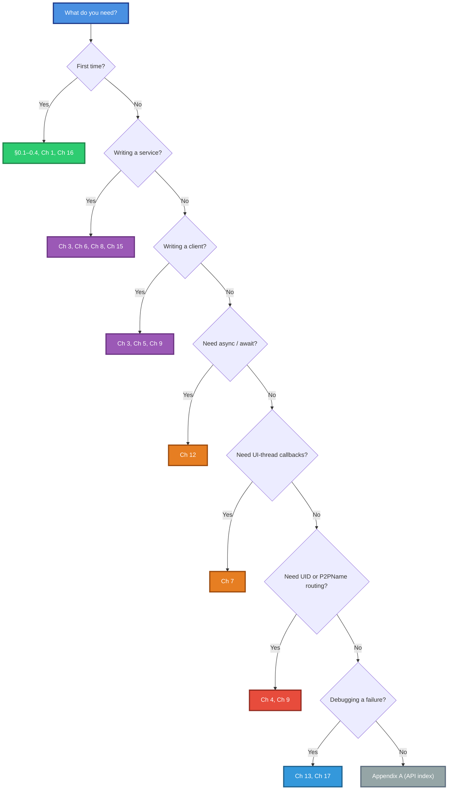
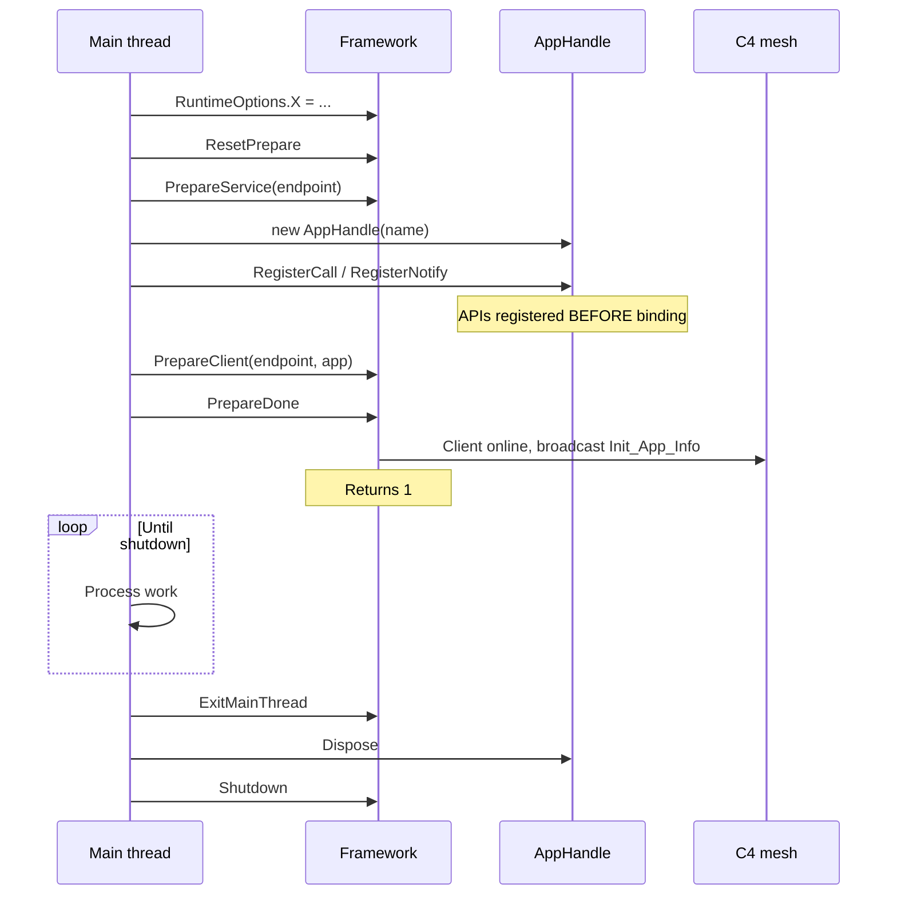
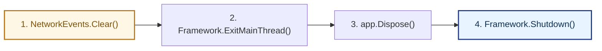

# The LingoFuse C# interface — complete guide

**Document version**: 5.0
**Coverage**: the LingoFuse native library v5.01 + the two-layer C# binding (assembly `LingoFuse`,
namespace `LingoFuse`)
**Target framework**: .NET 8.0+
**Reading goal**: with this document alone (without opening any source file), an engineer or AI agent
can write correct, production-grade LingoFuse C# programs — including UID / P2PName addressing,
async calls, custom callback thread scheduling and sender identity reads.

> Chinese version: [LingoFuse_CSharp_Complete_Guide.md](LingoFuse_CSharp_Complete_Guide.md)

---

## Changelog

### v5.0 (2026-10-13) — a major feature release

This version merges the v5.0 binding upgrade into the existing guide. The guiding principle is
unchanged: this file remains the single authoritative source for the C# interface, and any AI can
produce production-grade LingoFuse C# code by reading it alone.

The new API surface (each has its own chapter):

| Feature | Chapter | Notes |
|---|---|---|
| the `P2PUid` value type | 4 | a 32-byte session UID |
| `DataHandle.GetSenderUid` / `GetSenderP2PName` | 3 | the sender identity ("side data") |
| the `RuntimeOptions` strongly typed facade | 6 | full coverage of `LF_SetOption` / `LF_GetOption` |
| `ILingoCallbackDispatcher` / `CallbackDispatcher` | 7 | control which thread runs the callback body |
| UID addressing (`CallByUid` / `NotifyByUid` / …) | 9 | route directly to a specific session |
| P2PName addressing (`CallByP2PName` / `NotifyByP2PName` / …) | 9 | group routing + server-side load balancing |
| Task-based async (`CallAsync` / `CallByUidAsync` / …) | 12 | `Task<DataHandle>` + native `await` semantics |
| process-level P2P registration (`RegisterP2PCall` / …) | 9 | APIs reachable only through UID / P2PName |
| extra liveness probes (`CheckUid` / `CheckP2PName` / …) | 9 | cached liveness probes for UID / P2PName |

Non-breaking additions:

- `AppHandle.RegisterCall` and `RegisterNotify` gained dispatcher-aware overloads. The historical
  signatures are preserved and delegate internally to `CallbackDispatcher.Inline`.
- `Framework.SetOption` is unchanged; `RuntimeOptions` is a strongly typed facade layered on top of
  it.

Documentation additions:

- §0.4 now lists ten iron rules (previously seven).
- §12 records the native `await` semantics end to end, including a **counter-intuitive behaviour**
  found during the v5.0 test run — "a local App-name async call completes synchronously".
- §17 gained eight entries covering the v5.0 API surface.
- Appendix D's self-check list gained 18 questions covering P2PUid, RuntimeOptions,
  CallbackDispatcher, async and side data.

### v5.1 (2026-10-13) — callback-style async (call-site inline)

A new callback-style async facade `Async` merges "call + callback" into a single expression, fully
isomorphic to C++'s `lingofuse::callAsync` and Pascal's `LF.AsyncCallApp_P`.

New APIs:

| Feature | Chapter | Notes |
|---|---|---|
| `Async.Call` / `CallSequenced` | 12.10 | App-name addressing, callback style |
| `Async.CallByUid` / `CallByUidSequenced` | 12.10 | UID addressing, callback style |
| `Async.CallByP2PName` / `CallByP2PNameSequenced` | 12.10 | P2PName addressing, callback style |
| the `AsyncResult` value type | 12.10 | `Ok` / `Error` / `Size` / `Handle` / `Read*` |

Design principles:

- **the call and the callback are one expression** — no `Task`, no `await`, no `std::function`.
- **a single error path** — `if (!r.Ok) { ... }` handles dispatch failure and an empty remote return
  in one place.
- **the handle is borrowed and valid only inside the callback body** — `AsyncResult` internally holds
  `DataHandle.FromRaw(result, owned: false)` and exposes `Read*` convenience methods. Users never
  touch a raw pointer.

Relationship to the await style (`Framework.CallAsync`):

- the two coexist, share the underlying C ABI and do not interfere with each other.
- the await style suits UI applications and scenarios that need automatic marshalling through a
  `SynchronizationContext`.
- the callback style suits server-side callback logic, embedded and scripted environments, and
  scenarios that want to stay consistent with C++/Pascal.

Test coverage: `test2/Program.cs` gained 10 tests, taking the total from 48 to 58.

### v4.0 (the previous version)

The first full restructure: the two-layer architecture, the wire protocol, `DataHandle` /
`AppHandle` / `Framework` / `NetworkEvents` / `LingoFuseStatus`, cross-language interop, lifecycle
patterns, complete examples, a pitfalls knowledge base and the reference appendices.

---

## Contents

**Part 1 — Positioning**
- [Chapter 0 — What LingoFuse is](#chapter-0--what-lingofuse-is)
- [Chapter 1 — Quick start](#chapter-1--quick-start)

**Part 2 — Contracts**
- [Chapter 2 — The wire protocol](#chapter-2--the-wire-protocol)
- [Chapter 3 — DataHandle](#chapter-3--datahandle)
- [Chapter 4 — P2PUid](#chapter-4--p2puid)
- [Chapter 5 — LfIo](#chapter-5--lfio)
- [Chapter 6 — RuntimeOptions](#chapter-6--runtimeoptions)
- [Chapter 7 — CallbackDispatcher](#chapter-7--callbackdispatcher)
- [Chapter 8 — AppHandle](#chapter-8--apphandle)
- [Chapter 9 — Framework](#chapter-9--framework)
- [Chapter 10 — NetworkEvents](#chapter-10--networkevents)
- [Chapter 11 — LingoFuseStatus](#chapter-11--lingofusestatus)
- [Chapter 12 — The async call model](#chapter-12--the-async-call-model)
- [Chapter 13 — Exception reference](#chapter-13--exception-reference)

**Part 3 — Interop and patterns**
- [Chapter 14 — Cross-language interoperability](#chapter-14--cross-language-interoperability)
- [Chapter 15 — Lifecycle patterns](#chapter-15--lifecycle-patterns)
- [Chapter 16 — Complete examples](#chapter-16--complete-examples)
- [Chapter 17 — Pitfalls and anti-patterns](#chapter-17--pitfalls-and-anti-patterns)

**Part 4 — Reference**
- [Appendix A — Public API index](#appendix-a--public-api-index)
- [Appendix B — Cross-language wire protocol matrix](#appendix-b--cross-language-wire-protocol-matrix)
- [Appendix C — Glossary](#appendix-c--glossary)
- [Appendix D — Self-check list](#appendix-d--self-check-list)

---

## Chapter 0 — What LingoFuse is

### 0.1 A one-sentence definition

> **LingoFuse is a cross-language, cross-process, cross-machine RPC framework built on the C4 service
> mesh. It lets services written in Pascal, Python, C++, C#, Rust, Java or any other language call
> each other through a unified wire protocol.**

The C# binding exposes LingoFuse through a small set of public types in a single namespace, strictly
split into two layers:

| Layer | Responsibility | Types |
|---|---|---|
| **the native layer** (internal) | direct P/Invoke declarations of the 59 C ABI exports, the two opaque handles, the 32-byte UID struct and the four callback prototypes. **User code never touches this layer.** | `NativeMethods`, `DataHnd`, `AppHnd`, `TUIDNative`, `Utf8Marshal`, `LfCallFunc`, `LfNotifyFunc`, `LfNetworkEventFunc`, `LfAsyncCallOnResult`, `AsyncCallbackBridge` |
| **the managed layer** (public) | RAII handle wrappers, the UID value type, the runtime option facade, the callback dispatcher, uniform JSON / string I/O, the process-level lifecycle facade, network events, the status queue and the exception hierarchy. | `DataHandle`, `AppHandle`, `P2PUid`, `LfIo`, `RuntimeOptions`, `CallbackDispatcher` / `ILingoCallbackDispatcher`, `Framework`, `NetworkEvents`, `LingoFuseStatus`, `LingoFuseException`, `LingoFuseCallException`, `LingoFuseIoException`, `LingoFuseObjectDisposedException`, `LingoFuseLibraryLoadException` |

### 0.2 Twelve core concepts

If you can remember only twelve things, remember these:

1. **`DataHandle` is a byte buffer with an API name.** You write request bytes into it and read
   response bytes out of it. It is an RAII object: `using` releases the underlying native resource.

2. **`AppHandle` is an application.** It groups a set of related APIs under one unique name for
   mesh routing.

3. **`P2PUid` is a 32-byte session UID.** The framework assigns one to each client at TunnelLink
   time and injects it as "side data" into every outbound request payload.

4. **`LfIo` is the only legitimate entry point for moving data back and forth between managed objects
   and a `DataHandle`.** Strings, raw bytes, JSON. There is no second path.

5. **`RuntimeOptions` is a strongly typed facade covering every `LF_SetOption` / `LF_GetOption` key.**
   Use it instead of string option names — the compiler checks spelling, and reading a value takes
   one property access.

6. **`CallbackDispatcher` controls which thread runs the callback body.** `Inline` (the default)
   runs on the native worker thread; `MainThread` marshals to the captured UI thread; a custom
   dispatcher can target any scheduling primitive.

7. **`Framework` is the process-level ABI facade.** It prepares the network, issues remote calls
   (by App name / UID / P2PName), issues async calls, registers P2P APIs, sets options, generates
   application names and shuts everything down.

8. **Async calls return `Task<DataHandle>`.** The await continuation follows native C# `await`
   semantics: if the awaiting thread has a `SynchronizationContext` it returns to it; otherwise it
   runs inline on whichever thread completed the Task.

9. **Callbacks run on native worker threads by default.** A callback must not block, must not touch
   the UI and must not call any blocking LingoFuse function. If the callback body needs the UI
   thread, use `CallbackDispatcher.MainThread`.

10. **The JSON wire protocol is UTF-8, and non-ASCII characters are emitted literally.** Characters
    that can be expressed literally get **no `\uXXXX` escapes** — emoji included.

11. **The cleanup order is fixed**: `NetworkEvents.Clear()` → `Framework.ExitMainThread()` →
    `App.Dispose()` → `Framework.Shutdown()`.

12. **`Framework.PrepareDone()` returns `1` only once per process.** A second call without an
    intervening `Shutdown()` returns `0`, which is **not a failure**.

### 0.3 Reading paths



### 0.4 The ten iron rules

| # | Rule | Consequence of violating it |
|:-:|---|---|
| 1 | callbacks must be declared with the correct calling convention. In C# this is automatic: the internal callback delegates carry `[UnmanagedFunctionPointer(CallingConvention.Cdecl)]`. | (does not apply in C#.) |
| 2 | never call `Framework.Call` / `Notify` / `SequencedNotify` / `LocalCall` / `LocalNotify` / `PrepareDone` / `Shutdown` inside a callback. | deadlock. |
| 3 | all JSON / string / byte I/O goes through `LingoFuse.LfIo` or `DataHandle`. | frame drift, cross-language failure. |
| 4 | cleanup order: `NetworkEvents.Clear` → `Framework.ExitMainThread` → `App.Dispose` → `Framework.Shutdown`. | dangling pointers, leaks. |
| 5 | one client per physical address, unless `RuntimeOptions.OverlapConnection = true` is set before `PrepareClient`. | connections silently dropped. |
| 6 | every `P2PUid` obtained from `DataHandle.GetSenderUid` is a **copy**. Store it; do not think about "the sender's handle". | (guidance only.) |
| 7 | every callback body must treat its `DataHandle` parameters as **borrowed handles**. Do not call `Dispose()` on them. | (harmless today, but semantically wrong.) |
| 8 | an async call whose target is **local** **completes synchronously** — before `CallAsync` returns. An `await` on an already-completed Task runs inline on the current thread. | surprising thread identity, but correct behaviour. See §12.4. |
| 9 | a `CallbackDispatcher` implementation must have finished the callback before `Dispatch` returns. | use-after-free on the framework-owned input / output handles. |
| 10 | `P2PUid` is a session-scoped value. It is regenerated on every reconnect. Do not cache it across link loss. | calls routed to a UID that no longer exists. |

### 0.5 Key defaults

| Item | Value |
|---|---:|
| native library name (Windows x64) | `LingoFuse64.dll` |
| native library name (Windows x86) | `LingoFuse32.dll` |
| native library name (Linux / BSD) | `liblingofuse.so` |
| native library name (macOS) | `liblingofuse.dylib` |
| default TCP port | 9898 |
| DataHandle idle reclamation | 10 minutes |
| reclamation scan interval | 5 seconds |
| `PrepareDone` initialization timeout | 30 seconds |
| `RuntimeOptions.WaitConnectionTimeoutMs` default | 30000 |
| `RuntimeOptions.OverlapConnection` default | `false` |
| `RuntimeOptions.WaitConnectionReadyOk` default | `true` |
| `RuntimeOptions.FixedSequencedTimeMs` default | 20000 |
| `RuntimeOptions.DataHandleIdleTimeoutMs` default | 600000 |
| `RuntimeOptions.DataHandlePoolScanIntervalMs` default | 5000 |
| `RuntimeOptions.NoReponseCmdNullFlushThreshold` default | 5000 |
| validity of a `Framework.GenerateAppName` pointer | ~5 seconds |
| validity of a `DataHandle.GetSenderUid` return value | copied immediately |
| validity of a `DataHandle.GetSenderP2PName` return value | copied immediately |
| `P2PUid` byte length | 32 |
| sequenced notification thread idle timeout | 5 minutes |
| sequenced notification thread deferred release | 5 seconds |
| lifetime of an async call's result handle | only inside the callback body |

### 0.6 Conventions in this document

- **"callback"** means any user-supplied function the framework invokes: a registered Call handler,
  a Notify handler, a network event listener or an async completion.
- **"borrowed handle"** means a `DataHandle` whose `Dispose` is a no-op, created by
  `DataHandle.FromRaw(raw, owned: false)`. The underlying native resource is owned by the framework
  and released when the callback returns.
- **"owned handle"** means a `DataHandle` whose `Dispose` calls `LF_FreeData`. Every handle produced
  by the public constructors, `CreatePermanent`, `LocalCall`, `Call` or the async bridge is an owned
  handle.
- **"side data"** means metadata the sender injects into the outbound request payload before
  transmission. Two side data fields are defined today: the sender UID and the P2P name.

---

## Chapter 1 — Quick start

### 1.1 Project configuration

Add a project reference to the LingoFuse binding assembly:

```xml
<ItemGroup>
  <ProjectReference Include="..\src\LingoFuse\LingoFuse.csproj" />
</ItemGroup>
```

Or, if the binding ships as a NuGet package:

```xml
<PackageReference Include="LingoFuse" Version="1.0.0" />
```

Just one `using`:

```csharp
using LingoFuse;
```

There is no other public namespace.

### 1.2 A minimal server

```csharp
using System;
using LingoFuse;

using var app = new AppHandle("Calculator", "Demo calculator");

// Register a JSON API: takes an int[] {a, b}, returns {"result": a+b}.
app.RegisterCall("add", "Add two ints", (input, output) =>
{
    var args = LfIo.ReadJson<int[]>(input);
    LfIo.WriteJson(output, new { result = args[0] + args[1] });
});

RuntimeOptions.OverlapConnection = true;
Framework.ResetPrepare();
Framework.PrepareService("ipc:calc", "ipc:calc");
Framework.PrepareClient("ipc:calc", app);

if (Framework.PrepareDone() != 1)
{
    Console.Error.WriteLine("Startup failed");
    return;
}

Console.WriteLine("Ready. Press Enter to stop.");
Console.ReadLine();

NetworkEvents.Clear();
Framework.ExitMainThread();
app.Dispose();
Framework.Shutdown();
```

The above uses the v5.0 strongly typed `RuntimeOptions` facade. If you prefer the old string style,
`Framework.SetOption("Overlap_Connection", "True")` still works and produces the same result.

### 1.3 A minimal client

```csharp
using System;
using System.Text.Json;
using LingoFuse;

RuntimeOptions.WaitConnectionReadyOk = true;
RuntimeOptions.OverlapConnection = true;
Framework.ResetPrepare();
Framework.PrepareClient("ipc:calc", null);

if (Framework.PrepareDone() != 1)
{
    Console.Error.WriteLine("Startup failed");
    return;
}

using var request = new DataHandle("add");
LfIo.WriteJson(request, new[] { 5, 7 });

using var response = Framework.Call("Calculator", request, timeoutMs: 3000);
if (response.Size == 0)
{
    Console.WriteLine("Call failed (timeout or unreachable)");
    return;
}

var result = LfIo.ReadJson<JsonElement>(response);
Console.WriteLine($"5 + 7 = {result.GetProperty("result").GetInt32()}");

NetworkEvents.Clear();
Framework.ExitMainThread();
Framework.Shutdown();
```

### 1.4 A minimal async client (v5.0)

```csharp
using System;
using LingoFuse;

RuntimeOptions.WaitConnectionReadyOk = true;
RuntimeOptions.OverlapConnection = true;
Framework.ResetPrepare();
Framework.PrepareClient("ipc:calc", null);
Framework.PrepareDone();

using var request = new DataHandle("add");
LfIo.WriteJson(request, new[] { 5, 7 });

// The await resumes on the caller's SynchronizationContext when one
// exists, and inline on the completing thread otherwise.
using var response = await Framework.CallAsync("Calculator", request);

var result = LfIo.ReadJson<JsonElement>(response);
Console.WriteLine($"5 + 7 = {result.GetProperty("result").GetInt32()}");

NetworkEvents.Clear();
Framework.ExitMainThread();
Framework.Shutdown();
```

Note that the containing method must be `async`. In a console application's `Main`, either mark
`Main` as `async Task Main` or block with `.GetAwaiter().GetResult()`.

### 1.5 The three-terminal demo

```
Terminal 1:  dotnet run --project crossService
Terminal 2:  dotnet run --project CrossNode      (after terminal 1 prints "running")
Terminal 3:  dotnet run --project CrossCall      (after terminal 2 prints "Online")
```

The demo registers an application named `demo` with two APIs (`add`, `inv_seri`), runs a 32-thread
load test for 10 seconds and prints a throughput summary.

---

## Chapter 2 — The wire protocol

This is the most important chapter. Every cross-language bug you hit can be traced back to violating
one of these contracts.

### 2.1 Contract 1: the NUL frame for strings

Every string on the wire is:

```
[UTF-8 bytes][0x00]
```

A raw binary payload is:

```
[arbitrary bytes][0x00]
```

The receiver uses the NUL to find the end.

### 2.2 Contract 2: UTF-8, no escapes

The only text encoding on the wire is UTF-8. Non-ASCII characters are emitted as literal UTF-8
bytes:

- `"你好"` → `E4 BD A0 E5 A5 BD` (6 bytes)
- `"🌍"` → `F0 9F 8C 8D` (4 bytes)

**Never** use `\uXXXX` escapes:

- ❌ `"你好"` → `\u4f60\u597d` (12 ASCII characters)
- ❌ `"🌍"` → `\ud83c\udf0d` (12 ASCII characters)

The binding's `LfIo.WriteJson` explicitly de-escapes both BMP characters and supplementary-plane
characters (surrogate pairs) to guarantee this. Both `DataHandle.WriteString` and `LfIo.WriteJson`
produce literal UTF-8.

### 2.3 Contract 3: little-endian integers

Every integer and floating-point type is encoded little-endian:

```
int32 0x01020304  →  bytes 04 03 02 01
uint16 0xAABB     →  bytes BB AA
```

On x86/x64/ARM64 the host byte order is already little-endian, so `DataHandle.WriteInt32(0x01020304)`
produces the correct wire bytes directly, with no conversion needed.

### 2.4 Contract 4: tolerant reads

When reading a NUL-framed string, if no NUL is found before the end of the buffer, **the entire
remaining buffer is consumed** and the cursor advances to `size + 1` (one byte past the end).

This is exactly what makes interop with the HTTP bridge, browsers and hand-written clients work:
they do not append a NUL, and the reader still works.

The three cases of `DataHandle.ReadString()`:

| Cursor position | Behaviour |
|---|---|
| `< size`, a NUL found at `e` | returns the bytes in `[start, e)`. Cursor → `e + 1`. |
| `< size`, no NUL | returns the bytes in `[start, size)`. Cursor → `size + 1`. |
| `>= size` | returns `""`. The cursor does not move. |

### 2.5 Contract 5: the JSON policy

Every JSON payload the binding produces goes through **the same** serialization configuration, defined
privately inside `LfIo`:

| Property | Value | Reason |
|---|---|---|
| `WriteIndented` | `false` | compact, no trailing newline |
| `Encoder` | `UnsafeRelaxedJsonEscaping` | BMP characters are emitted as literal UTF-8 |
| `PropertyNameCaseInsensitive` | `false` | case-sensitive matching |
| `DefaultIgnoreCondition` | `Never` | even null properties are serialized |
| `NumberHandling` | `Strict` | no string-to-number coercion |

Plus a post-processing step (`UnescapeSurrogatePairs`) that restores surrogate escape pairs
(`\uD8xx\uDCxx`) to their original chars, so supplementary-plane characters (emoji) are also emitted
as literal UTF-8.

**Property names**: System.Text.Json uses the C# property name verbatim. A property named `MyValue`
produces the JSON key `"MyValue"`, not `"my_value"`. To change that, annotate the property:

```csharp
public sealed class Request
{
    [System.Text.Json.Serialization.JsonPropertyName("user_name")]
    public string UserName { get; set; } = "";
}
```

The binding **deliberately does not** expose its `JsonSerializerOptions`: a second serialization path
would fracture the wire protocol contract.

### 2.6 Contract 6: sender identity is side data (v5.0)

Every inbound request carries two fields, written into the payload head by **the sender's transport
layer** before transmission:

- `FromUID` (32 bytes) — the sender's session UID.
- `FromP2PName` (a UTF-8 string) — the sender's P2P group name.

The receiver reads these two fields through `DataHandle.GetSenderUid()` and
`DataHandle.GetSenderP2PName()`. They are **not** properties of the handle itself; they exist only on
the `input` parameter of a Call / Notify callback. On any other handle (an output, or a handle the
caller created itself) these two accessors return `P2PUid.Empty` / `""`.

The full contract is in §3.7.

### 2.7 Contract 7: a UID is 32 bytes and is treated as an opaque value

User code never interprets, sorts or byte-compares a UID. It is:

- generated by the framework at TunnelLink time.
- regenerated on every reconnect.
- compared for equality with `P2PUid.Equals` / `==`.
- formatted by `P2PUid.ToHexString()` as 64 lowercase hexadecimal characters.

The `P2PUid` value type is a 32-byte blittable struct; the full type contract is in Chapter 4.

---

## Chapter 3 — DataHandle

### 3.1 What it is

`DataHandle` is the RAII wrapper around a native byte buffer that carries an API name. It is the
lowest-level primitive of the managed layer. Everything else (`LfIo`, `AppHandle` callbacks,
`Framework.Call`) operates on `DataHandle` instances.

```csharp
public sealed class DataHandle : IDisposable
```

### 3.2 The ownership model

There are two kinds of `DataHandle`:

| Kind | Created by | `Dispose()` behaviour |
|---|---|---|
| **owned handle** | `new DataHandle("api")`, `CreatePermanent`, `FromRaw(raw, owned: true)` | calls `LF_FreeData` on the native handle |
| **borrowed handle** | `DataHandle.FromRaw(raw, owned: false)` | **no-op** — the native layer owns the resource |

Borrowed handles are used inside callbacks: the native layer hands you a raw pointer and releases it
as soon as the callback returns. If you call `Dispose()` on a borrowed handle nothing happens — the
wrapper's state is unchanged and you can keep reading from it for the rest of the callback.

**Never construct a `DataHandle` from a raw pointer except inside a callback or a bridge.** Outside a
callback, `FromRaw` + `owned: false` leaks the underlying resource.

### 3.3 Construction

```csharp
public DataHandle(string apiName)
```

Creates a new owned data handle bound to the given API name. The underlying buffer starts empty.

- `apiName` must not be null. An empty string is technically allowed but unusual.
- if `apiName` is null, it throws `ArgumentNullException`.
- if the native library fails to allocate, it throws `LingoFuseException`.

```csharp
public static DataHandle CreatePermanent(string apiName)
```

Creates a new **permanent** owned data handle. This handle does not join the library's idle pool. The
automatic idle reclaimer never frees it. `Dispose` releases it synchronously.

When to use it:

- for handles that must live for the whole process lifetime.
- for cached request templates, long-lived scratch buffers and global registries.

When **not** to use it:

- for short-lived or one-shot handles. The pool safety net stops applying.

```csharp
public static DataHandle FromRaw(IntPtr raw, bool owned)
```

Wraps an existing raw pointer. Use `owned: false` inside a callback or the async bridge.

### 3.4 Identity and state

| Member | Type | Notes |
|---|---|---|
| `Raw` | `IntPtr` | the raw native pointer. `IntPtr.Zero` after an owned handle has been disposed. |
| `IsValid` | `bool` | true while the handle is usable. A borrowed handle stays valid until the native layer releases it. |
| `IsOwning` | `bool` | true when `Dispose()` releases the native handle. |

### 3.5 Position and size

| Member | Get | Set |
|---|---|---|
| `Position` | `long`, the current cursor | `long`, must be non-negative; a value beyond the current size **implicitly grows** the buffer and the new bytes are uninitialized |
| `Size` | `long`, the total buffer size | `long`, must be non-negative; growing leaves the new bytes uninitialized |
| `GetBufferPointer()` | `IntPtr`, the native buffer pointer | — |

**Trap**: the pointer returned by `GetBufferPointer()` becomes invalid after any subsequent write, resize
or out-of-range `Position` assignment. Do not cache it.

### 3.6 Byte I/O

Two families of read operations:

```csharp
public long WriteBytes(byte[] data)
```

Appends `data` at the current cursor. The buffer grows as needed. Returns the number of bytes written
(equal to `data.Length`, or `0` when `data` is empty). **A short write throws `LingoFuseIoException`.**

```csharp
public byte[] ReadBytes(int count)
```

Reads **at most** `count` bytes. If the buffer ends early, fewer bytes are returned. A short read does
**not** throw. The result is never null.

```csharp
public byte[] ReadBytesExact(int count)
```

Reads **exactly** `count` bytes. On a short read it restores the cursor to its original position and
**throws `LingoFuseIoException`** with `Operation = "ReadBytesExact"`.

```csharp
public bool TryReadBytes(int count, out byte[]? value)
```

The non-throwing counterpart of `ReadBytesExact`. On a short read it restores the cursor and returns
`false`.

```csharp
public byte[] ReadAllBytes()
```

Reads every remaining byte from the cursor to the end. The cursor advances to the end.

**Which one to use**:

- **`ReadBytes`**: when you want "as much as there is" — for streaming or chunked reads.
- **`ReadBytesExact`**: when you want "all or nothing" — for fixed-size fields.
- **`TryReadBytes`**: the same, but you want a boolean result.

### 3.7 Atomic types (little-endian)

| Write | Read (exact) | Read (Try) |
|---|---|---|
| `WriteInt8(sbyte)` | `ReadInt8() : sbyte` | `TryReadInt8(out sbyte)` |
| `WriteUInt8(byte)` | `ReadUInt8() : byte` | `TryReadUInt8(out byte)` |
| `WriteInt16(short)` | `ReadInt16() : short` | `TryReadInt16(out short)` |
| `WriteUInt16(ushort)` | `ReadUInt16() : ushort` | `TryReadUInt16(out ushort)` |
| `WriteInt32(int)` | `ReadInt32() : int` | `TryReadInt32(out int)` |
| `WriteUInt32(uint)` | `ReadUInt32() : uint` | `TryReadUInt32(out uint)` |
| `WriteInt64(long)` | `ReadInt64() : long` | `TryReadInt64(out long)` |
| `WriteUInt64(ulong)` | `ReadUInt64() : ulong` | `TryReadUInt64(out ulong)` |
| `WriteSingle(float)` | `ReadSingle() : float` | `TryReadSingle(out float)` |
| `WriteDouble(double)` | `ReadDouble() : double` | `TryReadDouble(out double)` |

Every exact read throws `LingoFuseIoException` on a short read. Every `Try*` variant returns `false`
and leaves the cursor unchanged.

### 3.8 String I/O

```csharp
public void WriteString(string value)
```

Writes `value` as UTF-8 followed by one NUL byte. An empty string writes **exactly one byte** (the NUL).

```csharp
public string ReadString()
```

Reads up to the first NUL or the end of the buffer. Invalid UTF-8 byte sequences are decoded with the
encoder's default fallback: each invalid byte becomes `U+FFFD`. This is **binary-safe** — the C# reader
never throws on malformed UTF-8. If you need to detect invalid UTF-8, read the raw bytes and check
yourself.

```csharp
public bool TryReadString(out string? value)
```

Returns `false` only when the cursor is at or past the end. A payload containing a single NUL (the
empty string) returns `true` with `value == ""`.

### 3.9 Sender identity (v5.0)

```csharp
public P2PUid GetSenderUid()
public string GetSenderP2PName()
```

These two accessors read **the sender identity** from an INPUT handle. They are the C# binding of the
native `LF_Get_P2P_UID` and `LF_Get_P2P_Name` exports.

**The validity matrix**:

| Handle | `GetSenderUid` returns | `GetSenderP2PName` returns |
|---|---|---|
| the `input` parameter of a Call / Notify callback | the sender UID | the sender P2P group name |
| the `input` parameter of a local call / notify | the sender UID | the sender P2P group name |
| the `output` parameter of a Call callback | `P2PUid.Empty` | `""` |
| a handle the caller created itself | `P2PUid.Empty` | `""` |
| a disposed handle | throws `LingoFuseObjectDisposedException` | throws `LingoFuseObjectDisposedException` |

**The contract**:

- the returned `P2PUid` is a fresh copy. It is safe to store, compare and pass to another thread.
- the returned `string` is a fresh copy. It is safe to store.
- the accessors never expose a native pointer. The pointer the native side returns is valid for about
  5 seconds; the wrapper copies the value before returning.
- the accessors never throw for the "wrong handle role" case. They silently return the type default,
  matching the well-defined behaviour of the native layer.

**Example**:

```csharp
app.RegisterCall("whoami", "identity probe", (input, output) =>
{
    var uid = input.GetSenderUid();
    var p2pName = input.GetSenderP2PName();

    output.WriteString(uid.ToHexString());
    output.WriteString(p2pName);
});
```

### 3.10 Lifetime

```csharp
public void Dispose()
```

- **an owned automatically reclaimed handle**: calls `LF_FreeData`. The native side only marks the
  handle for deletion; the actual release happens on the next pool scan (within 5 seconds). Idempotent.
- **an owned permanent handle**: calls `LF_FreeData`. The native side releases it immediately.
- **a borrowed handle**: **no-op**. The wrapper's state is unchanged.

The `_handle` field is declared `volatile`, so a `Dispose()` on one thread is observed by
`EnsureNotDisposed()` on another without external locking. That is enough for the "do not use after
release" contract; it does **not** make concurrent writes safe.

**Do not share an owned `DataHandle` across threads for writing.** Different instances are completely
independent and can be used concurrently without restriction.

### 3.11 A complete example

```csharp
using var dh = new DataHandle("demo");
dh.WriteInt32(42);
dh.WriteString("hello");
dh.WriteUInt16(0xABCD);

dh.Position = 0;
int a = dh.ReadInt32();        // 42
string s = dh.ReadString();    // "hello"
ushort u = dh.ReadUInt16();    // 0xABCD
// dh.Position == dh.Size
```

---

## Chapter 4 — P2PUid

### 4.1 What it is

`P2PUid` is the managed representation of the 32-byte session UID. The framework assigns one to each
client at TunnelLink time and injects it as "side data" into every outbound request payload.

```csharp
public readonly struct P2PUid : IEquatable<P2PUid>
```

### 4.2 Why it needs its own type

The UID is a first-class citizen of LingoFuse's routing model:

- it is the primary key of UID addressing (`Framework.CallByUid` and its async / notify variants).
- it is the return value of `DataHandle.GetSenderUid()` inside callbacks, used for authentication,
  audit logging and session-scoped routing.
- it is a 32-byte binary blob that must round-trip byte for byte across IPC / TCP boundaries and
  across every language binding.

Exposing the UID as a plain `byte[]` would be dangerous: arrays are mutable, reference equality is
wrong for a value concept, and the 32-byte invariant cannot be enforced.

Exposing it as `unsafe fixed byte[32]` would force consumer projects to enable `AllowUnsafeBlocks`.

The solution is a `readonly struct` backed by four `ulong` fields:

- 4 × `ulong` = 32 bytes, byte-for-byte compatible with Pascal's `array[0..31] of Byte` (through the
  internal `TUIDNative` mirror).
- blittable: no marshalling stubs, no allocation, no unsafe code.
- value semantics: structural equality.
- zero GC pressure: `default(P2PUid)` is a legitimate all-zero UID.

### 4.3 Byte order

The four `ulong` fields are laid out **little-endian**:

| Field | Byte range |
|---|---|
| `_lo` | 0..7 |
| `_hi` | 8..15 |
| `_top` | 16..23 |
| `_last` | 24..31 |

The byte sequence produced by `ToByteArray()` and `CopyTo()` matches what the native side writes, so
`P2PUid` round-trips unchanged through the `DataHandle.WriteUid` / `ReadUid` equivalents.

### 4.4 Construction

```csharp
public static P2PUid FromBytes(ReadOnlySpan<byte> bytes)
```

Creates a UID from exactly 32 bytes. Throws `ArgumentException` when the span length is not 32.

```csharp
public static bool TryParse(string? hex, out P2PUid uid)
```

Parses a 64-character hexadecimal string. Letters may be lowercase or uppercase. Returns `true` on
success and `false` on any failure (wrong length, a non-hex character, `null`). On failure `uid` is
set to `Empty`.

```csharp
public static P2PUid Parse(string hex)
```

The same as `TryParse`, but throws `FormatException` on failure.

```csharp
public static readonly P2PUid Empty
```

The all-zero UID. This is the framework's sentinel for "no UID".

### 4.5 Conversion

```csharp
public bool IsEmpty { get; }
```

Returns true when all 32 bytes are zero.

```csharp
public byte[] ToByteArray()
```

Returns a newly allocated 32-byte array. The returned array is independent and freely modifiable.

```csharp
public void CopyTo(Span<byte> destination)
```

Copies the 32 bytes into `destination`. At least 32 bytes of space are required; otherwise it throws
`ArgumentException`.

```csharp
public string ToHexString()
```

Returns 64 lowercase hexadecimal characters in byte order (byte[0] first). No separators, no prefix.

```csharp
public override string ToString()
```

Returns the same string as `ToHexString()`.


### 4.6 Equality

`P2PUid` implements structural equality:

- the `==` / `!=` operators.
- `Equals(P2PUid)` and `Equals(object)`.
- `GetHashCode()`, consistent with equality.

`P2PUid` is a legitimate dictionary key:

```csharp
var map = new Dictionary<P2PUid, string>();
map[uid] = "Alice";
```

### 4.7 Usage pattern: a session registry

A typical server-side case, keeping session state keyed by the sender UID:

```csharp
private static readonly ConcurrentDictionary<P2PUid, Session> _sessions = new();

app.RegisterCall("subscribe", "subscribe a session", (input, output) =>
{
    var uid = input.GetSenderUid();
    if (uid.IsEmpty)
    {
        // Identity not available (wrong handle role, or the caller
        // is a local call without an injected identity).
        output.WriteString("rejected");
        return;
    }

    var session = _sessions.GetOrAdd(uid, _ => new Session(uid));
    session.Touch();
    output.WriteString("accepted");
});
```

### 4.8 Pitfall: caching across reconnects

`P2PUid` is regenerated on every TunnelLink. If you cache it and the underlying link drops and
reconnects, a later `Framework.CallByUid(cachedUid, ...)` fails — that key no longer exists in the
server's UID pool.

The correct patterns are:

- on the client side: re-probe your own UID after every Connect event (see the "whoami" pattern in
  §10.3 and §16.5).
- on the server side: treat the UID pool as volatile and key sessions by an identifier the
  application itself controls.

---

## Chapter 5 — LfIo

### 5.1 What it is

`LfIo` is the only entry point for JSON and string I/O on a `DataHandle`. Its job is to centralize:

1. the framing policy (NUL termination).
2. the JSON serialization policy (compact, literal UTF-8, no escapes).
3. read tolerance (tolerant NUL handling).

**There is no second path.** If you feel the urge to call `System.Text.Json.JsonSerializer.Serialize`
directly, stop — you are about to violate the wire protocol.

```csharp
public static class LfIo
```

### 5.2 String I/O

```csharp
public static void WriteString(DataHandle handle, string value)
public static string ReadString(DataHandle handle)
```

Thin wrappers over `DataHandle.WriteString` / `DataHandle.ReadString`.

### 5.3 Byte-oriented I/O

```csharp
public static void WriteStringBytes(DataHandle handle, byte[] data)
```

Writes raw bytes followed by a NUL terminator. **Embedded NUL bytes are preserved.** Unlike
`WriteString` it does not stop at an embedded NUL — it writes all `data.Length` bytes verbatim and
then appends one NUL.

Use it when you already have pre-serialized UTF-8 bytes (for instance from
`JsonSerializer.SerializeToUtf8Bytes`) and want to avoid a `string` round trip.

```csharp
public static byte[] ReadStringBytes(DataHandle handle)
public static byte[] ReadAllBytes(DataHandle handle)
```

The first reads up to the first NUL (tolerantly: with no NUL it reads everything remaining). The
second does no NUL handling at all and reads every byte.

### 5.4 JSON I/O

```csharp
public static void WriteJson(DataHandle handle, object? value)
```

Serializes `value` with the canonical policy and writes it with a NUL terminator.

- a `null` value produces the four-byte literal `null`.
- it throws `LingoFuseException` when serialization fails.
- it throws `LingoFuseIoException` on a short write.

```csharp
public static T ReadJson<T>(DataHandle handle)
```

Deserializes a NUL-framed JSON payload into `T`.

- it throws `LingoFuseException` when the payload is not valid JSON or cannot be materialized as
  `T`.
- it throws `LingoFuseObjectDisposedException` when the handle has been disposed.
- if the payload is `null` and `T` is a reference type or `Nullable<T>`, it returns `null`. If `T`
  is a non-nullable value type, it throws `LingoFuseException`.

```csharp
public static bool TryReadJson<T>(DataHandle handle, out T? value)
```

The non-throwing counterpart. It returns `false` when:

- the payload is empty.
- the payload is not valid JSON.
- the payload cannot be materialized as `T`.

It catches both `JsonException` and `NotSupportedException` (for unsupported types such as interfaces
without a converter).

### 5.5 Example: a JSON round trip

```csharp
public sealed class Person
{
    public string Name { get; set; } = "";
    public int Age { get; set; }
}

using var dh = new DataHandle("json_poco");
var original = new Person { Name = "Alice", Age = 30 };
LfIo.WriteJson(dh, original);

dh.Position = 0;
var back = LfIo.ReadJson<Person>(dh);
// back.Name == "Alice", back.Age == 30
```

The serialized JSON is:

```
{"Name":"Alice","Age":30}\0
```

Note that the property names are `"Name"` and `"Age"` (the C# names verbatim), not `"name"` and
`"age"`.

### 5.6 Example: snake_case JSON

```csharp
public sealed class Request
{
    [System.Text.Json.Serialization.JsonPropertyName("user_name")]
    public string UserName { get; set; } = "";

    [System.Text.Json.Serialization.JsonPropertyName("request_id")]
    public int RequestId { get; set; }
}
```

It serializes as `{"user_name":"...","request_id":...}` — matching the Python, C++ and Pascal peers.

### 5.7 Example: a JSON array

```csharp
using var dh = new DataHandle("json_array");
LfIo.WriteJson(dh, new int[] { 1, 2, 3 });

dh.Position = 0;
var back = LfIo.ReadJson<int[]>(dh);   // [1, 2, 3]
```

### 5.8 Example: JSON with unicode

```csharp
using var dh = new DataHandle("json_unicode");
LfIo.WriteJson(dh, new { message = "你好 🌍" });

dh.Position = 0;
var text = dh.ReadString();
// text contains: {"message":"你好 🌍"}
// NOT: {"message":"\u4f60\u597d \ud83c\udf0d"}
```

The wire bytes for `"你好 🌍"`:

```
E4 BD A0 E5 A5 BD 20 F0 9F 8C 8D
```

All literal UTF-8. No escapes.

### 5.9 Why there are no public options

`LfIo` **deliberately** does not expose its `JsonSerializerOptions`. Exposing them would let callers
construct a second serialization path — a different encoder, different indentation, different null
handling — destroying the whole point of a single contract.

If you need to customize the shape of a payload, customize your **types**:

- use `[JsonPropertyName]` to change key names.
- use `[JsonIgnore]` to omit properties.
- use `[JsonConverter]` to control how a custom type is encoded.

But the outer policy — compact, literal UTF-8, no escapes — is not adjustable.

---

## Chapter 6 — RuntimeOptions

### 6.1 What it is

`RuntimeOptions` is the strongly typed C# facade over every `LF_SetOption` / `LF_GetOption` key
exposed by the C ABI.

```csharp
public static class RuntimeOptions
```

### 6.2 Why a strongly typed facade is needed

The C ABI exposes runtime configuration through two string-based functions:

```c
void   LF_SetOption(const char* optionName, const char* value);
char*  LF_GetOption(const char* optionName);
```

That interface is deliberately loose. Unknown option names are silently ignored, booleans are parsed
from text, integers are parsed from decimal strings. That design is fine for a C ABI but terrible for
C#:

- a misspelled option name produces no error and no diagnostic. The application silently behaves as
  if the option was never set.
- callers must remember the exact string for every option and its aliases.
- values arrive as strings and must be parsed by hand.
- there is no discoverable list of supported options.

`RuntimeOptions` wraps that layer with one strongly typed property per option. Each property:

- uses the canonical option key on the wire, so callers cannot misspell it;
- converts between the CLR type and the wire format with a single documented policy;
- has XML documentation explaining its effect, default and relevant trade-offs.

The two raw entry points `LF_SetOption` / `LF_GetOption` remain available through
`Framework.SetOption` and `RuntimeOptions.GetRaw` / `SetRaw`, so this abstraction is not a wall: it is
a convenience layer that doubles as the discoverable list of supported options.

### 6.3 The value format policy

The wire format for each CLR type is fixed:

| CLR type | Wire format |
|---|---|
| `bool` | `"True"` or `"False"` (canonical). The ABI also accepts `"1"`, `"0"`, `"Yes"`, `"No"` and case-insensitive spellings, but the binding always writes the canonical form. |
| `int` | a decimal string, invariant culture. Negative values carry a leading `-`. |
| `ulong` | a decimal string, invariant culture. |
| `string` | verbatim text, no escaping. |

### 6.4 The read policy

The getter returns the current value reported by `LF_GetOption`. The ABI returns an empty string for
unknown options and for options that were never set; this binding maps an empty string to the type's
default:

| CLR type | Default on an empty string |
|---|---|
| `bool` | `false` |
| `int` | `0` |
| `ulong` | `0` |
| `string` | `""` |

The `bool` parser additionally accepts the alternative spellings the ABI itself accepts (`"1"`,
`"0"`, `"Yes"`, `"No"` and the lowercase forms), so even if someone wrote a non-canonical spelling
through `Framework.SetOption`, reading it back is correct.

### 6.5 The complete property list

#### Authentication

```csharp
public static string Password { get; set; }
```

The C4 P2PVM authentication token. Both sides of a connection must match, or the handshake fails. The
default is the well-known development token `DTC40@ZSERVER`.

**Getter behaviour**: the ABI always returns a fixed mask (`********`) rather than the real value.
Do not rely on this property to recover the password.

The underlying option key: `password` (alias: `passwd`).

#### Logging and diagnostics

```csharp
public static bool Quiet { get; set; }
```

Suppresses most internal informational logging. Default: `false`.

```csharp
public static bool ShowThreadId { get; set; }
```

When enabled, every status message emitted by the Z.Status subsystem is prefixed with the numeric ID
of the thread that produced it. Default: `true`.

```csharp
public static bool ConsoleOutput { get; set; }
```

When enabled, the Z.Status subsystem writes every status message to stdout. When disabled, messages
are still queued and can be read through `LingoFuseStatus.GetStatus`. Default: host-dependent.

```csharp
public static void SetDebugCommand(string command);
```

Executes a C4 console debug command. **Write-only**: there is no matching getter, because the ABI
cannot read a debug command back. Each call constructs a transient helper object on the Pascal side;
do not call it in a hot loop.

Recognized command names include `service`, `tunnel`, `ZNet_Info`, `HPC_Thread_Info` and
`Instance_Info`.

The underlying option key: `debug`.

#### Connection readiness

```csharp
public static bool OverlapConnection { get; set; }
```

Controls whether multiple client tunnels may share the same physical address.

- `false` (the default): only one client tunnel per physical address. A second
  `Framework.PrepareClient` for the same address returns `-1` and the new application handle is
  discarded.
- `true`: every `Framework.PrepareClient` call creates a new independent tunnel.

**It must be set before the `PrepareClient` calls it is meant to affect.**

```csharp
public static bool WaitConnectionReadyOk { get; set; }
```

Controls whether `Framework.PrepareDone` blocks until all prepared clients are online.

- `true` (the default): `PrepareDone` waits until every prepared client reaches the "online" state
  before returning.
- `false`: `PrepareDone` returns as soon as the simulated main thread has started.

The total wait is bounded by `WaitConnectionTimeoutMs`.

```csharp
public static ulong WaitConnectionTimeoutMs { get; set; }
```

The timeout in milliseconds that `PrepareDone` waits. Default: `30000`. The ABI imposes a 5000 ms
lower bound.

#### IPC

```csharp
public static int IpcServerThreadCount { get; set; }
public static int IpcServerMaxQueueLength { get; set; }
public static int IpcServerMaxMsgSize { get; set; }
```

All three must be set before the IPC server starts. The defaults are platform-dependent.

#### Sequenced notification

```csharp
public static ulong FixedSequencedTimeMs { get; set; }
```

The stickiness window of P2PName load balancing. Default: `20000`.

#### P2P group name

```csharp
public static string P2PName { get; set; }
```

The P2P group name of this process. The name is injected into every outbound request payload and
reported to the server through the Update_UID command. It determines which P2PName-addressed calls
this process is willing to receive.

Default: an empty string. An empty P2P name disables P2PName routing for this process; UID and App-name
routing are unaffected.

**Do not confuse it with the sender identity.** This property sets the **local** process's group name.
To read the **sender's** P2P name from an inbound request, use `DataHandle.GetSenderP2PName` inside
the callback.

#### The data handle pool

```csharp
public static ulong DataHandleIdleTimeoutMs { get; set; }
public static ulong DataHandlePoolScanIntervalMs { get; set; }
```

The idle reclamation threshold and scan interval for automatically reclaimed handles. Defaults:
`600000` and `5000`. Setting `DataHandleIdleTimeoutMs = 0` disables idle reclamation entirely.

Neither option affects permanent handles (those created by `DataHandle.CreatePermanent`); they never
enter the idle reclamation path.

#### Command flushing

```csharp
public static int NoReponseCmdNullFlushThreshold { get; set; }
```

The NULL flush threshold for commands with no response. Default: `5000`.

The option key preserves the historical spelling `No_Reponse_Cmd_NULL_Flush_Threshold` ("Response"
with the second 's' missing). That is intentional and matches the Pascal helper name; the property
name uses the correct spelling for readability.

### 6.6 The raw escape hatch

```csharp
public static string GetRaw(string optionName)
public static void SetRaw(string optionName, string value)

```

Read and write options by their wire key. Use it for options added after this binding was compiled,
or to inspect the raw value of an option that was never set.

Both methods throw `ArgumentNullException` for a `null` argument.

### 6.7 Scope and lifetime

Options are **process-level** and are lost after `Framework.Shutdown`. An application that restarts
the framework must reapply its options.

There is no per-App or per-Client option scope.

### 6.8 Thread safety

Both underlying ABI functions are thread-safe. `RuntimeOptions` itself takes no locks; concurrent
writers and readers behave as the ABI does, that is, a setter is visible to a later reader on another
thread, but the two may interleave. An application that needs a consistent multi-option snapshot must
serialize its updates itself.

### 6.9 Example: configuring a service

```csharp
RuntimeOptions.OverlapConnection = true;
RuntimeOptions.WaitConnectionReadyOk = true;
RuntimeOptions.WaitConnectionTimeoutMs = 10000;
RuntimeOptions.P2PName = "worker_group_alpha";
RuntimeOptions.Quiet = false;
RuntimeOptions.ShowThreadId = true;
RuntimeOptions.ConsoleOutput = true;

Framework.ResetPrepare();
Framework.PrepareService("ipc:my_service", "ipc:my_service");
Framework.PrepareClient("ipc:my_service", app);
```

---

## Chapter 7 — CallbackDispatcher

### 7.1 What it is

`CallbackDispatcher` is the abstraction that decides **which thread a LingoFuse callback body runs on**.

```csharp
public interface ILingoCallbackDispatcher
{
    void Dispatch(Action callback);
}
```

### 7.2 Why it exists

Every LingoFuse callback (a Call handler, a Notify handler, a network event handler) runs on a native
worker thread by default. That is fine for pure computation, but it is dangerous for any handler that:

- touches UI controls (WPF / WinForms / MAUI / Avalonia),
- assumes single-threaded access to shared state,
- expects a particular `SynchronizationContext`,
- must run inside an environment scope the application installed.

Pascal solves this with a parallel family of "sync" registration functions
(`LF_RegisterSyncCall_M` / `LF_RegisterSyncNotify_M`) that marshal the callback body to the simulated
main thread. C++ has no counterpart. The C# binding now exposes an equivalent capability through
`ILingoCallbackDispatcher`.

### 7.3 The synchronous dispatch contract (critical)

This is the single most important rule in this chapter.

> **`Dispatch` must not return until the callback has finished.**

The reason comes from a hard property of the C ABI:

> **The `input` and `output` handles passed to a callback are valid only for the duration of the callback body. The native layer releases them the instant the callback function returns.**

If `Dispatch` were allowed to post the callback to another thread and return immediately, the native
worker thread would return from the callback while the dispatched work was still running. The
framework would then release `input` and `output` just as the UI thread (or any other thread) was
about to read them. The result is **use-after-free**, which no exception handler catches.

`Dispatch` is therefore **defined as synchronous**: the caller (the native worker thread) blocks until
the callback body has finished running on the target thread. This matches the behaviour of Pascal's
`TSoft_Synchronize_Tool`.

The cost is that the worker thread is tied up for the entire duration of the callback body, even
though the body runs on another thread. That is unavoidable: it is the price of safety for cross-thread
callbacks where `input` can be a live view of a framework-owned buffer.

### 7.4 Lock / UI interaction caveats

Because `Dispatch` blocks the worker, a handler that dispatches to the UI thread deadlocks if the UI
thread is itself blocked on a synchronous LingoFuse call (`Framework.Call`).

This is not a flaw; it applies equally to Pascal's `LF_RegisterSyncCall_M`. The correct patterns are:

- keep the UI thread idle while a call is in flight. Use `Framework.CallAsync` and `await` instead of
  `Framework.Call`.
- or register the handler with `CallbackDispatcher.Inline` and marshal manually inside the callback
  body — copy whatever you need out of `input` first.
- or register the handler with a `SingleThreadedDispatcher` and never dispatch from it to the UI
  thread.

### 7.5 The built-in dispatchers

#### `CallbackDispatcher.Inline`

```csharp
public static ILingoCallbackDispatcher Inline { get; }
```

Runs the callback immediately on the calling thread. This is the default for every registration
without a specified dispatcher. Zero scheduling overhead.

#### `CallbackDispatcher.MainThread`

```csharp
public static ILingoCallbackDispatcher MainThread { get; }
```

Marshals the callback to the application's captured main thread. The target `SynchronizationContext`
must be installed by calling `CaptureMainThread` from the main thread before any callback registered
with this dispatcher fires.

If a callback fires before the context has been captured, `MainThread` falls back to inline execution
and emits a one-time warning through `Trace`.

If the calling thread is already the thread of the captured context when the dispatcher is asked to
run the callback, it executes inline instead of posting. That avoids a pointless hop and prevents
self-deadlock.

### 7.6 Main thread capture

```csharp
public static void CaptureMainThread()
public static bool IsMainThreadCaptured { get; }
```

`CaptureMainThread` captures the current thread's `SynchronizationContext` as the target of
`MainThread`. Call it once from the UI thread, after the UI framework has installed its
`SynchronizationContext`.

If the current thread has no `SynchronizationContext` installed, the method throws
`InvalidOperationException`.

Typical call sites:

| Framework | Where to call |
|---|---|
| WPF | in `App.OnStartup`, after `base.OnStartup(e)` |
| WinForms | in `Program.Main`, after `Application.EnableVisualStyles()` |
| MAUI | in `MauiProgram.CreateMauiApp`, after the app builder is created |
| Avalonia | in `App.OnFrameworkInitializationCompleted` |

### 7.7 Factory helpers

#### `FromSynchronizationContext`

```csharp
public static ILingoCallbackDispatcher FromSynchronizationContext(
    SynchronizationContext context);
```

Wraps an arbitrary `SynchronizationContext`. Use it instead of `MainThread` when the target you want
is not the application's main UI thread, or when you want to scope the target to a subsystem.

It throws `ArgumentNullException` when `context` is null.

#### `CreateSingleThreadedQueue`

```csharp
public static SingleThreadedDispatcher CreateSingleThreadedQueue(
    string? threadName = null);
```

Creates a dispatcher backed by a dedicated background thread. Every dispatched action runs on that
thread in FIFO order.

The returned `SingleThreadedDispatcher` implements `IDisposable`. Disposing it stops the worker thread
and releases resources.

#### `CreateCustom`

```csharp
public static ILingoCallbackDispatcher CreateCustom(
    Action<Action> dispatchImpl);
```

Wraps an arbitrary dispatch delegate. That delegate **must honour the synchronous contract**: it must
not return before the action has completed.

It throws `ArgumentNullException` when `dispatchImpl` is null.

### 7.8 The exception policy

A dispatcher **never** catches exceptions thrown by the callback. The managed bridges inside
`AppHandle` and `Framework` handle that, because only the bridge knows which registration the callback
belongs to and can route the failure to `Framework.ReportCallbackError` with an accurate source label.

A dispatcher that runs the callback on another thread must **propagate the exception back to the calling
thread** so the bridge can observe it. The built-in dispatchers do this by capturing the exception on
the target thread and rethrowing it after the synchronization primitive signals (preserving the
original stack).

### 7.9 A complete example

```csharp
// Application startup (WPF, WinForms, ...):
CallbackDispatcher.CaptureMainThread();

// Register a UI-thread handler:
app.RegisterCall("update_label", "update a UI control",
    (input, output) =>
    {
        var text = input.ReadString();
        // This runs on the UI thread; touching UI controls here is
        // safe.
        MyWindow.Label.Text = text;
        output.WriteString("ok");
    },
    CallbackDispatcher.MainThread);
```

The native worker thread that triggered the callback blocks in `Dispatch` until
`MyWindow.Label.Text = text;` and the rest of the callback body have completed. Throughout that time
the framework-held `input` and `output` handles stay valid.

### 7.10 Relationship to async calls

The dispatcher abstraction applies to **server-side** callbacks (`AppHandle.RegisterCall` /
`RegisterNotify`, and the process-level P2P equivalents). It does **not** apply to client-side async
completions: when a caller awaits `Framework.CallAsync`, the await continuation is posted back to the
caller's original `SynchronizationContext` by the normal C# await machinery, independent of any
dispatcher. The client-side contract is in Chapter 12.

---

## Chapter 8 — AppHandle

### 8.1 What it is

`AppHandle` is the RAII wrapper around a native application. An application is a named container of
related APIs.

```csharp
public sealed class AppHandle : IDisposable
```

### 8.2 Construction

```csharp
public AppHandle(string name, string description = "")
```

Creates a new application with the given name and description.

- `name` must not be null. It should be unique on the mesh.
- `description` may be null; it is treated as an empty string.
- it throws `LingoFuseException` when native allocation fails.

**Application name uniqueness**: if you create a new `AppHandle` with a name already in use, the native
side creates a new application, but the old one stays in the global pool until `LF_Shutdown`. Prefer
distinct names.

### 8.3 Identity and state

| Member | Type | Notes |
|---|---|---|
| `Name` | `string` | the name passed to the constructor. |
| `Raw` | `IntPtr` | the raw native pointer. `IntPtr.Zero` after `Dispose`. |
| `IsValid` | `bool` | true while the handle is usable. |

### 8.4 API registration — without a dispatcher

```csharp
public bool RegisterCall(
    string apiName,
    string description,
    Action<DataHandle, DataHandle> handler)

public bool RegisterNotify(
    string apiName,
    string description,
    Action<DataHandle> handler)
```

Registers a Call (request-response) or Notify (one-way) API. The handler runs **inline** on a native
worker thread.

- returns `true` on success and `false` when the API name is already taken.
- throws `ArgumentNullException` when `apiName` or `handler` is null.
- throws `LingoFuseObjectDisposedException` when the handle has been disposed.

**The callback signatures**:

- Call: `Action<DataHandle input, DataHandle output>` — you read from `input` and write to `output`.
- Notify: `Action<DataHandle input>` — you read from `input`, with no output.

**Borrowed handles**: the `DataHandle` instances passed to the callback are **borrowed handles** from
the native layer. Do **not** call `Dispose()` on them.

**Callback exceptions**: any exception the handler throws is caught by the wrapper and reported
through `Framework.ReportCallbackError`. The native layer sees the callback complete normally and the
caller receives an empty response.

### 8.5 API registration — with a dispatcher (v5.0)

```csharp
public bool RegisterCall(
    string apiName,
    string description,
    Action<DataHandle, DataHandle> handler,
    ILingoCallbackDispatcher dispatcher)

public bool RegisterNotify(
    string apiName,
    string description,
    Action<DataHandle> handler,
    ILingoCallbackDispatcher dispatcher)
```

The same as the previous overloads, but the handler runs on whichever thread the dispatcher selects. The
dispatcher contract is synchronous (§7.3).

**Typical dispatcher choices**:

- `CallbackDispatcher.MainThread` — for handlers that touch UI controls.
- `CallbackDispatcher.CreateSingleThreadedQueue()` — for handlers that need serialized access to a
  single-threaded resource.
- `CallbackDispatcher.CreateCustom(...)` — for an application-specific scheduler.

### 8.6 Unregistering

```csharp
public bool Unregister(string apiName)
```

Removes a previously registered API. The local effect is immediate; the network broadcast propagates
within a few seconds. Returns `true` if the API was found and removed.

### 8.7 Local execution

```csharp
public DataHandle LocalCall(DataHandle param)
public void LocalNotify(DataHandle param)
```

Executes a Call or Notify API **within the same process**, bypassing the network.

- `LocalCall` returns a new `DataHandle` that owns the result. The caller must dispose it.
- the request handle is **not** consumed by this call; the caller keeps ownership.
- it throws `LingoFuseCallException` when the native layer returns a null handle.
- when the target API is not registered, the returned handle has `Size == 0`.

Local execution runs the handler synchronously on the calling thread. No dispatcher is involved: the
caller already controls its own thread.

### 8.8 Client binding

```csharp
public int Bind()
```

Binds the application to every currently unbound client. It must be called after
`Framework.PrepareDone()` has returned `1`.

Returns the number of clients bound. Zero means:

- there are no idle clients.
- the main thread is not live.

### 8.9 Threads and locks

Every public method that touches a native handle or the internal registration dictionary is serialized
under an internal lock. That closes the race between an in-flight `RegisterCall` and a concurrent
`Dispose`.

**The registration dictionary and the GC**: the wrapper stores every callback delegate in an internal
dictionary (`_registrations`). The delegates stay alive as long as the application is alive and the API
stays registered.

### 8.10 Two-phase destruction

`AppHandle.Dispose()` calls `LF_FreeApp`, which is **the first phase** of two-phase destruction:

1. **phase 1** (`Dispose`): the native object is unbound from all clients and the sequencing threads
   stop. The object itself still lives in the global `LF_App_Pool`.
2. **phase 2** (`Framework.Shutdown`): the pool is cleared and every `TLF_App` object is destroyed.

**Implications**:

- the handle is invalid after `Dispose`. Every later operation throws.
- the underlying memory is **not** actually released until `Framework.Shutdown`.
- if you create and destroy thousands of applications, the pool keeps growing until `Shutdown`.

**The rule**: call `Framework.Shutdown()` when the process exits.

### 8.11 A complete example

```csharp
using var app = new AppHandle("Echo", "Echo service");

// Inline handler (default).
app.RegisterCall("echo", "Echo a string", (input, output) =>
{
    var s = LfIo.ReadJson<string>(input);
    LfIo.WriteJson(output, s);
});

// UI-thread handler.
app.RegisterCall("update_ui", "Update a UI control",
    (input, output) =>
    {
        var text = input.ReadString();
        MyWindow.Label.Text = text;
        output.WriteString("ok");
    },
    CallbackDispatcher.MainThread);

// Local call — no network involved.
using var param = new DataHandle("echo");
LfIo.WriteJson(param, "hello");
using var result = app.LocalCall(param);
var echoed = LfIo.ReadJson<string>(result);   // "hello"
```

---

## Chapter 9 — Framework

### 9.1 What it is

`Framework` is the public facade for the process-level native functions that do not fit the
`DataHandle` or `AppHandle` abstractions:

- network preparation.
- remote calls (App name / UID / P2PName, synchronous and asynchronous).
- runtime options (the raw string interface; the strongly typed layer is `RuntimeOptions`).
- process-level P2P API registration.
- cached liveness probes for each addressing scheme.
- application name generation.
- process-level shutdown.

```csharp
public static class Framework
```

### 9.2 Callback error reporting

```csharp
public static Action<string, Exception>? CallbackErrorHandler { get; set; }
```

An optional handler for unhandled exceptions thrown by user callbacks. The first argument is a short
identifier of the callback site (for example `"AppHandle.RegisterCall[add]"`), the second is the
exception.

**Threading**: the handler is invoked on the native worker thread that ran the failing callback. Do
not block, do not touch the UI.

**Exceptions the handler itself throws are swallowed**, so a broken logging pipeline cannot destabilize
the process.

**Default behaviour**: when the handler is null, the swallowed exception is still reported through
`System.Diagnostics.Trace.WriteLine`.


### 9.3 Network preparation

```csharp
public static void ResetPrepare()
```

Clears the preparation queue. Running services and clients are unaffected.

```csharp
public static int PrepareService(string listeningAddr, string physicsAddr)
```

Prepares a C4 service. Returns an internal tag on success, or `-1` for a duplicate address.

```csharp
public static int PrepareClient(string physicsAddr, AppHandle? app = null)
```

Prepares a C4 client. Pass `null` for a pure consumer, or pass an `AppHandle` to expose it. Returns an
internal tag on success, or `-1` for a duplicate address (unless
`RuntimeOptions.OverlapConnection` is enabled).

```csharp
public static int PrepareDone()
```

Starts the LingoFuse framework with all prepared services and clients. Returns `1` on success. A second
call in the same process (with no intervening `Shutdown()`) returns `0` — **that is not a failure**.

```csharp
public static void ExitMainThread()
```

Requests the simulated main thread to exit. It does not release every resource; call `Shutdown`
afterwards.

**[Trap]** `ExitMainThread` also flushes the data handle pool and releases every outstanding handle —
including those created by `DataHandle.CreatePermanent`. Do not use any data handle after this call
returns.

### 9.4 Runtime options (raw)

```csharp
public static void SetOption(string option, string value)
```

Adjusts a global runtime option. Unknown option names are **silently ignored**.

**Prefer the `RuntimeOptions` properties in new code.** The raw setter is kept for forward compatibility
with options introduced after this binding was compiled.

### 9.5 Application name generation and queries

```csharp
public static string GenerateAppName()
public static string GetAppName(AppHandle app)
```

Both return a managed copy of the underlying native string. The native pointer is valid for about 5
seconds; the copy can be kept indefinitely.

`GenerateAppName` must be called after `PrepareDone` has returned `1`.

### 9.6 Remote calls — App-name addressing (synchronous)

```csharp
public static DataHandle Call(
    string appName,
    DataHandle param,
    ulong timeoutMs = 5000)

public static DataHandle? TryCall(
    string appName,
    DataHandle param,
    ulong timeoutMs = 5000)

public static void Notify(string appName, DataHandle param)
public static void SequencedNotify(string appName, DataHandle param)
```

`Call` performs a synchronous remote call and returns the response.

- on timeout or failure the native side returns an **empty handle** (`Size == 0`), not a null pointer.
- the result is never null; the caller must dispose it.

`TryCall` is a convenience wrapper that returns `null` instead of a size-0 handle for a timeout or an
unreachable target.

`Notify` sends a one-way notification. Delivery order is not guaranteed.

`SequencedNotify` sends a one-way notification with FIFO ordering guaranteed for the same
`(appName, apiName)` pair.

**App-name routing is local-first**: if the caller's own process hosts an App with a matching name and
API, the call is served locally and never touches the network.

### 9.7 Remote calls — App-name addressing (asynchronous, v5.0)

```csharp
public static Task<DataHandle> CallAsync(string appName, DataHandle param)
public static Task<DataHandle> CallSequencedAsync(string appName, DataHandle param)
```

Both return `Task<DataHandle>`, completing on success with a fresh, caller-owned `DataHandle` and
faulting with `LingoFuseCallException` when the request cannot be dispatched.

The complete async model is in Chapter 12.

### 9.8 Remote calls — UID addressing (v5.0)

```csharp
public static DataHandle CallByUid(
    P2PUid uid,
    DataHandle param,
    ulong timeoutMs = 5000)

public static void NotifyByUid(P2PUid uid, DataHandle param)
public static void SequencedNotifyByUid(P2PUid uid, DataHandle param)

public static Task<DataHandle> CallByUidAsync(P2PUid uid, DataHandle param)
public static Task<DataHandle> CallByUidSequencedAsync(P2PUid uid, DataHandle param)
```

UID addressing routes to the exact client whose TunnelLink produced that UID. A UID can address **any**
API registered on the target — whether app-bound (`AppHandle.RegisterCall`) or process-level
(`Framework.RegisterP2PCall`) — without the caller knowing the target's App name.

**UID routing is local-first**, consistent with App-name routing.

UIDs are regenerated on every reconnect. A caller that caches a UID **must** re-probe after a
link-loss.

### 9.9 Remote calls — P2PName addressing (v5.0)

```csharp
public static DataHandle CallByP2PName(
    string p2pName,
    DataHandle param,
    ulong timeoutMs = 5000)

public static void NotifyByP2PName(string p2pName, DataHandle param)
public static void SequencedNotifyByP2PName(string p2pName, DataHandle param)

public static Task<DataHandle> CallByP2PNameAsync(string p2pName, DataHandle param)
public static Task<DataHandle> CallByP2PNameSequencedAsync(string p2pName, DataHandle param)
```

P2PName addressing routes to any client in a user-defined group. The server-side dispatcher picks a
target with one of two strategies:

- **load balancing (Cycle_Anchor)**: pick the target with the smallest anchor value, then advance its
  anchor.
- **sticky affinity (FixedSequenced)**, controlled by `RuntimeOptions.FixedSequencedTimeMs`.

**P2PName routing is not local-first.** Even when the caller's own process hosts a client in the
target group, the call is still forwarded to the server for dispatch.

### 9.10 Process-level P2P API registration (v5.0)

```csharp
public static bool RegisterP2PCall(
    string apiName,
    string description,
    Action<DataHandle, DataHandle> handler)

public static bool RegisterP2PCall(
    string apiName,
    string description,
    Action<DataHandle, DataHandle> handler,
    ILingoCallbackDispatcher dispatcher)

public static bool RegisterP2PNotify(
    string apiName,
    string description,
    Action<DataHandle> handler)

public static bool RegisterP2PNotify(
    string apiName,
    string description,
    Action<DataHandle> handler,
    ILingoCallbackDispatcher dispatcher)

public static bool UnregisterP2P(string apiName)
```

P2P APIs live on the process-level `LF_P2P_APP`. They are reachable **only** through UID and P2PName
addressing; they are **not** reachable through App-name addressing, even if the API name happens to
match an App name.

Typical use: globally discoverable utility APIs (health probes, capability discovery, identity echo,
and so on) that any client on the mesh can call by UID or P2PName without knowing the target's App
name.

The dispatcher overloads have the same threading contract as the `AppHandle` versions.

**Duplicate names**: a second registration of the same name fails and returns `false`.

### 9.11 Liveness probes (v5.0)

```csharp
public static bool CheckUid(P2PUid uid)
public static bool CheckUidApi(P2PUid uid, string apiName)
public static bool CheckP2PName(string p2pName)
public static bool CheckP2PNameApi(string p2pName, string apiName)
```

These probe the mesh's locally cached view, which periodic broadcasts refresh, with a typical
propagation delay of about 3 seconds. They may return false negatives shortly after a registration and
false positives shortly after an unregistration. Treat them as probes, not as authoritative existence
tests.

`CheckUid(P2PUid.Empty)` returns `false`.

### 9.12 Shutdown

```csharp
public static void Shutdown()
```

Terminates the framework gracefully and releases every resource.

**What it does**:

1. releases the managed P2P bridge registry (so a reinitialization starts from a clean state).
2. clears the network event callbacks (redundant if `NetworkEvents.Clear()` was called).
3. stops the simulated main thread.
4. releases every remaining data handle.
5. clears the global application pool.
6. unloads the IPC library.

**After `Shutdown`**:

- every `AppHandle` still alive in the process becomes invalid.
- the framework can be reinitialized by calling `PrepareService` / `PrepareClient` / `PrepareDone`
  again.
- the process-level "started" flag is reset, so the next `PrepareDone` returns `1`.

**Idempotent**: safe to call multiple times.

### 9.13 A complete example: server + client in one process

```csharp
using System;
using LingoFuse;

// --- Setup ---
RuntimeOptions.WaitConnectionReadyOk = true;
RuntimeOptions.OverlapConnection = true;
RuntimeOptions.WaitConnectionTimeoutMs = 10000;
Framework.ResetPrepare();

// --- Service ---
int serviceTag = Framework.PrepareService("ipc:demo", "ipc:demo");
if (serviceTag == -1)
{
    Console.Error.WriteLine("Service address already in use");
    return;
}

// --- Application ---
using var app = new AppHandle("Demo", "Demo service");

app.RegisterCall("echo", "Echo a string", (input, output) =>
{
    var s = LfIo.ReadJson<string>(input);
    LfIo.WriteJson(output, s);
});

// --- Client ---
int clientTag = Framework.PrepareClient("ipc:demo", app);
if (clientTag == -1)
{
    Console.Error.WriteLine("Client address already in use");
    return;
}

// --- Start ---
if (Framework.PrepareDone() != 1
    && !LingoFuseStatus.CheckMainThread())
{
    Console.Error.WriteLine("Startup failed");
    return;
}

// --- Synchronous call ---
using (var param = new DataHandle("echo"))
{
    LfIo.WriteJson(param, "hello");
    using var response = Framework.Call("Demo", param, 3000);
    if (response.Size > 0)
    {
        var echoed = LfIo.ReadJson<string>(response);
        Console.WriteLine($"Echoed: {echoed}");
    }
}

// --- Asynchronous call ---
using (var param = new DataHandle("echo"))
{
    LfIo.WriteJson(param, "hello async");
    using var response = await Framework.CallAsync("Demo", param);
    var echoed = LfIo.ReadJson<string>(response);
    Console.WriteLine($"Echoed async: {echoed}");
}

// --- Shutdown ---
NetworkEvents.Clear();
Framework.ExitMainThread();
app.Dispose();
Framework.Shutdown();
```

---

## Chapter 10 — NetworkEvents

### 10.1 What it is

`NetworkEvents` exposes process-level connect and disconnect handlers.

```csharp
public static class NetworkEvents
```

### 10.2 Semantics

**Connect** fires when a client **first** receives the service API information broadcast. It is **not**
a TCP handshake; it is the earliest point at which remote calls can be routed.

**Disconnect** fires once per **physical link loss**. Automatic reconnection does **not** fire
Disconnect for the attempt itself; once the client is back online a fresh Connect fires.

**Scope**: process-level. There is no per-client registration.

### 10.3 The threading contract

Callbacks run on a **background worker thread** owned by the native library. They must:

- copy the endpoint string immediately if they need to keep it. The wrapper has already done this:
  your delegate receives a managed `string`.
- never touch UI controls directly.
- never call any blocking LingoFuse function. That deadlocks.
- never let an exception escape into the native stack. The wrapper catches every exception and reports
  it through `Framework.ReportCallbackError`.

### 10.4 The API

```csharp
public static bool IsInstalled { get; }

public static void Set(
    Action<string>? onConnect,
    Action<string>? onDisconnect)

public static void Clear()
```

`Set` is a **replace** operation: calling it again discards every previously installed handler,
including those whose corresponding argument is `null` in the new call.

`Clear` removes both handlers. Safe to call multiple times.

### 10.5 Example

```csharp
NetworkEvents.Set(
    onConnect: addr => Console.WriteLine($"[+] Connected: {addr}"),
    onDisconnect: addr => Console.WriteLine($"[-] Disconnected: {addr}"));

// ... run the framework ...

NetworkEvents.Clear();
```

### 10.6 Automatic clearing on shutdown

`Framework.Shutdown` does **not** clear the managed delegate references held by `NetworkEvents`. It
clears the native slots, so callbacks no longer fire, but the managed delegates live until
`NetworkEvents.Clear` is called or the process exits.

**Best practice**: always call `NetworkEvents.Clear()` before `Framework.Shutdown()`.

---

## Chapter 11 — LingoFuseStatus

### 11.1 What it is

`LingoFuseStatus` exposes the status queue and health checks.

```csharp
public static class LingoFuseStatus
```

### 11.2 The status queue

The native library maintains a bounded FIFO log message queue of at most 1000 entries. When full, the
oldest are dropped.

**Main-thread dependency**: the queue is processed by the native simulated main thread. Before
`Framework.PrepareDone` is called, the queue may be empty or hold stale data.

```csharp
public static int GetStatusCount()
public static string GetStatus()
public static string[] DrainStatus(int maxMessages = 64)
public static void PostStatus(string message)
```

`GetStatus` returns the next message, or an empty string when the queue is empty. The native function
returns a pointer to a static buffer that the next call overwrites; the wrapper copies the string to
managed memory immediately.

**Note**: an empty message and an empty queue both produce `""`. That is a limitation of the native
ABI. To tell them apart, check `GetStatusCount()` first.

### 11.3 Health checks

```csharp
public static bool CheckMainThread()
public static bool CheckApp(string appName)
public static bool CheckApi(string appName, string apiName)
```

`CheckMainThread` returns `true` while the simulated main thread is running.

`CheckApp` and `CheckApi` probe the mesh's locally cached view, updated by network broadcasts with a
propagation delay of about **3 seconds**. False negatives immediately after a registration and false
positives shortly after an unregistration are both normal.

### 11.4 Example: waiting for an application to appear

```csharp
bool seen = false;
for (int i = 0; i < 30; i++)
{
    if (LingoFuseStatus.CheckApp("RemoteApp")) { seen = true; break; }
    Thread.Sleep(200);
}
```


if (!seen)
{
    Console.Error.WriteLine("RemoteApp did not appear within 6 seconds");
}
```

---

## Chapter 12 — The async call model

### 12.1 What it is

The async call model wraps the C ABI's async family into a `Task<DataHandle>` API. Every synchronous
call has an asynchronous counterpart.

```csharp
// App-name addressing
public static Task<DataHandle> CallAsync(string appName, DataHandle param)
public static Task<DataHandle> CallSequencedAsync(string appName, DataHandle param)

// UID addressing
public static Task<DataHandle> CallByUidAsync(P2PUid uid, DataHandle param)
public static Task<DataHandle> CallByUidSequencedAsync(P2PUid uid, DataHandle param)

// P2PName addressing
public static Task<DataHandle> CallByP2PNameAsync(string p2pName, DataHandle param)
public static Task<DataHandle> CallByP2PNameSequencedAsync(string p2pName, DataHandle param)
```

### 12.2 await semantics

The await continuation follows **native C# await semantics**:

- if the awaiting thread has a `SynchronizationContext`, the continuation is posted back to it. A UI
  application resumes on the UI thread.
- if the awaiting thread has no `SynchronizationContext`, the continuation runs inline on whichever
  thread completed the Task — in the async case, the native worker thread.
- `ConfigureAwait(false)` forces the inline behaviour regardless of `SynchronizationContext`.

This matches the behaviour of every Task-returning API in the BCL (`HttpClient.GetAsync`,
`Stream.ReadAsync`, …): none of them set `RunContinuationsAsynchronously` on their internal
completion source.

**The consequence for developers**: a continuation must return quickly, just like with any other
async API. A blocking continuation blocks the thread that completed the Task — possibly the native
worker thread.

### 12.3 Result handle ownership

The `DataHandle` returned by an async call is a fresh, caller-owned handle. Its lifetime is
independent of the framework-held buffer the C ABI hands to the completion callback.

**Implementation**: inside the native completion trampoline, before the Task completes, the payload
of the framework-held handle is copied in 1 MiB chunks into a new owned `DataHandle`. The
framework-held handle is never exposed to user code.

The API name attached to the returned handle is a reserved internal marker (`__async_result__`). It
exists only to satisfy the `DataHandle` constructor contract; it is not a routable API name and should
not be used as a request handle.

The caller is responsible for disposing the returned handle.

### 12.4 The "local App name" special case

When an App-name-addressed async call targets an App that is **local to the calling process** (that
is, the mesh routes the call through the local path), the C ABI invokes the completion callback
**synchronously**, before `LF_Async_Call` returns.

The consequence for a C# caller is:

- the `Task<DataHandle>` returned by `CallAsync` is **already complete** when `CallAsync` returns.
- a subsequent `await` on that Task **runs the continuation inline on the current thread**, without
  posting to any `SynchronizationContext`.

**Example**: calling `await Framework.CallAsync("LocalApp", param)` on the UI thread, where `LocalApp`
is hosted in the same process — the continuation **runs on the UI thread**, with no
`SynchronizationContext.Post`. That is correct behaviour — the UI thread never yielded — but it
differs from the remote case, where the continuation is explicitly posted.

**The practical implication**: a handler registered with `CallbackDispatcher.MainThread` that issues an
async call to a local App completes that async call on the same thread. That is what the caller
expects and it does not deadlock.

**The general rule**: do not rely on `await` yielding. If your code must run on a particular thread,
marshal explicitly.

### 12.5 Dispatch failure

When the C ABI rejects the request before dispatch (a return value of `0` from `LF_Async_Call` and
friends), the returned Task faults immediately with `LingoFuseCallException`. The caller's code path
is therefore uniform:

```csharp
try
{
    using var response = await Framework.CallAsync("App", param);
    // response.Size > 0 (unless the remote produced an empty result)
}
catch (LingoFuseCallException ex)
{
    // The request was never dispatched.
}
```

There is no separate return code to check. The single error path is `try / catch`.

### 12.6 No timeout, no cancellation

The C ABI family has neither a timeout parameter nor a cancellation handle. The bridge does not invent
one, because a faked timeout would either abandon the holder (leaking it) or require a cooperative
cancellation protocol the C ABI does not support.

An application that needs a hard timeout composes one at the call site:

```csharp
var pending = Framework.CallAsync("App", param);
var delay = Task.Delay(TimeSpan.FromSeconds(5));
var completed = await Task.WhenAny(pending, delay);

if (completed == delay)
{
    // Soft timeout: the underlying holder remains allocated until
    // the framework eventually delivers the callback.
}
else
{
    using var response = await pending;
    // ...
}
```

### 12.7 Relationship to CallbackDispatcher

The dispatcher abstraction applies to **server-side** callbacks: the handlers you register with
`AppHandle.RegisterCall`, `RegisterNotify`, `Framework.RegisterP2PCall` and `RegisterP2PNotify`. It
controls which thread a handler runs on when a request arrives.

The async model applies to **client-side** calls. The `SynchronizationContext` behaviour comes from
the CLR's own await machinery; no dispatcher is involved.

The two mechanisms coexist:

- a UI-thread handler (registered with `CallbackDispatcher.MainThread`) may issue async calls, and the
  await continuation resumes on the UI thread as well, when the current SynchronizationContext is the
  UI one.
- a UI-thread client (calling `Framework.CallAsync` on the UI thread) can await without worrying about
  thread identity.

### 12.8 A complete example

```csharp
private async Task DemoAsync(AppHandle app, string appName)
{
    // 1. Fire off three independent async calls.
    var tasks = new List<Task<DataHandle>>();
    for (int i = 0; i < 3; i++)
    {
        var p = new DataHandle("echo_n");
        p.WriteInt32(i);
        tasks.Add(Framework.CallAsync(appName, p));
    }

    // 2. Await them all.
    var results = await Task.WhenAll(tasks);

    // 3. Dispose each result.
    foreach (var result in results)
    {
        using (result)
        {
            Console.WriteLine($"echo: {result.ReadInt32()}");
        }
    }
}
```

In a WPF or WinForms application the `foreach` body runs on the UI thread, because `DemoAsync` is
called from the UI thread and does not use `ConfigureAwait(false)`. So updating UI controls inside the
loop is safe.

### 12.9 A complete example: chained async calls

```csharp
private async Task ChainAsync()
{
    using var login = new DataHandle("login");
    LfIo.WriteJson(login, new { user = "alice" });

    using var loginResult = await Framework.CallAsync("AuthSvc", login);
    string token = LfIo.ReadJson<JsonElement>(loginResult)
        .GetProperty("token").GetString()!;

    using var fetch = new DataHandle("fetch");
    LfIo.WriteJson(fetch, new { token });

    using var fetchResult = await Framework.CallAsync("DataSvc", fetch);
    var data = LfIo.ReadJson<JsonElement>(fetchResult);

    // Only the fresh JSON values survive across await boundaries.
    Console.WriteLine(data);
}
```

**The key rule**: copy whatever you need out of the awaited `DataHandle` **before the next await**.
Do not capture the handle in a closure for later use — you own its lifetime and it is disposed at the
end of the `using` scope.

---

## Chapter 13 — Exception reference

### 13.1 The hierarchy

### 12.10 Callback-style async (the `Async` facade, v5.1)

The await style suits UI applications: `await Framework.CallAsync(...)` lets the CLR's own await
machinery handle the `SynchronizationContext` automatically. But server-side callback logic, embedded
scripting, or integration scenarios that want consistency with C++ / Pascal often prefer to write
"the call and the callback in one expression" — which is exactly what the `Async` facade provides.

**The C++ correspondence**: `Async.Call(...)` is equivalent to C++'s `lingofuse::callAsync(...)`;
`AsyncResult` is equivalent to `lingofuse::AsyncResult`.

**The Pascal correspondence**: `Async.Call(...)` is equivalent to `LF.AsyncCallApp_P(...)`; the
borrowed-handle semantics of `AsyncResult` are equivalent to the `Result_` parameter in
`procedure(Result_: TDataHnd___)`.

#### 12.10.1 API signatures

```csharp
public static class Async
{
    // App name addressing
    public static void Call(
        string appName, DataHandle request, Action<AsyncResult> onResult);
    public static void CallSequenced(
        string appName, DataHandle request, Action<AsyncResult> onResult);
    public static void Call<T>(
        string appName, string apiName, T payload, Action<AsyncResult> onResult);
    public static void CallSequenced<T>(
        string appName, string apiName, T payload, Action<AsyncResult> onResult);

    // UID addressing
    public static void CallByUid(
        P2PUid uid, DataHandle request, Action<AsyncResult> onResult);
    public static void CallByUidSequenced(
        P2PUid uid, DataHandle request, Action<AsyncResult> onResult);
    public static void CallByUid<T>(
        P2PUid uid, string apiName, T payload, Action<AsyncResult> onResult);

    // P2PName addressing
    public static void CallByP2PName(
        string p2pName, DataHandle request, Action<AsyncResult> onResult);
    public static void CallByP2PNameSequenced(
        string p2pName, DataHandle request, Action<AsyncResult> onResult);
    public static void CallByP2PName<T>(
        string p2pName, string apiName, T payload, Action<AsyncResult> onResult);
}
```

All methods return `void`. The completion signal travels through the `AsyncResult` handed to the user
callback.

#### 12.10.2 The AsyncResult contract

```csharp
public readonly struct AsyncResult
{
    public bool         Ok     { get; }   // true = a result handle was produced
    public string?      Error  { get; }   // non-null only when Ok == false
    public long         Size   { get; }   // payload byte count; 0 when Ok == false
    public DataHandle   Handle { get; }   // borrowed; valid only inside the callback

    public string   ReadString();
    public byte[]   ReadAllBytes();
    public T        ReadJson<T>();
}
```

| Item | Value |
|---|---|
| lifetime | **valid only while the callback lambda is executing**. The framework releases the underlying handle as soon as the lambda returns; the `AsyncResult` value can be copied, but accessing `Handle` / `Read*` on a copy is UB (consistent with the C++ `AsyncResult` contract) |
| `Ok` semantics | `true` = a result handle was obtained (**this does not mean there is data**; `Size == 0` means the remote returned empty or timed out). `false` = dispatch failed and no callback was ever produced |
| `Error` semantics | non-null only when `Ok == false`; the content is a human-readable string, not a stable API |
| `ReadJson<T>()` | throws `InvalidOperationException` when `Ok == false` or `Size == 0`; otherwise delegates to `LfIo.ReadJson<T>(Handle)` |
| `ReadString()` | throws `InvalidOperationException` when `Ok == false`; returns `""` when `Size == 0` |
| `ReadAllBytes()` | throws `InvalidOperationException` when `Ok == false`; returns an empty array when `Size == 0` |

#### 12.10.3 The simplest form

```csharp
Async.Call("Calculator", "add",
    new { a = 10, b = 20 },
    r =>
    {
        if (!r.Ok) { Console.Error.WriteLine(r.Error); return; }
        var v = r.ReadJson<JsonElement>();
        Console.WriteLine($"10 + 20 = {v.GetProperty("result").GetInt32()}");
    });
```

Three characteristics:

1. **the call and the callback are in one expression** — no `Task`, no `await`, no manual trampoline.
2. **there is only one error-handling path** — `if (!r.Ok)`. Dispatch failure and remote failure both
   go there.
3. **the result is read out of a "borrowed handle"** — `r.ReadJson<T>()` / `r.ReadString()` /
   `r.ReadAllBytes()` return fresh objects and the user never touches a raw pointer.

#### 12.10.4 The DataHandle form

When the request needs fine-grained construction (many fields, mixed types), use the DataHandle
overloads:

```csharp
using var request = new DataHandle("inv_seri");
request.WriteUInt8(200);
request.WriteUInt16(0x10);
request.WriteUInt32(0x2F);
request.WriteString("hello");

Async.Call("CrossNode", request,
    r =>
    {
        if (!r.Ok || r.Size == 0) return;   // dispatch failure or empty result
        var b   = r.Handle.ReadUInt8();
        var w   = r.Handle.ReadUInt16();
        var c   = r.Handle.ReadUInt32();
        var msg = r.Handle.ReadString();
        // ... use b / w / c / msg ...
    });
```

#### 12.10.5 Callback threads and dispatch failure

| Case | Callback thread | `AsyncResult.Ok` | Timing |
|---|---|---|---|
| normal dispatch | the native worker thread | `true` | after the remote response arrives |
| dispatch failure | **the caller's thread** | `false` | **before `Async.Call` returns** (synchronously) |

**Dispatch failure is synchronous**: consistent with C++'s `AsyncResult::ok()==false` behaviour. When
the C ABI's `LF_Async_*` returns `0` (the request was rejected before queueing), `Async` invokes the
callback **synchronously on the caller's thread**. That guarantees the single error path.

**The four iron rules inside a callback** (the same as for every LingoFuse callback):

1. it must not block (sleeping, network I/O, waiting on a lock).
2. it must not call blocking functions such as `Framework.Call` / `Notify` / `PrepareDone` /
   `Shutdown`.
3. it must not touch UI controls directly (unless you marshal yourself).
4. it must not let an exception escape the callback body (`Async.OnResult` catches and reports them,
   but catching them yourself is more controllable).

#### 12.10.6 Chained calls

A callback may issue another `Async.Call`:

```csharp
Async.Call("AuthSvc", "login", new { user = "alice" },
    r1 =>
    {
        if (!r1.Ok) return;

        // Copy the token out of the borrowed handle.
        string token = r1.ReadJson<JsonElement>()
            .GetProperty("token").GetString()!;

        // Fire the next call from inside the callback.
        Async.Call("DataSvc", "fetch", new { token },
            r2 =>
            {
                if (!r2.Ok) return;
                var data = r2.ReadJson<JsonElement>();
                myMainThreadQueue.Enqueue(data);   // copied out
            });
    });
```

Each level copies out the values it needs before entering the next one. No borrowed handle ever
escapes the callback body that owns it.

#### 12.10.7 Choosing between the await style and the callback style

| Scenario | Recommendation |
|---|---|
| a UI application (WPF / WinForms / MAUI / Avalonia) | `await Framework.CallAsync(...)` |
| needing automatic `SynchronizationContext` marshalling | `await Framework.CallAsync(...)` |
| needing `Task.WhenAll` / `Task.WhenAny` composition | `await Framework.CallAsync(...)` |
| server-side callback logic, embedded, scripted | `Async.Call(..., r => { ... })` |
| a team keeping parity with C++ / Pascal integration | `Async.Call(..., r => { ... })` |
| wanting to avoid `async`/`await` infecting the whole call stack | `Async.Call(..., r => { ... })` |

The two can be mixed freely. They share the underlying C ABI; only the result-handle ownership model
exposed to users differs:

- **the await style**: **copies** the result into a new handle handed to the caller.
- **the callback style**: **lends** the framework-held handle to the callback body, and it becomes
  invalid as soon as the callback returns.

#### 12.10.8 No timeout, no cancellation

Same as the await style: the C ABI's async family has neither a timeout parameter nor a cancellation
handle. `Async` does not invent one.

A caller that needs a hard timeout can embed a timer in the callback body, or keep an "active request
table" in the business layer:

```csharp
var requestId = Guid.NewGuid();
activeRequests[requestId] = DateTime.UtcNow;

Async.Call("App", request,
    r =>
    {
        activeRequests.TryRemove(requestId, out _);
        if (!r.Ok) return;
        // ... handle r ...
    });

// An independent sweeper thread scans activeRequests and can
// time out entries at the application layer.
```

That is the application's business, not the `Async` facade's job.

#### 12.10.9 Relationship to AsyncCallbackBridge

The C# binding now offers **two** async styles:

```
                      NativeMethods.LF_Async_*
                                │
            ┌───────────────────┴───────────────────┐
            │                                       │
   AsyncCallbackBridge                    Async (callback style)
   (await style, internal)                       (public)
            │                                       │
   TaskCompletionSource<DataHandle>         Action<AsyncResult>
            │                                       │
   Framework.CallAsync(...)                 Async.Call(..., r => { ... })
```

The two trampolines are independent and do not affect each other:

- `AsyncCallbackBridge` **copies** the payload of the framework-held handle into a new handle and then
  hands it to the `Task`.
- `Async` **lends** the framework-held handle to the callback body, and the framework releases it
  when the callback returns.

The semantics differ, so they should not be forced into one.

```
System.Exception
└── LingoFuseException                     (base class)
    ├── LingoFuseCallException             (remote call failed)
    ├── LingoFuseIoException               (short read or write)
```


    ├── LingoFuseObjectDisposedException   (use after Dispose)
    └── LingoFuseLibraryLoadException      (native library could not be loaded)
```

### 13.2 `LingoFuseException`

The base class. Catch this type as a single catch-all handler around any LingoFuse operation.

```csharp
try
{
    // ... LingoFuse operation ...
}
catch (LingoFuseException ex)
{
    Console.Error.WriteLine($"LingoFuse error: {ex.Message}");
}
```

### 13.3 `LingoFuseCallException`

Thrown when a remote Call fails: a null handle from the native layer, a timeout, or an unreachable
target. It is also thrown synchronously when an async request is rejected before dispatch.

```csharp
public string? TargetApp { get; }
public string? TargetApi { get; }
```

### 13.4 `LingoFuseIoException`

Thrown when a low-level I/O operation on a data handle fails: a short read when the caller demanded a
fixed byte count, or a short write when the native layer accepts fewer bytes than requested.

```csharp
public string? Operation { get; }
```

The `Operation` property names the failing operation (for example `"ReadBytesExact"`).

Argument validation errors use the standard .NET exceptions (`ArgumentNullException`,
`ArgumentOutOfRangeException`), not `LingoFuseIoException`.

### 13.5 `LingoFuseObjectDisposedException`

Thrown when an operation is attempted on an already disposed object.

```csharp
public string ObjectName { get; }
```

### 13.6 `LingoFuseLibraryLoadException`

Declared for future use. **The current binding does not throw this exception.** If the native library
cannot be found, `NativeLibrary.Load` throws `DllNotFoundException` (a platform exception).

Catch both:

```csharp
try
{
    // ... first LingoFuse operation ...
}
catch (DllNotFoundException ex)
{
    Console.Error.WriteLine($"LingoFuse native library not found: {ex.Message}");
}
```

### 13.7 The Try* family

The following methods promise not to throw for I/O or JSON reasons. They may still throw
`ArgumentNullException` or `LingoFuseObjectDisposedException` for caller misuse.

| Method | When it returns `false` |
|---|---|
| `DataHandle.TryReadBytes` | a short read |
| `DataHandle.TryReadInt32` and friends | a short read |
| `DataHandle.TryReadString` | the buffer is exhausted |
| `LfIo.TryReadJson<T>` | an empty payload, invalid JSON, an unsupported type |
| `AppHandle.RegisterCall` | a duplicate API name (returns `false`) |
| `AppHandle.RegisterNotify` | a duplicate API name (returns `false`) |
| `AppHandle.Unregister` | the API was not found |
| `Framework.TryCall` | a timeout / unreachable target (returns `null`) |
| `Framework.RegisterP2PCall` | a duplicate name (returns `false`) |
| `Framework.RegisterP2PNotify` | a duplicate name (returns `false`) |
| `Framework.UnregisterP2P` | the API was not found (returns `false`) |
| `P2PUid.TryParse` | a malformed input (returns `false`) |

---

## Chapter 14 — Cross-language interoperability

### 14.1 The common wire protocol

Every LingoFuse binding uses the same wire format for scalar values and JSON:

| Element | Encoding |
|---|---|
| string frame | UTF-8 bytes + a single NUL (`0x00`) |
| integer | little-endian |
| floating point | IEEE 754, little-endian |
| JSON text | compact, literal UTF-8, no `\uXXXX` escapes |
| UID | 32 raw bytes, in little-endian form four 64-bit words |
| raw bytes | arbitrary; a NUL follows if written through `LfIo.WriteStringBytes` |

### 14.2 Cooperating with C++ / Pascal / Python peers

The ABI channel is the natural interop path. Every binding reads and writes scalar types in the same
order.

**Example: `add(int a, int b) -> int`**

The request bytes (8 bytes):

```
[a: int32 little-endian][b: int32 little-endian]
```

The response bytes (4 bytes):

```
[sum: int32 little-endian]
```

The C# server:

```csharp
app.RegisterCall("add", "Add two ints", (input, output) =>
{
    int a = input.ReadInt32();
    int b = input.ReadInt32();
    output.WriteInt32(a + b);
});
```

A C++ client:

```cpp
DataHandle param("add");
param.write<int32_t>(a);
param.write<int32_t>(b);
auto response = lingofuse::call("demo", param, 1000);
int32_t sum = response.read<int32_t>();
```

The wire bytes are identical.

### 14.3 Cooperating with a Python peer

For JSON payloads, both bindings emit literal UTF-8:

The C# server:

```csharp
app.RegisterCall("echo", "Echo", (input, output) =>
{
    var s = LfIo.ReadJson<string>(input);
    LfIo.WriteJson(output, s);
});
```

A Python client:

```python
result = c4.call("Echo", "hello")
```

The Python side uses `json.dumps(obj, ensure_ascii=False)` by default; the C# side uses the canonical
`LfIo` policy. Both produce the same bytes.

### 14.4 Cooperating with a C# peer

Two C# processes connect through the mesh exactly like any other pair. The wire protocol has no
special case for it.

### 14.5 The complete interop matrix

The full matrix of (server language) × (client language) × (transport) × (envelope) is in Appendix B.

### 14.6 Choosing ABI vs JSON

For each `(app, api)` pair you choose **either** the ABI channel **or** the JSON channel:

| Channel | Handler | Wire format | When to use it |
|---|---|---|---|
| ABI | `app.RegisterCall(name, desc, Action<DataHandle, DataHandle>)` | a caller-defined scalar sequence | cross-language binary RPC; performance-critical; a fixed schema |
| JSON | `app.RegisterCall(name, desc, (input, output) => { LfIo.WriteJson(...); })` | JSON text + NUL | structured data; an evolving schema; human-readable debugging |

Both channels use the same `AppHandle.RegisterCall` method — the difference is what the handler does
with the `input` and `output` handles.

### 14.7 Cross-addressing

A single server can be reached through three different addressing schemes:

| The caller knows… | Use | Routing |
|---|---|---|
| the application name | `Framework.Call("AppName", ...)` | local-first, then the mesh |
| the session UID | `Framework.CallByUid(uid, ...)` | local-first, then the mesh |
| the P2P group name | `Framework.CallByP2PName("group", ...)` | always through the mesh; the server load-balances |

The three schemes are **not mutually exclusive**: the same server can register APIs under an `AppHandle`
and (independently) under the process-level P2P namespace, making it reachable through all three.

---

## Chapter 15 — Lifecycle patterns

### 15.1 The standard service pattern



**The rule**: `RegisterCall` comes **before** `PrepareClient`. If you register afterwards, the mesh
broadcast carries an empty API list and the first call to the newly registered API may time out.

### 15.2 The pure consumer pattern

```csharp
RuntimeOptions.WaitConnectionReadyOk = true;
Framework.ResetPrepare();
Framework.PrepareClient("ipc:service", null);   // null = no app
Framework.PrepareDone();

// Now you can call any app on the mesh.
using var param = new DataHandle("some_api");
LfIo.WriteJson(param, payload);
using var response = Framework.Call("RemoteApp", param, 3000);
```

### 15.3 The worker node pattern

```csharp
RuntimeOptions.WaitConnectionReadyOk = true;
RuntimeOptions.P2PName = "compute_group_alpha";
Framework.ResetPrepare();

using var app = new AppHandle("Worker", "Compute worker");
app.RegisterCall("compute", "Compute", (input, output) =>
{
    // ... your work ...
});

Framework.PrepareClient("ipc:beacon", app);
Framework.PrepareDone();
```

Note: there is no `PrepareService`. The beacon is hosted elsewhere. The client can now reach this
worker with `CallByP2PName("compute_group_alpha", ...)`.

### 15.4 The UI-thread handler pattern (v5.0)

```csharp
// Called from Program.Main or App.OnStartup:
CallbackDispatcher.CaptureMainThread();

using var app = new AppHandle("UIApp", "UI-bound service");

app.RegisterCall("update_status", "Update status text",
    (input, output) =>
    {
        var text = input.ReadString();
        // Runs on the UI thread.
        StatusLabel.Text = text;
        output.WriteString("ok");
    },
    CallbackDispatcher.MainThread);

Framework.PrepareClient("ipc:ui", app);
Framework.PrepareDone();
```

The native worker thread blocks while `StatusLabel.Text = text;` runs on the UI thread. Do not call
`Framework.Call` from the UI thread during that time.

### 15.5 The async client pattern (v5.0)

```csharp
private async Task DoWorkAsync()
{
    using var param = new DataHandle("get_data");
    LfIo.WriteJson(param, new { });

    using var response = await Framework.CallAsync("RemoteApp", param);
    var data = LfIo.ReadJson<MyData>(response);
    // ... use data ...
}
```

**Do not wrap `DoWorkAsync` in `Task.Run(...)` and then await it from the UI thread expecting the
continuation to come back to the UI thread.** See §12.4 for why.

### 15.6 The reinitialization pattern

The framework can be started and stopped several times within one process.

```csharp
// First cycle
Framework.PrepareService("ipc:ep1", "ipc:ep1");
Framework.PrepareDone();
// ... use ...
Framework.ExitMainThread();
Framework.Shutdown();

// Second cycle (fresh state)
Framework.ResetPrepare();
Framework.PrepareService("ipc:ep2", "ipc:ep2");
Framework.PrepareDone();   // returns 1 again
```

**Important**: `Shutdown` **must** be called between cycles. Otherwise the second `PrepareDone` returns
`0` and the new service is not created.

### 15.7 The cleanup order

The correct shutdown order is:



| Step | Reason |
|---|---|
| 1 | prevents user callbacks from firing during the shutdown transition |
| 2 | stops the native main thread so no callback can fire anymore |
| 3 | unbinds the application from the mesh and stops its sequencing threads |
| 4 | releases every remaining native resource, including the application pool and the P2P bridge registry |

Use a `finally` block to guarantee it runs on every exit path:

```csharp
AppHandle? app = null;
bool started = false;

try
{
    app = new AppHandle("MyApp", "");
    // ... setup ...
    started = true;
    // ... run ...
}
catch (LingoFuseException ex)
{
    Console.Error.WriteLine(ex.Message);
    return 1;
}
finally
{
    if (started)
    {
        try { NetworkEvents.Clear(); } catch { }
        try { Framework.ExitMainThread(); } catch { }
        try { app?.Dispose(); } catch { }
        try { Framework.Shutdown(); } catch { }
    }
    else
    {
        try { app?.Dispose(); } catch { }
    }
}
```

### 15.8 Dispatcher lifetime

The `SingleThreadedDispatcher` returned by `CallbackDispatcher.CreateSingleThreadedQueue` must outlive
every registration that uses it. The natural pattern is a field, or a `using` scope spanning the
application's lifetime:

```csharp
using var dispatcher =
    CallbackDispatcher.CreateSingleThreadedQueue("my-handler-queue");

using var app = new AppHandle("MyApp", "");
app.RegisterCall("handler", "desc", Handler, dispatcher);

Framework.PrepareClient("ipc:my", app);
Framework.PrepareDone();
// ...
```

Do not dispose the dispatcher before every registration referencing it has been removed
(`Unregister`) or the application itself has been disposed.

---

## Chapter 16 — Complete examples

### 16.1 The calculator server


```csharp
using System;
using LingoFuse;

using var app = new AppHandle("Calculator", "Simple calculator");

app.RegisterCall("add", "Add two ints", (input, output) =>
{
    var args = LfIo.ReadJson<int[]>(input);
    LfIo.WriteJson(output, new { result = args[0] + args[1] });
});

app.RegisterCall("multiply", "Multiply two ints", (input, output) =>
{
    var args = LfIo.ReadJson<int[]>(input);
    LfIo.WriteJson(output, new { result = args[0] * args[1] });
});

app.RegisterNotify("log", "Log a message", input =>
{
    var msg = LfIo.ReadJson<string>(input);
    Console.WriteLine($"[Calculator] {msg}");
});

RuntimeOptions.OverlapConnection = true;
Framework.ResetPrepare();
Framework.PrepareService("ipc:calc", "ipc:calc");
Framework.PrepareClient("ipc:calc", app);

if (Framework.PrepareDone() != 1)
{
    Console.Error.WriteLine("Startup failed");
    return;
}

Console.WriteLine("Calculator ready. Press Enter to stop.");
Console.ReadLine();

NetworkEvents.Clear();
Framework.ExitMainThread();
app.Dispose();
Framework.Shutdown();
```

### 16.2 The calculator client (synchronous)

```csharp
using System;
using System.Text.Json;
using LingoFuse;

RuntimeOptions.WaitConnectionReadyOk = true;
Framework.ResetPrepare();
Framework.PrepareClient("ipc:calc", null);

if (Framework.PrepareDone() != 1)
{
    Console.Error.WriteLine("Startup failed");
    return;
}

bool seen = false;
for (int i = 0; i < 30; i++)
{
    if (LingoFuseStatus.CheckApp("Calculator")) { seen = true; break; }
    System.Threading.Thread.Sleep(200);
}
if (!seen) { Console.Error.WriteLine("Calculator not found"); return; }

using (var param = new DataHandle("add"))
{
    LfIo.WriteJson(param, new[] { 5, 7 });
    using var response = Framework.Call("Calculator", param, 3000);
    if (response.Size > 0)
    {
        var result = LfIo.ReadJson<JsonElement>(response);
        Console.WriteLine($"5 + 7 = {result.GetProperty("result").GetInt32()}");
    }
}

using (var param = new DataHandle("log"))
{
    LfIo.WriteJson(param, "Client says hello");
    Framework.Notify("Calculator", param);
}

NetworkEvents.Clear();
Framework.ExitMainThread();
Framework.Shutdown();
```

### 16.3 The calculator client (asynchronous, v5.0)

```csharp
using System;
using System.Text.Json;
using LingoFuse;

static async Task Main()
{
    RuntimeOptions.WaitConnectionReadyOk = true;
    Framework.ResetPrepare();
    Framework.PrepareClient("ipc:calc", null);

    if (Framework.PrepareDone() != 1)
    {
        Console.Error.WriteLine("Startup failed");
        return;
    }

    using var param = new DataHandle("add");
    LfIo.WriteJson(param, new[] { 5, 7 });

    // Await the async call.
    using var response = await Framework.CallAsync("Calculator", param);

    var result = LfIo.ReadJson<JsonElement>(response);
    Console.WriteLine($"5 + 7 = {result.GetProperty("result").GetInt32()}");

    NetworkEvents.Clear();
    Framework.ExitMainThread();
    Framework.Shutdown();
}
```

### 16.4 An ABI cross-language server

```csharp
using System;
using LingoFuse;

using var app = new AppHandle("demo", "ABI worker");

// add(int a, int b) -> int
app.RegisterCall("add", "Add two ints", (input, output) =>
{
    int a = input.ReadInt32();
    int b = input.ReadInt32();
    output.WriteInt32(a + b);
});

// inv_seri() -> reversed typed sequence
app.RegisterCall("inv_seri", "Reversed typed sequence", (input, output) =>
{
    byte   b   = input.ReadUInt8();
    ushort w   = input.ReadUInt16();
    uint   c   = input.ReadUInt32();
    ulong  u64 = input.ReadUInt64();
    string s   = input.ReadString();
    float  f   = input.ReadSingle();

    output.WriteSingle(f);
    output.WriteString(s);
    output.WriteUInt64(u64);
    output.WriteUInt32(c);
    output.WriteUInt16(w);
    output.WriteUInt8(b);
});

RuntimeOptions.OverlapConnection = true;
Framework.ResetPrepare();
Framework.PrepareClient("ipc:cross", app);

if (Framework.PrepareDone() != 1)
{
    Console.Error.WriteLine("Startup failed");
    return;
}

Console.WriteLine("ABI worker online. Press Enter to stop.");
Console.ReadLine();

NetworkEvents.Clear();
Framework.ExitMainThread();
app.Dispose();
Framework.Shutdown();
```

### 16.5 The UID-based whoami pattern (v5.0)

**The client side**: discover your own UID by calling the server's `whoami` API.

```csharp
using LingoFuse;

public static class Whoami
{
    /// <summary>
    /// Sends a whoami request to any App that exposes the service-side
    /// helper, and returns the UID that the service recorded as ours.
    /// </summary>
    public static P2PUid Probe(AppHandle app, string appName)
    {
        var uidHolder = new StrongBox<P2PUid>(P2PUid.Empty);

        // Register a local handler that captures the echo.
        app.RegisterCall("whoami_local", "local echo",
            (input, output) =>
            {
                uidHolder.Value = input.GetSenderUid();
                output.WriteString(uidHolder.Value.ToHexString());
            });

        using var param = new DataHandle("whoami");
        using var response = Framework.Call(appName, param, 5000);

        // Now query the App for our own UID. The App should register a
        // "whoami" handler that returns GetSenderUid() from the input.
        return uidHolder.Value;
    }
}
```

**The server side**:

```csharp
app.RegisterCall("whoami", "Return caller identity",
    (input, output) =>
    {
        var uid = input.GetSenderUid();
        var p2p = input.GetSenderP2PName();
        output.WriteString(uid.ToHexString());
        output.WriteString(p2p);
    });
```

### 16.6 A P2PName load-balanced worker (v5.0)

**The server side (the worker)** — start N identical worker processes:

```csharp
RuntimeOptions.P2PName = "compute_group";
RuntimeOptions.WaitConnectionReadyOk = true;

using var app = new AppHandle("Worker", "Compute worker");
app.RegisterCall("compute", "Compute",
    (input, output) =>
    {
        // Handle a compute request.
        output.WriteString("done");
    });

Framework.ResetPrepare();
Framework.PrepareClient("ipc:beacon", app);
Framework.PrepareDone();

Console.WriteLine("Worker online. Press Enter to exit.");
Console.ReadLine();
```

**The client side** — any process on the mesh:

```csharp
using var param = new DataHandle("compute");
using var response = Framework.CallByP2PName("compute_group", param, 5000);

// The server-side dispatcher routes to one of the N workers.
// Repeated calls are load-balanced by the framework.
```

### 16.7 Process-level P2P APIs (v5.0)

```csharp
// Register a process-wide utility API before PrepareClient.
Framework.RegisterP2PNotify("health_ping",
    "Notify every client in the mesh that we are alive",
    input =>
    {
        var text = input.ReadString();
        Console.WriteLine($"[health] {text}");
    });

Framework.RegisterP2PCall("capabilities",
    "Return a JSON list of this process's capabilities",
    (input, output) =>
    {
        LfIo.WriteJson(output, new { version = "5.0", features = new[] { "compute" } });
    });

// Any client can now address us by our UID or P2PName:
//     Framework.CallByUid(someUid, new DataHandle("capabilities"));
//     Framework.CallByP2PName("some_group", new DataHandle("capabilities"));
```

### 16.8 The UI-thread dispatcher plus async (v5.0)

```csharp
// In the UI entry point (WPF / WinForms / MAUI / Avalonia):
CallbackDispatcher.CaptureMainThread();

using var app = new AppHandle("UIService", "UI-bound service");

// A handler that must run on the UI thread.
app.RegisterCall("show_message", "Show a message box",
    (input, output) =>
    {
        var text = input.ReadString();
        // Safe: we are on the UI thread.
        MessageBox.Show(text);
        output.WriteString("ok");
    },
    CallbackDispatcher.MainThread);

Framework.PrepareClient("ipc:ui", app);
Framework.PrepareDone();

// Elsewhere, on any thread:
using var param = new DataHandle("show_message");
param.WriteString("Hello from the mesh!");
using var response = await Framework.CallAsync("UIService", param);
```

### 16.9 A load-testing client

```csharp
using System;
using System.Threading;
using LingoFuse;

RuntimeOptions.WaitConnectionReadyOk = true;
Framework.ResetPrepare();
Framework.PrepareClient("ipc:cross", null);

if (Framework.PrepareDone() != 1) return;

const int kThreads = 32;
long success = 0;
long failed = 0;
var stop = new ManualResetEventSlim(false);
var threads = new Thread[kThreads];

for (int i = 0; i < kThreads; i++)
{
    threads[i] = new Thread(() =>
    {
        var rng = new Random();
        while (!stop.IsSet)
        {
            int a = rng.Next(1, 1000);
            int b = rng.Next(1, 1000);
            try
            {
                using var param = new DataHandle("add");
                param.WriteInt32(a);
                param.WriteInt32(b);
                using var response = Framework.Call("demo", param, 1000);
                if (response.Size >= 4) Interlocked.Increment(ref success);
                else Interlocked.Increment(ref failed);
            }
            catch { Interlocked.Increment(ref failed); }
        }
    }) { IsBackground = true };
    threads[i].Start();
}

Thread.Sleep(TimeSpan.FromSeconds(10));
stop.Set();
foreach (var t in threads) t.Join();

Console.WriteLine($"Success: {success}, Failed: {failed}");

NetworkEvents.Clear();
Framework.ExitMainThread();
Framework.Shutdown();
```

---

## Chapter 17 — Pitfalls and anti-patterns

The table below summarizes every known C#-specific pitfall. The ID column is a stable identifier you
can use in issue tracking.

### 17.1 Callback and dispatcher pitfalls

| ID | Pitfall | Symptom | Fix |
|---|---|---|---|
| LF-CB-001 | touching the UI inside a callback running on a worker thread | random crashes when touching the UI | register with `CallbackDispatcher.MainThread` |
| LF-CB-002 | calling a blocking function inside a callback | deadlock | offload to a background thread; do not call `Framework.Call` from a callback |
| LF-CB-003 | blocking inside a `SynchronizationContext` continuation | worker thread starvation | keep continuations non-blocking |
| LF-CB-004 | a custom dispatcher returning before the callback has run | use-after-free on framework-held handles | honour the synchronous dispatch contract |
| LF-CB-005 | not capturing the dispatcher before use | callbacks run inline on the worker thread | call `CallbackDispatcher.CaptureMainThread()` before registering |

### 17.2 Async pitfalls (v5.0)

| ID | Pitfall | Symptom | Fix |
|---|---|---|---|
| LF-ASYNC-001 | assuming `await` always yields to the caller's thread | the continuation runs on an unexpected thread | understand §12.4: local App-name calls complete synchronously |
| LF-ASYNC-002 | capturing an awaited handle in a closure for later use | use-after-free / `ObjectDisposedException` | copy out what you need inside the `using` scope |
| LF-ASYNC-003 | concurrently calling `Dispose` on the result handle | double-free / crash | use `using` and rely on scope exit |
| LF-ASYNC-004 | relying on `ConfigureAwait(false)` to control thread identity when the Task is already complete | the continuation runs on the current thread regardless | marshal explicitly for thread-affine work |

### 17.3 UID and P2PName pitfalls (v5.0)

| ID | Pitfall | Symptom | Fix |
|---|---|---|---|
| LF-UID-001 | caching a `P2PUid` across a link drop | `CallByUid` returns a size-0 handle | re-probe the UID after every Connect |
| LF-UID-002 | reading the sender UID from `output` | a silent `P2PUid.Empty` | read identity from `input` only |
| LF-UID-003 | assuming `CheckUid` is authoritative | false negatives / positives shortly after registering | retry for up to 6 seconds; use it as a hint |
| LF-P2P-001 | assuming P2PName routing is local-first | calls always go through the server | use `Call` / `CallByUid` when you need local-first |
| LF-P2P-002 | registering a P2P API under the same name as an App API | the P2P call succeeds and so does the App call, but they are different targets | use different names |

### 17.4 DataHandle pitfalls

| ID | Pitfall | Symptom | Fix |
|---|---|---|---|
| LF-DATA-001 | forgetting `Dispose` | memory growth | use `using` |
| LF-DATA-002 | calling `Dispose` on a callback parameter | a no-op (harmless) but semantically wrong | do not dispose borrowed handles |
| LF-DATA-003 | `WriteBytes` without appending a NUL | the peer reads extra bytes | use `WriteString` / `LfIo.WriteStringBytes` |
| LF-DATA-004 | a string read with no NUL consuming tail data | a wrong payload | always write through `WriteString` |
| LF-DATA-005 | caching the buffer pointer across writes | a stale pointer | do not cache `GetBufferPointer()` |
| LF-DATA-006 | sharing an owned handle for concurrent writes | a data race | one handle per thread, or external locking |

### 17.5 Lifecycle pitfalls

| ID | Pitfall | Symptom | Fix |
|---|---|---|---|
| LF-NET-001 | a second `PrepareClient` for the same address | returns `-1` | set `RuntimeOptions.OverlapConnection = true` beforehand |
| LF-NET-002 | expecting a second `PrepareDone` to return `1` | it returns `0` | `Shutdown` + `ResetPrepare` + `PrepareDone` |
| LF-NET-003 | storing a network event's `addr` | a dangling string | copy it immediately (the wrapper already does) |
| LF-CHK-001 | `CheckApp` returning `false` right after registering | cache delay | retry for up to 6 seconds |
| LF-CALL-001 | `Call` timing out is not null | a null check never fires | check `Size == 0` or use `TryCall` |
| LF-CLEAN-001 | the wrong cleanup order | a crash on exit | follow §15.7 |
| LF-APP-001 | `AppHandle.Dispose` not releasing memory immediately | memory growth | call `Shutdown` when the process exits |
| LF-OPT-001 | an unknown option silently ignored | the setting has no effect | use the `RuntimeOptions` properties |

### 17.6 JSON pitfalls

| ID | Pitfall | Symptom | Fix |
|---|---|---|---|
| LF-JSON-001 | adding a `JsonSerializerOptions` to the toolchain | a second serialization path | customize types, not options |
| LF-JSON-002 | snake_case not matching Pascal / Python | mismatched keys | use `[JsonPropertyName]` |
| LF-JSON-003 | emoji escaped as `\uD8xx` | bytes differ from the peer | `LfIo` handles it automatically |

### 17.7 The `Task.Run` pitfall (v5.0)

Do not write it this way:

```csharp
// WRONG: the continuation may not run on the SyncContext thread.
var outer = Task.Run(async () =>
{
    SynchronizationContext.SetSynchronizationContext(ctx);
    using var response = await Framework.CallAsync(appName, param);
    // The continuation thread is NOT guaranteed to be ctx's thread.
});
```

The reasoning is subtle but important: if the underlying Task is **already complete** when the `await`
is reached — as it is for every local App-name call (see §12.4) — then the `await` does not yield and
no `SynchronizationContext.Post` is issued.

For tests, or for a caller that must run on a particular thread, the correct pattern is to **post the
whole async lambda to that thread**:

```csharp
// RIGHT: the whole lambda runs on the SyncContext thread.
ctx.Post(async _ =>
{
    using var response = await Framework.CallAsync(appName, param);
    // Continuation is posted back to ctx, even if the Task was
    // already completed.
}, null);
```

### 17.8 A twelve-line summary

1. register APIs before binding the App to the mesh.
2. never call a blocking LingoFuse function from a callback.
3. use `CallbackDispatcher.MainThread` for UI handlers.
4. do not rely on `await` yielding to a particular thread.
5. copy out of an awaited handle whatever you need before the next await.
6. never dispose a borrowed handle.
7. read the sender identity from `input` only.
8. do not cache a UID across reconnects.
9. a `Call` timeout is a size-0 handle, not null.
10. cleanup order: `Clear` → `ExitMainThread` → `Dispose` → `Shutdown`.
11. options are process-level and are lost after shutdown.
12. P2PName routing always goes through the server.

---

## Appendix A — Public API index

### DataHandle

| Member | Signature |
|---|---|
| constructor | `DataHandle(string apiName)` |
| factory | `static DataHandle CreatePermanent(string apiName)` |
| factory | `static DataHandle FromRaw(IntPtr raw, bool owned)` |
| `Raw` | `IntPtr` |
| `IsValid` | `bool` |
| `IsOwning` | `bool` |
| `Position` | `long` (get/set) |
| `Size` | `long` (get/set) |
| `GetBufferPointer()` | `IntPtr` |
| `WriteBytes(byte[])` | `long` |
| `ReadBytes(int)` | `byte[]` |
| `ReadBytesExact(int)` | `byte[]` |
| `TryReadBytes(int, out byte[]?)` | `bool` |
| `ReadAllBytes()` | `byte[]` |
| `WriteInt8` / `WriteUInt8` | `void` |
| `WriteInt16` / `WriteUInt16` | `void` |
| `WriteInt32` / `WriteUInt32` | `void` |
| `WriteInt64` / `WriteUInt64` | `void` |
| `WriteSingle` / `WriteDouble` | `void` |
| `ReadInt8` : `sbyte` / `ReadUInt8` : `byte` | — |
| `ReadInt16` : `short` / `ReadUInt16` : `ushort` | — |
| `ReadInt32` : `int` / `ReadUInt32` : `uint` | — |
| `ReadInt64` : `long` / `ReadUInt64` : `ulong` | — |
| `ReadSingle` : `float` / `ReadDouble` : `double` | — |
| `TryReadInt8` … `TryReadDouble` | `bool` with an `out` parameter |
| `WriteString(string)` | `void` |
| `ReadString()` | `string` |
| `TryReadString(out string?)` | `bool` |
| `GetSenderUid()` | `P2PUid` |
| `GetSenderP2PName()` | `string` |
| `Dispose()` | `void` |

### P2PUid

| Member | Signature |
|---|---|
| `Empty` | `static readonly P2PUid` |
| `IsEmpty` | `bool` |
| `FromBytes(ReadOnlySpan<byte>)` | `static P2PUid` |
| `TryParse(string?, out P2PUid)` | `static bool` |
| `Parse(string)` | `static P2PUid` |
| `ToByteArray()` | `byte[]` |
| `CopyTo(Span<byte>)` | `void` |
| `ToHexString()` | `string` |
| `ToString()` | `string` |
| `Equals(P2PUid)` / `Equals(object)` | `bool` |
| `GetHashCode()` | `int` |
| `==` / `!=` | operators |

### LfIo

| Member | Signature |
|---|---|
| `WriteString` | `static void WriteString(DataHandle, string)` |
| `ReadString` | `static string ReadString(DataHandle)` |
| `WriteStringBytes` | `static void WriteStringBytes(DataHandle, byte[])` |
| `ReadStringBytes` | `static byte[] ReadStringBytes(DataHandle)` |
| `ReadAllBytes` | `static byte[] ReadAllBytes(DataHandle)` |
| `WriteJson` | `static void WriteJson(DataHandle, object?)` |
| `ReadJson<T>` | `static T ReadJson<T>(DataHandle)` |
| `TryReadJson<T>` | `static bool TryReadJson<T>(DataHandle, out T?)` |

### RuntimeOptions

| Member | Type |
|---|---|
| `Password` | `string` (the getter returns a mask) |
| `Quiet` | `bool` |
| `ShowThreadId` | `bool` |
| `ConsoleOutput` | `bool` |
| `SetDebugCommand(string)` | `void` (write-only) |
| `OverlapConnection` | `bool` |
| `WaitConnectionReadyOk` | `bool` |
| `WaitConnectionTimeoutMs` | `ulong` |
| `IpcServerThreadCount` | `int` |
| `IpcServerMaxQueueLength` | `int` |
| `IpcServerMaxMsgSize` | `int` |
| `FixedSequencedTimeMs` | `ulong` |
| `P2PName` | `string` |
| `DataHandleIdleTimeoutMs` | `ulong` |
| `DataHandlePoolScanIntervalMs` | `ulong` |
| `NoReponseCmdNullFlushThreshold` | `int` |
| `GetRaw(string)` | `static string` |
| `SetRaw(string, string)` | `static void` |

### CallbackDispatcher

| Member | Type |
|---|---|
| `ILingoCallbackDispatcher.Dispatch(Action)` | `void` |
| `CallbackDispatcher.Inline` | `static ILingoCallbackDispatcher` |
| `CallbackDispatcher.MainThread` | `static ILingoCallbackDispatcher` |
| `CallbackDispatcher.IsMainThreadCaptured` | `static bool` |
| `CallbackDispatcher.CaptureMainThread()` | `static void` |
| `CallbackDispatcher.FromSynchronizationContext(ctx)` | `static ILingoCallbackDispatcher` |
| `CallbackDispatcher.CreateSingleThreadedQueue(name?)` | `static SingleThreadedDispatcher` |
| `CallbackDispatcher.CreateCustom(dispatchImpl)` | `static ILingoCallbackDispatcher` |
| `SingleThreadedDispatcher.Dispatch(Action)` | `void` |
| `SingleThreadedDispatcher.Dispose()` | `void` |

### AppHandle

| Member | Signature |
|---|---|
| constructor | `AppHandle(string name, string description = "")` |
| `Name` | `string` |
| `Raw` | `IntPtr` |
| `IsValid` | `bool` |
| `RegisterCall` | `bool RegisterCall(string, string, Action<DataHandle, DataHandle>)` |
| `RegisterCall` (v5.0) | `bool RegisterCall(string, string, Action<DataHandle, DataHandle>, ILingoCallbackDispatcher)` |
| `RegisterNotify` | `bool RegisterNotify(string, string, Action<DataHandle>)` |
| `RegisterNotify` (v5.0) | `bool RegisterNotify(string, string, Action<DataHandle>, ILingoCallbackDispatcher)` |
| `Unregister` | `bool Unregister(string)` |
| `LocalCall` | `DataHandle LocalCall(DataHandle)` |
| `LocalNotify` | `void LocalNotify(DataHandle)` |
| `Bind` | `int Bind()` |
| `Dispose()` | `void` |

### Framework

| Member | Signature |
|---|---|
| `CallbackErrorHandler` | `static Action<string, Exception>?` (get/set) |
| `ResetPrepare` | `static void ResetPrepare()` |
| `PrepareService` | `static int PrepareService(string, string)` |
| `PrepareClient` | `static int PrepareClient(string, AppHandle? = null)` |
| `PrepareDone` | `static int PrepareDone()` |
| `ExitMainThread` | `static void ExitMainThread()` |
| `SetOption` | `static void SetOption(string, string)` |
| `GenerateAppName` | `static string GenerateAppName()` |
| `GetAppName` | `static string GetAppName(AppHandle)` |
| `Call` | `static DataHandle Call(string, DataHandle, ulong = 5000)` |
| `TryCall` | `static DataHandle? TryCall(string, DataHandle, ulong = 5000)` |
| `Notify` | `static void Notify(string, DataHandle)` |
| `SequencedNotify` | `static void SequencedNotify(string, DataHandle)` |
| `CallAsync` | `static Task<DataHandle> CallAsync(string, DataHandle)` |
| `CallSequencedAsync` | `static Task<DataHandle> CallSequencedAsync(string, DataHandle)` |
| `CallByUid` | `static DataHandle CallByUid(P2PUid, DataHandle, ulong = 5000)` |
| `NotifyByUid` | `static void NotifyByUid(P2PUid, DataHandle)` |
| `SequencedNotifyByUid` | `static void SequencedNotifyByUid(P2PUid, DataHandle)` |
| `CallByUidAsync` | `static Task<DataHandle> CallByUidAsync(P2PUid, DataHandle)` |
| `CallByUidSequencedAsync` | `static Task<DataHandle> CallByUidSequencedAsync(P2PUid, DataHandle)` |
| `CallByP2PName` | `static DataHandle CallByP2PName(string, DataHandle, ulong = 5000)` |
| `NotifyByP2PName` | `static void NotifyByP2PName(string, DataHandle)` |
| `SequencedNotifyByP2PName` | `static void SequencedNotifyByP2PName(string, DataHandle)` |
| `CallByP2PNameAsync` | `static Task<DataHandle> CallByP2PNameAsync(string, DataHandle)` |
| `CallByP2PNameSequencedAsync` | `static Task<DataHandle> CallByP2PNameSequencedAsync(string, DataHandle)` |
| `RegisterP2PCall` (×2 overloads) | `static bool RegisterP2PCall(...)` |
| `RegisterP2PNotify` (×2 overloads) | `static bool RegisterP2PNotify(...)` |
| `UnregisterP2P` | `static bool UnregisterP2P(string)` |
| `CheckUid` | `static bool CheckUid(P2PUid)` |
| `CheckUidApi` | `static bool CheckUidApi(P2PUid, string)` |
| `CheckP2PName` | `static bool CheckP2PName(string)` |
| `CheckP2PNameApi` | `static bool CheckP2PNameApi(string, string)` |
| `Shutdown` | `static void Shutdown()` |

### NetworkEvents

| Member | Signature |
|---|---|
| `IsInstalled` | `static bool IsInstalled` |
| `Set` | `static void Set(Action<string>?, Action<string>?)` |
| `Clear` | `static void Clear()` |

### LingoFuseStatus

| Member | Signature |
|---|---|
| `GetStatusCount` | `static int GetStatusCount()` |
| `GetStatus` | `static string GetStatus()` |
| `DrainStatus` | `static string[] DrainStatus(int = 64)` |
| `PostStatus` | `static void PostStatus(string)` |
| `CheckMainThread` | `static bool CheckMainThread()` |
| `CheckApp` | `static bool CheckApp(string)` |
| `CheckApi` | `static bool CheckApi(string, string)` |

### Exceptions

| Type | Base | Notable members |
|---|---|---|
| `LingoFuseException` | `Exception` | — |
| `LingoFuseCallException` | `LingoFuseException` | `TargetApp`, `TargetApi` |
| `LingoFuseIoException` | `LingoFuseException` | `Operation` |
| `LingoFuseObjectDisposedException` | `LingoFuseException` | `ObjectName` |
| `LingoFuseLibraryLoadException` | `LingoFuseException` | `LibraryName` |

---

## Appendix B — Cross-language wire protocol matrix

### B.1 Scalar encoding

| Type | C# | Bytes (little-endian) |
|---|---|---|
| signed 8-bit | `sbyte` | `[v]` |
| unsigned 8-bit | `byte` | `[v]` |
| signed 16-bit | `short` | `[v & 0xFF, (v >> 8) & 0xFF]` |
| unsigned 16-bit | `ushort` | `[v & 0xFF, (v >> 8) & 0xFF]` |
| signed 32-bit | `int` | 4 bytes LE |
| unsigned 32-bit | `uint` | 4 bytes LE |
| signed 64-bit | `long` | 8 bytes LE |
| unsigned 64-bit | `ulong` | 8 bytes LE |
| single precision | `float` | 4 bytes IEEE 754 LE |
| double precision | `double` | 8 bytes IEEE 754 LE |
| string | `string` | UTF-8 bytes + `0x00` |
| UID | `P2PUid` | 32 raw bytes (4 × 64-bit LE) |

### B.2 The JSON wire format

| Aspect | Value |
|---|---|
| encoding | UTF-8 |
| non-ASCII characters | literal UTF-8 (no `\uXXXX`) |
| supplementary plane (emoji) | literal 4-byte UTF-8 (no surrogate escapes) |
| compactness | no indentation, no trailing newline |
| null | `null` (4 bytes) |
| numbers | the shortest round-trippable representation |
| property names | the C# property name verbatim; change it with `[JsonPropertyName]` |

### B.3 The interop matrix

| Server | Client | Transport | Envelope | Supported |
|---|---|---|---|---|
| C# | C# | IPC | JSON | ✅ |
| C# | C# | IPC | ABI | ✅ |
| C# | C# | IPC | UID routing | ✅ |
| C# | C# | IPC | P2PName routing | ✅ |
| C# | Pascal | IPC | JSON / ABI / UID / P2PName | ✅ |
| Pascal | C# | IPC | JSON / ABI / UID / P2PName | ✅ |
| C# | Python | IPC | JSON / ABI / UID / P2PName | ✅ |
| Python | C# | IPC | JSON / ABI / UID / P2PName | ✅ |
| C# | C++ | IPC | JSON / ABI / UID / P2PName | ✅ |
| C++ | C# | IPC | JSON / ABI / UID / P2PName | ✅ |
| C# | Rust / Go / Node / Java | IPC | JSON / ABI / UID / P2PName | ✅ |
| C# | the HTTP bridge | IPC | JSON | ✅ (through `bridge.py`) |
| HTTP | C# | HTTP→bridge→LF | JSON | ✅ (through `bridge.py`) |

Every row uses the same wire protocol contract. The only differences are which envelope the application
layer chooses (JSON text vs raw scalars) and which addressing scheme it uses (App name / UID /
P2PName).

### B.4 The side data matrix

| Command | Identity injected |
|---|:--:|
| `Framework.Notify` / `SequencedNotify` | ✅ |
| `Framework.Call` / `CallAsync` | ✅ |
| `Framework.CallByUid` / `CallByUidAsync` | ✅ |
| `Framework.CallByP2PName` / `CallByP2PNameAsync` | ✅ |
| `AppHandle.LocalCall` / `LocalNotify` | ✅ |
| an async result handle (in the completion callback) | ❌ (an output handle) |
| a handle the caller created itself | ❌ (no sender) |

---

## Appendix C — Glossary

| Term | Definition |
|---|---|
| **App** | a named container of related APIs, identified by a unique string |
| **ABI channel** | the raw byte path: the handler reads and writes scalars directly |
| **addressed-party UID** | the `P2PUid` a caller targets with `CallByUid` |
| **beacon** | the server hosting the registry; serves as the discovery anchor |
| **borrowed handle** | a `DataHandle` whose `Dispose` is a no-op |
| **C4** | the underlying service mesh handling discovery, routing and load balancing |
| **Call** | the request-response API pattern |
| **callback** | a user-supplied delegate the framework invokes |
| **callback dispatcher** | an `ILingoCallbackDispatcher` instance deciding which thread runs the callback body |
| **Cycle_Anchor** | the per-UID counter used for P2PName load balancing |
| **FIFO** | first in, first out order |
| **FixedSequenced** | the sticky-affinity routing strategy for P2PName |
| **handler thread** | the thread a callback body runs on; may be a native worker, the UI thread or a custom thread, depending on the dispatcher |
| **JSON channel** | the JSON text path: the handler uses `LfIo.WriteJson` / `ReadJson` |
| **main thread** | the simulated event loop started by `Framework.PrepareDone` |
| **mesh** | see C4 |
| **NUL** | the byte `0x00` |
| **Notify** | the one-way API pattern |
| **owned handle** | a `DataHandle` whose `Dispose` calls `LF_FreeData` |
| **P2PName** | a user-defined group name. Several clients may share one |
| **P2PUid** | the 32-byte session UID assigned at TunnelLink time and regenerated on reconnect |
| **raw pointer** | the native `IntPtr` behind a `DataHandle` or `AppHandle` |
| **sequenced notify** | a one-way notification with FIFO guaranteed per `(app, api)` |
| **side data** | metadata the sender injects into the request payload before transmission (`FromUID`, `FromP2PName`) |
| **SynchronizationContext** | the .NET abstraction deciding where an `await` continuation resumes |
| **TunnelLink** | the handshake that establishes a client's presence on the mesh and generates its UID |
| **worker thread** | any native-library-owned thread that runs callbacks; the default execution context for handlers without a dispatcher |

---

## Appendix D — Self-check list

After reading this document you should be able to answer every one of the following questions **without
opening any source file**.

### D.1 Basic concepts

- [ ] What are the public types of the LingoFuse C# binding?
- [ ] What is the difference between `DataHandle` and `AppHandle`?
- [ ] What is `P2PUid`, and how does it differ from a plain `byte[]`?
- [ ] Why is `LfIo` the only legitimate JSON path?
- [ ] What is the difference between the ABI channel and the JSON channel?

### D.2 Wire format

- [ ] How are strings framed on the wire?
- [ ] What is the byte sequence for `"你好"` in the JSON channel?
- [ ] What is the byte sequence for the int32 `0x01020304`?
- [ ] What happens when `ReadString` finds no NUL?
- [ ] How many bytes does `P2PUid` occupy on the wire?

### D.3 DataHandle

- [ ] What two kinds of `DataHandle` are there?
- [ ] What does `Dispose` do on a borrowed handle?
- [ ] How do you read the sender UID inside a callback?
- [ ] What does `GetSenderUid` return on an output handle?

### D.4 P2PUid

- [ ] How do you create a `P2PUid` from 32 bytes?
- [ ] How do you parse a hexadecimal string into a `P2PUid`?
- [ ] What does `ToHexString` return?
- [ ] What is `P2PUid.Empty`?
- [ ] Why is caching a `P2PUid` across reconnects dangerous?

### D.5 RuntimeOptions

- [ ] What is the difference between `RuntimeOptions` and `Framework.SetOption`?
- [ ] How do you set the P2P group name?
- [ ] How do you read an option that was never set?
- [ ] What happens to options at `Framework.Shutdown`?
- [ ] Which options must be set **before** `PrepareClient`?

### D.6 CallbackDispatcher

- [ ] What is the synchronous dispatch contract?
- [ ] Why is that contract needed?
- [ ] How do you register a UI-thread handler?
- [ ] Where is `CaptureMainThread` called?
- [ ] What happens if you use `MainThread` before capturing?
- [ ] What is `SingleThreadedDispatcher` for?

### D.7 Lifecycle

- [ ] What are the four steps of starting a service?
- [ ] In what order relative to `PrepareClient` must APIs be registered?
- [ ] What is the correct cleanup order?
- [ ] Why does `PrepareDone` return `1` only once?
- [ ] How do you restart the framework?

### D.8 Callbacks

- [ ] Which thread do callbacks run on by default?
- [ ] Which functions must not be called from a callback?
- [ ] What happens when a callback throws?
- [ ] How do you install a global error handler for swallowed callback exceptions?

### D.9 Remote calls

- [ ] What does `Framework.Call` return on a timeout?
- [ ] How do you detect a timeout?
- [ ] What is the difference between `Notify` and `SequencedNotify`?
- [ ] What is the difference between App-name, UID and P2PName addressing?
- [ ] Why is P2PName addressing not local-first?

### D.10 Async

- [ ] What is the return type of `Framework.CallAsync`?
- [ ] Where does the await continuation run?
- [ ] Why can a local App-name async call complete synchronously?
- [ ] What happens when an async request cannot be dispatched?
- [ ] How do you add a timeout to an async call?
- [ ] Can an async call be cancelled?

### D.11 Side data

- [ ] On which handles is `GetSenderUid` valid?
- [ ] What does it return on an output handle?
- [ ] Why must the returned `P2PUid` be copied?

### D.12 JSON

- [ ] How do you change a property's JSON key?
- [ ] How is an emoji emitted on the wire?
- [ ] When does `TryReadJson<T>` return `false`?
- [ ] Why is there no public `JsonSerializerOptions`?

### D.13 Cross-language

- [ ] What is the byte sequence for `add(int, int) -> int`?
- [ ] What byte order do integers use?
- [ ] Which NUL framing rule do strings use?
- [ ] Can a C# server be called by a Python client? A C++ client? A Pascal client?

### D.14 Debugging

- [ ] What does `LingoFuseCallException.TargetApp` tell you?
- [ ] What does `LingoFuseIoException.Operation` tell you?
- [ ] Why does `CheckApp` return `false` right after a registration?
- [ ] Why may the first call to a newly registered API time out?
- [ ] Why may a UI handler registered with `MainThread` deadlock?

### D.15 Advanced

- [ ] What happens with a custom dispatcher that returns before the callback runs?
- [ ] What is the difference between a "borrowed" and an "owned" handle?
- [ ] How do you register a process-level P2P API?
- [ ] How does a peer address a P2P API?
- [ ] Where in the code is the `SynchronizationContext` captured?

If you can answer every question above, you have mastered the LingoFuse C# interface.

---

**Document version**: 5.0
**Coverage**: LingoFuse native v5.01, the C# binding (the two-layer design + the v5.0 additions)
**Last updated**: 2026-10-13
**Maintenance rule**: any change to the C# binding's public API must update this document in the same
commit. The self-check list in Appendix D defines the minimum contract for "documented enough".

