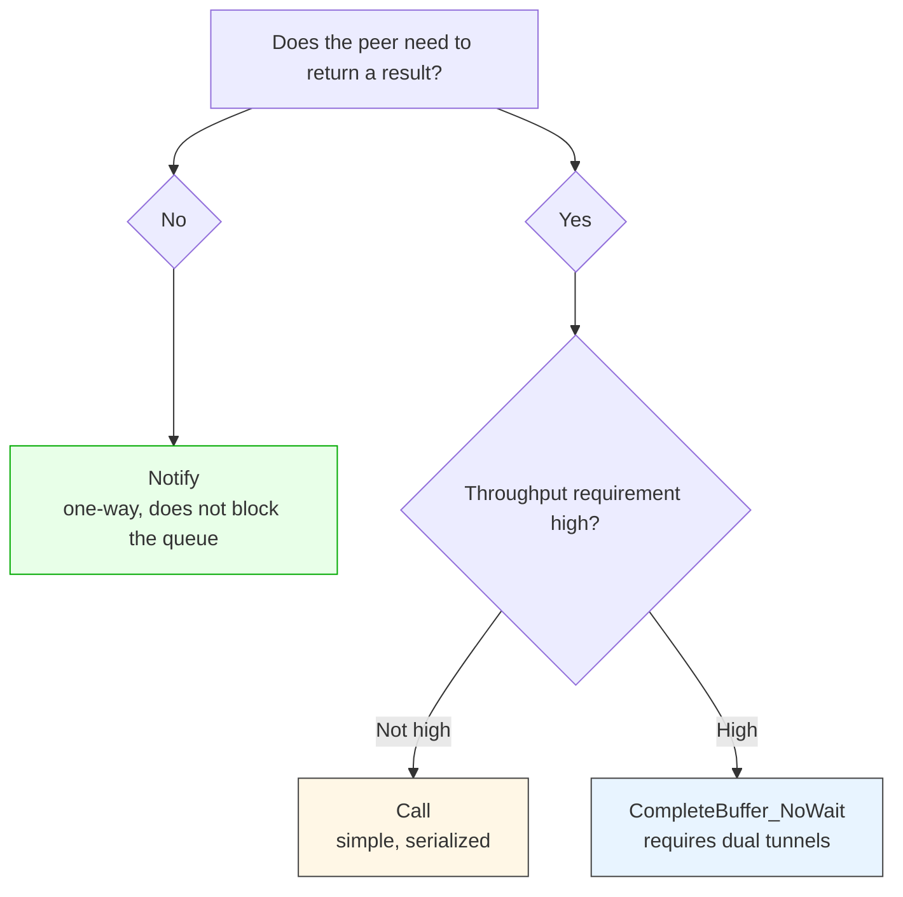
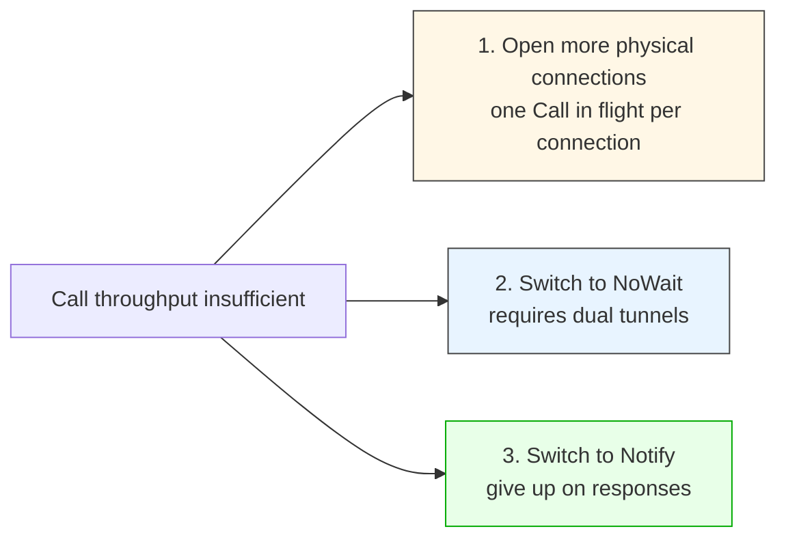

# LF_Cmd_Model_Choice.md

> Chinese version: [LF_Cmd_Model_Choice.md](LF_Cmd_Model_Choice.md)

> The choice you face on day one of an LF application: **Notify or Call**.
>
> The difference is not "synchronous vs asynchronous" — it is **a difference of protocol model**. `Call` is request-response and only one may be in flight per IO (the internal `FWaitOnResult` flag jams the queue); `Notify` is a one-way notification that returns as soon as it is sent and is entirely unaffected by that flag. The architectural corollary is therefore: **with Call your throughput ceiling = the slowest round trip on a single connection; only Notify can saturate the connection**. And the third route — `CompleteBuffer_NoWait_Stream` — is the optimization LF offers for "want a response and high throughput too", at the cost of requiring dual tunnels.

---

## The trade-offs of the three routes



| Model | Response | Blocks the queue | Needs dual tunnels | Typical use |
|------|:------:|:--------:|:----------:|---------|
| **Notify** | ❌ | ❌ | ❌ | Log reporting, metric push, event broadcast |
| **Call** | ✅ | ✅ | ❌ | Queries, config fetch, low-frequency RPC |
| **CompleteBuffer_NoWait** | ✅ | ❌ | ✅ | High-frequency RPC, game frame sync, real-time commands |

**The key difference is the "Blocks the queue" column.** The moment a `Call` is sent the entire send queue stalls until the response returns. Neither `Notify` nor `NoWait` touches `FWaitOnResult`, so the queue keeps flowing.

---

## The cost of Notify: no acknowledgement

`Notify` does not block the queue precisely because it **does not guarantee delivery**. Fire and forget: if the peer crashes, the network dies or the handling fails, the sender never knows.

So `Notify` only suits scenarios where "a loss does not affect correctness" — logs, metrics, events. Any business logic that **must** be acknowledged cannot use `Notify`. If ordering is needed, use `Sequenced_Notify` (it goes through the sequenced thread pool with FIFO guarantee), but there is still no acknowledgement.

**Entry points per language**:

```cpp
// C++
lingofuse::notify("Logger", payload);           // unordered
lingofuse::sequencedNotify("Logger", payload);  // FIFO
```

```python
# Python
lf.notify("Logger", payload)
lf.sequenced_notify("Logger", payload)
```

---

## The cost of Call: a throughput ceiling

`Call`'s simplicity is worth acknowledging — the caller blocks, gets the result, moves on, low mental load. But its bottleneck is explicit: **throughput ceiling = the slowest round trip on a single connection**.

1000 concurrent requests become 1000 serial round trips with `Call`. This is not an implementation flaw of LF but a consequence of **the model itself** — it is simply not designed for concurrency.

Three ways to break the ceiling:



**Route one (multiple connections)** is the plainest — have the client connect to 10 servers, or open 10 physical connections to the same server, with one `Call` in flight per connection, for 10× aggregate throughput. It suits "I want the simplicity of Call but cannot live with low throughput".

**Route two (NoWait)** is LF's optimization for exactly this need — requests travel on one tunnel and responses on another, so the two directions do not block each other. The cost is that **dual tunnels must be configured** (`DoubleChannelFramework`), which is more configuration than a single connection.

**Route three (Notify)** is a root-level abandonment — if you do not need a response, do not ask for one. Many businesses do not actually need a synchronous response; they just "habitually used Call".

---

## An easily overlooked fact

After a `Call` times out, `FWaitOnResult` **does not reset itself**. That means one timeout leaves every subsequent `Call` unable to go out, and the connection is effectively dead. Applications using `Call` must therefore implement **reconnect after timeout** — not "try again", but "drop the connection and rebuild it".

`Notify` and `NoWait` do not have this problem because they never set `FWaitOnResult`.

All language bindings handle it the same way: treat a returned handle with `size == 0` as "this Call failed", then rebuild the connection at the application layer.

```cpp
// Pseudo-code for reconnecting after timeout on the C++ side
auto resp = lingofuse::call("App", param, 3000);
if (!resp || resp.size() == 0) {
    // 1. local cleanup: dispose resp
    // 2. application-level decision: retry (will jam), or Shutdown + rebuild first?
    framework::shutdown();
    framework::resetPrepare();
    framework::prepareClient("ipc:app");
    framework::prepareDone();
}
```

```python
# Same on the Python side
resp = lf.call("App", param, 3000)
if resp is None or resp.size == 0:
    lf.shutdown()
    lf.reset_prepare()
    lf.prepare_client("ipc:app")
    lf.prepare_done()
```

---

## Pitfall quick reference

| Symptom | Root cause | Fix |
|------|------|------|
| Call throughput will not rise | `FWaitOnResult` serialization | More connections, or switch to NoWait |
| Whole connection jammed after a Call timeout | `FWaitOnResult` not reset | Reconnect after the timeout |
| Notify loses messages | By design, no acknowledgement | Use Call when acknowledgement is needed |
| Notify ordering scrambled | Does not use the sequenced thread | Use `Sequenced_Notify` when FIFO is needed |
| NoWait errors out | Dual tunnels not configured | Configure `DoubleChannelFramework` |
| Unsure which to use | Habitually used Call | Ask "is a response needed" first, then "is throughput sufficient" |

---

## Final word

When choosing a model, **ask "is a response needed" first, then "is throughput sufficient"**. Once both questions are answered the model is settled. Everything else is configuration — more connections, dual tunnels, sequenced variants.

Conversely, many performance problems are not LF being slow but **the wrong model being used**. 1000 serial Calls are not LF's fault; Call never did concurrency. Understanding this is far more useful than tuning parameters afterwards.


