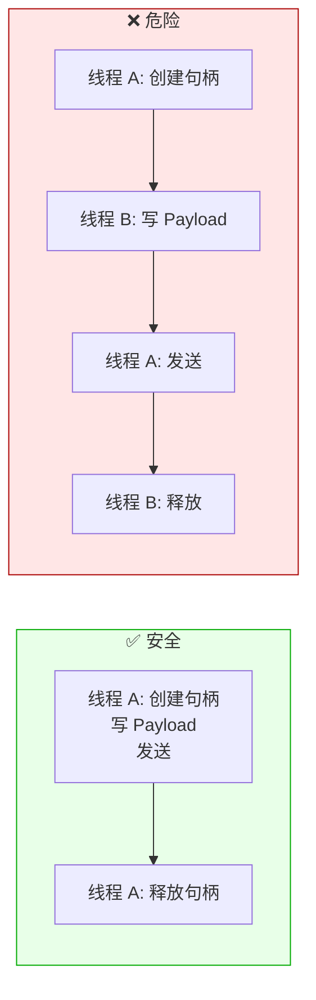
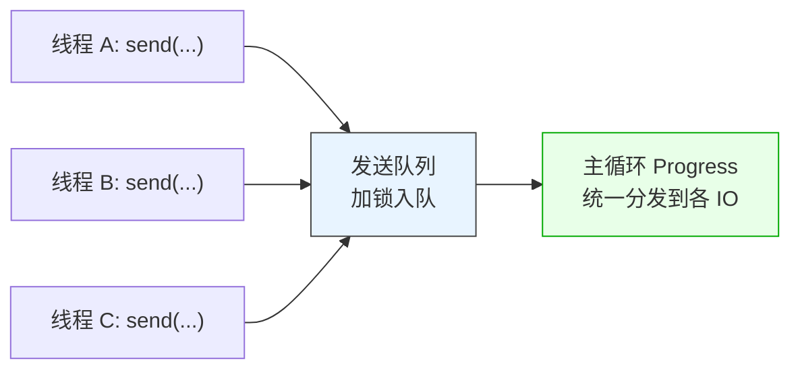
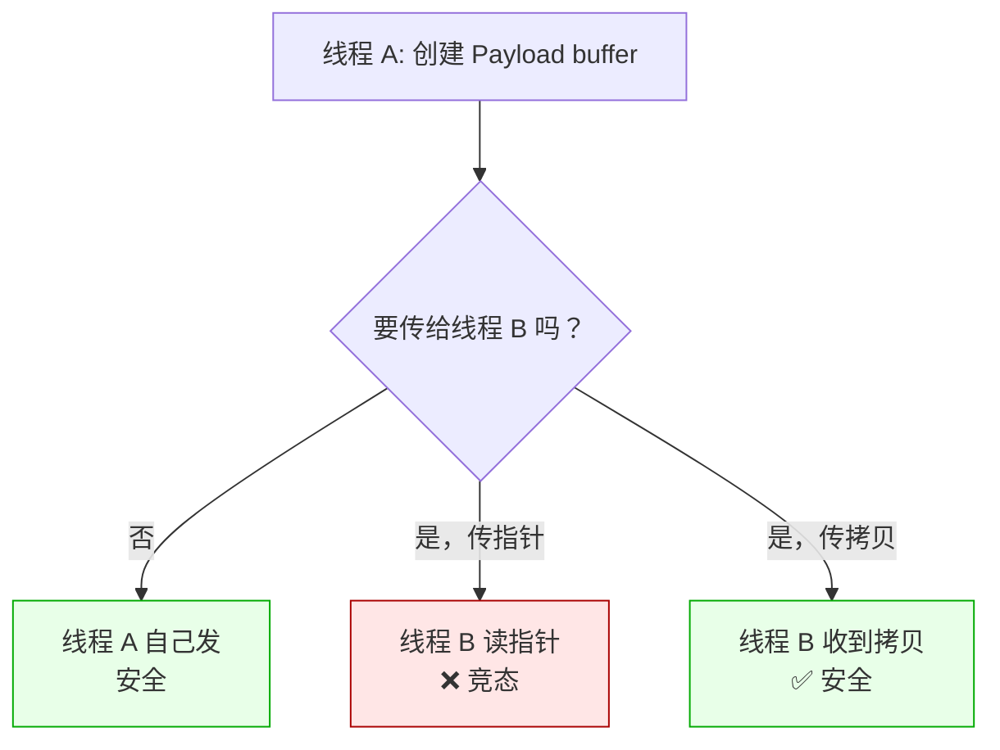
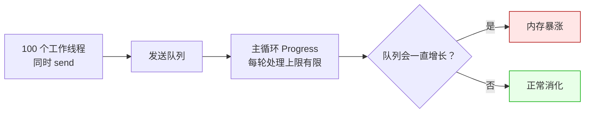

# LF_Concurrent_Send.md

> LF 允许你从任何线程发请求，但**不代表任何写法都安全**。
>
> `Send*` 系列函数（`SendCompleteBuffer` / `SendStreamCmd` 等）本身是线程安全的——它们只做一件事：把序列化好的消息塞进**发送队列**，而这个队列有锁。但**"能塞进去"不等于"塞进去的东西是对的"**。大多数跨线程发送的 bug 不在发送函数本身，而在发送前的准备：句柄还在用就被别的线程读了、Payload 被两个线程同时写、发送完立刻释放了句柄但底层还在读。

---

## 一条铁律：谁创建，谁使用，谁释放



**数据句柄不是线程安全对象**。它内部有一个读写游标（position），两个线程同时写会错位、会扩容竞态、会互相覆盖。所以句柄应该**由一个线程完整走完"创建 → 填充 → 发送 → 释放"这条链**，不要跨线程传。

**正确姿势**：每个线程自己创建自己的句柄，填完自己的数据，调 `send`，在作用域结束时释放。**不要把句柄当成共享数据在线程间传递**——要传就传字节数组。

### C++ 正确写法

```cpp
void worker_thread(int id) {
    lingofuse::DataHandle req("my_api");   // 线程私有的句柄
    req.write<int32_t>(id);
    req.write_string("hello");
    lingofuse::notify("Worker", req);
    // req 的析构函数自动释放
}
```

### Python 正确写法

```python
def worker_thread(worker_id):
    req = lf.DataHandle("my_api")   # 线程私有的句柄
    try:
        req.write_int32(worker_id)
        req.write_string("hello")
        lf.notify("Worker", req)
    finally:
        req.dispose()   # 显式释放
```

---

## 发送函数本身是安全的



`send` 函数做两件事：加锁，把消息推进发送队列。多个线程同时调 `send`，就是多个线程排队往同一个池子里塞东西——池子内部有锁，塞的动作为原子。所以从**调用**角度看，`send` 是线程安全的。

但有个细节：**`send` 是异步的**。它塞进队列就返回了，真正发出去发生在下一个 Progress 循环里。这意味着调用方在 `send` 返回后可以立刻释放句柄吗？**可以**——因为 `send` 内部已经把 Payload 复制进队列了（或者接管了它的所有权），调用方的句柄跟发送已经没有关系了。

各语言绑定的行为一致：`send` 返回后，请求句柄可以安全释放。

---

## 真正容易踩的坑：Payload 的共享



如果线程 A 和线程 B 都要往同一个 payload 里写，那就**不要共享 payload**——各写各的，各自 `send`。LF 的发送队列能处理"多个线程同时 send"，但处理不了"两个线程同时写同一个 buffer"。

需要汇总的话，做法是：线程 A 写自己的部分 → 拷贝一份给线程 B（通过 `swap` 或 `copy`）→ 线程 B 拿独立的副本。**不要在 Payload 层面共享内存**。

### C++ 的做法：拷贝或移动

```cpp
// ❌ 危险：共享同一个 buffer
lingofuse::DataHandle shared("api");
std::thread t1([&] { shared.write<int32_t>(1); });
std::thread t2([&] { shared.write<int32_t>(2); });   // 竞态！

// ✅ 安全：各写各的
std::thread t1([] {
    lingofuse::DataHandle h("api");
    h.write<int32_t>(1);
    lingofuse::notify("App", h);
});
std::thread t2([] {
    lingofuse::DataHandle h("api");
    h.write<int32_t>(2);
    lingofuse::notify("App", h);
});
```

### Python 的做法：`bytes` 是值语义

Python 的 `bytes` 是不可变值对象，天然线程安全。如果把 Payload 从 `DataHandle` 里读出来成 `bytes`，跨线程传递就没问题。

```python
def producer(q):
    # 生成 payload 字节
    h = lf.DataHandle("api")
    try:
        h.write_int32(42)
        h.position = 0
        payload_bytes = h.read_bytes(h.size)   # bytes 是值语义
    finally:
        h.dispose()
    q.put(payload_bytes)   # 线程安全

def consumer(q):
    payload_bytes = q.get()
    h = lf.DataHandle("api")
    try:
        h.write_bytes(payload_bytes)
        h.position = 0
        lf.notify("App", h)
    finally:
        h.dispose()
```

---

## 频率控制：发送也得限流



发送队列**没有容量上限**。如果 100 个工作线程同时高频率 `send`，主循环消化不过来，队列就会无限增长。这不是 LF 的问题，是**发送速度 > 发送能力**的经典背压问题。

**解决方式**：应用层限流。每条连接维护一个"在途请求数"，超过阈值就阻塞或丢弃。或者用信号量——每 `send` 一次 `wait`，对端响应回来 `release`。第二种更精确，但要跟踪响应。

`CompleteBuffer` 的 `SendNULL` 机制其实也是背压的一种——周期性发一个空消息，让队列"探一下底"，如果队列太深（空消息迟迟不返回），说明对端处理不过来，可以放慢节奏。

### C++ 侧的在途请求限流

```cpp
#include <semaphore>

std::counting_semaphore<> inflight(64);   // 最多 64 个在途请求

void send_one() {
    inflight.acquire();
    try {
        lingofuse::DataHandle req("api");
        // ... 填充 req ...
        lingofuse::notify("App", req);
    } catch (...) {
        inflight.release();
        throw;
    }
    // 响应回来后在回调里 inflight.release()
}
```

### Python 侧的限流

```python
import threading

inflight = threading.Semaphore(64)

def send_one():
    inflight.acquire()
    try:
        req = lf.DataHandle("api")
        try:
            req.write_int32(1)
            lf.notify("App", req)
        finally:
            req.dispose()
    except:
        inflight.release()
        raise
    # 响应回来后在回调里 inflight.release()
```

---

## 线程安全矩阵

| 操作 | 线程安全 |
|------|:--------:|
| `call` / `notify` / `send*` | ✅ 完全线程安全 |
| 创建 / 释放句柄 | ⚠️ 单个句柄不安全，多线程各管各的则安全 |
| 读 / 写句柄缓冲区 | ❌ 同一句柄不能多线程同时读写 |
| 读取发送方身份（P2P UID / Name） | ✅ 每次调用独立分配 |
| 读取状态日志 | ⚠️ 返回共享静态缓冲，多线程会互相覆盖 |
| 设置运行时选项 | ✅ 内部投递到主线程 |
| `shutdown` | ❌ 必须在主线程调 |

**核心规律**：**函数级线程安全，句柄级不线程安全**。同一个句柄被多个线程访问就要出问题，多个句柄各在各的线程里跑没问题。

---

## 陷阱速查

| 症状 | 根因 | 修复 |
|------|------|------|
| 发送的内容错位/乱码 | 两个线程同时写同一个句柄 | 各用各的句柄，要传就拷贝 |
| 句柄还没发就崩 | 另一个线程释放了它 | 谁创建谁释放，别跨线程 |
| 队列无限增长 | 发送速度 > 主循环消化速度 | 应用层限流，或在途请求数上限 |
| 发送完立刻释放句柄，内容丢了 | 以为释放后队列还在读 | `send*` 内部已接管，释放是安全的 |
| 状态日志内容错乱 | 静态缓冲多线程覆盖 | 每次调用立即拷贝 |

---

## 最后一句

跨线程发送的规则其实就两句：**函数随便调，句柄不共享**。`send*` 是线程安全的，所以谁想发谁发；数据句柄不是线程安全的，所以每个句柄只在一个线程里走完生命周期。

遇到"我明明是线程安全的 API，怎么还崩"的时候，大概率不是 `send*` 崩的，而是 `send*` 之前那句 `write` 崩的——因为那个句柄被另一个线程碰过了。
