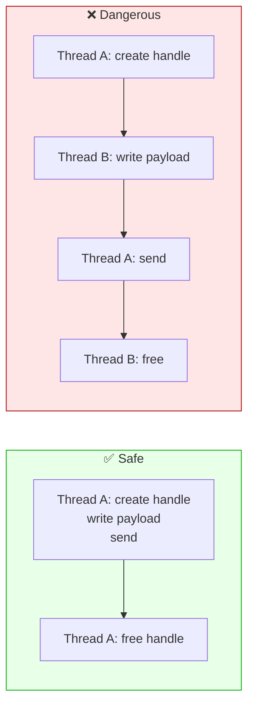
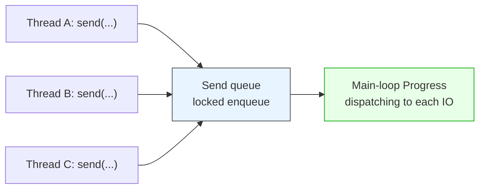
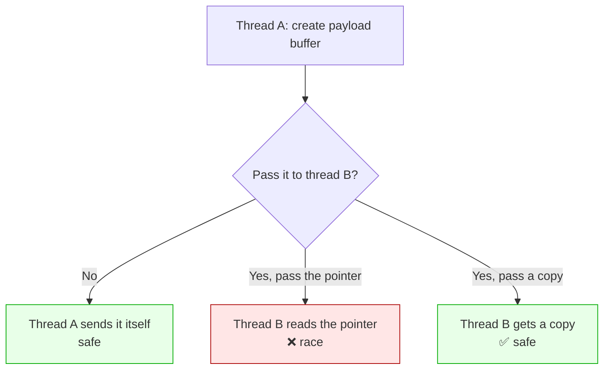
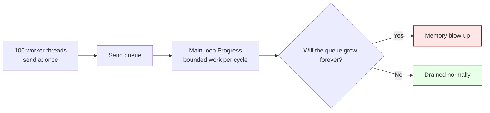

# LF_Concurrent_Send.md

> Chinese version: [LF_Concurrent_Send.md](LF_Concurrent_Send.md)

> LF lets you send requests from any thread, but that **does not mean every way of doing it is safe**.
>
> The `Send*` family (`SendCompleteBuffer` / `SendStreamCmd` etc.) is itself thread-safe — it does one thing: push a serialized message into the **send queue**, and that queue is locked. But **"it can be pushed in" is not the same as "what got pushed in is correct"**. Most cross-thread sending bugs are not in the send function but in the preparation before it: a handle still in use gets read by another thread, a payload is written by two threads at once, a handle is freed right after sending while the lower layer is still reading it.

---

## One iron rule: whoever creates it uses it and frees it



**A data handle is not a thread-safe object**. It carries a read/write cursor (position) inside; two threads writing concurrently will desynchronize, race on growth, and overwrite each other. A handle should therefore be taken through **create → fill → send → free** entirely by one thread, never passed across threads.

**The right pattern**: each thread creates its own handle, fills its own data, calls `send`, and frees it at the end of the scope. **Do not treat a handle as shared data passed between threads** — if you must pass something, pass a byte array.

### Correct C++ usage

```cpp
void worker_thread(int id) {
    lingofuse::DataHandle req("my_api");   // thread-private handle
    req.write<int32_t>(id);
    req.write_string("hello");
    lingofuse::notify("Worker", req);
    // req's destructor frees it automatically
}
```

### Correct Python usage

```python
def worker_thread(worker_id):
    req = lf.DataHandle("my_api")   # thread-private handle
    try:
        req.write_int32(worker_id)
        req.write_string("hello")
        lf.notify("Worker", req)
    finally:
        req.dispose()   # explicit release
```

---

## The send function itself is safe



`send` does two things: lock, then push the message into the send queue. Many threads calling `send` at once simply queue up to stuff things into the same pool — the pool is internally locked and the push is atomic. From the **caller's** perspective, `send` is thread-safe.

One detail: **`send` is asynchronous**. It returns as soon as the message is queued; the actual transmission happens in the next Progress cycle. Does that mean the caller can free the handle immediately after `send` returns? **Yes** — `send` has already copied the payload into the queue (or taken ownership of it), so the caller's handle has nothing to do with the transmission any more.

All language bindings behave the same: after `send` returns, the request handle can be safely freed.

---

## The pitfall that actually bites: sharing the payload



If threads A and B both need to write into the same payload, **do not share the payload** — each writes its own and each sends its own. LF's send queue handles "many threads sending at once" but not "two threads writing the same buffer at once".

To aggregate, do this: thread A writes its own part → copy it for thread B (via `swap` or `copy`) → thread B works on an independent copy. **Never share memory at the payload level**.

### C++ approach: copy or move

```cpp
// ❌ Dangerous: sharing one buffer
lingofuse::DataHandle shared("api");
std::thread t1([&] { shared.write<int32_t>(1); });
std::thread t2([&] { shared.write<int32_t>(2); });   // race!

// ✅ Safe: each writes its own
std::thread t1([] {
    lingofuse::DataHandle h("api");
    h.write<int32_t>(1);
    lingofuse::notify("App", h);
});
std::thread t2([] {
    lingofuse::DataHandle h("api");
    h.write<int32_t>(2);
    lingofuse::notify("App", h);
});
```

### Python approach: `bytes` has value semantics

Python `bytes` is an immutable value object and inherently thread-safe. If you read the payload out of a `DataHandle` into `bytes`, passing it across threads is fine.

```python
def producer(q):
    # build the payload bytes
    h = lf.DataHandle("api")
    try:
        h.write_int32(42)
        h.position = 0
        payload_bytes = h.read_bytes(h.size)   # bytes has value semantics
    finally:
        h.dispose()
    q.put(payload_bytes)   # thread-safe

def consumer(q):
    payload_bytes = q.get()
    h = lf.DataHandle("api")
    try:
        h.write_bytes(payload_bytes)
        h.position = 0
        lf.notify("App", h)
    finally:
        h.dispose()
```

---

## Rate control: sending needs throttling too



The send queue **has no capacity limit**. If 100 worker threads `send` at high frequency, the main loop cannot drain fast enough and the queue grows unboundedly. This is not an LF flaw but the classic back-pressure problem of **send rate > send capacity**.

**The fix**: throttle at the application layer. Maintain an "in-flight request count" per connection and block or drop once it exceeds a threshold. Or use a semaphore — `wait` on each `send` and `release` when the response returns. The second is more precise but requires tracking responses.

`CompleteBuffer`'s `SendNULL` mechanism is itself a form of back-pressure — periodically send an empty message to "sound the bottom" of the queue; if the queue is too deep (the empty message takes long to return), the peer cannot keep up and the pace can be slowed.

### In-flight throttling on the C++ side

```cpp
#include <semaphore>

std::counting_semaphore<> inflight(64);   // at most 64 in-flight requests

void send_one() {
    inflight.acquire();
    try {
        lingofuse::DataHandle req("api");
        // ... fill req ...
        lingofuse::notify("App", req);
    } catch (...) {
        inflight.release();
        throw;
    }
    // release inflight in the response callback
}
```

### Throttling on the Python side

```python
import threading

inflight = threading.Semaphore(64)

def send_one():
    inflight.acquire()
    try:
        req = lf.DataHandle("api")
        try:
            req.write_int32(1)
            lf.notify("App", req)
        finally:
            req.dispose()
    except:
        inflight.release()
        raise
    # release inflight in the response callback
```

---

## Thread-safety matrix

| Operation | Thread-safe |
|------|:--------:|
| `call` / `notify` / `send*` | ✅ Fully thread-safe |
| Create / free a handle | ⚠️ A single handle is unsafe; safe when each thread owns its own |
| Read / write a handle's buffer | ❌ One handle cannot be read/written by multiple threads at once |
| Read the sender identity (P2P UID / Name) | ✅ Allocated independently per call |
| Read the status log | ⚠️ Returns a shared static buffer; threads overwrite each other |
| Set runtime options | ✅ Posted internally to the main thread |
| `shutdown` | ❌ Must be called on the main thread |

**The core rule**: **thread-safe at the function level, not at the handle level**. One handle accessed by several threads will cause trouble; several handles each confined to their own thread will not.

---

## Pitfall quick reference

| Symptom | Root cause | Fix |
|------|------|------|
| Sent content misaligned or garbled | Two threads writing the same handle | One handle per thread; copy if you need to pass data |
| Crash before the handle is even sent | Another thread freed it | Whoever creates it frees it; never cross threads |
| Queue grows unboundedly | Send rate > main-loop drain rate | Application-level throttling or an in-flight cap |
| Content lost after freeing the handle right post-send | Assuming the queue still reads it | `send*` has taken ownership; freeing is safe |
| Status log content garbled | Static buffer overwritten by several threads | Copy immediately on every call |

---

## Final word

The rules for cross-thread sending boil down to two lines: **call the functions freely, never share handles**. `send*` is thread-safe, so anyone may send; data handles are not, so each handle completes its lifecycle inside a single thread.

When you hit "this API is supposed to be thread-safe, why did it crash", the culprit is most likely not `send*` but the `write` before it — because another thread has touched that handle.


