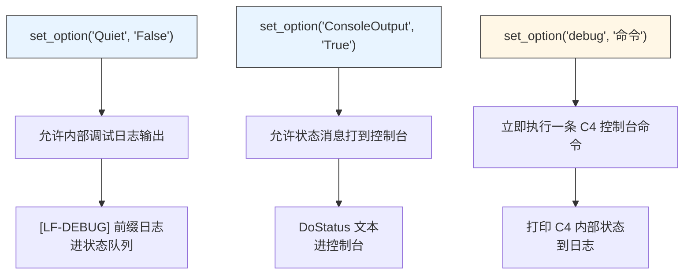
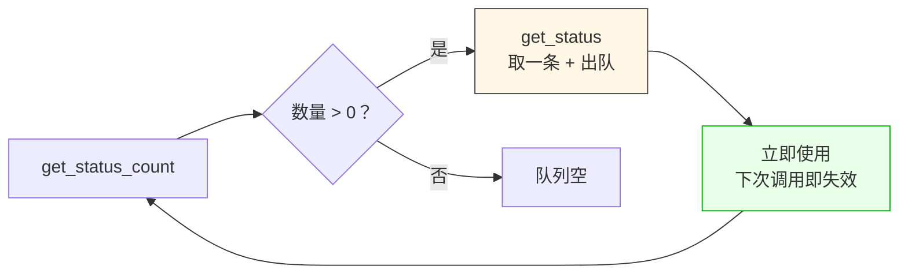

# LF_Debug_Mode.md

> LF 的调试开关不是一个，是三个——`Quiet`、`ConsoleOutput`、`debug`，各管一摊。很多人只调了一个，然后就以为"打开调试了"，结果看不到想看的东西。这一篇说清楚三个开关各做什么，以及怎么把状态读出来。

---

## 三个开关

LF 的调试分三层，各管一摊，不能互相替代：



| 开关 | 默认 | 管什么 | 不管什么 |
|------|------|--------|---------|
| `Quiet` | `False`（日志开着） | `[LF-DEBUG]` 前缀的调试日志 | 状态消息、状态队列 |
| `ConsoleOutput` | `True`（控制台开着） | 状态消息输出到控制台 | 日志内容、状态队列长度 |
| `debug` | — | 一次性执行 C4 控制台命令 | 持久开关、日志、状态 |

**简单说**：`Quiet` 管内部日志，`ConsoleOutput` 管控制台输出，`debug` 是一次性快照。

### 各语言设置方式

```cpp
// C++
lingofuse::setOption("Quiet", "False");
lingofuse::setOption("ConsoleOutput", "True");
lingofuse::setOption("debug", "HPC_Thread_Info");
```

```python
# Python
lf.set_option("Quiet", "False")
lf.set_option("ConsoleOutput", "True")
lf.set_option("debug", "HPC_Thread_Info")
```

---

## 看状态：`get_status`

日志最终都进状态队列，靠 `get_status` 一行一行读出来：



`get_status` 返回的是**静态 64KB 缓冲**的指针，下次调用就会覆盖。所以：

- 读一条，处理一条，别攒着
- 超过 64KB 的消息被截断
- 队列上限 1000 条，溢出时丢弃最旧

### C++ 的典型轮询

```cpp
while (lingofuse::getStatusCount() > 0) {
    std::string msg = lingofuse::getStatus();   // 立即拷成 std::string
    std::cout << msg << "\n";
}
```

### Python 的典型轮询

```python
while lf.get_status_count() > 0:
    msg = lf.get_status()   # 已拷贝为 Python str
    print(msg)
```

---

## 用 debug 命令：一次性快照

`set_option('debug', 'xxx')` 相当于把命令丢进 C4 控制台执行一次。支持的命令覆盖了服务、隧道、线程、句柄、数据库等方方面面：

| 命令 | 看什么 |
|------|--------|
| `service` | 物理服务端信息 |
| `tunnel` | 物理客户端信息 |
| `ZNet_Info` | 所有 ZNet 实例 |
| `HPC_Thread_Info` | TCompute 线程池状态 |
| `Instance_Info` | 实例计数（内存泄漏排查） |
| `Service_CMD_Info` | 服务端命令 CPU 消耗 |
| `Client_CMD_Info` | 客户端命令 CPU 消耗 |

**注意**：每次调用 `debug` 都会创建一个内部辅助对象，开销不小。**它是调试工具，不是生产工具**——别在热路径里循环调用。

---

## 一个完整的最小配置

```cpp
// C++ 版本
lingofuse::setOption("Quiet", "False");           // ① 打开日志
lingofuse::setOption("ConsoleOutput", "True");    // ② 确保控制台也开着
lingofuse::prepareDone();                          // ③ 启动

while (running) {
    // ④ 主循环里读状态
    while (lingofuse::getStatusCount() > 0) {
        std::cout << lingofuse::getStatus() << "\n";
    }

    // ⑤ 需要时抓一次快照
    lingofuse::setOption("debug", "HPC_Thread_Info");

    std::this_thread::sleep_for(std::chrono::milliseconds(10));
}
```

```python
# Python 版本
lf.set_option("Quiet", "False")
lf.set_option("ConsoleOutput", "True")
lf.prepare_done()

while running:
    while lf.get_status_count() > 0:
        print(lf.get_status())

    lf.set_option("debug", "HPC_Thread_Info")

    time.sleep(0.01)
```

---

## 陷阱速查

| 症状 | 根因 | 修复 |
|------|------|------|
| 打开了日志但看不到 | `Quiet` 设了 True | 改成 False |
| 状态里没东西 | 队列空，或者没主线程驱动 | 确认 `prepare_done` 成功，主循环在跑 |
| `get_status` 返回垃圾 | 上次调用后缓冲被覆盖 | 每次调用立即用，别存指针 |
| 消息超过 64KB 被截断 | 静态缓冲限制 | 分多次 `post_status`，或者拆日志 |
| 队列 1000 条后丢消息 | 上限溢出 | 提高消费频率，或者接受丢弃 |
| `debug` 命令没输出 | `Quiet` 设了 True，日志被屏蔽 | 打开日志 |
| `debug` 卡顿 | 每次都建内部辅助对象 | 不要高频调用 |
| 状态顺序乱 | 多线程并发写状态消息 | 接受乱序，或者按 ID 分组 |

---

## 最后一句

LF 的调试其实就三步：**开日志 → 读状态 → 抓快照**。

- **开日志**：`Quiet=False`，让内部调试信息能出来
- **读状态**：`get_status` 轮询，一行一行消费
- **抓快照**：`debug` 命令，需要时来一炮

三个开关之间没有隐含关系，得**分别设置**。设完了就别指望它们自动串起来——LF 只提供机制，驱动和消费都是你的事。
