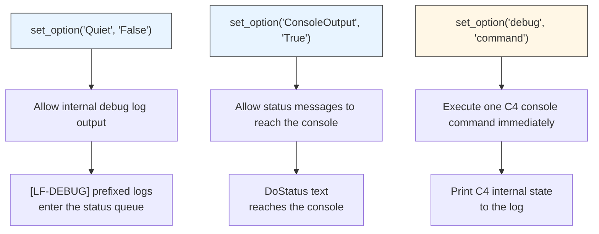
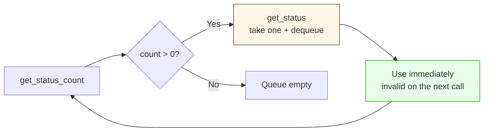

# LF_Debug_Mode.md

> Chinese version: [LF_Debug_Mode.md](LF_Debug_Mode.md)

> LF does not have one debug switch — it has three: `Quiet`, `ConsoleOutput` and `debug`, each governing a different area. Many people flip only one of them and then assume "debugging is on", and end up unable to see what they wanted. This note explains what each of the three does and how to read the state out.

---

## The three switches

LF debugging has three layers, each with its own scope, and none substitutes for another:



| Switch | Default | Governs | Does not govern |
|------|------|--------|---------|
| `Quiet` | `False` (logging on) | Debug logs with the `[LF-DEBUG]` prefix | Status messages, status queue |
| `ConsoleOutput` | `True` (console on) | Status messages printed to the console | Log content, status queue length |
| `debug` | — | One-shot execution of a C4 console command | Persistent switches, logs, status |

**In short**: `Quiet` governs internal logs, `ConsoleOutput` governs console output, `debug` is a one-shot snapshot.

### How to set them per language

```cpp
// C++
lingofuse::setOption("Quiet", "False");
lingofuse::setOption("ConsoleOutput", "True");
lingofuse::setOption("debug", "HPC_Thread_Info");
```

```python
# Python
lf.set_option("Quiet", "False")
lf.set_option("ConsoleOutput", "True")
lf.set_option("debug", "HPC_Thread_Info")
```

---

## Reading state: `get_status`

All logs eventually land in the status queue and are read out line by line through `get_status`:



`get_status` returns a pointer into a **static 64 KB buffer** that is overwritten by the next call. Therefore:

- Read one, process one, never accumulate
- Messages larger than 64 KB are truncated
- The queue caps at 1000 entries; on overflow the oldest are dropped

### Typical C++ polling

```cpp
while (lingofuse::getStatusCount() > 0) {
    std::string msg = lingofuse::getStatus();   // copy into std::string immediately
    std::cout << msg << "\n";
}
```

### Typical Python polling

```python
while lf.get_status_count() > 0:
    msg = lf.get_status()   # already copied into a Python str
    print(msg)
```

---

## The debug command: a one-shot snapshot

`set_option('debug', 'xxx')` is equivalent to throwing a command into the C4 console once. The supported commands cover services, tunnels, threads, handles, databases and more:

| Command | What it shows |
|------|--------|
| `service` | Physical server-side information |
| `tunnel` | Physical client-side information |
| `ZNet_Info` | All ZNet instances |
| `HPC_Thread_Info` | TCompute thread-pool state |
| `Instance_Info` | Instance counts (memory-leak hunting) |
| `Service_CMD_Info` | Server-side command CPU consumption |
| `Client_CMD_Info` | Client-side command CPU consumption |

**Note**: every `debug` call creates an internal helper object and is not cheap. **It is a debugging tool, not a production tool** — do not call it in a loop on a hot path.

---

## A complete minimal configuration

```cpp
// C++ version
lingofuse::setOption("Quiet", "False");           // (1) turn logging on
lingofuse::setOption("ConsoleOutput", "True");    // (2) make sure the console is on too
lingofuse::prepareDone();                          // (3) start

while (running) {
    // (4) read status in the main loop
    while (lingofuse::getStatusCount() > 0) {
        std::cout << lingofuse::getStatus() << "\n";
    }

    // (5) grab a snapshot when needed
    lingofuse::setOption("debug", "HPC_Thread_Info");

    std::this_thread::sleep_for(std::chrono::milliseconds(10));
}
```

```python
# Python version
lf.set_option("Quiet", "False")
lf.set_option("ConsoleOutput", "True")
lf.prepare_done()

while running:
    while lf.get_status_count() > 0:
        print(lf.get_status())

    lf.set_option("debug", "HPC_Thread_Info")

    time.sleep(0.01)
```

---

## Pitfall quick reference

| Symptom | Root cause | Fix |
|------|------|------|
| Logging enabled but nothing appears | `Quiet` is True | Set it to False |
| Nothing in the status | Queue empty, or no main thread driving it | Confirm `prepare_done` succeeded and the main loop is running |
| `get_status` returns garbage | The buffer was overwritten after the previous call | Use each result immediately, never keep the pointer |
| Messages over 64 KB are truncated | Static buffer limit | Post status in several smaller pieces, or split the log |
| Messages lost after 1000 entries | Queue overflow | Consume more frequently, or accept the loss |
| `debug` command produces no output | `Quiet` is True, so logs are suppressed | Turn logging on |
| `debug` causes stalls | An internal helper object is built every time | Do not call it frequently |
| Status order is scrambled | Multiple threads writing status concurrently | Accept out-of-order output, or group by ID |

---

## Final word

LF debugging really comes down to three steps: **turn logging on → read status → grab a snapshot**.

- **Turn logging on**: `Quiet=False`, so internal debug information can surface
- **Read status**: poll `get_status` and consume one line at a time
- **Grab a snapshot**: the `debug` command, fired when needed

There is no implicit relationship among the three switches; they must be **set separately**. Once set, do not expect them to wire themselves together — LF only provides the mechanism; driving and consuming are your job.


