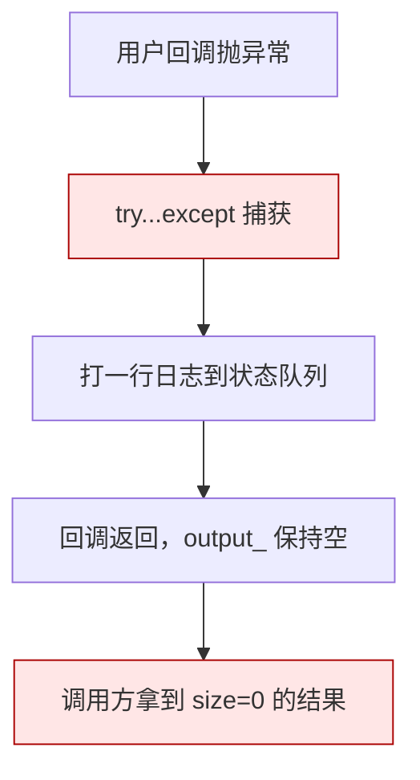
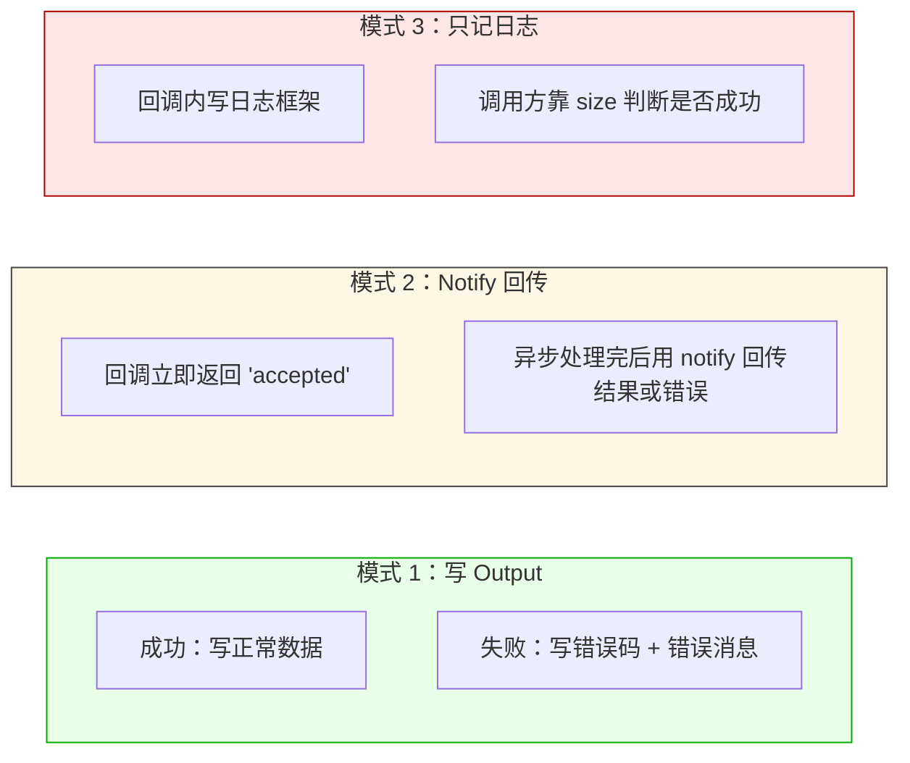
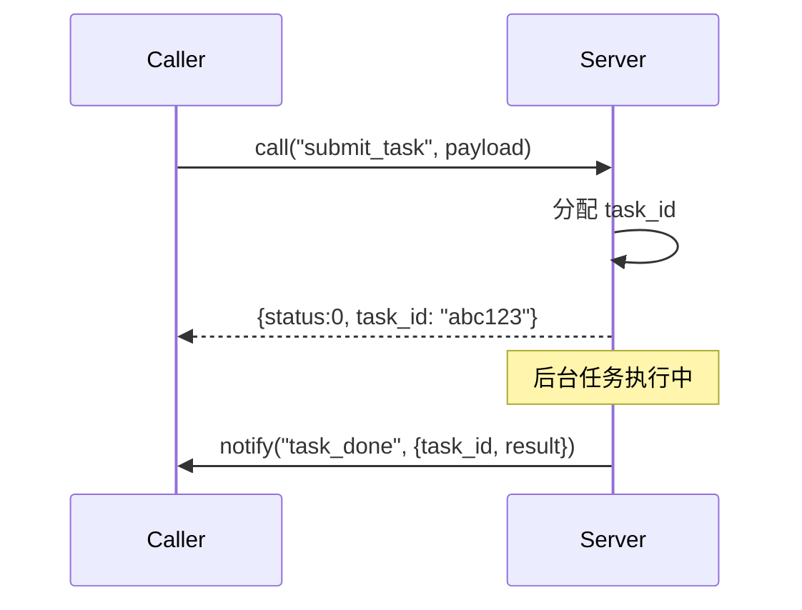
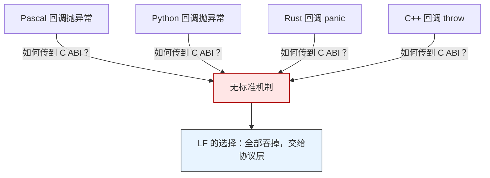

# LF_Error_In_Callback.md

> LF 的回调里**抛异常等于没抛**。
>
> LF 引擎在调用用户回调时，把整个回调体包在 `try...except` 里，异常被吞掉、打一行 `'execute call-mode api "%s" (stdcall) execpet!'` 到日志、然后正常返回——调用方拿到的是一个**空的、大小为零的结果**，看上去就像"这次调用成功了但什么也没干"。这个设计不是疏忽，是跨语言回调的必然结果：C ABI 边界上没有统一的异常传递机制，Pascal 异常不能传到 Python，Python 异常不能传到 Rust，所以 LF 干脆全部吞掉，把"错误怎么传"这件事留给协议层。



| 你以为的 | 实际发生的 |
|---------|-----------|
| 回调抛异常，调用方收到错误 | 异常被吞，调用方拿到 size=0 的空结果 |
| size=0 就是"没找到 API" | size=0 可能是"没找到"、"回调异常"、"超时"三种之一 |
| 日志里能看到异常 | 能看到，但只有一行 `execpet!`，没有堆栈、没有错误详情 |
| 异常会向上传播 | 不会，引擎内部消化掉了 |

**怎么正确报错**：在回调里用**协议层**传错误，不要用异常。常见的三种模式：



---

## 模式 1：在 Output 里写错误码（推荐）

**适合短任务**——直接在 Output 里写一个"状态字节 + 数据"或者"状态字节 + 错误字符串"，调用方读第一个字节判断成功失败。最省事，也最可控。

### 约定

```
响应帧 = [status: uint8][payload]

status == 0x00  → 成功，payload 是业务数据
status == 0xFF  → 失败，payload 是 UTF-8 错误消息 + NUL
```

这个约定与 `code_decl_to_abi` 生成的跨语言绑定完全一致——所以 C++ / Python / C# / Rust / Go 等等所有语言的调用方对错误处理的理解都一样。

### C++ 服务端

```cpp
app.registerCall("divide", "integer division", 
    [](lingofuse::DataHandle& in, lingofuse::DataHandle& out) {
        int32_t a, b;
        if (!in.read<int32_t>(a) || !in.read<int32_t>(b)) {
            // 协议层报错：状态字节 + 错误消息
            out.write<uint8_t>(0xFF);
            out.write_string("bad input");
            return;
        }
        if (b == 0) {
            out.write<uint8_t>(0xFF);
            out.write_string("division by zero");
            return;
        }
        out.write<uint8_t>(0x00);      // 成功
        out.write<int32_t>(a / b);
    });
```

### C++ 调用方

```cpp
auto resp = lingofuse::call("Calc", req, 3000);
if (!resp || resp.size() == 0) {
    // size == 0：可能是超时、也可能是回调异常被吞
    // 分不清，只能记日志 + 走重试
    std::cerr << "call failed or timed out\n";
    return;
}

resp.position = 0;
uint8_t status = resp.read<uint8_t>();
if (status == 0xFF) {
    std::string err = resp.read_string();
    std::cerr << "remote error: " << err << "\n";
    return;
}
int32_t result = resp.read<int32_t>();
```

### Python 服务端

```python
def divide_handler(inp, out):
    try:
        a = inp.read_int32()
        b = inp.read_int32()
    except Exception:
        out.write_uint8(0xFF)
        out.write_string("bad input")
        return
    if b == 0:
        out.write_uint8(0xFF)
        out.write_string("division by zero")
        return
    out.write_uint8(0x00)
    out.write_int32(a // b)

app.register_call("divide", "integer division", divide_handler)
```

### Python 调用方

```python
resp = lf.call("Calc", req, 3000)
if resp is None or resp.size == 0:
    print("call failed or timed out", file=sys.stderr)
    return

resp.position = 0
status = resp.read_uint8()
if status == 0xFF:
    err = resp.read_string()
    print(f"remote error: {err}", file=sys.stderr)
    return
result = resp.read_int32()
```

---

## 模式 2：异步 Notify 回传

**适合长任务**——回调立即返回 `task_id`，调用方通过 `task_id` 追踪进度。但要求调用方那边有个地方存 `task_id` 到回调的映射，工程量大一些。

### 流程



### C++ 服务端

```cpp
// 1. 同步返回 task_id
app.registerCall("submit_task", "submit", 
    [](lingofuse::DataHandle& in, lingofuse::DataHandle& out) {
        std::string task_id = generate_task_id();
        schedule_background_task(task_id, in.read<std::string>());
        out.write<uint8_t>(0x00);
        out.write_string(task_id);
    });

// 2. 后台任务完成后 notify 调用方
void on_background_done(const std::string& task_id, const std::string& result) {
    lingofuse::DataHandle n("task_done");
    n.write_string(task_id);
    n.write_string(result);
    // 通过 UID 定向 notify 到原来的调用方
    lingofuse::notifyByUid(caller_uid, n);
}
```

### Python 调用方

```python
def on_task_done(inp):
    task_id = inp.read_string()
    result = inp.read_string()
    print(f"task {task_id} done: {result}")

# 调用方自己注册一个 Notify API 接收回传
app.register_notify("task_done", "receive task result", on_task_done)

# 提交任务
resp = lf.call("Worker", req, 5000)
# resp 是 {"status":0, "task_id":"abc123"}
```

---

## 模式 3：只记日志

**只适合"错误不影响调用方决策"的场景**——比如心跳、指标上报。**不要用这个模式处理业务逻辑错误**——调用方分不清"成功了但没返回数据"和"失败了"。

```cpp
app.registerNotify("heartbeat", "ping", 
    [](lingofuse::DataHandle& in) {
        try {
            // 读数据
        } catch (const std::exception& e) {
            // 只记日志，不通知调用方
            lingofuse::postStatus(std::string("heartbeat error: ") + e.what());
        }
    });
```

```python
def heartbeat_handler(inp):
    try:
        # 读数据
        pass
    except Exception as e:
        # 只记日志，不通知调用方
        lf.post_status(f"heartbeat error: {e}")

app.register_notify("heartbeat", "ping", heartbeat_handler)
```

---

## 跨语言为什么没有统一异常

这是设计上的**根本约束**，不是 LF 偷懒：



各语言的异常模型互相不兼容：

- Pascal 的 `try...except` 捕获的是 `Exception` 对象
- C++ 的 `throw` / `catch` 有自己的类型系统
- Python 的 `BaseException` 完全不同的栈展开模型
- Rust 的 `panic!` 走的是 unwind 或 abort，与 C ABI 不兼容
- Go 根本没有异常，只有 `error` 返回值
- Erlang 的进程崩溃隔离在 BEAM 内部

**没有一个 C ABI 层面能统一这些模型**。LF 的做法是：把所有异常吞掉，把"错误怎么表达"这件事交给**上层协议**。这也是为什么 `code_decl_to_abi` 生成的代码里统一用 `[status][payload]` 帧——这就是跨语言的错误通道。

---

## 代价

所有错误处理都必须在**应用层协议**里做。LF 不提供 `call` 的 `try...catch` 语义，因为跨语言的异常传递本身就是没有统一标准的。

**一个后果**：如果你用 `call` 只判断"返回 size 是不是 0"，那你就分不清"对端没注册 API"、"对端回调崩了"、"对端超时"——三种情况返回的都是 size=0 的句柄。正确的做法是让协议层带上状态码：

```
Output 第一个字节：
  0x00 → 成功
  0xFF → 失败，后面跟错误消息
```

调用方读第一个字节就能区分，这才是 LF 推荐的用法。

---

## 陷阱速查

| 症状 | 根因 | 修复 |
|------|------|------|
| 调用方拿到 size=0，服务端日志有 `execpet!` | 回调抛异常被吞 | 协议层写状态码 |
| 分不清"没找到"、"超时"、"崩溃" | 都返回 size=0 | 协议层带状态字节 |
| 错误堆栈丢了 | 异常被吞，只留一行日志 | 回调内自己 `catch` 并记详细日志 |
| 回调内 `try...catch` 没生效 | 异常可能是非 `std::exception` / `BaseException` | 用 `catch (...)` / `except BaseException` |
| 跨语言错误码不统一 | 各语言绑定未对齐协议 | 用 `code_decl_to_abi` 生成，统一 `[status][payload]` |

---

## 最后一句

LF 的回调契约只有一句话：**回调是值传递的边界，异常不跨界**。

想清楚这一点，就不会试图用 `try...catch` 处理远程错误——那是应用的活，不是通讯层的活。协议层写清楚状态码，两端都能正确解读，这才是跨语言 RPC 的正确姿势。
