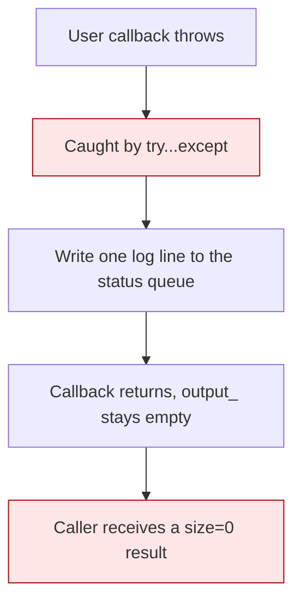
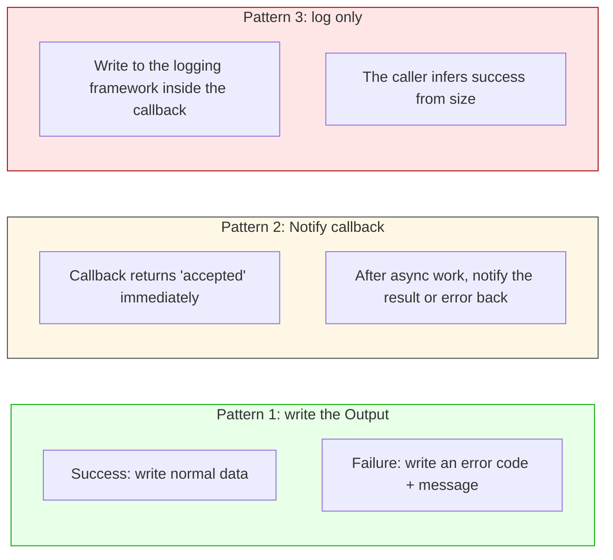
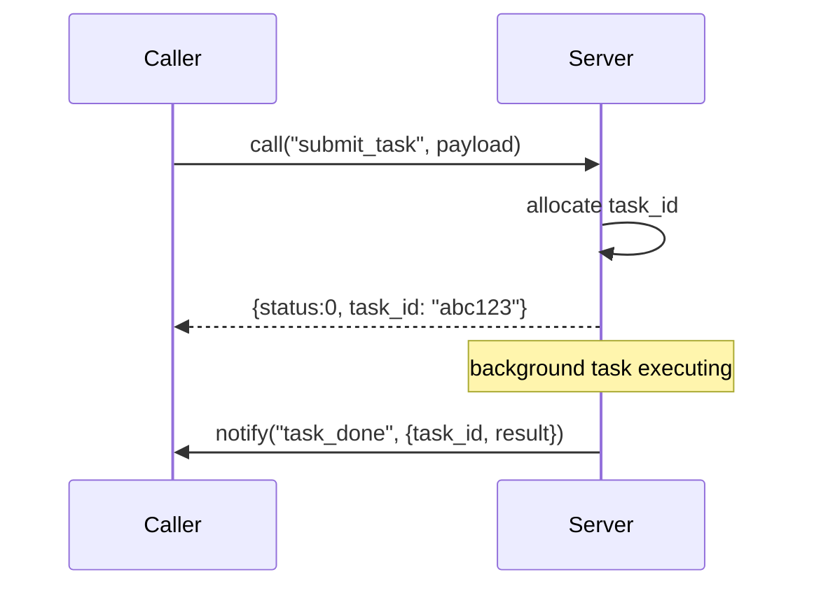
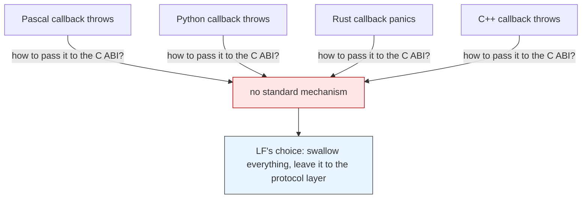

# LF_Error_In_Callback.md

> Chinese version: [LF_Error_In_Callback.md](LF_Error_In_Callback.md)

> Throwing inside an LF callback **is the same as not throwing at all**.
>
> When the LF engine invokes a user callback it wraps the entire callback body in `try...except`: the exception is swallowed, a line `'execute call-mode api "%s" (stdcall) execpet!'` is written to the log, and the function returns normally — the caller receives an **empty, zero-sized result**, which looks like "this call succeeded but did nothing". This is not an oversight but an inevitable consequence of cross-language callbacks: there is no unified exception-passing mechanism at the C ABI boundary, a Pascal exception cannot travel into Python, a Python exception cannot travel into Rust, so LF swallows everything and leaves "how errors are conveyed" to the protocol layer.



| What you assume | What actually happens |
|---------|-----------|
| The callback throws and the caller receives an error | The exception is swallowed; the caller gets an empty size=0 result |
| size=0 means "API not found" | size=0 may mean "not found", "callback threw", or "timeout" |
| The exception is visible in the log | It is, but only as one line `execpet!`, with no stack and no detail |
| The exception propagates upward | It does not; the engine consumes it internally |

**How to report errors properly**: convey them through the **protocol layer** inside the callback, never through exceptions. Three common patterns:



---

## Pattern 1: write an error code in the Output (recommended)

**Suited to short tasks** — write "status byte + data" or "status byte + error string" directly into the Output, and let the caller read the first byte to decide success or failure. Least trouble, most control.

### Convention

```
response frame = [status: uint8][payload]

status == 0x00  → success; payload is the business data
status == 0xFF  → failure; payload is a UTF-8 error message + NUL
```

This convention matches exactly what the cross-language bindings generated by `code_decl_to_abi` expect — so callers in C++, Python, C#, Rust, Go and every other language understand error handling the same way.

### C++ server

```cpp
app.registerCall("divide", "integer division", 
    [](lingofuse::DataHandle& in, lingofuse::DataHandle& out) {
        int32_t a, b;
        if (!in.read<int32_t>(a) || !in.read<int32_t>(b)) {
            // protocol-level error: status byte + error message
            out.write<uint8_t>(0xFF);
            out.write_string("bad input");
            return;
        }
        if (b == 0) {
            out.write<uint8_t>(0xFF);
            out.write_string("division by zero");
            return;
        }
        out.write<uint8_t>(0x00);      // success
        out.write<int32_t>(a / b);
    });
```

### C++ caller

```cpp
auto resp = lingofuse::call("Calc", req, 3000);
if (!resp || resp.size() == 0) {
    // size == 0: could be a timeout, or a swallowed callback exception
    // indistinguishable, so log and retry
    std::cerr << "call failed or timed out\n";
    return;
}

resp.position = 0;
uint8_t status = resp.read<uint8_t>();
if (status == 0xFF) {
    std::string err = resp.read_string();
    std::cerr << "remote error: " << err << "\n";
    return;
}
int32_t result = resp.read<int32_t>();
```

### Python server

```python
def divide_handler(inp, out):
    try:
        a = inp.read_int32()
        b = inp.read_int32()
    except Exception:
        out.write_uint8(0xFF)
        out.write_string("bad input")
        return
    if b == 0:
        out.write_uint8(0xFF)
        out.write_string("division by zero")
        return
    out.write_uint8(0x00)
    out.write_int32(a // b)

app.register_call("divide", "integer division", divide_handler)
```

### Python caller

```python
resp = lf.call("Calc", req, 3000)
if resp is None or resp.size == 0:
    print("call failed or timed out", file=sys.stderr)
    return

resp.position = 0
status = resp.read_uint8()
if status == 0xFF:
    err = resp.read_string()
    print(f"remote error: {err}", file=sys.stderr)
    return
result = resp.read_int32()
```

---

## Pattern 2: asynchronous Notify callback

**Suited to long tasks** — the callback returns a `task_id` immediately and the caller tracks progress through it. It requires the caller to keep a mapping from `task_id` to callbacks, which is more engineering work.

### Flow



### C++ server

```cpp
// 1. return the task_id synchronously
app.registerCall("submit_task", "submit", 
    [](lingofuse::DataHandle& in, lingofuse::DataHandle& out) {
        std::string task_id = generate_task_id();
        schedule_background_task(task_id, in.read<std::string>());
        out.write<uint8_t>(0x00);
        out.write_string(task_id);
    });

// 2. notify the caller when the background task finishes
void on_background_done(const std::string& task_id, const std::string& result) {
    lingofuse::DataHandle n("task_done");
    n.write_string(task_id);
    n.write_string(result);
    // notify back to the original caller by targeting its UID
    lingofuse::notifyByUid(caller_uid, n);
}
```

### Python caller

```python
def on_task_done(inp):
    task_id = inp.read_string()
    result = inp.read_string()
    print(f"task {task_id} done: {result}")

# The caller registers a Notify API to receive the callback
app.register_notify("task_done", "receive task result", on_task_done)

# Submit the task
resp = lf.call("Worker", req, 5000)
# resp is {"status":0, "task_id":"abc123"}
```

---

## Pattern 3: log only

**Only suitable where an error does not affect the caller's decisions** — heartbeats, metric reporting. **Never use this pattern for business-logic errors** — the caller cannot tell "succeeded but returned no data" from "failed".

```cpp
app.registerNotify("heartbeat", "ping", 
    [](lingofuse::DataHandle& in) {
        try {
            // read data
        } catch (const std::exception& e) {
            // log only, do not notify the caller
            lingofuse::postStatus(std::string("heartbeat error: ") + e.what());
        }
    });
```

```python
def heartbeat_handler(inp):
    try:
        # read data
        pass
    except Exception as e:
        # log only, do not notify the caller
        lf.post_status(f"heartbeat error: {e}")

app.register_notify("heartbeat", "ping", heartbeat_handler)
```

---

## Why there is no unified cross-language exception

This is a **fundamental design constraint**, not LF being lazy:



The exception models of the languages are mutually incompatible:

- Pascal's `try...except` catches `Exception` objects
- C++'s `throw` / `catch` has its own type system
- Python's `BaseException` uses a completely different stack-unwinding model
- Rust's `panic!` unwinds or aborts, incompatible with the C ABI
- Go has no exceptions at all, only `error` return values
- Erlang's process crashes are isolated inside BEAM

**No C ABI layer can unify these models**. LF's approach: swallow every exception and leave "how errors are expressed" to the **upper-layer protocol**. That is also why code generated by `code_decl_to_abi` uniformly uses `[status][payload]` frames — that is the cross-language error channel.

---

## Cost

All error handling must live in the **application-layer protocol**. LF does not provide `try...catch` semantics for `call`, because cross-language exception passing has no standard in the first place.

**One consequence**: if you use `call` and only check "is the returned size 0", you cannot distinguish "the peer never registered the API", "the peer's callback crashed" and "the peer timed out" — all three return a size=0 handle. The right approach is to carry a status code in the protocol layer:

```
First byte of Output:
  0x00 → success
  0xFF → failure, followed by an error message
```

The caller reads the first byte and can tell them apart; that is LF's recommended usage.

---

## Pitfall quick reference

| Symptom | Root cause | Fix |
|------|------|------|
| The caller gets size=0 and the server log shows `execpet!` | A callback exception was swallowed | Write a status code in the protocol layer |
| Cannot tell "not found", "timeout" and "crash" apart | All return size=0 | Include a status byte in the protocol |
| The error stack is lost | The exception is swallowed leaving one log line | `catch` inside the callback and log details yourself |
| `try...catch` inside the callback has no effect | The exception may not be a `std::exception` / `BaseException` | Use `catch (...)` / `except BaseException` |
| Error codes differ across languages | Bindings not aligned with the protocol | Generate with `code_decl_to_abi` for a uniform `[status][payload]` |

---

## Final word

The LF callback contract is one sentence: **a callback is a value-passing boundary; exceptions do not cross it**.

Once this is clear you will not try to handle remote errors with `try...catch` — that is the application's job, not the transport layer's. Write clear status codes in the protocol layer and both ends interpret them correctly; that is the right posture for cross-language RPC.


