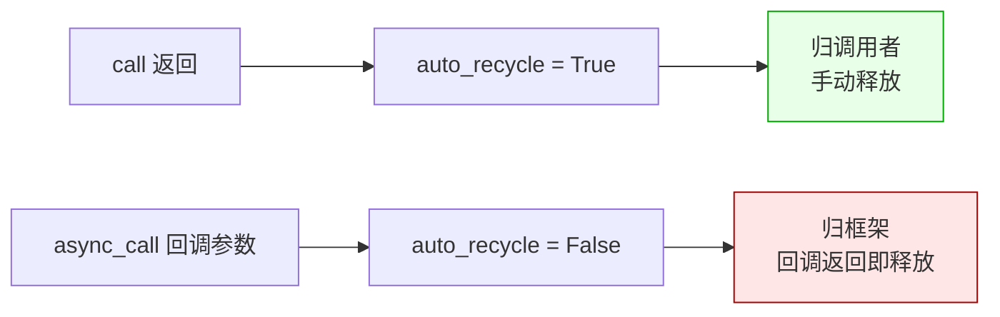
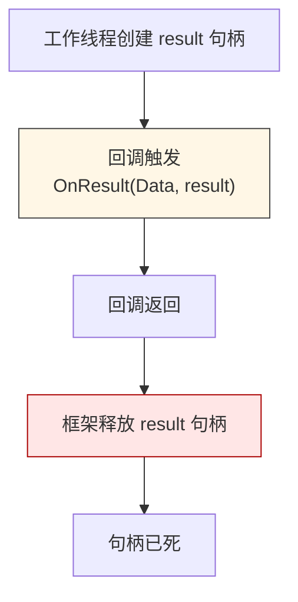
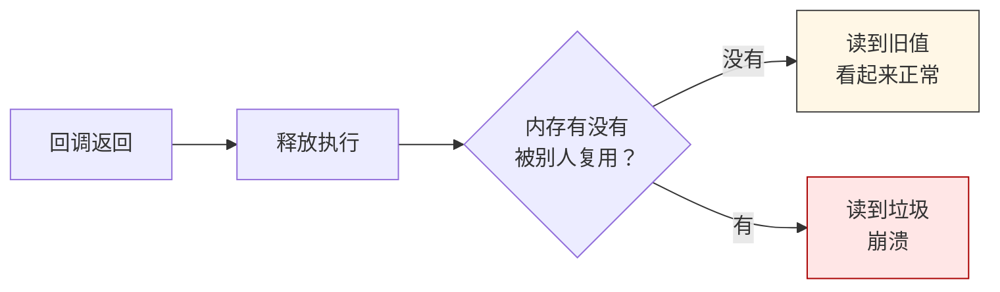

# LF_Handle_Ownership.md

> 这篇只讲一件事：**LF 的句柄归谁**。
>
> 调 `call` 拿到的和调 `async_call` 拿到的，长得一模一样，类型一模一样，但所有权**恰好相反**。这一篇就把这个相反说透——因为它是 LF 内核里最容易让人写出"偶尔崩溃、偶尔正常"代码的地方。

---

## 先说结论

LF 的 C ABI 有两族调用：

- **同步族**：`call` / `uid_call` / `p2pname_call` / `local_call`
- **异步族**：`async_call` / `uid_async_call` / `p2pname_async_call`

同步族返回的句柄**归调用者**，你用完自己释放。
异步族回调里收到的句柄**归框架**，回调一返回它就没了。



一眼看上去这只是两个标志位的差别，实际上是两种截然不同的生命周期模型。下面分开说。

---

## 为什么这样设计

这是当初的一个取舍，值得说清楚，因为不理解取舍就没法理解后续所有的坑。

**同步族为什么归调用者**：调用方是阻塞的，拿到结果后有个明确的"我用完了"时刻。既然有明确的用完点，那就让调用方自己负责释放——最直白，也最符合大多数语言的直觉。

**异步族为什么归框架**：异步回调跑在后台工作线程上，调用方根本不知道回调什么时候跑完、在哪个线程跑完。如果还要求调用方负责释放，那"谁在什么时刻释放"这件事就变成了调用方和工作线程之间的竞态，而这个竞态是无法用简单 API 表达出来的。所以干脆让框架在回调返回的下一行代码就释放掉——生命周期短到没有竞态窗口。

**代价**：调用方失去了对返回句柄的控制权。所有想在回调外处理结果的需求，都必须在回调内先把数据拷贝出来。

**收益**：框架能保证"回调返回后这个句柄绝对不存在了"，调用方不用担心别人还在用它。

---

## 异步句柄的死法

这张图就是异步族全部的生命周期，短得不能再短：



从创建到释放，只隔了一次函数调用。这中间**唯一**的安全窗口就是回调函数的函数体。

有个容易看错的注释：源码里有类似"1 秒后延迟释放"的写法，看起来像"1 秒后释放"。但那 1 秒释放的是**异步操作的状态对象**，**不是句柄本身**。句柄释放发生在回调返回后的下一行，**没有延迟**。

我见过有人读注释的时候把这两件事看混了，然后认定"回调返回后还有 1 秒窗口"。**没有。**

---

## 为什么"偶尔正常、偶尔失败"

这是最费解的地方。明明在回调外用句柄是未定义行为，为什么有时候就是能跑？

因为释放不是立刻还给操作系统，而是走**池化回收**：

- 释放函数把 `Data_Param` / `Data_Result` / `calling` 计数器都 dispose 掉
- 把 `TLF_Data` record 推回一个**二级内存池**

释放是发生了，但分配器回收内存这件事是延迟的——那块内存还躺在分配器的空闲链表里，还没被新的分配吃掉。如果这期间没有其他线程刚好分配到同一块内存，读起来就还是旧值。

于是就有了一幅很诡异的图景：



这个图解释了一个很常见的误判：有人用"返回 int 时正常，返回 dict 时出错"来归纳问题，觉得是"类型"的问题。其实不是类型的问题。返回 int 时 payload 通常只有几字节，小分配不容易被别人占用；返回 dict 时 payload 大，大分配更容易被复用。

真正的变量是**内存复用时机**，不是类型。搞清楚这一点，排查方向才不跑偏。

---

## 三条路怎么选

碰到"异步调用的结果需要在回调外处理"这种需求，有三条路：

**第一条：用同步族。**

能阻塞就阻塞。网关、代理、脚本调用、HTTP 桥接，这些场景本来就阻塞，直接 `call` 最省事。句柄归你，随便读，读完释放，契约简单到不会错。

```cpp
// C++ 同步调用
auto resp = lingofuse::call("App", req, 3000);
if (resp && resp.size() > 0) {
    resp.position = 0;
    auto value = resp.read<int32_t>();
    // ... 处理 value ...
}
// resp 超出作用域自动释放
```

```python
# Python 同步调用
resp = lf.call("App", req, 3000)
try:
    if resp is not None and resp.size > 0:
        resp.position = 0
        value = resp.read_int32()
        # ... 处理 value ...
finally:
    resp.dispose()
```

**第二条：用异步族，在回调内拷贝。**

回调里读 `input`、读 `result`、把需要的东西拷成自己的对象（`std::vector<uint8_t>` / `bytes` / `String` / `Array`），然后把拷贝出来的东西交给队列或 Future。回调返回后句柄死，但你已经不依赖它了。

关键点：**"拷贝"必须发生在回调返回之前**。不要把裸句柄塞进队列、塞进 Promise、塞进任何延迟执行的结构里。

```cpp
// C++ 异步回调：在回调内拷贝
lingofuse::callAsync("App", req, [](lingofuse::AsyncResult r) {
    if (!r.value) {
        std::cerr << "async failed: " << r.error << "\n";
        return;
    }
    // ✅ 在回调内读数据
    r.value.position = 0;
    auto bytes = r.value.readAllBytes();   // 拷成 std::vector<uint8_t>

    // ✅ 把拷贝交给队列（safe）
    my_queue.push(std::move(bytes));

    // ❌ 不要 `r.value.dispose()` —— 归框架
    // ❌ 不要把 `r.value` 存到全局变量
});
```

```python
# Python 异步回调：在回调内拷贝
def on_result(result, error, user_data):
    if error is not None:
        print(f"async failed: {error}", file=sys.stderr)
        return
    # ✅ 在回调内读数据
    result.position = 0
    payload_bytes = result.read_all_bytes()   # bytes 是值语义

    # ✅ 把拷贝交给队列（safe）
    my_queue.put(payload_bytes)

    # ❌ 不要 result.dispose() —— 归框架
    # ❌ 不要把 result 存到全局变量

lf.async_call("App", req, callback=on_result)
```

**第三条：用绑定层封好的 Future。**

大多数语言的绑定层其实已经帮你做了第二条。比如 Python 的 `CallFuture`、C# 的 `TaskCompletionSource`、Rust 的 `call_async_wait`——它们都在内部回调里把数据拷出来了，你拿到的已经是安全的原生对象。优先用这类接口，别自己造轮子去接裸句柄。

```cpp
// C++ 用绑定层封装好的 Future 风格（如果有）
// 绑定层内部会在回调里拷贝数据，返回的是安全的句柄
auto future = lingofuse::callFuture("App", req, 3000);
auto resp = future.get();   // 拿到的 resp 归调用者，安全
```

```python
# Python 用绑定层的 CallFuture
future = lf.async_call_future("App", req, timeout=5000)
try:
    payload = future.result(timeout=5.0)   # 内部已经拷贝
    # payload 是 bytes，与框架完全脱离
finally:
    future.cancel()
```

---

## 各语言里最容易出错的地方

不同语言踩的坑不太一样，简单列一下：

| 语言 | 典型写法 | 关键点 |
|------|---------|--------|
| **C++** | `lingofuse::callAsync(app, hnd, lambda)` | lambda 里拷贝；`r.value` 是临时对象，别存到外面 |
| **Python** | `def on_result(result, error, ...)` | `result.read_all_bytes()` 之后就不该再碰 `result` |
| **C#** | `Async.Call(..., (result, err) => {...})` | `result.ReadAllBytes()` 后 `TaskCompletionSource` 完成 |
| **Rust** | `framework::call_async(app, hnd, move \|r\| ...)` | `r` 是 `Result`，`match` 里处理完就结束 |
| **Go** | `lingofuse.CallAsync(..., func(res *DataHandle, err error){...})` | 回调里 `res.ReadAllBytes()` 后再发到 channel |
| **Node.js / TS** | `framework.callAsync(..., (res, err) => {...})` | 回调里 `res.readAllBytes()` 后再 `resolve` Promise |
| **Java** | `Async.call(..., (result, err) -> {...})` | 回调里读完再 `future.complete(data)` |
| **Swift** | `try await target.callAsync(...)` | 绑定层的 async 桥内部已拷贝，用户拿到的是新句柄 |
| **Erlang** | NIF 回调里 `enif_send` | 只能发**拷贝后的数据**，指针过不了 BEAM 边界 |
| **Julia** | `@cfunction` 回调 | 回调内 `copy` 成 `Vector{UInt8}`；`Channel` 只能传值 |
| **R** | C 扩展回调 | 回调内 `memcpy` 到堆内存，再入队给 R 主线程 |
| **Pascal** | `res_ptr := LF_Call(...)` | 归你，`try..finally` 释放即可；不要碰异步结果 |

规律很清楚：**凡是托管语言、凡是跨 GC 边界、凡是跨线程，一律拷贝后再处理**。裸句柄只在回调期间有效。

---

## 陷阱速查

| 症状 | 根因 | 修复 |
|------|------|------|
| 异步回调外读到空 / 垃圾 | 句柄已释放，内存被复用 | 回调内拷出数据 |
| 异步回调外调释放函数崩溃 | double-free | 异步结果不要碰 |
| "返回 int 正常，返回 dict 崩" | payload 大小影响内存复用 | 二者都不是安全用法，都改 |
| 异步回调里把句柄塞进队列 | 回调返回后队列里的指针已野 | 队列里塞拷贝后的数据 |
| 认为是"1 秒后释放" | 注释看混了状态对象和句柄 | 句柄是**立即**释放 |
| 用 `call` 拿到的句柄释放后还用 | 同步族释放只标记 | 释放后不要再读，即使内存还在 |

---

## 最后一句

LF 的句柄模型并不复杂，就一句话：**同步族归你，异步族归框架**。复杂的是这句话在跨语言、跨线程、跨 GC 边界时如何落地。落地方式不复杂，也是同一个原则：

> 如果这个句柄的生命周期不属于你，那就在你还有权限的时候，把需要的东西拷出来。

拷出来之后，句柄是什么命运就跟你没关系了。
