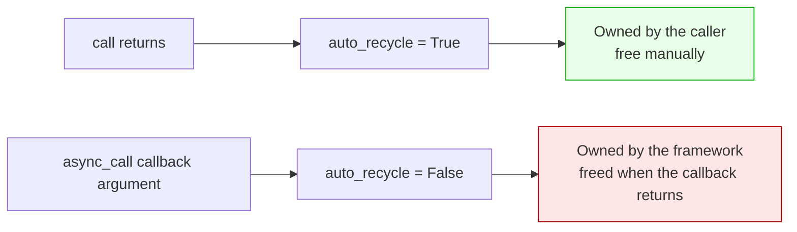
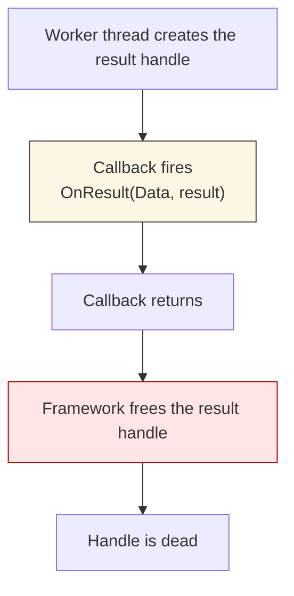
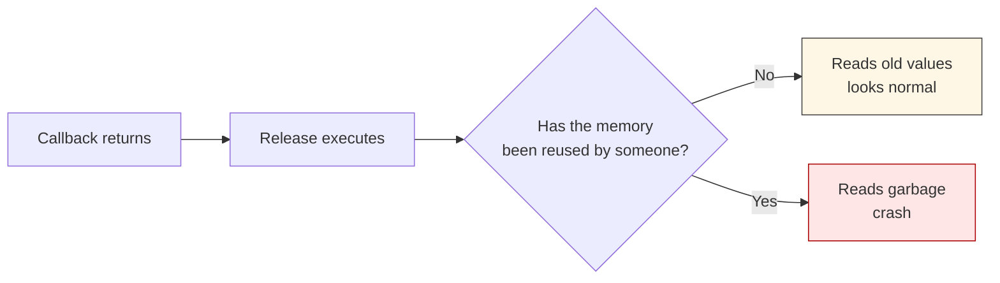

# LF_Handle_Ownership.md

> Chinese version: [LF_Handle_Ownership.md](LF_Handle_Ownership.md)

> This note is about one thing only: **who owns an LF handle**.
>
> The handle returned by `call` and the one received from `async_call` look identical and have the same type, yet their ownership is **exactly the opposite**. This note explains that reversal, because it is the easiest place in the LF core to write code that "sometimes crashes and sometimes works".

---

## The conclusion first

LF's C ABI has two families of calls:

- **Synchronous family**: `call` / `uid_call` / `p2pname_call` / `local_call`
- **Asynchronous family**: `async_call` / `uid_async_call` / `p2pname_async_call`

The handle returned by the synchronous family **belongs to the caller**; you free it when done.
The handle received in an asynchronous callback **belongs to the framework**; it is gone as soon as the callback returns.



At first glance this is a difference of two flags; in reality it is two entirely different lifetime models. Both are described below.

---

## Why it was designed this way

This was a trade-off made early on, and it is worth spelling out — without understanding it you cannot understand any of the downstream pitfalls.

**Why the synchronous family belongs to the caller**: the caller blocks and therefore has an unambiguous "I am done" moment after receiving the result. Given a clear end point, let the caller own the release — it is the most direct and matches the intuition of most languages.

**Why the asynchronous family belongs to the framework**: an async callback runs on a background worker thread and the caller has no idea when or on which thread it finishes. If the caller were also responsible for the release, "who releases at what moment" would become a race between the caller and the worker thread, and that race cannot be expressed through a simple API. So the framework simply releases it on the very next line after the callback returns — a lifetime short enough that no race window exists.

**Cost**: the caller loses control over the returned handle. Any need to process the result outside the callback must first copy the data out inside the callback.

**Benefit**: the framework can guarantee "this handle absolutely no longer exists after the callback returns", so the caller never worries about someone else still using it.

---

## How an async handle dies

This diagram is the entire lifetime of the async family, and it cannot be shorter:



From creation to release only one function call separates them. The **only** safe window in between is the callback body.

There is a comment that is easy to misread: the source contains something like "delayed release after 1 second", which reads like "released 1 second later". But that 1 second releases the **state object of the asynchronous operation**, **not the handle itself**. The handle is released on the next line after the callback returns, **with no delay**.

I have seen people conflate those two when reading the comments and then conclude "there is still a 1-second window after the callback returns". **There is not.**

---

## Why it "sometimes works and sometimes fails"

This is the most puzzling part. Using a handle outside the callback is undefined behaviour, so why does it sometimes just work?

Because the release does not immediately return memory to the operating system; it goes through **pooled recycling**:

- The release function disposes `Data_Param` / `Data_Result` / the `calling` counter
- It pushes the `TLF_Data` record back into a **second-level memory pool**

The release did happen, but the allocator reclaims the memory lazily — the block is still sitting on the allocator's free list and has not yet been consumed by a new allocation. If no other thread happens to allocate that same block in the meantime, reading still yields the old values.

That produces a rather eerie picture:



This diagram explains a very common misdiagnosis: people summarize the problem as "returns an int fine, returns a dict broken" and conclude it is a "type" problem. It is not. When returning an int the payload is usually only a few bytes and small allocations are less likely to be occupied; returning a dict means a large payload, and large allocations are more easily reused.

The real variable is **when the memory gets reused**, not the type. Understanding this keeps the debugging direction on track.

---

## Choosing among the three routes

When the requirement is "the async result must be processed outside the callback", three routes exist:

**Route one: use the synchronous family.**

If you can block, block. Gateways, proxies, script invocations, HTTP bridges — these are blocking scenarios anyway, and a plain `call` is the least trouble. The handle is yours; read it freely, free it when done, a contract so simple it cannot go wrong.

```cpp
// C++ synchronous call
auto resp = lingofuse::call("App", req, 3000);
if (resp && resp.size() > 0) {
    resp.position = 0;
    auto value = resp.read<int32_t>();
    // ... process value ...
}
// resp is freed automatically when it goes out of scope
```

```python
# Python synchronous call
resp = lf.call("App", req, 3000)
try:
    if resp is not None and resp.size > 0:
        resp.position = 0
        value = resp.read_int32()
        # ... process value ...
finally:
    resp.dispose()
```

**Route two: use the asynchronous family and copy inside the callback.**

Inside the callback read `input`, read `result`, and copy what you need into your own objects (`std::vector<uint8_t>` / `bytes` / `String` / `Array`), then hand the copies to a queue or a Future. The handle dies when the callback returns, but you no longer depend on it.

The key point: **the copy must happen before the callback returns**. Never put a raw handle into a queue, a Promise, or any deferred-execution structure.

```cpp
// C++ async callback: copy inside the callback
lingofuse::callAsync("App", req, [](lingofuse::AsyncResult r) {
    if (!r.value) {
        std::cerr << "async failed: " << r.error << "\n";
        return;
    }
    // ✅ Read data inside the callback
    r.value.position = 0;
    auto bytes = r.value.readAllBytes();   // copy into std::vector<uint8_t>

    // ✅ Hand the copy to a queue (safe)
    my_queue.push(std::move(bytes));

    // ❌ Do not call `r.value.dispose()` — the framework owns it
    // ❌ Do not store `r.value` in a global
});
```

```python
# Python async callback: copy inside the callback
def on_result(result, error, user_data):
    if error is not None:
        print(f"async failed: {error}", file=sys.stderr)
        return
    # ✅ Read data inside the callback
    result.position = 0
    payload_bytes = result.read_all_bytes()   # bytes has value semantics

    # ✅ Hand the copy to a queue (safe)
    my_queue.put(payload_bytes)

    # ❌ Do not call result.dispose() — the framework owns it
    # ❌ Do not store result in a global

lf.async_call("App", req, callback=on_result)
```

**Route three: use the Future provided by the binding layer.**

Most language bindings already implement route two for you. Python's `CallFuture`, C#'s `TaskCompletionSource`, Rust's `call_async_wait` — all copy the data out inside their internal callbacks, so what you receive is already a safe native object. Prefer these interfaces instead of building your own wheel around raw handles.

```cpp
// C++ using a Future-style API wrapped by the binding layer (if available)
// The binding layer copies the data inside the callback and returns a safe handle
auto future = lingofuse::callFuture("App", req, 3000);
auto resp = future.get();   // the resulting resp belongs to the caller and is safe
```

```python
# Python using the binding layer's CallFuture
future = lf.async_call_future("App", req, timeout=5000)
try:
    payload = future.result(timeout=5.0)   # already copied internally
    # payload is bytes, fully detached from the framework
finally:
    future.cancel()
```

---

## Where each language most easily goes wrong

Different languages trip over different things; a brief list:

| Language | Typical usage | Key point |
|------|---------|--------|
| **C++** | `lingofuse::callAsync(app, hnd, lambda)` | Copy inside the lambda; `r.value` is a temporary, never store it outside |
| **Python** | `def on_result(result, error, ...)` | After `result.read_all_bytes()` never touch `result` again |
| **C#** | `Async.Call(..., (result, err) => {...})` | `TaskCompletionSource` completes after `result.ReadAllBytes()` |
| **Rust** | `framework::call_async(app, hnd, move \|r\| ...)` | `r` is a `Result`; finish handling inside `match` |
| **Go** | `lingofuse.CallAsync(..., func(res *DataHandle, err error){...})` | Send `res.ReadAllBytes()` to the channel after reading in the callback |
| **Node.js / TS** | `framework.callAsync(..., (res, err) => {...})` | `resolve` the Promise after `res.readAllBytes()` in the callback |
| **Java** | `Async.call(..., (result, err) -> {...})` | Read fully in the callback, then `future.complete(data)` |
| **Swift** | `try await target.callAsync(...)` | The binding's async bridge copies internally; you get a new handle |
| **Erlang** | `enif_send` inside the NIF callback | Only **copied data** can be sent; pointers cannot cross the BEAM boundary |
| **Julia** | `@cfunction` callback | `copy` into a `Vector{UInt8}` inside the callback; a `Channel` only carries values |
| **R** | C extension callback | `memcpy` to heap memory inside the callback, then enqueue to the R main thread |
| **Pascal** | `res_ptr := LF_Call(...)` | It is yours, just free it in `try..finally`; do not touch async results |

The pattern is clear: **any managed language, any GC boundary, any thread crossing — always copy first and process afterwards**. Raw handles are valid only during the callback.

---

## Pitfall quick reference

| Symptom | Root cause | Fix |
|------|------|------|
| Reading empty / garbage outside the async callback | Handle already freed, memory reused | Copy the data out inside the callback |
| Crash when calling the release function outside the async callback | double-free | Never touch async results |
| "int returns fine, dict crashes" | Payload size affects memory reuse | Neither is a safe usage; fix both |
| Stuffing the handle into a queue inside the callback | The pointer in the queue is dangling after the callback returns | Put copied data into the queue |
| Believing it is "released after 1 second" | Misread comments mixing the state object and the handle | The handle is released **immediately** |
| Using a synchronous handle after freeing it | The synchronous release only marks it | Never read after release, even if the memory is still there |

---

## Final word

The LF handle model is not complicated; one sentence covers it: **the synchronous family is yours, the asynchronous family is the framework's**. What is complicated is how that sentence lands across languages, threads and GC boundaries. The way to land it is also simple, one principle:

> If the handle's lifetime does not belong to you, then while you still have access, copy out what you need.

Once copied out, the handle's fate is none of your business.


