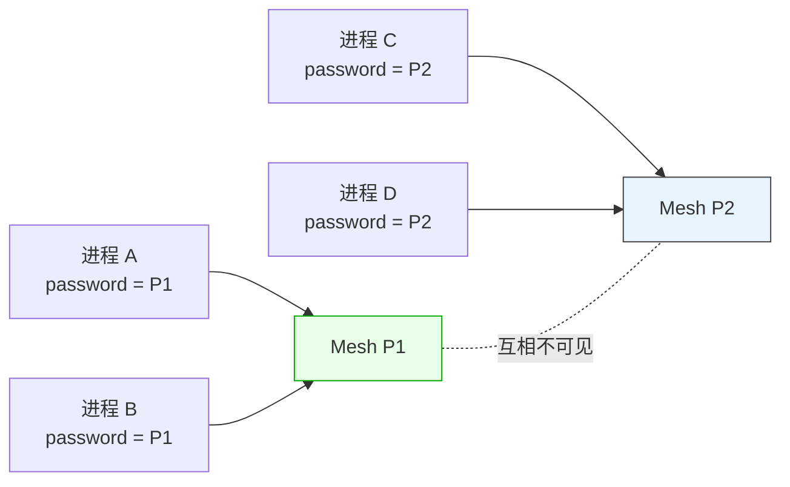
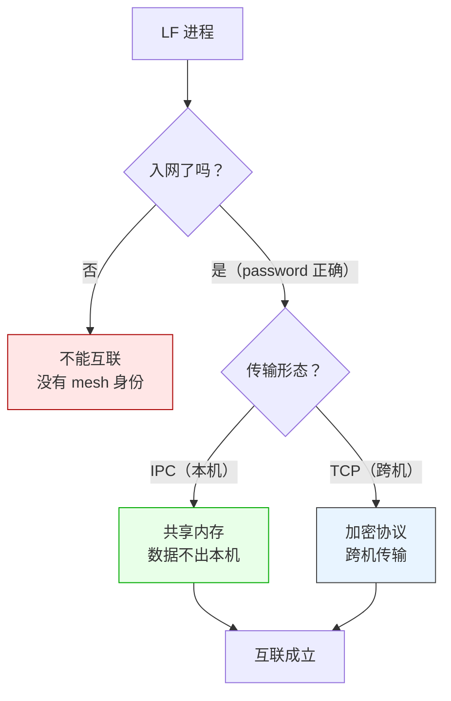
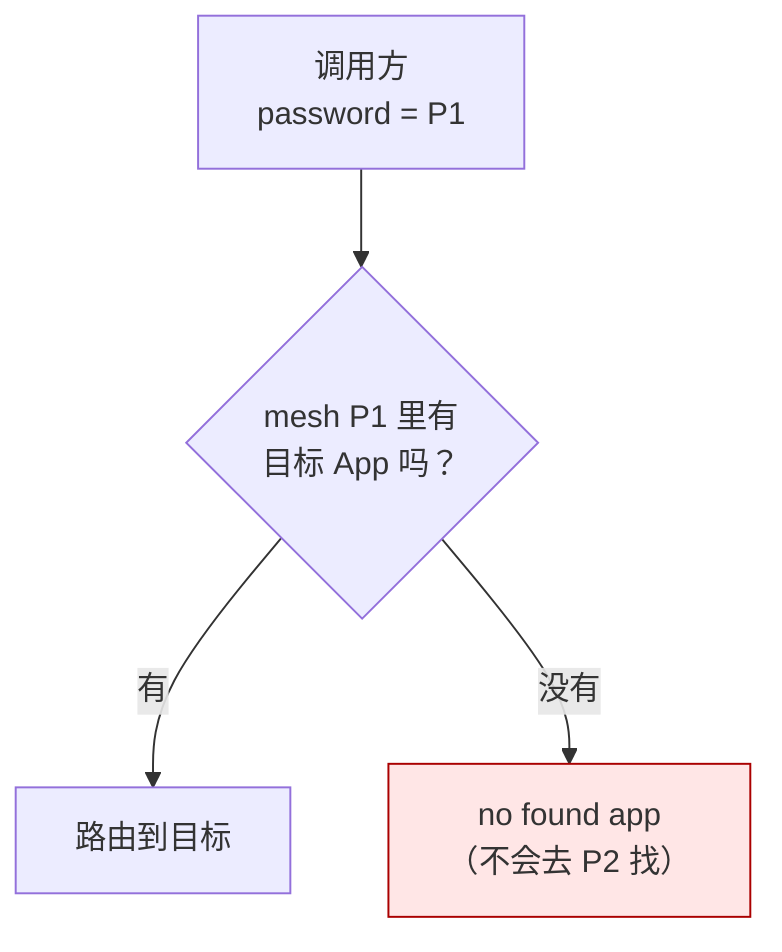
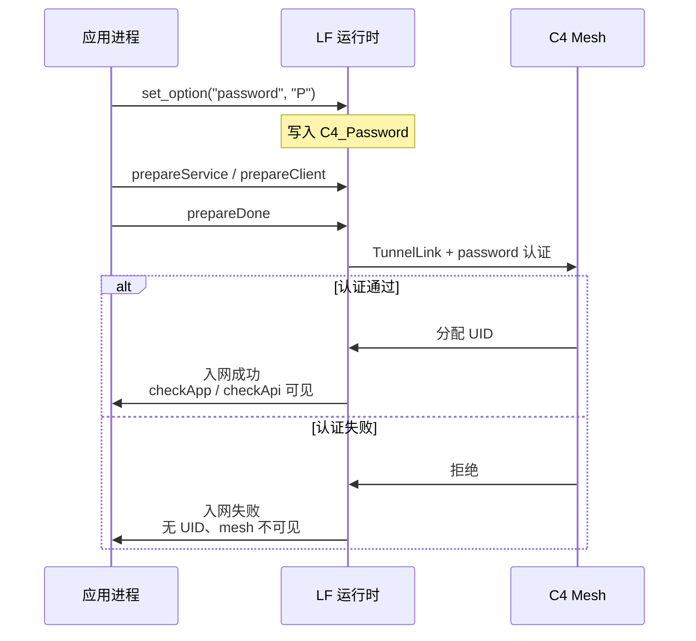

# `doc/LF_Network_Join.md`

> **LF 互联前必须先入网。不管走 IPC（共享内存）还是走分布式（TCP），入网都是第一步——而入网需要 password。**
>
> 这一篇说清楚：入网为什么是必须的、password 在哪里设、设了 password 之后会发生什么、不同 password 的 mesh 为什么互相看不见。

---

## 一句话本质

**LF 是一个"网"，不是一堆可以随便连的 socket。** 任何想要互联的进程，都必须先加入这张网。加入的方式只有一个：`set_option("password", "<你的密码>")`。password 是入网凭证，也是隔离键——**相同 password 的进程在同一个 mesh 里，不同 password 的进程互相不可见、互相不可路由。**



---

## 为什么 IPC 也要入网

很多人会想："IPC 是本机共享内存，数据不离开本机，为什么还要密码？"

因为 **IPC 不是"没有网络"，IPC 是"本机进程之间的一条私有通道"**。这条通道是 LF 的 mesh 在本机内的延伸——它和 TCP 走的是同一套入网逻辑、同一套身份体系、同一套 Handle 所有权模型。区别只在数据出不出本机，不在"要不要认证"。



**IPC 只是"传输形态"的一种，不是"跳过入网"的理由**。没有 password，就没有入网；没有入网，就没有身份；没有身份，mesh 就看不见你。这条规则对 IPC 和 TCP **完全一致**。

---

## password 在哪设

通过 `LF_SetOption` 的 `password` 键（或各语言绑定的 typed setter）：

| 语言 | 写法 |
|------|------|
| C++ | `lingofuse::setOption("password", "your_password");` |
| Python | `lf.set_option("password", "your_password")` |
| C# | `Framework.SetOption("password", "your_password");` 或 `RuntimeOptions.Password = "..."` |
| Java | `Options.setPassword("your_password");` |
| Rust | `options::set_password("your_password");` |
| Go | `lingofuse.SetOptPassword("your_password")` |
| TypeScript / JS | `lf.options.setOptPassword("your_password")` |
| Swift | `Options.setPassword("your_password")` |
| Ruby | `LingoFuse::Options.set_opt_password("your_password")` |
| Erlang | `lingofuse:set_opt_password(<<"your_password">>)` |
| Julia | `set_option("password", "your_password")` |
| Zig | `lf.options.setPassword("your_password")` |
| Fortran | `lf_set_opt_password("your_password")` |
| Dart | `Framework.setOptPassword("your_password")` |
| R | `lingofuse::lf_set_opt_password("your_password")` |

**位置**：`prepareService` / `prepareClient` / `prepareDone` **之前**。`prepareDone` 会启动模拟主线程；之后 `LF_SetOption` 走的是异步投递路径（见 `Z.LingoFuse.md` §11.1），**不能保证在连接建立前生效**。

---

## 设了 password 之后发生什么

### 1. 入网认证

客户端在 `TunnelLink` 阶段用 password 与服务端完成认证。**认证通过 → 入网成功 → 拿到 UID → mesh 上可见**。认证不通过 → 入网失败 → 不会出现在 mesh 上。

### 2. 传输层加密

TCP 模式下，**认证通过后的每一字节都走 LF 内部的加密协议**——不是明文，不是裸 TCP。这是"内部走加密协议"的含义。

**IPC 模式**：本机共享内存，数据不出本机，所以不需要**传输层**加密；但**入网认证仍然生效**——IPC 也有"谁在这个 mesh 里"的概念，password 决定你属于哪个 mesh。

### 3. mesh 隔离

**这是 password 最重要的语义**：

> **一旦设置了 password，就与常规通讯物理隔离。**

什么叫"物理隔离"？不是"逻辑上过滤一下"，而是**两个不同 password 的 mesh 在路由层根本看不到对方**：

- Mesh P1 的节点 A，**看不见** Mesh P2 的节点 C；
- A 调 `call("AppOnC", ...)`，路由层**不会**把请求发给 C——因为 C 不在 A 的 mesh 里；
- P1 和 P2 之间**没有跨 mesh 的路由**，也没有"密码错误"的显式报错——只是**看不见**。



**这个隔离是双向的、彻底的**：不同 password 的 mesh 互不可见、互不可路由、互不可调用。想跨 mesh 通信，唯一的方式是**统一 password**——也就是加入同一张 mesh。

### 4. 默认 password

材料里对默认值有两种说法：

- `Z.LingoFuse.md` 和 R README：默认 `'DTC40@ZSERVER'`
- 其他语言 README：写"内置"或"空"

**不管默认值到底是什么，生产环境必须改。** 默认 password 意味着"所有没改 password 的 LF 进程都在同一张 mesh 里"——这对开发方便，对生产是灾难。

---

## getter 永远返回掩码

`get_option("password")` **永远返回 `'********'`**——不是真实密码。这是安全设计：password 不通过 API 暴露，即使你写了个日志把选项全打出来，也看不到真实值。

```cpp
lingofuse::setOption("password", "my_real_secret");
std::string readback = lingofuse::getOption("password");
// readback == "********"，不是 "my_real_secret"
```

**不要试图"读回 password 做校验"**——读不回来。password 的管理应该在应用层（配置文件、环境变量、密钥管理），LF 只负责"用它入网"。

---

## 完整入网时序



---

## 契约速查

| 维度 | 约定 |
|------|------|
| **入网是否必须** | 必须。IPC 和 TCP 都要入网 |
| **入网凭证** | `password` 选项，唯一凭证 |
| **设置时机** | `prepareService` / `prepareClient` / `prepareDone` 之前 |
| **设置方式** | `set_option("password", ...)` 或各语言 typed setter |
| **读取行为** | getter 永远返回 `'********'`，不暴露真实值 |
| **默认值** | 材料有 `'DTC40@ZSERVER'` 一说；**生产必须改** |
| **IPC 模式** | 需要入网，传输层不加密（数据不出本机） |
| **TCP 模式** | 需要入网，传输层加密（内部加密协议） |
| **不同 password** | mesh 级隔离，互相不可见、不可路由 |
| **跨 mesh 通信** | 不可能。必须统一 password |
| **认证失败表现** | 入网失败、mesh 不可见；具体错误码以实测为准 |

---

## 不确定清单（诚实标注）

以下内容**材料里没有明确说明**，部署前需要自行实测或查源码确认：

1. **认证失败的具体行为**：连接超时？显式拒绝？还是静默失败？材料没写。
2. **password 与 `Wait_Connection_ReadyOk` 的交互**：password 错误时，`prepareDone` 会等满超时然后返回 0 吗？材料没写。
3. **password 的长度 / 字符集限制**：有没有最小长度、最大长度、允许字符集？材料没写。
4. **修改 password 是否需要重连**：改完 password 后已有连接是否失效？需要 `exitMainThread` + `shutdown` + 重新 `prepareDone` 吗？材料没写。
5. **password 是否影响 UID**：换 password 后 UID 会变吗？材料没写。
6. **C4 网格多服务端时 password 是否必须全一致**：材料只说"入网需要 password"，没说多服务端场景下的统一规则。
7. **默认值 `'DTC40@ZSERVER'` 的确切来源和版本差异**：不同语言 README 说法不一致，需要核实。

**这些都不影响"入网是必须的、password 是唯一凭证、不同 password 互相隔离"这三条核心结论**——它们是确定的。不确定的是"失败时的边界行为"和"细节参数"。

---

## 陷阱速查

| 症状 | 根因 | 修复 |
|------|------|------|
| 两个进程都启动了，但 `checkApp` 永远 false | password 不一致，各在各的 mesh | 统一 password |
| 改了 password 但行为没变 | 在 `prepareDone` 之后设的，异步投递没赶上 | 在 `prepareDone` 之前设 |
| 想读回 password 做校验，读到 `'********'` | getter 是掩码设计 | 应用层管理 password，不要读回 |
| 生产环境忘了改默认 password | 默认值让所有 LF 进程进同一张 mesh | 部署清单里加一条"改 password" |
| IPC 下以为不用 password | 入网与传输形态无关 | IPC 也必须设 password |
| 两个团队各用各的 password，互相调不通 | 物理隔离，设计如此 | 要么统一 password，要么加一层显式网关 |

---

## 最后一句

LF 的入网模型很简单，就一句话：**password 是入网凭证，也是隔离键**。

- **入网是必须的**：IPC 和 TCP 都要入网，没有"绕过入网"的通道。
- **password 是唯一凭证**：设在 `prepareDone` 之前，setter 可写，getter 只返回掩码。
- **不同 password = 不同 mesh**：互相不可见、不可路由，这是物理隔离，不是逻辑过滤。
- **IPC 管本机、TCP 管跨机**：传输形态不影响入网规则，只影响传输层是否加密。

想清楚这一点，"为什么两个进程明明都启动了却调不通"就不再是玄学——它们只是不在同一张网里。