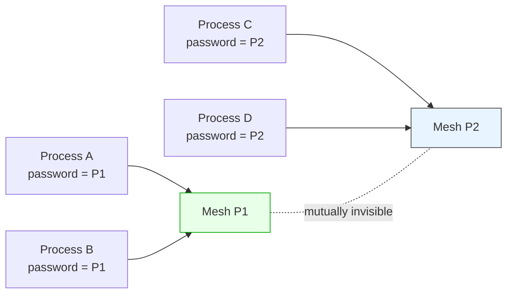
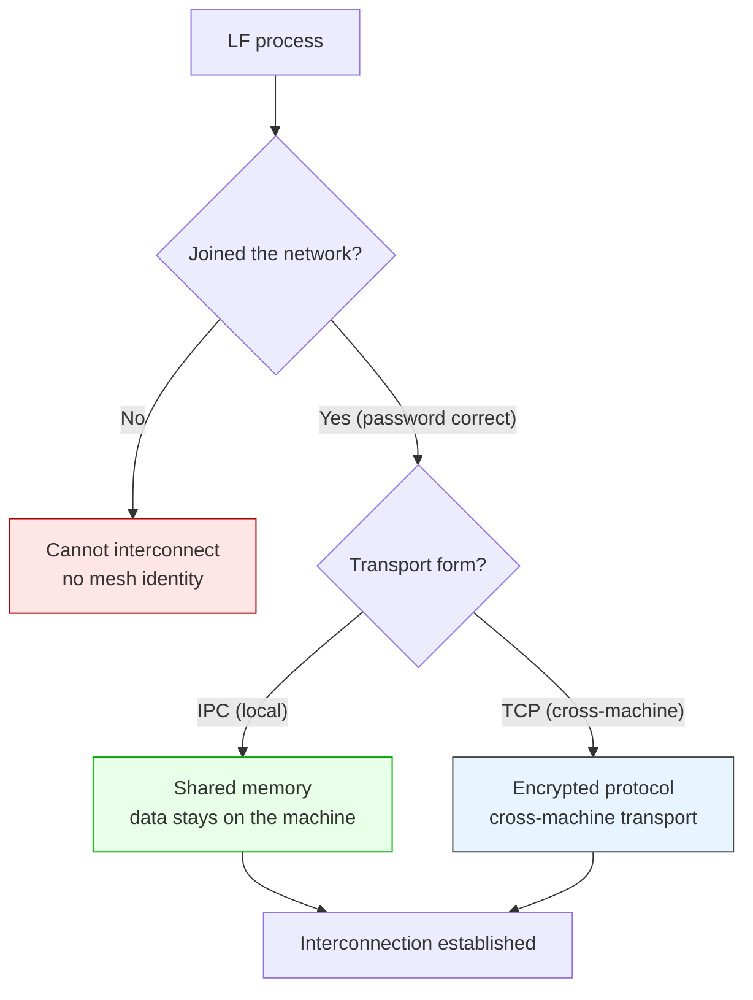
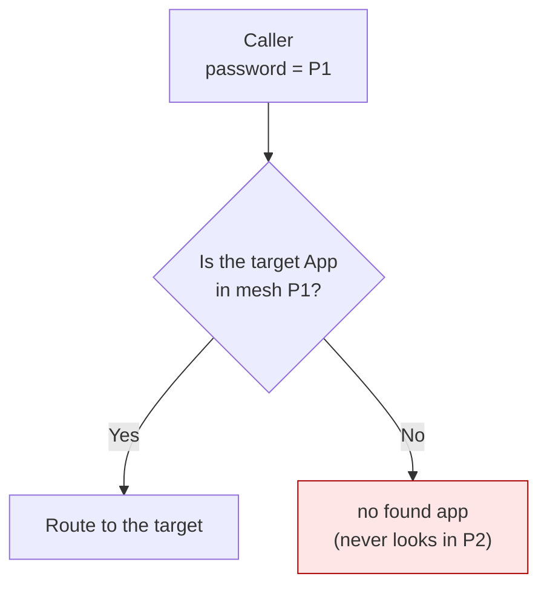
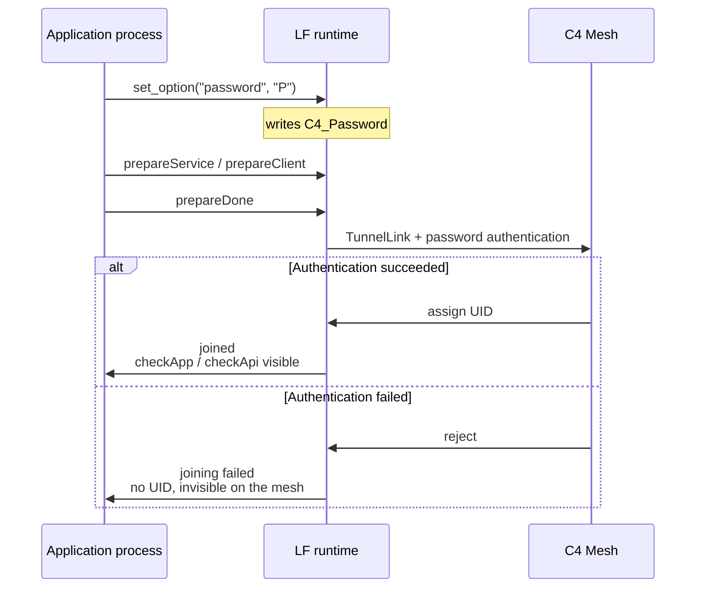

# `doc/LF_Network_Join.md`

> Chinese version: [LF_Network_Join.md](LF_Network_Join.md)

> **Before any LF interconnection you must first join the network. Whether over IPC (shared memory) or distributed (TCP), joining is step one — and joining requires a password.**
>
> This note explains why joining is mandatory, where the password is set, what happens after it is set, and why meshes with different passwords cannot see each other.

---

## The essence in one sentence

**LF is a "network", not a bunch of sockets you can connect at will.** Any process that wants to interconnect must first join that network. There is exactly one way to join: `set_option("password", "<your password>")`. The password is both the admission credential and the isolation key — **processes with the same password live in the same mesh, while processes with different passwords are mutually invisible and mutually unroutable.**



---

## Why IPC also needs joining

Many people wonder: "IPC is local shared memory, the data never leaves this machine, so why a password?"

Because **IPC is not "no network"; IPC is "a private channel between local processes"**. That channel is an extension of the LF mesh inside the machine — it uses the same joining logic, the same identity system and the same handle ownership model as TCP. The only difference is whether the data leaves the machine, not whether authentication is needed.



**IPC is merely one "transport form", never a reason to skip joining**. No password, no joining; no joining, no identity; no identity and the mesh cannot see you. This rule is **exactly the same** for IPC and TCP.

---

## Where the password is set

Through the `password` key of `LF_SetOption` (or the typed setter of each language binding):

| Language | Usage |
|------|------|
| C++ | `lingofuse::setOption("password", "your_password");` |
| Python | `lf.set_option("password", "your_password")` |
| C# | `Framework.SetOption("password", "your_password");` or `RuntimeOptions.Password = "..."` |
| Java | `Options.setPassword("your_password");` |
| Rust | `options::set_password("your_password");` |
| Go | `lingofuse.SetOptPassword("your_password")` |
| TypeScript / JS | `lf.options.setOptPassword("your_password")` |
| Swift | `Options.setPassword("your_password")` |
| Ruby | `LingoFuse::Options.set_opt_password("your_password")` |
| Erlang | `lingofuse:set_opt_password(<<"your_password">>)` |
| Julia | `set_option("password", "your_password")` |
| Zig | `lf.options.setPassword("your_password")` |
| Fortran | `lf_set_opt_password("your_password")` |
| Dart | `Framework.setOptPassword("your_password")` |
| R | `lingofuse::lf_set_opt_password("your_password")` |

**Timing**: **before** `prepareService` / `prepareClient` / `prepareDone`. `prepareDone` starts the simulated main thread; afterwards `LF_SetOption` goes through the asynchronous posting path (see `Z.LingoFuse.md` §11.1), so **it cannot be guaranteed to take effect before the connection is established**.

---

## What happens after the password is set

### 1. Admission authentication

At the `TunnelLink` stage the client authenticates with the server using the password. **Authentication succeeds → joined → receives a UID → visible on the mesh**. Authentication fails → joining fails → it never appears on the mesh.

### 2. Transport-layer encryption

In TCP mode, **every byte after successful authentication passes through LF's internal encrypted protocol** — not plaintext, not raw TCP. That is what "internal encrypted protocol" means.

**IPC mode**: local shared memory, data never leaves the machine, so **transport-layer** encryption is unnecessary; but **admission authentication still applies** — IPC too has the notion of "who is in this mesh", and the password decides which mesh you belong to.

### 3. Mesh isolation

**This is the most important semantic of the password**:

> **Once a password is set, you are physically isolated from ordinary communication.**

What does "physically isolated" mean? Not "filtered logically" but **two meshes with different passwords simply cannot see each other at the routing layer**:

- Node A in mesh P1 **cannot see** node C in mesh P2;
- A calls `call("AppOnC", ...)` and the router **will not** send the request to C — because C is not in A's mesh;
- There is **no cross-mesh routing** between P1 and P2, and no explicit "wrong password" error — just **invisibility**.



**The isolation is mutual and complete**: meshes with different passwords are mutually invisible, unroutable and uncallable. The only way to communicate across meshes is to **unify the password** — that is, join the same mesh.

### 4. Default password

The materials say two different things about the default:

- `Z.LingoFuse.md` and the R README: the default is `'DTC40@ZSERVER'`
- Other language READMEs: "built-in" or "empty"

**Whatever the default actually is, production must change it.** A default password means "every LF process that never changed its password lives in the same mesh" — convenient for development, a disaster in production.

---

## The getter always returns a mask

`get_option("password")` **always returns `'********'`** — never the real password. This is a security design: the password is never exposed through the API, so even if you write a log dumping all options you cannot see the real value.

```cpp
lingofuse::setOption("password", "my_real_secret");
std::string readback = lingofuse::getOption("password");
// readback == "********", not "my_real_secret"
```

**Do not try to "read the password back for verification"** — it cannot be read back. Manage the password at the application layer (config files, environment variables, secret management); LF only "uses it to join".

---

## The complete joining sequence



---

## Contract quick reference

| Dimension | Convention |
|------|------|
| **Is joining mandatory** | Yes. Both IPC and TCP require it |
| **Admission credential** | The `password` option; the sole credential |
| **When to set** | Before `prepareService` / `prepareClient` / `prepareDone` |
| **How to set** | `set_option("password", ...)` or each language's typed setter |
| **Read behaviour** | The getter always returns `'********'`, never the real value |
| **Default** | Materials mention `'DTC40@ZSERVER'`; **production must change it** |
| **IPC mode** | Joining required; no transport-layer encryption (data stays local) |
| **TCP mode** | Joining required; transport-layer encryption (internal protocol) |
| **Different passwords** | Mesh-level isolation: mutually invisible, mutually unroutable |
| **Cross-mesh communication** | Impossible. The password must be unified |
| **Behaviour on auth failure** | Joining fails, invisible on the mesh; exact error codes must be measured |

---

## List of uncertainties (honestly flagged)

The following are **not explicitly covered by the materials** and need measurement or source inspection before deployment:

1. **Exact behaviour on authentication failure**: connection timeout? explicit rejection? silent failure? Not documented.
2. **Interaction between password and `Wait_Connection_ReadyOk`**: with a wrong password, will `prepareDone` wait out the full timeout and then return 0? Not documented.
3. **Length / character-set limits of the password**: minimum length, maximum length, allowed characters? Not documented.
4. **Whether changing the password requires reconnection**: do existing connections become invalid? Is `exitMainThread` + `shutdown` + a fresh `prepareDone` needed? Not documented.
5. **Whether the password affects the UID**: does the UID change after switching passwords? Not documented.
6. **Whether passwords must all match with multiple C4 servers**: the materials only say "joining requires a password", not the rule for multi-server scenarios.
7. **The exact origin and version differences of the default `'DTC40@ZSERVER'`**: the language READMEs disagree and it needs verification.

**None of these affects the three core conclusions — joining is mandatory, the password is the sole credential, and different passwords are mutually isolated** — those are settled. What is uncertain is "boundary behaviour on failure" and "detail parameters".

---

## Pitfall quick reference

| Symptom | Root cause | Fix |
|------|------|------|
| Both processes started but `checkApp` is forever false | Passwords differ, each in its own mesh | Unify the password |
| Changed the password but behaviour is unchanged | Set after `prepareDone`; the async posting missed the window | Set it before `prepareDone` |
| Reading the password back for verification yields `'********'` | The getter is masked by design | Manage the password at the application layer; do not read it back |
| Production forgot to change the default password | The default puts every LF process on one mesh | Add "change the password" to the deployment checklist |
| Assuming no password is needed under IPC | Joining is independent of transport form | IPC must set a password too |
| Two teams running separate passwords cannot call each other | Physical isolation, by design | Unify the password, or add an explicit gateway layer |

---

## Final word

LF's joining model is simple, one sentence: **the password is both the admission credential and the isolation key**.

- **Joining is mandatory**: both IPC and TCP require it; there is no channel that "bypasses joining".
- **The password is the sole credential**: set it before `prepareDone`; the setter writes, the getter only returns a mask.
- **Different passwords = different meshes**: mutually invisible and unroutable; this is physical isolation, not logical filtering.
- **IPC handles the local machine, TCP handles cross-machine**: the transport form affects only whether TLS-style encryption is applied, never the joining rules.

Once this is clear, "why do two processes that both started refuse to talk" stops being mysterious — they are simply not on the same network.


