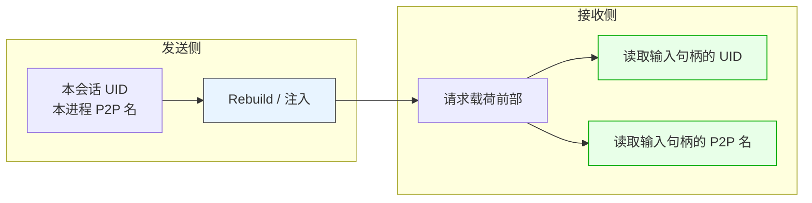
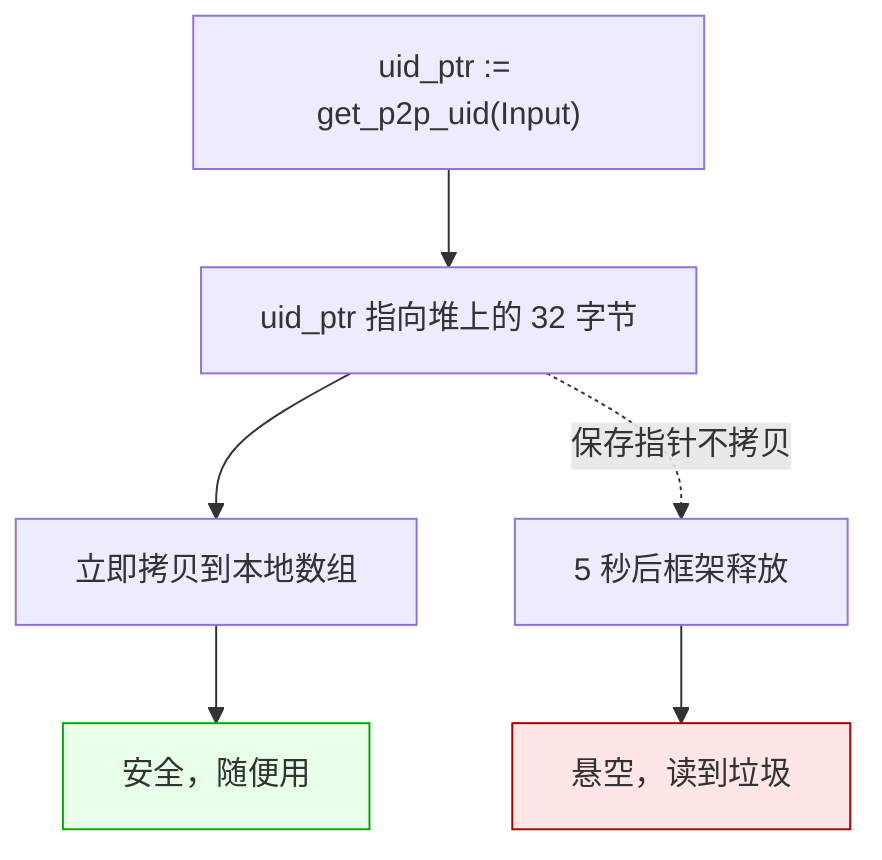
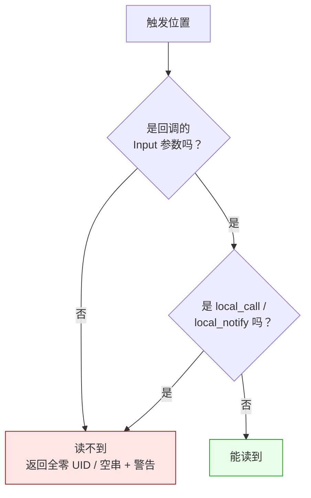

# LF_P2P_Identity.md

> LF 里有个东西叫"P2P 身份"，也就是 UID 和 P2PName。
>
> 这两个东西最容易让人误解的地方是：它**不是查出来的，是送过来的**。这一篇就把这个"送"的过程说清楚。

---

## 一句话本质

身份是**发送方在发请求时顺手写进载荷的元数据**，接收方只是把它读出来而已。



关键在于：**如果发送方没写进去，接收方就永远读不到**。所以那些"读不到身份"的场景，根本原因是这个请求压根没有发送方。

---

## 发送方到底写了什么

写进去的就三样东西，按顺序排在业务参数前面：

```
[apiName: string]
[FromUID: 32 bytes]         ← 发送方会话 UID
[FromP2PName: string]       ← 发送方 P2P 组名
[Param.Size: Int32]
[Param: bytes]              ← 真正的业务数据
```

这段是发送侧传输层（`Send*` 系列函数）在把载荷推入网络之前**自动完成**的。调用方不需要手动传这两个字段。

**所以只要请求走的是 `Send*` 路径，就一定带身份。不走 `Send*` 的，就没带。**

### 哪些路径会注入

| 调用路径 | 是否注入身份 |
|---------|:-----------:|
| `call` / `notify` / `sequenced_*` | ✅ |
| `uid_call` / `uid_notify` | ✅ |
| `p2pname_call` / `p2pname_notify` | ✅ |
| `call` 命中本地短路（本进程有同名 App） | ✅ |
| **`local_call` / `local_notify`** | ❌ |

**最后一行是坑**——见下面"为什么本地调用读不到"。

---

## 读的时候有一层陷阱

`LF_Get_P2P_UID` 的返回值不是 32 字节的数组，是**指向 32 字节的指针**。这是一个历史变更过的接口，旧文档可能还写着"返回值"，那种描述是错的。

C ABI 层面长这样：

```c
/* 返回指针（指向 32 字节 UID） */
const uint8_t* LF_Get_P2P_UID(void* input_handle);

/* 返回 UTF-8 字符串指针 */
const char* LF_Get_P2P_Name(void* input_handle);
```

指针由框架分配，**调用后约 5 秒自动释放**。这意味着：



**调用者只做一件事**：解引用，拷贝，完事。不手动释放，不长期保存。

Name 那边也是同样的规则——返回的是 `const char*`，约 5 秒后失效。各语言的绑定层都帮你把这层封装了：你拿到的已经是**拷贝后的值**，不需要操心 5 秒的事。

### C++ 绑定层的行为

```cpp
lingofuse::DataHandle in_h(raw_input, /*owned=*/false);

// 立即拷贝为 std::array<uint8_t,32>，原始指针从不暴露给你
std::array<uint8_t, 32> uid = in_h.getP2PUid();

// 立即拷贝为 std::string
std::string p2p = in_h.getP2PName();

// uid 和 p2p 是完全脱离框架内存的本地对象，可以任意持有
```

### Python 绑定层的行为

```python
# 立即拷贝为 32 字节 bytes
uid = inp.get_p2p_uid()

# 立即拷贝为 Python str
name = inp.get_p2p_name()

# uid 和 name 已经和 native 缓冲脱离，可以任意持有
```

---

## 哪些位置读得到，哪些读不到

这一部分最容易出错，因为直觉上你会觉得"句柄就在手里，读个身份有什么难"。事实上 LF 把能读的位置收得很紧。



| 位置 | 能读？ | 为什么 |
|------|:------:|--------|
| `registerCall` 回调的 `input` | ✅ | 从网络接收，带侧数据 |
| `registerNotify` 回调的 `input` | ✅ | 同上 |
| `call` 命中本地短路的回调 `input` | ✅ | 走了 `Send*` 路径 |
| `local_call` / `local_notify` 的回调 `input` | ❌ | **没走 `Send*`，没注入** |
| 异步回调的 `result` | ❌ | 是输出句柄，没有侧数据 |
| 自己 `new DataHandle(...)` 创建的句柄 | ❌ | 没有发送方 |

读到不该读的地方时，LF 不是静默返回空值，它会在日志里打一行警告：

```
[warning] getP2PUID(): P2P info is only available on the callback "input" parameter.
```

看到这行警告，就说明读错了位置。

---

## 为什么本地调用读不到

这一条最反直觉，单独说一下。

`local_call` 走的是**直接本地派发**：

```cpp
// 简化语义
auto local_call(App* app, DataHandle* param) {
    // ① 把 param 直接编码为内存流
    encode_to_memory_stream(param);
    // ② 直接调 Engine::Execute_Call —— 没有经过 Rebuild 注入
    return app->engine()->execute_call(stream);
}
```

注意这里**没有走 Rebuild 注入**。你自己用 `new DataHandle` 创建的请求句柄，其 `FromUID` 是全零、`FromP2PName` 是空串——因为**根本没有发送方**。

对比一下 `call` 走的路：

```cpp
// 简化语义
auto call(const char* appName, DataHandle* param) {
    // ① 用当前会话的 UID 和 P2PName 重写载荷头部
    auto rebuilt = rebuild_with_identity(param, current_uid, current_p2p);
    // ② 查本地：如果本进程有同名 App，直接本地执行
    if (auto local = find_local_api(appName, apiName(rebuilt))) {
        local->execute(rebuilt);   // 本地执行，但身份已注入
        return nullptr;
    }
    // ③ 否则走网络
    return send_to_network(rebuilt);
}
```

这也是一个取舍。`local_call` 被设计成"纯进程内调用"，不掺和任何网络身份的概念——如果要身份，用 `call`，反正会本地短路，成本一样。

---

## 各语言里怎么读

规则统一，只是语法不一样。列几个常见的：

| 语言 | UID | P2PName |
|------|-----|---------|
| **C++** | `inp.getP2PUid()` → `std::array<uint8_t,32>` | `inp.getP2PName()` → `std::string` |
| **Python** | `inp.get_p2p_uid()` → `bytes` | `inp.get_p2p_name()` → `str` |
| C# | `input.P2PUid` | `input.P2PName` |
| Rust | `input.p2p_uid()` | `input.p2p_name()` |
| Go | `inp.GetP2PUID()` | `inp.GetP2PName()` |
| Java | `in.getP2pUid()` | `in.getP2pName()` |
| Node.js / TS | `inp.getP2PUid()` | `inp.getP2PName()` |
| Swift | `input.p2pUid()` | `input.p2pName()` |
| Ruby | `input.p2p_uid` | `input.p2p_name` |
| Erlang | 通过 `with_identity` 的 `Identity` map | 同上 |
| Julia | `input.uid` / `input.p2p_name` | — |
| Zig | `input.p2pUid()` | `input.p2pName()` |
| Fortran | `lf_data_get_p2p_uid(input, uid)` | `lf_data_get_p2p_name(input, name)` |
| Dart | `ctx.senderUid` | `ctx.senderP2PName` |
| R | `ctx$sender_uid` | `ctx$sender_p2p_name` |
| Pascal | `LF_Get_P2P_UID(Input)^` | `LF_Get_P2P_NameEx(Input)` |

绑定层都已经帮你把指针解引用、拷贝这一步做完了。你拿到的就是原生对象，不需要操心 5 秒的事。

需要自己接裸指针的场景，比如写 NIF、写 C 扩展、手搓 Julia 的 `ccall`，才需要自己处理"解引用 + 立即拷贝"这套流程。

---

## whoami 模式：一个完整例子

最常见的用法是：**服务端注册一个 `whoami`，把 caller 的身份回写给客户端**，客户端因此学会自己的 UID。

### C++ 服务端

```cpp
app.registerCall("whoami", "echo caller identity",
    [](lingofuse::DataHandle& in, lingofuse::DataHandle& out) {
        // 从 Input 句柄读发送方身份
        auto uid  = in.getP2PUid();          // std::array<uint8_t,32>
        auto name = in.getP2PName();         // std::string

        // 十六进制化
        char hex[65] = {0};
        for (int i = 0; i < 32; ++i) {
            std::sprintf(hex + i * 2, "%02x", uid[i]);
        }

        // 回写给客户端
        out.write<uint8_t>(0x00);            // status: OK
        out.write_string(hex);
        out.write_string(name);
    });
```

### C++ 客户端

```cpp
lingofuse::DataHandle req("whoami");
auto resp = lingofuse::call("IdentitySvc", req, 3000);
if (!resp || resp.size() == 0) { /* 处理失败 */ }

resp.position = 0;
uint8_t status = resp.read<uint8_t>();
if (status != 0x00) { /* 服务端报了错 */ }

std::string uid_hex  = resp.read_string();   // 64 字符 hex
std::string p2p_name = resp.read_string();

// uid_hex 现在可以转成 32 字节数组，用于 UID 定向调用
```

### Python 服务端

```python
def whoami_handler(inp, out):
    uid  = inp.get_p2p_uid()       # bytes，长度 32
    name = inp.get_p2p_name()      # str

    out.write_uint8(0x00)          # status: OK
    out.write_string(uid.hex())    # 64 字符 hex
    out.write_string(name)

app.register_call("whoami", "echo caller identity", whoami_handler)
```

### Python 客户端

```python
req = lf.DataHandle("whoami")
try:
    resp = lf.call("IdentitySvc", req, 3000)
    if resp is None or resp.size == 0:
        raise RuntimeError("whoami failed")

    resp.position = 0
    if resp.read_uint8() != 0x00:
        raise RuntimeError("server-side error")

    uid_hex  = resp.read_string()      # 64 字符 hex
    p2p_name = resp.read_string()

    my_uid_bytes = bytes.fromhex(uid_hex)   # 转回 32 字节
finally:
    req.dispose()
    resp.dispose()
```

---

## 陷阱速查

| 症状 | 根因 | 修复 |
|------|------|------|
| 身份读出来全是 0 | 在 `output` 或自建句柄上调用 | 只在回调的 `input` 上读 |
| 日志里出现 `P2P info is only available on input` | 同上 | 同上 |
| `local_call` 里读不到身份 | 不走注入路径 | 需要身份时改用 `call` |
| 拿到的 UID 是乱码 | 把指针当成数组用了 | 解引用 + 立即拷贝 |
| 5 秒后 UID 变成垃圾 | 保存了指针没拷贝 | 立即拷贝，别存指针 |
| 发送方设了 P2P 名，接收方拿到空 | 设置之后没等上报周期 | 设置完至少等一个 Progress 周期 |
| 高频调用后内存慢涨 | 每次读都分配临时指针 | 回调内读一次，本地缓存 |

---

## 最后一句

P2P 身份的设计其实很朴素：**发送方顺手带上，接收方顺手读走**。所有的"读不到"、"读到空"、"读到垃圾"，都能归结成两种原因——

**要么这个请求压根没有发送方（本地调用、自建句柄），要么你读的位置不对（输出句柄）。**

想清楚这一点，剩下的都是细节。
