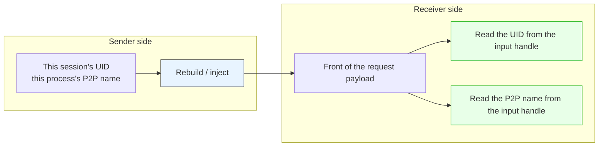
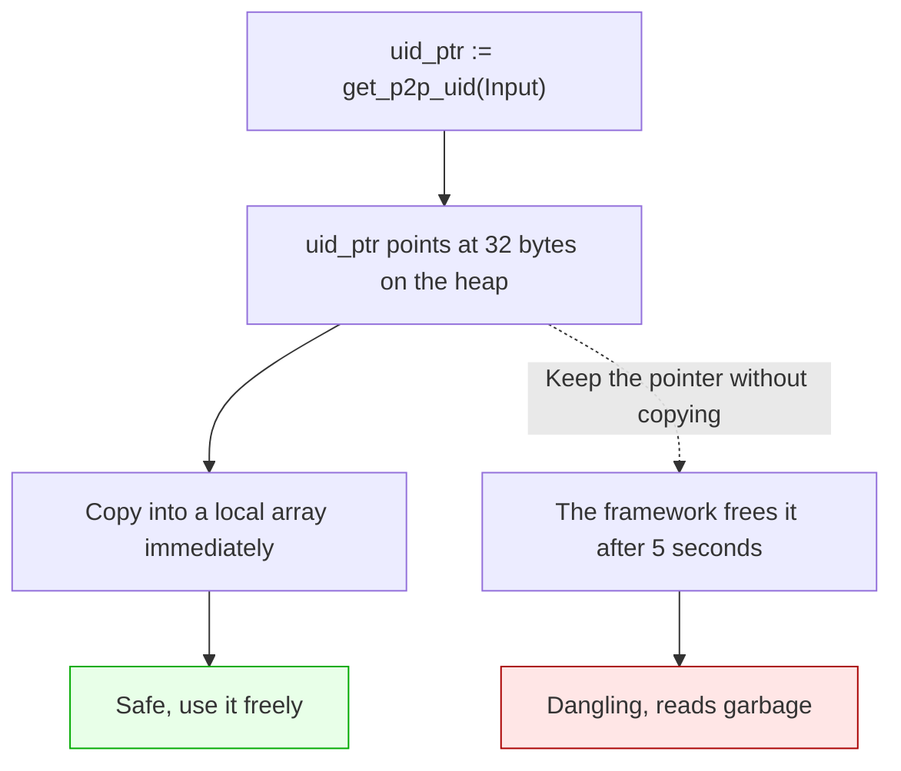
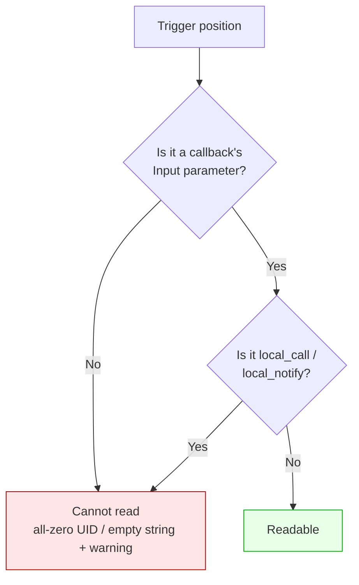

# LF_P2P_Identity.md

> Chinese version: [LF_P2P_Identity.md](LF_P2P_Identity.md)

> LF has something called "P2P identity", namely UID and P2PName.
>
> What people most often misunderstand about it: **it is not looked up, it is sent along**. This note explains that "sending along" process.

---

## The essence in one sentence

The identity is **metadata the sender casually writes into the payload when it sends a request**, and the receiver simply reads it out.



The key point: **if the sender never wrote it in, the receiver can never read it**. So every "cannot read the identity" scenario ultimately comes down to: this request has no sender at all.

---

## What exactly the sender writes

Three things, placed in front of the business parameters:

```
[apiName: string]
[FromUID: 32 bytes]         ← the sender's session UID
[FromP2PName: string]       ← the sender's P2P group name
[Param.Size: Int32]
[Param: bytes]              ← the actual business data
```

This is done **automatically** by the sender-side transport layer (the `Send*` family) before pushing the payload onto the network. The caller never passes these two fields by hand.

**So any request travelling through the `Send*` path always carries identity. Anything that does not go through `Send*` does not.**

### Which paths inject it

| Call path | Identity injected |
|---------|:-----------:|
| `call` / `notify` / `sequenced_*` | ✅ |
| `uid_call` / `uid_notify` | ✅ |
| `p2pname_call` / `p2pname_notify` | ✅ |
| `call` hitting the local short-circuit (same-named App in this process) | ✅ |
| **`local_call` / `local_notify`** | ❌ |

**The last row is the trap** — see "why local calls cannot read it" below.

---

## There is a layer of pitfalls when reading

`LF_Get_P2P_UID` does not return a 32-byte array; it returns **a pointer to 32 bytes**. This interface changed at some point historically, and old documents may still say "returns the value", which is wrong.

At the C ABI level it looks like this:

```c
/* Returns a pointer (to a 32-byte UID) */
const uint8_t* LF_Get_P2P_UID(void* input_handle);

/* Returns a UTF-8 string pointer */
const char* LF_Get_P2P_Name(void* input_handle);
```

The pointer is allocated by the framework and **released automatically about 5 seconds later**. That means:



**The caller does one thing**: dereference, copy, done. Never free manually, never keep it long-term.

The Name side follows the same rule — it returns a `const char*` that expires after about 5 seconds. Every language binding wraps this for you: what you receive is already **a copied value**, so you need not worry about the 5 seconds.

### C++ binding behaviour

```cpp
lingofuse::DataHandle in_h(raw_input, /*owned=*/false);

// Copied immediately into std::array<uint8_t,32>; the raw pointer is never exposed
std::array<uint8_t, 32> uid = in_h.getP2PUid();

// Copied immediately into std::string
std::string p2p = in_h.getP2PName();

// uid and p2p are local objects fully detached from framework memory; hold them freely
```

### Python binding behaviour

```python
# Copied immediately into 32-byte bytes
uid = inp.get_p2p_uid()

# Copied immediately into a Python str
name = inp.get_p2p_name()

# uid and name are detached from the native buffer; hold them freely
```

---

## Where it can and cannot be read

This part is the easiest to get wrong, because intuitively "the handle is in my hand, reading an identity should be trivial". In fact LF keeps the readable positions tight.



| Position | Readable? | Why |
|------|:------:|--------|
| The `input` of a `registerCall` callback | ✅ | Received from the network, carries side data |
| The `input` of a `registerNotify` callback | ✅ | Same as above |
| The `input` of a callback reached via the `call` local short-circuit | ✅ | It went through the `Send*` path |
| The `input` of a `local_call` / `local_notify` callback | ❌ | **Does not go through `Send*`, nothing injected** |
| The `result` of an async callback | ❌ | It is an output handle with no side data |
| A handle you created yourself with `new DataHandle(...)` | ❌ | No sender exists |

When you read in a place you should not, LF does not silently return empty — it logs a warning:

```
[warning] getP2PUID(): P2P info is only available on the callback "input" parameter.
```

Seeing that warning means you read in the wrong place.

---

## Why local calls cannot read it

This one is the most counter-intuitive, so it gets its own section.

`local_call` takes the **direct local dispatch** route:

```cpp
// Simplified semantics
auto local_call(App* app, DataHandle* param) {
    // (1) encode param directly into a memory stream
    encode_to_memory_stream(param);
    // (2) call Engine::Execute_Call directly — no Rebuild injection
    return app->engine()->execute_call(stream);
}
```

Note that **no Rebuild injection happens**. A request handle you created yourself with `new DataHandle` has an all-zero `FromUID` and an empty `FromP2PName` — because **there is no sender at all**.

Compare the route `call` takes:

```cpp
// Simplified semantics
auto call(const char* appName, DataHandle* param) {
    // (1) rewrite the payload header with the current session's UID and P2PName
    auto rebuilt = rebuild_with_identity(param, current_uid, current_p2p);
    // (2) check locally: if this process has a same-named App, execute locally
    if (auto local = find_local_api(appName, apiName(rebuilt))) {
        local->execute(rebuilt);   // local execution, but identity is already injected
        return nullptr;
    }
    // (3) otherwise go over the network
    return send_to_network(rebuilt);
}
```

This too is a trade-off. `local_call` is designed as a "pure in-process call" that involves no notion of network identity — if you need identity, use `call`, which short-circuits locally anyway at the same cost.

---

## How to read it in each language

The rule is uniform; only the syntax differs. A few common ones:

| Language | UID | P2PName |
|------|-----|---------|
| **C++** | `inp.getP2PUid()` → `std::array<uint8_t,32>` | `inp.getP2PName()` → `std::string` |
| **Python** | `inp.get_p2p_uid()` → `bytes` | `inp.get_p2p_name()` → `str` |
| C# | `input.P2PUid` | `input.P2PName` |
| Rust | `input.p2p_uid()` | `input.p2p_name()` |
| Go | `inp.GetP2PUID()` | `inp.GetP2PName()` |
| Java | `in.getP2pUid()` | `in.getP2pName()` |
| Node.js / TS | `inp.getP2PUid()` | `inp.getP2PName()` |
| Swift | `input.p2pUid()` | `input.p2pName()` |
| Ruby | `input.p2p_uid` | `input.p2p_name` |
| Erlang | via the `Identity` map of `with_identity` | Same as above |
| Julia | `input.uid` / `input.p2p_name` | — |
| Zig | `input.p2pUid()` | `input.p2pName()` |
| Fortran | `lf_data_get_p2p_uid(input, uid)` | `lf_data_get_p2p_name(input, name)` |
| Dart | `ctx.senderUid` | `ctx.senderP2PName` |
| R | `ctx$sender_uid` | `ctx$sender_p2p_name` |
| Pascal | `LF_Get_P2P_UID(Input)^` | `LF_Get_P2P_NameEx(Input)` |

The bindings have already done the dereference-and-copy step for you. What you receive is a native object, so you need not worry about the 5 seconds.

Only scenarios where you touch raw pointers yourself — writing a NIF, writing a C extension, hand-rolling Julia's `ccall` — require you to handle "dereference + copy immediately".

---

## The whoami pattern: a complete example

The most common usage: **the server registers a `whoami` that echoes the caller's identity back**, so the client can learn its own UID.

### C++ server

```cpp
app.registerCall("whoami", "echo caller identity",
    [](lingofuse::DataHandle& in, lingofuse::DataHandle& out) {
        // Read the sender identity from the Input handle
        auto uid  = in.getP2PUid();          // std::array<uint8_t,32>
        auto name = in.getP2PName();         // std::string

        // Hex-encode it
        char hex[65] = {0};
        for (int i = 0; i < 32; ++i) {
            std::sprintf(hex + i * 2, "%02x", uid[i]);
        }

        // Write it back to the client
        out.write<uint8_t>(0x00);            // status: OK
        out.write_string(hex);
        out.write_string(name);
    });
```

### C++ client

```cpp
lingofuse::DataHandle req("whoami");
auto resp = lingofuse::call("IdentitySvc", req, 3000);
if (!resp || resp.size() == 0) { /* handle failure */ }

resp.position = 0;
uint8_t status = resp.read<uint8_t>();
if (status != 0x00) { /* the server reported an error */ }

std::string uid_hex  = resp.read_string();   // 64-character hex
std::string p2p_name = resp.read_string();

// uid_hex can now be converted into a 32-byte array for UID-targeted calls
```

### Python server

```python
def whoami_handler(inp, out):
    uid  = inp.get_p2p_uid()       # bytes, length 32
    name = inp.get_p2p_name()      # str

    out.write_uint8(0x00)          # status: OK
    out.write_string(uid.hex())    # 64-character hex
    out.write_string(name)

app.register_call("whoami", "echo caller identity", whoami_handler)
```

### Python client

```python
req = lf.DataHandle("whoami")
try:
    resp = lf.call("IdentitySvc", req, 3000)
    if resp is None or resp.size == 0:
        raise RuntimeError("whoami failed")

    resp.position = 0
    if resp.read_uint8() != 0x00:
        raise RuntimeError("server-side error")

    uid_hex  = resp.read_string()      # 64-character hex
    p2p_name = resp.read_string()

    my_uid_bytes = bytes.fromhex(uid_hex)   # back to 32 bytes
finally:
    req.dispose()
    resp.dispose()
```

---

## Pitfall quick reference

| Symptom | Root cause | Fix |
|------|------|------|
| The identity reads as all zeros | Called on `output` or on a self-created handle | Read only on the callback's `input` |
| `P2P info is only available on input` appears in the log | Same as above | Same as above |
| Cannot read identity inside `local_call` | Does not use the injection path | Switch to `call` when identity is needed |
| The UID received is garbled | Treated the pointer as an array | Dereference + copy immediately |
| The UID turns into garbage after 5 seconds | Kept the pointer without copying | Copy immediately; never keep the pointer |
| The sender set a P2P name but the receiver gets empty | Did not wait for the reporting cycle after setting it | Wait at least one Progress cycle after setting it |
| Memory slowly grows under high-frequency calls | A temporary pointer is allocated on every read | Read once in the callback and cache locally |

---

## Final word

The P2P identity design is actually plain: **the sender casually carries it, the receiver casually reads it**. Every "cannot read", "reads empty", "reads garbage" reduces to two causes —

**either the request has no sender at all (local call, self-created handle), or you are reading in the wrong place (output handle).**

Once that is clear, everything else is detail.


