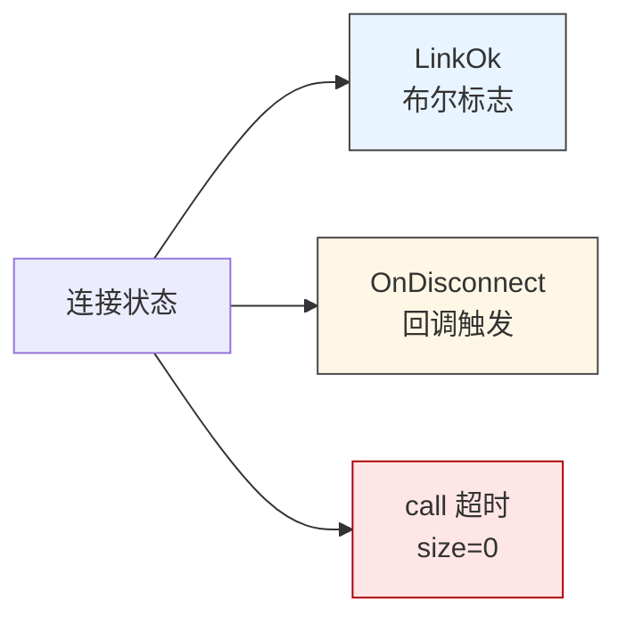
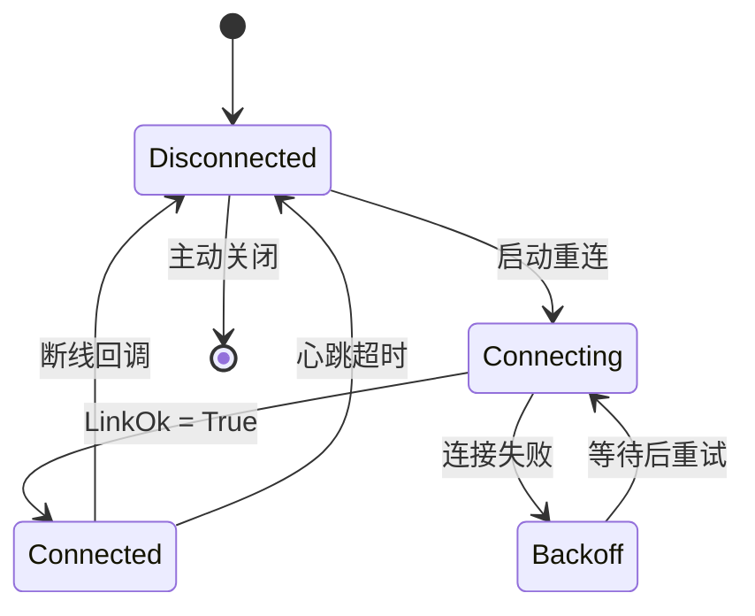
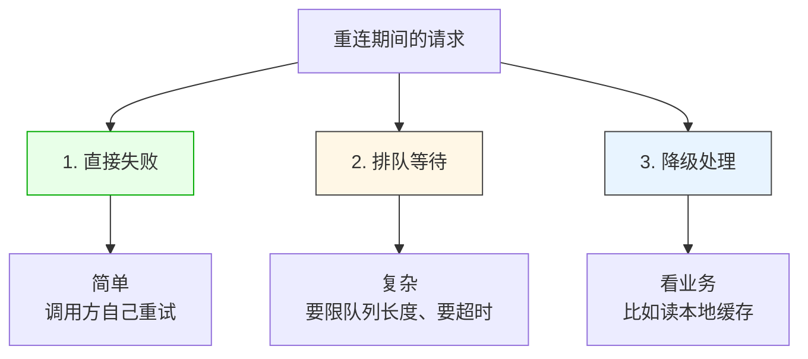
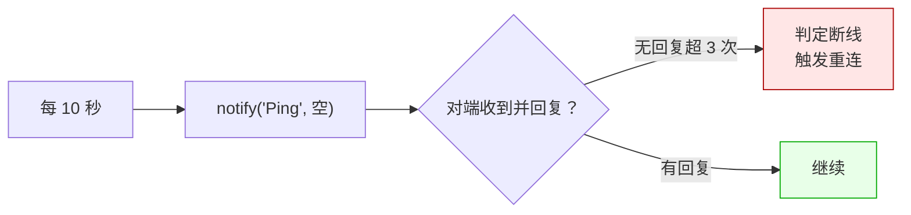

# LF_Reconnect_Strategy.md

> LF 给你的是"断线"信号，不是"重连"行为。
>
> 连接状态变 False、断线回调触发、`call` 超时返回空——这些都只是**告诉你连接没了**。什么时候重连、重连几次、重连期间请求怎么办，LF 一概不管。这一篇说清楚"应用层该怎么接这根线"。

---

## 断线的三个信号

LF 不抛异常，所以你得从三个地方判断"连接是不是还活着"：



| 信号 | 时机 | 可靠性 |
|------|------|--------|
| 连接状态变 False | 物理断开或 TunnelLink 失败 | 准，但轮询有延迟 |
| 断线回调触发 | 物理链路断开瞬间 | 准，但是异步的 |
| `call` 超时 | 发出请求后没响应 | 最慢，可能是网络卡也可能是对端挂了 |

**实践上三个都要用**：断线回调做即时反应（清理状态），连接状态做轮询兜底，`call` 超时做最后的手段（顺带触发重连）。

### 各语言设置方式

```cpp
// C++ 侧注册断线回调
lingofuse::setNetworkEvent(
    [](const std::string& addr) {           // onConnect
        std::cout << "[+] connected: " << addr << "\n";
    },
    [](const std::string& addr) {           // onDisconnect
        std::cout << "[-] disconnected: " << addr << "\n";
        // 在这里触发应用层的重连状态机
        request_reconnect();
    });
```

```python
# Python 侧注册断线回调
def on_connect(addr):
    print(f"[+] connected: {addr}")

def on_disconnect(addr):
    print(f"[-] disconnected: {addr}")
    # 在这里触发应用层的重连状态机
    request_reconnect()

lf.set_network_event(on_connect=on_connect, on_disconnect=on_disconnect)
```

---

## 重连的完整状态机



**关键点**：`Backoff` 那个状态不能省。没有退避的重连会变成**重连风暴**——服务端挂了，1000 个客户端同时重连，服务端刚起来又被压垮，客户端又失败，循环往复。

---

## 退避策略


指数退避，封顶 30 秒。上界别太小——太小等于没退避；也别太大——太大客户端恢复太慢。

**建议加上随机抖动**：`wait = base * 2^n + random(0, base)`。抖动能把"同时失败的客户端"分散开，避免它们在同一秒重连。

### C++ 侧的状态机实现

```cpp
#include <chrono>
#include <random>
#include <thread>

enum class ConnState { Disconnected, Connecting, Connected, Backoff };

struct ReconnectPolicy {
    std::atomic<ConnState> state{ConnState::Disconnected};
    std::atomic<int> backoff_step{0};
    std::thread worker;
    std::atomic<bool> stop{false};

    void start() {
        worker = std::thread([this] {
            std::mt19937 rng(std::random_device{}());
            while (!stop.load()) {
                if (state.load() == ConnState::Backoff) {
                    int step = backoff_step.load();
                    int base_ms = 1000;
                    int cap_ms  = 30000;
                    int wait_ms = std::min(cap_ms, base_ms << std::min(step, 5));
                    // 抖动：加上 0..base 的随机量
                    wait_ms += std::uniform_int_distribution<int>(0, base_ms)(rng);
                    std::this_thread::sleep_for(std::chrono::milliseconds(wait_ms));

                    if (stop.load()) break;
                    state.store(ConnState::Connecting);
                    if (try_connect()) {
                        state.store(ConnState::Connected);
                        backoff_step.store(0);
                    } else {
                        backoff_step.fetch_add(1);
                        state.store(ConnState::Backoff);
                    }
                } else {
                    std::this_thread::sleep_for(std::chrono::milliseconds(100));
                }
            }
        });
    }

    void stop_worker() {
        stop.store(true);
        if (worker.joinable()) worker.join();
    }

    void on_disconnected() {
        backoff_step.store(0);
        state.store(ConnState::Backoff);
    }

    bool try_connect() {
        // 应用层实现：重新 prepare_client + prepare_done
        // 注意：如果 LF 已经处于 shutdown 状态，需要先 reset_prepare 再重建
        try {
            lingofuse::resetPrepare();
            lingofuse::prepareClient("ipc:my_service", nullptr);
            lingofuse::prepareDone();
            return true;
        } catch (...) {
            return false;
        }
    }
};
```

### Python 侧的状态机实现

```python
import random
import threading
import time

class ReconnectPolicy:
    def __init__(self):
        self.state = "disconnected"     # disconnected / connecting / connected / backoff
        self.backoff_step = 0
        self.stop = threading.Event()
        self.worker = None

    def start(self):
        self.worker = threading.Thread(target=self._run, daemon=True)
        self.worker.start()

    def _run(self):
        while not self.stop.is_set():
            if self.state == "backoff":
                base_ms = 1000
                cap_ms  = 30000
                wait_ms = min(cap_ms, base_ms << min(self.backoff_step, 5))
                wait_ms += random.randint(0, base_ms)   # 抖动
                time.sleep(wait_ms / 1000.0)
                if self.stop.is_set():
                    break

                self.state = "connecting"
                if self._try_connect():
                    self.state = "connected"
                    self.backoff_step = 0
                else:
                    self.backoff_step += 1
                    self.state = "backoff"
            else:
                time.sleep(0.1)

    def stop_worker(self):
        self.stop.set()
        if self.worker:
            self.worker.join(timeout=5)

    def on_disconnected(self):
        self.backoff_step = 0
        self.state = "backoff"

    def _try_connect(self):
        try:
            lf.reset_prepare()
            lf.prepare_client("ipc:my_service", None)
            lf.prepare_done()
            return True
        except Exception:
            return False
```

---

## 重连期间的请求怎么办

这是应用层最头疼的地方。三个选择：



**选 1（直接失败）** 最省事。`call` 返回空，应用层立即返回错误。前提是调用方有重试逻辑——但重试逻辑放调用方往往更好，因为调用方知道这个请求重不重要。

**选 2（排队等待）** 需要小心。队列必须有上限，否则服务端挂 10 分钟，客户端内存涨 10 分钟。还要给排队请求设超时——超过 30 秒还没发出去的请求应该直接判失败。

**选 3（降级处理）** 适合读操作——读失败就读本地缓存，别阻塞主流程。写操作不适合降级，写失败必须明确告诉调用方。

**三个选择的共同点是：不能吞掉**。重连期间请求失败是正常的，但调用方必须知道它失败了。`call` 超时返回 size=0，这是"正常响应"，不是错误——应用层必须自己包装一层状态码，把"超时"和"对端返回空"区分开。

### C++ 侧的三种模式

```cpp
// 模式 1：直接失败
std::optional<Response> call_or_fail(const Request& req) {
    auto resp = lingofuse::call("App", req, 3000);
    if (!resp || resp.size() == 0) {
        return std::nullopt;    // 明确告诉调用方失败了
    }
    return parse_response(resp);
}

// 模式 2：排队等待（有上限、有超时）
struct PendingCall {
    Request req;
    std::chrono::steady_clock::time_point deadline;
    std::function<void(std::optional<Response>)> cb;
};

class BoundedQueue {
    std::mutex mtx;
    std::deque<PendingCall> q;
    static constexpr std::size_t MAX_SIZE = 256;
    static constexpr auto MAX_WAIT = std::chrono::seconds(30);

public:
    bool submit(PendingCall c) {
        std::lock_guard lk(mtx);
        if (q.size() >= MAX_SIZE) return false;     // 队列满，立即失败
        c.deadline = std::chrono::steady_clock::now() + MAX_WAIT;
        q.push_back(std::move(c));
        return true;
    }

    void drain_when_connected() {
        std::lock_guard lk(mtx);
        auto now = std::chrono::steady_clock::now();
        while (!q.empty()) {
            auto& c = q.front();
            if (c.deadline < now) {
                auto cb = std::move(c.cb);
                q.pop_front();
                cb(std::nullopt);       // 超时失败
                continue;
            }
            auto resp = lingofuse::call("App", c.req, 3000);
            auto cb = std::move(c.cb);
            q.pop_front();
            if (resp && resp.size() > 0) cb(parse_response(resp));
            else cb(std::nullopt);
        }
    }
};

// 模式 3：降级
std::optional<Response> call_with_fallback(const Request& req) {
    auto resp = lingofuse::call("App", req, 3000);
    if (resp && resp.size() > 0) {
        return parse_response(resp);
    }
    // 读操作：降级到本地缓存
    if (auto cached = local_cache.get(req.key)) {
        return cached;
    }
    return std::nullopt;
}
```

### Python 侧的三种模式

```python
import time
from collections import deque

# 模式 1：直接失败
def call_or_fail(req):
    resp = lf.call("App", req, 3000)
    if resp is None or resp.size == 0:
        return None
    try:
        return parse_response(resp)
    finally:
        resp.dispose()

# 模式 2：排队等待（有上限、有超时）
class BoundedQueue:
    MAX_SIZE = 256
    MAX_WAIT = 30.0

    def __init__(self):
        self._q = deque()
        self._lock = threading.Lock()

    def submit(self, req, cb):
        with self._lock:
            if len(self._q) >= self.MAX_SIZE:
                return False
            deadline = time.monotonic() + self.MAX_WAIT
            self._q.append((req, deadline, cb))
            return True

    def drain_when_connected(self):
        with self._lock:
            now = time.monotonic()
            while self._q:
                req, deadline, cb = self._q.popleft()
                if deadline < now:
                    cb(None)
                    continue
                resp = lf.call("App", req, 3000)
                try:
                    if resp is not None and resp.size > 0:
                        cb(parse_response(resp))
                    else:
                        cb(None)
                finally:
                    if resp is not None:
                        resp.dispose()

# 模式 3：降级
def call_with_fallback(req):
    resp = lf.call("App", req, 3000)
    try:
        if resp is not None and resp.size > 0:
            return parse_response(resp)
        return local_cache.get(req.key)
    finally:
        if resp is not None:
            resp.dispose()
```

---

## 心跳：别等 `call` 超时

`call` 超时是最慢的断线信号——它要等完整的一次往返超时（默认 30 秒）。业务流量大的时候还行，没流量的时候就变成"半小时才发现连接挂了"。

**主动心跳**是更快的方案：



心跳用一个轻量的 API——比如 `ping` / `status` 之类，不要挂业务逻辑。频率 10~30 秒，连续 3 次没回应就判死。这个参数自己调，越短发现越快，但流量越大。

**Heartbeat 有个副作用**：心跳本身也是 `notify` 或 `call`，会走队列。如果业务请求把队列堵死了（比如大批 `call` 串行），心跳也发不出去，就会误判断线。所以要确保心跳**不跟业务抢队列**——用单独的 P2PName，或者用 `notify`（不阻塞队列），或者接受这个误判（队列堵死本来也等同于断线）。

### C++ 心跳

```cpp
class Heartbeat {
    std::thread worker;
    std::atomic<bool> stop{false};
    std::atomic<int> missed{0};
    std::atomic<int64_t> last_ok_ms{0};

public:
    void start() {
        worker = std::thread([this] {
            while (!stop.load()) {
                std::this_thread::sleep_for(std::chrono::seconds(10));
                if (stop.load()) break;

                lingofuse::DataHandle req("ping");
                auto resp = lingofuse::call("HealthSvc", req, 3000);
                if (resp && resp.size() > 0) {
                    missed.store(0);
                    last_ok_ms.store(now_ms());
                } else {
                    missed.fetch_add(1);
                    if (missed.load() >= 3) {
                        // 连续 3 次失败 → 判定断线
                        trigger_reconnect();
                        missed.store(0);
                    }
                }
            }
        });
    }
    void stop_worker() { stop.store(true); if (worker.joinable()) worker.join(); }
};
```

### Python 心跳

```python
class Heartbeat:
    def __init__(self):
        self._stop = threading.Event()
        self._worker = None
        self._missed = 0

    def start(self):
        self._worker = threading.Thread(target=self._run, daemon=True)
        self._worker.start()

    def _run(self):
        while not self._stop.is_set():
            self._stop.wait(10.0)
            if self._stop.is_set():
                break

            req = lf.DataHandle("ping")
            try:
                resp = lf.call("HealthSvc", req, 3000)
                if resp is not None and resp.size > 0:
                    self._missed = 0
                else:
                    self._missed += 1
                    if self._missed >= 3:
                        trigger_reconnect()
                        self._missed = 0
            finally:
                req.dispose()
                if resp is not None:
                    resp.dispose()

    def stop_worker(self):
        self._stop.set()
        if self._worker:
            self._worker.join(timeout=5)
```

---

## 陷阱速查

| 症状 | 根因 | 修复 |
|------|------|------|
| 服务端重启后客户端全部卡住 | 客户端没检测到断线 | 加心跳或监听断线回调 |
| 服务端刚起来又被压垮 | 重连风暴 | 指数退避 + 随机抖动 |
| 重连期间内存暴涨 | 请求排队没上限 | 队列设上限 + 请求超时 |
| 半小时才发现断线 | 没流量，`call` 没超时 | 加心跳 |
| 重连一直失败 | 端点变了（服务端换端口） | 应用层配置重新拉取 |
| 重连后请求发到旧连接 | 清理不彻底 | 断线回调里清空应用层状态 |

---

## 最后一句

LF 提供的是"**断线的检测手段**"——连接状态、断线回调、心跳。重连行为本身是应用的职责，因为只有应用知道"哪些请求可以重试、哪些不行、重试几次、退避多久、重连期间怎么降级"。

把这个边界想清楚，重连就不会变成一件玄学的事——它只是应用层一个普通的有限状态机，退避、抖动、队列上限、请求超时，都是标准工程手段。
