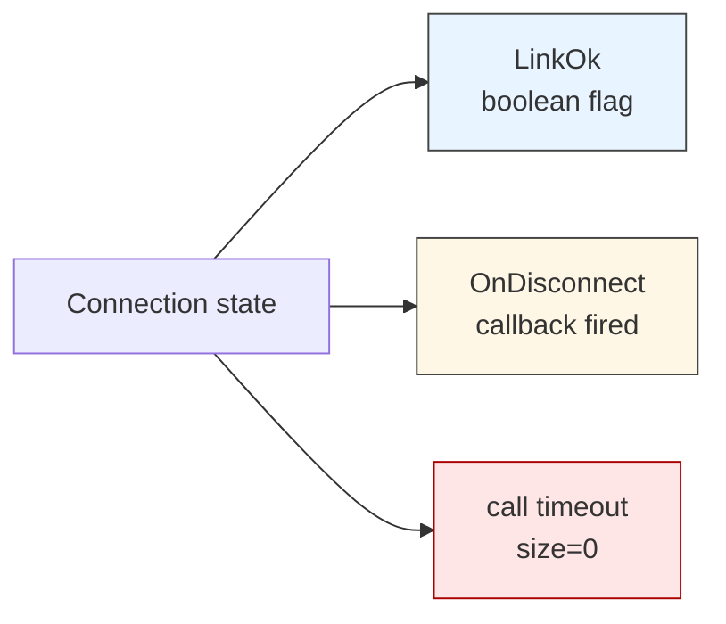
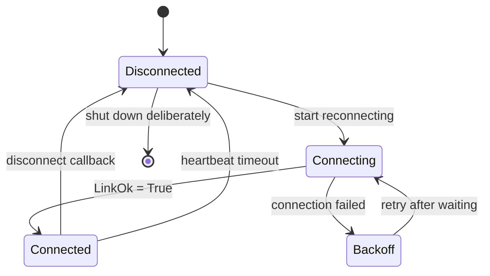
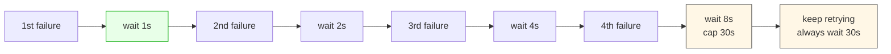
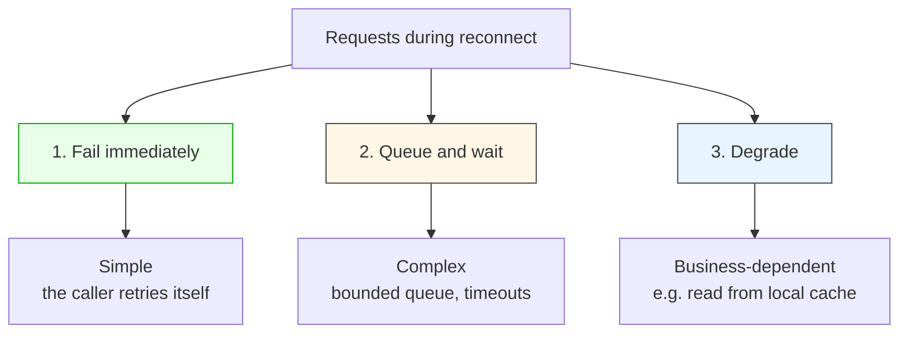
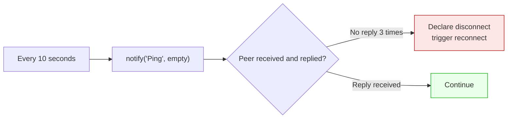

# LF_Reconnect_Strategy.md

> Chinese version: [LF_Reconnect_Strategy.md](LF_Reconnect_Strategy.md)

> What LF gives you is a "disconnected" signal, not "reconnect" behaviour.
>
> The connection state flipping to False, the disconnect callback firing, `call` timing out and returning empty — all of these merely **tell you the connection is gone**. When to reconnect, how many times, and what to do with requests in the meantime are entirely outside LF's concern. This note explains how the application layer should pick up that thread.

---

## The three disconnect signals

LF throws no exceptions, so you must judge "is the connection still alive" from three places:



| Signal | Timing | Reliability |
|------|------|--------|
| Connection state flips to False | Physical disconnect or TunnelLink failure | Accurate, but polling introduces latency |
| Disconnect callback fires | The instant the physical link drops | Accurate, but asynchronous |
| `call` timeout | No response after sending | Slowest; may be a stuck network or a dead peer |

**In practice use all three**: the disconnect callback for immediate reaction (state cleanup), the connection state for polling fallback, and `call` timeouts as the last resort (which can incidentally trigger a reconnect).

### How to set it up per language

```cpp
// Registering disconnect callbacks on the C++ side
lingofuse::setNetworkEvent(
    [](const std::string& addr) {           // onConnect
        std::cout << "[+] connected: " << addr << "\n";
    },
    [](const std::string& addr) {           // onDisconnect
        std::cout << "[-] disconnected: " << addr << "\n";
        // trigger the application-level reconnect state machine here
        request_reconnect();
    });
```

```python
# Registering disconnect callbacks on the Python side
def on_connect(addr):
    print(f"[+] connected: {addr}")

def on_disconnect(addr):
    print(f"[-] disconnected: {addr}")
    # trigger the application-level reconnect state machine here
    request_reconnect()

lf.set_network_event(on_connect=on_connect, on_disconnect=on_disconnect)
```

---

## The complete reconnect state machine



**Key point**: the `Backoff` state cannot be omitted. Reconnecting without back-off becomes a **reconnect storm** — the server dies, 1000 clients reconnect at once, the server has barely come up and is crushed again, the clients fail again, round and round.

---

## Back-off strategy



Exponential back-off capped at 30 seconds. Do not make the cap too small — that is no back-off at all; nor too large — clients take too long to recover.

**Adding random jitter is recommended**: `wait = base * 2^n + random(0, base)`. Jitter spreads out "clients that failed at the same moment" so they do not all reconnect in the same second.

### State machine implementation on the C++ side

```cpp
#include <chrono>
#include <random>
#include <thread>

enum class ConnState { Disconnected, Connecting, Connected, Backoff };

struct ReconnectPolicy {
    std::atomic<ConnState> state{ConnState::Disconnected};
    std::atomic<int> backoff_step{0};
    std::thread worker;
    std::atomic<bool> stop{false};

    void start() {
        worker = std::thread([this] {
            std::mt19937 rng(std::random_device{}());
            while (!stop.load()) {
                if (state.load() == ConnState::Backoff) {
                    int step = backoff_step.load();
                    int base_ms = 1000;
                    int cap_ms  = 30000;
                    int wait_ms = std::min(cap_ms, base_ms << std::min(step, 5));
                    // jitter: add a random amount in 0..base
                    wait_ms += std::uniform_int_distribution<int>(0, base_ms)(rng);
                    std::this_thread::sleep_for(std::chrono::milliseconds(wait_ms));

                    if (stop.load()) break;
                    state.store(ConnState::Connecting);
                    if (try_connect()) {
                        state.store(ConnState::Connected);
                        backoff_step.store(0);
                    } else {
                        backoff_step.fetch_add(1);
                        state.store(ConnState::Backoff);
                    }
                } else {
                    std::this_thread::sleep_for(std::chrono::milliseconds(100));
                }
            }
        });
    }

    void stop_worker() {
        stop.store(true);
        if (worker.joinable()) worker.join();
    }

    void on_disconnected() {
        backoff_step.store(0);
        state.store(ConnState::Backoff);
    }

    bool try_connect() {
        // Implemented by the application: prepare_client + prepare_done again
        // Note: if LF is already in the shutdown state, call reset_prepare before rebuilding
        try {
            lingofuse::resetPrepare();
            lingofuse::prepareClient("ipc:my_service", nullptr);
            lingofuse::prepareDone();
            return true;
        } catch (...) {
            return false;
        }
    }
};
```

### State machine implementation on the Python side

```python
import random
import threading
import time

class ReconnectPolicy:
    def __init__(self):
        self.state = "disconnected"     # disconnected / connecting / connected / backoff
        self.backoff_step = 0
        self.stop = threading.Event()
        self.worker = None

    def start(self):
        self.worker = threading.Thread(target=self._run, daemon=True)
        self.worker.start()

    def _run(self):
        while not self.stop.is_set():
            if self.state == "backoff":
                base_ms = 1000
                cap_ms  = 30000
                wait_ms = min(cap_ms, base_ms << min(self.backoff_step, 5))
                wait_ms += random.randint(0, base_ms)   # jitter
                time.sleep(wait_ms / 1000.0)
                if self.stop.is_set():
                    break

                self.state = "connecting"
                if self._try_connect():
                    self.state = "connected"
                    self.backoff_step = 0
                else:
                    self.backoff_step += 1
                    self.state = "backoff"
            else:
                time.sleep(0.1)

    def stop_worker(self):
        self.stop.set()
        if self.worker:
            self.worker.join(timeout=5)

    def on_disconnected(self):
        self.backoff_step = 0
        self.state = "backoff"

    def _try_connect(self):
        try:
            lf.reset_prepare()
            lf.prepare_client("ipc:my_service", None)
            lf.prepare_done()
            return True
        except Exception:
            return False
```

---

## What to do with requests during a reconnect

This is what pains application layers most. Three choices:



**Choice 1 (fail immediately)** is the least trouble. `call` returns empty and the application layer reports an error right away. The premise is that the caller has retry logic — and retry logic usually belongs in the caller, because only the caller knows whether the request matters.

**Choice 2 (queue and wait)** demands care. The queue must be bounded, otherwise ten minutes of server downtime means ten minutes of client memory growth. Queued requests also need deadlines — anything not sent within 30 seconds should fail outright.

**Choice 3 (degrade)** suits reads — on a read failure, read from the local cache rather than blocking the main flow. It does not suit writes; a failed write must be reported clearly to the caller.

**What all three share: never swallow the failure**. Requests failing during a reconnect is normal, but the caller must know it failed. A `call` timing out and returning size=0 is a "normal response", not an error — the application layer must wrap it with its own status code to separate "timeout" from "the peer returned empty".

### The three patterns on the C++ side

```cpp
// Pattern 1: fail immediately
std::optional<Response> call_or_fail(const Request& req) {
    auto resp = lingofuse::call("App", req, 3000);
    if (!resp || resp.size() == 0) {
        return std::nullopt;    // tell the caller it failed, explicitly
    }
    return parse_response(resp);
}

// Pattern 2: queue and wait (bounded, with deadlines)
struct PendingCall {
    Request req;
    std::chrono::steady_clock::time_point deadline;
    std::function<void(std::optional<Response>)> cb;
};

class BoundedQueue {
    std::mutex mtx;
    std::deque<PendingCall> q;
    static constexpr std::size_t MAX_SIZE = 256;
    static constexpr auto MAX_WAIT = std::chrono::seconds(30);

public:
    bool submit(PendingCall c) {
        std::lock_guard lk(mtx);
        if (q.size() >= MAX_SIZE) return false;     // queue full, fail immediately
        c.deadline = std::chrono::steady_clock::now() + MAX_WAIT;
        q.push_back(std::move(c));
        return true;
    }

    void drain_when_connected() {
        std::lock_guard lk(mtx);
        auto now = std::chrono::steady_clock::now();
        while (!q.empty()) {
            auto& c = q.front();
            if (c.deadline < now) {
                auto cb = std::move(c.cb);
                q.pop_front();
                cb(std::nullopt);       // failed on timeout
                continue;
            }
            auto resp = lingofuse::call("App", c.req, 3000);
            auto cb = std::move(c.cb);
            q.pop_front();
            if (resp && resp.size() > 0) cb(parse_response(resp));
            else cb(std::nullopt);
        }
    }
};

// Pattern 3: degrade
std::optional<Response> call_with_fallback(const Request& req) {
    auto resp = lingofuse::call("App", req, 3000);
    if (resp && resp.size() > 0) {
        return parse_response(resp);
    }
    // read operation: degrade to the local cache
    if (auto cached = local_cache.get(req.key)) {
        return cached;
    }
    return std::nullopt;
}
```

### The three patterns on the Python side

```python
import time
from collections import deque

# Pattern 1: fail immediately
def call_or_fail(req):
    resp = lf.call("App", req, 3000)
    if resp is None or resp.size == 0:
        return None
    try:
        return parse_response(resp)
    finally:
        resp.dispose()

# Pattern 2: queue and wait (bounded, with deadlines)
class BoundedQueue:
    MAX_SIZE = 256
    MAX_WAIT = 30.0

    def __init__(self):
        self._q = deque()
        self._lock = threading.Lock()

    def submit(self, req, cb):
        with self._lock:
            if len(self._q) >= self.MAX_SIZE:
                return False
            deadline = time.monotonic() + self.MAX_WAIT
            self._q.append((req, deadline, cb))
            return True

    def drain_when_connected(self):
        with self._lock:
            now = time.monotonic()
            while self._q:
                req, deadline, cb = self._q.popleft()
                if deadline < now:
                    cb(None)
                    continue
                resp = lf.call("App", req, 3000)
                try:
                    if resp is not None and resp.size > 0:
                        cb(parse_response(resp))
                    else:
                        cb(None)
                finally:
                    if resp is not None:
                        resp.dispose()

# Pattern 3: degrade
def call_with_fallback(req):
    resp = lf.call("App", req, 3000)
    try:
        if resp is not None and resp.size > 0:
            return parse_response(resp)
        return local_cache.get(req.key)
    finally:
        if resp is not None:
            resp.dispose()
```

---

## Heartbeat: do not wait for a `call` timeout

A `call` timeout is the slowest disconnect signal — it waits for a full round-trip timeout (30 seconds by default). With heavy business traffic that is acceptable; with no traffic at all it becomes "half an hour before noticing the connection died".

**An active heartbeat is faster**:



Use a lightweight API for the heartbeat — `ping` / `status` and the like, with no business logic attached. A frequency of 10–30 seconds, and declare death after 3 consecutive misses. Tune it yourself: shorter means faster detection but more traffic.

**Heartbeats have a side effect**: the heartbeat is itself a `notify` or `call` and goes through the queue. If business requests jam the queue (say many serial `call`s), the heartbeat cannot go out either and you get a false disconnect. So make sure the heartbeat **does not compete with business for the queue** — a separate P2PName, or `notify` (which does not block the queue), or accept the false positive (a jammed queue amounts to a dead connection anyway).

### C++ heartbeat

```cpp
class Heartbeat {
    std::thread worker;
    std::atomic<bool> stop{false};
    std::atomic<int> missed{0};
    std::atomic<int64_t> last_ok_ms{0};

public:
    void start() {
        worker = std::thread([this] {
            while (!stop.load()) {
                std::this_thread::sleep_for(std::chrono::seconds(10));
                if (stop.load()) break;

                lingofuse::DataHandle req("ping");
                auto resp = lingofuse::call("HealthSvc", req, 3000);
                if (resp && resp.size() > 0) {
                    missed.store(0);
                    last_ok_ms.store(now_ms());
                } else {
                    missed.fetch_add(1);
                    if (missed.load() >= 3) {
                        // three consecutive failures → declare disconnect
                        trigger_reconnect();
                        missed.store(0);
                    }
                }
            }
        });
    }
    void stop_worker() { stop.store(true); if (worker.joinable()) worker.join(); }
};
```

### Python heartbeat

```python
class Heartbeat:
    def __init__(self):
        self._stop = threading.Event()
        self._worker = None
        self._missed = 0

    def start(self):
        self._worker = threading.Thread(target=self._run, daemon=True)
        self._worker.start()

    def _run(self):
        while not self._stop.is_set():
            self._stop.wait(10.0)
            if self._stop.is_set():
                break

            req = lf.DataHandle("ping")
            try:
                resp = lf.call("HealthSvc", req, 3000)
                if resp is not None and resp.size > 0:
                    self._missed = 0
                else:
                    self._missed += 1
                    if self._missed >= 3:
                        trigger_reconnect()
                        self._missed = 0
            finally:
                req.dispose()
                if resp is not None:
                    resp.dispose()

    def stop_worker(self):
        self._stop.set()
        if self._worker:
            self._worker.join(timeout=5)
```

---

## Pitfall quick reference

| Symptom | Root cause | Fix |
|------|------|------|
| All clients hang after the server restarts | The client never detected the disconnect | Add a heartbeat or listen for the disconnect callback |
| The server is crushed right after coming up | Reconnect storm | Exponential back-off + random jitter |
| Memory explodes during a reconnect | Unbounded request queue | Bound the queue + request deadlines |
| Half an hour to notice a disconnect | No traffic, so `call` never timed out | Add a heartbeat |
| Reconnects keep failing | The endpoint changed (server moved port) | Re-fetch the configuration at the application layer |
| Requests go to the old connection after reconnecting | Incomplete cleanup | Clear application state inside the disconnect callback |

---

## Final word

What LF provides is "**means of detecting a disconnect**" — connection state, disconnect callbacks, heartbeats. The reconnect behaviour itself is the application's responsibility, because only the application knows which requests can be retried, how many times, with what back-off, and how to degrade during the outage.

Once this boundary is clear, reconnecting stops being arcane — it is just an ordinary finite state machine in the application layer, with back-off, jitter, queue bounds and request deadlines all standard engineering tools.


