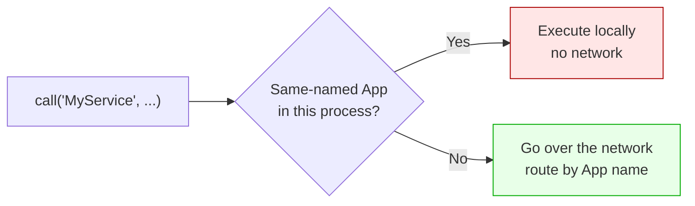
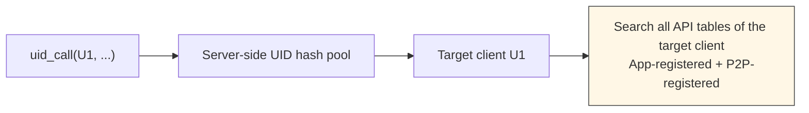

# LF_Route_Choice.md

> Chinese version: [LF_Route_Choice.md](LF_Route_Choice.md)

> The first thing you do when building an application with LF is choose a route: `call`, `uid_call`, `p2pname_call`. These are not "versions" but **three different semantics** — App name finds a service, UID finds a client, P2PName finds a group. Choose wrong and nothing errors out; it just quietly goes astray. This note clarifies "when to choose which" and the hidden traps of each.

---

## A table to decide

| Your need | Use | One sentence |
|---------|--------|--------|
| A fixed service name, whoever is running it will do | **App name** | Find by service name, local first |
| Target one specific client | **UID** | Session-level targeting; can call **any** of its APIs |
| A group of homogeneous workers, any one handles it | **P2PName** | In-group load balancing, no local-first |
| Purely in-process call | **`local_call`** | Injects no identity, no routing |

After choosing there is a hidden decision: **is an App with the same name also registered in this process?** If so, `call` **short-circuits locally** and never touches the network.

---

## Local short-circuit: the most common bite



This is LF's **routing optimization** — saving one network round trip. But for application builders it has a side effect: **in a multi-node deployment, if the server process also registers an App with the same name, requests arriving from clients are handled in place on the server and are never forwarded to the backend worker cluster**.

The typical bugs this produces:

- **Everything is fine locally** — single-process self-testing, only one process anyway
- **After deployment some requests are slower and some faster** — because traffic splits into two paths, part handled locally and part forwarded

What is more insidious: **when the server's App and the client's App share a name**, the server's App "intercepts" requests that should have gone to a remote worker. This design is **intentional** ("if the server can handle it locally, do not forward"), but for the uninitiated it looks like **inconsistent behaviour**.

### How to observe it on the C++ side

```cpp
// Determine whether a call will hit the local short-circuit:
// any App with the same name registered in this process that exposes the target API will hit local.
bool will_hit_local(const std::string& app_name, const std::string& api_name) {
    // The application layer keeps its own table of "which Apps / APIs this process exposes"
    return local_registry.has(app_name, api_name);
}

// When you must force network routing, avoid a name identical to this process's
auto resp = lingofuse::call("RemoteCalcSvc", req, 3000);   // a name reserved for the remote side
```

### How to observe it on the Python side

```python
# Determine whether a call will hit the local short-circuit
def will_hit_local(app_name: str, api_name: str) -> bool:
    return local_registry.has(app_name, api_name)

# When you must force network routing, avoid a name identical to this process's
resp = lf.call("RemoteCalcSvc", req, 3000)
```

---

## The cost of UID's universal routing

UID's biggest selling point is **the ability to call any API of the target client**, whether registered via P2P or via an App. That is nice, but it has a cost: **it bypasses App-name boundaries**.



That "all" cuts both ways:
- Upside: you need not know which App name the target registered under
- Downside: **any API of the same name in the target client's API table can be reached** — even ones that are "internal tools" or "for debugging" and were never meant to be called from outside

So when building applications, **APIs registered via P2P should be treated as "public but handle with care" interfaces**; do not hang internal-use things on P2P.

### Using UID on the C++ side

```cpp
// The 32-byte UID obtained from a whoami probe
std::array<uint8_t, 32> target_uid = /* ... */;

lingofuse::DataHandle req("compute");
req.write<int32_t>(42);
auto resp = lingofuse::uidCall(target_uid, req, 5000);
```

### Using UID on the Python side

```python
target_uid = b'\x01\x02...'    # 32-byte bytes

req = lf.DataHandle("compute")
try:
    req.write_int32(42)
    resp = lf.uid_call(target_uid, req, 5000)
finally:
    req.dispose()
    if resp is not None:
        resp.dispose()
```

---

## The asymmetry of P2PName

P2PName is a "group" concept: several clients configured with the same P2PName form a group. A request sent to it is handled by one member selected via `Cycle_Anchor` or `FixedSequenced`. That sounds much like App names, but there is **one crucial difference**:

| Dimension | App name | P2PName |
|------|--------|---------|
| Local first | ✅ | ❌ |
| Reaches P2P-registered APIs | ❌ | ✅ |
| Load balancing | None (App name is unique) | ✅ |
| Stickiness | None | ✅ (20 seconds) |

**App-name calls never reach P2P-registered functions**. That means: if you register an API into the process-level P2P namespace, an App-name call **cannot find it**. You must use UID or P2PName.

This asymmetry matters a lot to application builders: **for an API to be discoverable by App name and also reachable by UID, it must be registered on the business App, not on P2P**. Conversely, P2P registration suits "utility functions" — `whoami`, `Status`, `Ping` — things that do not hang off a business App and can be reached by UID or group name.

### Using P2PName on the C++ side

```cpp
// Worker side: declare that this process belongs to the "compute_workers" group
lingofuse::setOption("LF_P2P_name", "compute_workers");
// ... prepare_client + prepare_done ...

// Caller side: call by group name; the server picks a worker automatically
lingofuse::DataHandle req("process");
req.write_string("task-42");
auto resp = lingofuse::p2pnameCall("compute_workers", req, 5000);
```

### Using P2PName on the Python side

```python
# Worker side
lf.set_option("LF_P2P_name", "compute_workers")
# ... prepare_client + prepare_done ...

# Caller side
req = lf.DataHandle("process")
try:
    req.write_string("task-42")
    resp = lf.p2pname_call("compute_workers", req, 5000)
finally:
    req.dispose()
    if resp is not None:
        resp.dispose()
```

---

## Three rules to remember

1. **Register business APIs on the business App** — that way they are reachable by App name as well as by UID / P2PName.
2. **Register utility APIs on P2P** — things like `whoami`, `Status`, `Ping`, exposed only to UID / P2PName calls.
3. **In a multi-node deployment, decide carefully whether the server should register the business App** — if it does, local short-circuiting intercepts requests; if it does not, all requests are forwarded out.

---

## Pitfall quick reference

| Symptom | Root cause | Fix |
|------|------|------|
| Fine in one process, partially slow with several | Server-side local short-circuit interception | Do not register the business App on the server, or switch to UID / P2PName |
| App-name call to a P2P-registered API fails | Routing asymmetry | Register the API on the business App |
| `call` sent a request but it never arrived | Local short-circuit | Make sure this process has no same-named App |
| Same-named App receives double traffic across nodes | Each node short-circuits locally | Target with UID / P2PName |
| Wanted to "broadcast" to a group of workers, only one got it | Used an App name | Use P2PName |
| P2PName ordering is not strict | The server may switch between several UIDs | For strict order, target a UID + Sequenced |

---

## Final word

Route selection fundamentally answers "**what am I looking for**":

- Looking for a **service** (whoever runs it) → App name
- Looking for **a specific client** → UID
- Looking for **a group of workers** → P2PName

Once that layer is clear the rest is engineering trade-offs — whether to accept local short-circuiting, whether the server should register the business App, whether utility APIs get their own P2P namespace.

None of these trade-offs has a "best practice"; it depends on your deployment shape. But laying the choices out clearly beats post-mortem debugging of "why did the request not reach the peer".


