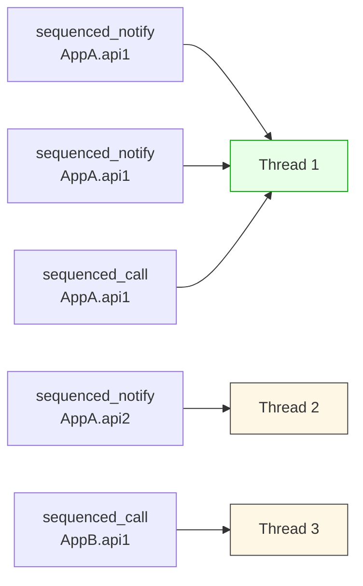
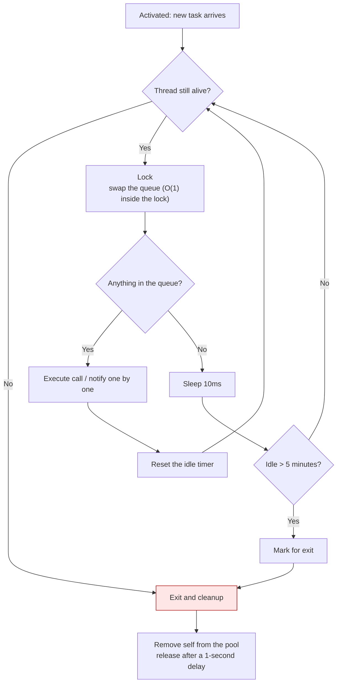

# LF_Sequenced_FIFO.md

> Chinese version: [LF_Sequenced_FIFO.md](LF_Sequenced_FIFO.md)

> The `Sequenced_*` family is the only calling convention in LF that carries an ordering guarantee.
>
> But what it guarantees is **not global FIFO** — it is **FIFO at a certain granularity**. This note explains that granularity and the thread model behind it, along with a detail that is easily misread from the comments.

---

## The essence in one sentence

FIFO is not achieved by queueing; it is achieved by **"each `(App, API)` pair owning an exclusive thread"**.



All Sequenced requests for the same `(App, API)` enter one thread's queue; the queue is FIFO, hence the ordering guarantee. Different `(App, API)` pairs each get their own thread and never block one another.

The design is convenient — no global lock, no complex dependency-graph scheduling, just hash the key onto a thread. The cost is a potentially large thread count (every active `(App, API)` pair occupies a thread), so idle threads are reclaimed after 5 minutes.

---

## How the key is composed

The key is `App.Name + '.' + apiName`.

Note a detail: **the key contains neither UID nor P2PName**. That means `uid_sequenced_notify` and `p2pname_sequenced_notify` follow the same key logic — they still end up partitioned by `(App, API)`. UID and P2PName only determine how a request is routed to the target client; they have nothing to do with thread grouping.

---

## What FIFO actually guarantees

This is where people trip up most often. The table spells it out:

| Scenario | FIFO? | Why |
|------|:------:|--------|
| `sequenced_notify` for the same `(App, API)` | ✅ | Same thread, same queue |
| `sequenced_call` for the same `(App, API)` | ✅ | Same as above |
| `sequenced_notify` and `sequenced_call` mixed for the same `(App, API)` | ✅ | Both use **the same thread** but **different queues** — see below |
| `uid_sequenced_*` for the same UID | ✅ | Inherits the row above; when routed to the same UID they stay on the same `(App, API)` thread |
| `p2pname_sequenced_*` for the same P2PName | ⚠️ | FIFO per `(p2p_name, api)` pair, **but p2p load balancing may distribute requests to different UIDs and thus different clients** |
| Between different `(App, API)` pairs | ❌ | Different threads, naturally concurrent |
| Mixing `sequenced_notify` with plain `notify` | ❌ | Plain notify does not use the sequenced thread pool |

**The ⚠️ on the third row deserves its own explanation**: `sequenced_notify` uses the `Notify Sequence Thread Pool` while `sequenced_call` uses the `Call Sequence Thread Pool`. The two pools are separate, and **for the same `(App, API)` pair each pool has its own thread**. That is, if you send a `sequenced_notify` and then a `sequenced_call`, they enter two different threads' queues with **no ordering guarantee between them**.

FIFO holds only "within one function family". Mix them and which thread finishes first is anyone's guess.

This is a very common cause when people investigate "I used Sequenced, why is the order still scrambled".

### C++ side: explicitly stay in one family

```cpp
// ✅ Correct: all in the sequenced_call family
lingofuse::sequencedCall("Worker", req1, 3000);
lingofuse::sequencedCall("Worker", req2, 3000);
lingofuse::sequencedCall("Worker", req3, 3000);
// All three are guaranteed FIFO

// ✅ Correct: all in the sequenced_notify family
lingofuse::sequencedNotify("Worker", n1);
lingofuse::sequencedNotify("Worker", n2);
// Both notifications are guaranteed FIFO

// ❌ Wrong: mixed, no ordering guarantee
lingofuse::sequencedNotify("Worker", n1);
lingofuse::sequencedCall("Worker", req1, 3000);   // separate thread
lingofuse::sequencedNotify("Worker", n2);         // same thread as n1, but unordered vs req1
```

### Python side: explicitly stay in one family

```python
# ✅ Correct: all in the sequenced_call family
lf.sequenced_call("Worker", req1, 3000)
lf.sequenced_call("Worker", req2, 3000)
lf.sequenced_call("Worker", req3, 3000)

# ✅ Correct: all in the sequenced_notify family
lf.sequenced_notify("Worker", n1)
lf.sequenced_notify("Worker", n2)

# ❌ Wrong: mixed, no ordering guarantee
lf.sequenced_notify("Worker", n1)
lf.sequenced_call("Worker", req1, 3000)
lf.sequenced_notify("Worker", n2)
```

---

## Once the thread is running

The main loop of a sequenced thread does just three things: **swap the queue, process, check idleness**.



**Swapping the queue** is the key step: inside the lock it replaces the pending queue wholesale with an empty temporary object, then processes it leisurely outside the lock. That way the producer (`sequenced_notify`) is never blocked by the consumer. This "swap the pointer inside the lock, work outside the lock" pattern is everywhere in LF — see `LF_SwapUnderLock.md`.

---

## That 1 second vs 5 minutes thing

Two numbers appear in the source and must be told apart:

- **5 minutes**: how long a thread may sit without work — idle beyond 5 minutes and it is marked for exit.
- **1 second**: how long after "quitting time" the lights stay on — once marked for exit the thread immediately walks the cleanup path, and after cleanup releases its own object after a 1-second delay.

These two happen in sequence; it is not "1 more second of usability after shutdown". Once a thread starts exiting it enters cleanup immediately; the 1 second is only a window for the runtime to finish writing state bits so that external observers (if any) can see "this thread has exited".

One detail worth noticing: **1 second, not 5 seconds**. I have seen inconsistent descriptions across document versions. **The source is authoritative — the delayed release is 1 second.**

---

## That race condition

There is a subtle race between the sequenced thread's destruction path and its own "have I already exited" check, worth mentioning.

On exit the thread must decide "do I still need to remove myself from the pool":

```
// Thread exit path (check without lock)
if (internal_queue_data != null) and (internal_queue_pool != null) then
    lock(internal_queue_pool)
    try remove(internal_queue_pool, internal_queue_data)
    finally unlock(internal_queue_pool)
```

Meanwhile the "destroy the App" path **takes a lock** and nulls those two fields:

```
// Destroy path (null out under lock)
lock(queue.critical)
try
    queue.internal_queue_pool := null
    queue.internal_queue_data := null
finally unlock(queue.critical)
```

**The problem**: the exit path checks `internal_queue_pool != null` **without holding the lock**. In theory the destroy path could null the pointer after that check but before the `lock`, and then `lock(internal_queue_pool)` would call a method on null — a crash.

This is a low-probability event needing a particular thread-scheduling interleaving. Practical mitigations:

- **Make sure the sequenced threads have stopped before releasing the App** (e.g. the application is exiting normally rather than being killed mid-run)
- **Avoid creating and destroying Apps frequently under heavy concurrency**

It does not guarantee the race can never happen, but it is sufficient for ordinary lifecycles.

---

## Pitfall quick reference

| Symptom | Root cause | Fix |
|------|------|------|
| `sequenced_notify` and `sequenced_call` mixed, order scrambled | They use different pools with one thread each | Do not mix; use either all notify or all call |
| `p2pname_sequenced_*` order scrambled | p2p load balancing sends requests to different UIDs | Use `uid_sequenced_*` when strict order is required |
| Thread count explodes | Too many active `(App, API)` pairs | Reduce the number of Apps or merge APIs |
| One API jams the whole chain | A callback for that `(App, API)` blocks | Do short work inline, move long work elsewhere |
| Believing "a 5-second window remains after the thread exits" | Misread comments | The 1-second release concerns the object; no reference survives after exit |
| Crash when destroying Apps under heavy concurrency | Exit path checks pointers without a lock | Avoid concurrent App destruction |

---

## Final word

The `Sequenced_*` design is actually clear: **trade one thread for the ordering guarantee of one `(App, API)` pair**. Once you get this, every boundary follows —

- Within one key, order is stable
- Between different keys, concurrency is natural
- The key contains no UID, so the UID and P2PName Sequenced variants are still fundamentally `(App, API)`-level FIFO

When you need a stronger guarantee — say "global order for one API across all UIDs" — this model cannot give it. LF's answer is to target a single client by UID and then use Sequenced: turning "global order" into "order on a single target" reduces the problem to the one it already solved.


