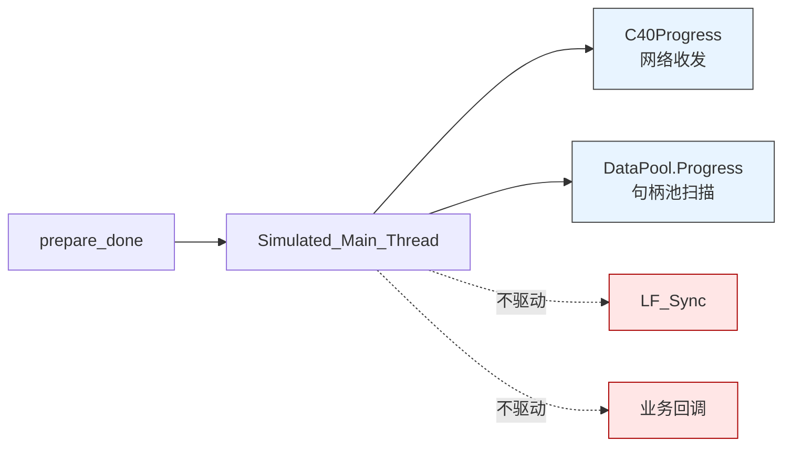
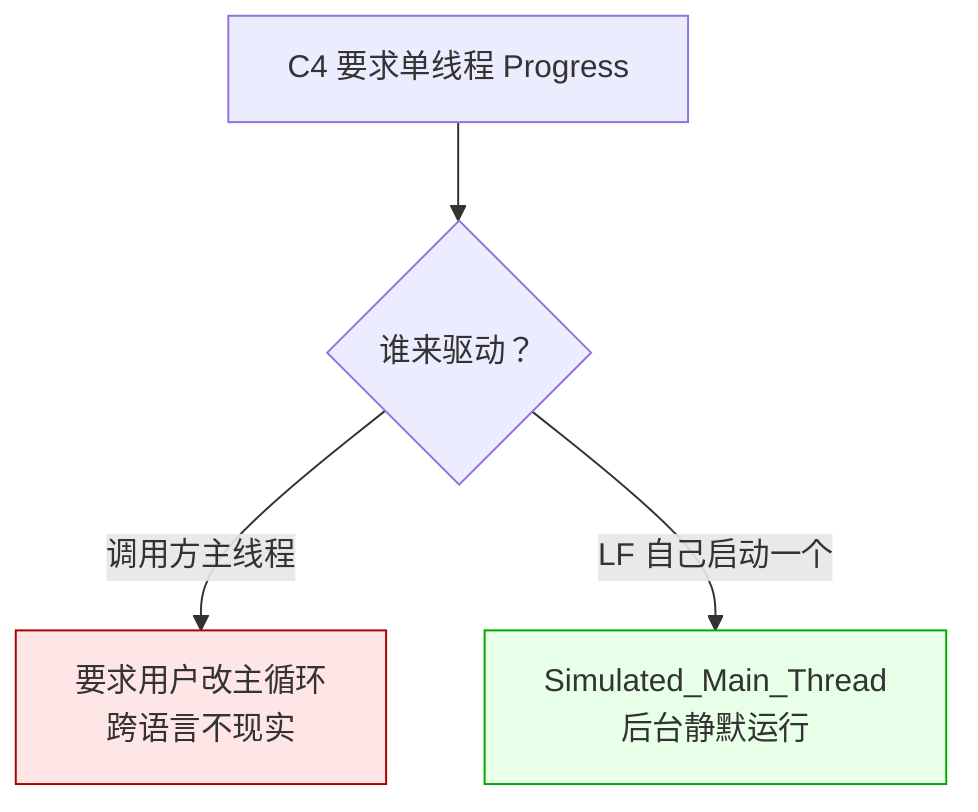
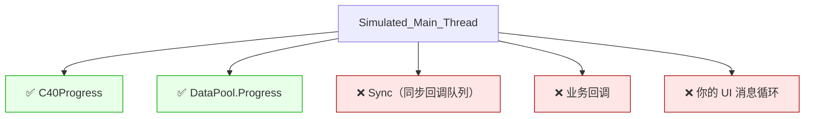
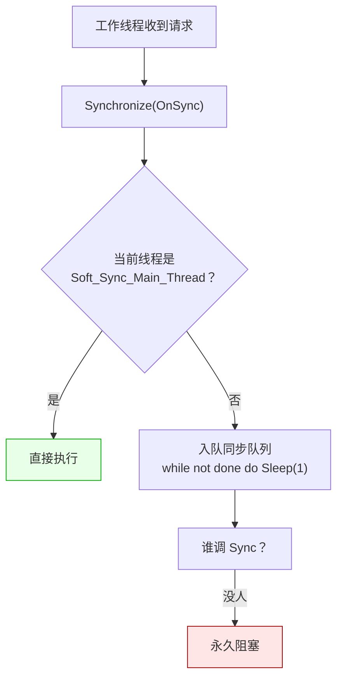

# LF_Simulated_Main_Thread.md

> LF 有一个自己的"主线程"。
>
> 它不是你程序启动时的那个主线程，也不是 UI 线程，而是 `prepare_done` 在内部造出来的一个**独立 OS 线程**。这一篇说清它到底干什么、不干什么，以及为什么同步回调永远不会自己跑起来。

---

## 一句话本质

`prepare_done` 启动一个后台线程，它**只做两件事**：驱动 C4 网络收发，驱动数据句柄池扫描。



**业务回调不在这里跑**。所有 Call / Notify / AsyncResult / 网络事件回调都在工作线程或顺序线程里执行。模拟主线程只是"网络和句柄的后台清洁工"。

---

## 为什么要自己造一个"主线程"

这是 LF 的一个核心取舍，得讲清楚。

C4 那一层（LF 的分布式网络层）是**单线程 Progress 驱动**的。它所有的状态机——握手、命令分发、路由、负载均衡——都假设"有一个线程在定期调 Progress"。这个假设简化了整个 C4 的实现，不用到处加锁。

问题是，LF 要作为一个**动态库**被 C#、Python、Rust、Julia 这些语言调用。调用方的程序有它自己的主循环——可能是 WinForms 的 `Application.Run`、可能是 asyncio 的 `event_loop`、可能是 R 的 REPL。**LF 不可能要求调用方"你们把主循环改成定期调 Progress"**——那不是一个库该有的要求。

于是就有了这个选择：



**代价**：进程里多了一个线程，而且它不是你的主线程，它不知道你的 UI 框架、你的 GC、你的 event loop。
**收益**：调用方完全不用关心 C4 的驱动细节，`prepare_done` 返回后网络就自己跑起来了。

---

## 它到底在循环什么

主循环短得吓人，抽象出来就三行：

```
while simulated_main_thread_running:
    C40Progress(if_(LF_RunningCount > 0, 1, 10))
    LF_DataPool.Progress()
```

`C40Progress` 里面挂了所有 C4 的进度：命令分发、Sequence Packet 处理、定时器回调、P2P 隧道进度。`DataPool.Progress` 就是那个每 5 秒扫一次句柄池、处理超时/删除的活。

`if_(LF_RunningCount > 0, 1, 10)` 是个小优化：有回调正在跑的时候 1ms 循环（保证网络响应及时），空闲的时候 10ms 循环（省 CPU）。

---

## 它**不**做的三件事

这一部分最重要。看源码会发现，很多"应该自动做"的事，模拟主线程压根没做：



**`Sync` 不在里面**。这一点很多人第一次遇到时想不通——"模拟主线程不是应该把一切都驱动吗，为什么同步回调永远不执行"。

因为 `Sync` 的设计前提是"**在主线程上调用**"。它内部的检查会验证当前线程是不是"软同步主线程"，不是就直接返回 0。模拟主线程虽然是"名义上的主线程"，但"软同步主线程"的标记是在**第一次调用 `Synchronize` 时惰性设置**的——到底哪个线程能成为"主线程"，取决于谁先调。

如果模拟主线程从不主动调 `Sync`，那这个标记就永远不会被设成它。要么你外部调，要么第一次注册同步回调的工作线程就成了"主线程"——这就乱套了。

---

## 同步回调的困境

注册同步回调时，走的是"软同步工具"的 `Synchronize`：



如果外部不调 `Sync`，工作线程就会在等待循环里**永久睡下去**。这个工作线程从此无法处理任何其他任务，线程池慢慢被耗尽，最终整个 LF 无响应。

**LF 自己不会调 `Sync`**。这是设计要求——同步回调意味着"回到调用方的主线程执行"，LF 不知道你的主线程是什么框架，它不可能替你做这件事。

---

## 各语言里怎么做

调用方必须自己起一个主循环，在里面定期调 `Sync`。各个语言的套路不一样：

| 语言 | 主循环形态 |
|------|-----------|
| **C++** | `while (running) { lingofuse::sync(); std::this_thread::sleep_for(10ms); }` |
| **Python** | `while running: lf.sync(); time.sleep(0.01)` |
| C# | `while (running) { Framework.Sync(); Thread.Sleep(10); }`（或 WinForms 定时器里调） |
| Rust | 主循环里 `framework::sync();` |
| Go | `for running { lingofuse.Sync(); time.Sleep(10*time.Millisecond) }` |
| Node.js / TS | `setInterval(() => framework.sync(), 10)` |
| Java | 主循环里 `Framework.sync();` |
| Swift | 主循环里 `Framework.sync()` |
| Ruby | `until stop; Lingofuse::Framework.sync; sleep(0.01); end` |
| Erlang | BEAM 进程循环里 `'LF_Sync'()` |
| Julia | `while running; LF_Sync(); sleep(0.01); end` |
| R | `while (running) { .Call("LF_Sync"); later::run_now(0.01) }` |
| Pascal | `while Running do begin LF.Sync; Check_Soft_Thread_Synchronize(10); Sleep(10); end;` |

几乎每一种语言都有一行"用户在主循环里调 `Sync`"的示范代码，但用户经常忽略这行。最后的表现就是——**同步回调注册的回调永远不执行，而且没有任何错误提示**（因为工作线程只是安静地在等待循环里睡）。

### C++ 完整主循环示例

```cpp
#include <lingofuse/LingoFuse.hpp>
#include <atomic>
#include <chrono>
#include <thread>

std::atomic<bool> g_running{true};

int main() {
    // ... 创建 App、注册同步回调、prepare_done ...

    // ★ 关键：主循环必须定期调 sync()
    while (g_running.load()) {
        lingofuse::sync();                                  // 驱动同步回调队列
        std::this_thread::sleep_for(std::chrono::milliseconds(10));
    }

    lingofuse::exitMainThread();
    lingofuse::shutdown();
    return 0;
}
```

### Python 完整主循环示例

```python
import time

running = True

# ... 创建 App、注册同步回调、prepare_done ...

# ★ 关键：主循环必须定期调 sync()
while running:
    lf.sync()                # 驱动同步回调队列
    time.sleep(0.01)
```

---

## 一点技巧：模拟主线程能替你吗

能，只要你让模拟主线程跑起来。

有一种做法是把 `Sync` 塞到模拟主线程里，但那不现实——模拟主线程是 LF 内部代码，你改不了。

另一种做法是用 `set_option` 里的一些选项去调，但那些选项管的是别的（比如 `Wait_Connection_ReadyOk`），不涉及 `Sync` 的驱动。

所以答案是不行。**`Sync` 必须外部驱动**。这是 LF 的一个明确的边界——"我提供机制，你负责驱动"。

如果真的想省事，可以这样做：**不用同步回调**。`register_call` / `register_notify` 用普通版本，回调落在工作线程上，然后在回调内部自己把 UI 操作编组回你的主线程（`std::thread::queue` / `Dispatcher.Invoke` / `setImmediate` / `future::schedule` 之类）。这是各语言自己的机制，比 LF 提供的同步回调更灵活，因为你完全掌握什么时候切、切到哪个线程。

### C++ 侧：不用同步回调、自己编组回 UI 线程

```cpp
// 注册普通回调（跑在工作线程）
app.registerCall("update_status", "update UI label",
    [](lingofuse::DataHandle& in, lingofuse::DataHandle& out) {
        std::string text = in.read<std::string>();

        // 把 UI 操作投递到主线程（用你自己的 UI 框架）
        ui_thread::queue([text] {
            my_label->set_text(text);       // 只在主线程执行
        });

        out.write<uint8_t>(0x00);           // 立即返回成功
    });
```

### Python 侧：不用同步回调、自己编组回 UI 线程

```python
import asyncio
import tkinter as tk

loop = asyncio.get_event_loop()

def update_status_handler(inp, out):
    text = inp.read_string()

    # 把 UI 操作投递到 Tk 主线程
    root.after(0, lambda: label.config(text=text))

    out.write_uint8(0x00)

app.register_call("update_status", "update UI label", update_status_handler)
```

---

## 陷阱速查

| 症状 | 根因 | 修复 |
|------|------|------|
| 同步回调永远不执行 | 主循环没调 `Sync` | 主循环定期调 `Sync` |
| 工作线程慢慢耗尽 | 同步回调堆在队列里没人处理 | 同上 |
| 主循环里调了 `Sync` 还是卡住 | 第一次调 `Sync` 的线程和工作线程不是同一个 | 确保真正的主线程先调一次 |
| 以为 `prepare_done` 后什么都会自动跑 | 模拟主线程不驱动 `Sync` | 手动驱动 |
| UI 卡顿 | 在模拟主线程上跑重活 | 模拟主线程只处理 C4 网络，别加业务代码 |
| `exit_main_thread` 后仍有回调触发 | 模拟主线程退出后，工作线程可能还在收尾 | 按 `exitMainThread → app.dispose → shutdown` 顺序清理 |

---

## 最后一句

模拟主线程这个概念，说穿了就是"**LF 内部造了一个线程，专门伺候 C4 网络**"。它不是你的主线程，也不假装是你的主线程，它只是一个**带明确边界**的后台 worker。

理解了这一点，很多困惑就散了——

- **网络会自己跑**：因为模拟主线程在驱动 C4
- **句柄会自己回收**：因为模拟主线程在驱动 `DataPool.Progress`
- **同步回调不会自己跑**：因为模拟主线程**故意不**驱动 `Sync`
- **业务回调不在模拟主线程上**：因为它们都在工作线程里

把"该自动的"和"必须手动驱动"的界线记住，剩下的都不会踩坑。
