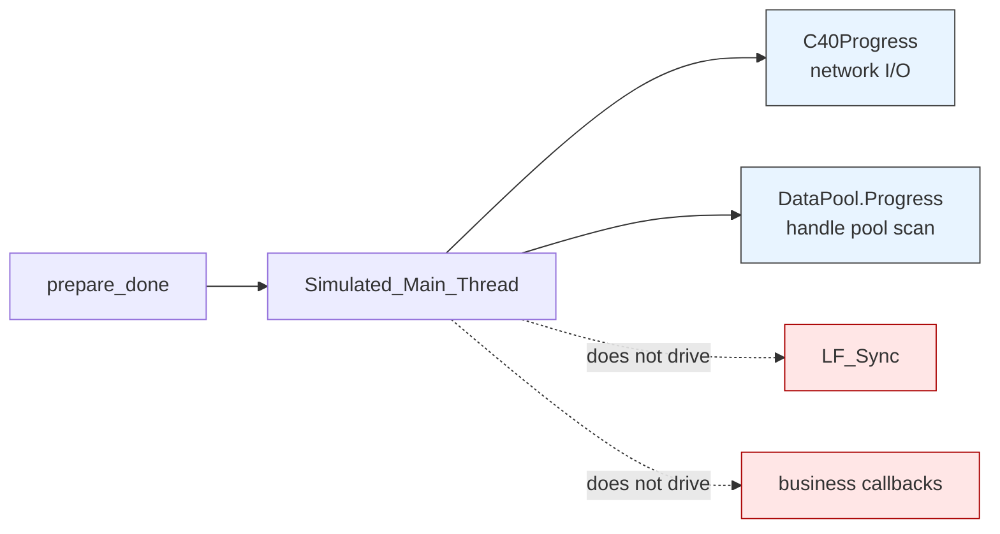
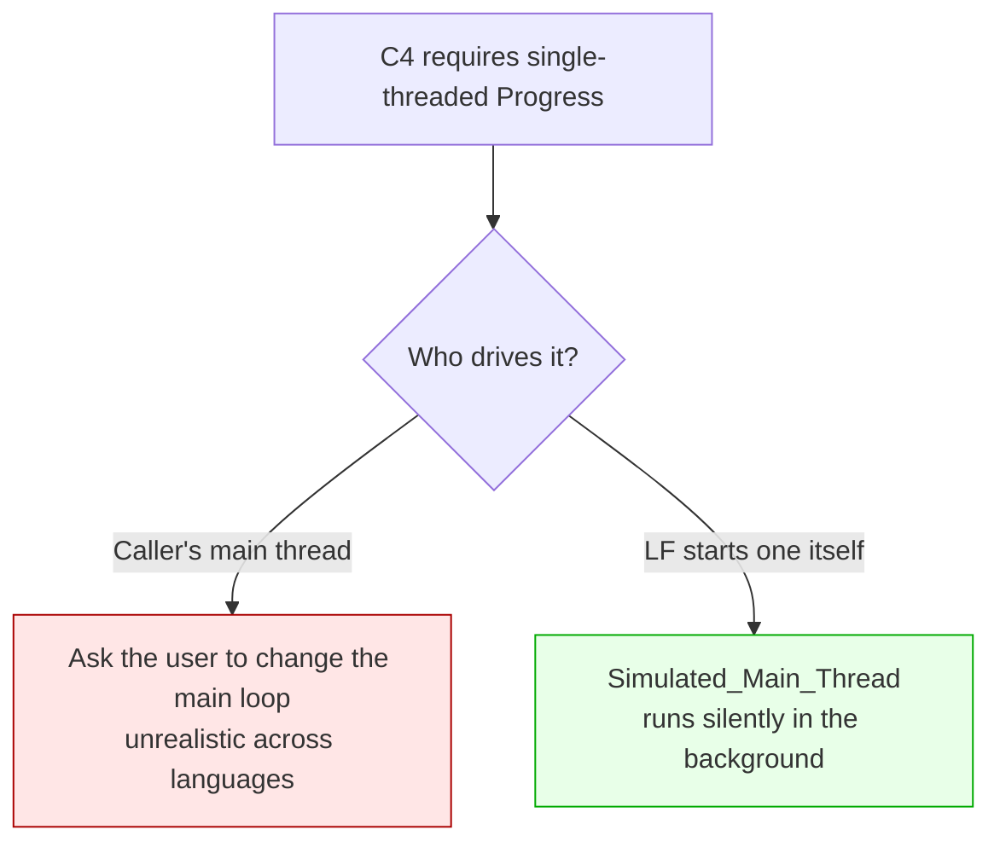
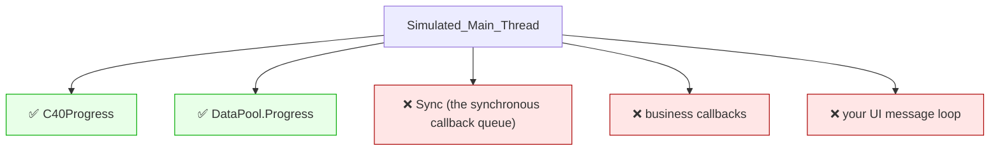
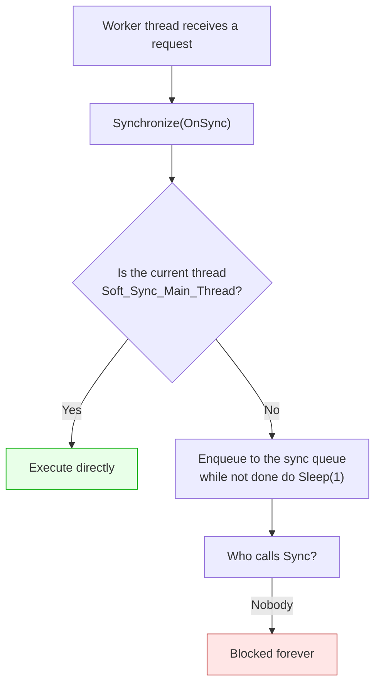

# LF_Simulated_Main_Thread.md

> Chinese version: [LF_Simulated_Main_Thread.md](LF_Simulated_Main_Thread.md)

> LF has a "main thread" of its own.
>
> It is not the main thread your program starts with, nor a UI thread — it is a **standalone OS thread** that `prepare_done` creates internally. This note explains exactly what it does and does not do, and why synchronous callbacks never run by themselves.

---

## The essence in one sentence

`prepare_done` starts a background thread that **does only two things**: drive C4 network I/O and drive the data-handle pool scan.



**Business callbacks do not run here**. All Call / Notify / AsyncResult / network-event callbacks execute on worker threads or sequenced threads. The simulated main thread is only the "background janitor of the network and handles".

---

## Why build a "main thread" at all

This is a core LF trade-off worth explaining.

The C4 layer (LF's distributed networking layer) is **driven by a single-threaded Progress loop**. Every state machine in it — handshakes, command dispatch, routing, load balancing — assumes "some thread periodically calls Progress". That assumption simplifies the whole C4 implementation, so locks need not be sprinkled everywhere.

The problem is that LF must be called as a **dynamic library** from C#, Python, Rust, Julia and others. The caller's program has its own main loop — maybe WinForms' `Application.Run`, maybe asyncio's `event_loop`, maybe R's REPL. **LF cannot ask callers to "change your main loop to call Progress periodically"** — that is not something a library should demand.

Hence this choice:



**Cost**: one more thread in the process, and it is not your main thread — it knows nothing about your UI framework, your GC or your event loop.
**Benefit**: the caller need not care about C4 driving details at all; once `prepare_done` returns the network runs by itself.

---

## What it actually loops over

The main loop is shockingly short; abstracted, it is three lines:

```
while simulated_main_thread_running:
    C40Progress(if_(LF_RunningCount > 0, 1, 10))
    LF_DataPool.Progress()
```

`C40Progress` hangs all C4 progress off it: command dispatch, Sequence Packet handling, timer callbacks, P2P tunnel progress. `DataPool.Progress` is that job scanning the handle pool every 5 seconds and handling timeouts/deletions.

`if_(LF_RunningCount > 0, 1, 10)` is a small optimization: loop at 1 ms while callbacks are running (keeping network response timely) and at 10 ms when idle (saving CPU).

---

## The three things it does **not** do

This part matters most. Reading the source reveals that many things "that ought to happen automatically" the simulated main thread simply never does:



**`Sync` is not in there**. Many people find this incomprehensible the first time — "isn't the simulated main thread supposed to drive everything, why do synchronous callbacks never execute".

Because `Sync` is designed on the premise of "**being called on the main thread**". Its internal check verifies whether the current thread is the "soft-sync main thread" and returns 0 if not. The simulated main thread is a "main thread in name", but the "soft-sync main thread" marker is set **lazily on the first call to `Synchronize`** — which thread becomes "the main thread" depends on who calls first.

If the simulated main thread never calls `Sync` on its own, the marker will never be set to it. Either you call it externally, or the first worker thread that registers a synchronous callback becomes "the main thread" — and that is a mess.

---

## The plight of synchronous callbacks

Registering a synchronous callback goes through the "soft sync tool" `Synchronize`:



If nobody calls `Sync` externally, the worker thread **sleeps forever** in the wait loop. That worker can then handle no other task, the thread pool slowly drains, and eventually the whole of LF stops responding.

**LF never calls `Sync` itself**. That is by design — a synchronous callback means "execute back on the caller's main thread", and LF has no idea what framework your main thread uses; it cannot do that for you.

---

## How to do it in each language

The caller must run a main loop and call `Sync` periodically inside it. Each language has its own idiom:

| Language | Main loop shape |
|------|-----------|
| **C++** | `while (running) { lingofuse::sync(); std::this_thread::sleep_for(10ms); }` |
| **Python** | `while running: lf.sync(); time.sleep(0.01)` |
| C# | `while (running) { Framework.Sync(); Thread.Sleep(10); }` (or call it from a WinForms timer) |
| Rust | `framework::sync();` inside the main loop |
| Go | `for running { lingofuse.Sync(); time.Sleep(10*time.Millisecond) }` |
| Node.js / TS | `setInterval(() => framework.sync(), 10)` |
| Java | `Framework.sync();` inside the main loop |
| Swift | `Framework.sync()` inside the main loop |
| Ruby | `until stop; Lingofuse::Framework.sync; sleep(0.01); end` |
| Erlang | `'LF_Sync'()` in the BEAM process loop |
| Julia | `while running; LF_Sync(); sleep(0.01); end` |
| R | `while (running) { .Call("LF_Sync"); later::run_now(0.01) }` |
| Pascal | `while Running do begin LF.Sync; Check_Soft_Thread_Synchronize(10); Sleep(10); end;` |

Nearly every language ships demo code with one line "the user calls `Sync` in the main loop", and users routinely overlook it. The visible outcome: **the callbacks registered as synchronous callbacks never execute, with no error at all** (because the worker thread merely sleeps quietly in the wait loop).

### Complete C++ main loop example

```cpp
#include <lingofuse/LingoFuse.hpp>
#include <atomic>
#include <chrono>
#include <thread>

std::atomic<bool> g_running{true};

int main() {
    // ... create App, register synchronous callbacks, prepare_done ...

    // ★ Key: the main loop must call sync() periodically
    while (g_running.load()) {
        lingofuse::sync();                                  // drives the synchronous callback queue
        std::this_thread::sleep_for(std::chrono::milliseconds(10));
    }

    lingofuse::exitMainThread();
    lingofuse::shutdown();
    return 0;
}
```

### Complete Python main loop example

```python
import time

running = True

# ... create App, register synchronous callbacks, prepare_done ...

# ★ Key: the main loop must call sync() periodically
while running:
    lf.sync()                # drives the synchronous callback queue
    time.sleep(0.01)
```

---

## A trick: can the simulated main thread do it for you

It can — if you make the simulated main thread run it.

One idea is to put `Sync` into the simulated main thread, but that is not realistic — the simulated main thread is LF-internal code you cannot modify.

Another idea is to use some option in `set_option`, but those options govern other things (such as `Wait_Connection_ReadyOk`) and have nothing to do with driving `Sync`.

So the answer is no. **`Sync` must be driven externally**. This is an explicit boundary of LF — "I provide the mechanism, you drive it".

If you really want to save trouble, do this: **skip synchronous callbacks**. Use the plain versions of `register_call` / `register_notify` so callbacks land on worker threads, then marshal UI operations back to your own main thread inside the callback (`std::thread::queue` / `Dispatcher.Invoke` / `setImmediate` / `future::schedule` and the like). That is your language's own mechanism and more flexible than LF's synchronous callbacks, because you fully control when to switch and to which thread.

### C++ side: no synchronous callbacks, marshal back to the UI thread yourself

```cpp
// Register a plain callback (runs on a worker thread)
app.registerCall("update_status", "update UI label",
    [](lingofuse::DataHandle& in, lingofuse::DataHandle& out) {
        std::string text = in.read<std::string>();

        // Post the UI operation to the main thread (using your own UI framework)
        ui_thread::queue([text] {
            my_label->set_text(text);       // executes only on the main thread
        });

        out.write<uint8_t>(0x00);           // return success immediately
    });
```

### Python side: no synchronous callbacks, marshal back to the UI thread yourself

```python
import asyncio
import tkinter as tk

loop = asyncio.get_event_loop()

def update_status_handler(inp, out):
    text = inp.read_string()

    # Post the UI operation to the Tk main thread
    root.after(0, lambda: label.config(text=text))

    out.write_uint8(0x00)

app.register_call("update_status", "update UI label", update_status_handler)
```

---

## Pitfall quick reference

| Symptom | Root cause | Fix |
|------|------|------|
| Synchronous callbacks never execute | The main loop never calls `Sync` | Call `Sync` periodically in the main loop |
| Worker threads slowly drain | Sync callbacks pile up in the queue unprocessed | Same as above |
| Still stuck even after calling `Sync` in the main loop | The first thread to call `Sync` was not the same as the worker | Make sure the real main thread calls it once first |
| Assuming everything runs automatically after `prepare_done` | The simulated main thread does not drive `Sync` | Drive it manually |
| UI stutters | Heavy work running on the simulated main thread | The simulated main thread only handles C4 networking; add no business code |
| Callbacks still firing after `exit_main_thread` | Worker threads may still be winding down after the simulated main thread exits | Clean up in the order `exitMainThread → app.dispose → shutdown` |

---

## Final word

The concept of the simulated main thread is simply "**LF builds a thread internally to serve C4 networking**". It is not your main thread and does not pretend to be; it is only a background worker **with an explicit boundary**.

With that understood, much of the confusion dissolves —

- **The network runs by itself**: because the simulated main thread drives C4
- **Handles are reclaimed by themselves**: because the simulated main thread drives `DataPool.Progress`
- **Synchronous callbacks do not run by themselves**: because the simulated main thread **deliberately does not** drive `Sync`
- **Business callbacks are not on the simulated main thread**: because they all live on worker threads

Remember the line between "what should be automatic" and "what must be driven manually", and the rest of the pitfalls disappear.


