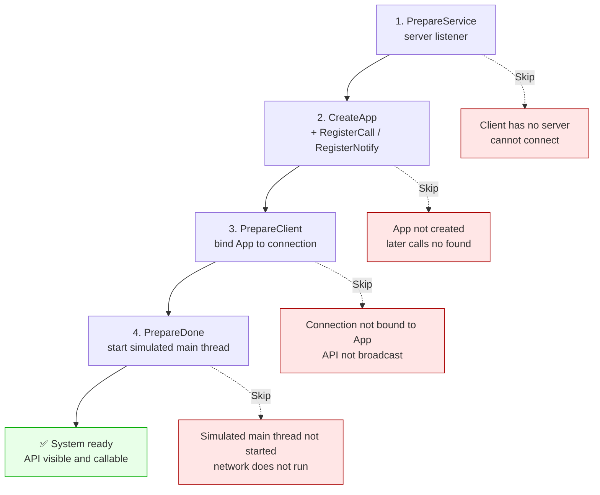

# LF_Startup_Order.md

> Chinese version: [LF_Startup_Order.md](LF_Startup_Order.md)

> LF's startup order **must not be scrambled**, and the consequence of scrambling it is **silent failure** — no error, no crash, just "the connection is up but calls never work".
>
> The correct order is `PrepareService` → create App + register APIs → `PrepareClient` → `PrepareDone`. Among these four, `PrepareClient` must come **after** App creation, because it needs to know which App to bind the connection to; `PrepareDone` must come last, because once it starts the simulated main thread the earlier configuration is frozen. The most common symptom of a wrong order is "TunnelLink succeeds, but the peer's calls to my API always return no found".

| Wrong order | Symptom |
|---------|------|
| `PrepareClient` before `CreateApp` | The connection is established but no App is bound to it, so the API list is empty |
| `RegisterCall` after `PrepareClient` | Registration succeeds, but registrations made before `PrepareDone` do not trigger an immediate broadcast and clients cannot see them |
| `PrepareDone` before `PrepareClient` | When the simulated main thread starts there is no client yet; `Wait_Connection_ReadyOk` waits on an empty connection and then times out |
| `PrepareDone` first, then `CreateApp` | A late-registered App must wait for the 1-second `DoChange` broadcast cycle; do not expect immediate visibility |

**Why this order**: `PrepareService` and `PrepareClient` merely register "which connections to create" in `AppHnd_Bind_Tag_List`; `PrepareDone` is the moment those connections are actually started, the simulated main thread is spun up, and C4 runs. So before `PrepareDone`, the registered Apps / APIs / clients are all just **registration state** with no real effect. Only after `PrepareDone` does the system enter "runtime", where registered items get broadcast and can be routed to.

**One consequence**: when deploying a distributed system you cannot control the startup order of clients and servers. If the client starts first while the server is not up yet, `PrepareDone` with `Wait_Connection_ReadyOk=True` waits `Wait_Connection_Timeout` (default 30 seconds) and then returns 0. At that point either restart the client, or use `Wait_Connection_ReadyOk=False` so `PrepareDone` returns immediately and then poll for readiness yourself with `LF_CheckApp` / `LF_CheckApi`.

The latter is the standard practice in deployment environments — **do not bet on "you will be there when I come up"**, bet on "I will be up and can wait for you".

