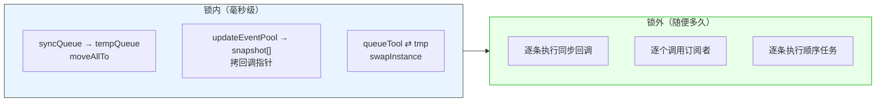

# LF_SwapUnderLock.md

> LF 内核里凡是"持锁遍历"，都不真在锁里遍历。
>
> 它总是先在锁内把整个队列**换成一个临时空容器**（`moveAllTo` / `swapInstance` / `snapshot` 拷贝），解锁后再慢慢处理临时容器里的东西。这个模式在 `Check_Synchronize`、`Do_LFRegEvent`、`Sequence_Thread.Do_Run_Th` 里反复出现，是 LF 里最统一的一处设计——**锁只负责"抢所有权"，不负责"干活"**。



| 你以为的 | 实际发生的 |
|---------|-----------|
| 持锁遍历队列，回调在锁里跑 | 锁里只换容器，回调全在锁外跑 |
| `moveAllTo` / `swapInstance` 是拷贝 | 都是 O(1) 换指针，不移动节点、不拷数据 |
| `snapshot` 是深拷贝回调对象 | 只拷 `OnUpdate` 函数指针到数组，不是对象 |
| 锁的粒度是"整批处理完" | 锁的粒度是"换指针"，通常几十个时钟周期 |

**为什么这样做**：因为回调里大概率会再次访问同一个容器。`OnUpdate` 里可能 `Subscribe_Update` / `Remove_Update`（改 `updateEventPool`），顺序任务里可能 `post_notify`（改 `queueTool`），同步回调里可能又触发新的 `Synchronize`（改 `syncQueue`）。如果持锁遍历，回调一访问自己就死锁。**换容器把"遍历"和"修改"解耦**——锁内换走的是旧容器的所有权，回调改的是新容器，两者互不干扰。

**代价**：峰值时刻内存里有两份容器。`tempQueue` 是个空 list、`snapshot` 是个指针数组、`tmp` 是个空 order struct——都不大，但是有。换来的收益是回调可以任意操作容器，不会死锁。

**一个后果**：`Do_LFRegEvent` 的回调里 `Remove_Update(self)` 是安全的，`Do_Run_Th` 的任务里 `post_notify2` 是安全的，`Check_Synchronize` 的同步回调里再 `Synchronize` 也是安全的。这些"看起来会死锁"的操作，都靠"锁内换容器"这一招撑住。反过来，如果在锁外遍历的过程中又有新东西入队，那批新东西只能等下一次循环——**这批不会丢，但也不会被当前这一轮处理**，所以高频回调会表现为"分批处理、永远慢一拍"。

---

## 这个模式长什么样

用 C++ 伪代码把这个模式的骨架画出来，比读文字更直观：

```cpp
// ─────────────────────────────────────────────────────────
// 反模式：持锁遍历（会死锁）
// ─────────────────────────────────────────────────────────
void bad_process() {
    std::lock_guard lk(mtx);
    for (auto& item : queue) {         // ← 遍历在锁内
        item.callback();                // ← 回调在锁内
        // 如果 callback 里调 subscribe() / unsubscribe()，
        // 它会试图拿同一把 mtx → 自死锁
    }
}

// ─────────────────────────────────────────────────────────
// 正确模式：锁内换容器，锁外干活
// ─────────────────────────────────────────────────────────
void good_process() {
    std::deque<Item> local;             // ← 本地临时容器

    // ① 锁内只做一件事：把 queue 整体换到 local
    {
        std::lock_guard lk(mtx);
        local.swap(queue);              // ← O(1)，不移动节点
    }

    // ② 锁外慢慢处理 local
    for (auto& item : local) {
        item.callback();                // ← 回调里可以随意拿锁
    }

    // local 析构时清空；queue 仍是空状态，等待下一批
}
```

Python 版本（Python 的 `list` 没有 `swap`，但可以用 `local = queue; queue = []` 来实现等价语义）：

```python
import threading

class SwapUnderLock:
    def __init__(self):
        self._mtx = threading.Lock()
        self._queue = []

    def enqueue(self, item):
        with self._mtx:
            self._queue.append(item)

    def process_all(self):
        # ① 锁内换容器：O(1)，只是换了引用
        with self._mtx:
            local, self._queue = self._queue, []

        # ② 锁外慢慢处理
        for item in local:
            item.callback()             # 回调里可以再 enqueue，不会死锁

    def subscribe(self, cb):
        with self._mtx:
            self._queue.append(Subscriber(cb))
```

---

## 三种换法

LF 里有三种"锁内换容器"的具体形态，各有用处：

### 形态 1：整个队列换走（`moveAllTo` / `swap`）

适用场景：**待处理的任务 / 事件 / 通知**。生产者持续入队，消费者定期整批取走。

```cpp
// C++ 侧的一个典型实现
void drain_queue() {
    std::deque<Task> local;
    {
        std::lock_guard lk(mtx);
        local.swap(queue);
    }
    for (auto& t : local) t.run();
}
```

```python
# Python 侧的一个典型实现
def drain_queue(self):
    with self._mtx:
        local, self._queue = self._queue, []
    for t in local:
        t.run()
```

**特点**：旧容器在锁内被清空，新来的任务进的是新容器，两批不冲突。这就是"分批处理"的来源。

### 形态 2：把回调指针拷贝成快照（`snapshot`）

适用场景：**订阅者池 / 观察者列表**。订阅者数量少，回调执行时间短，但回调里可能增删订阅者。

```cpp
void notify_all_observers() {
    std::vector<Observer*> snapshot;
    {
        std::lock_guard lk(mtx);
        snapshot.assign(observers.begin(), observers.end());  // ← 只拷指针
    }
    // 锁外调用
    for (auto* o : snapshot) {
        o->on_update();
        // 即使 on_update 里 unsubscribe 了某个观察者，也没关系——
        // 快照已经拷完了，这次遍历的名单不受影响
    }
}
```

```python
def notify_all_observers(self):
    with self._mtx:
        snapshot = list(self._observers)     # 只拷引用
    for o in snapshot:
        o.on_update()
```

**特点**：`snapshot` 是**浅拷贝**——只拷指针，不拷对象。这样即使回调里 `unsubscribe` 某个观察者，它也只是从主容器里移除，`snapshot` 里那份还在。当轮遍历会照常调用它，下一轮就不调了。这个语义很多事件系统都采用。

### 形态 3：整个容器换成一个空对象（`swapInstance`）

适用场景：**顺序线程的队列交换**（见 `LF_Sequenced_FIFO.md`）。生产端用 `post_*` 入队，消费端的线程用 `swap` 换走整个队列。

```cpp
// C++ 侧顺序线程的消费循环
void run_sequence_thread() {
    std::deque<Job> tmp;
    while (active) {
        {
            std::lock_guard lk(mtx);
            tmp.swap(jobs);               // 换走所有待处理任务
        }
        for (auto& j : tmp) j.execute();
        tmp.clear();
        std::this_thread::sleep_for(std::chrono::milliseconds(10));
    }
}
```

```python
# Python 侧顺序线程的消费循环
def run_sequence_thread(self):
    while self._active:
        with self._mtx:
            tmp, self._jobs = self._jobs, []
        for j in tmp:
            j.execute()
        time.sleep(0.01)
```

**特点**：`tmp` 是一个**长期存在的空容器**，每轮换走当前批次，处理完清空，下一轮再换。这是"每轮处理一批"模型的经典实现。

---

## 这个模式的副作用

### 副作用 1：新入队的任务"慢一拍"

这是最直接的表现。假设本轮开始时队列里有 100 个任务，锁内换走后，生产者又塞了 50 个进去。这一轮只处理换走的 100 个，那 50 个要等下一轮。

**表现**：高频回调会看到"分批处理，每批稳定，但入队到处理的延迟总有两轮"。这不是 bug，是这个模式的必然结果。

**缓解**：如果你需要"入队即处理"，别用整批换走模式，改用"锁内单独取出一个，锁外处理"的模式：

```cpp
// 每次取一个，处理完再取下一个
void drain_one_by_one() {
    while (true) {
        Task t;
        {
            std::lock_guard lk(mtx);
            if (queue.empty()) break;
            t = std::move(queue.front());
            queue.pop_front();
        }
        t.run();
    }
}
```

这样延迟更低，但每次都加锁解锁，吞吐略低。选哪个取决于你的场景。

### 副作用 2：峰值时刻有两份容器

锁内换走后，`local` 和 `queue` 同时存在——虽然 `queue` 是空的，但底层容器对象本身还在。对于 `std::deque`，这是两个独立对象；对于链表，只是两个头指针。内存开销很小，但要意识到它的存在。

### 副作用 3：遍历顺序与"当前真实顺序"可能不一致

如果你用的是 `moveAllTo` 把队列整体换走，那么 `local` 里的是"换走这一刻"的顺序。生产者在锁外继续入队的新任务，不在这个 `local` 里——它们的顺序是"新容器内的顺序"，跟旧批次无关。

对顺序线程来说这没问题（每批 FIFO 是独立的）；但如果应用层期望"全局 FIFO"，就要注意这个边界。

---

## 什么时候不该用这个模式

**不是所有持锁场景都适合换容器**。以下场景用普通锁就够了：

- **单次操作**：`lock(); do_one_thing(); unlock()`——没有遍历，不存在"遍历中修改"的问题
- **只读访问**：读一个计数器、读一个布尔状态——读锁或原子变量即可
- **容器极小且回调极短**：换容器的开销（分配临时容器、O(1) 换指针）可能比直接持锁跑还高

**判断标准**：问自己一句——**"回调里会不会再次访问这个容器？"** 会，就必须换；不会，普通锁就够了。

---

## 陷阱速查

| 症状 | 根因 | 修复 |
|------|------|------|
| 回调里调 `unsubscribe` 就死锁 | 持锁遍历 | 锁内换容器，锁外遍历 |
| 新任务"慢一拍"才被处理 | 整批换走的必然结果 | 接受，或改"每次取一个"模式 |
| 峰值内存翻倍 | 两份容器同时存在 | 正常，容器本身很小 |
| 遍历过程中新增的任务丢了 | 你以为锁外还会再扫一遍 | 不会；新任务等下一轮 |
| `snapshot` 里调用了已 `unsubscribe` 的观察者 | 快照是浅拷贝 | 这是设计语义，不是 bug |
| 换成"每次取一个"后吞吐降了 | 每次加锁解锁 | 权衡延迟 vs 吞吐 |

---

## 最后一句

LF 内核里这个"锁内换容器"的模式，表面上看是为了避免死锁，实质上是把**"谁拥有这批数据"**这件事从"锁"里分离出来——锁只负责**抢所有权**（O(1) 交换），处理本身在锁外，谁也不挡谁。

理解了这一点，再看 LF 里所有涉及锁的地方，你会发现它们都长得一样：**锁内换指针，锁外慢慢干**。
